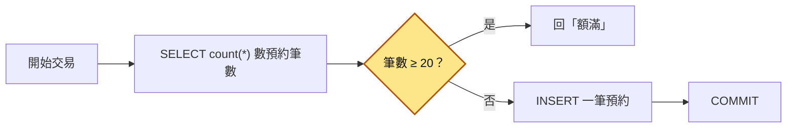
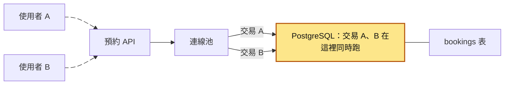
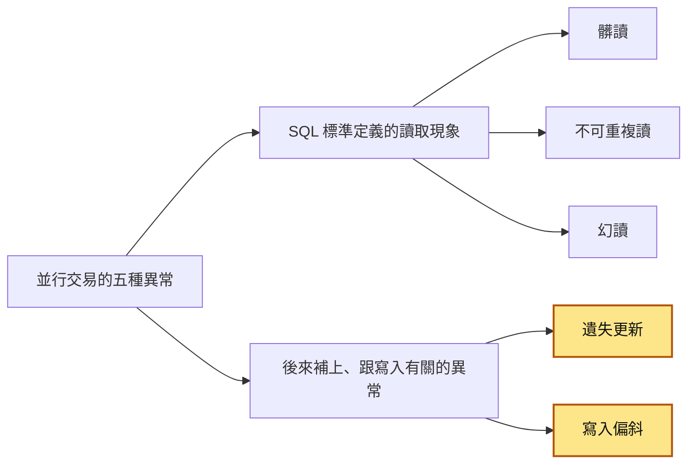
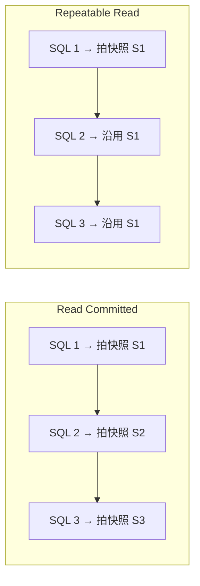
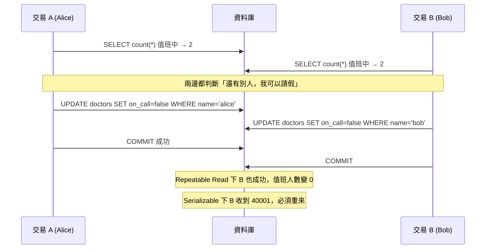
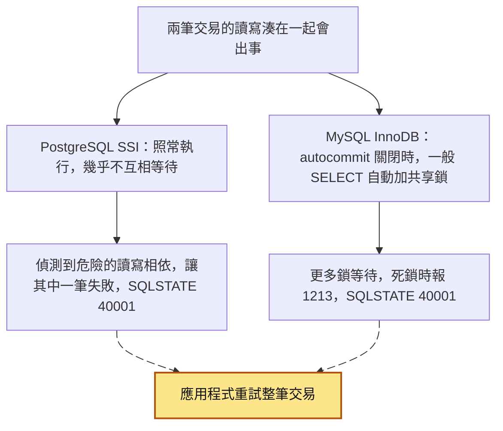
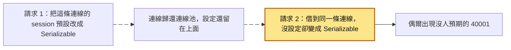

# 05｜隔離等級（Isolation Levels）

> 隔離等級（isolation level）是[交易](03-資料庫交易.md)（一組要嘛全部成功、要嘛全部取消的 SQL）的一項設定，決定同時在跑的交易彼此能看到、能影響對方多少。等級越高，結果越不容易出錯，但交易也越容易互相等待，或被資料庫要求整筆重來。

**難度**：★★☆　**閱讀時間**：約 20 分鐘　**前置知識**：[競爭條件](01-競爭條件.md)、[資料庫交易](03-資料庫交易.md)、[ACID 特性](04-ACID%20特性.md)

## 核心問題與理念

**它要解決的問題**：健身房熱門課上限 20 人，開放預約時幾百人同時搶。每個預約請求都先數到「已經 19 人」，覺得還有位子就各自新增一筆預約，最後一堂課收了 23 人；有人把隔離等級拉高到 Repeatable Read（整筆交易從頭到尾都看同一份資料），下週還是照樣超賣（下面的情境會完整走一遍）。

**核心理念**：先弄清楚要防的是哪一種錯，再挑擋得住它的那一級。

**想通的那一步**：

- **卡住的地方**：直覺的做法是把隔離等級拉高到 Repeatable Read，讓每筆交易都看開頭拍下的同一張快照（交易在某個時間點看到的資料內容）。它卡在 PostgreSQL 的 Repeatable Read 只在「兩筆交易改到同一列」時判定衝突，而搶課的每個交易新增的都是不同的列（資料表裡不同的幾筆資料），資料庫找不到衝突，照樣讓它們全部成功。
- **火花**：Serializable（最嚴格的一級）除了看有沒有改到同一列，還記下「誰讀過哪些資料」：A 讀過的被 B 改了、B 讀過的也被 A 改了，讀寫關係繞成一個圈，就叫其中一筆整個重來。這樣連「各自寫不同列、合起來破壞規則」的情況也抓得到。

| 等級 | 解決什麼 | 核心想法 |
|---|---|---|
| Read Uncommitted | 幾乎什麼都不防（PostgreSQL 把它當成 Read Committed） | 別人還沒定案的修改也看得到 |
| Read Committed | 讀到別人還沒提交、後來又取消的資料 | 每句 SQL 都看當下已經提交的資料 |
| Repeatable Read | 同一筆交易裡前後讀到的不一樣 | 整筆交易都看開頭拍的那一張快照 |
| Serializable | 各自檢查都通過、合起來卻破壞規則（例如課程超賣） | 結果要跟一筆接一筆排隊跑一樣，做不到就叫其中一筆重來 |

## 閱讀前推薦具備知識

| 知識 | 要會到什麼程度 | 這篇哪裡會用到 | 不熟的話先看 |
|---|---|---|---|
| [資料庫交易](03-資料庫交易.md) | **必備**：會在 psql 用 `BEGIN`／`COMMIT`／`ROLLBACK` 開始和結束一筆交易，知道還沒提交的修改別的連線看不到 | 情境的時間表，以及四個實驗都用兩個終端機各開一筆交易 | 本系列第 03 篇〈BEGIN / COMMIT / ROLLBACK〉 |
| [競爭條件](01-競爭條件.md) | **必備**：看到「先 `SELECT` 讀出來、在程式裡判斷或計算、再寫回」，能說出兩個請求同時跑會怎麼出錯 | 情境的課程超賣、〈先認識五種異常〉的遺失更新 | 本系列第 01 篇 |
| SQL 的 `count(*)` 和 `INSERT` | **加分**：看得懂 `SELECT count(*) FROM bookings WHERE class_id = %s` 回傳的是一個數字 | 情境的預約流程、實驗 3 的值班醫生 | [PostgreSQL 官方教學](https://www.postgresql.org/docs/current/tutorial.html) 第 2 章 |
| [ACID 特性](04-ACID%20特性.md) | **加分**：知道 ACID 的 I 指同時跑的交易彼此不干擾，PostgreSQL 改一列時會留著舊版本（MVCC） | 〈生活比喻〉最後的 MVCC 說明、〈快照是什麼時候拍的？〉 | 本系列第 04 篇〈A 原子性〉和〈I 隔離性〉 |
| Python 的例外處理和迴圈 | **加分**：看得懂 `for` 迴圈裡用 `try`／`except` 接住某種錯誤、再重跑一次 | 實驗 4 的 `run_serializable` | [Python 官方教學（中文）](https://docs.python.org/zh-tw/3/tutorial/index.html) |
| Docker 和 psql | **加分**：會用 `docker exec -it ... psql` 開兩個終端機視窗，各自連進同一個資料庫 | 「動手看看」的四個實驗 | [Docker 入門](https://docs.docker.com/get-started/) |

**快速自我檢查**：終端機 A 下了 `BEGIN;` 和 `UPDATE accounts SET balance = 50 WHERE id = 1;`（原本是 100），還沒 `COMMIT`。這時終端機 B 執行 `SELECT balance FROM accounts WHERE id = 1;`，看到多少？

<details markdown="1"><summary>看答案</summary>

100。A 還沒提交，B 只看得到已經提交的資料；A `COMMIT` 之後 B 再查，才會看到 50。這篇講的隔離等級，就是在調「別的交易看得到多少」。答不出來也沒關係，先看 03「動手看看」第 2 步；如果你也說不出「兩個請求同時讀出 100、各自寫回 90」會發生什麼，再補 01。

</details>

## 為什麼要在意：一個具體的情境

以下是假設情境。你負責一套健身房的課程預約 API，資料庫是 PostgreSQL。每堂熱門課上限 20 人，每週一晚上 8 點開放下週名額，幾百人同時搶。預約的流程寫在同一筆交易裡：先用 `SELECT count(*) FROM bookings WHERE class_id = %s` 數這堂課已經有幾筆預約，數到 20 以上就回「額滿」，否則 `INSERT` 一筆新預約再提交。

這張圖看的是一個預約請求在交易裡走過的路。「先數、再判斷、再寫」，數完到寫入之間沒有任何保護：



測試環境只有一個人在點，完全沒問題。上線後第一個週一，一堂課收了 23 筆預約，比上限多了 3 人。

要看懂多出來的人是怎麼來的，先知道一件事：PostgreSQL 預設的隔離等級叫 Read Committed，每一句 SQL 只看得到別人「已經提交（COMMIT）」的資料，別的交易還沒提交的 `INSERT` 看不到。開放那一刻這堂課已經有 19 人預約，下面是其中兩個請求的經過：

| 時間 | 請求 A（交易 A） | 請求 B（交易 B） | 資料庫裡已提交的預約筆數 |
|---|---|---|---|
| T1 | `SELECT count(*)` 讀到 19 | | 19 |
| T2 | | `SELECT count(*)` 讀到 19 | 19 |
| T3 | 19 < 20，判斷還有位子，`INSERT` 一筆（還沒提交） | | 19 |
| T4 | | 手上也是 19，判斷還有位子，`INSERT` 另一筆（還沒提交） | 19 |
| T5 | `COMMIT` 成功 | | 20 |
| T6 | | `COMMIT` 成功 | 21 |

實際上那一瞬間有 4 個請求都這樣做，4 個都讀到 19、都插入成功，最後變成 23 筆。下面的互動圖把這 4 個請求放在一起播一次：

<figure class="draw-fig">
<iframe class="draw-fig__frame" src="../figures/05-booking-oversell.html" title="按播放或拖時間軸，看 4 個交易怎麼都讀到 19、都判斷還有位子、各自 INSERT 不同的列，最後全部 COMMIT 成功，變成 23 筆、多 3 人。注意每個交易手上的 19 從頭到尾都沒變。" loading="lazy" style="height: 440px;"></iframe>
<figcaption>按播放或拖時間軸，看 4 個交易怎麼都讀到 19、都判斷還有位子、各自 INSERT 不同的列，最後全部 COMMIT 成功，變成 23 筆、多 3 人。注意每個交易手上的 19 從頭到尾都沒變。</figcaption>
</figure>

- **使用者看到的**：23 個人都收到「預約成功」，但教室只有 20 個位子。
- **工程師看到的**：日誌裡 23 次預約都成功，沒有任何錯誤或例外。用 `SELECT count(*) FROM bookings WHERE class_id = ...` 查出 23 筆，第 20 到第 23 筆預約幾乎在同一個毫秒完成。

**根因**：圖裡「筆數 ≥ 20？」這個判斷（程式裡就是 `if booked >= 20:` 這一行）用的是自己剛讀到的 19，而別人的 `INSERT` 那時還沒提交，所以看不到。每個交易插入的是**不同的列**，彼此沒有搶同一列，資料庫也就沒有理由擋下任何一個。

第一次修正，有人提議把隔離等級拉到 Repeatable Read（整筆交易從頭到尾都看同一份資料）。改完下週還是超賣。Repeatable Read 保證的是「我自己前後讀到的一致」，而這幾個交易插入的是不同的列，彼此沒有寫到同一列，PostgreSQL 的 Repeatable Read 不會判定衝突。這種「各自檢查都通過、各自寫入不同的列，合起來卻破壞規則」的問題叫 **write skew（寫入偏斜）**，後面「先認識五種異常」會把它跟其他異常放在一起比較。

真正的修法有幾種，後面「write skew 為什麼連 Repeatable Read 都擋不住」和「常見地雷 1」會細講：

1. 把整筆交易改成 Serializable（最嚴格的等級）。資料庫發現衝突時會回錯誤代碼 `40001`，要你整筆交易重來，程式要接住它重試。
2. 預約前先 `SELECT ... FROM classes WHERE id = %s FOR UPDATE` 鎖住課程那一列，讓搶同一堂課的人排隊（見 [悲觀鎖定](07-悲觀鎖定.md)）。
3. 在 `classes` 表放一個 `booked_count` 欄，用一句原子的條件式 UPDATE（判斷和加一在同一句 SQL 裡完成，中間不會被插隊）搶名額：`UPDATE classes SET booked_count = booked_count + 1 WHERE id = %s AND booked_count < capacity`，影響列數是 0 就代表額滿。

**提高隔離等級不一定能解決問題。先確認你要防的是哪一種異常，再確認你選的等級防不防得住。**

## 全貌：它在系統裡的位置

這張圖看的是一次預約請求從使用者走到資料庫會經過哪些地方。連線池是 API 伺服器預先開好、輪流借給每個請求用的一批資料庫連線：



隔離等級是資料庫自己的設定，作用在 PostgreSQL 裡面：同時在跑的交易 A、B 看不看得到對方的修改、會不會被要求整筆重來，都在這裡決定。往外一層，應用程式可以用 [樂觀鎖定](06-樂觀鎖定.md) 或 [悲觀鎖定](07-悲觀鎖定.md) 自己補保護。如果把隔離等級設在整條連線上，連線被池子借給下一個請求時，設定也會跟著過去，見 [連線池](08-連線池.md)。

## 生活比喻

想像一間辦公室共用一份紙本的「值班表」。

- **Read Uncommitted**：你看到同事正拿著鉛筆在表上塗改，還沒確定要不要改，你就照著他塗到一半的內容做事。他後來擦掉了，你卻已經照錯的做了。
- **Read Committed**：你只看「已經用原子筆寫定」的內容。但你每次抬頭看，內容都可能跟上次不一樣，因為別人隨時在改。
- **Repeatable Read**：你一開始就把值班表拍照，整段工作都看自己手機裡的照片。照片不會變，所以前後一致；但你看到的可能是舊的，而且你跟同事各拿各的照片做決定，可能做出互相衝突的決定。
- **Serializable**：櫃台有個管理員盯著，一旦發現「你們兩個的決定湊在一起會出事」，就請其中一個人「重新排隊再做一次」。

**比喻失準的地方**：真正的資料庫不會複製整張表。PostgreSQL 和 MySQL InnoDB 用的技術叫 MVCC（Multi-Version Concurrency Control，多版本並行控制）：每一列保留多個版本，每個交易依自己的「快照」挑出看得到的版本。快照就是交易在某個時間點看到的資料庫內容，對應比喻裡的那張照片，只是成本比拍整張表低得多。

另外，Serializable 的「管理員」在兩家的做法不同：PostgreSQL 事後偵測衝突、要交易重來；MySQL 靠加鎖讓交易等待。兩種做法的代價不一樣，後面會講。

## 它是怎麼運作的

同時在跑的交易如果完全不互相隔離，就會讀到別人改到一半的資料、互相蓋掉修改；如果完全隔離，讓交易一筆排隊一筆跑，系統又會很慢。隔離等級讓你在這兩端之間選一個點。要選對，得先知道每一級會放過哪些異常。

### 先認識五種異常

SQL 標準用 3 種「讀取現象」來定義等級，後來 Berenson 等人的論文指出這樣不夠（見延伸閱讀），又補上 2 種跟寫入有關的：

| 異常 | 英文 | 白話 |
|---|---|---|
| 髒讀 | dirty read | 讀到別人**還沒提交**的資料，對方後來 rollback，你讀到的東西根本不存在過 |
| 不可重複讀 | non-repeatable read | 同一筆交易裡讀同一列兩次，中間被別人改了並提交，兩次結果不同 |
| 幻讀 | phantom read | 同一個條件查兩次（例如 `WHERE amount > 100`），中間別人新增或刪除了符合條件的列，結果列數變了 |
| 遺失更新 | lost update | 兩個交易都「讀出 100、各自算、寫回」，後寫的蓋掉先寫的，有一次扣款憑空消失 |
| 寫入偏斜 | write skew | 兩個交易讀到同一批資料、各自檢查條件成立，然後各自改**不同的列**，合起來破壞了規則（例如值班醫生全請假、課程超賣） |

這張圖把五種異常按來源分成兩組：



最後 2 種在 SQL 標準的表裡沒有出現，在一般業務程式碼裡卻最常見。它們在學術上屬於「serialization anomaly（序列化異常）」的一種：結果無法對應到任何一種「一筆接一筆」的執行順序。

### 四個等級各防什麼

下面整理 SQL 標準的要求，以及 PostgreSQL 和 MySQL InnoDB 實際的行為（○ = 會發生，✕ = 不會發生）。表裡的 `40001` 就是情境裡提過的「請整筆交易重來」錯誤代碼。第一次讀先看 PostgreSQL 那一塊就好，MySQL 的部分等你用到 MySQL 再回來對照。

**SQL 標準**（標準的表沒有列出遺失更新和寫入偏斜，所以前 3 級這兩欄留白）

| 等級 | 髒讀 | 不可重複讀 | 幻讀 | 遺失更新 ※ | 寫入偏斜 |
|---|---|---|---|---|---|
| Read Uncommitted | ○ | ○ | ○ | | |
| Read Committed | ✕ | ○ | ○ | | |
| Repeatable Read | ✕ | ✕ | ○ | | |
| Serializable | ✕ | ✕ | ✕ | ✕ | ✕ |

**PostgreSQL**

| 等級 | 髒讀 | 不可重複讀 | 幻讀 | 遺失更新 ※ | 寫入偏斜 |
|---|---|---|---|---|---|
| Read Uncommitted | ✕（同 Read Committed） | ○ | ○ | ○ | ○ |
| Read Committed | ✕ | ○ | ○ | ○ | ○ |
| Repeatable Read | ✕ | ✕ | ✕ | ✕（報 40001） | ○ |
| Serializable | ✕ | ✕ | ✕ | ✕（報 40001） | ✕（報 40001） |

**MySQL InnoDB**（一般 SELECT；加鎖讀取另計，見下文）

| 等級 | 髒讀 | 不可重複讀 | 幻讀 | 遺失更新 ※ | 寫入偏斜 |
|---|---|---|---|---|---|
| Read Uncommitted | ○ | ○ | ○ | ○ | ○ |
| Read Committed | ✕ | ○ | ○ | ○ | ○ |
| Repeatable Read | ✕ | ✕ | 快照內 ✕ | ○ | ○ |
| Serializable | ✕ | ✕ | ✕ | ✕（鎖等待／死鎖） | ✕（鎖等待／死鎖） |

※ 遺失更新指「先 SELECT、在程式裡算、再 UPDATE 寫回固定值」這種寫法。直接寫 `UPDATE ... SET balance = balance - 10` 在每個等級都不會遺失。

這張圖看的是 PostgreSQL 每往上一級，多擋下哪些異常：


看這幾張表時要注意 3 件事：

- **PostgreSQL 的 Read Uncommitted 實際行為跟 Read Committed 一樣**。你可以設定它，但不會讀到髒資料，官方文件說這是把標準等級對應到 MVCC 架構唯一合理的方式。
- **PostgreSQL 的 Repeatable Read 比標準更嚴**：標準允許幻讀，但 PostgreSQL 不會出現。它實際上是「快照隔離」（snapshot isolation，整筆交易都用同一張快照），而且當你要更新的列已經被另一個並行交易改過並提交時，會直接報錯：`could not serialize access due to concurrent update`（SQLSTATE `40001`；SQLSTATE 是 SQL 標準定義的五碼錯誤代碼），所以「讀了再寫回」的遺失更新會被擋下來。但 write skew 照樣會發生。
- **MySQL 的 Repeatable Read 不會幫你擋遺失更新**。它的一般 `SELECT` 讀快照，但 `UPDATE`、`DELETE`、`SELECT ... FOR UPDATE` 讀的是「最新已提交」的版本（常被稱為 current read），會等對方的鎖放掉之後直接覆寫，不會報錯。

### 快照是什麼時候拍的？

快照（snapshot）是交易在某個時間點看到的資料庫內容，快照建立之後別人才提交的修改，用這張快照讀不到。Read Committed 和 Repeatable Read 最大的差別，在於快照建立的時間點：

- **Read Committed**：**每一句 SQL** 開始時拍一張新快照。所以同一交易裡第二次查詢，會看到別人在這中間提交的資料。
- **Repeatable Read**：**交易裡第一句非交易控制的 SQL**（`BEGIN` 本身不算）拍一張快照，整筆交易都用它。MySQL 的一般讀取也是「第一次讀取時建立快照」，除非用 `START TRANSACTION WITH CONSISTENT SNAPSHOT`。



用一個例子看差別：交易 A 在同一筆交易裡讀兩次餘額，中間交易 B 把它從 100 改成 50 並提交。

| 時間 | 交易 A | 交易 B | A 在 Read Committed 讀到 | A 在 Repeatable Read 讀到 |
|---|---|---|---|---|
| T1 | 開始交易，第一次 `SELECT balance` | | 100 | 100 |
| T2 | | 把 balance 改成 50 並提交 | | |
| T3 | 第二次 `SELECT balance` | | 50（拍了新快照） | 100（沿用 T1 的快照） |
| T4 | `COMMIT;` 後開新交易再查 | | 50 | 50 |

PostgreSQL 在 Read Committed 下另有一條跟更新有關的規則。你送出 `UPDATE` 時，如果目標列正被另一個交易修改，PostgreSQL 會先等對方提交，再**拿這一列的最新版本重新檢查 WHERE 條件**，條件仍成立才更新。所以 `UPDATE accounts SET balance = balance - 10 WHERE id = 1` 這種原子寫法在 Read Committed 就安全了，不需要提高等級。

### write skew 為什麼連 Repeatable Read 都擋不住

用經典的「值班醫生」例子：規則是至少要有一位醫生值班。Alice 和 Bob 都在值班，兩人同時按下「我要請假」。



兩個交易改的是不同列，沒有「同一列被兩個人改」的衝突，所以快照隔離看不出問題。只有 Serializable 會追蹤「A 讀過的資料被 B 改了、B 讀過的資料被 A 改了」這種讀寫相依的循環，然後中止其中一個。

### Serializable 的兩種實作，代價不同

- **PostgreSQL**：從 9.1 起用 SSI（Serializable Snapshot Isolation）。本質還是快照，額外記錄「誰讀了什麼範圍」（predicate lock，名字叫鎖但不會擋人），發現危險的讀寫相依就讓某個交易失敗，錯誤訊息是 `could not serialize access due to read/write dependencies among transactions`，SQLSTATE 一樣是 `40001`。好處是幾乎不互相等待，代價是**一定會有交易失敗，你必須重試**。
- **MySQL InnoDB**：比較接近傳統的「加鎖」。在關閉 autocommit 的情況下，Serializable 會把一般 `SELECT` 隱式轉成 `SELECT ... FOR SHARE`，讀過的東西都上共享鎖（別人還能讀，但要改就得等你的交易結束）。代價是**更多等待和死鎖**（MySQL 死鎖錯誤碼 1213，SQLSTATE 也是 `40001`），一樣要準備重試。

這張圖看的是兩家遇到「讀寫湊在一起會出事」時各自怎麼處理，最後都走到同一個地方：



不管哪一家，**「用 Serializable」和「寫重試邏輯」是綁在一起的，不能只做一半。** 重試本身的細節（次數、間隔）請看 [重試機制](26-重試機制.md)、[指數退避](27-指數退避.md) 和 [抖動](28-抖動.md)。

### 怎麼設定

兩家常用的指令整理如下，最常用的是只對單筆交易設定：

| 要做什麼 | PostgreSQL | MySQL |
|---|---|---|
| 查目前這個 session 的隔離等級 | `SHOW transaction_isolation;`，預設回 `read committed` | `SELECT @@transaction_isolation;`，預設回 `REPEATABLE-READ` |
| 只設定一筆交易（最常用） | `BEGIN ISOLATION LEVEL SERIALIZABLE;`<br>或 `BEGIN;` 之後馬上下 `SET TRANSACTION ISOLATION LEVEL REPEATABLE READ;`，必須在交易的第一句查詢之前 | `SET TRANSACTION ISOLATION LEVEL READ COMMITTED;`<br>不加 `SESSION`／`GLOBAL` 只影響「下一筆」交易 |
| 改整個 session 的預設值（小心連線池，見地雷 5） | `SET SESSION CHARACTERISTICS AS TRANSACTION ISOLATION LEVEL SERIALIZABLE;` | `SET SESSION TRANSACTION ISOLATION LEVEL READ COMMITTED;` |

PostgreSQL 伺服器端的預設值由 `default_transaction_isolation` 參數控制。MySQL 的 `@@transaction_isolation` 從 5.7.20 起才有，8.0 已移除舊名 `tx_isolation`。

這張圖看的是 session 層級的設定怎麼跟著連線，跑到下一個請求身上：



所以隔離等級盡量設在單筆交易層級。

## 動手看看

起一個本機的 PostgreSQL，開兩個終端機分別當「交易 A」和「交易 B」：

```shell
# -p 讓實驗 4 的 Python 程式能從主機連進來；本機 5432 已被占用就改成 -p 5433:5432
docker run --name iso-pg -e POSTGRES_PASSWORD=pg -p 5432:5432 -d postgres:16
# 終端機 A、終端機 B 各執行一次：
docker exec -it iso-pg psql -U postgres
```

先在任一邊建資料：

```sql
CREATE TABLE accounts (id int PRIMARY KEY, balance int NOT NULL);
INSERT INTO accounts VALUES (1, 100);

CREATE TABLE doctors (name text PRIMARY KEY, on_call boolean NOT NULL);
INSERT INTO doctors VALUES ('alice', true), ('bob', true);
```

### 實驗 1：Read Committed 的不可重複讀，Repeatable Read 的固定快照

| 步驟 | 終端機 A | 終端機 B |
|---|---|---|
| 1 | `BEGIN;`<br>`SELECT balance FROM accounts WHERE id = 1;` → **100** | |
| 2 | | `UPDATE accounts SET balance = 50 WHERE id = 1;`（自動提交） |
| 3 | `SELECT balance FROM accounts WHERE id = 1;` → **50**（變了）<br>`COMMIT;` | |

把 A 的 `BEGIN;` 換成 `BEGIN ISOLATION LEVEL REPEATABLE READ;`，B 改成設 `balance = 30` 再做一次：A 第二次查詢會還是看到 **50**（A 的快照在第一句 SELECT 時就定了），`COMMIT` 之後再查才會看到 30。

### 實驗 2：遺失更新，以及 Repeatable Read 的 40001

先 `UPDATE accounts SET balance = 100 WHERE id = 1;` 重設。模擬兩個請求都「讀出餘額、在程式裡扣錢、寫回結果」：

| 步驟 | 終端機 A | 終端機 B |
|---|---|---|
| 1 | `BEGIN ISOLATION LEVEL REPEATABLE READ;`<br>`SELECT balance FROM accounts WHERE id = 1;` → 100 | |
| 2 | | `BEGIN ISOLATION LEVEL REPEATABLE READ;`<br>`SELECT balance FROM accounts WHERE id = 1;` → 100 |
| 3 | `UPDATE accounts SET balance = 90 WHERE id = 1;`（扣 10） | |
| 4 | | `UPDATE accounts SET balance = 80 WHERE id = 1;`（扣 20）→ **卡住，等 A** |
| 5 | `COMMIT;` | |
| 6 | | 立刻報錯：`ERROR:  could not serialize access due to concurrent update`<br>`ROLLBACK;` |

如果兩邊都用 `BEGIN;`（Read Committed）重做一次，步驟 6 的 B 會**成功**，最後餘額是 80，A 扣的那 10 元就不見了，這就是遺失更新。

> 在 MySQL InnoDB 的預設 Repeatable Read 下做同樣的實驗，B 會在 A 提交後直接成功、不報錯，結果一樣是 80。PostgreSQL 和 MySQL 的等級名稱相同、行為不同，這裡最容易出事。

### 實驗 3：write skew，Repeatable Read 擋不住、Serializable 擋得住

| 步驟 | 終端機 A | 終端機 B |
|---|---|---|
| 1 | `BEGIN ISOLATION LEVEL REPEATABLE READ;`<br>`SELECT count(*) FROM doctors WHERE on_call;` → 2 | |
| 2 | | `BEGIN ISOLATION LEVEL REPEATABLE READ;`<br>`SELECT count(*) FROM doctors WHERE on_call;` → 2 |
| 3 | `UPDATE doctors SET on_call = false WHERE name = 'alice';` | |
| 4 | | `UPDATE doctors SET on_call = false WHERE name = 'bob';`（不會卡住，因為是不同列） |
| 5 | `COMMIT;` → 成功 | |
| 6 | | `COMMIT;` → **也成功** |

查一下 `SELECT * FROM doctors;`，兩個人都是 `false`，規則被破壞了。

先執行 `UPDATE doctors SET on_call = true;` 把資料改回來，兩邊都換成 `BEGIN ISOLATION LEVEL SERIALIZABLE;` 再做一次。這次其中一邊（通常是後提交的 B）會在 UPDATE 或 COMMIT 時收到：

```
ERROR:  could not serialize access due to read/write dependencies among transactions
DETAIL:  Reason code: Canceled on identification as a pivot, during commit attempt.
HINT:  The transaction might succeed if retried.
```

（照上表的順序實測，是 B 在 `COMMIT` 時收到；`DETAIL` 的 Reason code 會依偵測到衝突的時機而不同，例如在 UPDATE 時偵測到會寫 `during write`。）

B 重試時會重新數，發現只剩 1 人值班，就不會再請假了。

### 實驗 4：在 Python 裡正確處理 40001

```python
import random
import time

import psycopg
from psycopg import errors

# 值得自動重試的錯誤：序列化失敗（40001）、死鎖（40P01）
RETRYABLE = (errors.SerializationFailure, errors.DeadlockDetected)

def run_serializable(conn: psycopg.Connection, work, max_attempts: int = 5):
    """用 Serializable 執行 work(conn)，失敗時整筆交易重來。

    conn 需以 autocommit=True 建立，交易由 conn.transaction() 控制。
    work 裡只能放資料庫操作，不要寄信、呼叫外部 API（重試時會重複執行）。
    """
    for attempt in range(1, max_attempts + 1):
        try:
            with conn.transaction():
                # 必須是交易裡的第一句
                conn.execute("SET TRANSACTION ISOLATION LEVEL SERIALIZABLE")
                return work(conn)  # 離開 with 時才 COMMIT，COMMIT 也可能丟 40001
        except RETRYABLE:
            if attempt == max_attempts:
                raise
            # 指數退避加抖動，避免大家同時重試又撞在一起
            time.sleep(random.uniform(0, 0.05 * 2 ** attempt))

def take_leave(conn: psycopg.Connection, name: str) -> bool:
    (on_call,) = conn.execute(
        "SELECT count(*) FROM doctors WHERE on_call"
    ).fetchone()
    if on_call < 2:
        return False  # 只剩自己，不准請假
    conn.execute("UPDATE doctors SET on_call = false WHERE name = %s", (name,))
    return True

with psycopg.connect(
    "host=localhost user=postgres password=pg", autocommit=True
) as conn:
    ok = run_serializable(conn, lambda c: take_leave(c, "alice"))
    print("請假成功" if ok else "人手不足，不能請假")
```

（如果 `docker run` 時改用了別的主機埠，連線字串要加上 `port=5433`。）寫這種重試要注意 3 件事。重試的單位是**整筆交易**，包含前面的讀取和判斷。`COMMIT` 本身也可能失敗，所以 try 要包住整個 `with conn.transaction()`。寄通知這類副作用要放到交易成功之後。

實驗結束後清掉容器：`docker rm -f iso-pg`。

## 常見地雷

### 1. 以為「拉高到 Repeatable Read 就沒有並行問題」

- ❌ 錯誤做法：遇到超賣、重複預約，第一反應是把整個應用程式改成 Repeatable Read。
- 為什麼錯：Repeatable Read 只保證「你自己讀到的前後一致」，「先檢查、再寫入不同列」的 write skew 照樣會發生。在 MySQL 下連「讀出來算完再寫回」的遺失更新都擋不住。
- ✅ 正確做法：先判斷要防的是哪一種異常。同一列的加減，用原子 `UPDATE ... SET x = x - 1`；需要先讀再決定的，用 `SELECT ... FOR UPDATE` 或版本號（見 [樂觀鎖定](06-樂觀鎖定.md)）；跨多列的規則，用 Serializable 加重試，或把規則變成 [唯一約束](14-唯一約束.md) 之類的資料庫約束。

### 2. 開了 Serializable 卻沒寫重試

- ❌ 錯誤做法：設定 `isolation_level="SERIALIZABLE"`，然後把 `40001` 當成一般錯誤回 500 給使用者。
- 為什麼錯：PostgreSQL 的 SSI 本來就是靠「讓某些交易失敗」來維持正確性，流量一高就會穩定出現 `40001`。沒有重試，等於把正常機制變成使用者看到的錯誤。
- ✅ 正確做法：在交易的最外層包重試，只針對 `40001`（以及 `40P01` 死鎖）重試，設定次數上限和退避間隔，並監控重試率。

### 3. 重試只重送最後一句，或把副作用放在交易裡

- ❌ 錯誤做法：抓到 `40001` 只重新執行失敗的那句 `UPDATE`；或在交易中間呼叫金流 API、寄 email，然後整筆重試。
- 為什麼錯：交易失敗後整筆已經 rollback，前面讀到的資料都可能過期，只重送一句等於用舊資料做決定。而外部副作用不會跟著 rollback，重試一次就多扣一次款、多寄一封信。
- ✅ 正確做法：重試**整個函式**，包含所有讀取與判斷邏輯（PostgreSQL 官方文件也這樣要求）；外部副作用移到交易提交後，或用 [信箱模式](44-信箱模式.md) 處理，並讓它具備 [冪等性](25-冪等性.md)。

### 4. 在交易中途才設定隔離等級

- ❌ 錯誤做法：`BEGIN; SELECT ...; SET TRANSACTION ISOLATION LEVEL SERIALIZABLE;`
- 為什麼錯：PostgreSQL 規定 `SET TRANSACTION ISOLATION LEVEL` 必須在交易的第一句查詢之前執行，否則會報錯；快照在第一句查詢時就已經拍好了。有些 ORM 會在你不注意時先發一句查詢，導致設定失敗。
- ✅ 正確做法：用 `BEGIN ISOLATION LEVEL ...` 一次寫清楚，或透過驅動程式／ORM 的正式設定（例如 SQLAlchemy 的 `execution_options(isolation_level="SERIALIZABLE")`），並在測試環境用 `SHOW transaction_isolation;` 確認真的生效。

### 5. 改 session 層級的設定，汙染了連線池

- ❌ 錯誤做法：某個 API 為了方便，執行 `SET SESSION CHARACTERISTICS AS TRANSACTION ISOLATION LEVEL SERIALIZABLE`，用完把連線還給池子。
- 為什麼錯：連線會被下一個請求借走，那個請求莫名其妙變成 Serializable，開始出現沒人預期的 `40001`，而且只會偶爾發生，非常難查。
- ✅ 正確做法：隔離等級盡量設在**單筆交易**層級；真的要改 session 層級，就確保歸還連線時有重設（見 [連線池](08-連線池.md)）。

### 6. 以為 PostgreSQL 和 MySQL 的同名等級行為一樣

- ❌ 錯誤做法：照著 MySQL 的文章理解 Repeatable Read，然後套到 PostgreSQL（或反過來）；或從 MySQL 搬到 PostgreSQL 時，沒注意預設等級從 Repeatable Read 變成 Read Committed。
- 為什麼錯：兩者實作不同。PostgreSQL 的 Repeatable Read 沒有幻讀、會對更新衝突報 `40001`；MySQL 的 Repeatable Read 一般讀取讀快照，加鎖讀取和 UPDATE 讀最新版本，混在一起用時，同一筆交易裡會看到兩套不同的資料。MySQL 官方文件也建議不要在同一個 Repeatable Read 交易裡混用加鎖和不加鎖的讀取。
- ✅ 正確做法：寫並行相關的程式碼時，查「你正在用的那套資料庫、那個版本」的官方文件，並用上面的雙終端機實驗實際驗證。

### 7. 在高隔離等級下開著長交易

- ❌ 錯誤做法：在 Repeatable Read 或 Serializable 交易裡，跑完查詢後去呼叫一個要 3 秒的外部服務，或讓使用者在畫面上填表單時交易一直開著。
- 為什麼錯：交易越長，跟別人衝突的機率越高，`40001` 重試率跟著上升；在 PostgreSQL 長時間開著的快照還會讓 VACUUM（PostgreSQL 回收舊版本列的清理程序）清不掉舊版本的列，表會越來越大。
- ✅ 正確做法：交易只包資料庫操作，越短越好。PostgreSQL 可以用 `idle_in_transaction_session_timeout` 防止交易被忘記關閉。

## 重點整理

- 隔離等級決定同時在跑的交易彼此看得到多少。SQL 標準定義 4 級：Read Uncommitted、Read Committed、Repeatable Read、Serializable。只有 Serializable 保證「結果跟一筆接一筆排隊執行一樣」，其他 3 級都會放過某些異常。
- **PostgreSQL 預設是 Read Committed（每句 SQL 拍一張新快照），MySQL InnoDB 預設是 Repeatable Read（整筆交易用同一張快照）。** 等級名稱相同，兩套資料庫的行為也不完全一樣，換資料庫或看別人的文章時要先確認講的是哪一套。
- 業務程式碼最常踩到的是 lost update（遺失更新）和 write skew（寫入偏斜），兩者都是「先讀、在程式裡判斷或計算、再寫回」，中間被別的交易插隊。Read Committed 兩種都擋不住；PostgreSQL 的 Repeatable Read 會用 `40001` 擋下 lost update，但擋不住 write skew，像情境裡的課程超賣。
- 用 Serializable（或 PostgreSQL 的 Repeatable Read）就**一定要寫重試**：收到 `40001` 時重跑整筆交易，包含前面的讀取和判斷，寄信、呼叫外部 API 這類副作用放到交易提交之後。
- 實務上多數系統維持預設的 Read Committed，再針對關鍵路徑用原子 UPDATE、`SELECT ... FOR UPDATE`、版本號（[樂觀鎖定](06-樂觀鎖定.md)）、[唯一約束](14-唯一約束.md) 補洞；真的需要嚴格正確才局部改用 Serializable。

## 新人必知清單

### 一定要會（基本功）

- [ ] 說得出 4 個隔離等級的名字，以及 PostgreSQL 預設 Read Committed、MySQL InnoDB 預設 Repeatable Read。
- [ ] 能用自己的話解釋 dirty read、non-repeatable read、phantom read、lost update、write skew，並各舉一個業務例子。
- [ ] 知道 Read Committed 每句 SQL 拍新快照，Repeatable Read 整筆交易用同一張快照。
- [ ] 看到「先 SELECT、在程式裡判斷或計算、再 UPDATE／INSERT」的程式碼，會立刻懷疑有並行問題。
- [ ] 知道同一列的加減要寫成 `UPDATE ... SET x = x + 1` 這種原子寫法，不要讀出來算完再寫回。
- [ ] 知道用 Serializable 就必須針對 `40001` 重試整筆交易，而且副作用不能放在交易裡。
- [ ] 會查、會設定目前的隔離等級（`SHOW transaction_isolation;`、`BEGIN ISOLATION LEVEL ...`）。

### 知道有這回事就好

- PostgreSQL 的 Read Uncommitted 行為等同 Read Committed；Repeatable Read 實際上是快照隔離，沒有幻讀。
- PostgreSQL 的 Serializable 用 SSI 實作，靠 predicate lock 追蹤讀取範圍；有合適的索引時鎖的範圍比較小，誤判也比較少，全表掃描則會鎖住整張表的範圍。
- MySQL InnoDB 在 Repeatable Read 下，加鎖讀取（`SELECT ... FOR UPDATE`、`UPDATE`、`DELETE`）會用 gap lock／next-key lock（連列與列之間的空隙一起鎖住）防止別人插入到被掃描的範圍；Serializable 會在 autocommit 關閉時把一般 SELECT 轉成 `FOR SHARE`。
- 唯讀交易在 PostgreSQL 的 Repeatable Read 下永遠不會遇到序列化衝突；在 Serializable 下則不一定，要完全避免就宣告成 `SERIALIZABLE READ ONLY DEFERRABLE`：它開始時可能先等一下，等拿到「保證安全」的快照之後，就不會再因序列化衝突失敗，適合長時間的報表查詢。
- SQL 標準用三種讀取現象定義等級的方式有漏洞，lost update、write skew 是後來學界補上的（見延伸閱讀的 Berenson 等人論文）。

### 先不用管（等你遇到再學）

- SSI 內部的 rw-conflict、dangerous structure、pivot 判定細節。
- `max_pred_locks_per_transaction` 這類 predicate lock 記憶體相關參數的調校。
- 分散式資料庫（CockroachDB、Spanner 等）的隔離等級與時鐘機制，以及跨服務的一致性問題（見 [分散式交易](43-分散式交易.md)）。
- Oracle、SQL Server 等其他資料庫各自的隔離等級對照（SQL Server 還有 Snapshot 等級）。

## Code Review 時可以問的問題

1. 這段程式碼有沒有「先讀、再依讀到的值寫入」的模式？如果兩個請求同時進來，結果還對嗎？
2. 這裡依賴的是哪個隔離等級？是資料庫預設，還是有明確設定？換成 MySQL／PostgreSQL 行為會不會變？
3. 如果用了 Serializable 或 Repeatable Read，`40001` 有沒有被重試？重試的是整筆交易，還是只有最後一句？
4. 交易裡有沒有呼叫外部 API、寄信、寫訊息佇列這種無法 rollback 的動作？重試時會不會重複發生？
5. 這個業務規則（例如「不能超過 N 人」「同時段不能重複」）能不能改用唯一約束、條件式 UPDATE，讓資料庫直接幫我們擋？
6. 隔離等級是設在單筆交易還是 session？用了連線池的話，會不會影響到其他請求？

## 情境演練

**1. 團隊要把一個服務從 MySQL InnoDB 搬到 PostgreSQL，程式碼裡沒有任何隔離等級設定，只有一支報表查詢設成 `READ UNCOMMITTED`。同事擔心：「搬過去之後，這支報表會不會讀到別人還沒提交的資料？」你會怎麼回答？搬遷時還有什麼要一起檢查？**

<details markdown="1"><summary>看答案</summary>

不會讀到。PostgreSQL 雖然接受 `READ UNCOMMITTED` 這個設定，實際行為跟 Read Committed 一樣，不會讀到髒資料。它的 MVCC 架構下，每個交易本來就只挑「已提交」或「自己寫的」版本來讀，刻意去讀未提交的版本反而不合理。

要一起檢查的是預設等級的變化。MySQL InnoDB 預設 Repeatable Read，PostgreSQL 預設 Read Committed。原本沒寫設定的程式，搬過去後每句 SQL 都會拍新快照，同一筆交易裡前後讀到的資料可能不一樣。要找出依賴預設等級的交易，逐一確認行為（見地雷 6）。

</details>

**2. 你寫了一個對帳程式，在同一筆交易裡先查一次帳戶餘額做檢查，隔幾行再查一次拿來計算。服務跑在 PostgreSQL 預設設定上，測試時偶爾發現兩次查到的值不一樣。為什麼？如果你需要兩次讀到一樣的值，要怎麼改？**

<details markdown="1"><summary>看答案</summary>

原因在快照的時機。預設的 Read Committed 每句 SQL 開始時拍一張新快照，所以第一次查到 100，別人中間改成 50 並提交，第二次就查到 50（不可重複讀）。

改成 `BEGIN ISOLATION LEVEL REPEATABLE READ;` 開交易。Repeatable Read 在交易第一句查詢時拍快照，整筆交易都用它，所以兩次都是 100，即使別人已經提交了新值。這筆交易如果只讀不寫，在 PostgreSQL 的 Repeatable Read 下不會遇到序列化衝突。

</details>

**3. Code review 時你看到同事寫的扣款程式如下，資料庫是 PostgreSQL，用預設隔離等級。兩個扣款請求同時進來會怎樣？你會建議怎麼改？**

```python
(balance,) = conn.execute("SELECT balance FROM accounts WHERE id = 1").fetchone()
conn.execute("UPDATE accounts SET balance = %s WHERE id = 1", (balance - 10,))
```

<details markdown="1"><summary>看答案</summary>

會有遺失更新。兩個請求同時讀到 100，各自算出 90 寫回，結果只扣了一次。Read Committed 不擋這種情況。

最簡單的修法是把計算交給資料庫，寫成一句原子更新：`UPDATE accounts SET balance = balance - 10 WHERE id = 1`。PostgreSQL 在 Read Committed 下遇到別人正在改同一列時會等對方提交，再拿最新值重新計算，所以不會遺失。若還要檢查餘額不能變負數，可以加條件 `AND balance >= 10`，再看影響列數是不是 1。如果邏輯複雜到無法寫成一句 SQL，就用 `SELECT ... FOR UPDATE` 先鎖住那一列。

</details>

**4. 會議室預約系統的規則是「同一間會議室、同一時段只能有一筆預約」。程式先查詢該時段有沒有重疊的預約，沒有就 INSERT。同事把交易改成 PostgreSQL 的 Repeatable Read 後，上線還是出現重複預約。為什麼？你會怎麼修？**

<details markdown="1"><summary>看答案</summary>

這是 write skew（也可以看成幻讀造成的寫入衝突）。兩個交易在各自的快照裡都查不到重疊預約，接著各自 INSERT 一筆**新的、不同的列**。Repeatable Read 只會在「兩個交易改到同一列」時報 `40001`，這裡沒有同一列被改，所以兩邊都提交成功。

修法可以擇一：

- 改用 Serializable 並加上 `40001` 重試，SSI 會偵測到「A 讀的範圍被 B 插入了、B 讀的範圍被 A 插入了」，讓其中一個重來。
- 先 `SELECT ... FROM rooms WHERE id = %s FOR UPDATE` 鎖住會議室那一列，讓預約同一間的請求排隊。
- 讓資料庫直接保證規則：時段是固定格子的話，用 `(room_id, slot)` 的唯一約束；時段任意的話，PostgreSQL 可以用 exclusion constraint（排除約束）搭配範圍型別防止重疊（`room_id` 要用 `=` 比較時需先啟用 `btree_gist` 擴充）。

能用約束就優先用約束，因為它不依賴每個開發者都記得寫對。

</details>

**5. 你在 PostgreSQL 用 Serializable 寫了一個轉帳函式：先讀兩個帳戶的餘額並檢查，接著更新兩邊，再呼叫簡訊服務通知使用者，最後 COMMIT。外面也照規矩包了 `40001` 重試。上線後偶爾有使用者抱怨收到兩封一樣的通知。問題出在哪？**

<details markdown="1"><summary>看答案</summary>

Serializable 會因為序列化衝突讓交易在 UPDATE 或 COMMIT 時拿到 `40001`，你的重試邏輯讓整筆交易重跑。資料庫的變更會 rollback，但已經發出去的簡訊收不回來，重跑一次就多送一封。

修法是把簡訊移到交易成功提交之後再發；需要保證一定送達的話，在交易裡寫一筆「待發送通知」到資料表（[信箱模式](44-信箱模式.md)），由背景工作者發送，並用通知 ID 讓發送具備冪等性。會被重試的交易裡，只放能 rollback 的東西。

</details>

## 相關主題

- [資料庫交易](03-資料庫交易.md)：隔離等級是設定在交易上的，先搞懂 BEGIN／COMMIT／ROLLBACK 的邊界。
- [ACID 特性](04-ACID%20特性.md)：隔離等級就是 ACID 裡的 I，這篇是它的細節展開。
- [競爭條件](01-競爭條件.md)：lost update、write skew 都是資料庫層的競爭條件。
- [樂觀鎖定](06-樂觀鎖定.md)：不提高隔離等級，用版本號在 Read Committed 下防止遺失更新。
- [悲觀鎖定](07-悲觀鎖定.md)：用 `SELECT ... FOR UPDATE` 讓衝突的交易排隊，是 write skew 的常見解法。
- [重試機制](26-重試機制.md)：Serializable 一定要配重試，重試的次數與間隔怎麼設計看這篇。

## 延伸閱讀

- PostgreSQL 官方文件〈Transaction Isolation〉：https://www.postgresql.org/docs/current/transaction-iso.html
- PostgreSQL 官方文件〈Serialization Failure Handling〉：https://www.postgresql.org/docs/current/mvcc-serialization-failure-handling.html
- MySQL 官方文件〈Transaction Isolation Levels〉（InnoDB）：https://dev.mysql.com/doc/refman/8.0/en/innodb-transaction-isolation-levels.html
- Hal Berenson 等人，〈A Critique of ANSI SQL Isolation Levels〉（SIGMOD 1995）：指出標準定義的漏洞，提出 lost update、write skew 等異常的經典論文。
