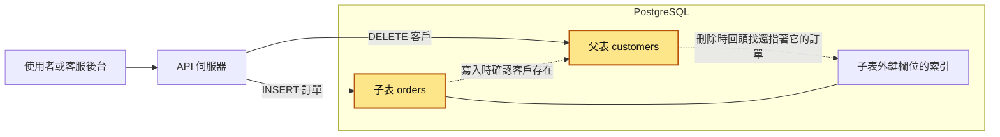
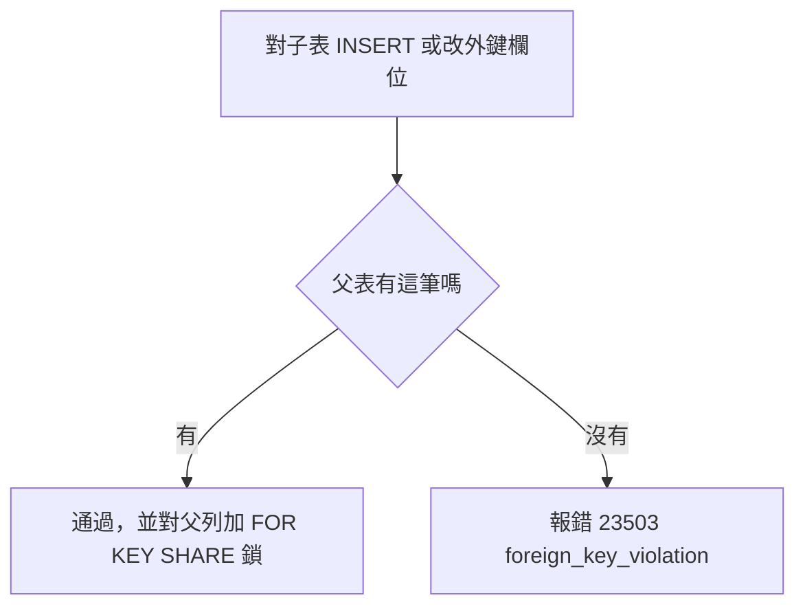
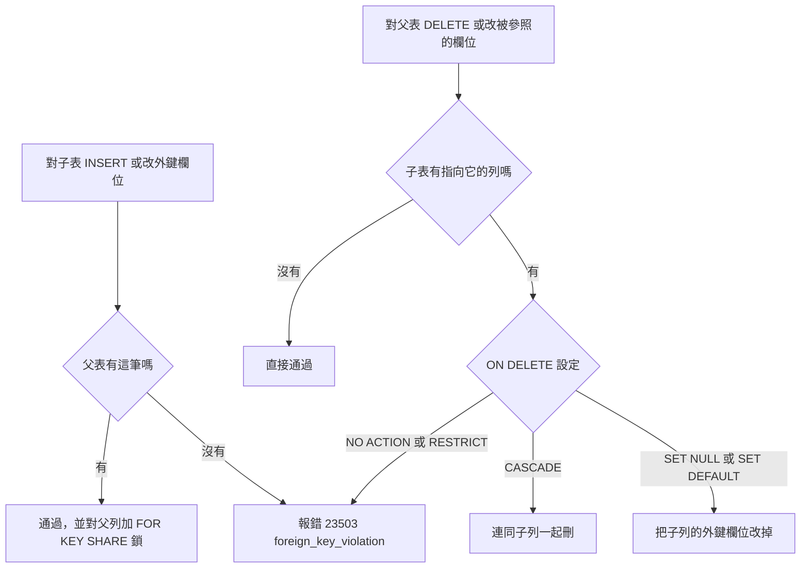
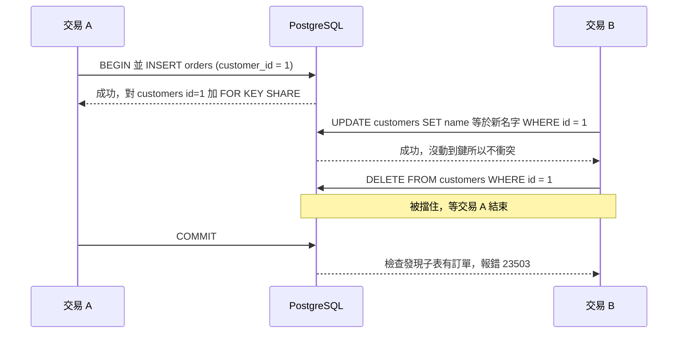

# 13｜外鍵約束（Foreign Key Constraint）

> 外鍵約束（foreign key constraint）讓資料庫替你保證「這一欄指到的那筆資料真的存在」，例如訂單上寫的客戶編號，在客戶表裡一定找得到。

**難度**：★★☆　**閱讀時間**：約 20 分鐘　**前置知識**：[資料庫交易](03-資料庫交易.md)、[資料庫索引](10-資料庫索引.md)

---

## 為什麼要在意：一個具體的情境

假設你在一家做電商 SaaS（把同一套開店系統租給很多商家用）的公司負責後端。資料表是一層指一層：`merchants`（商家）→ `orders`（訂單）→ `order_items`（訂單明細）。每一層都用外鍵串起來，而且都設了 `ON DELETE CASCADE`，意思是「刪掉上一層的資料時，下一層指向它的資料也一起刪掉」。當初的想法是「刪商家的時候比較方便，不用一層一層清」。

公司還有讀取副本（read replica）：主資料庫的唯讀複本，前台查訂單是從這裡讀，靠主資料庫傳來的變更紀錄跟上進度（見 [讀取副本](17-讀取副本.md)）。

有一個測試商家（id = 42）原本開來做 demo，後來被拿去跑壓力測試，底下累積了 80 萬筆訂單、400 多萬筆訂單明細。

❌ 出事的寫法：

```sql
-- ❌ 出事的寫法：每一層都 CASCADE，子表的外鍵欄位都沒有建索引
CREATE TABLE orders (
    id           bigserial PRIMARY KEY,
    merchant_id  bigint NOT NULL REFERENCES merchants (id) ON DELETE CASCADE
);
CREATE TABLE order_items (
    id        bigserial PRIMARY KEY,
    order_id  bigint NOT NULL REFERENCES orders (id) ON DELETE CASCADE
);
-- 少了這兩行：CREATE INDEX ON orders (merchant_id); CREATE INDEX ON order_items (order_id);

-- 上班時間，客服在後台按下「刪除測試商家」，後台送出這一句
DELETE FROM merchants WHERE id = 42;
```

最後那一句 `DELETE` 只寫了要刪 1 筆商家，資料庫卻要照著外鍵一路往下處理。下表是這一句送出後依序發生的事：

| 時間 | 後台送出的 DELETE | 資料庫裡發生的事 | 結帳 API |
|---|---|---|---|
| T1 | 開始執行 | 刪掉商家 42。外鍵發現 `orders` 有列指向它，設定是 `CASCADE`，所以要連訂單一起刪 | 正常，回應約 200ms |
| T2 | 還在跑 | 要找出 `merchant_id = 42` 的訂單，但 `orders.merchant_id` 沒有索引，只好把整張 `orders` 掃一遍，找到 80 萬筆 | 正常 |
| T3 | 還在跑 | 刪第 1 筆訂單。外鍵又要去 `order_items` 找指向這筆訂單的明細，`order_items.order_id` 沒有索引，只好把 400 多萬列的 `order_items` 整張掃一遍 | 開始變慢 |
| T4 | 還在跑 | 刪第 2、第 3……筆訂單，每一筆都再掃一次整張 `order_items`。80 萬筆訂單，就是 80 萬次整張表掃描 | 資料庫 CPU 100%、磁碟 I/O 滿載，回應變成 8 秒，大量逾時 |
| T5 | 還在跑，這一句還沒結束 | 幾百萬列的刪除都塞在同一個交易裡。交易不結束，相關的列一直被鎖著；同時產生大量 WAL（寫前日誌，資料庫記下每一筆變更的紀錄），讀取副本跟不上 | 前台看到的訂單狀態是好幾分鐘前的舊資料 |
| T6 | DBA 手動砍掉這個查詢 | 這一句被中止，整個交易回滾，刪到一半的資料全部還原 | 慢慢恢復 |

**使用者看到什麼**：顧客按下結帳後一直轉圈，等了 8 秒還是逾時；剛下的訂單在前台看到的還是舊狀態。

**工程師看到什麼**：監控上資料庫 CPU 100%、磁碟 I/O 滿載，結帳 API 的回應時間從 200ms 跳到 8 秒，讀取副本的複寫延遲（副本落後主資料庫多久，見 [複寫延遲](18-複寫延遲.md)）衝到好幾分鐘。值班工程師一開始以為是流量暴增，擴了應用程式伺服器，完全沒用，因為卡住的是資料庫裡那一句 `DELETE`。事後在測試環境用 `EXPLAIN ANALYZE`（讓資料庫實際執行一句 SQL，並回報每一步花了多久，見 [EXPLAIN ANALYZE](12-EXPLAIN%20ANALYZE.md)）對一小批資料重跑，時間都花在 `Trigger for constraint ...` 這一行，也就是外鍵處理。「動手看看」的實驗三會讓你親眼看到這一行。

**根因**：`order_items` 那一行 `order_id ... REFERENCES orders (id) ON DELETE CASCADE` 建了外鍵，下面卻沒有對應的 `CREATE INDEX`，所以每刪一筆訂單就要掃一次整張 `order_items`。最後那一句 `DELETE FROM merchants WHERE id = 42` 又把幾百萬列的刪除塞進同一個交易。

**怎麼修**：補上外鍵欄位的索引；把 `merchants → orders` 改成 `RESTRICT`（有訂單就不准刪商家），刪商家改成背景工作分批處理。索引在後面「外鍵欄位要自己建索引」一節，`CASCADE` 和 `RESTRICT` 怎麼選在「ON DELETE 的五種選擇」和地雷 2。

**這次出事的原因是外鍵欄位沒建索引，加上對大量資料直接用 CASCADE；外鍵本身該留著。**

---

## 全貌：它在系統裡的位置

下面這張圖看的是：一個寫入或刪除的請求從使用者走到資料庫，外鍵檢查發生在哪一段。圖裡用的是後面範例的 `customers`（客戶）和 `orders`（訂單）。



外鍵檢查完全發生在資料庫裡，兩張表之間。API 只送出一句 `INSERT` 或 `DELETE`，確認父資料存在、刪除時回頭找子資料，都是資料庫自己做的。被指的那一欄必須唯一，這是 [唯一約束](14-唯一約束.md) 的範圍；刪除時回頭查子表快不快，要看子表那一邊有沒有索引，見 [資料庫索引](10-資料庫索引.md)。

---

## 生活比喻

想像圖書館的借閱登記簿。每一筆借閱紀錄寫著「讀者證號 A123 借了某本書」。

外鍵約束就像櫃台人員的規矩：

- **登記借書時**，櫃台會先查讀者名冊，確認 A123 這個人真的存在，才讓你登記。不存在就拒絕。（插入子資料時檢查父資料存在）
- **有人要註銷讀者證時**，櫃台會先翻借閱簿：
  - 「這個人還有書沒還，不准註銷。」（對應 `RESTRICT` / `NO ACTION`）
  - 「註銷就順便把他所有借閱紀錄一起撕掉。」（對應 `CASCADE`）
  - 「註銷可以，借閱紀錄留著，但讀者欄改成『已註銷』（空白）。」（對應 `SET NULL`）
- **借閱簿要是沒有依讀者證號排序的索引**，櫃台每次要註銷一個人，就得把整本借閱簿從頭翻到尾。（外鍵欄位沒建索引）

括號裡的 `RESTRICT`、`CASCADE` 這些是後面「ON DELETE 的五種選擇」會講的設定名稱，現在先記得「註銷時有三種處理方式」就好。

**比喻失準的地方**：真實櫃台是一個人慢慢查，而資料庫是成千上萬個交易同時在做這些檢查，所以還多了「鎖」的問題：資料庫會暫時把某筆資料保留給一個交易，別的交易要動它就得排隊。你在登記借書的那一刻，資料庫會暫時鎖住那位讀者的資料，不讓別人同時把他註銷。這點在比喻裡看不出來，下面會細講。

---

## 它是怎麼運作的

### 基本語法：REFERENCES

子表只存了父表的 id，資料庫預設不會檢查這個 id 對不對得上任何一筆父資料。加上 `REFERENCES`，資料庫就會在每次寫入時替你去父表確認。

子表裡指向不存在父資料的列，例如訂單的 `customer_id` 寫著 999、`customers` 裡卻沒有 999 號客戶，叫做孤兒資料（orphan rows）。外鍵就是用來擋住它的。

```sql
CREATE TABLE customers (
    id    bigint PRIMARY KEY,
    name  text NOT NULL
);

CREATE TABLE orders (
    id           bigint PRIMARY KEY,
    -- 外鍵：orders.customer_id 必須對應到某個存在的 customers.id
    customer_id  bigint NOT NULL REFERENCES customers (id),
    amount       numeric(12, 2) NOT NULL
);
```

幾個用語先講清楚：

- **父表（parent / referenced table）**：被指的那張，這裡是 `customers`。
- **子表（child / referencing table）**：去指別人的那張，這裡是 `orders`。
- 在 PostgreSQL，被參照的欄位必須有 **主鍵（primary key）或唯一約束（unique constraint）**（或非部分的唯一索引；部分索引是帶 `WHERE` 條件、只收一部分列的索引），不然資料庫不讓你建外鍵。如果 `customers.id` 可以重複，「指到哪一筆」就沒有意義，所以被參照的一邊必須唯一。
- 沒有自己取名的話，PostgreSQL 會自動命名成 `<表名>_<欄名>_fkey`，例如 `orders_customer_id_fkey`。錯誤訊息裡會看到這個名字。

外鍵欄位允許 `NULL`。預設的比對方式（`MATCH SIMPLE`）下，只要外鍵欄位是 `NULL`，就不檢查。所以「這筆訂單一定要有客戶」要另外加 `NOT NULL`，外鍵本身不管這件事。

### 資料庫什麼時候會檢查

外鍵在兩種時候檢查。第一種是你寫入子表：你送出 `INSERT`（或改外鍵欄位）時，資料庫先去父表找這筆資料，找到才放行。放行的同時，資料庫會對那筆父資料加一個很輕的鎖（圖裡的 `FOR KEY SHARE`），防止它在你的交易結束前被刪掉，細節在後面「外鍵帶來的鎖與效能成本」。找不到就報錯，`23503` 是外鍵違反的錯誤碼。



第二種是你刪改父表。下面這張圖在上一張的基礎上多了父表這一條路。你送出 `DELETE`（或改被參照的欄位）時，資料庫反過來去子表找有沒有列還指著它，再依 `ON DELETE` 的設定決定怎麼做。



第二張圖裡**「子表有指向它的列嗎」這一步，是拿父表的鍵去子表查。** 能不能查得快，完全看子表的外鍵欄位有沒有索引。

在 PostgreSQL 內部，外鍵是用系統觸發器（trigger，某張表被寫入時資料庫自動執行的一段程式）實作的，所以你用 `EXPLAIN ANALYZE`（見 [EXPLAIN ANALYZE](12-EXPLAIN%20ANALYZE.md)）看一個 `DELETE` 時，會看到 `Trigger for constraint ...` 這樣的一行，告訴你外鍵檢查花了多少時間、被呼叫幾次。下面動手時會看到。

### ON DELETE 的五種選擇

| 設定 | 父資料被刪時，子資料怎麼辦 | 適合的情境 |
|---|---|---|
| `NO ACTION`（預設） | 有子資料就報錯 | 大部分情況的安全預設 |
| `RESTRICT` | 有子資料就報錯 | 跟 `NO ACTION` 幾乎一樣，差在檢查時機（見下面） |
| `CASCADE` | 子資料跟著刪 | 子資料完全依附父資料、沒有獨立意義，且數量可控 |
| `SET NULL` | 子資料的外鍵欄位設成 `NULL` | 子資料要保留，只是「不再屬於誰」 |
| `SET DEFAULT` | 子資料的外鍵欄位設成預設值 | 很少用；預設值本身必須在父表存在 |

`ON UPDATE` 也有同樣的選項，處理「父表的被參照欄位被改掉」。如果你的主鍵是不會變的代理鍵（surrogate key，例如自增 id 或 UUID），`ON UPDATE` 幾乎用不到，維持預設就好。

**`NO ACTION` 和 `RESTRICT` 差在哪？** 先認識一個選項：`DEFERRABLE` 是建外鍵時可以加上的設定，加了之後，檢查可以延到交易提交（`COMMIT`）時才做。`RESTRICT` 是立刻檢查、不能延後；`NO ACTION` 的檢查可以搭配 `DEFERRABLE` 延到交易提交時才做（沒設 `DEFERRABLE` 時，是在整條 SQL 執行完才檢查）。

沒設 `DEFERRABLE` 的話，兩者在日常使用上幾乎看不出差別；少數例外是修改父表鍵值時，`NO ACTION` 看的是「改完之後」的狀態，`RESTRICT` 則只要有子資料指著舊值就直接拒絕。MySQL 的 InnoDB 裡兩者完全相同，都是立刻檢查。

**怎麼選？** 問自己兩個問題：

1. **子資料離開父資料還有意義嗎？** 訂單明細離開訂單就沒有意義，可以考慮 `CASCADE`。訂單離開客戶仍有意義（會計、稅務要留），絕對不要 `CASCADE`。
2. **連鎖刪除的量會不會很大？** 一個使用者底下 5 筆通知設定，`CASCADE` 沒問題。一個租戶（tenant，SaaS 裡的一個客戶公司）底下幾百萬筆資料，就不該靠一個 `DELETE` 一次刪完，應該用 `RESTRICT` 擋住，改成背景工作分批清。

拿不定主意就用預設（`NO ACTION`）。它最多讓你刪不掉、跳錯誤，不會讓你一次刪光不該刪的東西。

### 外鍵欄位要自己建索引

外鍵檢查有兩個方向：寫入子表時查父表，刪改父表時查子表。查父表一定快，查子表快不快，要看你有沒有自己建索引。

- 父表的被參照欄位（通常是主鍵）一定有索引，因為主鍵和唯一約束本身就會建索引。所以「插入子資料時查父表」很快。
- **子表的外鍵欄位，PostgreSQL 不會自動建索引。** 而刪除父資料、修改父表主鍵時，資料庫要反過來去子表查，沒有索引就是全表掃描。
- MySQL InnoDB 在建外鍵時，如果外鍵欄位沒有可用的索引，會自動幫你建一個。從 MySQL 轉過來的人特別容易忘記這件事。

```sql
-- ✅ 建完外鍵，順手建索引
CREATE INDEX orders_customer_id_idx ON orders (customer_id);
```

除了刪除變快，這個索引通常本來就有用：「查某客戶的所有訂單」、`JOIN` 時，幾乎都會用到它。如果已經有一個以 `customer_id` 開頭的複合索引（例如 `(customer_id, created_at)`），它就能兼顧外鍵查詢，不用再另建一個。

什麼時候可以不建？父表幾乎不刪除、不改主鍵，而且子表也從不依這個欄位查詢，例如指向「國家代碼」這種靜態對照表。即使如此，決定不建之前也要想清楚，不要只因為「不想多一個索引」就省掉。索引的取捨細節見 [資料庫索引](10-資料庫索引.md)。

### 外鍵帶來的鎖與效能成本

這一節會用到「列鎖」：只鎖住一列資料的鎖，別的交易要對這一列做衝突的操作，就得排隊等。PostgreSQL 有好幾種強弱不同的列鎖，這裡只需要認得三種（完整說明見 [悲觀鎖定](07-悲觀鎖定.md)）：

| 列鎖 | 什麼時候會拿 | 跟 `FOR KEY SHARE` 衝突嗎 |
|---|---|---|
| `FOR KEY SHARE` | 寫入子表時，資料庫對父列加的 | 不衝突 |
| `FOR NO KEY UPDATE` | 一般的 `UPDATE`，沒動到鍵欄位（主鍵或有唯一約束的欄位） | 不衝突 |
| `FOR UPDATE` | `DELETE`、修改鍵欄位、明確的 `SELECT ... FOR UPDATE` | 衝突，要等 |

**1. 寫入子表時，會鎖住父列。**

在 PostgreSQL，當你插入一筆訂單（或修改 `orders.customer_id`），資料庫會對那筆 `customers` 加一個 `FOR KEY SHARE` 的列鎖，直到你的交易結束。目的是防止「我正在插入訂單，另一個交易同時把這個客戶刪掉」。

這個鎖很輕，只跟 `FOR UPDATE` 等級的鎖衝突，也就是 `DELETE` 父列、修改父列的鍵欄位，或明確的 `SELECT ... FOR UPDATE`。一般的 `UPDATE customers SET name = ...`（沒動到鍵）拿的是 `FOR NO KEY UPDATE`，不會被擋。



所以外鍵會讓別的交易排隊等待。交易拖得越長，父列被鎖得越久。多個交易以不同順序刪改父子資料時，也可能形成 [死鎖](02-死鎖.md)。

**2. 每次寫入子表都多一次查詢。** 插入一筆訂單，等於寫一次 `orders`，再查一次 `customers` 的主鍵索引。單筆來看很便宜，大量批次匯入時，這個成本會累積起來。

**3. 刪除父資料可能觸發大量工作。** `CASCADE` 是逐列觸發的，每刪一筆父資料就去子表處理一次。沒索引的話就是開頭事故的情況。

**4. 新增外鍵本身會鎖表。** 在既有的表上 `ALTER TABLE ... ADD FOREIGN KEY`，PostgreSQL 會在子表和父表上都拿 `SHARE ROW EXCLUSIVE` 鎖（這是鎖整張表的表鎖，範圍比上面的列鎖大），然後掃描整張子表確認現有資料都合法。這段時間兩張表的 `INSERT`/`UPDATE`/`DELETE` 都會被擋住。大表上要拆成兩步（見「常見地雷」）。

### 為什麼有些團隊不用外鍵

你可能聽過「我們公司不用外鍵」。常見的理由：

- **分片之後跨不過去。** 資料分散在不同的資料庫節點上時，資料庫沒辦法替你檢查「另一台機器上的那筆資料存不存在」。PostgreSQL 的外鍵本來就不能跨資料庫。一些分散式方案（例如 Citus）只在特定條件下支援外鍵，例如兩張表按同一個鍵放在一起；Vitess 這類 MySQL 分片中介層對外鍵的支援也有限，細節依版本而異。詳見 [資料庫分片](19-資料庫分片.md)。
- **線上 schema 變更工具（在不停機的情況下修改表結構的工具）不支援。** MySQL 圈常用的 gh-ost 不支援有外鍵的表，pt-online-schema-change 處理外鍵也很麻煩。
- 寫入量極高，想省掉每次寫入的檢查與鎖。
- 服務拆分後，資料本來就在不同服務的資料庫裡，外鍵自然不存在。

但代價很實在：

- **孤兒資料一定會出現。** 程式有 bug、有人手動改資料、某個刪除流程中途失敗，都會留下指向不存在資料的列。沒人擋，就會累積。
- 應用程式要自己負責檢查，而且「先查存在、再寫入」本身就有 [競爭條件](01-競爭條件.md)：你查完之後、寫入之前，父資料可能剛好被刪了。
- 需要定期跑對帳腳本，找出孤兒資料並處理。
- 刪除父資料時，應用程式要記得自己清子資料，而且要按正確順序。

不用外鍵是一種有意識的取捨，通常出現在規模很大、而且有成熟補償機制的團隊。**如果你的系統還在單一 PostgreSQL 上，沒有理由不用外鍵。**

### 軟刪除與外鍵

很多系統用「軟刪除（soft delete）」：不真的 `DELETE`，而是設一個 `deleted_at` 欄位。這跟外鍵有幾個摩擦：

- **外鍵不檢查 `deleted_at`。** 對資料庫來說，被軟刪除的客戶還「存在」，所以子表照樣可以插入指向它的新訂單。「不能對已刪除客戶下單」這條規則，外鍵幫不了你，要靠應用程式或觸發器。
- **`ON DELETE CASCADE` 不會觸發。** 你只是 `UPDATE` 了 `deleted_at`，子資料不會跟著被軟刪除。要連動就得自己寫。
- **唯一約束會打架。** 使用者軟刪除後想用同一個 email 重新註冊，`UNIQUE (email)` 會擋住。常見解法是部分唯一索引（`WHERE deleted_at IS NULL`），細節在 [唯一約束](14-唯一約束.md)。
- **軟刪除很適合搭配 `RESTRICT`。** 父資料永遠不會被真正刪掉，外鍵就永遠不會擋你，同時又能防止有人誤用硬刪除。

如果你的團隊是因為「怕刪錯、要留稽核紀錄」才用軟刪除，另一個做法是：真刪除，但刪之前把資料搬到封存表（archive table）。哪個好取決於查詢需求，先知道有這兩條路就好。

---

## 動手看看

用 Docker 起一個本機 PostgreSQL（密碼只是本機測試用）：

```bash
docker run --rm -d --name fk-lab -e POSTGRES_PASSWORD=postgres -p 5432:5432 postgres:16
# 開兩個終端機，各自連進去，等等會用到兩個 session
docker exec -it fk-lab psql -U postgres
```

### 實驗一：外鍵擋住孤兒資料

```sql
-- 讓錯誤訊息顯示 SQLSTATE 錯誤碼
\set VERBOSITY verbose

CREATE TABLE customers (
    id    bigint PRIMARY KEY,
    name  text NOT NULL
);

CREATE TABLE orders (
    id           bigserial PRIMARY KEY,
    customer_id  bigint NOT NULL REFERENCES customers (id),  -- 預設 NO ACTION
    amount       numeric(12, 2) NOT NULL
);

INSERT INTO customers VALUES (1, '小明');

-- 正常：客戶 1 存在
INSERT INTO orders (customer_id, amount) VALUES (1, 100);

-- 失敗：客戶 999 不存在
INSERT INTO orders (customer_id, amount) VALUES (999, 100);
```

預期會看到類似：

```
ERROR:  23503: insert or update on table "orders" violates foreign key constraint "orders_customer_id_fkey"
DETAIL:  Key (customer_id)=(999) is not present in table "customers".
```

（開了 `VERBOSITY verbose`，下面還會多出 `SCHEMA NAME`、`TABLE NAME`、`CONSTRAINT NAME`、`LOCATION` 等幾行細節，可以先略過。）

再試著刪掉還有訂單的客戶：

```sql
DELETE FROM customers WHERE id = 1;
-- ERROR:  23503: update or delete on table "customers" violates foreign key constraint "orders_customer_id_fkey" on table "orders"
-- DETAIL:  Key (id)=(1) is still referenced from table "orders".
```

兩種情況都是同一個錯誤碼 `23503`（`foreign_key_violation`），應用程式可以依這個錯誤碼判斷。

### 實驗二：觀察外鍵帶來的鎖

**Session A：**

```sql
BEGIN;
INSERT INTO orders (customer_id, amount) VALUES (1, 200);
-- 先不要 COMMIT，交易保持開著
```

**Session B：**

```sql
-- 改名字：沒動到鍵，不會被擋，馬上成功
UPDATE customers SET name = '小明二號' WHERE id = 1;

-- 刪除：會卡住，因為 Session A 對這筆客戶持有 FOR KEY SHARE 鎖
DELETE FROM customers WHERE id = 1;
```

開第三個 session，查 `pg_stat_activity`（PostgreSQL 內建的檢視，每個連線一列，顯示它正在做什麼、在等什麼）看誰在等：

```sql
SELECT pid, wait_event_type, wait_event, state, left(query, 60) AS query
FROM pg_stat_activity
WHERE wait_event_type = 'Lock';
```

應該會看到 Session B 的 `DELETE` 在等鎖。回到 Session A 執行 `COMMIT;`，Session B 的 `DELETE` 會立刻結束，並因為子表有訂單而報 `23503`。

### 實驗三：外鍵欄位沒索引有多痛

```sql
-- 重來一份乾淨的資料，這次用 CASCADE
DROP TABLE orders;
CREATE TABLE orders (
    id           bigserial PRIMARY KEY,
    customer_id  bigint NOT NULL REFERENCES customers (id) ON DELETE CASCADE,
    amount       numeric(12, 2) NOT NULL
);

-- 1000 個客戶、100 萬筆訂單
INSERT INTO customers
SELECT g, 'customer ' || g FROM generate_series(2, 1000) AS g;

INSERT INTO orders (customer_id, amount)
SELECT (g % 1000) + 1, 100 FROM generate_series(1, 1000000) AS g;

ANALYZE customers;
ANALYZE orders;

-- EXPLAIN ANALYZE 會「真的執行」DELETE，所以包在交易裡再 ROLLBACK
BEGIN;
EXPLAIN ANALYZE DELETE FROM customers WHERE id BETWEEN 1 AND 20;
ROLLBACK;
```

輸出最後面會有一行類似：

```
Trigger for constraint orders_customer_id_fkey: time=... calls=20
```

`calls=20` 代表刪了 20 個客戶，觸發了 20 次外鍵處理；沒有索引時，每一次都要掃整張 `orders`。把 `time` 記下來，然後補索引再跑一次：

```sql
CREATE INDEX orders_customer_id_idx ON orders (customer_id);

BEGIN;
EXPLAIN ANALYZE DELETE FROM customers WHERE id BETWEEN 1 AND 20;
ROLLBACK;
```

`Trigger for constraint` 那一行的時間應該會明顯下降，常見是差 1 到 2 個數量級（實際數字看你的機器）。這就是開頭事故的縮小版。怎麼讀 `EXPLAIN ANALYZE` 的輸出，見 [EXPLAIN ANALYZE](12-EXPLAIN%20ANALYZE.md)。

### 實驗四：找出整個資料庫裡「沒有索引的外鍵」

> 第一次讀可以先跳過這一節，等你要檢查自己專案的外鍵有沒有索引時再回來看。

這個查詢可以直接拿去自己的專案跑，不用看懂每一行：`pg_constraint` 記著所有約束，`pg_index` 記著所有索引，這段查詢就是拿兩邊比對，列出找不到可用索引的外鍵。

```sql
-- 列出子表外鍵欄位沒有任何索引能涵蓋的外鍵
SELECT c.conrelid::regclass         AS child_table,
       c.conname                    AS fk_name,
       pg_get_constraintdef(c.oid)  AS definition
FROM pg_constraint AS c
WHERE c.contype = 'f'
  AND NOT EXISTS (
        SELECT 1
        FROM pg_index AS i
        WHERE i.indrelid = c.conrelid
          -- 索引的前 N 個欄位要剛好涵蓋外鍵的 N 個欄位
          AND (i.indkey::int2[])[0:cardinality(c.conkey) - 1] @> c.conkey
          -- 這 N 個欄位必須是索引鍵本身（INCLUDE 的欄位不能拿來搜尋）
          AND i.indnkeyatts >= cardinality(c.conkey)
          -- 部分索引（帶 WHERE 條件的）不能拿來服務外鍵檢查
          AND i.indpred IS NULL
      )
ORDER BY 1, 2;
```

在 PostgreSQL 16 實測過：沒有索引、索引不是以外鍵欄位開頭、複合外鍵只建了第一欄的索引、外鍵欄位只出現在 `INCLUDE` 或部分索引裡，這幾種都會被列出來；單欄索引、以外鍵欄位開頭的複合索引、主鍵或唯一約束開頭剛好是外鍵欄位，則不會被誤報。（拿掉最後兩個條件的舊版寫法，會漏掉 `INCLUDE` 和部分索引這兩種情況。）

實驗做完記得收掉容器：`docker stop fk-lab`（加了 `--rm`，停掉就會自動刪除）。

---

## 常見地雷

### 地雷 1：外鍵欄位沒建索引

- ❌ **錯誤做法**：只寫 `customer_id bigint REFERENCES customers (id)`，以為資料庫會順便建索引。
- **為什麼錯**：PostgreSQL 只會在父表的主鍵或唯一欄位上有索引，子表的外鍵欄位不會自動建。刪除父資料、修改父表主鍵時就會全表掃描子表，`CASCADE` 時更嚴重。
- ✅ **正確做法**：每建一個外鍵，就檢查子表是否已有以該欄位開頭的索引；沒有就建。在 code review 時把這條當成必查項目，也可以定期跑上面實驗四的查詢。

### 地雷 2：看到父子關係就無腦 CASCADE

- ❌ **錯誤做法**：`users → orders → invoices` 全部 `ON DELETE CASCADE`，理由是「刪使用者比較方便」。
- **為什麼錯**：一個 `DELETE` 可能悄悄刪掉幾百萬列，包括會計、稅務、稽核上必須保留的資料。量大時還會變成長交易（遲遲不結束的交易），讓鎖、WAL 和複寫延遲一起爆掉（見 [複寫延遲](18-複寫延遲.md)）。而且誤刪很難救。
- ✅ **正確做法**：只有「子資料完全依附父資料、數量可控」才用 `CASCADE`，例如訂單明細依附訂單。需要保留的資料用預設的 `NO ACTION` 或 `RESTRICT` 擋住；大量清除改成背景工作分批刪。

### 地雷 3：在正式環境的大表上直接加外鍵

- ❌ **錯誤做法**：

```sql
-- ❌ 錯誤示範：大表上一次做完，驗證期間兩張表的寫入都被擋住
ALTER TABLE orders
    ADD CONSTRAINT orders_customer_id_fkey
    FOREIGN KEY (customer_id) REFERENCES customers (id);
```

- **為什麼錯**：這個指令會在 `orders` 和 `customers` 上拿 `SHARE ROW EXCLUSIVE` 鎖，然後掃描整張 `orders` 確認現有資料合法。表很大時，這段期間所有寫入都在排隊。
- ✅ **正確做法**：拆成兩步。

```sql
-- ✅ 正確寫法
-- 第一步：只對「之後的新資料」生效，不掃舊資料，很快結束
ALTER TABLE orders
    ADD CONSTRAINT orders_customer_id_fkey
    FOREIGN KEY (customer_id) REFERENCES customers (id)
    NOT VALID;

-- 第二步：另外找時間驗證舊資料
-- 這一步拿的鎖比較輕，驗證期間一般的讀寫可以照常進行
ALTER TABLE orders VALIDATE CONSTRAINT orders_customer_id_fkey;
```

  第一步雖然快，還是要拿鎖，建議搭配 `SET lock_timeout = '5s';`（等鎖最多等多久，等不到就放棄並報錯），避免排在長交易後面反而卡住所有人。外鍵欄位的索引也要先用 `CREATE INDEX CONCURRENTLY`（建索引期間不擋寫入的做法）建好。整套流程見 [零停機遷移](16-零停機遷移.md)。

### 地雷 4：在應用程式「先查再寫」，以為可以取代外鍵

- ❌ **錯誤做法**：

```python
# ❌ 錯誤示範：先查再寫，中間有空隙
row = conn.execute("SELECT 1 FROM customers WHERE id = %s", (customer_id,)).fetchone()
if row is None:
    raise CustomerNotFound(customer_id)
# 就在這一刻，別的請求可能剛好把這個客戶刪掉了
conn.execute(
    "INSERT INTO orders (customer_id, amount) VALUES (%s, %s)",
    (customer_id, amount),
)
```

- **為什麼錯**：查詢和寫入之間有時間差，這就是典型的 [競爭條件](01-競爭條件.md)。沒有外鍵的話，孤兒資料就這樣產生了。
- ✅ **正確做法**：讓外鍵把關，應用程式直接寫入，再把資料庫錯誤翻成業務錯誤。

```python
# ✅ 正確寫法：直接寫入，由外鍵保證正確，捕捉 23503 轉成業務錯誤（psycopg 3）
from psycopg import errors

try:
    with conn.transaction():
        conn.execute(
            "INSERT INTO orders (customer_id, amount) VALUES (%s, %s)",
            (customer_id, amount),
        )
except errors.ForeignKeyViolation as e:
    # e.diag.constraint_name 可以知道是哪個外鍵擋下來的
    if e.diag.constraint_name == "orders_customer_id_fkey":
        raise CustomerNotFound(customer_id) from e
    raise
```

  想在 API 回傳更友善的訊息，可以保留「先查」當作提早回應，但**正確性的最後一道防線仍然是外鍵**。

### 地雷 5：選了 SET NULL，卻沒想清楚欄位和語意

- ❌ **錯誤做法**：`customer_id bigint NOT NULL REFERENCES customers (id) ON DELETE SET NULL`，或為了「刪得掉」而隨手把外鍵改成 `SET NULL`。
- **為什麼錯**：第一種寫法自相矛盾。刪除客戶時，資料庫要把 `customer_id` 設成 `NULL`，卻違反 `NOT NULL`，刪除照樣失敗。第二種會留下一堆「不知道屬於誰」的資料，報表和查詢都要多處理 `NULL`。
- ✅ **正確做法**：只有當「子資料沒有父資料仍然有意義」時才用 `SET NULL`，例如文章的作者帳號被刪了，文章要保留、顯示成「已刪除的使用者」。欄位要允許 `NULL`，程式和報表也要處理這種情況。

### 地雷 6：搬資料時關掉外鍵檢查，之後忘了驗證

- ❌ **錯誤做法**：匯入資料時為了快，在 MySQL 下 `SET FOREIGN_KEY_CHECKS = 0`，或在 PostgreSQL 用 `SET session_replication_role = replica` 讓外鍵觸發器不執行，匯完就直接上線。
- **為什麼錯**：關掉期間寫進去的資料完全沒被檢查，重新打開之後，資料庫也不會回頭幫你檢查。孤兒資料就這樣進了正式環境，而且你以為有外鍵保護。（`session_replication_role` 需要高權限，也會影響所有觸發器，不只外鍵。）
- ✅ **正確做法**：盡量依照父表到子表的順序匯入，讓外鍵正常運作；真的要關，匯完之後跑一次孤兒資料檢查：

```sql
-- 找出指向不存在客戶的訂單
SELECT o.id, o.customer_id
FROM orders AS o
LEFT JOIN customers AS c ON c.id = o.customer_id
WHERE o.customer_id IS NOT NULL
  AND c.id IS NULL
LIMIT 100;
```

---

## 重點整理

- 外鍵讓資料庫替你擋掉孤兒資料，例如訂單指向不存在的客戶。應用程式「先查再寫」中間有空隙擋不住，交給資料庫最可靠。
- `ON DELETE` 要刻意選：預設的 `NO ACTION` 是有子資料就不准刪，`CASCADE` 會連子資料一起刪，`SET NULL` 會把子資料的外鍵欄位清成 `NULL`。對大量資料用 `CASCADE`，一句 `DELETE` 就可能刪掉幾百萬列。
- PostgreSQL 不會自動幫子表的外鍵欄位建索引，要自己建；沒建的話，每刪一筆父資料就要掃一次整張子表。MySQL InnoDB 會自動建。
- 外鍵有成本：每次寫入子表都要查父表，並對父列加 `FOR KEY SHARE` 鎖。在大表上新增外鍵要拆成 `NOT VALID` 和 `VALIDATE CONSTRAINT` 兩步，避免擋住寫入。
- 有些團隊因為分片或線上 schema 變更工具而不用外鍵，代價是要自己做檢查和對帳。系統還在單一 PostgreSQL 上，預設就該加外鍵。

---

## 新人必知清單

### 一定要會（基本功）

- [ ] 會用 `REFERENCES` 建外鍵，知道被參照的欄位必須是主鍵或有唯一約束。
- [ ] 知道外鍵欄位允許 `NULL`，「一定要有父資料」要另外加 `NOT NULL`。
- [ ] 分得清 `NO ACTION`／`RESTRICT`／`CASCADE`／`SET NULL` 的效果，並能說出選擇的理由。
- [ ] **知道 PostgreSQL 不會自動幫外鍵欄位建索引**，每加一個外鍵就檢查索引。
- [ ] 認得錯誤碼 `23503`（`foreign_key_violation`），會在程式裡捕捉並轉成業務錯誤。
- [ ] 知道在大表上新增外鍵要用 `NOT VALID` + `VALIDATE CONSTRAINT` 兩步走。
- [ ] 會用 `LEFT JOIN ... WHERE 父表.id IS NULL` 找孤兒資料。

### 知道有這回事就好

- 寫入子表時，PostgreSQL 會對父列加 `FOR KEY SHARE` 鎖；它只跟刪除父列、修改父列的鍵這類操作衝突。
- `DEFERRABLE INITIALLY DEFERRED` 可以把外鍵檢查延到交易提交時，用在「兩張表互相參照」或「一次換掉一整批資料」這類情況。
- MySQL InnoDB 和 PostgreSQL 的差異：InnoDB 在外鍵欄位沒有可用索引時會自動建一個；`RESTRICT` 等同 `NO ACTION`，都是立刻檢查；由外鍵觸發的 `CASCADE` 動作不會觸發 trigger；InnoDB 歷史上允許參照「非唯一」的索引欄位，但這不是標準做法，不要依賴。
- PostgreSQL 15 起，`ON DELETE SET NULL` / `SET DEFAULT` 可以指定只清空部分欄位（用在複合外鍵）。
- 分片、跨服務、gh-ost 這類工具的限制，是有些團隊不用外鍵的原因；不用的代價是要自己做檢查和對帳。
- 軟刪除不會觸發 `ON DELETE`，外鍵也不檢查 `deleted_at`。
- 外鍵可以是多個欄位的複合外鍵，例如 `FOREIGN KEY (tenant_id, order_id) REFERENCES orders (tenant_id, id)`，常用在多租戶設計裡防止跨租戶的錯誤參照。

### 先不用管（等你遇到再學）

- `MATCH FULL` 和 `MATCH SIMPLE` 對複合外鍵中部分欄位為 `NULL` 時的差異。
- 熱門父列被大量並行插入子資料時，PostgreSQL 產生的 MultiXact 與相關的維護問題。
- 分割表（partitioned table）上的外鍵限制（PostgreSQL 12 起才能參照分割表，各版本細節不同，見 [分割](20-分割.md)）。
- Citus、Vitess 等分散式方案各自對外鍵的支援範圍。
- 外鍵的觸發器內部實作細節。

---

## Code Review 時可以問的問題

1. **這個新外鍵的欄位有索引嗎？** 有沒有現成的、以這個欄位開頭的複合索引可以用？
2. **這裡為什麼選 `CASCADE`（或 `SET NULL`）？** 父資料被刪時，最多會連動多少列？那些資料是否有保留的需求（會計、稽核、法規）？
3. **這是在既有的大表上加外鍵嗎？** 遷移有沒有拆成 `NOT VALID` + `VALIDATE`？有沒有設 `lock_timeout`？
4. **這張表有參照關係，為什麼沒有外鍵？** 如果是刻意不加，孤兒資料要由誰、用什麼方式檢查和清理？
5. **程式有沒有處理 `23503`？** 使用者會看到有意義的錯誤訊息，還是一個 500？
6. **這個表用軟刪除嗎？** 對「已軟刪除的父資料」新增子資料，是允許的嗎？誰負責擋？

---

## 情境演練

**1. 你在 code review 看到同事新增了 `invoices.order_id bigint REFERENCES orders (id)`，PR 說明寫「外鍵會自動建索引，所以不用另外建」。你會怎麼回？**

<details markdown="1"><summary>看答案</summary>

請他補上 `invoices.order_id` 的索引。在 PostgreSQL，父表和子表都不會「因為外鍵」而自動建索引。父表的被參照欄位之所以有索引，是因為外鍵要求它必須是主鍵或有唯一約束，而主鍵和唯一約束本身就會建索引。

子表的外鍵欄位 PostgreSQL 不會自動建。刪除父資料、修改父表的鍵時，資料庫要去子表找「有沒有列指向這筆」，沒有索引就只能全表掃描。`CASCADE` 時，每刪一筆父資料就掃一次，資料量大時非常慢。同事如果是從 MySQL 轉過來的，會有這個印象很正常，因為 MySQL InnoDB 會自動建。

</details>

**2. 你在寫 `orders.customer_id` 的遷移，同事問你 `ON DELETE` 要寫 `RESTRICT`，還是留預設的 `NO ACTION`。你會怎麼決定？**

<details markdown="1"><summary>看答案</summary>

兩者都是「有子資料就不准刪父資料」。差別在檢查時機：`RESTRICT` 一定立刻檢查、不能延後；`NO ACTION` 可以搭配 `DEFERRABLE` 把檢查延到交易提交時。沒有設 `DEFERRABLE` 的話，日常使用上幾乎看不出差別。

一般情況用預設的 `NO ACTION` 就好；如果你想明確表達「這裡絕對不允許、也不打算延後檢查」，可以寫 `RESTRICT`，讓讀 schema 的人一眼看懂意圖。在 MySQL InnoDB 裡兩者完全相同。

</details>

**3. 你在一個開著的交易裡插入了一筆訂單（`customer_id = 1`），還沒提交。這時另一個請求想改客戶 1 的名字，另一個請求想刪除客戶 1。這兩個請求分別會怎樣？**

<details markdown="1"><summary>看答案</summary>

插入訂單時，PostgreSQL 會對客戶 1 這一列加 `FOR KEY SHARE` 鎖。

- **改名字**：一般的 `UPDATE`（沒有動到主鍵或唯一欄位）拿的是 `FOR NO KEY UPDATE` 鎖，跟 `FOR KEY SHARE` 不衝突，所以馬上成功。
- **刪除**：`DELETE` 需要 `FOR UPDATE` 等級的鎖，跟 `FOR KEY SHARE` 衝突，所以會卡住，等到插入訂單的交易結束。如果那個交易提交了，刪除就會因為子表有訂單而報 `23503`（在 `NO ACTION`／`RESTRICT` 下）；如果那個交易回滾，刪除就會成功。

這也是為什麼交易要盡量短：交易拖越久，被鎖住的父列就越久。

</details>

**4. 每天凌晨有一個「清除半年未登入使用者」的排程工作，最近從幾分鐘變成跑好幾個小時，期間資料庫 CPU 很高、讀取副本延遲變大。`users` 底下有 `sessions`、`notifications`、`orders` 等子表，部分用 `CASCADE`。你會怎麼查、怎麼修？**

<details markdown="1"><summary>看答案</summary>

**查：**

1. 在測試環境（或包在 `BEGIN; ... ROLLBACK;` 裡）對一小批使用者跑 `EXPLAIN ANALYZE DELETE ...`，看 `Trigger for constraint ...` 每一行的 `time` 和 `calls`，找出是哪個外鍵最慢。
2. 用「找出沒有索引的外鍵」的查詢，檢查那些子表的外鍵欄位有沒有索引。子表隨時間變大，沒索引的全表掃描會越來越慢，很符合「以前幾分鐘、現在好幾小時」的症狀。
3. 看這個工作是不是一個交易刪掉全部使用者。

**修：**

1. 先補上缺少的外鍵欄位索引（正式環境用 `CREATE INDEX CONCURRENTLY`）。
2. 改成分批刪除，例如每次 1000 個使用者、每批一個短交易，批次之間稍微停一下，讓複寫跟得上。
3. 重新檢查 `CASCADE` 的範圍：`orders` 這種需要保留的資料，不應該跟著使用者被刪掉。改成 `RESTRICT`，並在業務上決定這些訂單要怎麼處理（匿名化、封存）。

</details>

**5. 團隊用軟刪除（`deleted_at`）管理商品，`order_items.product_id` 有外鍵指向 `products`。有人說「有外鍵，所以不可能對已下架刪除的商品下單」。你會怎麼回應？需要補什麼？**

<details markdown="1"><summary>看答案</summary>

這句話不成立。軟刪除只是 `UPDATE products SET deleted_at = now()`，那一列仍然存在，外鍵只檢查「這個 id 存不存在」，不會看 `deleted_at`。所以仍然可以插入指向已軟刪除商品的訂單明細。

補法有幾種，可以組合使用：

- 下單流程在同一個交易裡查詢商品，條件加上 `deleted_at IS NULL`，並用 `SELECT ... FOR SHARE`（或更強的鎖）鎖住商品列，避免查完之後商品剛好被軟刪除（見 [悲觀鎖定](07-悲觀鎖定.md)）。
- 如果要由資料庫強制，可以寫觸發器在插入時檢查，但要評估維護成本。
- 另外，外鍵在這裡仍然有價值：它保證商品不會被「硬刪除」而讓歷史訂單變成孤兒，可以搭配 `RESTRICT` 使用。

</details>

---

## 相關主題

- [資料庫索引](10-資料庫索引.md)：外鍵欄位要自己建索引，這篇講索引怎麼選、成本是什麼。
- [唯一約束](14-唯一約束.md)：外鍵的參照目標必須是唯一的；軟刪除和唯一約束的衝突也在那篇處理。
- [零停機遷移](16-零停機遷移.md)：在正式環境新增外鍵的 `NOT VALID` / `VALIDATE` 流程，以及 `lock_timeout` 的用法。
- [悲觀鎖定](07-悲觀鎖定.md)：外鍵檢查背後用到的 `FOR KEY SHARE`、`FOR UPDATE` 等列鎖。
- [死鎖](02-死鎖.md)：多個交易以不同順序刪改父子資料時，外鍵鎖可能讓死鎖出現。
- [資料庫分片](19-資料庫分片.md)：資料分散到多個節點後，外鍵為什麼很難維持，以及替代做法。

---

## 延伸閱讀

- PostgreSQL 官方文件：Constraints（含 Foreign Keys 一節）— https://www.postgresql.org/docs/current/ddl-constraints.html
- PostgreSQL 官方文件：ALTER TABLE（`NOT VALID`、`VALIDATE CONSTRAINT` 與各操作所需的鎖）— https://www.postgresql.org/docs/current/sql-altertable.html
- PostgreSQL 官方文件：Explicit Locking（`FOR KEY SHARE` 等列鎖的衝突關係）— https://www.postgresql.org/docs/current/explicit-locking.html
- MySQL 官方文件：FOREIGN KEY Constraints（InnoDB 的外鍵行為與差異）— https://dev.mysql.com/doc/refman/8.0/en/create-table-foreign-keys.html
