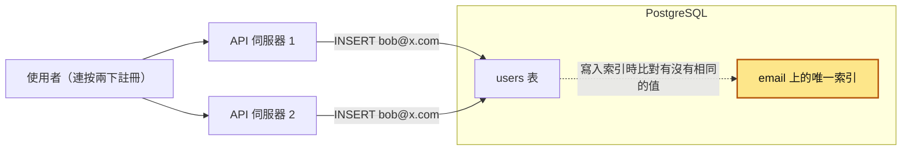
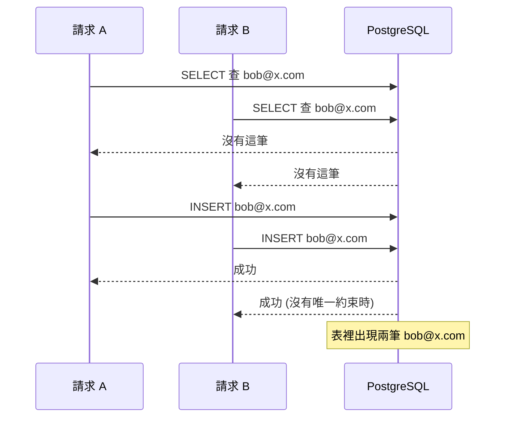
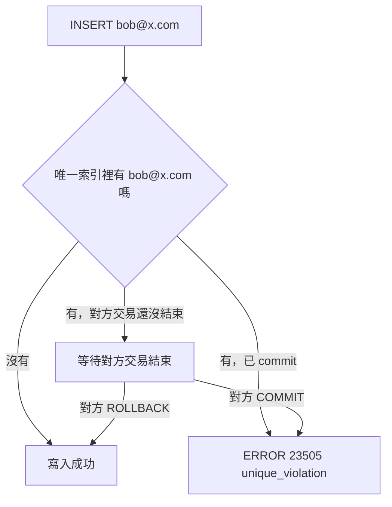

# 14｜唯一約束（Unique Constraint）

> 唯一約束（unique constraint）讓資料庫替你保證「這個值（或這組值）在整張表裡只會出現一次」，不管同時有多少請求在寫。

**難度**：★★☆　**閱讀時間**：約 18 分鐘　**前置知識**：[競爭條件](01-競爭條件.md)、[資料庫交易](03-資料庫交易.md)、[資料庫索引](10-資料庫索引.md)

## 為什麼要在意：一個具體的情境

假設你負責一家電商的會員註冊 API，活動是「新會員註冊就送 200 元購物金」。`users` 表的 `email` 欄只有一般索引，沒有唯一約束。註冊程式的寫法很直覺，先查這個 email 在不在，不在才寫入：

```python
# ❌ 出事的寫法：先查再寫，users.email 沒有唯一約束
def signup(email: str) -> str:
    with psycopg.connect(DSN, autocommit=True) as conn:
        exists = conn.execute(
            "SELECT 1 FROM users WHERE email = %s", (email,)
        ).fetchone()
        if exists:
            return "此 email 已註冊"
        conn.execute("INSERT INTO users (email) VALUES (%s)", (email,))
        # 接著發一筆 200 元購物金
        return "成功"
```

開發時測過很多次都沒問題。活動開始後流量衝高，資料庫回應從 20ms 變成 300ms。手機網路不穩的使用者按了「註冊」沒反應，又多按一下；前端的 HTTP client 剛好也設了逾時自動重送。於是同一個 email `bob@x.com` 的兩個註冊請求幾乎同時送進來，各自跑了一次 `signup()`：

| 時間 | 請求 A（第一次按註冊） | 請求 B（多按一下送出的第二次） | `users` 表裡 bob@x.com 有幾筆 |
|---|---|---|---|
| T1 | `SELECT` 查 bob@x.com，查無資料 | | 0 |
| T2 | | `SELECT` 查 bob@x.com，查無資料（A 還沒寫入） | 0 |
| T3 | `INSERT` bob@x.com，發 200 元 | | 1 |
| T4 | | `INSERT` bob@x.com，發 200 元（資料庫沒有規則擋它） | 2 |
| T5 | 回「成功」 | 回「成功」 | 2 |

資料庫變慢，`SELECT` 到 `INSERT` 之間的空檔就跟著拉長，第二個請求剛好掉進這個空檔的機會也就變大。

**使用者看到什麼**：註冊時兩次都顯示「成功」。隔天客服收到一批「我登入不了」的客訴。財務發現有人領了三份購物金，還有一小撮人發現了這個漏洞，用腳本同時打 20 個請求，一個 email 刷出 20 份。

**工程師看到什麼**：登入程式用 SQLAlchemy 的 `session.query(User).filter_by(email=...).one()` 取「剛好一筆」使用者，日誌裡這一行拋出 `MultipleResultsFound`（查到不只一筆）。一查資料庫，同一個 email 有兩到三筆帳號。

**根因**：`exists = conn.execute("SELECT ...")` 和下面的 `conn.execute("INSERT ...")` 之間有空檔，兩個請求都在 T1、T2 看到「沒有」，全部走到 `INSERT`。`users.email` 沒有唯一約束，資料庫照單全收。

**怎麼修**：在 `email` 上加唯一約束（這個例子要不分大小寫，所以用 `lower(email)` 的唯一索引），程式改成直接 `INSERT`，撞到時捕捉錯誤碼 `23505` 回「這個 email 已經註冊過了」。原理在「唯一約束怎麼擋」，修好的程式在「動手看看」第 4 步的 `signup_good`。

事後補救更麻煩。工程師想補一個 `ALTER TABLE users ADD CONSTRAINT users_email_key UNIQUE (email)`，結果直接失敗，因為表裡已經有重複資料。他們得先寫腳本合併重複帳號（訂單、購物金要掛到哪一筆？）、跟客服對帳，花了一週才把約束加上去。另外還發現有 `Alice@Gmail.com` 和 `alice@gmail.com` 這種只差大小寫、其實是同一人的帳號，原本打算加的唯一約束擋不住。

**「不能重複」是資料的規則，就應該寫在資料庫裡**，而且要在第一天就寫，不要等出事。

## 全貌：它在系統裡的位置

下面這張圖看的是：同一個 email 的兩個註冊請求，從使用者走到資料庫，唯一約束在哪裡把第二筆擋下來。



唯一約束發生在資料庫裡，寫入唯一索引的那一刻。兩台 API 伺服器彼此看不到對方正在做什麼，只有資料庫同時看得到兩邊的寫入，所以擋重複只能交給它。這個問題的本質是 [競爭條件](01-競爭條件.md)；同樣靠唯一約束擋重複的還有 [冪等性](25-冪等性.md) 的冪等鍵；另一種資料庫層的保護是 [外鍵約束](13-外鍵約束.md)。

## 生活比喻

想像一家熱門餐廳的訂位。櫃台有兩位服務生，各拿一支電話。

「先查再寫」就像兩位服務生各自翻一下訂位簿，看到「週五晚上 7 點 3 號桌」還空著，各自跟客人說「好，幫您訂了」，然後各自寫上去。週五晚上兩組客人同時到，現場大亂。

唯一約束就像餐廳換成一本「每個桌位格子只能填一次、而且一次只能一個人拿筆」的訂位簿。第二位服務生拿到筆時發現格子已經有人寫了，當場就知道要跟客人說「抱歉，那個位子剛剛被訂走了，要不要換 7 點半？」。

**比喻失準的地方**：真實的資料庫不是「整本簿子一次只給一個人用」，那樣太慢。PostgreSQL 只在「兩個交易寫入同一個值」時才讓後到的那個等待，寫不同值的交易完全不會互相影響。另外，資料庫判斷「同一格」的方式是逐位元比對值，所以 `Alice` 和 `alice`、NULL 和 NULL 算不算同一格，要你自己告訴它，它不會猜。

## 它是怎麼運作的

### 先查再寫為什麼會破

要擋重複，最直覺的寫法是先查再寫。兩個請求同時送進來時，事情依序是這樣發生的：



這就是典型的「先檢查再行動」（check-then-act）競爭條件，細節見 [競爭條件](01-競爭條件.md)。把兩個步驟包進同一個交易也擋不住，因為在預設的 Read Committed 隔離等級下（PostgreSQL 的預設規則：每一句 SQL 只看得到已經 commit 的資料），兩個交易的 `SELECT` 都看不到對方還沒 commit 的資料（隔離等級的差異見 [隔離等級](05-隔離等級.md)）。

### 唯一約束怎麼擋

唯一約束要補的就是上面那段時間窗。在 PostgreSQL 裡，宣告 `UNIQUE (email)` 時，資料庫會**自動建一個唯一的 B-tree 索引**（B-tree 是 PostgreSQL 預設的索引結構，見 [資料庫索引](10-資料庫索引.md)）。你送出 `INSERT` 或 `UPDATE` 時，資料庫寫入索引時，會在索引裡找有沒有相同的值：

- 找到相同的值，而且那筆資料所屬的交易已經 commit，就直接報錯 `23505`。
- 找到相同的值，但那筆資料所屬的交易還沒結束，後到的交易就會**等待**，直到前一個交易 commit（後到的報錯）或 rollback（後到的成功）。
- 沒找到，就寫入成功。



「等待」這一步應用層做不到，因為資料庫能看到所有交易進行中的寫入，你的程式看不到。

主鍵（primary key）就是「唯一約束 + NOT NULL」。所以你每建一張有主鍵的表，就已經在用唯一約束了。

### 唯一約束 vs. 唯一索引

在 PostgreSQL 裡兩者都能保證唯一。下表會用到三個詞，先講清楚：

- **部分索引**：帶 `WHERE` 條件、只收一部分列的索引，下面「部分唯一索引：軟刪除」會用到。
- **運算式**：像 `lower(email)` 這種先算過再拿來比對的值，下面「大小寫不敏感」會用到。
- **`DEFERRABLE`**：讓檢查延到交易 commit 時才做的設定。

差別是：

| | `UNIQUE` 約束 | `CREATE UNIQUE INDEX` |
|---|---|---|
| 能不能加 `WHERE`（部分索引） | 不行 | 可以 |
| 能不能用運算式（如 `lower(email)`） | 不行 | 可以 |
| 能不能設成 `DEFERRABLE` | 可以 | 不行 |
| 被 [外鍵約束](13-外鍵約束.md) 參照 | 可以（但設成 `DEFERRABLE` 的不行） | 可以，但只限非部分、非運算式的唯一索引（這是 PostgreSQL 的擴充，不是 SQL 標準） |

**一般欄位用約束，需要條件或運算式時用唯一索引。**

### NULL 的行為

SQL 標準裡 NULL 代表「不知道」，兩個「不知道」不能說它們相等，所以預設 **NULL 之間互不衝突**：

```sql
CREATE TABLE coupons (code text UNIQUE);
INSERT INTO coupons VALUES (NULL), (NULL);  -- 成功，表裡有兩個 NULL
```

PostgreSQL 15 加入 `NULLS NOT DISTINCT`，讓 NULL 也被當成同一個值：

```sql
CREATE TABLE coupons2 (code text UNIQUE NULLS NOT DISTINCT);
INSERT INTO coupons2 VALUES (NULL), (NULL);  -- ERROR 23505
```

多欄唯一更容易出錯。`UNIQUE (tenant_id, email)` 裡只要有任一欄是 NULL，這一列就不會跟任何列衝突。MySQL 的 InnoDB 也是「多個 NULL 可以共存」，但沒有 `NULLS NOT DISTINCT` 這個選項。

### 部分唯一索引：軟刪除

很多系統用 `deleted_at` 做軟刪除（soft delete）。需求通常是：「刪掉的帳號不算，活著的帳號 email 不能重複；使用者刪帳號後可以用同一個 email 重新註冊」。

```sql
-- ✅ 只對 deleted_at IS NULL 的列要求 email 唯一
CREATE UNIQUE INDEX users_email_active_key
    ON users (email)
    WHERE deleted_at IS NULL;
```

被軟刪除的列不在索引裡，所以再多筆同 email 的已刪除資料都不會衝突。附帶好處是索引比較小。MySQL 沒有部分索引，常見替代做法是用產生欄位（generated column）湊出「活著才有值、刪掉就是 NULL」的欄位，再對它加唯一，細節依版本而異。

### 大小寫不敏感

PostgreSQL 的 `text` 比較是逐字元的，`'A' <> 'a'`。email、使用者名稱這類欄位通常希望不分大小寫，有兩種做法：

1. **運算式唯一索引**：`CREATE UNIQUE INDEX ... ON users (lower(email))`。查詢時也要寫成 `WHERE lower(email) = lower($1)` 才用得到這個索引。
2. **`citext` 擴充型別**：`CREATE EXTENSION citext;` 之後把欄位型別改成 `citext`，比較時自動不分大小寫，一般的 `UNIQUE` 就夠了，查詢也不用改寫。官方文件另外建議可以考慮非決定性定序（nondeterministic collation；定序是資料庫比較、排序字串時用的規則），這屬於進階做法。

實務上很多團隊會「寫入前就先轉小寫存起來」再加一般唯一約束，這樣最單純。但要確保**所有寫入路徑**都做了轉換（後台、匯入腳本、別的服務），所以資料庫那一層仍建議用 `lower()` 索引當最後一道防線。

**MySQL 差異**：MySQL 8.0 預設定序 `utf8mb4_0900_ai_ci` 本身就不分大小寫（`ci`）、也不分重音（`ai`），所以 `UNIQUE (email)` 預設就把 `Alice` 和 `alice` 當成重複。從 MySQL 搬到 PostgreSQL 的專案，常在這裡出事。

### INSERT ... ON CONFLICT（upsert）

upsert 是 update 和 insert 的合稱：沒有就新增，已經有就更新或跳過。PostgreSQL 9.5 起支援 `INSERT ... ON CONFLICT`，讓你在一句 SQL 裡表達「有衝突就怎樣」，而且多個請求同時執行也安全：

```sql
-- 有就跳過（假設 users.email 上有一般的 UNIQUE (email) 約束；
-- 若對不上任何唯一索引，會報 there is no unique or exclusion constraint matching the ON CONFLICT specification）
INSERT INTO users (email) VALUES ('bob@x.com')
ON CONFLICT (email) DO NOTHING;

-- 有就更新（EXCLUDED 代表「這次本來要寫入的那一列」）
INSERT INTO user_settings (user_id, theme) VALUES (42, 'dark')
ON CONFLICT (user_id) DO UPDATE SET theme = EXCLUDED.theme;
```

使用時要注意幾件事：

- `DO UPDATE` **一定要指定衝突目標**（conflict target），例如 `(user_id)` 或 `ON CONSTRAINT 約束名稱`；`DO NOTHING` 可以不寫目標，但那會吞掉這張表上任何一個唯一約束（或唯一索引）的衝突，可能連你沒預期的重複也被默默跳過，建議還是寫清楚。
- 目標要對得上一個實際存在、而且不是 `DEFERRABLE` 的唯一索引或約束。用部分索引時，要把 `WHERE` 條件也寫上去；用表達式索引時，要寫一樣的運算式。
- MySQL 對應的語法是 `INSERT ... ON DUPLICATE KEY UPDATE`。

### 捕捉 23505，回傳友善訊息

唯一違反的錯誤長這樣：

```
ERROR:  duplicate key value violates unique constraint "users_email_key"
DETAIL:  Key (email)=(bob@x.com) already exists.
```

SQLSTATE 是資料庫給每種錯誤的五碼代碼，這個錯誤是 `23505`，條件名稱 `unique_violation`。同一個 `23` 類別（integrity constraint violation）底下還有 `23502`（NOT NULL）、`23503`（外鍵）、`23514`（CHECK）等。MySQL 的對應錯誤是錯誤碼 1062（`ER_DUP_ENTRY`），SQLSTATE 是 `23000`。

程式要捕捉這個錯誤，**看是哪個約束**（約束名稱），轉成使用者看得懂的訊息，例如「這個 email 已經註冊過了」，並回傳 HTTP 409 Conflict 或你們 API 慣用的錯誤格式。所以約束名稱要取得有意義，不要讓它變成 `idx_123`。

## 動手看看

### 1. 起一個 PostgreSQL

```shell
# 起一個用完即丟的 PostgreSQL 17（NULLS NOT DISTINCT 需要 15 以上）
docker run --rm -d --name pg-uniq -e POSTGRES_PASSWORD=pw -p 5432:5432 postgres:17

# 進 psql
docker exec -it pg-uniq psql -U postgres
```

### 2. 觀察 NULL、大小寫、軟刪除

```sql
-- NULL 預設互不衝突
CREATE TABLE t_null (code text UNIQUE);
INSERT INTO t_null VALUES (NULL), (NULL);           -- INSERT 0 2

CREATE TABLE t_null2 (code text UNIQUE NULLS NOT DISTINCT);
INSERT INTO t_null2 VALUES (NULL), (NULL);          -- ERROR: duplicate key value ...

-- 大小寫：一般 UNIQUE 擋不住
CREATE TABLE t_case (email text UNIQUE);
INSERT INTO t_case VALUES ('Alice@x.com'), ('alice@x.com');   -- 兩筆都成功

-- 正式版的 users 表：活著的帳號 email 不分大小寫唯一
CREATE TABLE users (
    id         bigint GENERATED ALWAYS AS IDENTITY PRIMARY KEY,
    email      text NOT NULL,
    deleted_at timestamptz
);
CREATE UNIQUE INDEX users_email_active_key
    ON users (lower(email))
    WHERE deleted_at IS NULL;

INSERT INTO users (email) VALUES ('Alice@x.com');             -- 成功
INSERT INTO users (email) VALUES ('alice@x.com');             -- ERROR 23505
UPDATE users SET deleted_at = now() WHERE lower(email) = 'alice@x.com';
INSERT INTO users (email) VALUES ('alice@x.com');             -- 成功：舊的已軟刪除

-- upsert 對部分 + 運算式索引：衝突目標要寫同樣的運算式和 WHERE
INSERT INTO users (email) VALUES ('ALICE@x.com')
ON CONFLICT ((lower(email))) WHERE deleted_at IS NULL
DO NOTHING
RETURNING id;   -- 衝突時回傳 0 列
```

### 3. 親眼看「後到的交易在等」

開兩個終端機，都執行 `docker exec -it pg-uniq psql -U postgres`：

```sql
-- 終端機 A
BEGIN;
INSERT INTO users (email) VALUES ('bob@x.com');
-- 先不要 commit

-- 終端機 B
INSERT INTO users (email) VALUES ('bob@x.com');
-- 會卡住不動，因為在等 A 的交易結束

-- 回到終端機 A
COMMIT;      -- B 立刻報 ERROR 23505
-- （如果 A 改成 ROLLBACK，B 會成功寫入）
```

### 4. 用 Python 重現競爭條件，再修好它

下面的 `run()` 用 5 個執行緒同時呼叫同一個註冊函式，模擬開頭情境裡的連按和重送。`signup_bad` 是開頭那段出事的寫法，`signup_good` 是修好的寫法。

```python
# pip install "psycopg[binary]"
import threading
import time

import psycopg
from psycopg import errors

DSN = "postgresql://postgres:pw@localhost:5432/postgres"

def setup():
    with psycopg.connect(DSN, autocommit=True) as conn:
        conn.execute("DROP TABLE IF EXISTS signup_nocons")
        conn.execute("CREATE TABLE signup_nocons (email text NOT NULL)")  # 沒有唯一約束
        # users 表沿用第 2 步建好的那張（有 users_email_active_key）；清掉上次的 dave 方便重跑
        conn.execute("DELETE FROM users WHERE lower(email) = 'dave@x.com'")

# ❌ 錯誤示範：先查再寫，並行時會寫出重複資料
def signup_bad(email: str) -> str:
    with psycopg.connect(DSN, autocommit=True) as conn:
        exists = conn.execute(
            "SELECT 1 FROM signup_nocons WHERE lower(email) = lower(%s)", (email,)
        ).fetchone()
        if exists:
            return "已註冊"
        time.sleep(0.1)  # 模擬高負載下被拉長的時間窗
        conn.execute("INSERT INTO signup_nocons (email) VALUES (%s)", (email,))
        return "成功"

# ✅ 正確寫法：直接寫，讓唯一索引擋，捕捉 23505 轉成友善訊息
def signup_good(email: str) -> str:
    with psycopg.connect(DSN) as conn:
        try:
            with conn.transaction():
                conn.execute("INSERT INTO users (email) VALUES (%s)", (email,))
            return "成功"
        except errors.UniqueViolation as e:
            # 依約束（索引）名稱判斷是哪一種重複，不要一律回「email 重複」
            if e.diag.constraint_name == "users_email_active_key":
                return "這個 email 已經註冊過了"
            raise  # 其他唯一約束的衝突，交給上層處理

def run(fn, email, n=5):
    results = []
    threads = [threading.Thread(target=lambda: results.append(fn(email))) for _ in range(n)]
    for t in threads:
        t.start()
    for t in threads:
        t.join()
    return results

if __name__ == "__main__":
    setup()
    print("bad :", run(signup_bad, "carol@x.com"))
    with psycopg.connect(DSN) as conn:
        cnt = conn.execute("SELECT count(*) FROM signup_nocons").fetchone()[0]
    print("沒有約束的表裡有幾筆 carol：", cnt)

    print("good:", run(signup_good, "dave@x.com"))
```

預期結果：`bad` 那行通常會印出 5 個「成功」，表裡有 5 筆 carol；`good` 那行只有 1 個「成功」，其餘 4 個是「這個 email 已經註冊過了」。

玩完記得收掉：`docker stop pg-uniq`（有加 `--rm`，停掉就會刪除容器）。

## 常見地雷

### 1. 只靠應用層檢查

- ❌ 錯誤做法：在 service 裡 `if repo.exists(email): raise ...`，資料庫沒有唯一約束。
- 為什麼錯：先查再寫之間有時間窗，多台伺服器、多個執行緒、使用者重複點擊、用戶端重送都會穿過去。測試環境流量小，幾乎重現不出來，上線才炸。
- ✅ 正確做法：資料庫一定要有唯一約束或唯一索引。應用層的檢查可以留著，用來在表單上即時提示，但寫入時仍要處理 `23505`。

### 2. 軟刪除用多欄唯一

- ❌ 錯誤做法：`UNIQUE (email, deleted_at)`，以為「活著的 deleted_at 都是 NULL，所以活著的 email 不能重複」。
- 為什麼錯：NULL 之間不算重複，兩筆 `('a@x.com', NULL)` 完全合法，這個約束對活著的帳號等於沒加。
- ✅ 正確做法：`CREATE UNIQUE INDEX ... ON users (email) WHERE deleted_at IS NULL`。

### 3. 以為唯一約束會幫你處理大小寫

- ❌ 錯誤做法：PostgreSQL 上 `email text UNIQUE` 就收工，或從 MySQL 搬過來沒注意定序差異。
- 為什麼錯：PostgreSQL 的 `text` 分大小寫，`Bob@x.com` 和 `bob@x.com` 會變成兩個帳號，登入、找回密碼時行為難以預測。
- ✅ 正確做法：`CREATE UNIQUE INDEX ... ON users (lower(email))` 或改用 `citext`，查詢也用同樣的方式比對。

### 4. 抓到錯誤後繼續用同一個交易

- ❌ 錯誤做法：在一個交易裡 `INSERT`，捕捉到 `UniqueViolation` 後，接著在同一個交易裡執行下一句 SQL。
- 為什麼錯：PostgreSQL 交易裡任何一句失敗，整個交易就進入中止狀態，之後的每一句都會報 `current transaction is aborted, commands ignored until end of transaction block`（SQLSTATE `25P02`），直到你 rollback。
- ✅ 正確做法：把可能衝突的那句包在儲存點（savepoint，交易裡的中途存檔點，失敗時可以只退回這裡，不用放棄整個交易）裡。psycopg 3 在已經開著交易時，巢狀的 `with conn.transaction():` 就會自動建立 savepoint；或者乾脆改用 `ON CONFLICT`，讓它根本不報錯。

### 5. 所有 IntegrityError 都回「資料重複」

- ❌ 錯誤做法：`except IntegrityError: return "email 已存在"`。
- 為什麼錯：`IntegrityError` 也包含外鍵、NOT NULL、CHECK 違反。真正的 bug 會被包裝成「email 已存在」，使用者困惑、工程師也查不到。另外，把 `DETAIL` 原文丟給前端，會洩漏資料內容。
- ✅ 正確做法：只捕捉 `UniqueViolation`（SQLSTATE `23505`），再用 `e.diag.constraint_name` 對應到具體訊息；對不上的就往上拋，交給統一的錯誤處理並寫日誌。給使用者的訊息自己寫，不要轉傳資料庫原文。

### 6. 為了拿 id 寫假的 DO UPDATE

- ❌ 錯誤做法：`ON CONFLICT (email) DO UPDATE SET email = EXCLUDED.email RETURNING id`，只為了衝突時也能拿到 id。
- 為什麼錯：這會真的更新那一列，產生新的列版本（PostgreSQL 的 `UPDATE` 會寫一份新版本的列，舊版本之後要被 vacuum 這個清理程序清掉）、觸發 `UPDATE` trigger、鎖住那一列，大量使用時成本不低。
- ✅ 正確做法：`ON CONFLICT DO NOTHING RETURNING id`，沒回傳列時再 `SELECT` 一次（極少數情況下，那一列可能剛好在兩句之間被別人刪掉而查不到，程式要能處理「查無資料」，例如重試一次）。真的要更新欄位時才用 `DO UPDATE`。另外注意：同一句 `INSERT` 的多列 `VALUES` 裡如果有兩列撞同一個鍵，`DO UPDATE` 會報 `ON CONFLICT DO UPDATE command cannot affect row a second time`，批次寫入前要先在程式裡去重。

### 7. 在大表上直接 ADD CONSTRAINT

- ❌ 錯誤做法：正式環境對幾千萬列的表直接 `ALTER TABLE ... ADD CONSTRAINT ... UNIQUE (...)`。
- 為什麼錯：`ALTER TABLE ... ADD CONSTRAINT ... UNIQUE` 會拿 `ACCESS EXCLUSIVE` 鎖（最強的表鎖），建索引的整段期間，這張表的**讀和寫都會被擋住**，可能卡好幾分鐘，API 直接逾時；如果已經有重複資料，往往建到一半才失敗，白卡一場。
- ✅ 正確做法：先查重複並清理，再 `CREATE UNIQUE INDEX CONCURRENTLY`（建索引期間不擋讀寫的做法），成功後用 `ALTER TABLE ... ADD CONSTRAINT ... UNIQUE USING INDEX ...` 把索引升級成約束（這一步仍要拿鎖，但只是一瞬間；而且只適用一般欄位的索引，部分索引或表達式索引不能升級，就直接以唯一索引的形式留著）。`CONCURRENTLY` 失敗會留下 `INVALID` 的索引，要記得刪掉重來。完整流程見 [零停機遷移](16-零停機遷移.md)。

## 重點整理

- 「先查有沒有，沒有再寫入」擋不住重複：兩個請求同時查、同時看到「沒有」、同時寫入，結果就是兩筆。可靠的做法是資料庫的唯一約束，應用層的檢查只用來給使用者提示。
- 預設情況下 NULL 不算重複，`UNIQUE` 欄位可以有很多個 NULL；多欄唯一裡只要有一欄是 NULL，整組就不會被擋。PostgreSQL 15 起可以用 `NULLS NOT DISTINCT` 改變這個行為。
- 軟刪除要用部分唯一索引：`CREATE UNIQUE INDEX ... WHERE deleted_at IS NULL`，只對還沒刪除的資料要求唯一。
- PostgreSQL 的 `UNIQUE (email)` 分大小寫。要不分大小寫，用 `lower(email)` 的運算式唯一索引，或改用 `citext` 型別。
- 衝突就讓它發生，然後好好處理：用 `INSERT ... ON CONFLICT` 做 upsert，或捕捉 `23505`（`unique_violation`），依約束名稱回傳友善的錯誤訊息。

## 新人必知清單

### 一定要會（基本功）

- [ ] 說得出為什麼「先查再寫」在並行下會產生重複，以及為什麼只有資料庫約束靠得住
- [ ] 會用 `UNIQUE` 宣告單欄與多欄唯一約束，並給它取有意義的名稱
- [ ] 知道 NULL 預設不算重複，多欄唯一裡有 NULL 時整組不會被擋
- [ ] 會用部分唯一索引處理軟刪除
- [ ] 會用 `lower()` 表達式索引或 `citext` 處理大小寫不敏感
- [ ] 會寫 `INSERT ... ON CONFLICT ... DO NOTHING / DO UPDATE`，知道 `EXCLUDED` 是什麼
- [ ] 會捕捉 `23505`，依約束名稱回傳友善訊息，不吞掉其他錯誤
- [ ] 知道交易裡出錯後整個交易會中止，要 rollback 或用 savepoint

### 知道有這回事就好

- PostgreSQL 15 起的 `NULLS NOT DISTINCT`
- 唯一約束可以設成 `DEFERRABLE`，延到 commit 時才檢查（例如交換兩列的排序值）；但 `ON CONFLICT` 不能用可延遲的約束當衝突目標
- `ON CONFLICT DO NOTHING` 衝突時仍會消耗序列（sequence）的值，所以 id 會有跳號，這是正常的，不要依賴 id 連續
- 大表加唯一約束要走 `CREATE UNIQUE INDEX CONCURRENTLY` 再 `ADD CONSTRAINT ... USING INDEX`
- MySQL 差異：預設定序不分大小寫、upsert 語法是 `ON DUPLICATE KEY UPDATE`、錯誤碼 1062、沒有部分索引
- 冪等鍵（idempotency key）的底層通常就是一個唯一約束，見 [冪等性](25-冪等性.md)

### 先不用管（等你遇到再學）

- 排除約束（exclusion constraint，例如「同一間會議室的時段不能重疊」），錯誤碼 `23P01`
- 非決定性定序（nondeterministic collation）做大小寫、重音不敏感的比較
- 很長的字串欄位做唯一時的索引項大小限制與 hash 表達式索引
- 分片後跨分片的全域唯一（見 [資料庫分片](19-資料庫分片.md)）
- `MERGE` 與 `ON CONFLICT` 在並行下的行為差異

## Code Review 時可以問的問題

1. 這段程式有「先查有沒有、沒有就寫」的邏輯嗎？資料庫那邊有沒有對應的唯一約束當最後防線？
2. 這個欄位可能是 NULL 嗎？NULL 時要不要也算重複？多欄唯一裡有沒有可為 NULL 的欄位？
3. 這張表有軟刪除嗎？唯一約束有沒有排除已刪除的資料，被刪掉的值能不能重新使用？
4. 這個值該不該分大小寫（email、帳號、標籤）？其他寫入路徑（後台、匯入、別的服務）也走同一套規則嗎？
5. 衝突時程式怎麼處理？是捕捉 `23505` 並看約束名稱，還是籠統地抓 `IntegrityError`？錯誤訊息有沒有把資料庫原文丟給使用者？
6. 遷移是在大表上直接加約束嗎？現有資料裡有沒有重複？有沒有先檢查？

## 情境演練

**1. 你在設計 `users` 表，`id` 已經是主鍵。同事問：「`email` 也不能重複，要不要也設成主鍵？」你會怎麼回？**

<details markdown="1"><summary>看答案</summary>

`email` 加唯一約束就好，不能是空值的話再加 `NOT NULL`。一張表只能有一個主鍵，`id` 已經用掉了。主鍵等於唯一約束加上 NOT NULL；唯一約束可以有很多個，欄位也可以是 NULL（預設 NULL 之間互不衝突），所以「email 必填」要靠 `NOT NULL` 另外講清楚。兩者在 PostgreSQL 裡都會自動建立唯一的 B-tree 索引。

</details>

**2. 你接手一張 `memberships` 表，`group_id` 是 NULL 代表「還沒分組」，業務要求每個使用者最多只有一筆未分組的紀錄。結果測試時同一個使用者出現了兩列 `(1, NULL)`。為什麼下面的約束沒擋住？要怎麼改？**

```sql
CREATE TABLE memberships (
    user_id  bigint NOT NULL,
    group_id bigint,
    UNIQUE (user_id, group_id)
);
```

<details markdown="1"><summary>看答案</summary>

預設情況下 NULL 被視為「彼此不相等」，所以只要組合裡有一欄是 NULL，這一列就不會和任何列衝突，兩列 `(1, NULL)` 可以同時存在。業務上 `group_id` 為 NULL 也要唯一的話，PostgreSQL 15 以上可以改成 `UNIQUE NULLS NOT DISTINCT (user_id, group_id)`；舊版本可以另外建一個 `CREATE UNIQUE INDEX ... ON memberships (user_id) WHERE group_id IS NULL`。

</details>

**3. 同事說：「我把 SELECT 和 INSERT 包在同一個交易裡了，所以不會重複註冊。」你會怎麼回？**

<details markdown="1"><summary>看答案</summary>

這樣還是會重複。在 PostgreSQL 預設的 Read Committed 隔離等級下，兩個交易同時 `SELECT` 時都看不到對方還沒 commit 的 `INSERT`，所以都會判斷「沒有」，然後都寫入。交易保證的是「一起成功或一起失敗」，不保證「別人不能同時做同樣的事」。要可靠地防重複，就加唯一約束，讓資料庫在寫入索引時檢查，必要時讓後到的交易等待前一個結束。

</details>

**4. 你們的使用者表用 `deleted_at` 做軟刪除，產品要求「刪除帳號後，可以用同一個 email 重新註冊」，而且 email 不分大小寫。你會建什麼唯一索引？註冊時用哪一句 SQL 做到「已存在就不寫入，並回傳新列 id」？**

<details markdown="1"><summary>看答案</summary>

```sql
CREATE UNIQUE INDEX users_email_active_key
    ON users (lower(email))
    WHERE deleted_at IS NULL;

INSERT INTO users (email) VALUES ($1)
ON CONFLICT ((lower(email))) WHERE deleted_at IS NULL
DO NOTHING
RETURNING id;
```

部分索引只涵蓋 `deleted_at IS NULL` 的列，所以已刪除的帳號不會擋住新註冊；`lower(email)` 讓大小寫不同的 email 被視為同一個。`ON CONFLICT` 的衝突目標要寫和索引一模一樣的運算式和 `WHERE` 條件，PostgreSQL 才找得到對應的索引。衝突時 `RETURNING` 會回傳 0 列，程式要依此回「這個 email 已經註冊過了」。

</details>

**5. 一個批次匯入程式在交易裡逐筆 `INSERT` 一千筆商品，第 37 筆撞到唯一約束，程式捕捉例外、記日誌後繼續插第 38 筆，結果第 38 到 1000 筆全部失敗。發生了什麼事？怎麼修？**

<details markdown="1"><summary>看答案</summary>

PostgreSQL 的交易裡只要有一句失敗，整個交易就會進入中止狀態，之後每一句都會報 `current transaction is aborted, commands ignored until end of transaction block`（SQLSTATE `25P02`），直到 rollback。所以第 37 筆之後全部失敗，而且最後連前 36 筆也不會 commit。

修法有三種，看需求選：(1) 每筆用 savepoint 包起來，失敗就 rollback 到 savepoint 再繼續（psycopg 3 在交易中巢狀使用 `with conn.transaction():` 就會建立 savepoint）；(2) 改用 `INSERT ... ON CONFLICT DO NOTHING`，讓重複的資料直接被跳過、不報錯，並用 `RETURNING` 確認哪些真的寫入；(3) 如果業務上「有一筆重複就整批作廢」，那就讓它整批 rollback，並回報是哪一筆衝突。

</details>

## 相關主題

- [競爭條件](01-競爭條件.md)：「先查再寫」就是典型的競爭條件，唯一約束是解它最便宜的方法之一。
- [資料庫索引](10-資料庫索引.md)：唯一約束底下就是一個唯一索引，索引的成本與結構在那篇講。
- [外鍵約束](13-外鍵約束.md)：同為資料庫層的完整性保護，外鍵參照的對象必須有唯一性。
- [零停機遷移](16-零停機遷移.md)：在正式環境的大表補唯一約束，要用 `CONCURRENTLY` 分步驟進行。
- [冪等性](25-冪等性.md)：冪等鍵表通常靠唯一約束確保同一個請求只被處理一次。
- [樂觀鎖定](06-樂觀鎖定.md)：另一種「不先上鎖、衝突時再處理」的思路，和 upsert 的精神相近。

## 延伸閱讀

- PostgreSQL 官方文件：Constraints（Unique Constraints 小節）— https://www.postgresql.org/docs/current/ddl-constraints.html
- PostgreSQL 官方文件：INSERT（ON CONFLICT 子句）— https://www.postgresql.org/docs/current/sql-insert.html
- PostgreSQL 官方文件：Partial Indexes — https://www.postgresql.org/docs/current/indexes-partial.html
- PostgreSQL 官方文件：PostgreSQL Error Codes — https://www.postgresql.org/docs/current/errcodes-appendix.html
