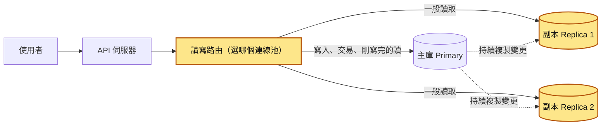
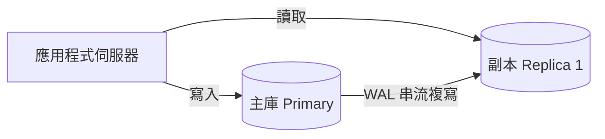
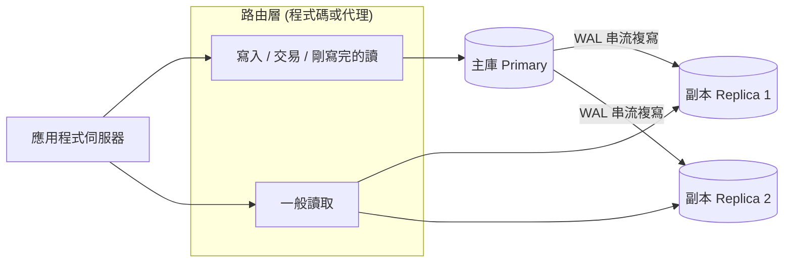
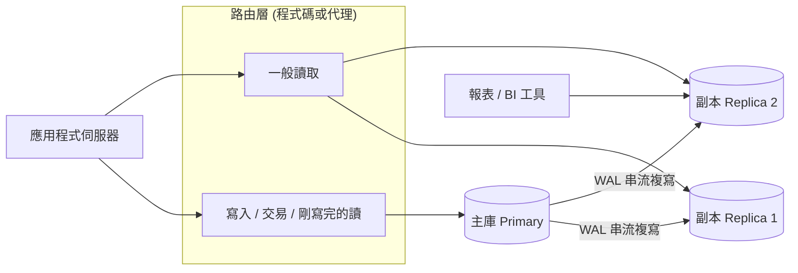
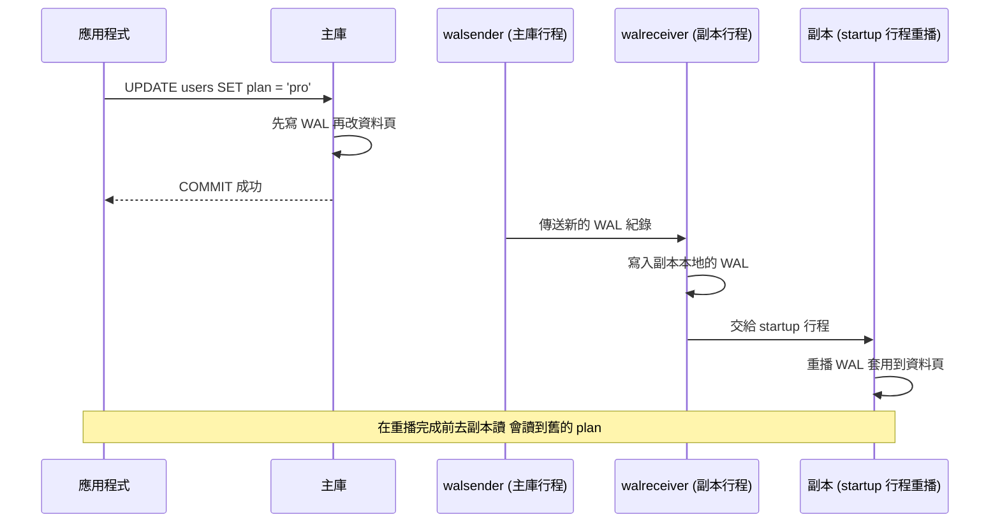
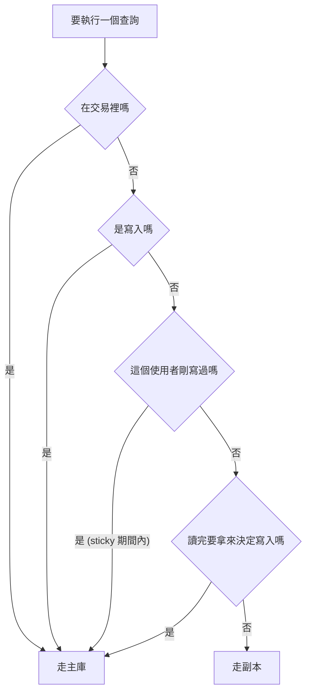

# 17｜讀取副本（Read Replica）

> 讀取副本（read replica）是一台只能讀、不能寫的資料庫，它會持續把主庫（primary，負責接收所有寫入的那台資料庫）的變更複製過來。讀取可以分給一台或多台副本處理，主庫專心處理寫入。

**難度**：★★☆　**閱讀時間**：約 22 分鐘　**前置知識**：[資料庫交易](03-資料庫交易.md)、[連線池](08-連線池.md)

## 為什麼要在意：一個具體的情境

以下是假設情境。假設你負責一個訂閱制 SaaS 平台的後端，資料庫是 PostgreSQL。主庫的 CPU 長期在 80%，大部分負載是讀：儀表板、列表頁、搜尋。團隊決定加 2 台讀取副本，並在 ORM 層設定一條規則：「所有 `SELECT` 走副本、寫入走主庫」。上線當天，主庫 CPU 降到 35%。

先補一個背景：副本的資料是從主庫抄過來的。主庫每提交一筆變更，副本就照順序把這筆變更在自己身上再做一次，這個動作叫「重播」。重播需要一點時間，平常只有幾毫秒，忙的時候會更久。

使用者按下「建立專案」時，ORM 背後做的事攤開來，等於下面兩段。寫法跟後面「動手看看」第 5 步的錯誤示範相同，`RETURNING id` 是讓 `INSERT` 直接把新專案的 id 傳回來：

```python
# ❌ 出事的寫法
# 請求 1：建立專案。這是寫入，走主庫
with primary_pool.connection() as conn:
    new_id = conn.execute(
        "INSERT INTO projects (name) VALUES (%s) RETURNING id", ("gamma",)
    ).fetchone()[0]

# 請求 2：前端拿到 new_id，馬上導到專案頁。這是 SELECT，照規則走副本
with replica_pool.connection() as conn:
    row = conn.execute("SELECT id, name FROM projects WHERE id = %s", (new_id,)).fetchone()
# 副本還沒重播到剛才的 INSERT，row 是 None，專案頁回 404
```

一格一格看，事情是這樣發生的：

| 時間 | 使用者 | API 伺服器 | 主庫的 projects 表 | 副本的 projects 表 |
|---|---|---|---|---|
| T1（10:02:31.100） | 按「建立專案」 | 把 `INSERT` 送到主庫 | 0 筆 | 0 筆 |
| T2（10:02:31.120） | | 主庫提交成功，拿到新專案的 id | 1 筆 | 0 筆 |
| T3 | 畫面顯示建立成功，自動導到專案頁 | | 1 筆 | 0 筆 |
| T4（10:02:31.150） | | 專案頁的 `SELECT` 打到副本。副本這時只重播到 10:02:31.080 的變更，查不到這個專案，回 404 | 1 筆 | 0 筆 |
| T5 | 看到 404，以為沒建成功，再按一次「建立專案」 | 又送一次 `INSERT` 到主庫，專案頁又打到還沒追上的副本 | 2 筆 | 還在追 |
| T6 | 又看到 404，按了第 3 次 | 再送一次 `INSERT` 到主庫 | 3 筆 | 還在追 |
| T7（稍後） | 打開專案列表 | `SELECT` 打到副本，副本已經追上 | 3 筆 | 3 筆，名字一模一樣 |

**使用者看到的**：專案頁 404，接著列表裡出現 3 個一模一樣的專案。同一週客服還收到另外兩種回報，原因相同：「我剛升級成付費方案，付款成功頁卻說我還是免費版」「我改了大頭貼，重新整理後還是舊的，再整理一次又好了」。

**工程師看到的**：一開始大家以為是快取問題，清了好幾次 Redis 都沒用。後來有人在日誌裡比對時間戳才發現：建立專案的 `INSERT` 在主庫上 10:02:31.120 提交，專案頁的 `SELECT` 在 10:02:31.150 打到副本，而那時副本才重播到 10:02:31.080 的變更。**資料已經寫進主庫，副本還沒追上**。

再查下去還有更糟的：付費升級流程裡有一段「先讀使用者目前方案，若是免費版才扣款並升級」。這段讀取也被送到副本，在副本落後變大的尖峰時段，偶爾會讀到舊方案而重複扣款。這跟「常見地雷」第 2 條的庫存例子是同一種寫法：先在副本讀、判斷完再去主庫寫。

**根因**在請求 2 那一行 `with replica_pool.connection()`：「`SELECT` 一律走副本」的規則太粗，沒有考慮「剛寫完的讀」和「讀完要決定寫」這 2 種查詢，它們必須讀到最新資料。

**怎麼修**有 3 步：

1. 交易內的所有查詢一律走主庫。
2. 寫入後的一小段時間內，同一個使用者的讀取改走主庫（[複寫延遲](18-複寫延遲.md)稱為「寫後一段時間讀主庫」）。
3. 升級、扣款這類「讀後決定寫」的流程，整段在主庫的交易裡完成，必要時加鎖（見[悲觀鎖定](07-悲觀鎖定.md)）。

後面「哪些查詢不能丟去副本」會逐一列出要留在主庫的讀，「動手看看」第 6 步有一個路由的寫法。

## 全貌：它在系統裡的位置

下面這張圖畫的是一個請求從使用者走到資料庫的路，上色的是這篇在講的部分：



這個主題發生在兩個地方：API 伺服器決定一個查詢要送去主庫還是副本（讀寫路由），以及副本本身。主庫和每台副本通常各有一個[連線池](08-連線池.md)。主庫到副本的那條虛線會有時間差，那是下一篇[複寫延遲](18-複寫延遲.md)的主題；寫入多到主庫撐不住時，要看的是[資料庫分片](19-資料庫分片.md)。

## 生活比喻

想像一間公司的公告欄。

- **主庫**是總公司那塊唯一能改內容的白板，只有行政可以在上面寫字。
- **副本**是各樓層的電子看板，總公司白板一改，系統就自動把新內容推到各樓層。員工要看公告，去自己樓層的看板就好，不用全部擠到總公司前面。
- 你想改公告，只能去總公司白板改；在樓層看板上亂寫是沒用的（它根本不讓你寫）。

這就是讀寫分離：看的人分散到各樓層，寫的人只去一個地方。

**比喻失準的地方**：

1. 公告欄更新慢個幾分鐘沒人在意，但系統裡「剛改完密碼，下一頁卻顯示舊資料」會讓使用者以為改失敗、重按好幾次。副本的「慢一點」對程式邏輯的影響比公告欄大得多。
2. 樓層看板是「整面替換」，資料庫副本則是**依序重播主庫的每一筆變更**。這代表主庫做了什麼蠢事（例如沒加 `WHERE` 的 `DELETE`），副本也會一模一樣重播一次。
3. 樓層看板壞了不影響總公司；但資料庫副本如果設成同步複寫（主庫要等副本確認才回應），副本卡住反而會拖慢主庫的寫入（後面會提）。

## 它是怎麼運作的

### 整體架構：主庫寫、副本讀

開頭的情境裡，主庫 CPU 長期在 80%，大部分是讀取。讀取副本處理的就是這種負載：多開幾台唯讀的資料庫分擔讀取，寫入仍然只進主庫。

先看最基本的一主一副本。應用程式把寫入送到主庫，主庫把變更串流給副本，一般讀取去副本拿。圖上箭頭寫的「WAL 串流複寫」，意思是主庫把自己的變更紀錄（WAL）持續傳給副本，WAL 是什麼下一小節會講：



下一張加上路由層，由它決定每個查詢去哪一台，副本也增加到 2 台：



最後再加上報表工具，它直接連 Replica 2，不碰主庫：



這個架構有 3 條規則：

1. **寫只進主庫**。副本在 PostgreSQL 裡處於「復原模式（recovery）」，也就是「正在重播別人傳來的變更」的狀態，任何寫入都會被拒絕。
2. **副本靠主庫的變更紀錄追資料**。主庫每改一筆，副本就照著重播一筆，不會定期整份重新複製。
3. **誰讀哪裡，由路由層決定**。路由層可以是你的程式碼（最常見）、ORM 的設定、或是放在中間的資料庫代理（proxy）。

### PostgreSQL 的串流複寫（streaming replication）

PostgreSQL 做任何修改之前，都會先把「我要改什麼」寫進一份預寫日誌（WAL，Write-Ahead Log）。WAL 本來是為了當機復原用的：資料庫重開時，重播 WAL 就能把資料恢復到當機前的狀態。

複寫借用同一個機制。既然重播 WAL 能還原資料，**就把 WAL 即時傳給另一台機器，讓它一直重播**，這台機器的資料就會跟著主庫更新。

下面這張圖裡有 3 個 PostgreSQL 的內部行程（行程就是作業系統裡正在跑的一支程式）：主庫上的 walsender 負責送 WAL，副本上的 walreceiver 負責收，副本上的 startup 行程負責重播。

你送出一句 `UPDATE` 時，主庫先寫 WAL、再改資料頁（資料在磁碟上是一頁一頁存的），提交成功就回應應用程式。之後主庫的 walsender 才把新的 WAL 送到副本，副本收下、寫進自己的 WAL，再交給 startup 行程重播。重播完成之前，去副本讀到的都是舊值：



幾個你要知道的名詞：

- **walsender／walreceiver**：上圖的兩個行程。主庫上每接一台副本就有一個 walsender 行程負責送 WAL；副本上的 walreceiver 負責收。
- **熱備援（hot standby）**：副本一邊重播 WAL、一邊開放唯讀查詢。PostgreSQL 10 起 `hot_standby` 預設就是 `on`，你建好副本就能直接連上去查。
- **非同步 vs 同步複寫**：預設是**非同步（asynchronous）**，主庫提交後就回應使用者，不等副本。這就是副本「慢一點」的根源。可以用 `synchronous_standby_names` 改成同步，讓主庫等副本確認後才回應，但寫入延遲會變高，而且副本卡住時主庫的寫入也會卡住。一般讀取副本都用非同步。
- **同步也不保證副本馬上讀得到**：同步複寫在預設的 `synchronous_commit = on` 下，主庫只等副本「把 WAL 寫進磁碟」，不等它「重播完」，所以就算開了同步，剛提交就去副本讀，還是可能讀到舊資料；要等到副本重播完、查得到才回應，得設成 `remote_apply`，寫入會更慢。各個設定值的差別在[複寫延遲](18-複寫延遲.md)有整理成表。
- **複寫槽（replication slot）**：讓主庫記住「這台副本讀到哪了」，副本斷線時主庫會保留它還沒拿走的 WAL。好處是副本重連時不會因為 WAL 被清掉而追不上；壞處是副本長期掉線時，主庫的 WAL 會一直堆，把磁碟塞滿。
- **LSN（Log Sequence Number）**：WAL 裡的位置編號。主庫寫到哪個 LSN、副本重播到哪個 LSN，相減就是落後了多少位元組。延遲怎麼量、怎麼處理，交給下一篇 [複寫延遲](18-複寫延遲.md)。

> **MySQL 的差異**：MySQL 的複寫是基於二進位日誌（binlog），副本上有 I/O 執行緒收 binlog、SQL 執行緒（新版叫 applier）重播。概念一樣是「主庫寫日誌、副本重播」，但設定、監控指令和一致性細節不同。MySQL 副本要自己設定 `read_only`／`super_read_only` 才會拒絕寫入，不像 PostgreSQL 副本天生就是唯讀。

### 讀寫分離怎麼在程式裡路由

常見的 3 種做法：

| 做法 | 怎麼做 | 優點 | 缺點 |
|---|---|---|---|
| 程式碼裡 2 個連線池 | 一個池接主庫、一個接副本，呼叫時明確選 | 最透明，好除錯 | 每個查詢都要想清楚走哪邊 |
| ORM 路由 | Django 的 `DATABASE_ROUTERS`、SQLAlchemy 多個 engine | 寫法一致、改動集中 | 規則太粗時會出事（開頭情境的事故） |
| 資料庫代理 | Pgpool-II、MySQL 的 ProxySQL、雲端的 reader endpoint | 應用程式幾乎不用改 | 代理很難知道「這個讀是不是剛寫完」 |

不管用哪一種，**路由規則**都是同一份判斷清單。下面這張圖從上往下回答 4 個問題，任何一題答「是」就走主庫。圖裡的 sticky（黏著）指的是：使用者寫入後的幾秒內，把他的讀取「黏」在主庫，等副本追上再放回副本：



### 哪些查詢不能丟去副本

1. **剛寫完馬上讀（read-your-writes）**：建立後導頁、更新後回傳最新狀態、改完設定重新整理。使用者會看到「自己剛做的事沒生效」。
2. **讀完要拿結果決定寫入**：檢查庫存再扣、檢查餘額再扣款、檢查帳號是否存在再建立。拿舊資料做判斷，等於把 [競爭條件](01-競爭條件.md) 放大。這種要在主庫的交易裡做，必要時搭配 [悲觀鎖定](07-悲觀鎖定.md) 或 [樂觀鎖定](06-樂觀鎖定.md)。
3. **寫入交易裡的任何讀**：一個交易只能在一台資料庫、一條連線上。主庫開的交易中途跑去副本讀，那條讀根本不在交易裡，交易的一致性保證完全失效。（例外：整段都是唯讀、只想要一致快照的交易，例如報表，可以整段放在副本上跑，只是讀到的是副本當下的狀態。為了簡單，很多團隊的路由規則直接寫成「有交易就走主庫」，上面的流程圖也是這樣畫。）
4. **需要鎖的讀**：`SELECT ... FOR UPDATE`／`FOR SHARE` 在 PostgreSQL 副本上根本不能執行。
5. **身分驗證、權限、金流狀態**：登入 session、權限變更、付款結果，讀到舊的就是安全或金錢問題。

能安全丟副本的典型例子：商品列表、文章內容、搜尋結果、統計報表、別人的公開資料、歷史紀錄。共同點是「慢幾秒沒人會發現，也不會拿去做決定」。

### 副本的其他用途：報表與備援

- **報表、分析、匯出**：大型聚合查詢、一次掃幾千萬列的匯出，丟在主庫會搶 CPU、I/O 和記憶體，影響線上使用者。常見做法是指定一台副本專門給報表用，不放進線上讀取的輪替。
- **備援（failover）**：主庫掛掉時，把一台副本升級（promote）成新主庫。PostgreSQL 可以用 `pg_promote()` 函式（12 版起）或 `pg_ctl promote`。實務上通常交給 Patroni、雲端託管服務這類工具自動判斷與切換，新人不需要自己做，但要知道「副本可以變主庫」，以及切換後應用程式要能連到新主庫。

### 副本不是備份

副本和備份都存著一份資料，差別在擋得住哪些事：

| | 讀取副本 | 備份 |
|---|---|---|
| 防硬體壞掉 | 可以 | 可以 |
| 防誤刪、錯誤的 `UPDATE` | **不行**，幾毫秒內就同步過去 | 可以，還原到誤刪前 |
| 防勒索軟體、被入侵後刪資料 | **不行** | 可以（如果備份有隔離） |
| 回到某個時間點 | 不行 | 搭配 WAL 歸檔可以做到時間點復原（PITR） |

副本防的是「機器掛了」，備份防的是「人做錯事」，所以副本和備份都要有。PostgreSQL 雖然有 `recovery_min_apply_delay` 可以做「延遲重播的副本」，讓誤刪之後還有一段時間能從這台副本把資料撈回來，但那是補充，不能取代真正的備份。

## 動手看看

我們用 Docker 起一台主庫、一台副本，親手看「主庫寫、副本讀」、「副本拒絕寫入」以及「剛寫完讀副本會讀不到」。

> 以下指令是 bash 寫法。用 PowerShell 的話，把每個指令寫成一行即可（範例都刻意寫成單行）。

### 1. 起主庫

```bash
# 建一個專用網路，讓兩個容器用名稱互相連線
docker network create pgnet

# 起主庫（對外 55432，避免撞到本機已有的 PostgreSQL）
docker run -d --name pg-primary --network pgnet -p 55432:5432 -e POSTGRES_PASSWORD=secret postgres:16

# 等幾秒讓它初始化完成，然後建立複寫專用的帳號
docker exec -it pg-primary psql -U postgres -c "CREATE ROLE replicator WITH REPLICATION LOGIN PASSWORD 'replpass';"

# 官方映像檔的 pg_hba.conf 預設沒有允許外部的複寫連線，補一行再重新載入設定
docker exec pg-primary bash -c 'echo "host replication replicator all scram-sha-256" >> "$PGDATA/pg_hba.conf"'
docker exec -it pg-primary psql -U postgres -c "SELECT pg_reload_conf();"
```

PostgreSQL 10 起 `wal_level` 預設就是 `replica`、`max_wal_senders` 預設是 10，所以主庫不用額外改設定。

### 2. 起副本

```bash
# 用 pg_basebackup 從主庫拷一份完整資料，-R 會自動寫好連回主庫的設定，然後直接以副本身分啟動
docker run -d --name pg-replica --network pgnet -p 55433:5432 --user postgres -e PGPASSWORD=replpass postgres:16 bash -c "pg_basebackup -h pg-primary -U replicator -D /tmp/pgdata -R -X stream -P && exec postgres -D /tmp/pgdata"
```

`-R` 在 PostgreSQL 12 以後會在資料目錄放一個 `standby.signal` 檔，並把 `primary_conninfo` 寫進 `postgresql.auto.conf`。有 `standby.signal`，PostgreSQL 就知道自己是副本。（資料放在容器的 `/tmp` 只是為了示範方便，容器刪掉就沒了。）

`pg_basebackup` 一開始會先等主庫做完一次 checkpoint（把記憶體裡改過的資料頁一次寫回磁碟），`docker logs pg-replica` 會停在 `waiting for checkpoint`。預設是慢慢寫的 spread checkpoint，實測從幾秒到將近一分鐘都有可能；不想等可以在指令裡加 `-c fast`。等日誌出現 `database system is ready to accept read-only connections` 和 `started streaming WAL from primary`，副本才算起好。

### 3. 確認複寫有在跑

```bash
# 在主庫看：有幾台副本連著、狀態是什麼
docker exec -it pg-primary psql -U postgres -c "SELECT client_addr, state, sent_lsn, replay_lsn FROM pg_stat_replication;"
```

預期會看到一列，`state` 是 `streaming`，`sent_lsn` 和 `replay_lsn` 幾乎一樣。

```bash
# 在副本看：自己是不是在復原（副本）模式
docker exec -it pg-replica psql -U postgres -c "SELECT pg_is_in_recovery();"
```

預期回傳 `t`（true）。在主庫上跑同一句會是 `f`。

### 4. 主庫寫、副本讀；副本拒絕寫入

```bash
# 主庫建表、寫資料
docker exec -it pg-primary psql -U postgres -c "CREATE TABLE projects (id bigserial PRIMARY KEY, name text NOT NULL); INSERT INTO projects (name) VALUES ('alpha');"

# 副本讀得到（表結構和資料都同步過來了）
docker exec -it pg-replica psql -U postgres -c "SELECT * FROM projects;"

# 副本寫入會被拒絕
docker exec -it pg-replica psql -U postgres -c "INSERT INTO projects (name) VALUES ('beta');"
```

最後一句預期看到：

```
ERROR:  cannot execute INSERT in a read-only transaction
```

### 5. 重現「剛寫完讀副本讀不到」

本機的延遲通常只有幾毫秒，很難碰巧撞到。我們用 `pg_wal_replay_pause()` 讓副本暫停重播，人工製造延遲。

```python
# demo_read_your_writes.py
# 需要：pip install "psycopg[binary]" psycopg_pool
from psycopg_pool import ConnectionPool

PRIMARY_DSN = "host=localhost port=55432 dbname=postgres user=postgres password=secret"
REPLICA_DSN = "host=localhost port=55433 dbname=postgres user=postgres password=secret"

# 主庫、副本各一個連線池
primary_pool = ConnectionPool(PRIMARY_DSN, min_size=1, max_size=5, open=True)
replica_pool = ConnectionPool(REPLICA_DSN, min_size=1, max_size=5, open=True)

# 模擬副本落後：暫停副本的 WAL 重播（需要超級使用者權限）
with replica_pool.connection() as conn:
    conn.execute("SELECT pg_wal_replay_pause()")

try:
    # 在主庫寫入，離開 with 區塊時自動 COMMIT
    with primary_pool.connection() as conn:
        new_id = conn.execute(
            "INSERT INTO projects (name) VALUES (%s) RETURNING id", ("gamma",)
        ).fetchone()[0]
    print("主庫已提交，id =", new_id)

    # ❌ 錯誤示範：剛寫完馬上去副本讀
    with replica_pool.connection() as conn:
        row = conn.execute("SELECT id, name FROM projects WHERE id = %s", (new_id,)).fetchone()
    print("副本讀到：", row)  # 預期是 None，使用者會看到 404

    # ✅ 正確寫法：剛寫完的讀，走主庫
    with primary_pool.connection() as conn:
        row = conn.execute("SELECT id, name FROM projects WHERE id = %s", (new_id,)).fetchone()
    print("主庫讀到：", row)  # 預期是 (id, 'gamma')
finally:
    # 記得恢復重播，不然副本會一直落後
    with replica_pool.connection() as conn:
        conn.execute("SELECT pg_wal_replay_resume()")
    primary_pool.close()
    replica_pool.close()
```

預期輸出：

```
主庫已提交，id = 2
副本讀到： None
主庫讀到： (2, 'gamma')
```

正式環境的延遲不會這麼誇張，但只要尖峰時段落後個幾百毫秒，就足以讓「建立後導頁」撞到 404。

### 6. 一個簡單的路由寫法

把路由規則集中在一個地方，不要讓每個呼叫的人自己猜。這裡示範「寫入後同一個使用者黏在主庫幾秒」：

```python
# db_router.py
from contextlib import contextmanager
import redis

# primary_pool、replica_pool 沿用上一段範例建立的兩個連線池
r = redis.Redis(host="localhost", port=6379)
STICKY_SECONDS = 5  # 寫入後多久內，這個使用者的讀都走主庫；要依實際延遲調整

def mark_wrote(user_id: int) -> None:
    """每次寫入成功後呼叫，標記這個使用者剛寫過。"""
    r.set(f"db:sticky:{user_id}", 1, ex=STICKY_SECONDS)

@contextmanager
def read_conn(user_id: int | None = None):
    """一般讀取用。剛寫過的使用者會被導回主庫。"""
    use_primary = user_id is not None and r.exists(f"db:sticky:{user_id}")
    pool = primary_pool if use_primary else replica_pool
    with pool.connection() as conn:
        yield conn

@contextmanager
def write_conn():
    """寫入、交易、讀後決定寫入：一律走主庫。"""
    with primary_pool.connection() as conn:
        yield conn
```

這只是最陽春的版本。sticky 秒數要設多長、要不要改用 LSN 判斷副本追上了沒，是 [複寫延遲](18-複寫延遲.md) 要談的事。

### 收拾

```bash
docker rm -f pg-primary pg-replica
docker network rm pgnet
```

## 常見地雷

### 1. 「`SELECT` 一律走副本」

- ❌ **錯誤做法**：在 ORM 或代理層設一條規則：讀走副本、寫走主庫，其他什麼都不管。
- **為什麼錯**：剛寫完的讀、讀後決定寫的讀，都會讀到舊資料。事故裡的 404、重複建立、重複扣款都是這樣來的。
- ✅ **正確做法**：預設可以讀副本，但要有明確的「強制主庫」出口：交易內、寫入後一段時間、關鍵業務流程。Code Review 時對每個新的讀取問一句「它可以接受舊資料嗎」。

### 2. 先讀副本判斷，再寫主庫

- ❌ **錯誤做法**：

  ```python
  # ❌ 錯誤示範：在副本檢查庫存，再到主庫扣
  with replica_pool.connection() as conn:
      stock = conn.execute("SELECT stock FROM products WHERE id = %s", (pid,)).fetchone()[0]
  if stock > 0:
      with primary_pool.connection() as conn:
          conn.execute("UPDATE products SET stock = stock - 1 WHERE id = %s", (pid,))
  ```

- **為什麼錯**：副本上的 `stock` 可能已經過時，主庫實際可能已經是 0。這比一般的競爭條件更糟，因為「舊」的時間窗更長。
- ✅ **正確做法**：判斷和寫入都在主庫，最好合成一句帶條件的更新：

  ```python
  # ✅ 正確寫法：在主庫用一句條件式 UPDATE，讓資料庫原子地檢查並扣減
  with primary_pool.connection() as conn:
      cur = conn.execute(
          "UPDATE products SET stock = stock - 1 WHERE id = %s AND stock > 0", (pid,)
      )
      if cur.rowcount == 0:
          raise OutOfStock()
  ```

### 3. 把副本當備份

- ❌ **錯誤做法**：「我們有 2 台副本，資料很安全，備份就先不用做了。」
- **為什麼錯**：誤刪、錯誤的批次更新、被入侵後的破壞，都會照樣複寫到所有副本。
- ✅ **正確做法**：另外做定期備份（`pg_basebackup` 或託管服務的快照）加 WAL 歸檔，並且**定期演練還原**。沒演練過還原，就不知道這份備份到底救不救得回資料。

### 4. 交易裡混用主庫和副本

- ❌ **錯誤做法**：在主庫開了交易，交易中間呼叫某個 helper，那個 helper 預設走副本去讀。
- **為什麼錯**：副本那條查詢不在你的交易裡，看不到交易內未提交的變更，也不受交易的隔離保證保護。而且有些框架的路由不會因為你在交易裡就自動改走主庫，例如 Django 的 router 在 `transaction.atomic()` 裡照樣會依 `db_for_read` 決定讀哪個資料庫。
- ✅ **正確做法**：交易內的連線從頭到尾同一條，全部在主庫。helper 要能接收外面傳進來的連線，而不是自己去拿。

### 5. 在副本上跑長報表，被莫名取消

- ❌ **錯誤做法**：把跑 20 分鐘的報表丟到線上用的副本，然後抱怨查詢常常失敗。
- **為什麼錯**：副本一邊重播 WAL、一邊服務查詢。如果主庫清掉了報表查詢還需要的舊版資料（例如 `VACUUM`，PostgreSQL 定期清掉沒用的舊版資料列的維護工作），副本重播到這一步時就會跟查詢衝突。PostgreSQL 會等最多 `max_standby_streaming_delay`（預設 30 秒），等不到就取消查詢，錯誤訊息類似 `canceling statement due to conflict with recovery`。
- ✅ **正確做法**：報表用專屬副本，並依需求調整：調大這台的 `max_standby_streaming_delay`（代價是這台的資料會落後更多），或打開 `hot_standby_feedback`（副本會告訴主庫「這些舊資料我還在用」，代價是主庫的死列，也就是被更新或刪除後留下的舊版資料列，清不掉，表會膨脹）。這 2 個設定都有代價，改之前先跟 DBA 或資深同事討論。

### 6. 副本掛了，整個讀取功能跟著掛

- ❌ **錯誤做法**：讀取只寫死連某一台副本，沒有健康檢查、也沒有退路。
- **為什麼錯**：副本也會掛、也會落後到不能用。這時候所有讀取都失敗，主庫明明還好好的。
- ✅ **正確做法**：多台副本放在負載平衡或 DNS 後面，並做 [健康檢查](49-健康檢查.md)：連不上或落後太多就移出輪替。至於副本全掛時要不要退回主庫，要先算過主庫扛不扛得住，不然會把主庫一起拖垮。

### 7. 以為加副本能解決寫入瓶頸

- ❌ **錯誤做法**：主庫寫入太多、鎖等待嚴重，於是加了 3 台副本。
- **為什麼錯**：副本只分擔讀。而且每台副本都要重播全部的寫入，寫入量本身一點都沒少。
- ✅ **正確做法**：先確認瓶頸是讀還是寫（看 `pg_stat_statements` 這個記錄每種查詢花了多少時間的統計，看 CPU 和 I/O 花在哪）。寫入瓶頸要找 [查詢最佳化](11-查詢最佳化.md)、批次化、[垂直擴展](33-垂直擴展.md)，真的到極限才考慮 [資料庫分片](19-資料庫分片.md)。

## 重點整理

- 讀取副本是主庫的唯讀複本。**所有寫入都只能進主庫**，副本靠串流複寫拿到主庫的 WAL，照順序重播，只能拿來讀。
- 預設是非同步複寫，副本一定比主庫慢一點：平常是毫秒級，副本忙的時候可能落後幾秒甚至幾分鐘。所以「剛寫完馬上要讀」「讀完要拿結果去決定寫什麼」「交易裡的讀」「需要鎖的讀」**都要留在主庫**。
- 讀寫分離要在程式裡**明確路由**：哪個連線池接主庫、哪個接副本，什麼情況強制走主庫，要集中寫在程式碼裡讓人看得到。開頭情境的 404 和重複扣款，都是「`SELECT` 一律走副本」這種太粗的規則造成的。
- 副本除了分擔線上讀取，也適合跑報表和資料匯出（最好用專屬的一台），以及在主庫掛掉時升級成新主庫（failover）。
- **副本不是備份**。你在主庫誤刪一張表，副本幾毫秒內就跟著刪掉了。備份要另外做，並定期演練還原。

## 新人必知清單

### 一定要會（基本功）

- [ ] 說得出「主庫寫、副本讀」，以及副本為什麼只能讀。
- [ ] 知道預設是非同步複寫，副本一定比主庫慢一點。
- [ ] 能判斷一個查詢能不能丟副本：剛寫完的讀、讀後決定寫、交易內的讀、需要鎖的讀，都要走主庫。
- [ ] 看得懂專案裡的讀寫路由寫在哪裡（哪個連線池、哪個 ORM 設定），新增查詢時知道怎麼指定走主庫。
- [ ] 知道副本不是備份，能說出差別。
- [ ] 會用 `pg_is_in_recovery()` 確認自己連到的是主庫還是副本。

### 知道有這回事就好

- PostgreSQL 串流複寫是傳 WAL、副本重播；MySQL 是傳 binlog、副本重播。
- `pg_stat_replication`（主庫看）、`pg_stat_wal_receiver`（副本看）這 2 個檢視表可以看複寫狀態。
- 同步複寫存在，但會增加寫入延遲、副本卡住時會拖住主庫。
- 複寫槽能避免副本追不上，但副本長期掉線會讓主庫磁碟爆掉。
- 副本上的長查詢可能因為跟重播衝突而被取消，`max_standby_streaming_delay` 和 `hot_standby_feedback` 是相關的 2 個開關。
- 副本可以被升級成主庫（failover），通常由 Patroni 或雲端託管服務處理。
- libpq 的連線字串可以列多台主機，搭配 `target_session_attrs=read-write` 讓用戶端自己找出目前的主庫（`read-only`、`primary`、`standby`、`prefer-standby` 這幾個值是 14 版起才有）。

### 先不用管（等你遇到再學）

- 邏輯複寫（logical replication）、發布／訂閱（publication／subscription）。
- 串接複寫（cascading replication）：副本再接副本。
- 自己架 Patroni、etcd 做自動切換的細節。
- 同步複寫的 quorum 設定（`ANY 2 (...)` 這類語法）。
- 跨區域副本、延遲重播副本的維運細節。

## Code Review 時可以問的問題

1. 這個新增的讀取查詢走主庫還是副本？如果走副本，它能接受讀到幾秒前的資料嗎？
2. 這段流程是不是「寫完馬上讀」或「讀完拿來決定寫」？如果是，有沒有確保走主庫？
3. 交易裡呼叫的 helper，會不會自己從另一個連線池（副本）拿連線？
4. 這個大型查詢（報表、匯出）會不會跑在主庫或線上用的副本上，影響使用者？
5. 副本連不上或落後太多時，這段程式會怎樣？是報錯、退回主庫，還是靜靜回傳舊資料？
6. 有沒有任何地方把副本當成「備份」或「還原來源」的假設？

## 情境演練

**1. 你連上一台 PostgreSQL 補一筆資料，`INSERT` 卻回傳 `cannot execute INSERT in a read-only transaction`。你會先確認什麼？如果公司另一套系統用的是 MySQL，那邊的副本你要多確認什麼？**

<details markdown="1"><summary>看答案</summary>

先跑 `SELECT pg_is_in_recovery();`，回傳 `t` 就代表你連到的是副本，要改連主庫。

PostgreSQL 副本處於復原模式（`pg_is_in_recovery()` 回傳 true），它的工作是重播主庫傳來的 WAL，所有交易都被強制成唯讀，所以 `INSERT` 會得到 `cannot execute INSERT in a read-only transaction`。如果允許副本自己寫，它的資料就會跟主庫分岔，之後重播 WAL 時根本對不起來。

MySQL 的副本則不一定天生唯讀，要靠設定 `read_only`（以及更嚴格的 `super_read_only`）來擋寫入。沒設好的話，有人不小心寫進副本，資料就會悄悄分岔，所以 MySQL 環境要確認副本有開這些設定。

</details>

**2. 規劃會議上，同事提議：「我們已經有 2 台即時同步的副本，資料都在，備份可以先停掉省成本。」你會怎麼回應？**

<details markdown="1"><summary>看答案</summary>

不能停。副本是即時同步的，它重播的是主庫的每一筆變更，包括錯誤的變更。有人在主庫跑了沒加 `WHERE` 的 `DELETE`，幾毫秒內所有副本都會一起刪掉。

備份的價值在於「可以回到過去某個時間點」，副本只能反映「現在」。副本擋得住硬體故障，擋不住人為錯誤、程式 bug 或惡意破壞，所以副本和備份都需要。

</details>

**3. 主庫負載太高，你被指派盤點哪些查詢可以搬去副本。下面 4 個查詢，你會搬哪幾個？為什麼？**
(a) 首頁的熱門文章列表　(b) 使用者按下「儲存」後回傳的最新個人資料　(c) 每日營收報表　(d) 結帳前檢查優惠券是否已被使用

<details markdown="1"><summary>看答案</summary>

- (a) 適合。慢幾秒沒人察覺，也不會拿去做決定。
- (b) 不適合。這是「剛寫完馬上讀」，讀副本可能拿到舊資料，使用者會以為沒存成功。
- (c) 適合，而且最好用專屬的報表副本，避免影響主庫和線上讀取。只要接受「報表可能落後幾秒到幾分鐘」即可。
- (d) 不適合。這是「讀完拿來決定寫」，讀到舊資料可能讓同一張優惠券被用 2 次。要在主庫的交易裡檢查並標記，最好用條件式更新或 [唯一約束](14-唯一約束.md) 讓資料庫幫你擋。

</details>

**4. 你們的 API 在主庫交易裡先建立訂單，再呼叫 `get_user_level(user_id)` 計算折扣，最後寫入折扣。測試環境一切正常，上線後偶爾算錯折扣，而且剛好發生在使用者剛升級會員之後。你會怎麼查？可能的原因是什麼？**

<details markdown="1"><summary>看答案</summary>

先看 `get_user_level` 用的是哪條連線。最可能的原因是：這個 helper 自己去拿連線，而預設路由把讀取丟到副本。於是：

1. 使用者剛升級會員，`UPDATE` 在主庫提交了。
2. 緊接著下單，訂單交易在主庫，但 `get_user_level` 去副本讀，副本還沒重播到升級的變更，讀到舊等級。
3. 折扣用舊等級算，寫回主庫。

測試環境正常，是因為測試環境可能根本沒有副本（讀寫都在同一台），或副本延遲幾乎為零。

查法：在 helper 裡記錄 `inet_server_addr()` 或 `pg_is_in_recovery()` 確認連到哪一台；比對升級和下單的時間差與當時的複寫延遲。修法：讓 helper 接收外面傳入的交易連線，交易內的所有讀都在主庫完成；同時在路由層加上「交易中一律主庫」的保護。

</details>

**5. 主庫 CPU 很高，同事建議「加 2 台副本就好」。在同意之前你要先確認什麼？**

<details markdown="1"><summary>看答案</summary>

先確認負載是讀還是寫。用 `pg_stat_statements` 看最耗時的查詢是哪些、是 `SELECT` 還是 `INSERT`／`UPDATE`。

- 如果是大量讀取，而且這些讀可以接受一點延遲，加副本有用。但還要盤點：這些讀有多少屬於「剛寫完的讀」或「讀後決定寫」，那些不能搬走。
- 如果是寫入造成的，加副本沒用：每台副本都要重播全部寫入，主庫的寫入量一點都沒少。這時候應該先看 [查詢最佳化](11-查詢最佳化.md)、[資料庫索引](10-資料庫索引.md)（索引太多也會拖慢寫入），或考慮升級規格。
- 另外也要看是不是有幾條爛查詢佔掉大部分 CPU。最佳化一條查詢，往往比加 2 台機器便宜得多。

</details>

## 相關主題

- [複寫延遲](18-複寫延遲.md)：副本到底會落後多少、怎麼量、怎麼做到 read-your-writes，這篇只點到為止，下一篇深入。
- [最終一致性](42-最終一致性.md)：讀副本就是最常見的最終一致性，理解它能幫你判斷哪些讀可以接受舊資料。
- [資料庫交易](03-資料庫交易.md)：為什麼交易內的讀一定要跟寫在同一台、同一條連線上。
- [連線池](08-連線池.md)：讀寫分離通常就是主庫、副本各一個連線池，池的大小要分開算。
- [資料庫分片](19-資料庫分片.md)：副本解決讀的壓力，寫的壓力撐不住時才輪到分片。
- [CQRS](45-CQRS.md)：把讀和寫的模型徹底分開，可以看成讀寫分離在架構層的延伸。

## 延伸閱讀

- PostgreSQL 官方文件：Log-Shipping Standby Servers（含串流複寫與複寫槽）：https://www.postgresql.org/docs/current/warm-standby.html
- PostgreSQL 官方文件：Hot Standby（副本上能做什麼、不能做什麼、查詢衝突）：https://www.postgresql.org/docs/current/hot-standby.html
- PostgreSQL 官方文件：pg_basebackup：https://www.postgresql.org/docs/current/app-pgbasebackup.html
- Django 官方文件：Multiple databases（資料庫路由）：https://docs.djangoproject.com/en/stable/topics/db/multi-db/
