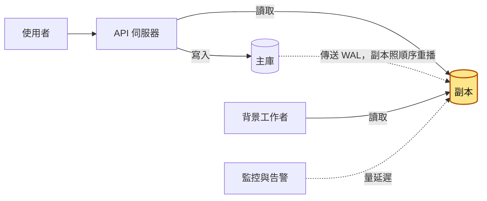
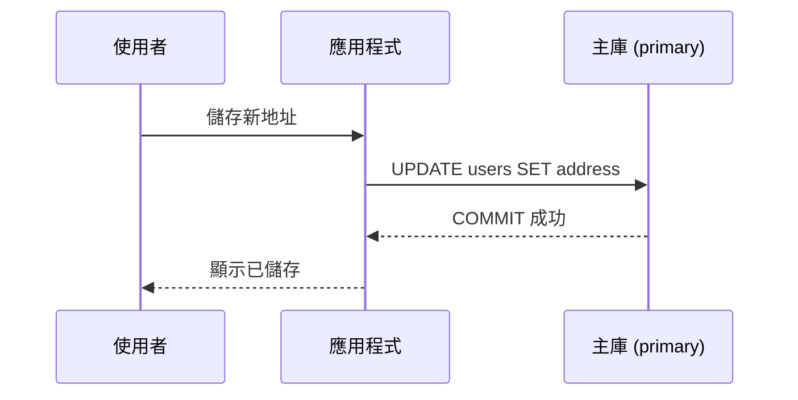
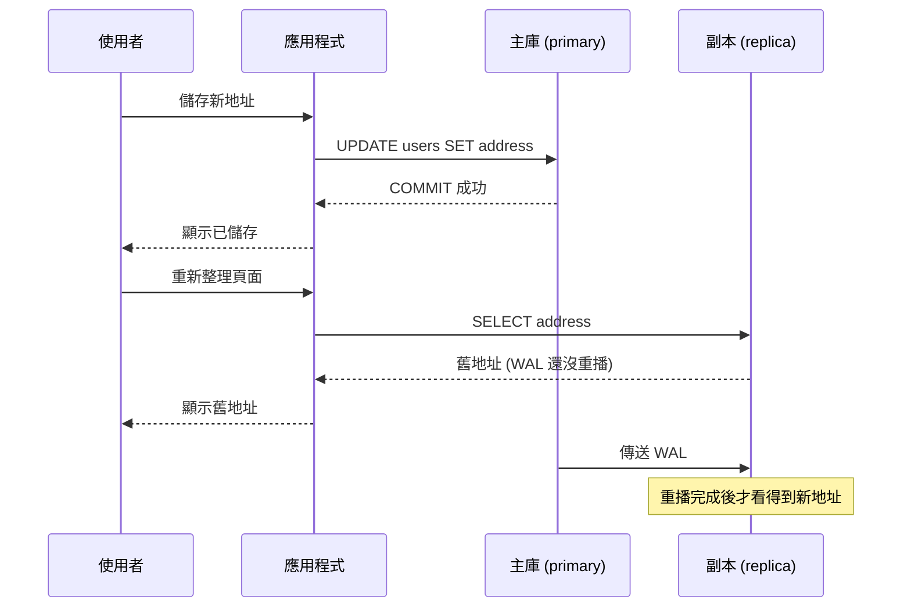
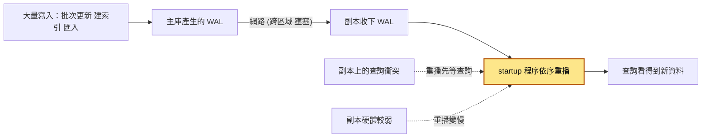
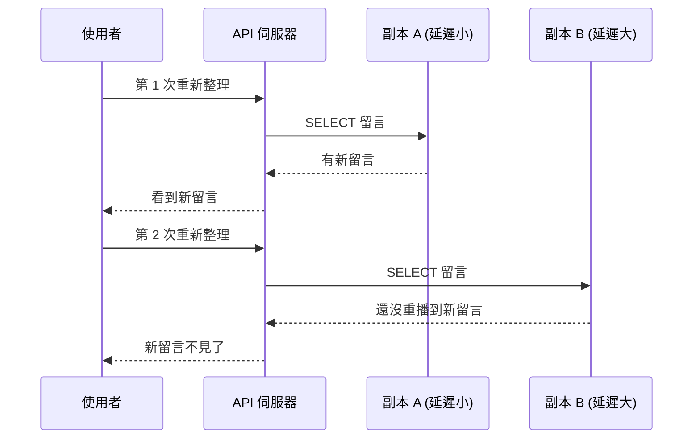
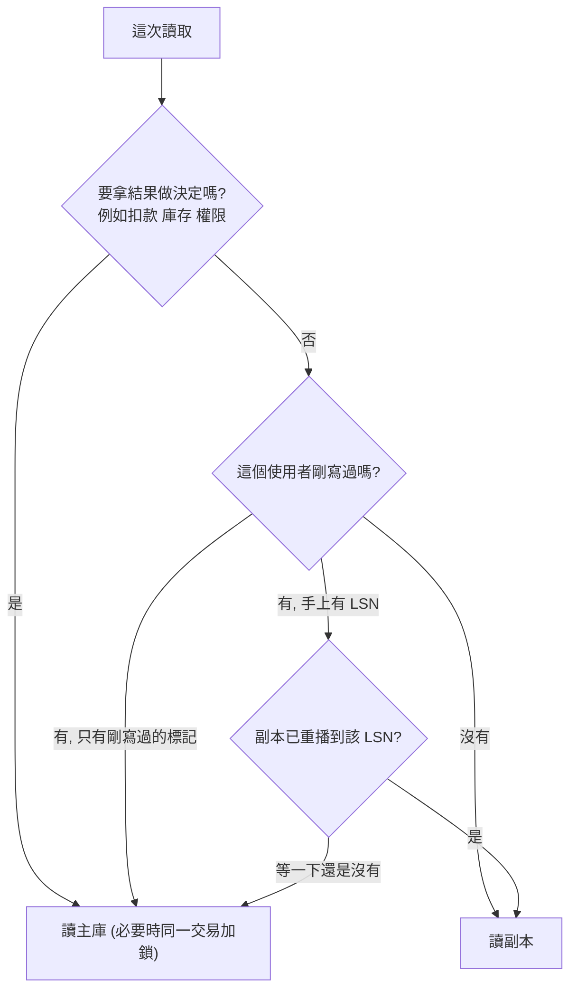
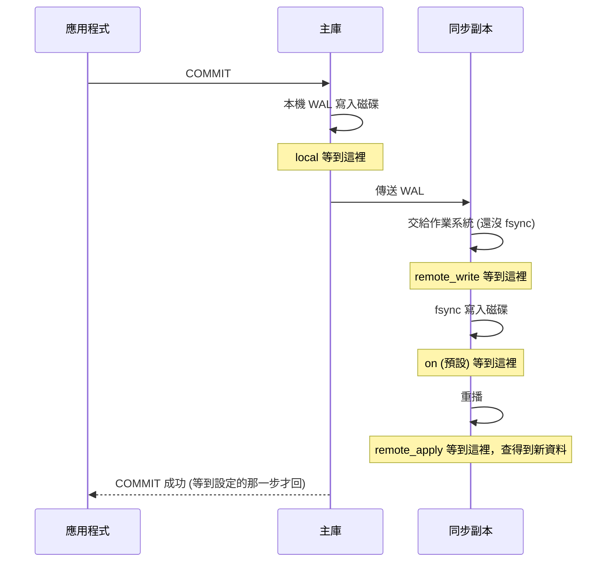
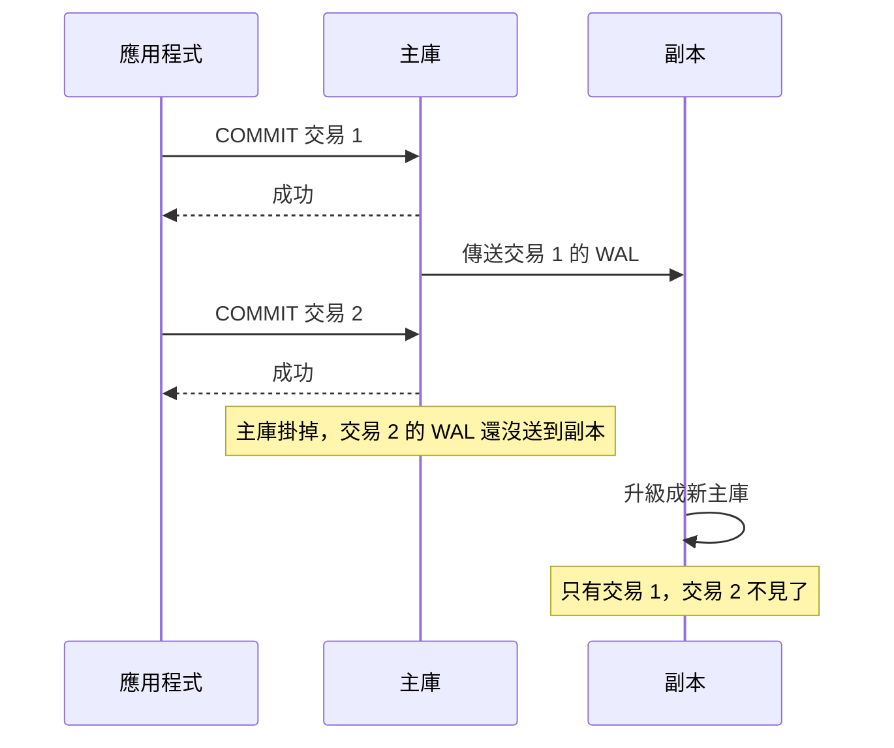

# 18｜複寫延遲（Replication Lag）

> 複寫延遲（replication lag）是一筆資料在主庫寫入成功（commit）之後，要再過多久才能在[讀取副本](17-讀取副本.md)上查到。這段時間內從副本讀到的都是舊資料。

**難度**：★★☆　**閱讀時間**：約 25 分鐘　**前置知識**：[競爭條件](01-競爭條件.md)、[資料庫交易](03-資料庫交易.md)、[讀取副本](17-讀取副本.md)

## 核心問題與理念

**它要解決的問題**：讀取副本（只能讀、資料從主庫抄過來的資料庫）一定比主庫晚一點拿到新資料，平常只差幾十毫秒，沒人察覺，尖峰時卻可能落後 40 秒。使用者改完收件地址按儲存，重新整理卻一直看到舊地址，結帳時訂單也用了舊地址，監控沒有任何告警。（下面的情境會完整走一遍）

**核心理念**：副本一定會慢一點；剛寫過或要拿來做決定的讀，先確認副本追上了，沒追上就讀主庫。

**想通的那一步**：

- **卡住的地方**：直覺的做法是想辦法讓副本永遠不落後。可是那得讓主庫等副本重播完才回應（`remote_apply`），每一筆寫入都跟著變慢；就算開了同步複寫（主庫等副本回應才算寫入成功），預設也只等副本把變更寫進磁碟，剛寫完去副本讀，還是可能讀到舊的。
- **火花**：延遲既然消不掉，就只替「剛寫過的人」保證讀得到新資料。寫入時記下這筆變更在變更紀錄（WAL）裡的位置編號（LSN），之後讀取先問副本「你重播到這個編號了沒」，到了就讀副本，還沒到就讀主庫。

## 閱讀前推薦具備知識

| 知識 | 要會到什麼程度 | 這篇哪裡會用到 | 不熟的話先看 |
|---|---|---|---|
| [讀取副本](17-讀取副本.md) | **必備**：能說出寫入只進主庫、副本靠重播主庫傳來的 WAL 追上資料，以及讀寫分離是由程式決定每個查詢去哪一台 | 整篇的情境（`GET` 走副本）、「複寫在做什麼」、「動手看看」第 1～3 步起一主一副本 | 本系列第 17 篇 |
| [資料庫交易](03-資料庫交易.md) | **必備**：知道 `COMMIT` 成功的那一刻，這筆變更在主庫上才算數 | 延遲的定義從 commit 起算、`synchronous_commit` 那張表、`ryw.py` 的 `with primary.transaction():` | 本系列第 03 篇 |
| HTTP 方法 | **加分**：知道 `GET` 用來讀資料，`POST`／`PUT`／`DELETE` 用來新增或修改 | 情境的讀寫分離規則「所有 `GET` 走副本」、`PUT /me/address` | [MDN：HTTP 方法](https://developer.mozilla.org/en-US/docs/Web/HTTP/Reference/Methods) |
| [競爭條件](01-競爭條件.md) | **加分**：能說出「先讀再寫」中間的空檔，會讓兩個請求都通過檢查 | 「讀到舊資料會長成哪些 bug」的「拿舊資料做決定」、常見地雷第 3 條 | 本系列第 01 篇 |
| Python 的函式與迴圈 | **加分**：看得懂 `while True:` 搭配 `return` 跳出的輪詢寫法 | 「動手看看」第 5 步 `ryw.py` 的 `replica_caught_up` | [Python 官方教學（中文）](https://docs.python.org/zh-tw/3/tutorial/index.html) 第 4 章 |
| Docker 基本指令 | **加分**：會用 `docker run` 起容器，用 `docker exec ... psql -c "..."` 在容器裡下一句 SQL | 「動手看看」第 1～4 步 | [Docker 入門](https://docs.docker.com/get-started/) |

**快速自我檢查**：非同步複寫下，主庫 commit 了 `UPDATE users SET address = '新家' WHERE id = 1`，下一個請求馬上到副本查 `SELECT address FROM users WHERE id = 1`。一定查得到新家嗎？

<details markdown="1"><summary>看答案</summary>

不一定。非同步複寫時，主庫 commit 完就回應，不等副本；副本要收到這段 WAL、重播完，才查得到新家。這篇整篇都在處理這段空檔。答不出來的話，先回頭看第 17 篇〈讀取副本〉的「PostgreSQL 的串流複寫」那一節。

</details>

## 為什麼要在意：一個具體的情境

以下是假設情境。假設你負責一個電商平台的後端，資料庫是 PostgreSQL，一台主庫加兩台副本，用的是預設的非同步複寫：主庫 commit 完就回應，不等副本。主庫的每一筆修改都會先寫進 WAL（write-ahead log，預寫式日誌），副本收到 WAL 後照順序重播，才查得到新資料（[讀取副本](17-讀取副本.md)講過這段）。團隊在 API 前面加了一層讀寫分離的規則：**所有 `GET` 請求走副本，`POST/PUT/DELETE` 走主庫**。上線後平常延遲都在 50 毫秒以內，一直相安無事。

會員中心「修改收件地址」的流程，照這條規則會拆成兩個請求：

1. **`PUT /me/address`（按儲存）**：寫入，走主庫，`UPDATE users SET address = ...` 在主庫 commit。
2. **`GET /me`（重新整理，或結帳頁帶出收件地址）**：讀取，照規則走副本。

這跟「動手看看」的〈5. 用 LSN 做 read-your-writes〉裡「直接讀副本」的錯誤示範是同一種寫法，只是把暱稱換成地址。

平常副本 50 毫秒內就追上，使用者按完儲存再重新整理，副本早就有新地址了。雙十一前一晚，兩件事同時發生，把延遲拉長到 40 秒以上。下面這張圖看這兩件事怎麼一起把副本塞住：

<figure class="draw-fig">
<iframe class="draw-fig__frame" src="../figures/18-replica-lag-queue.html" title="按播放或點 T1–T7，看「改地址」那一格 WAL 怎麼排在批次 WAL 後面慢慢往副本移動：這段期間主庫已經是新家，副本和使用者看到的卻一直是舊家。" loading="lazy" style="height: 340px;"></iframe>
<figcaption>按播放或點 T1–T7，看「改地址」那一格 WAL 怎麼排在批次 WAL 後面慢慢往副本移動：這段期間主庫已經是新家，副本和使用者看到的卻一直是舊家。</figcaption>
</figure>

一列一列看，使用者的地址在兩台資料庫上是這樣變的：

| 時間 | 發生什麼事 | 主庫的 address | 副本的 address | 副本落後多少 |
|---|---|---|---|---|
| T1（22:00） | 批次工作開始一次 `UPDATE` 300 萬筆商品價格，主庫瞬間產生大量 WAL | 舊家 | 舊家 | 從 50 毫秒開始往上爬 |
| T2（22:00） | 資料組在一台副本上跑報表，副本為了不打斷它，延後套用一部分 WAL | 舊家 | 舊家 | 繼續變大 |
| T3（22:05:10） | 使用者把地址改成新家，按儲存，主庫 commit 成功，畫面顯示「已儲存」 | 新家 | 舊家，這筆變更排在 40 多秒的隊伍後面 | 約 40 秒 |
| T4（22:05:15） | 使用者重新整理，`GET /me` 走副本 | 新家 | 舊家 | 約 40 秒 |
| T5（22:05:30） | 使用者以為沒存到，又改了幾次、整理了幾次，每次都是舊家 | 新家 | 舊家 | 約 40 秒 |
| T6 | 使用者直接去結帳，結帳頁從副本帶出舊家，訂單用舊地址成立 | 新家 | 舊家 | 約 40 秒 |
| T7（22:05:50 之後） | 副本終於重播到 T3 的變更 | 新家 | 新家 | 慢慢回落 |

**使用者看到的**：「我在會員中心改了收件地址，按儲存顯示成功，重新整理又變回舊的。」有人連改了 5 次，每次都「好像沒存到」。最嚴重的是幾位改完地址就去結帳的使用者，訂單寄到了舊家。

**工程師看到的**：監控只有 CPU 和連線數，兩個都沒有異常，所以 22:05 開始的整段時間沒有任何告警，直到客服反映才發現。事後在主庫查 `pg_stat_replication`，才看到副本的延遲衝到 40 秒以上。

**根因**在 `GET /me` 這個讀取：讀寫分離的規則只看 HTTP 方法，完全不管「這個使用者剛剛才寫過」。批次工作和副本上的報表只是把延遲放大的觸發點。**延遲平常很小，所以沒人處理；一旦變大，整套「讀副本」的假設就同時崩掉。**

**怎麼修**：寫入後把這筆寫入在 WAL 裡的位置（LSN）存進使用者的 session，後續讀取先確認副本追上這個位置，追不上就讀主庫；結帳這類拿來做決定的讀取直接改走主庫；報表移到專用副本；加上延遲超過 5 秒告警、超過 30 秒自動把副本從讀取池拿掉。做法的細節在後面「對策：read-your-writes」和「監控延遲」兩節，報表的問題在「常見地雷」第 7 條。

## 全貌：它在系統裡的位置

下面這張圖畫的是讀寫分離之後，一個請求和一筆資料會經過哪些地方，上色的是延遲發生的位置：



延遲就發生在主庫到副本的那條虛線上：資料已經進了主庫，副本還沒重播完。所有從副本讀資料的人都會受影響，包括 API 和[背景工作者](37-背景工作者.md)。為什麼要有副本，請看上一篇[讀取副本](17-讀取副本.md)；延遲太大時怎麼把副本移出讀取池，跟[健康檢查](49-健康檢查.md)有關。

## 生活比喻

想像公司有一份正本的「客戶通訊錄」放在總部，各分店各有一本影本。總部每改一筆，就把修改單用快遞寄到各分店，分店店員收到後照著改自己的影本。

- 客戶打給總部改地址，總部當場改好（**commit 在主庫**）。
- 客戶 10 分鐘後打給分店確認，分店還沒收到快遞，唸出來的是舊地址（**從副本讀到舊資料**）。
- 快遞在路上的時間、分店店員忙著接待客人沒空改的時間，加起來就是**複寫延遲**。
- 解法有 2 種：剛改過地址的客戶，這陣子打來都直接轉總部（**寫後一段時間讀主庫**）；或是總部給客戶一張「修改單號」，分店先確認自己已經處理到這個單號再回答，還沒處理到就轉總部（**帶 LSN 等副本追上**）。

**比喻失準的地方**：分店的修改單是「一張一張」照順序套用的，這點跟資料庫很像；但真實的分店店員可能跳著改、漏改，資料庫的副本不會，它嚴格照主庫的順序重播（replay），只是會慢。另外，PostgreSQL 的副本可能為了不打斷正在跑的查詢，**故意暫停**套用修改，這是比喻裡沒有的行為（後面會講）。

## 它是怎麼運作的

### 複寫在做什麼

讀取副本要分擔讀取，手上就得有一份跟主庫一樣的資料。PostgreSQL 的每一筆修改，都會先寫進 WAL。串流複寫（streaming replication）就是主庫把 WAL 一段一段傳給副本，副本收到後照順序重播，讓自己的資料跟主庫一樣。

非同步複寫下，**主庫 commit 時不等副本。** 主庫把 WAL 寫進自己的磁碟，就回覆應用程式「成功」。WAL 什麼時候到副本、副本什麼時候重播完，主庫不管。

先看只有主庫的寫入。使用者按下儲存，應用程式送出 `UPDATE`，主庫 commit 完就回覆成功：



再加上副本。使用者重新整理時，讀取被送到副本，但主庫的 WAL 還沒送到副本：



### 延遲是由哪幾段組成的

從主庫 commit 到副本看得到，中間有好幾段，每一段都可能慢。下面會出現 fsync：寫檔時資料通常先放在作業系統的記憶體緩衝區，fsync 是要求作業系統把它真的寫進磁碟。

這張圖從左到右看一筆 WAL 的旅程，每個箭頭是一段可能變慢的工作，每個方框底下寫著哪個 lag 量到這裡：


`pg_stat_replication`（在主庫上查）把這幾段量成 3 個時間欄位（PostgreSQL 10 起）。3 個欄位都是**從同一個起點（主庫把 WAL 寫入磁碟）一路算到該階段的累計時間**，所以正常情況下 `write_lag` ≤ `flush_lag` ≤ `replay_lag`。量到的時間也包含副本把進度回報給主庫的那一段：

| 欄位 | 意思 |
|---|---|
| `write_lag` | 主庫把 WAL 寫入磁碟後，到副本回報「已寫入（還沒 fsync）」的時間 |
| `flush_lag` | 到副本回報「已 fsync 到磁碟」的時間 |
| `replay_lag` | 到副本回報「已重播，查詢看得到」的時間 |

對讀取副本來說，**真正要在意的是 `replay_lag`**，因為只有重播完，查詢才看得到新資料。

另外還有 4 個 LSN（log sequence number，WAL 裡的位置）欄位：`sent_lsn`、`write_lsn`、`flush_lsn`、`replay_lsn`。拿主庫目前位置 `pg_current_wal_lsn()` 跟 `replay_lsn` 相減（用 `pg_wal_lsn_diff()`），就是「副本還差多少位元組沒重播」。

### 為什麼會落後

下面這張圖看 WAL 從主庫到副本的路上，每個原因卡在哪一段。所有 WAL 最後都要擠過上色的那一關，副本的重播主要由單一個 startup 程序依序處理。



表裡有兩個詞先說明：`VACUUM` 是 PostgreSQL 定期清掉已經沒用的舊版資料列的維護工作；排他鎖是「我在用，其他人都不能碰」的鎖。

| 原因 | 說明 |
|---|---|
| 大量寫入 | 批次 `UPDATE`／`DELETE`、建索引、大量匯入，短時間產生大量 WAL |
| 重播能力有限 | PostgreSQL 副本的重播主要由單一個 startup 程序依序處理，主庫多條連線並行寫入，副本卻得照順序排隊重播 |
| 副本上的查詢衝突 | 例如重播要清掉某些舊版本的列（主庫 VACUUM 的結果），或要對表取得排他鎖（主庫做了 `DROP TABLE`、`ALTER TABLE`），但副本上的查詢還在用，副本會先等查詢（最多等 `max_standby_streaming_delay`，預設 30 秒），等不到就取消查詢 |
| 副本硬體較弱 | 副本規格比主庫小、磁碟 I/O 不夠 |
| 網路 | 跨機房、跨區域複寫，或網路短暫壅塞 |

副本等到 `max_standby_streaming_delay` 的時間用完，副本上的查詢就會被取消，錯誤訊息是 `canceling statement due to conflict with recovery`。開 `hot_standby_feedback = on` 可以減少取消，但代價是主庫的 VACUUM 不能清掉副本還在用的舊列，主庫的表會膨脹。要不要開，看你比較能接受查詢被取消，還是主庫的表膨脹。

MySQL 的概念一樣：主庫寫 binlog，副本的 I/O 執行緒（receiver）收下來寫成 relay log，SQL 執行緒（applier）再套用。MySQL 可以設定多執行緒平行套用（`replica_parallel_workers`），減少「單線排隊」的問題，但大交易照樣會卡。

### 讀到舊資料會長成哪些 bug

先用一張圖看最難想像的一種「資料倒退」：同一個使用者連續重新整理 2 次，2 次剛好打到延遲不同的 2 台副本。



4 種常見的 bug：

- **讀不到自己的寫入**：改完重新整理看到舊的；新增文章後跳轉到文章頁顯示 404。
- **資料倒退**：使用者連續重新整理 2 次，第一次打到延遲小的副本 A（看到新留言），第二次打到延遲大的副本 B（新留言不見了）。這叫違反單調讀取（monotonic reads），對策是同一個使用者固定讀同一台副本，或用 LSN 保證「至少要追到某個位置」。
- **拿舊資料做決定**：從副本讀庫存、餘額、是否已存在，再到主庫寫入。這其實是[競爭條件](01-競爭條件.md)的一種，而且延遲越大，時間窗越寬。
- **非同步流程撲空**：API 寫完主庫，馬上丟一個訊息給背景工作者，工作者從副本讀，結果找不到那筆資料。

### 對策：read-your-writes

不是所有讀取都要最新資料。商品列表晚 1 秒沒人在意，但「我剛改的東西」一定要看得到。所以策略是**依讀取的需求分流**。下面這張圖從上往下問兩個問題：這次讀取要不要拿來做決定、這個使用者剛剛有沒有寫過。圖裡的「手上有 LSN」，指寫入時記下了主庫當下的 WAL 位置：



常見的 3 種做法，由簡單到精準：

1. **寫後一段時間讀主庫**：寫入時在 session 或 Redis 記一個「N 秒內讀主庫」的標記。簡單好做，Rails 內建的資料庫自動切換就是這個思路（官方範例設定是寫入後 2 秒內讀主庫）。缺點是 N 是猜的，延遲超過 N 秒照樣會出事，所以一定要配監控。
2. **黏著主庫（sticky primary）**：某些頁面或流程（例如從編輯、儲存到回到編輯頁的整段流程）一律走主庫。適合寫入少、但一致性要求高的功能，例如帳號設定。
3. **帶 LSN／GTID 等副本追上**：寫入後記下主庫的 LSN（PostgreSQL）或 GTID（global transaction identifier，MySQL），讀取前在副本上確認「已經重播到這個位置」，在很短的時間內（例如 100–300 毫秒）等不到就退回主庫。最精準，主庫負擔也最小。
   - PostgreSQL：主庫 `SELECT pg_current_wal_lsn()`，副本 `SELECT pg_last_wal_replay_lsn() >= '<lsn>'::pg_lsn`，自己輪詢（PostgreSQL 18 以前只能這樣做）。PostgreSQL 19 新增了內建的 `WAIT FOR LSN '<lsn>' WITH (TIMEOUT '200ms', NO_THROW)`，在副本上等到重播追上為止，逾時時回傳 `timeout`，不會報錯；寫這篇時 19 還在 release candidate 階段（預定 2026 年 11 月正式釋出），實際語法以正式版文件為準。
   - MySQL：副本上用 `SELECT WAIT_FOR_EXECUTED_GTID_SET('<gtid_set>', <秒數>)`，回傳 0 代表追上、1 代表逾時。

實務上常把 1 和 3 合起來：Redis 記下「這個使用者最近一次寫入的 LSN，存活 N 秒」，讀取時有這個 key 才去檢查 LSN，沒有就直接讀副本。

### 同步複寫：能消除延遲，但要付錢

> 第一次讀可以先跳過這一節，等團隊討論要不要開同步複寫時再回來看。

PostgreSQL 可以設定 `synchronous_standby_names`，讓主庫 commit 時等副本回應。等到哪一步，由 `synchronous_commit` 決定：

| `synchronous_commit` | commit 等到哪裡 | 副本上馬上讀得到嗎 |
|---|---|---|
| `off` | 連本機 WAL 寫入磁碟都不等 | 不保證 |
| `local` | 只等本機 WAL 寫入磁碟 | 不保證 |
| `remote_write` | 等同步副本收到並交給作業系統（還沒 fsync） | 不保證 |
| `on`（預設） | 等同步副本 fsync 寫入磁碟 | **不保證** |
| `remote_apply` | 等同步副本重播完 | 可以 |

沒設定 `synchronous_standby_names` 時，`on`、`remote_write`、`remote_apply` 都只等本機，效果跟 `local` 一樣。

下面這張圖把表格攤成時間順序，看有設定同步副本時，每個值各等到哪一步才回覆 COMMIT 成功（`off` 連第一步都不等，圖上省略）：



新人最容易誤會上面表格的第 4 列（`on`）。**`synchronous_commit = on` 的同步複寫只保證資料「不會因為主庫掛掉而遺失」，副本不一定「查得到」。** 要讀得到，得用 `remote_apply`。

同步複寫的代價有 3 個：

- **每次 commit 都變慢**：至少多一趟網路來回，加上副本寫入磁碟（`remote_apply` 還要加上重播時間）。跨區域時每次寫入多幾十毫秒很常見。
- **可用性變差**：同步副本掛了或網路斷了，PostgreSQL 的 commit 會一直卡住等，不會自動降級成非同步。所以通常會配 2 台以上的候選，例如 `synchronous_standby_names = 'ANY 1 (s1, s2)'`。
- **被副本拖累**：`remote_apply` 時，副本上的查詢衝突、重播變慢，會直接反映成主庫寫入變慢。

`synchronous_commit` 可以在單一交易裡設定（`SET LOCAL synchronous_commit = remote_apply`），只在真正需要的寫入付這個代價。

MySQL 的半同步複寫（semi-synchronous replication）是另一套：主庫等至少一台副本「收到並寫進 relay log」才回應，同樣**不等副本套用**，而且等待超過 `rpl_semi_sync_source_timeout`（8.0.26 以前叫 `rpl_semi_sync_master_timeout`，預設 10000 毫秒）就會自動退回非同步。它主要用來降低故障切換時遺失資料的風險，開了之後從副本照樣可能讀到舊資料。

### 延遲的另一面：故障切換會掉資料

這張圖看非同步複寫下，主庫突然掛掉時哪一筆交易會不見：



延遲 10 秒，代表最多可能掉 10 秒的寫入，所以複寫延遲不只是讀取的問題，也是你能承諾的資料遺失上限（RPO，Recovery Point Objective：出事時最多能接受遺失多久的資料）的問題。這部分屬於維運範疇，新人知道有這回事就好。

### 監控延遲

**PostgreSQL（在主庫上查）**：`pg_stat_replication` 每一台副本一列，查不到某台副本的列，代表它根本沒連上。關鍵的欄位只有這幾個：

```sql
SELECT application_name, client_addr,
       state,       -- 正常是 streaming
       sync_state,  -- async / sync / potential / quorum
       pg_wal_lsn_diff(pg_current_wal_lsn(), replay_lsn) AS replay_lag_bytes,  -- 還差幾個位元組沒重播
       replay_lag   -- interval，最近量到的重播延遲
FROM pg_stat_replication;
```

**PostgreSQL（在副本上查）**：用下面 4 個函式看副本自己的狀態。

| 在副本上查 | 看什麼 |
|---|---|
| `pg_is_in_recovery()` | 是不是副本，副本是 true |
| `pg_last_wal_receive_lsn()` | WAL 收到哪裡 |
| `pg_last_wal_replay_lsn()` | WAL 重播到哪裡 |
| `now() - pg_last_xact_replay_timestamp()` | 距離最後一次重播交易過了多久（下面叫它 `since_last_replay`） |

`since_last_replay` 很容易誤判。主庫如果一段時間沒有寫入，副本沒東西可重播，這個值就會一直變大，但副本早就追上了。所以正式環境常見的做法是**心跳表**：主庫每秒更新一列時間戳，在副本上讀這列，`now() - 心跳時間` 就是真實延遲（MySQL 生態的 pt-heartbeat 就是這個做法）。下面這張圖看心跳怎麼一路從主庫流到監控：


主庫就算沒有其他寫入，心跳每秒照樣在寫，所以副本不會因為「沒東西可重播」而看起來落後。

`replay_lag` 本身也是「副本回報之後才算出來的」：副本完全追上且主庫沒新寫入時，它會在一小段時間後變成 NULL；副本卡住不回報新進度時，它也不會即時反映卡了多久。所以告警最好**同時看時間和位元組差距**，並且把「副本那一列不見了」也當成告警。

**MySQL（在副本上查）**：執行 `SHOW REPLICA STATUS\G`（8.0.22 起的寫法，舊版是 `SHOW SLAVE STATUS`），看 `Replica_IO_Running`、`Replica_SQL_Running` 是否都是 `Yes`，以及 `Seconds_Behind_Source`（舊版叫 `Seconds_Behind_Master`）。它的盲點：

- 它是用「副本現在時間」減「正在套用的事件在主庫的時間戳」算的，只反映 SQL 執行緒的落後；如果是 I/O 執行緒收得慢，它可能顯示 0，但其實資料根本還沒收到。
- 複寫中斷時它會變成 `NULL`，數字不會跟著變大。告警規則如果寫成 `> 30`，`NULL` 會直接被放過。

## 動手看看

用 2 個 Docker container 起一主一副本，暫停副本的重播，親眼看到「主庫改了、副本還是舊的」。以下每個指令都寫成一行，bash 或 PowerShell 都能直接貼。

### 1. 起主庫

```shell
docker network create pglab
docker run -d --name pg-primary --network pglab -p 5432:5432 -e POSTGRES_PASSWORD=pass postgres:17
```

映像標籤請固定用 `postgres:17`：從 18 版的官方映像起，資料目錄（`PGDATA`）改成 `/var/lib/postgresql/18/docker`，下面寫死的 `/var/lib/postgresql/data` 路徑就不適用了。

等幾秒讓它初始化完，建立複寫用帳號，並允許它從網路做複寫連線（官方映像的 `pg_hba.conf` 預設沒有開 replication）：

```shell
docker exec pg-primary psql -U postgres -c "CREATE ROLE replicator WITH REPLICATION LOGIN PASSWORD 'replpass';"
docker exec pg-primary sh -c "echo 'host replication replicator all scram-sha-256' >> /var/lib/postgresql/data/pg_hba.conf"
docker exec pg-primary psql -U postgres -c "SELECT pg_reload_conf();"
```

PostgreSQL 10 起 `wal_level` 預設就是 `replica`、`max_wal_senders` 預設 10，所以不用改其他設定。

### 2. 起副本

用 `pg_basebackup` 從主庫複製一份完整資料，`-R` 會幫你寫好 `standby.signal` 和連線設定，讓它開機就以副本身分跟主庫串流：

```shell
docker run -d --name pg-replica --network pglab -p 5433:5432 --user postgres -e PGPASSWORD=replpass postgres:17 bash -c "pg_basebackup -h pg-primary -U replicator -D /var/lib/postgresql/replica -R -X stream && exec postgres -D /var/lib/postgresql/replica"
```

確認複寫有在跑（在主庫查）：

```shell
docker exec pg-primary psql -U postgres -x -c "SELECT application_name, state, sync_state, replay_lag FROM pg_stat_replication;"
```

**預期**：看到一列，`state` 是 `streaming`、`sync_state` 是 `async`。看不到任何列就是副本沒連上，用 `docker logs pg-replica` 看錯誤。

### 3. 建資料，然後暫停副本重播

```shell
docker exec pg-primary psql -U postgres -c "CREATE TABLE users (id int PRIMARY KEY, nickname text); INSERT INTO users VALUES (1, '小明');"
docker exec pg-replica psql -U postgres -c "SELECT * FROM users;"
```

副本應該已經看得到 `小明`。接著暫停副本的重播（模擬副本嚴重落後）：

```shell
docker exec pg-replica psql -U postgres -c "SELECT pg_wal_replay_pause();"
docker exec pg-primary psql -U postgres -c "UPDATE users SET nickname = '大明' WHERE id = 1;"
docker exec pg-replica psql -U postgres -c "SELECT * FROM users;"
```

**預期**：主庫已經是 `大明`，副本還是 `小明`。這就是使用者「改完重新整理看到舊的」的現場。

### 4. 觀察延遲指標

```shell
docker exec pg-primary psql -U postgres -c "SELECT pg_wal_lsn_diff(pg_current_wal_lsn(), replay_lsn) AS replay_lag_bytes, replay_lag FROM pg_stat_replication;"
docker exec pg-replica psql -U postgres -c "SELECT pg_is_wal_replay_paused(), pg_last_wal_receive_lsn(), pg_last_wal_replay_lsn();"
```

**預期**：`replay_lag_bytes` 大於 0；副本上 `receive_lsn` 比 `replay_lsn` 前面，代表 WAL 已經收到了，只是還沒重播，所以「副本收到」不等於「查得到」。另外留意 `replay_lag` 這一欄：副本暫停期間它不會跟著變大，可能停在很小的舊數值或顯示 NULL，這就是前面說的「它不會即時反映卡了多久」，所以告警一定要搭配位元組差距。

### 5. 用 LSN 做 read-your-writes

先裝好 Python 套件（範例用 `uv`，用 `pip install "psycopg[binary]"` 也可以），把下面存成 `ryw.py`：

```python
"""read-your-writes 示範：寫入後帶著 LSN 去副本讀，副本沒追上就改讀主庫"""
import time

import psycopg

PRIMARY_DSN = "host=localhost port=5432 user=postgres password=pass dbname=postgres"
REPLICA_DSN = "host=localhost port=5433 user=postgres password=pass dbname=postgres"

def write_nickname(primary: psycopg.Connection, user_id: int, nickname: str) -> str:
    """在主庫更新暱稱，回傳 commit 之後的 WAL 位置（LSN）"""
    with primary.transaction():
        primary.execute("UPDATE users SET nickname = %s WHERE id = %s", (nickname, user_id))
    # 交易已經 commit。預設 synchronous_commit=on 時 commit 紀錄已經寫入磁碟，
    # 所以此刻的 pg_current_wal_lsn() 一定不小於這筆交易的位置
    return primary.execute("SELECT pg_current_wal_lsn()::text").fetchone()[0]

def replica_caught_up(replica: psycopg.Connection, lsn: str, timeout: float = 0.2) -> bool:
    """在 timeout 秒內輪詢副本，看它是否已經重播到 lsn"""
    deadline = time.monotonic() + timeout
    while True:
        # 不小心連到一般啟動的主庫時，pg_last_wal_replay_lsn() 是 NULL，
        # 比較結果也是 NULL（Python 拿到 None），會被當成「沒追上」而退回主庫
        caught_up = replica.execute(
            "SELECT pg_last_wal_replay_lsn() >= %s::pg_lsn", (lsn,)
        ).fetchone()[0]
        if caught_up:
            return True
        if time.monotonic() >= deadline:
            return False
        time.sleep(0.02)

def read_nickname(primary, replica, user_id: int, min_lsn: str | None) -> tuple[str, str]:
    """有 min_lsn 就先確認副本追上；追不上就退回主庫讀"""
    if min_lsn is None or replica_caught_up(replica, min_lsn):
        source, conn = "replica", replica
    else:
        source, conn = "primary", primary
    nickname = conn.execute("SELECT nickname FROM users WHERE id = %s", (user_id,)).fetchone()[0]
    return source, nickname

def main() -> None:
    # autocommit=True：每個查詢自己一個交易，副本上的查詢不會一直拿著舊快照
    with (
        psycopg.connect(PRIMARY_DSN, autocommit=True) as primary,
        psycopg.connect(REPLICA_DSN, autocommit=True) as replica,
    ):
        new_name = f"阿明-{int(time.time())}"
        lsn = write_nickname(primary, 1, new_name)
        print(f"寫入 {new_name}，LSN = {lsn}")

        # ❌ 錯誤示範：寫完直接讀副本，不管它追上了沒
        naive = replica.execute("SELECT nickname FROM users WHERE id = 1").fetchone()[0]
        print("直接讀副本：", naive)

        # ✅ 正確寫法：帶著 LSN 讀
        print("read-your-writes：", read_nickname(primary, replica, 1, lsn))

if __name__ == "__main__":
    main()
```

```shell
uv run --with "psycopg[binary]" python ryw.py
```

**預期（副本還在暫停中）**：「直接讀副本」印出舊的暱稱；read-your-writes 等了約 0.2 秒後改讀主庫，印出 `('primary', '阿明-…')`。

接著恢復重播再跑一次：

```shell
docker exec pg-replica psql -U postgres -c "SELECT pg_wal_replay_resume();"
uv run --with "psycopg[binary]" python ryw.py
```

**預期**：本機延遲極小，多半 2 行都是新值，read-your-writes 那行顯示 `replica`。偶爾「直接讀副本」還是會拿到舊值，那正是正式環境會發生、但你在本機很難察覺的事。

### 6. 收拾

```shell
docker rm -f -v pg-primary pg-replica
docker network rm pglab
```

## 常見地雷

### 1. 寫完馬上從副本讀回來

❌ 建立訂單後 `redirect` 到訂單頁，訂單頁照讀寫分離規則走副本，使用者看到「訂單不存在」。

**為什麼錯**：重新導向後的請求跟寫入只差幾毫秒，副本很可能還沒重播。

✅ 寫入的回應直接帶回剛寫入的資料（`INSERT ... RETURNING`，讓 `INSERT` 直接把寫進去的那一列傳回來），不要再讀一次；需要跳轉時，帶著 LSN 或「剛寫過」標記，讓下一個請求走 read-your-writes。

### 2. 用 `sleep` 或「延遲應該不會超過 X 秒」當保證

❌ 寫完 `time.sleep(1)` 再去副本讀，或在設計文件寫「副本延遲小於 100 毫秒，可忽略」。

**為什麼錯**：延遲平常很小，但在批次工作、大交易、副本查詢衝突時會暴增。`sleep` 平常浪費時間，出事時又不夠長。

✅ 用 LSN／GTID 確認副本追上，或寫後讀主庫；需要固定時間窗（例如「寫後 5 秒讀主庫」）時，同時設好延遲告警，延遲超過時間窗就把副本移出讀取池。

### 3. 拿副本的資料做決定

❌ 從副本查「這個優惠券用過了沒」，沒用過就到主庫寫入使用紀錄。

**為什麼錯**：副本上的「沒用過」可能是 3 秒前的狀態，同一張券就被用了 2 次。這是[競爭條件](01-競爭條件.md)加上舊資料，時間窗更大。

✅ 會影響寫入結果的讀取（餘額、庫存、重複檢查、權限）一律走主庫，並且在同一個交易裡用[唯一約束](14-唯一約束.md)、[悲觀鎖定](07-悲觀鎖定.md)或條件式更新來保證正確。

### 4. 背景工作者從副本讀剛寫入的資料

❌ API 寫入訂單後立刻發訊息「訂單 123 建立了」，背景工作者收到後從副本 `SELECT` 訂單 123，查無資料就丟錯或直接略過。

**為什麼錯**：[訊息佇列](35-訊息佇列.md)的傳遞可能比複寫還快，工作者拿到訊息時副本還沒有那筆資料。

✅ 工作者讀主庫；或在訊息裡帶上必要的資料（或 LSN），讓工作者不必回頭查。至於「寫入主庫」和「發訊息」怎麼保證一起成功，請看[信箱模式](44-信箱模式.md)。

### 5. 監控指標用錯

❌ 只監控 `now() - pg_last_xact_replay_timestamp()`，主庫半夜沒寫入就一直誤報；或 MySQL 告警寫成 `Seconds_Behind_Source > 30`，複寫斷掉時值是 `NULL`，告警完全沒響。

**為什麼錯**：每個指標都有盲點。時間戳類的指標在沒寫入時會失真，`NULL` 在比較運算裡永遠不成立。

✅ 至少監控 3 件事：副本有沒有連上（`pg_stat_replication` 那一列在不在、MySQL 2 個執行緒是不是 `Yes`）、位元組差距、心跳表算出的真實延遲。`NULL` 要明確當成異常處理。

### 6. 以為開了同步複寫，副本就讀得到最新資料

❌ 設了 `synchronous_standby_names`，保留預設的 `synchronous_commit = on`，就把 read-your-writes 的程式拿掉了。

**為什麼錯**：`on` 只等副本寫入磁碟，不等重播。MySQL 半同步也只等副本收到，而且逾時會自動退回非同步。

✅ 真的需要副本立刻讀得到，只在那幾個交易用 `SET LOCAL synchronous_commit = remote_apply`，並接受它比較慢；大部分情況繼續用 read-your-writes 就好。

### 7. 在正式讀取副本上跑大報表

❌ 資料組直接連正式流量用的副本跑要掃半年資料的查詢。

**為什麼錯**：長查詢會跟重播衝突，副本要嘛延後重播（延遲變大，最多到 `max_standby_streaming_delay`，預設 30 秒；設成 -1 就是無限等），要嘛把查詢取消。開 `hot_standby_feedback` 又會讓主庫膨脹。

✅ 分析、報表用專用副本，設定跟服務線上流量的副本分開；線上副本的查詢要有逾時（`statement_timeout`，查詢跑超過這個時間就自動取消）。

## 重點整理

- **非同步複寫下，主庫 commit 不等副本，所以延遲一定存在。** 平常只有幾毫秒，遇到批次更新、副本上跑大查詢、網路壅塞，就可能變成好幾秒甚至更久，開頭情境就衝到 40 秒以上。不要假設「它很快」。
- **最常見的 bug 是「改完資料重新整理，看到的還是舊的」。** 寫入走主庫、讀取走副本，副本還沒重播到那筆變更，使用者就以為沒存到。
- **對策叫 read-your-writes：** 寫後一段時間讀主庫、整段流程黏著主庫，或記下寫入時的 LSN／GTID，在副本確認已經重播到這個位置再讀，等不到就退回主庫。不要用 `sleep` 等副本。
- **拿來「做決定」的讀取一律走主庫。** 檢查餘額、庫存、是否重複、權限，這些不能讀舊資料。
- **延遲一定要監控，而且要看對指標。** PostgreSQL 同時看 `replay_lag` 和位元組差距，並把「副本那一列不見了」當成告警；MySQL 的 `Seconds_Behind_Source` 在複寫中斷時是 `NULL`，正式環境建議另外用心跳表量。
- **同步複寫的預設 `synchronous_commit = on` 不保證副本查得到**，要 `remote_apply` 才保證，代價是每次寫入都變慢，同步副本掛了主庫的 commit 也會卡住。

## 新人必知清單

### 一定要會（基本功）

- [ ] 說得出「非同步複寫下，主庫 commit 不等副本」，所以副本一定會落後，只是多少的問題。
- [ ] 看到「改完重新整理看到舊的」「新增後跳轉 404」，第一個懷疑複寫延遲。
- [ ] 知道 read-your-writes 的 3 種做法（寫後一段時間讀主庫、黏著主庫、帶 LSN／GTID 等副本追上），並說得出各自的取捨。
- [ ] 會分辨哪些讀取可以容忍舊資料、哪些一定要讀主庫（拿來做決定的讀取）。
- [ ] 會在主庫查 `pg_stat_replication`，看懂 `state`、`replay_lsn`、`replay_lag`，會用 `pg_wal_lsn_diff()` 算位元組差距。
- [ ] 寫背景工作者時，記得它讀的資料可能還沒複寫過去。

### 知道有這回事就好

- `synchronous_commit` 各個值的差別，特別是 `on` 不保證副本讀得到、`remote_apply` 才保證。
- 同步複寫的代價：寫入變慢、同步副本掛了主庫會卡住。
- 副本查詢衝突、`max_standby_streaming_delay`、`hot_standby_feedback` 的取捨。
- MySQL 的 `Seconds_Behind_Source` 盲點、`WAIT_FOR_EXECUTED_GTID_SET()`、半同步逾時退回非同步。
- 單調讀取：同一個使用者在 2 台延遲不同的副本間跳來跳去，會看到資料「倒退」。
- 非同步複寫下故障切換會遺失還沒傳過去的交易。

### 先不用管（等你遇到再學）

- 複寫槽（replication slot）與 WAL 堆積導致主庫磁碟爆掉的問題。
- 邏輯複寫（logical replication）、跨版本升級用的複寫。
- 跨區域複寫的拓撲設計、級聯複寫（cascading replication）。
- MySQL 平行套用的細部調校、Group Replication。
- 故障切換工具（Patroni 之類）的選型與設定。

## Code Review 時可以問的問題

1. 這個 PR 新增或修改的讀取，是走主庫還是副本？如果走副本，這個畫面能接受讀到幾秒前的資料嗎？
2. 這段程式「寫完之後馬上讀」嗎？讀的那一次（包括跳轉後的下一個請求）會不會打到副本？
3. 有沒有「先讀再寫」的邏輯（檢查庫存、檢查是否重複、檢查權限）？那個讀取是不是在主庫、同一個交易裡？
4. 這個寫入之後會觸發訊息或背景工作嗎？接手的工作者從哪裡讀資料？
5. 有沒有用 `sleep` 或寫死的時間來「等副本」？可不可以改成 LSN 檢查或讀主庫？
6. 新的批次更新會一次改很多列嗎？有沒有分批，避免瞬間產生大量 WAL 把副本拖垮？

## 情境演練

**1. 你在寫 read-your-writes 的檢查。同事的版本是：在副本上查 `pg_last_wal_receive_lsn()`，只要它大於等於寫入時拿到的 LSN，就判斷「副本已經是最新的」，直接讀副本。你會讓這段程式通過 Code Review 嗎？**

<details markdown="1"><summary>看答案</summary>

不會，要改成比對 `pg_last_wal_replay_lsn()`。非同步複寫下，主庫只要把 WAL 寫進自己的磁碟就回覆 commit 成功，不等副本。WAL 要經過網路傳到副本、副本寫入、fsync 到磁碟，最後還要「重播」，查詢才看得到。最後一段是重播（replay），對應 `pg_stat_replication` 的 `replay_lag`。副本「收到了」不代表「查得到」，所以判斷讀取副本是否最新，要看 replay 的位置，不是 receive 的位置。

</details>

**2. 團隊把 `synchronous_commit` 保留預設的 `on`，並設定了一台同步副本。同事說：「這樣副本永遠是最新的，可以放心從副本讀了。」他說得對嗎？**

<details markdown="1"><summary>看答案</summary>

不對。`on` 只保證 commit 時同步副本已經把 WAL **寫入磁碟**，用來確保主庫掛了資料不會遺失；但副本可能還沒**重播**，這時從副本查仍然可能是舊的。要保證副本查得到，得用 `remote_apply`，代價是每次 commit 還要等副本重播完，更慢，而且副本上的查詢衝突也會拖慢主庫寫入。大部分情況下，用 read-your-writes 處理「剛寫過要讀到」的需求更划算。

</details>

**3. 你值班時收到告警：副本上的 `now() - pg_last_xact_replay_timestamp()` 已經好幾分鐘，而且還在變大。時間是半夜，主庫幾乎沒有寫入。你會直接判定副本落後、開始處理嗎？**

<details markdown="1"><summary>看答案</summary>

先不要，這不一定代表副本落後。這個式子算的是「距離副本最後一次重播交易已經過了多久」。主庫沒有新交易時，副本沒東西可重播，這個值就會隨時間一直變大，但副本其實已經完全追上了。所以它適合當參考，不適合單獨拿來告警。比較可靠的做法是心跳表：主庫定期更新時間戳，在副本讀出來跟現在時間比，或同時看 `pg_stat_replication` 的位元組差距。

</details>

**4. 使用者在「帳號設定」頁改了 Email，按儲存後頁面重新載入，顯示的還是舊 Email。系統是一主兩副本，所有 `GET` 走副本。你會怎麼修？請說出至少 2 種做法和取捨。**

<details markdown="1"><summary>看答案</summary>

這是典型的讀不到自己的寫入。幾種做法：

- **寫後一段時間讀主庫**：儲存成功時在 session 或 Redis 記「這個使用者 5 秒內讀主庫」。實作最簡單；缺點是 5 秒是猜的，延遲超過時一樣出錯，要配延遲告警與「延遲過大就把副本移出讀取池」。
- **黏著主庫**：帳號設定這類頁面讀寫都少、一致性要求高，乾脆整頁固定走主庫。最穩，主庫負擔增加有限。
- **帶 LSN 等副本追上**：儲存時取 `pg_current_wal_lsn()` 存進 session，下一次讀取先在副本確認 `pg_last_wal_replay_lsn() >= 該 LSN`，等 100–300 毫秒還沒追上就讀主庫。最精準、主庫負擔最小，但實作較複雜，要處理多台副本、連線池等細節。
- 另外，儲存的回應本身就可以直接回傳新的 Email，避免重新載入時再讀一次。

不建議的做法：`sleep` 一秒再讀，或把所有讀取都改回主庫（等於放棄讀取副本）。

</details>

**5. 某天晚上副本延遲突然從 50 毫秒升到 40 秒。你會先查哪些地方？**

<details markdown="1"><summary>看答案</summary>

- **主庫是否有大量寫入**：批次 `UPDATE`／`DELETE`、建索引、大量匯入。看主庫 WAL 產生量或 `pg_current_wal_lsn()` 的成長速度，以及當下跑的排程工作。
- **副本上是否有長查詢跟重播衝突**：副本可能延後重播最多到 `max_standby_streaming_delay`。在副本查 `pg_stat_activity` 找長時間的查詢，並看日誌有沒有 `canceling statement due to conflict with recovery`。
- **副本是收得慢還是重播得慢**：在副本比較 `pg_last_wal_receive_lsn()` 和 `pg_last_wal_replay_lsn()`。收到的位置也落後，是網路或主庫傳送問題；收到了但沒重播，是副本重播能力或查詢衝突。
- **副本資源**：CPU、磁碟 I/O 是不是滿了。

處理的同時，先保護使用者：延遲過大的副本移出讀取池，讓讀取暫時回到主庫或其他健康的副本。

</details>

## 相關主題

- [讀取副本](17-讀取副本.md)：複寫延遲是讀取副本的副作用，先懂為什麼要讀寫分離，再看延遲怎麼處理。
- [最終一致性](42-最終一致性.md)：複寫延遲是最終一致性最常見的例子，那篇會講更廣的一致性模型。
- [競爭條件](01-競爭條件.md)：拿副本的舊資料做決定，本質上是時間窗更大的競爭條件。
- [信箱模式](44-信箱模式.md)：寫入後要通知其他服務時，怎麼保證資料和訊息一致，避免工作者撲空。
- [健康檢查](49-健康檢查.md)：副本延遲過大時，應該讓它在健康檢查中被判為不可用，自動移出讀取池。
- [資料庫分片](19-資料庫分片.md)：讀取副本只分擔讀取，寫入撐不住時才輪到分片。

## 延伸閱讀

- PostgreSQL 官方文件：Log-Shipping Standby Servers（含串流複寫與同步複寫）— https://www.postgresql.org/docs/current/warm-standby.html
- PostgreSQL 官方文件：Hot Standby（副本查詢與重播衝突）— https://www.postgresql.org/docs/current/hot-standby.html
- PostgreSQL 官方文件：The Cumulative Statistics System（`pg_stat_replication` 欄位說明）— https://www.postgresql.org/docs/current/monitoring-stats.html
- Martin Kleppmann，《Designing Data-Intensive Applications》第 5 章 Replication（read-your-writes、單調讀取等複寫延遲問題的經典整理）
