# 19｜資料庫分片（Database Sharding）

> 分片（sharding）是把同一張表的資料依照某個欄位（叫分片鍵，例如 `user_id`）切成好幾份，分別放到好幾台獨立的資料庫，讓每台只扛一部分的資料量和讀寫量。

**難度**：★★★　**閱讀時間**：約 30 分鐘　**前置知識**：[資料庫交易](03-資料庫交易.md)、[資料庫索引](10-資料庫索引.md)、[唯一約束](14-唯一約束.md)、[讀取副本](17-讀取副本.md)、[分割](20-分割.md)（下一篇，可以讀完本篇再看）

## 核心問題與理念

**它要解決的問題**：訂單多到一台資料庫的寫入量和磁碟空間都快撐不住，加讀取副本（每台都存完整一份、只幫忙分擔讀取的資料庫）也分擔不了寫入，只好把資料切到 8 台。切的依據選錯的話，打開「我的訂單」一個頁面就要問遍 8 台，最慢的那台拖住整頁（下面的情境會完整走一遍）。

**核心理念**：照最常拿來查的欄位（例如 `user_id`）把資料切到好幾台，每個請求只要找其中一台。

**想通的那一步**：

- **卡住的地方**：直覺的做法是拿 `order_id` 算雜湊（把一個值固定換成一個數字）再取餘數，8 台分到的資料量最平均。它卡在「我的訂單」頁面手上只有 `user_id`，算不出訂單在哪台，只好 8 台都問一遍，再等最慢的那台回來。
- **火花**：切的依據改成「查詢時手上一定有的那個值」，而且訂單、明細、付款都用同一個 `user_id` 來切。同一個使用者的資料全落在同一台，查詢只要問一台，JOIN 和交易（幾條 SQL 一起成功或一起失敗）也都還在一台裡做完。

## 閱讀前推薦具備知識

| 知識 | 要會到什麼程度 | 這篇哪裡會用到 | 不熟的話先看 |
|---|---|---|---|
| [讀取副本](17-讀取副本.md) | **必備**：能說出每台副本都有完整一份資料，寫入一律先進主庫、再複寫出去 | 「分片是什麼，跟分割、副本差在哪」的對照表、情境演練第 1 題 | 本系列第 17 篇 |
| [資料庫交易](03-資料庫交易.md) | **必備**：能說出交易保證幾條 SQL 一起成功或一起失敗，而且這個保證只在同一台資料庫裡成立 | 「分片後會失去什麼」表格的最後一列、常見地雷第 6 條的轉帳、情境演練第 5 題 | 本系列第 03 篇 |
| 取餘數 `%` 與雜湊 | **必備**：會算 `10 % 8 = 2`，看得懂 `zlib.crc32(str(user_id).encode()) % len(SHARDS)` 是把同一個 `user_id` 固定換成一個數字、再取餘數 | 情境裡的 `shard_for`、「三種切法」的雜湊分片、實驗二的 `reshard_sim.py` | [Python 官方教學（中文）](https://docs.python.org/zh-tw/3/tutorial/index.html) 第 3 章的「數字」；雜湊是什麼，本篇〈為什麼要在意〉會順帶解釋 |
| [唯一約束](14-唯一約束.md) | **加分**：知道 `UNIQUE (email)` 是資料庫在寫入時，檢查這張表裡有沒有重複的值 | 「分片後會失去什麼」的註冊序列圖、常見地雷第 5 條 | 本系列第 14 篇 |
| [資料庫索引](10-資料庫索引.md) | **加分**：知道缺索引的查詢會掃整張表，資料一多就變慢 | 情境根因的「分片做得太早」、「先窮盡其他手段」第 1 關 | 本系列第 10 篇 |
| [分割](20-分割.md) | **加分**：先跳過也可以，本篇只用到「在同一台資料庫裡，把一張大表切成好幾張子表」這一句 | 「分片是什麼，跟分割、副本差在哪」的對照表和並排圖 | 本系列第 20 篇（下一篇，讀完本篇再看也可以） |

**快速自我檢查**：一台主庫加 2 台讀取副本，主庫每秒收到 1000 筆寫入。每台副本每秒要重播幾筆寫入？

<details markdown="1"><summary>看答案</summary>

也是 1000 筆。每台副本都要照順序重播主庫的全部寫入，才能保有完整一份資料，所以加副本分攤不了寫入量，這篇的分片就是從這裡接手。答不出來的話，先回頭看第 17 篇〈讀取副本〉的「整體架構」和常見地雷第 7 條。

</details>

## 為什麼要在意：一個具體的情境

以下是假設的情境。你負責一個電商平台的訂單系統，訂單表 `orders` 大約 3 億列、1.2 TB，放在一台 PostgreSQL 主機上，另外有 2 台[讀取副本](17-讀取副本.md)分擔讀取。寫入尖峰時主機 CPU 長時間超過 80%，DBA 估算再半年，磁碟空間和 IOPS（磁碟每秒能處理的讀寫次數）都會到頂。

團隊決定分片，把訂單切到 8 台 PostgreSQL。程式裡要有一個函式負責回答「這筆訂單放在哪一台」，這個工作叫**路由**。負責的工程師想：「訂單最常用 `order_id` 查，就拿 `order_id` 算雜湊（hash，把一個值固定換算成一個數字），再除以 8 取餘數，分布一定很平均。」上線第一週，寫入壓力確實平均分到 8 台。

出事的是路由函式 `shard_for` 裡的那一行 `zlib.crc32(order_id.encode()) % len(SHARDS)`：分片鍵是 `order_id`。「我的訂單」頁面的函式 `my_orders` 手上只有 `user_id`，算不出訂單在哪台，只好對 8 台都送出同一條 `WHERE user_id = %s ORDER BY created_at DESC LIMIT 20`，再把 8 份結果合併排序取前 20 筆。這種「問遍所有分片再合併」的寫法，完整程式在「動手看看」的〈實驗一〉，就是裡面的 `latest_orders_global`。

第二週，使用者 42 打開「我的訂單」頁面。他有 40 筆訂單，每筆訂單依自己的 `order_id` 分配，所以這 40 筆散在 8 台，每台大約 5 筆。下面這張圖是這個請求怎麼被撒到 8 台，黃色是拖慢整個請求的那一台。

<figure class="draw-fig">
<iframe class="draw-fig__frame" src="../figures/19-shard-scatter-gather.html" title="按播放或拖時間軸：API 只有 user_id，只好問遍 8 台；7 台約 60 ms 就回了，合併卻要等跑大報表的分片 3 拖到 1.8 秒，最慢的那台決定整個請求多久回來。" loading="lazy" style="height: 700px;"></iframe>
<figcaption>按播放或拖時間軸：API 只有 user_id，只好問遍 8 台；7 台約 60 ms 就回了，合併卻要等跑大報表的分片 3 拖到 1.8 秒，最慢的那台決定整個請求多久回來。</figcaption>
</figure>

合併那一步要等 8 份結果都到齊。這一個請求依序發生的事：

| 時間 | 應用程式在做什麼 | 8 台分片的狀況 | 這個請求已經花了多久 |
|---|---|---|---|
| T1 | 收到「我的訂單」請求，手上只有 `user_id = 42`；`shard_for` 要的是 `order_id`，用不上 | 還沒收到查詢 | 0 ms |
| T2 | 對 8 台都送出 `WHERE user_id = 42 ... LIMIT 20` | 8 台各自查自己手上那幾筆 | 0 ms |
| T3 | 收到 7 台的結果，每份大約 5 筆 | 分片 0–2、4–7 都回了 | 約 60 ms |
| T4 | 還在等分片 3，請求不能回 | 分片 3 正在跑後台的大報表，CPU 被吃滿 | 1.8 秒 |
| T5 | 把 8 份結果合併排序，取最新 20 筆回給使用者 | 分片 3 終於回了 | 1.8 秒 |

分片之前，同一個請求只要問 1 台，80 ms 就回來。現在最慢的那台決定整個請求的速度。如果 T4 的分片 3 正在做維護、根本連不上，`my_orders` 會直接丟出例外，整個請求失敗：原本只要 1 台資料庫正常，現在要 8 台同時正常。

使用者看到的：

- 「我的訂單」頁要轉將近 2 秒才出來。
- 任何一台分片在維護時，整頁顯示錯誤（API 回 500）。

工程師在監控看到的：

- 「我的訂單」API 的 p99（最慢那 1% 請求的回應時間）從 80 ms 變成 1.8 秒。
- 資料庫連線總數變成原本的 8 倍：每個應用程式行程對 8 台各開一個[連線池](08-連線池.md)。
- 後台的「本月熱銷商品」報表跑不出來。原本一條 `GROUP BY product_id` 的 SQL，現在要每台各算一次再合併，工程師改了 3 天。

根因有 2 個。第一，**分片鍵選錯**，問題出在 `shard_for` 拿 `order_id` 算分片的那一行。絕大多數使用者端查詢都是「某個使用者的東西」，像 `my_orders` 手上就只有 `user_id`。分片鍵應該是 `user_id`，讓同一個使用者的訂單、地址、購物車都落在同一台，`my_orders` 就只要問 1 台。第二，**分片做得太早**：事後回頭看，主機 CPU 高有一大半是幾條缺[索引](10-資料庫索引.md)的報表查詢和 [N+1 查詢](09-N+1%20查詢.md)造成的，先把那些修掉、報表搬到讀取副本，至少能再撐一兩年。

怎麼修：把分片鍵改成 `user_id`。團隊最後花了 4 個月重新分片，期間新舊兩邊同時寫入、把舊資料補搬過去、再比對兩邊是否一致，比當初分片還累。分片鍵怎麼選在後面的「分片鍵怎麼選」，重新分片的流程在「重新分片為什麼難」，分片前該先做哪些事在「先窮盡其他手段」。

## 全貌：它在系統裡的位置

下面這張圖是一個「我的訂單」請求從使用者走到資料庫的路線，黃色是分片發生的地方。

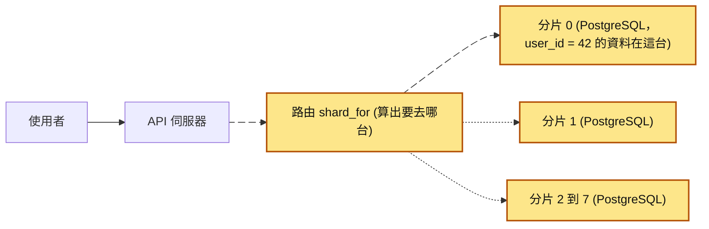

分片發生在 API 伺服器和資料庫之間：原本只有一台 PostgreSQL，現在變成好幾台，每個請求都要先經過路由，決定去哪一台。跟它相鄰的主題：[讀取副本](17-讀取副本.md)是每台都放完整一份、只分散讀取；[分割](20-分割.md)是在同一台資料庫裡把大表切成小表；[連線池](08-連線池.md)在分片後要對每一台各開一個。

## 生活比喻

想像一間全國連鎖的銀行，一開始只有一家總行，所有客戶的帳本都放在同一個檔案櫃。客戶多到檔案櫃塞不下、櫃檯排隊排到門外，於是開分行：**依客戶身分證字號的最後一碼分配**，0–4 的客戶去 A 分行，5–9 的去 B 分行。每家分行各有自己的檔案櫃和櫃員。

- 客戶來辦事，只要報身分證字號，就知道該去哪家分行，**只有那一家要忙**。這就是「查詢帶分片鍵」。
- 總經理想知道「全國今天存了多少錢」，就得打電話問每一家分行再自己加總。這就是「跨分片查詢」。
- 客戶 A（在 A 分行）要轉帳給客戶 B（在 B 分行），兩家分行要協調好，不能 A 扣了錢 B 沒收到。這就是「跨分片交易」。
- 生意又變大，要從 2 家分行變 3 家。如果規則改成「身分證字號 ÷ 3 的餘數」，大部分客戶的分行都會變，全部帳本要大搬家。這就是「重新分片很難」。

**比喻失準的地方**：真實銀行的分行有總行可以兜底、有人工可以協調，資料庫分片之間沒有「總行」，除非你自己蓋一個協調層（或用 Citus、Vitess 這種現成的）。另外，分行搬家可以挑週末關門慢慢搬，正式環境的資料庫通常要邊服務邊搬，難度高很多。

## 它是怎麼運作的

### 分片是什麼，跟分割、副本差在哪

單台資料庫的寫入量和容量有上限。讀取副本只能分散讀取，分割還是在同一台裡切，分片則把資料切到多台，讓寫入和容量也能分散。先把這 3 個常搞混的東西分清楚：

| | [讀取副本](17-讀取副本.md) | [分割](20-分割.md)（partitioning） | 分片（sharding） |
|---|---|---|---|
| 資料怎麼放 | 每台都有**完整**一份 | 一台資料庫裡，一張大表切成多張子表 | 資料切開，**每台只有一部分** |
| 解決什麼 | 讀取量太大 | 單表太大、清舊資料慢、查詢掃太多 | 寫入量、資料量、單機上限 |
| 寫入能分散嗎 | 不能，寫入還是只進主機 | 不能，還是同一台 | 能 |
| 應用程式要改嗎 | 少（分讀寫連線） | 幾乎不用 | 很多 |

下面這張圖把 3 種做法的資料放法並排，每個大框是一種做法，裡面每個方塊是一台資料庫或一張表。

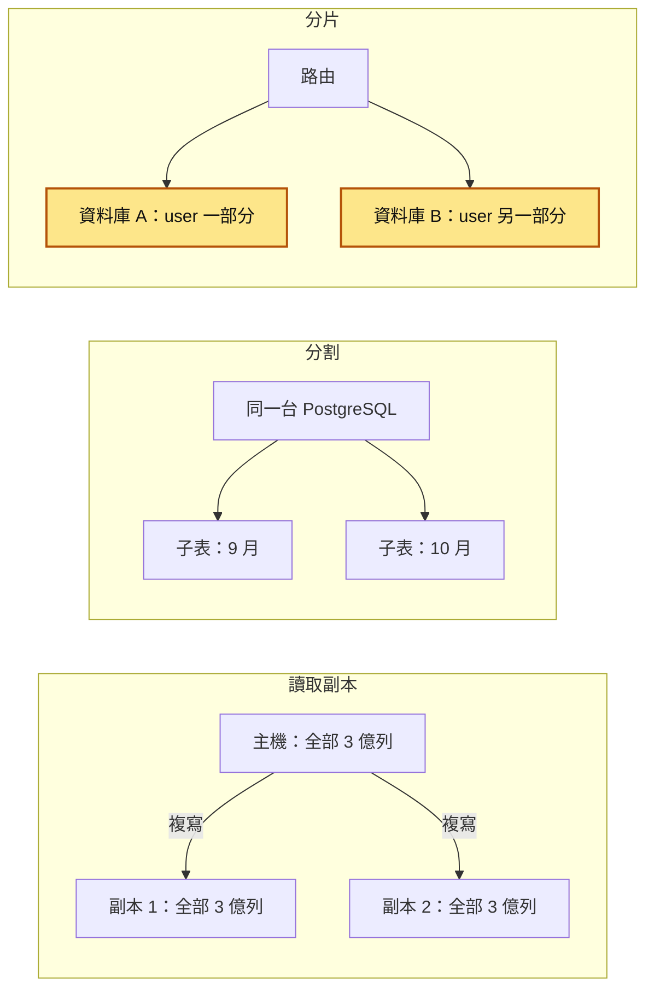

只有分片的每台資料庫各自扛一部分寫入，所以只有它能讓寫入量跟著機器數分散。

有些書（例如《Designing Data-Intensive Applications》第一版）把分片也叫 partitioning，讀文件時要看上下文。本系列的用法：**分割是在同一台資料庫內切表，分片是切到多台資料庫**。

分片又叫「水平分片」，因為它是一列一列（row）分開放。另一種「把不同的表搬到不同的資料庫」（例如訂單一台、會員一台）叫垂直切分（vertical partitioning），常是分片之前更簡單的一步。

### 整體架構

資料分到好幾台之後，每個請求都要先知道該去哪一台。先看最基本的形狀：應用程式把請求交給路由層，由路由層送到其中一台分片。

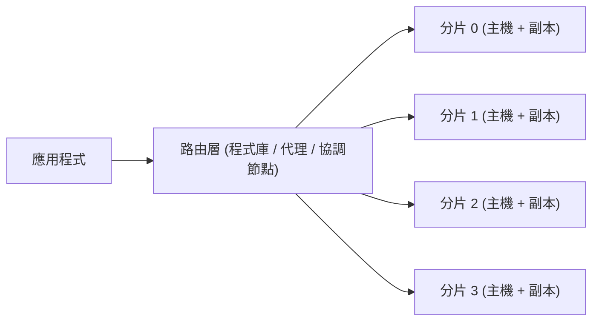

第二張多了分片對照表。資料先依分片鍵算出一個 slot。slot 可以想成事先切好、數量固定的格子（例如 1024 格），每一筆資料永遠屬於同一格，每台機器負責其中一段格子；為什麼要多這一層，下面「三種切法」會講。路由層查對照表，才知道每段 slot 在哪個分片：

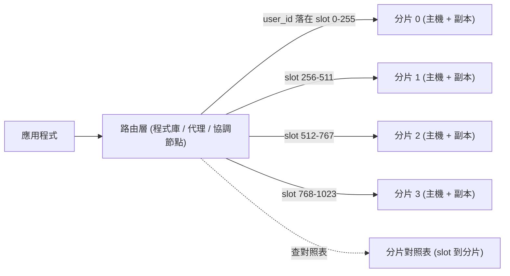

你送出一筆帶 `user_id` 的查詢時，路由層先算出這個 `user_id` 屬於哪個 slot，再查對照表找到負責那個 slot 的分片，最後只把查詢送到那一台。

每個分片本身就是一台完整的資料庫，通常也有自己的副本做高可用。中間的**路由層**負責「這筆資料在哪台」，常見 3 種放法：

1. **應用程式內的程式庫**：最簡單，但每個服務、每種語言都要實作一份，而且要一致。
2. **代理（proxy）**：應用程式照常連一台「資料庫」，連到的是代理，由代理轉送。Vitess 的 vtgate 就是這種。
3. **協調節點（coordinator）**：一台特殊的資料庫負責拆查詢、合併結果。Citus 的 coordinator 是這種。

### 三種切法：hash、range、directory

**1. 雜湊分片（hash-based）**：`shard = hash(分片鍵) % N`（或對到 slot）。`%` 是取餘數，N 是分片數，算出來的數字就是要去第幾台。

- 優點：分布平均，不容易有熱點（某一台分到的讀寫特別多，被打爆）。
- 缺點：範圍查詢（「user_id 1000 到 2000」「上週的訂單」）要問所有分片；直接 `% 實體台數` 的話，台數一變大部分資料都要搬（「動手看看」的〈實驗二〉會算給你看）。

**2. 範圍分片（range-based）**：依值的區間切，例如 user_id 1–100 萬在分片 0、100 萬–200 萬在分片 1。

- 優點：範圍查詢只打少數分片；切分點可以調整，加機器時把某個區間切一半搬走就好。
- 缺點：很容易熱點。拿時間或自增 ID 當分片鍵的話，**所有新寫入都打在最後一個分片**，其他分片閒著。

**3. 目錄分片（directory-based / lookup）**：有一張對照表記錄「這個 key 在哪台」，例如 `tenant_id → shard`。

- 優點：最彈性。某個超大客戶可以單獨搬到一台專屬分片，其他小客戶擠在一起。
- 缺點：每次查詢都要先查對照表，對照表本身要高可用、要快取，它出問題整個系統都出問題。

下面這張圖是同一筆資料在 3 種切法下，各自靠什麼找到它的分片。

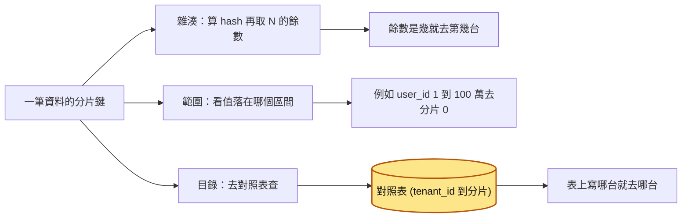

目錄式多了一次查表，所以那張對照表（黃色）本身變成必須高可用的元件。

實務上最常見的是**混合**：先用 hash 把 key 對到固定數量的邏輯分片（slot），再用一張小小的對照表記錄「每個 slot 在哪台實體機器」。好處是加機器時只要搬一部分 slot，對照表改幾列就好，每一筆資料的 slot 永遠不變。

Redis Cluster 用 16384 個 slot；Notion 在 2021 年把 480 個邏輯分片放到 32 台實體 PostgreSQL 上，後來擴到 96 台時邏輯分片數一個都沒改，只是每台負責的分片變少。這些都是同一個思路。

下面這張圖是 `user_id = 42` 怎麼找到它的機器，以及擴充時哪裡會變：slot 編號不變，只有對照表上「slot 731 在哪台」改了。

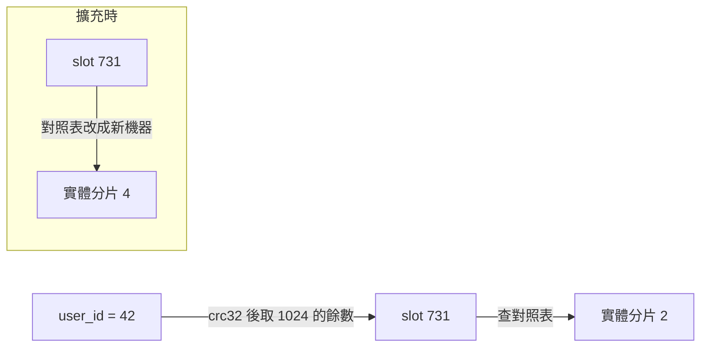

### 分片鍵怎麼選

好的分片鍵要同時滿足：

1. **基數高（high cardinality）**：不同的值要夠多。拿「國家」當分片鍵，最多幾十個值，而且台灣一國可能就佔 90%，根本分不開。`user_id`、`tenant_id` 通常沒問題。
2. **絕大多數查詢都帶它**：把你系統最常跑的前 20 條查詢列出來，看有幾條的 `WHERE` 裡有這個欄位。沒有帶的，每一條都會變成「問遍所有分片」。
3. **寫入不會集中**：分布要平均，而且不能是「新資料都同一個值」的那種欄位（時間、自增 ID 用 range 切就會中招）。
4. **相關的資料用同一個鍵**：訂單、訂單明細、付款紀錄都用 `user_id` 分片，同一個使用者的資料就會在同一台，JOIN 和交易都還是單機的，這叫**共置（co-location）**。

下面這張圖是共置的樣子：3 張表都用 `user_id` 分片，使用者 42 的資料全部落在同一台。

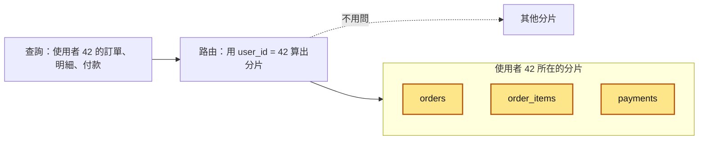

3 張表的 JOIN 和同一個交易都在這一台內完成，其他分片完全不用碰。

B2B SaaS 的經典選擇是 `tenant_id`：一間公司的資料幾乎不會跟另一間公司 JOIN，天生適合切開。要注意的是「大客戶問題」：如果最大的客戶佔了 30% 的資料，hash 再平均也救不了它所在的那台，這時候就需要目錄式的手段把它單獨拉出去。

很少有欄位能讓**所有**查詢都帶到。常見的補法：

- 使用者端用 `user_id` 分片；後台「依商品看訂單」這種查詢，另外同步一份到資料倉儲或搜尋引擎（例如用 [CQRS](45-CQRS.md) 的思路）去查。
- 需要用 `order_id` 直接查的時候，把分片資訊編進 ID 裡（例如 ID 的某幾個位元就是 slot 編號，Instagram 早年就是這樣做），或另建一張 `order_id → user_id` 的對照表。

### 分片後會失去什麼

下表左欄是單機時資料庫幫你做好的事，右欄是分片後的狀況。表裡的「兩階段提交」是跨多台資料庫一起 commit 的做法：先問每一台「你能不能 commit」，全部都說可以，才通知大家一起 commit。

| 原本單機做得到的 | 分片之後 |
|---|---|
| 任意 JOIN | 只有共置的表（同分片鍵）能在單台 JOIN；其他要在應用程式合併，或把小表複製到每台（Citus 叫 reference table） |
| `ORDER BY ... LIMIT ... OFFSET` 分頁 | 每台都要回 `OFFSET + LIMIT` 筆再合併，翻越深越慢，要改用 keyset 分頁（拿上一頁最後一筆的排序值當條件，例如 `WHERE created_at < ?`） |
| `COUNT`、`SUM` | 每台算完加總就好 |
| `AVG`、中位數、`COUNT(DISTINCT)` | `AVG` 要拿各台的 sum 和 count 重算；中位數、精確的 distinct 很貴 |
| [唯一約束](14-唯一約束.md) | 只在單台內有效。全域唯一（例如 email 不能重複）要靠包含分片鍵的唯一鍵，或另建一張全域對照表 |
| [外鍵約束](13-外鍵約束.md) | 只能指向同一台上的資料 |
| 自增 ID（`bigserial`、`IDENTITY`） | 每台各自從 1 開始，會撞號。改用 UUID、Snowflake（時間 + 機器編號 + 序號組成的整數）這類全域唯一 ID |
| [交易](03-資料庫交易.md) | 只在單台內有 [ACID](04-ACID%20特性.md)。跨分片要嘛用兩階段提交，要嘛改設計成[最終一致性](42-最終一致性.md)，見[分散式交易](43-分散式交易.md) |

拿唯一約束當例子。下面這張圖是 2 個人同時用同一個 email 註冊，他們的 `user_id` 剛好落在不同分片：

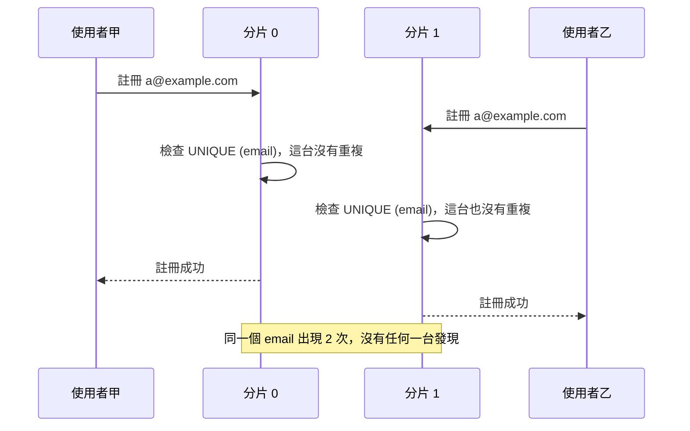

每台只檢查自己手上的資料，所以兩邊都放行。補法在「常見地雷」的〈5. 以為唯一約束還是全域有效〉。

### 重新分片為什麼難

資料量長大、某台變熱點、要加機器，都會碰到重新分片。它難在**資料要在服務不中斷的情況下搬家，搬的過程中還一直有新寫入。**

一般的流程跟[零停機遷移](16-零停機遷移.md)很像。複製資料時要「初始複製 + 持續追上新變更」，通常靠 2 種工具：邏輯複寫（把每一筆改動以「哪張表的哪一列改成什麼」的形式送到另一台），或 CDC（Change Data Capture，從資料庫的變更日誌把每一筆改動即時串流出去）。

下面這張圖是把 slot 731 從實體分片 2 搬到新的實體分片 4 時，資料和路由怎麼走。

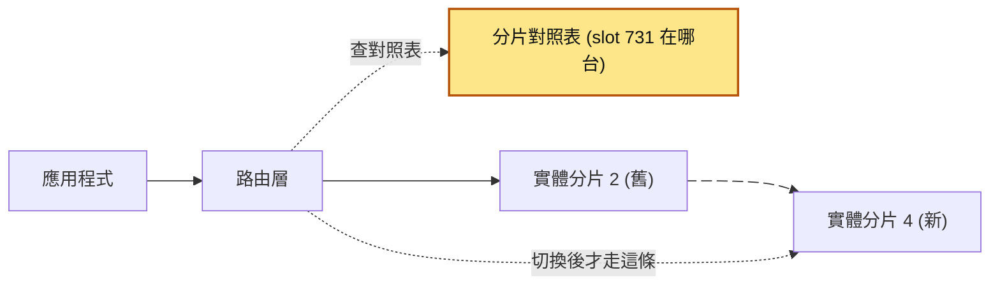

會動的箭頭是持續在跑的複製；路由在對照表改掉之前，一直都打舊分片。整個搬家依序是這樣：

| 步驟 | 在做什麼 | slot 731 的寫入打到哪 | 對照表上 slot 731 指向 |
|---|---|---|---|
| 1 | 新分片建好，開始把 slot 731 的資料**複製**過去，並持續追上新變更 | 舊的分片 2 | 分片 2 |
| 2 | 新舊兩邊的差距很小了，**比對資料**（筆數、checksum） | 舊的分片 2 | 分片 2 |
| 3 | **短暫擋住** slot 731 的寫入，把最後一點差距追完 | 暫停，等待中 | 分片 2 |
| 4 | 改對照表，讓路由指向新分片，放行寫入 | 新的分片 4 | 分片 4 |
| 5 | 觀察一陣子沒問題，再刪掉舊分片上 slot 731 的資料 | 新的分片 4 | 分片 4 |

每一步都有坑：複製追不上、比對不一致、切換時有請求打到舊的地方、應用程式快取了舊的對照表。「一開始就多切幾個 slot」就是為了這一步：搬 slot 時只要改對照表，每一列屬於哪個 slot 不用重算。

### 先窮盡其他手段

下面這張圖是分片前要依序過的 6 道關卡，任何一關答「還沒」，就先去做那一關的事。

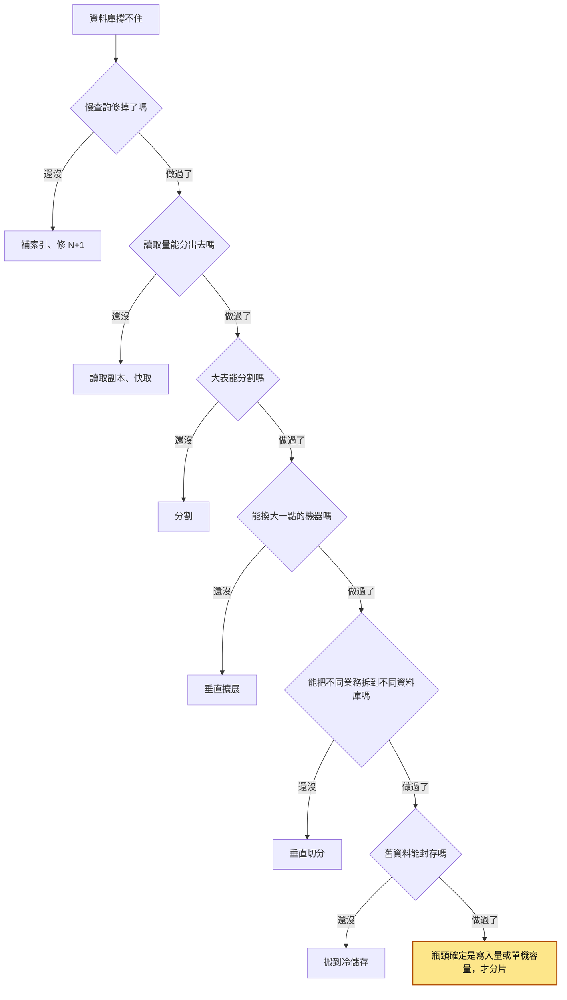

分片之前，請依序確認這些都做過了：

1. **慢查詢修掉了嗎？** 用 [EXPLAIN ANALYZE](12-EXPLAIN%20ANALYZE.md) 看最貴的前幾條查詢，缺[索引](10-資料庫索引.md)的補上，[N+1](09-N+1%20查詢.md) 修掉。很多「資料庫撐不住」的問題，修到這一步就解決了。
2. **讀取量能分出去嗎？** [讀取副本](17-讀取副本.md)、[快取](21-快取失效.md)。大部分系統是讀多寫少。
3. **大表能分割嗎？** [分割](20-分割.md)可以讓清舊資料、掃描範圍變小，而且應用程式幾乎不用改。
4. **能換大一點的機器嗎？** [垂直擴展](33-垂直擴展.md)聽起來很土，但現在單台雲端資料庫可以有上百核心、TB 級記憶體，比改寫整個資料存取層便宜太多。
5. **能把不同業務拆到不同資料庫嗎？** 訂單、會員、日誌各自一台（垂直切分），比水平分片簡單得多。
6. **舊資料能封存嗎？** 3 年前的訂單搬到冷儲存，熱資料就小很多。

這些都做完還是不夠，而且你能清楚說出「瓶頸是寫入量或單機容量」，才是分片的時機。

### 現成方案

下面這張圖是 Citus 和 Vitess 各把路由層放在哪裡，可以對照「整體架構」講的 3 種放法。

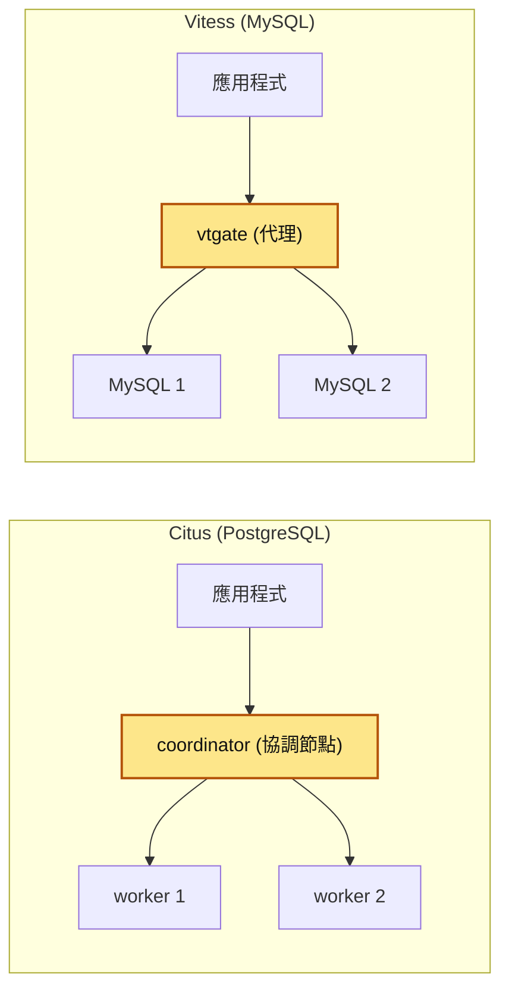

黃色就是各自的路由層，應用程式只連它，不用自己算資料在哪台。

- **Citus**：PostgreSQL 的擴充套件（extension），開源。一台 coordinator（協調節點）加多台 worker（實際存資料的分片），你只要宣告「這張表用哪個欄位分片」，它會幫你建 shard、路由查詢、平行執行跨分片查詢、用兩階段提交處理跨分片寫入，也有搬移 shard 的工具（rebalancer）。對應用程式來說大致還是在用 PostgreSQL，但不是所有 SQL 都支援跨分片執行，限制請看官方文件。
- **Vitess**：給 MySQL 用的分片系統，源自 YouTube，是 CNCF 畢業專案。應用程式連 vtgate（代理），vtgate 依 VSchema（描述每張表怎麼分片的設定）裡定義的 vindex（算出某個值該去哪個分片的規則）路由到各個 MySQL；重新分片有內建的工作流程。
- 另外還有一類是「天生分散式」的資料庫（例如 CockroachDB、YugabyteDB、Google Spanner），分片由資料庫自己管理，代價是行為跟單機 PostgreSQL 不完全一樣、延遲特性不同。新人知道有這條路就好。

## 動手看看

### 實驗一：用兩台 PostgreSQL 做一個最陽春的分片

先起 2 台 PostgreSQL 當 2 個分片（密碼 `pg` 只是本機測試用）：

```shell
docker run -d --name shard0 -e POSTGRES_PASSWORD=pg -p 5433:5432 postgres:17
docker run -d --name shard1 -e POSTGRES_PASSWORD=pg -p 5434:5432 postgres:17
```

存成 `shard_demo.py`。程式裡有兩個詞：scatter 是把同一條查詢撒給每一台，gather 是把各台的結果收回來合併。`heapq.merge` 是 Python 標準函式庫的工具，能把好幾份已經排好序的清單，合併成一份排好序的清單。

```python
import heapq
import random
import zlib
from datetime import datetime, timedelta, timezone

import psycopg

# 兩台獨立的 PostgreSQL，就是兩個分片
SHARDS = [
    "postgresql://postgres:pg@localhost:5433/postgres",
    "postgresql://postgres:pg@localhost:5434/postgres",
]
conns = [psycopg.connect(dsn, autocommit=True) for dsn in SHARDS]

def shard_for(user_id: int) -> int:
    """路由函式：分片鍵是 user_id。用 crc32 確保每個行程算出來都一樣"""
    return zlib.crc32(str(user_id).encode()) % len(SHARDS)

def setup() -> None:
    for c in conns:
        c.execute("DROP TABLE IF EXISTS orders")
        c.execute("""
            CREATE TABLE orders (
                id         uuid        NOT NULL DEFAULT gen_random_uuid(),
                user_id    bigint      NOT NULL,
                amount     integer     NOT NULL,
                created_at timestamptz NOT NULL,
                PRIMARY KEY (user_id, id)   -- 主鍵帶上分片鍵
            )
        """)

def insert_order(user_id: int, amount: int, created_at: datetime) -> None:
    # 寫入：先算出分片，只連那一台
    conns[shard_for(user_id)].execute(
        "INSERT INTO orders (user_id, amount, created_at) VALUES (%s, %s, %s)",
        (user_id, amount, created_at),
    )

def orders_of_user(user_id: int) -> list[tuple]:
    # 帶分片鍵的查詢：只打一台，這是分片最舒服的情況
    return conns[shard_for(user_id)].execute(
        "SELECT user_id, amount, created_at FROM orders "
        "WHERE user_id = %s ORDER BY created_at DESC LIMIT 5",
        (user_id,),
    ).fetchall()

def latest_orders_global(limit: int = 5) -> list[tuple]:
    # 不帶分片鍵的查詢：每台都要問（scatter），再在應用程式合併（gather）
    per_shard = [
        c.execute(
            "SELECT user_id, amount, created_at FROM orders "
            "ORDER BY created_at DESC LIMIT %s",
            (limit,),   # 每台都要回 limit 筆，因為不知道全域前幾名落在哪台
        ).fetchall()
        for c in conns
    ]
    # 每台的結果已經依 created_at 由新到舊排好，用 heapq.merge 合併
    merged = heapq.merge(*per_shard, key=lambda r: r[2], reverse=True)
    return list(merged)[:limit]

if __name__ == "__main__":
    setup()
    now = datetime.now(timezone.utc)
    for _ in range(2000):
        uid = random.randint(1, 200)
        insert_order(uid, random.randint(100, 5000),
                     now - timedelta(minutes=random.randint(0, 100_000)))

    for i, c in enumerate(conns):
        n = c.execute("SELECT count(*) FROM orders").fetchone()[0]
        print(f"shard{i} 有 {n} 筆訂單")

    print("user 42 落在 shard", shard_for(42), orders_of_user(42)[:2])
    print("全站最新 5 筆：", latest_orders_global())

    # 全站總數：每台算 count 再加總（count、sum 可以直接相加）
    total = sum(c.execute("SELECT count(*) FROM orders").fetchone()[0] for c in conns)
    print("全站訂單數：", total)
```

執行：

```shell
uv run --with "psycopg[binary]" python shard_demo.py
```

**預期會看到**：2 台各自大約 1000 筆（不會剛好一半，因為是依使用者分，每個使用者訂單數不同）；查 user 42 只連了一台；「全站最新 5 筆」則是 2 台各撈 5 筆再合併。你可以自己試試看：

- 直接連進 2 台各查一次 `docker exec -it shard0 psql -U postgres -c "SELECT count(DISTINCT user_id) FROM orders"`（另一台把 `shard0` 換成 `shard1`）。2 個數字加起來會剛好等於出現過的使用者數（最多 200），代表沒有任何一個 user 同時出現在 2 台，每個 user 的訂單都完整待在同一台。
- 把 `latest_orders_global` 改成要第 1001–1005 筆（`OFFSET 1000`），想想每台要回幾筆才保證正確？答案是每台都要回 1005 筆，這就是深分頁在分片後變貴的原因。

玩完記得清掉：

```shell
docker rm -f shard0 shard1
```

### 實驗二：算給你看「直接取模」重新分片要搬多少資料

這個不需要資料庫，純 Python 就能跑。它比較兩種做法：一是直接 `hash % 實體台數`；二是先 hash 到固定 1024 個 slot，再用對照表把 slot 分給機器。兩種做法各算一次「從 N 台加到 N+1 台時，有多少比例的 key 要換機器」。存成 `reshard_sim.py`：

```python
import zlib

KEYS = range(100_000)          # 模擬 10 萬個 user_id
SLOTS = 1024                    # 邏輯分片（slot）數量，一開始就定死

def h(key: int) -> int:
    # 穩定的雜湊：同一個 key 在任何機器、任何時間算出來都一樣
    return zlib.crc32(str(key).encode())

def moved_ratio_modulo(n_old: int, n_new: int) -> float:
    """直接用 hash % 實體節點數 的做法，節點數一變，有多少 key 要搬家"""
    moved = sum(1 for k in KEYS if h(k) % n_old != h(k) % n_new)
    return moved / len(KEYS)

def moved_ratio_slots(n_old: int) -> float:
    """先 hash 到固定 1024 個 slot，再用對照表把 slot 指派給實體節點"""
    old_map = {s: s % n_old for s in range(SLOTS)}
    new_map = dict(old_map)
    new_node = n_old
    # 從每個舊節點各挪一部分 slot 給新節點，讓大家平均
    target = SLOTS // (n_old + 1)
    for s in list(range(SLOTS))[::n_old + 1][:target]:
        new_map[s] = new_node
    moved = sum(1 for k in KEYS if old_map[h(k) % SLOTS] != new_map[h(k) % SLOTS])
    return moved / len(KEYS)

for n in (2, 4, 8):
    print(f"{n} -> {n+1} 台：取模要搬 {moved_ratio_modulo(n, n+1):.1%}，"
          f"slot 對照表只要搬 {moved_ratio_slots(n):.1%}")
```

```shell
python reshard_sim.py
```

**預期輸出**（數字會非常接近）：

```text
2 -> 3 台：取模要搬 66.7%，slot 對照表只要搬 33.2%
4 -> 5 台：取模要搬 80.1%，slot 對照表只要搬 19.9%
8 -> 9 台：取模要搬 89.0%，slot 對照表只要搬 11.0%
```

直接 `hash % N`，從 N 台變 N+1 台，只有大約 1/(N+1) 的資料留在原地，**機器越多，加一台要搬的比例反而越高**。用固定數量的 slot 加對照表，只需要搬「新機器該分到的那一份」，也就是理論上的最小值。所以幾乎所有正式的分片系統都用固定數量的 slot（邏輯分片）。

### 補充：Citus 長什麼樣子（片段，示意用法）

```sql
-- 在 Citus 的 coordinator 上執行
-- 宣告 orders 依 user_id 分片，Citus 會自動建立 shard 並分布到 worker
SELECT create_distributed_table('orders', 'user_id');

-- 讓 order_items 跟 orders 共置：同一個 user_id 的資料會在同一台
SELECT create_distributed_table('order_items', 'user_id', colocate_with => 'orders');

-- 小表（例如國家代碼）複製到每一台，任何分片都能直接 JOIN
SELECT create_reference_table('countries');
```

想在本機試，可以用 Citus 官方的 Docker 映像檔（`citusdata/citus`），單節點模式就能體驗；版本標籤請看官方文件。

## 常見地雷

### 1. 用語言內建的 `hash()` 算分片

❌ 錯誤示範：

```python
def shard_for(user_id: str) -> int:
    return hash(user_id) % 8   # ❌ Python 的字串 hash 每個行程不一樣
```

**為什麼錯**：Python 3 預設會對字串的 `hash()` 加隨機種子（`PYTHONHASHSEED`），同一個字串在不同行程算出來的值不同。你在 web 行程寫進分片 3 的資料，背景工作者可能去分片 5 找。其他語言也一樣不可靠：Java 的 `String.hashCode()` 雖然演算法固定，但跟別的語言算出來的不一樣，一般物件的 `hashCode()` 更是每次執行都可能不同；各語言內建的雜湊本來就是給記憶體裡的雜湊表用的，不保證跨行程、跨版本、跨語言一致。

✅ 正確寫法：用明確定義、跨語言可重現的雜湊，例如 `zlib.crc32`、`xxhash`、MurmurHash，並且把演算法寫進文件，所有語言的服務都要用同一個。

```python
import zlib

def shard_for(user_id: str, slots: int = 1024) -> int:
    return zlib.crc32(user_id.encode("utf-8")) % slots   # ✅ 結果固定
```

### 2. 分片鍵選了「分布平均」但查詢不帶的欄位

❌ 錯誤做法：只看分布平不平均，用 `order_id` 這種隨機 ID 當分片鍵。

**為什麼錯**：分布是平均了，但「某使用者的訂單」「某店家的訂單」都不帶 `order_id`，每次都要問遍所有分片。延遲由最慢的那台決定，任何一台故障都會影響所有請求。

✅ 正確做法：先列出最常跑、最重要的查詢，選「絕大多數查詢都帶得到」的欄位（通常是 `user_id` 或 `tenant_id`），相關的表全部用同一個鍵共置。少數不帶分片鍵的查詢，另外用對照表、搜尋引擎或資料倉儲處理。

### 3. 拿時間或自增 ID 做範圍分片

❌ 錯誤做法：`created_at` 每個月一台分片，或 `id` 每 1000 萬一台。

**為什麼錯**：新資料永遠寫進「最新」那一台，那台被打爆，其他台幾乎只剩讀取，等於沒分散寫入。這種切法比較適合同一台資料庫內的[分割](20-分割.md)（為了清舊資料方便），不適合拿來分散寫入。

✅ 正確做法：要分散寫入就用 hash（或 hash 到 slot）；確實需要時間範圍查詢，可以在每個分片內再依時間做分割。

### 4. 還在用每台各自的自增 ID

❌ 錯誤做法：分片後每台的 `orders.id` 還是 `bigserial`。

**為什麼錯**：每台都從 1 開始，2 台都有 `id = 1001`。之後只要有任何地方用 `id` 當全域識別（快取 key、事件、給客服查單），就會拿到錯的資料；日後合併或搬分片也會撞號。

✅ 正確做法：用全域唯一 ID。最簡單的是 UUID（PostgreSQL 13 起內建 `gen_random_uuid()`；要依時間排序可以用 UUIDv7，PostgreSQL 18 起內建 `uuidv7()`，舊版本可以在應用程式產生），或是 Snowflake 這類「時間 + 機器編號 + 序號」的 64 位元整數 ID。

### 5. 以為唯一約束還是全域有效

❌ 錯誤做法：依 `user_id` 分片後，在每台的 `users` 表上加 `UNIQUE (email)`，以為 email 就不會重複。

**為什麼錯**：唯一約束只在單台資料庫內檢查。2 個人同時用同一個 email 註冊，只要他們的 `user_id` 落在不同分片，兩邊都會成功。

✅ 正確做法：建一張以 email 為分片鍵的對照表 `email → user_id`（這張表本身的唯一約束就是全域有效的，因為同一個 email 一定落在同一台），註冊時先在這張表搶到 email 再建帳號，失敗要能補償。Citus 甚至會直接要求分散式表的唯一約束要包含分片欄位。

### 6. 跨分片寫入假裝有交易

❌ 錯誤示範：

```python
# ❌ 兩台各自 commit，中間任何一步失敗就會一邊扣錢一邊沒加錢
with conn_a.transaction():
    conn_a.execute("UPDATE wallets SET balance = balance - 100 WHERE user_id = %s", (a,))
with conn_b.transaction():
    conn_b.execute("UPDATE wallets SET balance = balance + 100 WHERE user_id = %s", (b,))
```

**為什麼錯**：2 個交易各自獨立，第一個 commit 之後程式掛掉、第二台逾時，資料就不一致了。單機的 [ACID](04-ACID%20特性.md) 在這裡不成立。

✅ 正確做法：第一選擇是**重新設計讓它不用跨分片**（例如相關資料共置）。真的要跨，就用有明確語意的做法：[信箱模式](44-信箱模式.md)加上可重試、[冪等](25-冪等性.md)的後續步驟（這種「拆成多個本地交易、失敗就做補償」的做法叫 Saga），或使用支援兩階段提交的方案（例如 Citus 對跨分片寫入的處理），並理解它的代價。細節見[分散式交易](43-分散式交易.md)。

### 7. 資料庫一慢就喊要分片

❌ 錯誤做法：主機 CPU 一高，就開始規劃分片。

**為什麼錯**：分片會讓所有開發、測試、維運的成本永久上升，而大部分「資料庫撐不住」是缺索引、爛查詢、讀寫沒分開造成的。分片也救不了爛查詢，只是把爛查詢平行跑在更多台上。

✅ 正確做法：先量。用 `pg_stat_statements` 找出最貴的查詢、用 EXPLAIN ANALYZE 修掉，加讀取副本和快取，評估垂直擴展和封存。確認瓶頸是「單台主機的寫入量或容量」之後，再談分片，並優先評估現成方案。

## 重點整理

- **分片是最後手段。** 修慢查詢、補索引、讀取副本、快取、分割、換大台機器（垂直擴展）、把不同業務拆到不同資料庫都做過了還撐不住，而且瓶頸確定是寫入量或單機容量，才輪到分片。做下去之後很難回頭。
- **分片鍵決定一個查詢要打幾台。** 查詢帶分片鍵，只打一台；沒帶，就要問遍所有分片，最慢的那台決定整個請求的速度。好的分片鍵要基數高（不同的值夠多）、絕大多數查詢都帶它、寫入不會集中在少數值上。
- **相關的表用同一個分片鍵（共置）。** 同一個使用者的訂單、明細、付款都在同一台，JOIN 和交易就還是單機的。
- **跨分片的操作都變貴。** JOIN、排序分頁、彙總、唯一約束、外鍵、交易，單機資料庫幫你做好的事，分片後要自己做，或做不到；ID 也要改用 UUID、Snowflake 這類全域唯一的。
- **一開始就用固定數量的 slot 加對照表。** 以後加機器只要搬一部分 slot、改對照表，不用重算每一筆資料的位置；直接 `hash % 台數` 的話，加一台就要搬大部分資料。
- **能用現成方案就別自己刻。** PostgreSQL 有 Citus，MySQL 有 Vitess；自己寫路由，重新分片、跨分片查詢、維運工具都要自己來。

## 新人必知清單

### 一定要會（基本功）

- [ ] 說得出分片、分割、讀取副本的差別，以及各自解決什麼問題
- [ ] 看到一個「要不要分片」的提案，能先問「索引、副本、快取、分割、垂直擴展都試過了嗎」
- [ ] 知道分片鍵的 3 個條件：基數高、查詢都帶它、寫入不集中
- [ ] 在已經分片的系統裡寫查詢時，知道自己的 `WHERE` 有沒有帶分片鍵，沒帶就會打所有分片
- [ ] 知道分片後 JOIN、唯一約束、外鍵、交易都只在單台內有效
- [ ] 分片系統裡的 ID 要用全域唯一的（UUID、Snowflake），不能用每台各自的自增
- [ ] 路由用的雜湊要穩定、跨行程跨語言一致，不能用 Python 內建 `hash()`

### 知道有這回事就好

- hash、range、directory 3 種切法的取捨，以及「hash 到固定 slot + 對照表」的混合做法
- 共置（co-location）與 reference table 的概念
- 重新分片的大致流程：複製、追上、比對、切換、清理
- Citus（PostgreSQL）、Vitess（MySQL）大概是什麼、解決什麼
- 一致性雜湊（consistent hashing）是另一種減少搬移量的做法：把 key 和節點都雜湊到同一個環上，key 歸順時針遇到的第一個節點，加一個節點只會搶走旁邊一段的 key
- 熱點與大客戶問題，可以用目錄式分片把特定 key 獨立出去

### 先不用管（等你遇到再學）

- 自己實作重新分片的工具與 CDC 管線
- 兩階段提交的細節、協調者故障時的處理
- 跨分片的全域二級索引（global secondary index）設計
- CockroachDB、Spanner 這類分散式 SQL 資料庫的內部原理
- 跨區域（multi-region）的資料放置與法規要求

## Code Review 時可以問的問題

1. **這條查詢有沒有帶分片鍵？** 沒帶的話，它會打幾台？在最大流量下延遲和連線數撐得住嗎？
2. **這個寫入會不會碰到 2 個以上的分片？** 會的話，失敗時怎麼辦？有沒有可能改成共置來避免？
3. **新加的表用什麼分片鍵？** 有沒有跟它常 JOIN 的表共置？
4. **這個 ID 是怎麼產生的？** 在所有分片之間是不是唯一的？
5. **這個「不能重複」的規則（email、訂單編號）在分片後還成立嗎？** 是靠哪一台的哪個約束保證的？
6. **路由邏輯是不是只有一份？** 有沒有人在別的服務或腳本裡自己寫了一份 `% 8`？

## 情境演練

**1. 主機 CPU 在寫入尖峰時被吃滿，同事提議：「再加 2 台讀取副本分散負載就好。」如果瓶頸確定是寫入量，這個提議有用嗎？你會往哪個方向想？**

<details markdown="1"><summary>看答案</summary>

加讀取副本解決不了寫入瓶頸。讀取副本是每台都有完整一份資料，寫入一律進主機再複寫出去，所以只能分散**讀取**，寫入量和單機容量的上限沒變。分片是每台只放一部分資料，寫入依分片鍵落到不同機器，所以**寫入和容量**都能分散。代價是分片後跨分片的查詢、約束、交易都變難，副本則幾乎不影響應用程式的寫法（除了[複寫延遲](18-複寫延遲.md)）。往分片走之前，還是要先確認上面「先窮盡其他手段」那幾項都做過了。

</details>

**2. 設計審查時，有人提議訂單表依 `created_at` 做範圍分片，每個月一台，理由是「寫入分散了，舊資料也自然分出去」。你會怎麼回應？**

<details markdown="1"><summary>看答案</summary>

這個切法分散不了寫入。新資料的 `created_at` 一定是「現在」，所以所有新寫入都會落在負責最新時間區間的那一台，形成熱點，其他分片幾乎只剩讀舊資料，寫入根本沒分散到。時間欄位比較適合拿來做同一台資料庫內的分割，方便清舊資料和縮小掃描範圍。

</details>

**3. 你接手的系統用 `hash(user_id) % 4` 分到 4 台，主管說下一季要加到 5 台。你估計大約有多少比例的資料要搬？如果還來得及改設計，你會怎麼改？**

<details markdown="1"><summary>看答案</summary>

大約 80%。`% 4` 和 `% 5` 結果相同的機率約 1/5，其餘都換了位置。機器越多，加一台要搬的比例越高。

避免的方法是一開始就把 key 雜湊到**固定數量的邏輯分片（slot）**，例如 1024 個，再用對照表記錄每個 slot 在哪台實體機器。加機器時只要把約 1/5 的 slot 搬到新機器、改對照表，資料的 slot 編號永遠不變。一致性雜湊也是同一類的思路。

</details>

**4. 你們的 B2B SaaS 用 `tenant_id` 分片。業務要做一個「全平台本月營收排行前 10 名的客戶」報表，你會怎麼做？**

<details markdown="1"><summary>看答案</summary>

這是不帶分片鍵的彙總，有幾種做法，依頻率和即時性選：

- **偶爾跑、資料量不大**：每個分片各自算 `SUM(amount) GROUP BY tenant_id`，因為同一個 tenant 的資料都在同一台，每台算出來的就是那些客戶的完整營收；再由應用程式（或 Citus 這種協調節點）合併取前 10。注意每台要回自己的前 10 名就夠了，因為一個 tenant 不會跨分片。
- **常跑或要即時**：把營收資料同步到資料倉儲或分析用資料庫（OLAP），報表在那邊跑，不要壓在正式的分片上。這就是把「寫入模型」和「查詢模型」分開的思路，可以看 [CQRS](45-CQRS.md)。

不該做的是：把所有分片的原始訂單都撈到應用程式記憶體裡自己加總。

</details>

**5. 你接手的系統依 `user_id` 分片。PM 要加一個功能：「使用者 A 可以把點數轉給使用者 B」。你會擔心什麼？怎麼設計？**

<details markdown="1"><summary>看答案</summary>

A 和 B 很可能在不同分片，扣 A 的點數和加 B 的點數是 2 台資料庫上的 2 個交易，沒有單機 ACID 保護。中間任何一步失敗（程式掛掉、逾時、網路斷），就會出現 A 扣了 B 沒加，或重試時 B 被加兩次。

比較穩的設計：

1. 在 A 的分片上用一個本地交易同時做「扣 A 的點數」和「寫一筆待處理的轉帳事件」到 outbox 表（[信箱模式](44-信箱模式.md)）。
2. 背景工作者讀 outbox，到 B 的分片加點數，這一步要帶轉帳 ID 做[冪等](25-冪等性.md)檢查（例如 B 分片上有一張以轉帳 ID 為唯一鍵的紀錄表），重試幾次都只會加一次。
3. 加點失敗到一定次數要有補償（把點數退回 A）和告警。
4. 對使用者說清楚：轉帳是「處理中 → 完成」，B 可能晚幾秒才看到，這是[最終一致性](42-最終一致性.md)。

如果方案本身支援跨分片交易（例如 Citus 的兩階段提交），也可以用，但要知道它的延遲和鎖定代價，詳見[分散式交易](43-分散式交易.md)。

</details>

## 相關主題

- [分割](20-分割.md)：同一台資料庫內把大表切成子表，常是分片之前更簡單、該先試的手段。
- [讀取副本](17-讀取副本.md)：分散讀取的第一步；分片後每個分片通常也各自有副本。
- [垂直擴展](33-垂直擴展.md)：換大機器，分片前一定要先評估的選項。
- [分散式交易](43-分散式交易.md)：跨分片寫入要面對的一致性問題與兩階段提交。
- [零停機遷移](16-零停機遷移.md)：重新分片本質上就是一次大型的零停機資料搬遷。
- [唯一約束](14-唯一約束.md)：分片後唯一約束只在單台有效，要知道怎麼補。

## 延伸閱讀

- Citus 官方文件：<https://docs.citusdata.com/>（分散式表、共置、reference table、rebalancer 都有詳細說明）
- Vitess 官方文件：<https://vitess.io/docs/>（VSchema、vindex、重新分片流程）
- PostgreSQL 官方文件〈Table Partitioning〉：<https://www.postgresql.org/docs/current/ddl-partitioning.html>（先搞懂單機分割，再談分片）
- Martin Kleppmann《Designing Data-Intensive Applications》第一版第 6 章〈Partitioning〉（第二版改用 sharding 這個詞）（分片鍵、再平衡、請求路由的經典講解）
