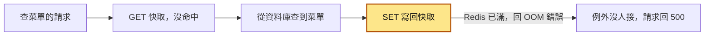
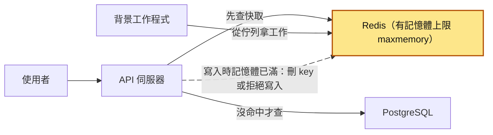
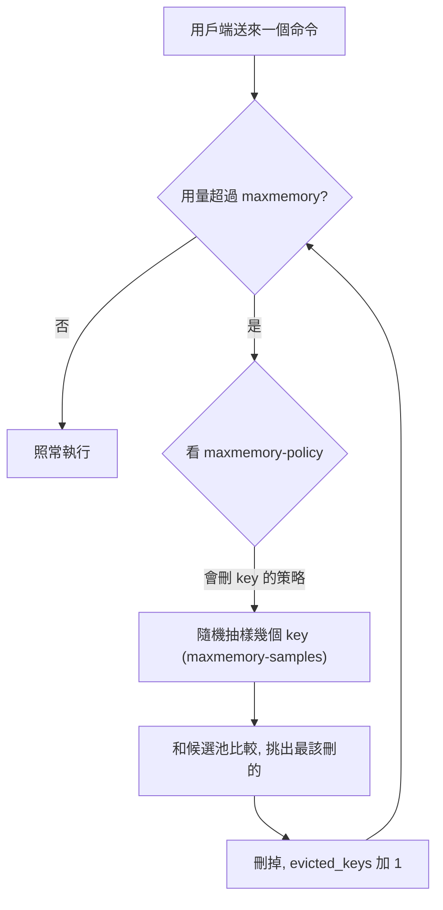
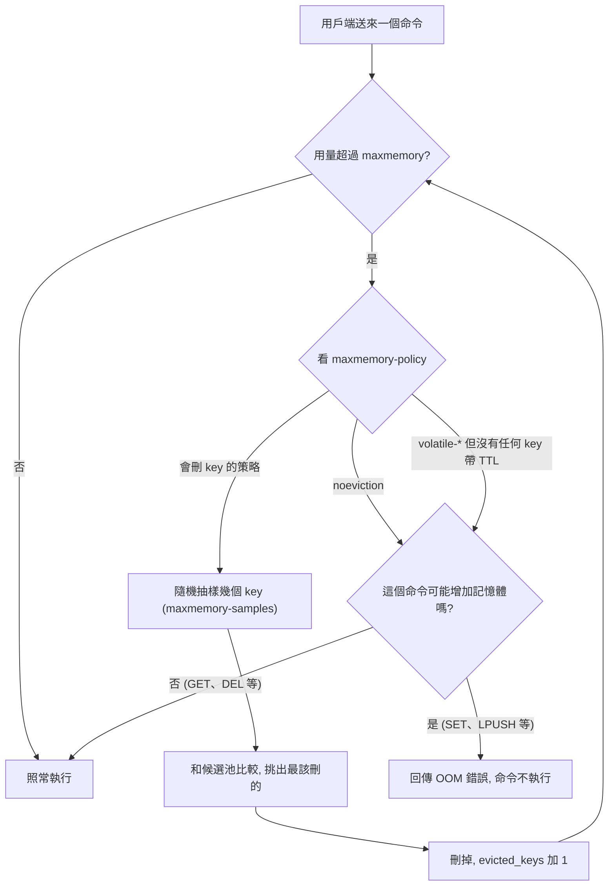
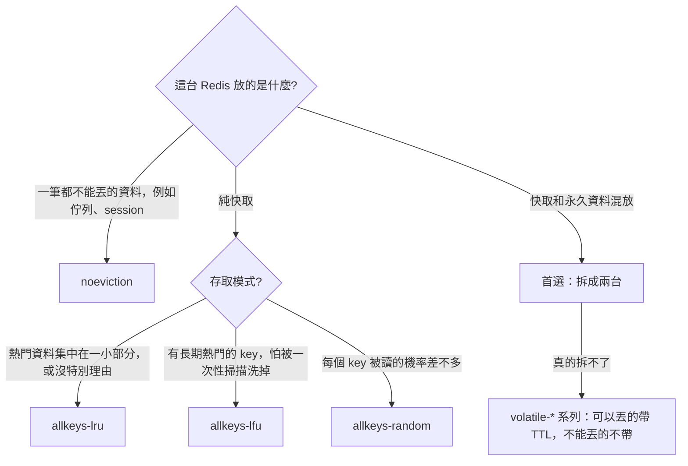
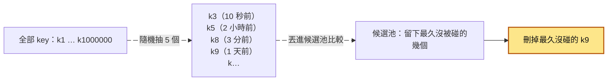
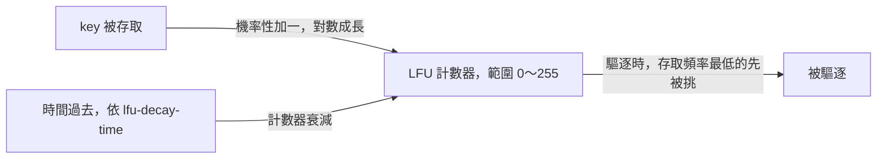
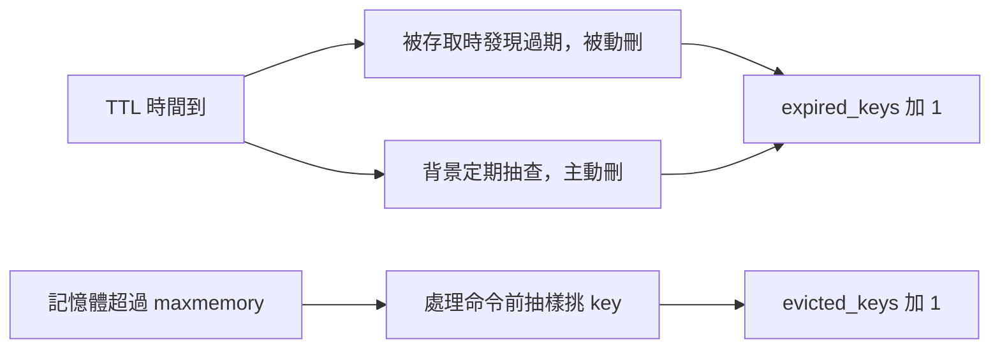

# 22｜Redis 驅逐（Redis Eviction）

> Redis 驅逐（eviction）是指 Redis 記憶體用到你設的上限時，依照你選的規則挑一些 key 刪掉，騰出空間給新資料；不設規則的話，它就直接拒絕寫入。

**難度**：★★☆　**閱讀時間**：約 18 分鐘　**前置知識**：[快取失效](21-快取失效.md)

## 核心問題與理念

**它要解決的問題**：一台 Redis（把資料放在記憶體裡的資料庫，常拿來當快取）同時放了丟了沒關係的菜單快取，和丟了就出事的登入狀態、待寄信件的排隊清單、簡訊驗證碼的次數計數器。沒人決定記憶體滿了要怎樣，結果先是整台被系統砍掉重啟，接著所有寫入都被拒絕、菜單頁出錯，改成「滿了就刪最久沒用的」之後，又悄悄刪掉了不能丟的登入狀態和待寄信件（下面的情境會完整走一遍）。

**核心理念**：先分清哪些資料能丟：能丟的滿了就刪最久沒用的，不能丟的滿了寧可拒絕寫入。

**想通的那一步**：

- **卡住的地方**：直覺的做法是替這台 Redis 挑一個最好的「滿了怎麼辦」規則。它卡在規則是整台共用的：選「拒絕寫入」，菜單快取寫不進去，頁面跟著出錯；選「刪最久沒用的」，半小時沒動作的登入狀態和排隊中的工作也會被刪。
- **火花**：一台只能有一種規則，那就照「能不能丟」把資料拆到兩台，快取那台刪最久沒用的，重要資料那台拒絕寫入。每台只剩一種資料，規則一下就選得出來。

## 閱讀前推薦具備知識

| 知識 | 要會到什麼程度 | 這篇哪裡會用到 | 不熟的話先看 |
|---|---|---|---|
| Redis 的 `GET`／`SET` 與 TTL | **必備**：知道 `SET key value EX 600` 的 key 600 秒後會自己消失，沒帶 `EX` 的 key 會一直留著，`TTL` 回 `-1` 代表沒設過期時間 | 〈過期 vs 驅逐〉、地雷 3「key 都沒設 TTL」、`volatile-*` 策略只挑有 TTL 的 key | [Redis 資料型別](https://redis.io/docs/latest/develop/data-types/) 的 Strings |
| [快取失效](21-快取失效.md) | **必備**：能說出 cache-aside 的讀取流程：先 `GET`，沒命中就查資料庫，再 `SET` 寫回快取 | 情境裡的 `get_menu` 和那張「請求在哪裡斷掉」的圖、地雷 2 | 本系列第 21 篇 |
| Python 的 `try`／`except` | **加分**：看得懂 `except redis.exceptions.RedisError:` 接住錯誤之後，程式會繼續往下跑，不會讓整個請求失敗 | 地雷 2 的降級寫法、「動手看看」的 `evict_demo.py` | [Python 官方教學（中文）](https://docs.python.org/zh-tw/3/tutorial/index.html) 第 8 章 |
| Docker | **加分**：會用 `docker run` 帶參數起一個容器，用 `docker exec` 在容器裡跑 `redis-cli` | 「動手看看」起一台上限 5MB 的 Redis | [Docker 入門](https://docs.docker.com/get-started/) |

**快速自我檢查**：在 Redis 裡依序執行 `SET a 1 EX 60` 和 `SET b 2`。70 秒後 `GET a`、`GET b` 各拿到什麼？`TTL b` 回傳什麼？

<details markdown="1"><summary>看答案</summary>

`GET a` 拿到 nil，因為 60 秒的 TTL 已經到期；`GET b` 拿到 `"2"`，`TTL b` 回 `-1`，代表 key 存在但沒有過期時間。這篇會一直區分「時間到自己消失」和「記憶體滿了被 Redis 刪掉」，前提就是先分得清楚哪些 key 有 TTL。答不出來也沒關係，先看 Redis 資料型別裡 Strings 的範例，再回頭看第 21 篇〈快取失效〉的〈先分清楚：快取「失效」有兩種〉。

</details>

## 為什麼要在意：一個具體的情境

這是一個假設情境。你負責一個線上訂餐服務的後端，初期為了省錢，整個後端只用一台 Redis（一個 Redis 實例），跑在記憶體上限 4GB 的容器裡。這台 Redis 同時放了四種東西：

1. 商品與菜單的快取（`menu:*`，有 TTL）。丟了沒關係，再查一次資料庫就好。
2. 使用者的登入狀態 session（`session:*`，有 TTL）。丟了，使用者就被登出。
3. 背景工作的佇列：「寄訂單確認信」這類工作先排進 Redis 裡的一個 list，背景程式再一件件拿出來做（Celery 用 Redis 當 broker 時就是這樣）。丟了，排隊中的工作就沒了。
4. 簡訊驗證碼的速率限制計數器：記錄每支手機最近要了幾次驗證碼，超過就擋。丟了，計數就歸零。

沒人動過 Redis 的設定，所以是兩個預設值：`maxmemory 0`（不限制記憶體用量）加 `maxmemory-policy noeviction`（記憶體滿了就拒絕寫入，什麼都不刪）。

查菜單的程式 `get_menu` 走的是一般的快取流程：先 `GET` 快取，沒命中就查資料庫，再把結果寫回快取。出問題的是寫回快取那一行 `r.set(f"menu:{shop_id}", json.dumps(menu), ex=600)`：它沒有處理錯誤，Redis 一拒絕寫入，例外就一路往上拋。完整程式在「常見地雷」的〈地雷 2〉。

這張圖看的是 Redis 滿了、開始拒絕寫入以後，一個查菜單的請求在哪裡斷掉：



菜單其實已經從資料庫查到了，只差寫回快取這一步失敗，使用者卻拿到錯誤頁。

這台 Redis 前後出了三次事。先解釋表格裡會出現的三個詞：

- **OOM killer**：記憶體超過限制時，作業系統或容器平台直接把行程殺掉。
- **RDB 快照**：Redis 定期把記憶體資料存成的檔案，重啟時從它載回資料。
- **`allkeys-lru`**：一種驅逐策略，滿了就刪最久沒被讀寫的 key，不管它是什麼。

下表照時間順序列出每一步發生什麼、記憶體變成怎樣：

| 時間 | 做了什麼／發生什麼 | Redis 記憶體 | 結果 |
|---|---|---|---|
| 週年慶當天 | 每筆菜單快取多塞促銷資訊，單筆變大好幾倍 | 一路往上長 | `maxmemory 0` 不設限，Redis 不知道容器只有 4GB |
| 當晚 19:00 尖峰 | 用量衝過 4GB，容器被 OOM killer 砍掉重啟 | 歸零，從 RDB 快照載回 | 最後一次快照之後寫入的 session 全部不見 |
| 接下來 20 分鐘 | 沒多久又滿、又被砍，反覆好幾次 | 反覆衝過 4GB | **第一次出事**：大量使用者被登出、訂單卡住 |
| 事後 | 團隊加上 `maxmemory 3gb`，策略還是 `noeviction` | 上限 3GB | Redis 不會再被砍 |
| 2 週後的尖峰 | 用量到 3GB，所有 `SET` 都被拒絕 | 停在 3GB | **第二次出事**：菜單頁回 500，新 session 寫不進去，登入跟著壞 |
| 當晚 | 值班工程師把策略改成 `allkeys-lru` | 停在 3GB，開始刪 key | OOM 錯誤馬上消失 |
| 隔天早上 | Redis 不分資料種類，一直刪最久沒被碰的 key | 停在 3GB，`evicted_keys` 一直漲 | **第三次出事**：見下面四點 |

第三次被刪掉的 key，各自造成不同的問題：

- 半小時沒動作的 session 被刪了，使用者一直被登出。
- 佇列在 Redis 裡通常就是一個 list key，被刪時是整條佇列連同排隊中的工作一起消失，所以有些訂單確認信根本沒寄出。
- 用來防止重複寄信的鎖／冪等鍵（記錄「這封信已經寄過」的 key，見[冪等性](25-冪等性.md)）也被刪了，補寄的排程重跑時以為沒寄過，又寄了一次，有人收到兩封一樣的信。
- 速率限制的計數器被刪了，等於歸零，攻擊者可以一直打簡訊 API 燒錢。

下面這張圖把三次出事照順序串起來，上方四個按鈕分別是三次出事和最後的修法：

<figure class="draw-fig">
<iframe class="draw-fig__frame" src="../figures/22-redis-eviction-three-incidents.html" title="按播放或點上方四個按鈕，看同一台混放快取、session、佇列和計數器的 Redis，在三種設定下怎麼一次次出事：先被砍掉、再拒絕寫入、最後悄悄刪掉不能丟的資料；也可以拖時間軸或按左右鍵一步步看。" loading="lazy" style="height: 560px;"></iframe>
<figcaption>按播放或點上方四個按鈕，看同一台混放快取、session、佇列和計數器的 Redis，在三種設定下怎麼一次次出事：先被砍掉、再拒絕寫入、最後悄悄刪掉不能丟的資料；也可以拖時間軸或按左右鍵一步步看。</figcaption>
</figure>

**使用者看到的**：第一次是突然被登出、訂單卡住；第二次是菜單頁變成錯誤頁、登不進去；第三次是一直被登出、沒收到確認信或收到兩封、驗證碼可以無限重寄。

**工程師看到的**：第一次只看到容器一直重啟。第二次應用程式日誌裡滿滿的 `OOM command not allowed when used memory > 'maxmemory'.`。第三次日誌裡什麼錯誤都沒有，只有 `INFO stats` 裡的 `evicted_keys`（被驅逐的 key 累計數量）一直往上漲。

**根因**：團隊沒有決定「Redis 滿了要怎樣」，也沒有分清楚哪些資料可以丟、哪些不行。第一次是 `maxmemory 0`；第二次是 `noeviction` 加上 `get_menu` 裡 `r.set(...)` 那一行沒處理錯誤，快取寫不進去就讓整個請求失敗；第三次是 `allkeys-lru` 開在混放了 session、佇列、計數器的同一台 Redis 上。

**怎麼修**：快取獨立一台 Redis，設 `maxmemory` 加 `allkeys-lru`；session、佇列、計數器放另一台，`noeviction`，並把記憶體告警設在 70%。快取寫入失敗時要降級，不讓請求失敗。細節在「常見地雷」的地雷 1、2、4。

## 全貌：它在系統裡的位置

這張圖看的是請求會經過哪些元件，以及驅逐發生在哪裡：



驅逐發生在 Redis 內部：寫入命令進來、記憶體已經到上限時，Redis 依設定決定要刪哪些 key，或乾脆拒絕這個寫入。同一台 Redis 如果還放了 session、佇列，被刪的就不只是快取。相鄰的主題：資料改了、程式主動把快取刪掉，是[快取失效](21-快取失效.md)；大量 key 不見之後請求一起打進 PostgreSQL，是[快取踩踏](23-快取踩踏.md)。

## 生活比喻

把 Redis 想成公司茶水間的冰箱。

- `maxmemory` 是冰箱的容量。沒設上限就像冰箱塞不下了還硬塞，最後門關不上、整台壞掉（被 OOM killer 砍掉）。
- `noeviction` 是「冰箱滿了，誰都不准再放」，管理員站在門口擋人，但你要拿東西出來（讀取）沒問題。
- `allkeys-lru` 是「滿了就把最久沒人碰的東西丟掉」。
- `allkeys-lfu` 是「滿了就把最少人拿的東西丟掉」，就算昨天有人碰過一次也一樣。
- `volatile-*` 是「只丟有貼保存期限標籤的東西」。沒貼標籤的便當，管理員一律不敢動；如果冰箱裡全是沒貼標籤的便當，那就跟 `noeviction` 一樣，誰都不准放。
- 過期（TTL）是便當上寫的「今天下班前要吃完」。時間到了就該丟，不管冰箱滿不滿。

**比喻失準的地方**：真實的冰箱管理員會把整台冰箱翻一遍找出「最久沒人碰」的那個；Redis 不會，它只隨機抽幾個出來比，挑裡面最舊的丟掉（近似 LRU）。另外，過期的便當要等有人去拿它、或背景定期抽查時，Redis 才會把它清掉，所以記憶體不會在過期那一刻立刻釋放。

## 它是怎麼運作的

### 什麼時候觸發驅逐

記憶體有上限，新資料又一直寫進來，Redis 得在用量超標時決定先刪哪些 key。這件事主要發生在處理命令的時候：有設 `maxmemory` 時，你送出一個命令，Redis 在執行它之前會先檢查目前用量有沒有超過上限，超過了就先依策略刪 key，通常刪到低於上限才往下走。如果沒有 key 可以刪（例如 `noeviction`），就只拒絕「可能增加記憶體」的命令，讀取和刪除照常執行。

先看有 key 可以刪的情況：



再加上沒有 key 可以刪的情況：策略是 `noeviction`，或是 `volatile-*` 但沒有任何 key 帶 TTL。這時 Redis 只看這個命令會不會增加記憶體：



用 `allkeys-lru` 當例子，一步一步看用量怎麼越過上限、又被拉回來：

| 步驟 | 發生什麼 | 用量和上限 |
|---|---|---|
| 1 | 用量剛好低於上限，送來一個 `SET` | 低於上限 |
| 2 | 執行前檢查：沒超過，照常寫入 | 被這筆推過上限 |
| 3 | 下一個命令送來，執行前檢查：超過了 | 超過上限 |
| 4 | 依策略抽樣、刪 key，`evicted_keys` 往上加 | 通常刪到低於上限 |
| 5 | 才開始執行這個命令 | 又可能推過上限，下一輪再刪 |

換成 `noeviction`，第 4 步沒有 key 可以刪，`SET` 這類命令直接收到 OOM 錯誤。

幾個細節：

- 是「先超過、再刪」，所以用量會短暫超過上限。官方文件特別提到：一個命令一次塞進大量資料（例如把很大的集合交集存成新 key），可能讓用量瞬間超標很多。
- 先解釋兩個詞：複寫是把資料即時同步一份到另一台 Redis（副本）；AOF 是 Redis 把每個寫入命令依序記到檔案裡的持久化方式，重啟時照著重放就能還原資料。開了複寫或 AOF 持久化時，用來暫存「要送給副本／要寫進 AOF 的資料」的緩衝區，**不算進**跟 `maxmemory` 比較的用量。這是為了避免「刪 key 產生的更新又塞進緩衝區、又觸發更多刪除」的惡性循環。所以 `maxmemory` 要設得比實體記憶體再小一點，留給這些緩衝區。`INFO memory` 的 `mem_not_counted_for_evict` 可以看到這塊目前用了多少。
- `noeviction` 只擋「會增加記憶體」的命令。`GET`、`DEL` 照常可以用，所以 OOM 時你還是能手動刪資料救火。

### 八種常用策略怎麼選

策略由 `maxmemory-policy` 決定，可以拆成兩個維度來記：**從哪些 key 裡挑**（全部 `allkeys` 還是只挑有 TTL 的 `volatile`），以及**用什麼標準挑**（LRU、LFU、隨機、剩餘 TTL）。

| 策略 | 從哪裡挑 | 挑誰 | 適合 |
|---|---|---|---|
| `noeviction`（預設） | 不挑 | 不刪，拒絕寫入 | Redis 裡的資料一筆都不能丟（佇列、session 專用實例） |
| `allkeys-lru` | 全部 key | 最久沒被存取的 | 純快取，熱門資料集中在一小部分。官方建議沒特別理由時就用這個 |
| `allkeys-lfu` | 全部 key | 存取頻率最低的 | 純快取，有「長期熱門」的 key，不希望被一次性的大量掃描洗掉 |
| `allkeys-random` | 全部 key | 隨機 | 每個 key 被讀的機率差不多（例如循環讀取） |
| `volatile-lru` | 有 TTL 的 key | 最久沒被存取的 | 同一台混放快取和永久資料（官方建議盡量拆成兩台） |
| `volatile-lfu` | 有 TTL 的 key | 存取頻率最低的 | 同上，但想用頻率來判斷 |
| `volatile-random` | 有 TTL 的 key | 隨機 | 同上 |
| `volatile-ttl` | 有 TTL 的 key | 剩餘 TTL 最短的 | 你能用 TTL 長短表達「誰比較不重要」 |

**所有 `volatile-*` 策略在「沒有任何 key 帶 TTL」時，行為跟 `noeviction` 一樣。** 另外官方文件也提到，幫 key 設 TTL 本身會多吃一點記憶體，所以純快取用 `allkeys-lru` 反而比較省。

這張圖把上表的「適合」欄排成選擇順序，先問這台 Redis 放了什麼：



> 版本補充：Redis 8.6 起多了 `allkeys-lrm` 和 `volatile-lrm`（Least Recently Modified，只看最後一次「寫入」的時間，讀取不算）。比較新，先知道有這回事就好，用之前確認你的 Redis 版本有支援。

### 近似 LRU：為什麼不是真的 LRU

> 第一次讀可以先跳過這一節，等遇到「`allkeys-lru` 怎麼把常用的 key 也刪了」或想調 `maxmemory-samples` 時再回來看。

LRU（Least Recently Used）就是「最久沒被用到的先刪」。教科書上的 LRU 要維護一條「依最後存取時間排序」的串列，每次讀寫都要移動節點，key 一多就很耗記憶體。Redis 的做法比較省：

1. 每個 key 只記一個小小的「最後存取時間」欄位。
2. 要驅逐時，隨機抽 `maxmemory-samples` 個 key（預設 `5`）。
3. 把抽到的 key 跟一個「候選池」比較（Redis 3.0 起才有這個池），留下最久沒被碰的那幾個，刪掉最該刪的。候選池是 Redis 記住的一小份名單，保存之前幾次抽樣看到、最久沒被碰的 key，所以每次比較不只看這一次抽到的 5 個。

這張圖看的是一次驅逐怎麼從一百萬個 key 裡挑出要刪的那一個，括號裡是每個 key 最後一次被存取的時間：



抽樣數越大越接近真正的 LRU，但每次驅逐要花更多 CPU。官方的測試顯示，抽 10 個時已經非常接近理論上的 LRU；預設的 5 對多數應用已經夠好。真的想調，可以在正式環境用 `CONFIG SET maxmemory-samples 10` 觀察命中率有沒有變好。

### LFU：看頻率，而且會「忘記」

> 第一次讀可以先跳過這一節，等你考慮把策略換成 `allkeys-lfu` 時再回來看。

LRU 有個弱點：一次性的大量掃描（例如每天凌晨跑報表，把所有商品讀一遍）會讓所有 key 都變成「剛剛被用過」，真正熱門的 key 反而可能被擠掉。LFU（Least Frequently Used，Redis 4.0 起）改看「被存取的頻率」：

- 每個 key 用一個很小的機率型計數器（Morris counter）估計存取次數，計數器範圍只有 0～255，用對數成長，所以只要 8 個 bit 就能表示上百萬次存取（預設設定下大約 100 萬次存取就飽和到 255）。
- 計數器會隨時間衰減，讓以前很熱、現在沒人用的 key 最後也能被淘汰。
- 兩個參數：`lfu-log-factor`（預設 `10`，越大需要越多次存取才會飽和）和 `lfu-decay-time`（預設 `1`，單位分鐘，`0` 代表不衰減）。新人通常不用調。

這張圖看的是一個 key 的 LFU 計數器被哪兩股力量推動，以及驅逐時怎麼用它：



一次性掃描只讓每個 key 多被讀一次，比不上長期熱門的 key 累積的次數，所以熱門的 key 比較不會被擠掉。

### 過期 vs 驅逐

這兩個常被混為一談，但觸發條件、處理對象、監控指標都不一樣：

| | 過期（expire） | 驅逐（eviction） |
|---|---|---|
| 誰決定 | 你（`EXPIRE`、`SET ... EX`） | Redis，依 `maxmemory-policy` |
| 什麼時候發生 | 時間到了以後 | 記憶體超過 `maxmemory` 時 |
| 會不會刪沒設 TTL 的 key | 不會 | `allkeys-*` 會 |
| 怎麼清 | 被存取時發現過期就刪（被動），加上背景定期抽查有 TTL 的 key（主動） | 處理命令前發現用量超標時，抽樣挑選 |
| 監控指標 | `INFO stats` 的 `expired_keys` | `INFO stats` 的 `evicted_keys` |

這張圖看的是一個 key 被刪掉的兩條路，各自從哪裡開始、最後記在哪個計數器：



設了 TTL，記憶體照樣可能滿。流量大、TTL 長、或單筆資料變大時，還沒過期的 key 就會把記憶體塞滿，這時候才輪到驅逐。

## 動手看看

用 Docker 起一台 Redis，故意把記憶體上限設得很小，觀察 OOM、驅逐和過期。

```bash
# 起一台 Redis，記憶體上限 5MB，策略先用預設的 noeviction
docker run -d --name redis-evict -p 6379:6379 redis:7.4 \
  redis-server --maxmemory 5mb --maxmemory-policy noeviction

# 確認設定生效
docker exec redis-evict redis-cli CONFIG GET 'maxmemory*'
```

接著跑下面這支 Python 程式（`uv run --with redis python evict_demo.py`）。程式分成 ① 到 ④ 四段，每段換一種策略或情況，對應下面「預期會看到」的四點：

```python
# evict_demo.py：觀察 noeviction、allkeys-lru、volatile-lru 和過期的差別
import time

import redis

r = redis.Redis(host="localhost", port=6379, decode_responses=True)
VALUE = "x" * 1024  # 每筆約 1KB

def stats(*fields):
    """從 INFO stats 和 INFO memory 抓出指定欄位"""
    info = {**r.info("stats"), **r.info("memory")}
    return {f: info.get(f) for f in fields}

def fill(prefix, limit=100_000, touch_hot=False):
    """一直寫，直到收到錯誤或寫滿 limit 筆；回傳成功寫了幾筆"""
    for i in range(limit):
        try:
            r.set(f"{prefix}:{i}", VALUE)
        except redis.exceptions.ResponseError as e:
            # redis-py 會把 OOM 錯誤包成 OutOfMemoryError（ResponseError 的子類別）
            print(f"  第 {i} 筆寫入失敗：{e}")
            return i
        if touch_hot and i % 100 == 0:
            r.get("cache:hot")  # 定期讀一下熱門 key，讓它保持「最近被用過」
    return limit

r.flushall()
r.config_set("maxmemory-policy", "noeviction")

print("① noeviction：寫到滿為止")
r.set("cache:hot", "我是熱門資料")
n = fill("cache")
print("  讀取還能用嗎？", r.get("cache:0") is not None)
print(" ", stats("evicted_keys", "used_memory_human", "maxmemory_human"))

print("② 改成 allkeys-lru，再寫 20000 筆")
r.config_set("maxmemory-policy", "allkeys-lru")
fill("more", limit=20_000, touch_hot=True)
print("  cache:0 還在嗎？", r.exists("cache:0") == 1)        # 很久沒碰，通常已被驅逐
print("  cache:hot 還在嗎？", r.exists("cache:hot") == 1)    # 一直被讀，通常會留下
print(" ", stats("evicted_keys"))

print("③ 改成 volatile-lru，但所有 key 都沒有 TTL")
r.config_set("maxmemory-policy", "volatile-lru")
fill("vol", limit=10)  # 預期：馬上 OOM，因為沒有可以刪的 key

print("④ 過期和驅逐是兩個不同的計數器")
r.flushall()  # 先清空，讓記憶體遠低於上限，這一步就不會觸發驅逐
r.config_set("maxmemory-policy", "allkeys-lru")
before = stats("expired_keys", "evicted_keys")
r.set("temp:otp", "123456", px=100)  # 100 毫秒後過期
time.sleep(0.3)
# None：可能是背景抽查已經先刪了，也可能是這次讀取發現過期才刪
print("  temp:otp 讀得到嗎？", r.get("temp:otp"))
print("  之前：", before)
print("  之後：", stats("expired_keys", "evicted_keys"))
```

預期會看到：

- ①：寫了幾千筆後寫入失敗，但 `GET` 還是成功，`evicted_keys` 是 `0`。Redis 回的錯誤原文是 `OOM command not allowed when used memory > 'maxmemory'.`（用 `redis-cli` 會看到這行）；redis-py 會把開頭的錯誤代碼 `OOM` 拿掉、改用 `OutOfMemoryError` 這個例外類別表示，所以程式印出來的是 `command not allowed when used memory > 'maxmemory'.`。
- ②：沒有錯誤了，`evicted_keys` 變成上萬；`cache:0` 不見了，`cache:hot` 通常還在。注意是「通常」：近似 LRU 是機率性的，而且 key 的最後存取時間只精確到秒，同一秒內寫進來的 key，Redis 會當成一樣新，所以不保證每次結果都一樣。
- ③：第 0 或第 1 筆就 OOM（剛好低於上限時，第一筆會先寫進去把用量推過上限）。`volatile-lru` 找不到任何有 TTL 的 key 可以刪。
- ④：`expired_keys` 加 1，`evicted_keys` 不變。

用 `redis-cli` 也可以直接看這些指標：

```bash
# 記憶體用量、上限、策略
docker exec redis-evict sh -c "redis-cli INFO memory | grep -E '^(used_memory_human|maxmemory_human|maxmemory_policy|mem_fragmentation_ratio|mem_not_counted_for_evict):'"

# 驅逐、過期、命中、未命中的累計次數
docker exec redis-evict sh -c "redis-cli INFO stats | grep -E '^(evicted_keys|expired_keys|keyspace_hits|keyspace_misses):'"

# 玩完記得收掉
docker rm -f redis-evict
```

## 常見地雷

### 地雷 1：沒設 maxmemory，讓容器幫你「驅逐」

❌ **錯誤做法**：Redis 跑在 4GB 的容器裡，`maxmemory` 維持預設 `0`。

**為什麼錯**：64 位元系統上 `0` 代表不限制。Redis 不知道容器的記憶體限制，會一直長大，最後被 OOM killer 整個砍掉，所有資料（包含不該丟的）一起消失，重啟還要花時間載入。另外，RDB 快照和 AOF 重寫會 fork 子行程（複製出一個子行程在背景寫檔），寫入量大時寫入時複製（copy-on-write）也會額外吃記憶體：子行程寫檔期間，主行程每改到一塊記憶體，作業系統就要先複製一份，讓子行程保留舊內容。

✅ **正確做法**：明確設定 `maxmemory`，並留餘裕給緩衝區、記憶體碎片（釋放後零零散散、不容易再拿來用的空間）和 fork。很多團隊抓機器記憶體的 6 到 7 成左右當起點，再依持久化方式和實際觀察調整（這是經驗值，官方沒有規定）。

```conf
# redis.conf（快取專用實例）
maxmemory 2800mb
maxmemory-policy allkeys-lru
```

### 地雷 2：拿 Redis 當快取，卻沿用預設的 noeviction

❌ **錯誤做法**：快取專用的 Redis 沒改策略，滿了就開始 OOM，而且應用程式把「寫快取失敗」當成致命錯誤。

```python
# ❌ 錯誤示範：快取寫入失敗會讓整個請求回 500
def get_menu(shop_id):
    cached = r.get(f"menu:{shop_id}")
    if cached:
        return json.loads(cached)
    menu = load_menu_from_db(shop_id)
    r.set(f"menu:{shop_id}", json.dumps(menu), ex=600)  # OOM 時這裡拋例外
    return menu
```

**為什麼錯**：快取本來就是「有最好、沒有也能活」。快取寫不進去，最多就是下次再查一次資料庫，不應該讓使用者看到錯誤頁。

✅ **正確做法**：快取專用實例改用 `allkeys-lru` 或 `allkeys-lfu`；程式碼端把快取讀寫的錯誤吞掉、記日誌，降級成直接查資料庫。

```python
# ✅ 正確寫法：快取出問題時降級，不影響主流程
import json
import logging

import redis

log = logging.getLogger(__name__)
r = redis.Redis(host="localhost", port=6379, socket_timeout=0.2)

def get_menu(shop_id):
    key = f"menu:{shop_id}"
    try:
        cached = r.get(key)
        if cached is not None:
            return json.loads(cached)
    except redis.exceptions.RedisError:
        log.warning("讀快取失敗，改查資料庫", exc_info=True)

    menu = load_menu_from_db(shop_id)

    try:
        r.set(key, json.dumps(menu), ex=600)
    except redis.exceptions.RedisError:
        # 包含 OOM：記下來就好，不要讓請求失敗
        log.warning("寫快取失敗，略過", exc_info=True)
    return menu
```

注意：這種「出錯就略過」只適用於快取。session、鎖、計數器寫不進去時，該失敗就要失敗。

### 地雷 3：選了 volatile-lru，但 key 都沒設 TTL

❌ **錯誤做法**：聽說「volatile-lru 比較安全，不會刪到永久資料」就選它，但快取的程式碼有一半沒加 `ex=`。

**為什麼錯**：`volatile-*` 只會從有 TTL 的 key 裡挑。沒有 TTL 的快取 key 永遠不會被驅逐，會慢慢堆積；等到有 TTL 的 key 刪光了，就跟 `noeviction` 一樣開始 OOM。

✅ **正確做法**：純快取實例用 `allkeys-*`，不用依賴每個 key 都記得設 TTL。真的要用 `volatile-*`，就要在 code review 時確認每一個快取寫入都有帶 TTL。

### 地雷 4：快取、session、佇列、鎖擠在同一台

❌ **錯誤做法**：一台 Redis 什麼都放，然後設 `allkeys-lru`；或是以為用 `SELECT 1`、`SELECT 2` 分開資料庫編號就能互不影響。

**為什麼錯**：`maxmemory` 和 `maxmemory-policy` 是**整個實例**共用的，編號 0～15 的資料庫共用同一份記憶體上限，驅逐時也會從所有資料庫裡挑。只要是 `allkeys-*`，session、排隊中的工作、[速率限制](30-速率限制.md)的計數器、分散式鎖都可能被刪掉，造成被登出、工作重複執行、限制失效這類很難查的問題。

✅ **正確做法**：

- 快取一台（`allkeys-lru`／`allkeys-lfu`），「不能丟的資料」另一台（`noeviction`，並且監控記憶體）。
- 佇列這類需求，認真考慮專門的[訊息佇列](35-訊息佇列.md)。
- 真的只能共用一台，至少用 `volatile-*`，並確保「可以丟的」都有 TTL、「不能丟的」都沒有 TTL。官方文件也把它當成權宜做法，首選還是拆成兩台。

### 地雷 5：把過期和驅逐搞混

❌ **錯誤做法**：「我們每個 key 都設了 TTL，所以記憶體不會滿」；或是看到命中率下降，只去調 TTL，不看 `evicted_keys`。

**為什麼錯**：TTL 只保證 key 「最晚」什麼時候作廢，不保證記憶體夠用。命中率下降可能是 TTL 太短（看 `expired_keys`），也可能是記憶體不夠、好資料被趕走（看 `evicted_keys`），兩者的修法完全不同。

✅ **正確做法**：命中率變差時，兩個指標一起看。`evicted_keys` 一直在漲，代表記憶體不夠或策略選錯，該加記憶體、縮小資料或換策略；`evicted_keys` 很低但 `expired_keys` 很高，才是 TTL 太短的問題。

### 地雷 6：沒有監控，等使用者來報才知道

❌ **錯誤做法**：只監控「Redis 活著嗎」，不看記憶體和驅逐。

**為什麼錯**：驅逐發生時不會有錯誤，也不會有日誌，只有命中率慢慢下降、資料庫負載慢慢上升，嚴重時一波大量 miss 就打爆資料庫（見[快取踩踏](23-快取踩踏.md)）。

✅ **正確做法**：至少監控並設告警：

- `used_memory` 和 `maxmemory` 的比例（例如超過 80% 告警）
- `evicted_keys` 的**增加速度**（它是累計值，要看每分鐘增加多少）
- 命中率：`keyspace_hits / (keyspace_hits + keyspace_misses)`
- `noeviction`（或 `volatile-*`）的實例：看應用程式日誌、`INFO errorstats` 的 `errorstat_OOM`，或 `INFO commandstats` 每個命令的 `rejected_calls`，有 OOM 就要告警

## 重點整理

- **記憶體上限要自己設。** `maxmemory` 預設 `0`，在 64 位元系統上等於不限制，Redis 會一路長大，直到被 OOM killer 砍掉。正式環境要明確設定，而且要比機器或容器的記憶體小，留空間給複寫／AOF 的緩衝區、記憶體碎片和 fork。
- **預設策略 `noeviction` 滿了就拒絕寫入。** 會增加記憶體的命令收到 `OOM command not allowed when used memory > 'maxmemory'.`，讀取和刪除照常。純快取實例改用 `allkeys-lru` 或 `allkeys-lfu`，程式碼也要讓快取讀寫失敗時降級去查資料庫。
- **`volatile-*` 只從有 TTL 的 key 裡挑。** 沒有任何 key 帶 TTL 時，行為跟 `noeviction` 一樣，照樣 OOM。
- **過期和驅逐是兩回事。** 過期是你替 key 設的作廢時間，驅逐是記憶體超過上限時 Redis 自己挑 key 刪；兩者看不同的計數器（`expired_keys`、`evicted_keys`）。設了 TTL，記憶體照樣可能滿。
- **快取和不能丟的資料分成不同的 Redis 實例。** session、佇列、鎖、速率限制計數器放在會驅逐的實例上，隨時可能被刪；用 `SELECT` 分資料庫編號不算隔離。記憶體用量比例和 `evicted_keys` 的增加速度都要監控。

## 新人必知清單

### 一定要會（基本功）

- [ ] 知道 `maxmemory` 預設 `0`（64 位元不限制），正式環境一定要設，且要比實體／容器記憶體小
- [ ] 知道預設策略是 `noeviction`，滿了寫入會收到 `OOM command not allowed ...`，讀取照常
- [ ] 能說出 `allkeys-*` 和 `volatile-*` 的差別，知道 `volatile-*` 在沒有 TTL key 時等同 `noeviction`
- [ ] 能分辨過期（`expired_keys`）和驅逐（`evicted_keys`），知道設了 TTL 記憶體還是會滿
- [ ] 會用 `CONFIG GET maxmemory*`、`INFO memory`、`INFO stats` 查目前的設定和指標
- [ ] 快取讀寫失敗時會降級，不讓快取的錯誤變成使用者看到的 500
- [ ] 知道快取和 session／佇列／鎖不該共用一台會驅逐的 Redis，也知道 `SELECT` 分資料庫編號不算隔離

### 知道有這回事就好

- 近似 LRU 的運作方式，以及 `maxmemory-samples`（預設 5）在準確度和 CPU 之間的取捨
- LFU 的機率型計數器與 `lfu-log-factor`、`lfu-decay-time` 兩個參數
- 複寫與 AOF 的緩衝區不算進驅逐判斷的用量（`mem_not_counted_for_evict`），所以要預留空間
- 副本預設忽略自己的 `maxmemory`（`replica-ignore-maxmemory yes`），由主節點驅逐後把刪除同步過去
- Redis Cluster 的每個節點各自依自己的 `maxmemory` 驅逐
- Redis 8.6 起新增的 `allkeys-lrm`／`volatile-lrm`
- 雲端託管的 Redis 預設值可能跟自架不同，有些還會限制 `CONFIG` 命令，要用主控台或 `CONFIG GET` 實際確認

### 先不用管（等你遇到再學）

- `maxmemory-eviction-tenacity`（驅逐時願意犧牲多少延遲）和 `lazyfree-lazy-eviction`（在背景釋放被驅逐 key 的記憶體）這類微調
- 記憶體碎片整理（active defrag）和 allocator 的細節
- 每個 key 的 LRU／LFU 欄位在物件結構裡怎麼存
- Redis Software／Redis Cloud 等商業版本各自的驅逐設定

## Code Review 時可以問的問題

1. 這個新的 Redis key 是「可以丟的快取」還是「不能丟的資料」？它會放進哪一台 Redis？那台的 `maxmemory-policy` 是什麼？
2. 如果目標實例用的是 `volatile-*`，這次新增的快取寫入有沒有帶 TTL（`ex=`、`px=`）？
3. 快取讀寫失敗（包含 OOM、連線逾時）時會發生什麼事？會降級查資料庫，還是直接讓請求失敗？
4. 這次改動會不會讓單筆 value 變大很多、或 key 數量暴增？目前的 `maxmemory` 撐得住嗎？
5. 這個功能依賴 Redis 裡的資料「一定還在」嗎（例如鎖、計數器、冪等鍵）？如果被驅逐了，結果還正確嗎？
6. 部署設定（`redis.conf`、Helm values、docker compose）有沒有明確寫 `maxmemory` 和 `maxmemory-policy`，而不是靠預設值？

## 情境演練

**1. 你接手一台跑在 64 位元機器上的 Redis，設定檔裡沒有 `maxmemory`，也沒有 `maxmemory-policy`。主管問你：「它記憶體用到多少會出事？出事時會怎樣？」你會怎麼回答？**

<details markdown="1"><summary>看答案</summary>

它的記憶體不會被限制。`maxmemory` 預設 `0`，在 64 位元系統代表不限制（32 位元系統則有隱含的 3GB 上限）。所以它會一直長大，直到機器記憶體不夠、開始用 swap 變慢，或被作業系統／容器的 OOM killer 砍掉。就算你設了 `maxmemory`，預設策略 `noeviction` 也不會刪任何 key，而是讓會增加記憶體的寫入命令回傳 OOM 錯誤。

</details>

**2. 快取命中率這週明顯下降，同事說「一定是 TTL 設太短」，準備把 TTL 調長。你會先看什麼再決定？**

<details markdown="1"><summary>看答案</summary>

先分開看 `INFO stats` 的 `expired_keys` 和 `evicted_keys`，因為過期和驅逐是兩件事。

過期是你替 key 設的作廢時間，時間到了 key 就該被刪，跟記憶體滿不滿無關；Redis 會在存取時發現它過期而刪除，或在背景定期抽查時刪除。對應 `INFO stats` 的 `expired_keys`。

驅逐是記憶體超過 `maxmemory` 時，Redis 依照 `maxmemory-policy` 自己挑 key 刪除，被刪的可能是還沒過期、甚至根本沒設 TTL 的 key（`allkeys-*` 時）。對應 `evicted_keys`。

兩者是不同的計數器，命中率下降時要分開看，才知道是 TTL 太短還是記憶體不夠：`evicted_keys` 一直在漲，代表記憶體不夠或策略選錯，該加記憶體、縮小資料或換策略；`evicted_keys` 很低但 `expired_keys` 很高，才是 TTL 太短的問題。

</details>

**3. 同事把快取 Redis 的策略設成 `volatile-lfu`，上線一週後開始出現 OOM 錯誤，但 `evicted_keys` 幾乎是 0。最可能的原因是什麼？**

<details markdown="1"><summary>看答案</summary>

大部分的快取 key 沒有設 TTL。`volatile-*` 只會從有 TTL 的 key 裡挑；沒有 TTL 的 key 永遠不會被驅逐，會一直堆積。當可以驅逐的 key 都刪光了（或本來就沒有），行為就跟 `noeviction` 一樣，寫入回傳 OOM，而且因為沒刪任何東西，`evicted_keys` 自然很低。

修法：純快取實例改用 `allkeys-lfu`（或 `allkeys-lru`）；或者全面檢查快取寫入，確保每一筆都帶 TTL。

</details>

**4. 你們的服務用一台 Redis 同時放商品快取和登入 session，策略是 `allkeys-lru`。最近大促期間，客服反映很多人「突然被登出」，但 session 的 TTL 是 7 天，程式碼最近也沒改。你會怎麼查？怎麼修？**

<details markdown="1"><summary>看答案</summary>

**查**：

1. `CONFIG GET maxmemory*` 確認上限和策略。
2. `INFO memory` 看 `used_memory` 是不是一直貼著 `maxmemory`。
3. `INFO stats` 看 `evicted_keys` 在大促期間是否暴增。如果是，就很可能是 session 被驅逐了。

**原因**：大促時商品快取的量暴增，記憶體到上限，`allkeys-lru` 開始刪「最久沒被存取」的 key。一段時間沒操作的使用者，session key 就是最久沒碰的那一批，於是被刪掉，跟 TTL 7 天無關。

**修法**：短期可以加大 `maxmemory` 或縮小快取資料。根本解是把 session 移到另一台 Redis（`noeviction` 並監控記憶體），快取那台維持 `allkeys-lru`。注意改成 `volatile-lru` 救不了這個情況：session 本身就帶 7 天的 TTL，在 `volatile-*` 下一樣是候選人。混放在同一台怎麼設都有風險，拆開才是正解。

</details>

**5. 同事發現 `allkeys-lru` 的 Redis 偶爾會驅逐還算常用的 key，提議把 `maxmemory-samples` 從預設的 5 調到 10。你會怎麼評估這個提議？**

<details markdown="1"><summary>看答案</summary>

可以試，但要邊調邊看命中率和 CPU。Redis 只抽樣、不做精確的 LRU，是因為精確的 LRU 要維護一條依存取時間排序的串列，每次讀寫都要調整，key 很多時記憶體成本很高。Redis 只替每個 key 記一個最後存取時間，驅逐時隨機抽 `maxmemory-samples` 個（預設 5）key，配合 Redis 3.0 起的候選池，挑出最久沒被碰的刪掉。實務上效果已經很接近真正的 LRU，尤其是存取分布符合冪次分布（少數熱門 key 拿走大部分流量）時。

把 `maxmemory-samples` 調大（例如 10），挑選結果會更接近真正的 LRU，代價是每次驅逐要多比幾個 key，CPU 用量變高。官方建議可以用 `CONFIG SET` 在線上調整，觀察命中率有沒有實質改善再決定。

</details>

## 相關主題

- [快取失效](21-快取失效.md)：快取資料「何時該更新或刪除」是你主動決定的，驅逐則是 Redis 被動幫你刪，兩者要一起設計。
- [快取踩踏](23-快取踩踏.md)：大量 key 被驅逐或同時過期時，一波 miss 同時打到資料庫，就是踩踏。
- [分散式快取](24-分散式快取.md)：快取放大到多台時，每台各自依自己的上限驅逐，容量規劃要以節點為單位。
- [速率限制](30-速率限制.md)：常用 Redis 存計數器，計數器被驅逐等於限制歸零，要放在不會驅逐的實例。
- [訊息佇列](35-訊息佇列.md)：工作佇列的資料不能丟，不要跟會驅逐的快取放在一起。
- [冪等性](25-冪等性.md)：用 Redis 存冪等鍵時，鍵被驅逐會讓重複請求被當成新請求。

## 延伸閱讀

- Redis 官方文件：Key eviction（策略、近似 LRU、LFU 參數、`INFO` 指標）<https://redis.io/docs/latest/develop/reference/eviction/>
- Redis 官方文件：INFO 命令（各欄位的意義）<https://redis.io/docs/latest/commands/info/>
- Redis 官方文件：EXPIRE 命令（包含 Redis 如何刪除過期 key）<https://redis.io/docs/latest/commands/expire/>
- Redis 原始碼附的範例設定檔 `redis.conf` 的 MEMORY MANAGEMENT 段落（每個參數的預設值與說明）<https://github.com/redis/redis/blob/unstable/redis.conf>
