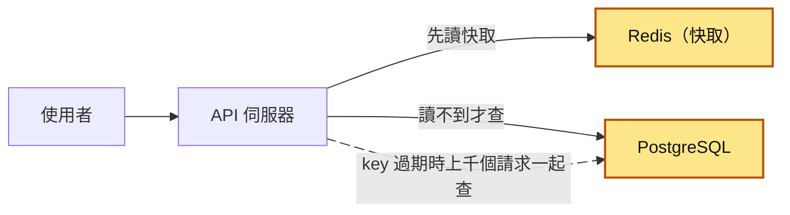
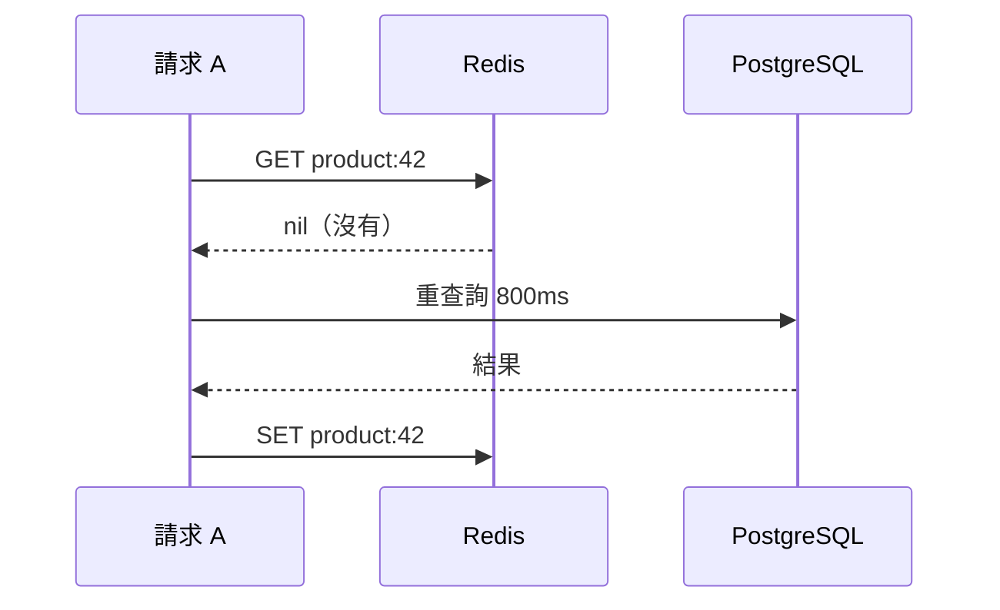
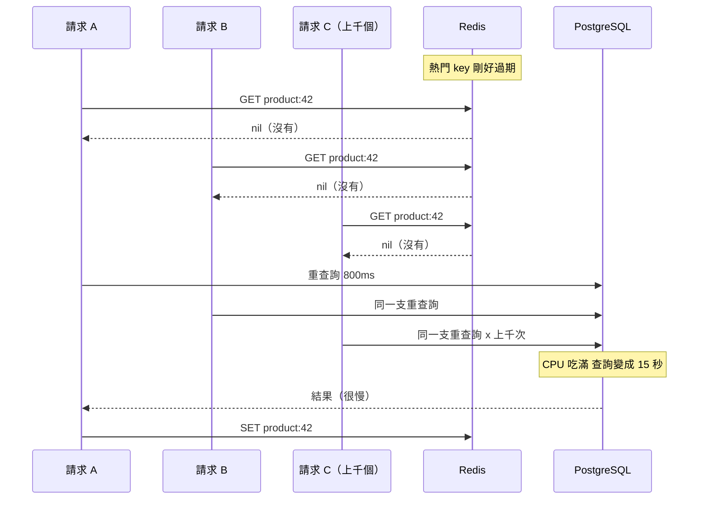
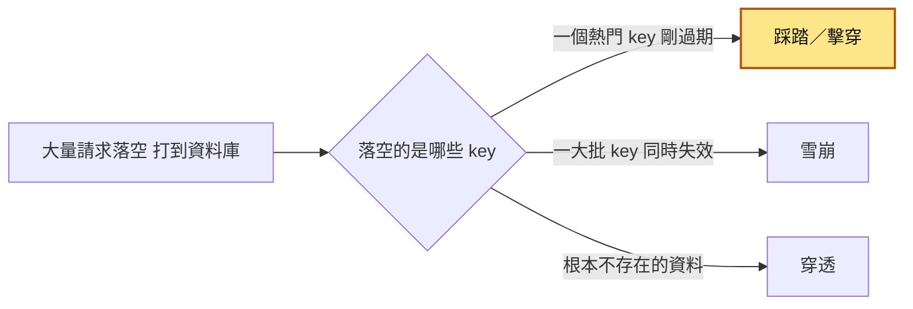
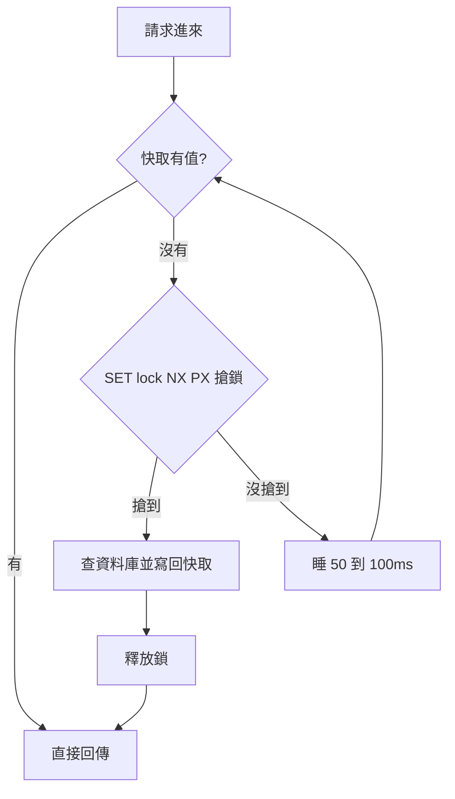
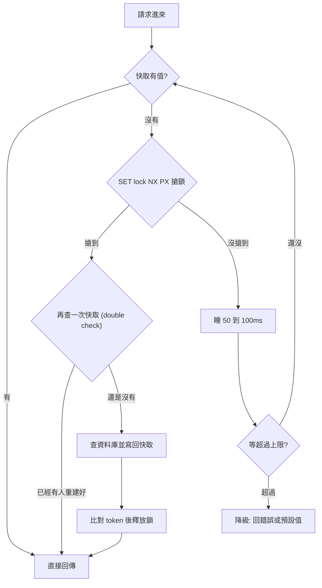
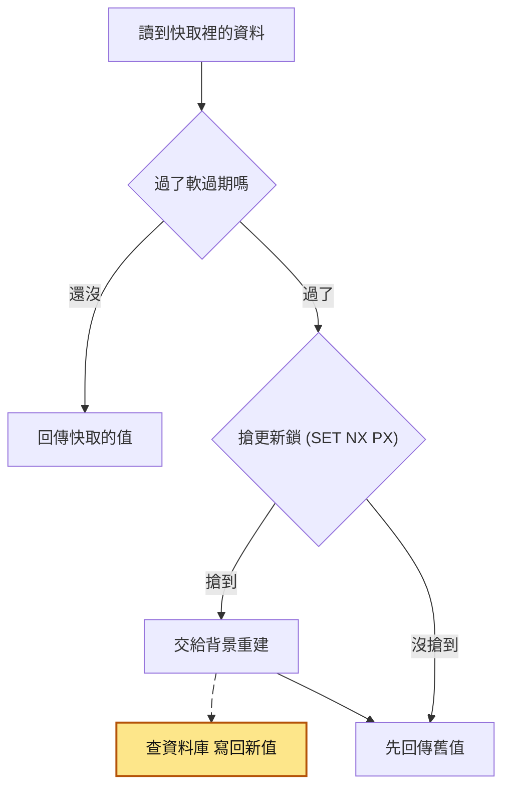
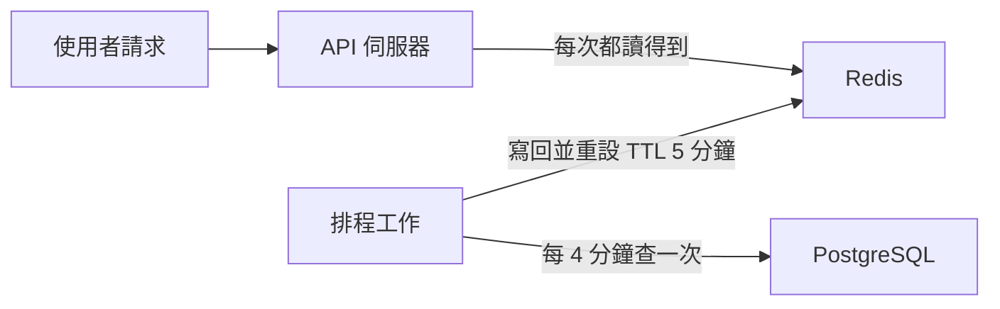
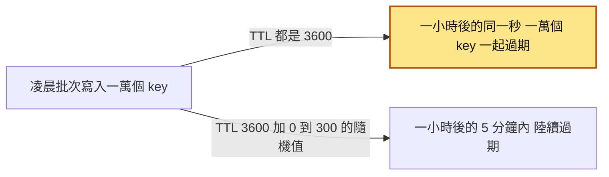
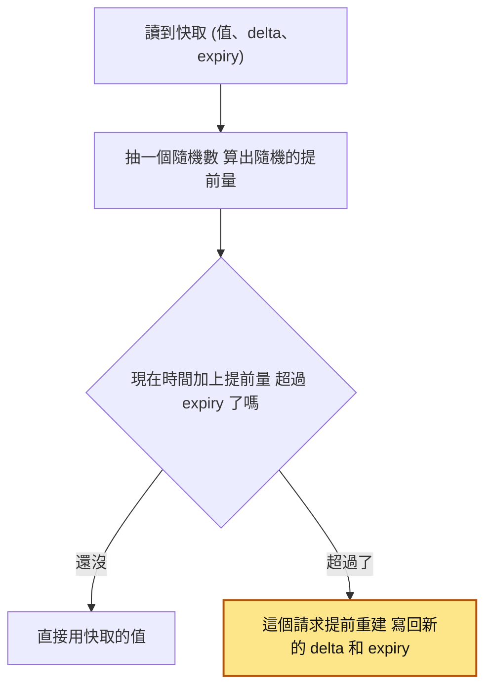

# 23｜快取踩踏（Cache Stampede）

> 快取踩踏（cache stampede）是指一筆很多人在讀的快取資料剛好過期時，同一瞬間沒讀到快取的大量請求一起去資料庫查同一份資料，把資料庫壓垮。

**難度**：★★☆　**閱讀時間**：約 20 分鐘　**前置知識**：[競爭條件](01-競爭條件.md)、[連線池](08-連線池.md)、[快取失效](21-快取失效.md)

## 核心問題與理念

**它要解決的問題**：一個熱門商品頁每秒有 3000 個請求，資料放在快取（存在 Redis、讀得比較快的那一份）裡，60 秒過期。過期那一瞬間，每個請求都發現快取是空的，各自去資料庫跑同一支要 0.8 秒的查詢，上千支擠在一起，資料庫被拖到每支 15 秒，連結帳都卡住（下面的情境會完整走一遍）。

**核心理念**：快取沒了，只派一個請求去資料庫拿，其他請求等它拿回來，或先拿舊的用。

**想通的那一步**：

- **卡住的地方**：直覺的做法是把過期時間調長，或加一點隨機秒數。它卡在熱門的那筆快取終究會在某一刻過期，那一刻同時落空的請求大約是「每秒請求數 × 查一次要幾秒」，3000 × 0.8 就是 2400 個，而且每個請求都各自決定「快取空了，我去查」。
- **火花**：把「去資料庫查」變成要先搶到名額才能做的事：用 Redis 一個指令搶一把鎖，搶到的那一個去查，其他人稍等再讀快取。再往前一步，快取裡多記一個「該更新了」的時間，真正刪掉的時間設得晚很多，該更新時舊值還在，大家先拿舊的用，連等都不用等。

## 閱讀前推薦具備知識

| 知識 | 要會到什麼程度 | 這篇哪裡會用到 | 不熟的話先看 |
|---|---|---|---|
| [快取失效](21-快取失效.md) | **必備**：能說出 cache-aside 的三步（先 `GET`，沒命中查資料庫，再 `SET` 帶 TTL 寫回），也知道 TTL 到了 key 就不見 | 情境裡 `get_product_naive` 的三步、〈踩踏是怎麼發生的〉 | 本系列第 21 篇 |
| [競爭條件](01-競爭條件.md) | **必備**：能說出「先檢查、再動作」分成兩步時，別的請求會在中間插進來，大家看到同一個舊狀態、做出同一個決定 | 〈踩踏是怎麼發生的〉的時序圖、〈對策一：互斥鎖〉為什麼搶鎖要用一個原子指令 | 本系列第 01 篇 |
| [連線池](08-連線池.md) | **加分**：知道連線池的連線被借光之後，新的請求只能排隊等 | 情境 T3「加入購物車」「結帳」也拿不到連線、地雷 3 | 本系列第 08 篇 |
| Python `threading` | **加分**：看得懂 `threading.Thread` 開執行緒、`threading.Lock` 保護共用變數、`Barrier` 讓所有執行緒一起起跑 | 「動手看看」的 `stampede_demo.py` | [Python threading（中文）](https://docs.python.org/zh-tw/3/library/threading.html) |
| Docker | **加分**：會用 `docker run` 起一個 Redis 容器 | 「動手看看」 | [Docker 入門](https://docs.docker.com/get-started/) |

**快速自我檢查**：key `k` 一開始不存在，兩個請求同時執行 `if r.get("k") is None: r.set("k", query_db(), ex=60)`。`query_db()` 最多會被呼叫幾次？

<details markdown="1"><summary>看答案</summary>

最多 2 次。兩個請求可能都先做完 `GET`、都看到 `None`，然後各自去查資料庫，因為「檢查」和「寫入」中間沒有任何東西擋住另一個請求。把 2 個換成每秒 3000 個，就是這篇的踩踏。答不出來也沒關係，先看第 01 篇〈競爭條件〉。

</details>

## 為什麼要在意：一個具體的情境

以下是假設的情境。你負責一個電商的商品 API，商品頁的資料要跨商品表、庫存表、評價表彙總，一次查詢在資料庫上大約要跑 800ms（0.8 秒）。為了不要每次都查，程式把查詢結果放進 Redis，TTL 60 秒。平常這一頁每秒約 30 個請求，就算 key 過期，也只有約 30 × 0.8 = 24 個請求一起去查，資料庫扛得住。

晚上 8 點，限量球鞋（商品 42）開賣，這一頁的流量衝到每秒 3000 個請求。

程式的讀取寫法是最常見的 cache-aside，每個請求都照這三步走：

1. 用 `r.get` 讀 Redis，有值就直接回傳。
2. 沒有值（「落空」，也叫 cache miss）就查資料庫，也就是 `data = slow_db_query(product_id)` 這一行。
3. 查完用 `r.set` 寫回 Redis，60 秒後過期。

只有一個請求時，這樣完全正確。完整程式在「動手看看」的 `stampede_demo.py`（函式 `get_product_naive`）。

8 點 02 分，`product:42` 剛好過期。下面這張圖可以按播放看整個過程；圖下面的表格按「逐步看」一列一列往下，注意最右邊兩欄怎麼變：

<figure class="draw-fig">
<iframe class="draw-fig__frame" src="../figures/23-cache-stampede.html" title="按播放或點 T1～T5，看 product:42 過期後請求怎麼全部落空、湧進 PostgreSQL，注意底下的空窗條：原本以為只有 0.8 秒，最後被拉長到約 15 秒。" loading="lazy" style="height: 640px;"></iframe>
<figcaption>按播放或點 T1～T5，看 product:42 過期後請求怎麼全部落空、湧進 PostgreSQL，注意底下的空窗條：原本以為只有 0.8 秒，最後被拉長到約 15 秒。</figcaption>
</figure>

| 時間 | 請求 A | 其他請求 | Redis 裡的 `product:42` | 資料庫 |
|---|---|---|---|---|
| T1（20:02:00.000） | `r.get` 拿到 `None`，開始查資料庫 | 還沒進來 | 沒有（剛過期） | 1 支查詢在跑 |
| T2（之後 0.8 秒內） | 還在等資料庫 | 每秒 3000 個進來，全部落空，各自去查 | 沒有 | 相同的查詢累積到約 2400 支（3000 × 0.8），CPU 100% |
| T3（0.8 秒） | 資料庫忙著搶 CPU 和 I/O，還沒回來 | 繼續落空；[連線池](08-連線池.md)被占滿，「加入購物車」「結帳」也拿不到連線 | 沒有 | 每支查詢從 0.8 秒拖到約 15 秒 |
| T4（約 15 秒） | 終於拿到結果，`r.set` 寫回 Redis | 很多請求已經逾時，前端自動[重試](26-重試機制.md)，流量再翻倍 | 有值了 | 還在跑已經送進來的上千支查詢 |
| T5（之後） | | 新請求讀到快取，但排隊的查詢和重試流量還在 | 有值 | 持續滿載 |
| T6（之後） | | [健康檢查](49-健康檢查.md)（定期確認服務還活著的機制）看到 API 一直逾時，重啟一批實例，能接請求的機器更少 | 有值 | 持續滿載 |

**使用者看到的**：商品頁一直轉圈或跳出錯誤頁，連加入購物車、結帳都按不下去。

**值班工程師看到的**：資料庫 CPU 100%；`pg_stat_activity`（PostgreSQL 列出「現在正在跑哪些查詢」的系統檢視表）裡有上千條一模一樣的查詢；整站 5xx（伺服器錯誤）比例飆高。最後是手動把商品資料塞回 Redis、在入口的閘道上開[速率限制](30-速率限制.md)擋掉一部分流量，20 分鐘後才恢復。

**根因**：從 `r.get` 拿到 `None` 到 `r.set` 寫回之間有一段空窗，這段時間進來的每個請求都會走到 `data = slow_db_query(product_id)` 那一行，程式裡沒有任何「只讓一個人去查」的機制。資料庫越慢，空窗越長，落空的請求越多，資料庫又更慢，形成正回饋迴圈。這張圖就是那個迴圈，一圈比一圈嚴重：


平常每秒 30 個請求時只多出二十幾支查詢，所以測試和平常完全看不出來，只在尖峰時刻爆炸。

**怎麼修**：讓同一時間只有一個請求去查資料庫，其他請求等它寫回快取再讀，見「它是怎麼運作的」的「對策一：互斥鎖」；或者讓熱門 key 根本不會真的過期，見「對策二」「對策三」。「動手看看」會實際跑一次：200 個同時落空的請求，資料庫被查的次數從 200 次降到 1 次。

## 全貌：它在系統裡的位置

下面這張圖是一個讀取請求會經過的元件，黃色是踩踏發生的地方。



踩踏發生在 Redis 讀不到值之後、API 轉去查 PostgreSQL 的那條路上：起因是 Redis 裡一個熱門 key 剛過期，壓力全部落到 PostgreSQL。key 什麼時候該刪、該刪還是該更新，是[快取失效](21-快取失效.md)的主題；記憶體不夠時 key 被 Redis 丟掉，見 [Redis 驅逐](22-Redis%20驅逐.md)；應用程式和快取都分成很多台時會多出哪些問題，見[分散式快取](24-分散式快取.md)。

## 生活比喻

想像公司茶水間只有一台咖啡機，旁邊放著一壺煮好的咖啡（快取）。大家來倒咖啡都很快。

有一天壺見底了（key 過期）。第一個人發現沒咖啡，開始煮新的一壺，要等五分鐘。問題是，接下來五分鐘內走進茶水間的每個人，也都看到壺是空的，然後每個人都去按咖啡機再煮一壺。咖啡機只有一台，大家擠成一團，最後誰都喝不到，咖啡機還過熱跳電。這就是踩踏。

對策就是茶水間的規矩：

- **互斥鎖**：第一個人煮的時候在壺上貼一張「煮咖啡中，五分鐘後回來」，後面的人看到就先回座位，等一下再來。
- **回傳舊值**：壺快見底時，留著最後一點還能喝的（雖然有點冷），同時有人去煮新的。來的人先喝舊的，不會空手而歸。
- **提早更新**：還剩三分之一壺就有人先去煮，壺根本不會見底。

**比喻失準的地方**：茶水間的人走進來會先看一眼壺上的紙條，但程式裡的請求是在「同一毫秒」大量湧入，「看壺」和「貼紙條」之間的空檔會被並行請求鑽進去，所以紙條（鎖）一定要用原子操作貼上去，也就是「看」和「貼」在同一個動作裡做完，中間不讓別人插隊，不能先看再貼。另外，現實中煮咖啡的人不會突然人間蒸發，但伺服器的程序會當掉，所以紙條必須設定「多久後自動作廢」，否則大家會永遠等下去。

## 它是怎麼運作的

### 踩踏是怎麼發生的

快取是為了讓資料庫少做重複的查詢，踩踏就是這個目的在某一瞬間落空。標準的 cache-aside 寫法是這樣運作的：你的請求進來時，程式先讀快取；快取沒有，就去查資料庫；查完再把結果寫回快取。只有一個請求時，流程長這樣：



這段流程在單一請求下完全正確。問題出在查資料庫到寫回快取之間有一段時間窗，這段時間內進來的請求都會看到快取是空的。這是一種[競爭條件](01-競爭條件.md)：大家同時檢查同一個狀態，同時做出同樣的決定。下面這張圖多加了請求 B 和上千個請求 C：



估算公式很簡單：**同時落空的請求數 ≈ 該 key 的 QPS（每秒查詢數）× 重建時間**。所以有兩類 key 要特別小心：

1. **讀取量很大的 key**：首頁設定、熱門商品、排行榜、全站共用的設定檔。
2. **重建很貴的 key**：彙總查詢、要呼叫外部 API 的結果、要算很久的推薦結果。

兩種條件都符合的 key 最容易踩踏。每秒讀 5 次、重建 10ms 的 key，就算過期也平均多不到 1 個查詢，不用特別處理。

### 三個容易搞混的名詞

三種情況的共同點都是「大量請求落空、打到資料庫」，差別在落空的是哪些 key。下面這張圖從「落空的 key」出發分成三條路：



本篇主要講黃色那一條。三種的典型原因和對策整理在下表：

| 名詞 | 發生什麼事 | 典型原因 | 主要對策 |
|---|---|---|---|
| 快取踩踏／擊穿（stampede、thundering herd、dogpile） | **一個**熱門 key 過期，大量請求同時重建 | 熱 key 的 TTL 到期、被主動刪除、被[驅逐](22-Redis%20驅逐.md) | 互斥鎖、回傳舊值、提早更新、XFetch |
| 快取雪崩（avalanche） | **大量** key 在同一時間失效 | 一批資料同時寫入、TTL 都一樣；Redis 重啟或整台掛掉 | TTL 加隨機值、快取高可用、降級（先回預設值或舊資料）與速率限制 |
| 快取穿透（penetration） | 查的是**不存在**的資料，快取永遠落空 | 惡意掃描不存在的 id、程式 bug | 快取空值（短 TTL）、布隆過濾器（Bloom filter，能快速判斷「這個 id 一定不存在」的資料結構）、參數驗證 |

> 名詞說明：英文世界的 cache stampede 通常同時涵蓋「單一熱 key」和「一批 key」的情況；中文圈則習慣把單一熱 key 叫「擊穿」，一批叫「雪崩」。跟別人討論時，直接講「哪個 key、為什麼失效、多少請求打進來」最不會誤會。thundering herd 這個詞原本來自作業系統：很多程序同時等待同一個事件，事件一來全部被喚醒去搶，結果只有一個搶得到。

### 對策一：互斥鎖／single-flight（只讓一個人去重建）

踩踏的成本來自上千個請求重複查同一份資料，所以最直接的對策是同一時間只放一個請求去查資料庫。你的請求發現快取落空時，先搶一把「重建鎖」。搶到的請求去查資料庫並寫回快取；沒搶到的請求不查資料庫，稍等一下再讀快取。

搶鎖用的是 Redis 的 `SET` 指令加上兩個選項：`NX` 是「這個 key 不存在才設定」，所以同一時間只有一個人設得成功；`PX` 是「幾毫秒後自動刪掉」。最基本的流程長這樣：



實際寫的時候還要補兩個檢查：搶到鎖後再查一次快取（double check），以及沒搶到鎖的請求等待要有上限。另外，搶鎖時存進去的值是一個隨機字串，叫 token，用來認出這把鎖是不是自己搶的，下面第 3 點會說明為什麼需要它。加上這兩步、並在釋放鎖前比對 token 之後，完整流程是：



這個流程有 5 個細節要做對：

- **搶鎖要用原子操作**：`SET lock:key token NX PX 5000`，一個指令同時做到「不存在才設定」和「設定過期時間」。不要寫成 `SETNX` 再 `EXPIRE` 兩步，中間當掉鎖就永遠不會過期。
- **鎖一定要有過期時間**：拿到鎖的程序可能當掉、被 OOM kill（記憶體用光，被系統強制結束）、被部署重啟。沒有過期時間，其他人會永遠等下去。
- **釋放鎖要比對 token**：如果重建花的時間超過鎖的 TTL，鎖會自動消失、被別人搶走。這時你直接 `DEL` 就會刪到別人的鎖。所以每次搶鎖放一個隨機 token，釋放時用 Lua 腳本「值相同才刪」。Redis 會把整段 Lua 腳本一次執行完，中間不會插進別的指令，所以「比對」和「刪除」之間不會被別人搶先。
- **拿到鎖後再查一次快取**：在你搶鎖的空檔，可能前一個鎖持有者剛好寫好快取並釋放鎖。不再查一次，就會多跑一次重查詢。
- **等待要有上限**：等太久就降級（回錯誤、回預設值、或乾脆自己查一次），不能無限迴圈。等待中的請求會占著執行緒和連線，等越久系統越容易被拖垮，這也是[背壓](47-背壓.md)要處理的問題。

第 3 點最不直覺。下表假設鎖的 TTL 是 5 秒，這次重建卻花了 7 秒，而且 A 釋放鎖時直接 `DEL`、沒有比對 token：

| 時間 | 請求 A | 請求 B、C | Redis 裡的 `lock:product:42` |
|---|---|---|---|
| T1（0 秒） | 搶到鎖，token 是 `a1`，開始重建 | 搶不到，等待 | `a1`（5 秒後過期） |
| T2（5 秒） | 還在重建 | 還在等 | 過期消失，沒有鎖 |
| T3（5 秒多） | 還在重建 | B 搶到鎖，token 是 `b1`，也開始重建 | `b1` |
| T4（7 秒） | 重建完，直接 `DEL` 鎖 | B 還在重建 | 被 A 刪掉，沒有鎖 |
| T5（7 秒多） | | C 又搶到鎖，第三個人去重建 | `c1` |

A 在 T4 刪掉的是 B 的鎖。如果 A 先比對 token，就會看到值是 `b1`，跟自己的 `a1` 不同，於是不刪，C 也就搶不到。

**程序內 single-flight 與分散式鎖的差別**：Go 有現成的 `golang.org/x/sync/singleflight` 套件，Python 也可以用一個 dict 存「正在進行中的重建」。這種做法只合併**同一個程序內**的重複請求，不需要 Redis，延遲也最低。但如果你的服務同時跑 20 個 Pod（Kubernetes 裡一份執行中的服務程式，可以先想成 20 台應用伺服器），過期那一刻資料庫還是會收到 20 個查詢。20 個通常可以接受，2000 個就不行。所以常見組合是：程序內 single-flight 先擋一層，真的很熱或很貴的 key 再加 Redis 分散式鎖。

**互斥鎖的缺點**：沒搶到鎖的請求得等，使用者會感覺到那一次的延遲。如果持有者當掉，大家要等到鎖過期才能重試。下面幾種對策都是為了讓使用者不用等這一段。

### 對策二：回傳舊值，背景更新（stale-while-revalidate）

剛過期的資料多半還能用：排行榜晚 30 秒更新，使用者通常不會發現。所以在快取裡存兩個時間：

- **軟過期**（logical expire）：過了這個時間，資料「該更新了」，但還能用。
- **硬過期**（Redis 的 TTL）：過了這個時間，資料真的刪掉，通常設得比軟過期長很多。

你的請求讀到一筆已經軟過期的資料時，先搶一把「更新鎖」，搶到的請求在背景重建；**所有人（包括搶到鎖的人）都先拿舊值回去**。使用者完全不用等，資料庫也只承受一次查詢。

這張圖是每個讀取請求的分岔，會碰到資料庫的只有背景重建那一條：



用「動手看看」片段裡的設定（軟過期 60 秒、硬過期 600 秒），加上開頭情境 0.8 秒的重建時間，一筆熱門 key 的時間軸是這樣：

| 時間 | 發生什麼 | 使用者拿到 | 正在跑的重建 |
|---|---|---|---|
| T1（0 秒） | 重建完成並寫入快取 | | 0 支 |
| T2（30 秒） | 請求讀到，還沒軟過期 | 新的值 | 0 支 |
| T3（61 秒） | 請求 A 讀到已軟過期的資料，搶到更新鎖，交給背景重建 | 舊值 | 1 支 |
| T4（61.5 秒） | 上千個請求讀到，都搶不到更新鎖 | 舊值 | 還是 1 支 |
| T5（61.8 秒） | 背景重建完成，寫回新值，軟過期往後推到 121.8 秒 | | 0 支 |
| T6（62 秒） | 新請求讀到 | 新的值 | 0 支 |

這個名稱來自 HTTP 的 `Cache-Control: stale-while-revalidate=秒數`（RFC 5861），CDN（放在使用者附近、替網站快取內容的一群伺服器）和 Nginx 都支援同樣的概念。代價是你得接受「短時間內讀到舊資料」，這對排行榜、商品介紹、設定檔沒問題；對庫存數量、帳戶餘額這種必須準確的資料就不適合。

### 對策三：提前非同步更新

熱門 key 通常事先就知道是哪幾個。可以讓一個[排程工作](38-工作排程.md)或[背景工作者](37-背景工作者.md)每 4 分鐘主動重建一次 TTL 5 分鐘的 key，它就永遠不會過期。

這張圖有兩條互不相干的路：讀取請求只碰 Redis，查資料庫的只有排程工作。



key 剩下的 TTL 每次降到 1 分鐘就被補滿：

| 時間 | 排程工作做什麼 | key 剩下的 TTL |
|---|---|---|
| T1（第 0 分鐘） | 第一次重建並寫入 | 5 分鐘 |
| T2（第 4 分鐘） | 重建並寫回 | 剩 1 分鐘時補回 5 分鐘 |
| T3（第 8 分鐘） | 重建並寫回 | 剩 1 分鐘時補回 5 分鐘 |
| T4（第 12 分鐘） | 重建並寫回 | 剩 1 分鐘時補回 5 分鐘 |

優點是讀取路徑最單純；缺點是你要維護「哪些 key 是熱的」清單，而且對冷門資料浪費資源。適合數量少、明確知道很熱的 key，例如首頁設定、全站公告、排行榜。

### 對策四：TTL 加隨機值（jitter）

如果一批 key 在同一時間寫入（例如每天凌晨批次預熱一萬個商品），又都設 TTL 3600 秒，它們會在一小時後的同一秒一起過期，這是雪崩。做法很簡單：`ttl = 3600 + random.randint(0, 300)`，讓過期時間散開。下面這張圖比較同一批 key 的兩種 TTL 設法：



這跟[抖動](28-抖動.md)在重試裡的用法是同一個道理：把同時發生的事情打散。

**TTL 加隨機值只解決「一批 key 同時過期」**。單一熱 key 的 TTL 加多少隨機值，它終究會在某一刻過期，那一刻的踩踏一個也沒少。

### 對策五：機率式提前過期（XFetch）

> 第一次讀可以先跳過這一節，等遇到「key 很多、熱度不一，又不想加鎖」時再回來看。

這是 Vattani 等人在 2015 年發表於 VLDB（資料庫領域的學術會議）的論文〈Optimal Probabilistic Cache Stampede Prevention〉提出的做法。做法是**每個讀取請求都抽一個隨機數，用它決定要不要提前重建**；離過期越近，判斷成立的機率越高（「動手看看」〈XFetch 的寫法〉程式碼註解寫的「擲中」，就是指判斷成立）。快取存三個東西：值、上次重建花了多久（`delta`）、過期時間（`expiry`）。判斷式是：如果 `now - delta × beta × ln(rand()) ≥ expiry`，就提前重建。

每個讀取請求都走一次下面這個判斷：



`rand()` 是 0 到 1 的隨機數，`ln(rand())` 是負數，所以 `-delta × beta × ln(rand())` 是一個隨機的正數，平均值是 `delta × beta`。直覺上就是「把現在的時間往後推一個隨機量，如果推過了過期時間，就提前重建」。

- `delta` 越大（重建越慢），越早開始有人提前重建，因為慢的重建需要更多提前量。
- `beta` 預設 1，調大會更積極提前、調小會更保守。
- 讀取量越大，做這個判斷的請求越多，越早有一個請求判斷成立；讀取量小的 key 幾乎不會提前，也不需要。

好處是不需要鎖、不需要額外的背景工作，每個請求自己決定。缺點是無法保證「只有一個人」重建，只是讓重建很可能分散在不同時間點、通常只有一兩個請求去做；而且需要多存 `delta` 和 `expiry` 兩個欄位。

### 怎麼選

| 情境 | 建議 |
|---|---|
| 資料可以晚幾十秒 | 回傳舊值＋背景更新（首選） |
| 少數已知的超熱 key | 提前非同步更新，或回傳舊值 |
| 必須拿到最新值、不能回舊值 | 互斥鎖，搭配等待上限與降級 |
| 不想引入鎖、key 很多且熱度不一 | XFetch |
| 一批 key 同時寫入 | 不管用哪個，TTL 都加隨機值 |
| 所有情況 | 程序內 single-flight 是便宜的第一層 |

## 動手看看

用 Docker 起一個 Redis，然後用 Python 重現踩踏，再看互斥鎖的效果。資料庫用 `time.sleep` 模擬，這樣不用準備 PostgreSQL 也能看清楚「資料庫被打了幾次」。

```shell
docker run --rm -d --name redis-lab -p 6379:6379 redis:7
```

把下面存成 `stampede_demo.py`：

```python
# stampede_demo.py：重現快取踩踏，並比較加上互斥鎖後的差別
# 執行：uv run --with redis python stampede_demo.py
import json
import random
import threading
import time
import uuid

import redis

# redis-py 8 起，連線池預設最多 100 條連線，用完會直接丟 MaxConnectionsError；
# 這裡要讓 200（甚至 1000）個執行緒同時打 Redis，所以把上限調高
r = redis.Redis(host="localhost", port=6379, decode_responses=True, max_connections=2000)

db_calls = 0
db_calls_lock = threading.Lock()

def slow_db_query(product_id: int) -> dict:
    """模擬一個要跑 500ms 的重查詢，並記錄被呼叫幾次。"""
    global db_calls
    with db_calls_lock:
        db_calls += 1
    time.sleep(0.5)
    return {"id": product_id, "name": "限量球鞋", "price": 3990}

# ---------- ❌ 錯誤示範：沒有任何保護的 cache-aside ----------
def get_product_naive(product_id: int) -> dict:
    key = f"product:{product_id}"
    cached = r.get(key)
    if cached is not None:
        return json.loads(cached)
    data = slow_db_query(product_id)          # 所有落空的請求都會走到這裡
    r.set(key, json.dumps(data), ex=60)
    return data

# ---------- ✅ 正確寫法：只讓一個請求去重建 ----------
# 只刪「自己的」鎖：比對 token 一致才刪，用 Lua 保證「比對＋刪除」是原子的
RELEASE_LOCK = r.register_script("""
if redis.call('get', KEYS[1]) == ARGV[1] then
    return redis.call('del', KEYS[1])
end
return 0
""")

def get_product_with_lock(product_id: int, wait_timeout: float = 3.0) -> dict:
    key = f"product:{product_id}"
    lock_key = f"lock:{key}"
    deadline = time.monotonic() + wait_timeout

    while True:
        cached = r.get(key)
        if cached is not None:
            return json.loads(cached)

        token = str(uuid.uuid4())
        # NX：key 不存在才設定；PX：鎖 5 秒後自動消失，避免持有者當掉後大家永遠等
        if r.set(lock_key, token, nx=True, px=5000):
            try:
                # 拿到鎖後再查一次：可能在我搶鎖的空檔，別人已經重建好了
                cached = r.get(key)
                if cached is not None:
                    return json.loads(cached)
                data = slow_db_query(product_id)
                # TTL 加一點隨機值，避免一批 key 在同一秒一起過期
                r.set(key, json.dumps(data), ex=60 + random.randint(0, 10))
                return data
            finally:
                RELEASE_LOCK(keys=[lock_key], args=[token])

        # 沒搶到鎖：短暫等待後重查快取，不要直接去打資料庫
        if time.monotonic() > deadline:
            raise TimeoutError(f"等待 {key} 重建逾時")
        time.sleep(0.05 + random.random() * 0.05)

def run(fn, concurrency: int = 200) -> None:
    global db_calls
    db_calls = 0
    r.delete("product:42", "lock:product:42")   # 模擬熱門 key 剛好過期
    barrier = threading.Barrier(concurrency)       # 讓所有執行緒同時起跑
    errors = []

    def worker():
        barrier.wait()
        try:
            fn(42)
        except Exception as e:  # noqa: BLE001
            errors.append(e)

    threads = [threading.Thread(target=worker) for _ in range(concurrency)]
    start = time.perf_counter()
    for t in threads:
        t.start()
    for t in threads:
        t.join()
    elapsed = time.perf_counter() - start
    print(f"{fn.__name__:<24} 並行 {concurrency}，資料庫被查 {db_calls} 次，"
          f"錯誤 {len(errors)} 個，耗時 {elapsed:.2f} 秒")

if __name__ == "__main__":
    run(get_product_naive)
    run(get_product_with_lock)
```

執行：

```shell
uv run --with redis python stampede_demo.py
```

預期會看到類似這樣（耗時依機器而異）：

```
get_product_naive        並行 200，資料庫被查 200 次，錯誤 0 個，耗時 0.5x 秒
get_product_with_lock    並行 200，資料庫被查 1 次，錯誤 0 個，耗時 0.6x 秒
```

要看的是**資料庫被查的次數：從 200 次變成 1 次**。兩邊耗時差不多，是因為模擬環境裡 200 次 `sleep` 可以平行進行；在真實資料庫上，200 支重查詢會互相搶 CPU 和 I/O，每一支都變慢，這就是事故中「800ms 變 15 秒」的由來。

可以自己玩玩看：

- 把 `concurrency` 改成 1000，看沒保護的版本是不是線性成長。
- 把鎖的 `px=5000` 改成 `px=200`（比重建時間 500ms 還短），看資料庫被查幾次。你會看到鎖提早過期、又有人搶到鎖去重建，這就是「鎖的 TTL 要大於重建時間」的原因。
- 開另一個終端機跑 `docker exec -it redis-lab redis-cli MONITOR`，觀察搶鎖的 `SET "lock:product:42" "<token>" "NX" "PX" "5000"` 被打了多少次。較舊的 redis-py（例如 5.x）會把 `PX` 放在 `NX` 前面，順序不影響效果。`MONITOR` 很吃效能，只在本機實驗用，不要在正式環境開。

### 回傳舊值的寫法（片段）

```python
# 沿用上面 stampede_demo.py 的 r、slow_db_query、RELEASE_LOCK
import json
import threading
import time
import uuid

SOFT_TTL = 60     # 軟過期：60 秒後該更新了，但舊值還能用
HARD_TTL = 600    # 硬過期：Redis 真正刪掉的時間，要比軟過期長很多

def get_product_swr(product_id: int) -> dict:
    key = f"product:{product_id}"
    raw = r.get(key)
    if raw is None:
        # 冷啟動（完全沒有資料）：這裡一樣要走互斥鎖流程，避免踩踏，此處省略。
        # 注意：rebuild_with_lock 寫回快取時要用跟 _refresh 相同的格式
        # （{"value": ..., "soft_expire_at": ...}），不能直接套用上面寫純資料的 get_product_with_lock
        return rebuild_with_lock(product_id)

    entry = json.loads(raw)
    if time.time() < entry["soft_expire_at"]:
        return entry["value"]                      # 還新鮮，直接用

    # 已經軟過期：搶到更新鎖的那一個負責在背景重建
    token = str(uuid.uuid4())
    if r.set(f"refresh:{key}", token, nx=True, px=10_000):
        # 正式環境建議丟給背景工作者或任務佇列，這裡用執行緒示意
        threading.Thread(target=_refresh, args=(product_id, key, token), daemon=True).start()
    return entry["value"]                          # 所有人都先拿舊值回去，不用等

def _refresh(product_id: int, key: str, token: str) -> None:
    try:
        value = slow_db_query(product_id)
        entry = {"value": value, "soft_expire_at": time.time() + SOFT_TTL}
        r.set(key, json.dumps(entry), ex=HARD_TTL)
    finally:
        RELEASE_LOCK(keys=[f"refresh:{key}"], args=[token])
```

### XFetch 的寫法（片段）

```python
# 沿用上面 stampede_demo.py 的 r、slow_db_query
import json
import math
import random
import time

def get_product_xfetch(product_id: int, ttl: int = 60, beta: float = 1.0) -> dict:
    key = f"product:{product_id}"
    raw = r.get(key)
    if raw is not None:
        entry = json.loads(raw)
        # random.random() 的範圍是 [0, 1)，可能剛好是 0，ln(0) 會出錯
        # 所以用 1 - random.random()，範圍變成 (0, 1]
        gap = -entry["delta"] * beta * math.log(1.0 - random.random())
        if time.time() + gap < entry["expiry"]:
            return entry["value"]                  # 這次沒擲中，直接用快取
    # 快取不存在，或擲中了提前重建
    start = time.time()
    value = slow_db_query(product_id)
    delta = time.time() - start                    # 記下這次重建花了多久
    entry = {"value": value, "delta": delta, "expiry": time.time() + ttl}
    r.set(key, json.dumps(entry), ex=ttl)
    return value
```

注意 XFetch 只處理「快要過期」的階段；如果 key 已經完全不存在（冷啟動、被驅逐），還是會發生踩踏，熱門 key 一樣要搭配互斥鎖。

### 在 Nginx 層擋（設定片段）

> 第一次讀可以先跳過這一節，等你的 API 前面有 Nginx 時再回來看。

如果你的 API 前面有 Nginx 做[反向代理](34-反向代理.md)快取，它內建了對應的開關：

```nginx
proxy_cache_path /var/cache/nginx keys_zone=api_cache:10m;

server {
    location /api/ranking {
        proxy_cache api_cache;
        proxy_cache_valid 200 60s;
        proxy_cache_lock on;                       # 快取裡還沒有這個項目時，同一個 key 只放一個請求去後端填快取
        proxy_cache_lock_timeout 5s;               # 等太久（預設就是 5s）就放行到後端，但這些回應不會寫入快取
        proxy_cache_use_stale updating error timeout;  # 更新中或後端出錯時先回舊值
        proxy_cache_background_update on;          # 過期項目在背景更新（必須搭配上一行的 updating）
        proxy_pass http://backend;
    }
}
```

`proxy_cache_lock` 只管「快取裡完全沒有這個項目」的情況；項目已經存在但過期時，靠的是 `proxy_cache_use_stale updating`：一個請求去後端更新，其他請求先拿舊的回應。兩個一起開，才同時擋住冷啟動和過期兩種踩踏。

實驗完記得清掉容器：

```shell
docker stop redis-lab
```

## 常見地雷

### 地雷 1：搶鎖和設過期時間分兩步做

- ❌ 錯誤做法：`if r.setnx(lock_key, 1): r.expire(lock_key, 5)`
- 為什麼錯：`SETNX` 成功之後、`EXPIRE` 之前程序如果當掉（部署、OOM、網路斷），這把鎖就永遠不會過期，之後所有請求都搶不到鎖，這個 key 再也無法重建。
- ✅ 正確做法：一個指令做完：`r.set(lock_key, token, nx=True, px=5000)`。

### 地雷 2：釋放鎖時直接 DEL

- ❌ 錯誤做法：`finally: r.delete(lock_key)`
- 為什麼錯：重建花了 7 秒，鎖 5 秒就過期了，B 已經搶到新的鎖在重建。A 做完後直接刪掉的是 B 的鎖，C 又搶到鎖去重建……保護就失效了。
- ✅ 正確做法：搶鎖時放一個隨機 token，釋放時用 Lua 腳本比對 token 一致才刪（見上方範例的 `RELEASE_LOCK`）。同時把鎖的 TTL 設得比重建時間的最壞情況長一些。

### 地雷 3：沒搶到鎖的請求無限等待，或是馬上又去查資料庫

- ❌ 錯誤做法：`while not r.get(key): time.sleep(0.01)`，沒有上限；或者沒搶到鎖就「算了我自己查」。
- 為什麼錯：無限等待時，重建一旦失敗（資料庫掛了），所有請求都卡住，把 worker 執行緒和連線池耗光；沒搶到鎖就自己查，等於沒加鎖。
- ✅ 正確做法：等待加上總時間上限（例如 2–3 秒）和帶隨機值的間隔，超時就降級：回傳預設值、舊值或明確的錯誤，讓上游的[斷路器](29-斷路器.md)和重試策略去處理。

### 地雷 4：以為 TTL 加隨機值就解決了踩踏

- ❌ 錯誤做法：首頁設定這個超熱 key 的 TTL 改成 `300 + random.randint(0, 60)`，就宣布「踩踏問題處理好了」。
- 為什麼錯：隨機值只是讓**一批** key 錯開過期時間。單一熱 key 不管 TTL 是多少，過期那一刻照樣有 QPS × 重建時間那麼多請求一起落空。
- ✅ 正確做法：TTL 加隨機值用來防雪崩；單一熱 key 另外用互斥鎖、回傳舊值或提前更新。

### 地雷 5：資料更新時「刪除熱門 key」，親手引爆踩踏

- ❌ 錯誤做法：後台每次修改首頁設定，就 `r.delete("homepage:config")`，讓下一次讀取自己重建。
- 為什麼錯：刪除熱 key 的效果跟它過期一模一樣，而且刪除常發生在營運人員上班、流量正高的時候。這是[快取失效](21-快取失效.md)策略跟踩踏的交會點。
- ✅ 正確做法：對熱 key 用「更新」取代「刪除」：資料庫寫入成功後直接把新值寫進快取（注意寫入順序與並行問題，詳見快取失效那篇），或只把軟過期時間改成現在、讓 stale-while-revalidate 在背景重建。

### 地雷 6：只防「過期」，忘了「冷啟動」

- ❌ 錯誤做法：精心設計了 SWR 和 XFetch，但 Redis 重啟、有人下了 `FLUSHALL`（清空整個 Redis 的指令）、key 被[驅逐](22-Redis%20驅逐.md)、新版本部署換了 key 的前綴時，什麼保護都沒有。
- 為什麼錯：這些情況下 key 完全不存在，stale-while-revalidate 沒有舊值可回，XFetch 也沒有快取項目可以拿來判斷，全部直接落空。換 key 前綴（例如 `v2:product:*`）等於一次讓所有 key 失效，是自己製造雪崩。
- ✅ 正確做法：冷啟動路徑一律包互斥鎖；部署或切換前先預熱（warm up）熱門 key；換 key 格式時分批切換，或讓新舊格式並存一段時間。

### 地雷 7：查不存在的資料時不快取，被穿透

- ❌ 錯誤做法：`if data is None: return None`，不寫入快取。
- 為什麼錯：有人拿不存在的 id 一直打（爬蟲、攻擊、前端 bug），每一次都直接打到資料庫，互斥鎖也只能讓它們排隊。這屬於穿透，常跟踩踏一起出現。
- ✅ 正確做法：把「不存在」也快取起來，用一個特殊值（例如空字串或 `{"_missing": true}`）並設較短的 TTL（如 30–60 秒）；id 格式明顯不對的請求在入口就擋掉。

## 重點整理

- **踩踏的規模大約是「這個 key 每秒被讀幾次 × 重建要花的秒數」。** 開頭情境裡每秒 3000 次、重建 0.8 秒，過期那一瞬間就有約 2400 個請求一起去查資料庫。流量越大、查詢越慢越危險，平常流量小時看不出來。
- **踩踏、雪崩、穿透是三件事**：踩踏（中文圈也叫擊穿）是一個熱門 key 過期；雪崩是大量 key 同時過期，或整台 Redis 掛掉；穿透是一直查根本不存在的資料，每次都落空。三者對策不一樣。
- **基本對策是只讓一個請求去重建**：用 `SET key token NX PX ms` 搶鎖，搶到的去查資料庫，其他人短暫等待後重讀快取。鎖一定要有過期時間、釋放時要比對 token、等待一定要有上限。
- **更好的做法是不讓熱門 key 真的過期**：回傳舊值同時在背景更新（stale-while-revalidate）、在過期前由排程提早更新，或用 XFetch 讓讀取請求依機率提前重建。使用者一直拿得到資料，資料庫只承受一次重建。
- **TTL 加隨機值只能防雪崩，防不了單一熱 key 的踩踏。**
- **key 完全不存在時也會踩踏**（Redis 重啟、key 被驅逐、換了 key 前綴），這條冷啟動路徑一樣要包互斥鎖，或事先把熱門 key 預熱。

## 新人必知清單

### 一定要會（基本功）

- [ ] 能用「QPS × 重建時間」估算一個 key 過期時會有多少請求打到資料庫，判斷它需不需要保護。
- [ ] 分得清踩踏（單一熱 key 過期）、雪崩（大量 key 同時失效）、穿透（查不存在的資料），知道各自的主要對策。
- [ ] 會用 `SET key token NX PX ms` 搶鎖，知道為什麼不能拆成 `SETNX` + `EXPIRE`。
- [ ] 會用 Lua 腳本比對 token 後釋放鎖，知道直接 `DEL` 會刪到別人的鎖。
- [ ] 拿到鎖後會再檢查一次快取（double check）；沒拿到鎖的等待一定有上限和降級方案。
- [ ] 批次寫入的 key 會在 TTL 上加隨機值。
- [ ] 會把「查不到」也快取起來（短 TTL），防止穿透。

### 知道有這回事就好

- stale-while-revalidate 的軟過期／硬過期設計，以及它在 HTTP（RFC 5861）、CDN、Nginx 的對應功能。
- XFetch 機率式提前過期的公式和參數意義。
- 程序內 single-flight（例如 Go 的 `singleflight`）只能合併同一程序內的請求。
- Facebook 在〈Scaling Memcache at Facebook〉（NSDI 2013）用「lease」機制處理熱 key 重建與舊值寫回的問題。
- Redis 單機鎖在主從切換時可能失效；用快取鎖防踩踏，偶爾失效只是多查幾次資料庫，可以接受。但如果是保護「不能重複做的業務操作」，就不要只靠這種鎖，要回到[冪等性](25-冪等性.md)和資料庫約束。

### 先不用管（等你遇到再學）

- Redlock 演算法與它的爭議。
- 多層快取（程序內 LRU + Redis + CDN）之間的一致性與失效傳遞。
- 熱 key 偵測（例如 `redis-cli --hotkeys`，它要求 `maxmemory-policy` 設成 LFU 類的驅逐策略才能用）與熱 key 複製分散到多個節點，這屬於[分散式快取](24-分散式快取.md)的範疇。
- 針對重建成本與讀取分布做的最佳化數學分析。

## Code Review 時可以問的問題

1. **這個 key 有多熱、重建要多久？** 如果是首頁、排行榜、全站設定這類高 QPS 又重建很貴的 key，落空時有沒有「只讓一個人重建」的保護？
2. **鎖怎麼搶、怎麼放？** 是不是用 `SET ... NX PX` 一步完成？釋放時有沒有比對 token？鎖的 TTL 是否比重建時間的最壞情況長？
3. **沒搶到鎖的請求怎麼辦？** 等待有沒有上限？超時之後回什麼給使用者？會不會偷偷變成大家都去查資料庫？
4. **這份資料可以回舊值嗎？** 如果可以，為什麼不用 stale-while-revalidate 讓使用者完全不用等？如果不行（庫存、餘額），有沒有寫清楚理由？
5. **寫入路徑是刪除快取還是更新快取？** 刪除的是不是熱 key？刪除的時機會不會剛好在尖峰？
6. **一批 key 是不是同時寫入、TTL 一樣？** 冷啟動、部署換 key 前綴、Redis 重啟時，有沒有預熱或保護？

## 情境演練

**1. 你負責的 API 每秒被呼叫 2000 次，背後的快取 key TTL 10 分鐘，重建查詢要 300ms。主管問你：這個 key 過期那一刻，大約會有多少個請求打到資料庫？如果重建查詢在高負載下變成 3 秒呢？你會怎麼估？**

<details markdown="1"><summary>看答案</summary>

用 QPS × 重建時間估：大約 2000 × 0.3 = 600 個。如果重建變成 3 秒，就變成 2000 × 3 = 6000 個。

重建時間從 300ms 拉長到 3 秒，正是踩踏自己造成的：踩踏會讓資料庫變慢，資料庫變慢又讓重建時間變長，落空的請求跟著變多，這是正回饋迴圈。所以踩踏常常直接把資料庫打掛，不只是慢一下。TTL 10 分鐘在這裡完全不影響每次過期的衝擊大小，只影響多久衝擊一次。

</details>

**2. 你這個月值班遇到下面三種狀況，各自要怎麼處理？（a）每天凌晨 3 點批次預熱 10 萬個商品快取，TTL 都是 24 小時，隔天凌晨 3 點資料庫 CPU 飆高；（b）有爬蟲用遞增的 id 掃描商品頁，大部分 id 根本不存在；（c）明星宣布代言後，某個商品頁 key 一過期資料庫就卡住。**

<details markdown="1"><summary>看答案</summary>

（a）雪崩：大量 key 同一時間寫入、同一時間過期。對策是 TTL 加隨機值，例如 `86400 + random.randint(0, 3600)`。

（b）穿透：查的是不存在的資料，快取永遠落空。對策是快取空值（短 TTL）、入口驗證 id，必要時用布隆過濾器。

（c）踩踏（擊穿）：單一熱 key 過期。對策是互斥鎖、回傳舊值或提前更新。這個情境的 TTL 加隨機值沒有幫助。

</details>

**3. 你在 review 同事的互斥鎖寫法：搶到鎖之後查資料庫、寫快取，最後執行 `r.delete(lock_key)`。鎖的 TTL 是 3 秒。這段程式在什麼情況下會出問題？你會請他怎麼改？**

<details markdown="1"><summary>看答案</summary>

當重建時間超過 3 秒（資料庫正在被踩踏、慢查詢、網路抖動），鎖會先自動過期，B 搶到新的鎖開始重建。A 完成後執行 `r.delete(lock_key)`，刪掉的其實是 B 的鎖，C 又能搶到鎖……原本「只有一個人重建」退化成「每 3 秒多一個人重建」，而且越慢越多。

修正：搶鎖時存一個隨機 token，釋放時用 Lua 腳本「值等於自己的 token 才刪」；把鎖的 TTL 設得比重建時間的最壞情況長。另外，拿到鎖之後也要再查一次快取（double check）。

</details>

**4. 你們的服務跑在 30 個 Pod 上，首頁設定 key 用了程序內的 single-flight（每個程序同一時間只有一個重建）。過期時資料庫會收到幾個查詢？要不要再加 Redis 分散式鎖？**

<details markdown="1"><summary>看答案</summary>

最多約 30 個，每個 Pod 各一個。程序內 single-flight 只能合併同一程序內的請求，跨 Pod 互相看不到。

要不要加分散式鎖，看這 30 個查詢資料庫扛不扛得住。如果重建只是一支 20ms 的主鍵查詢，30 個完全沒事，加 Redis 鎖反而多一次網路往返和更多失敗模式。如果重建是 2 秒的彙總查詢，或之後會擴到 300 個 Pod，就值得加分散式鎖，或者更好的做法：首頁設定可以接受舊值，直接改成 stale-while-revalidate 或排程提前更新，讓 key 永遠不會真的過期。

</details>

**5. 團隊在評估要不要用 XFetch（判斷式是 `now - delta × beta × ln(rand()) ≥ expiry` 時提前重建）。同事問你兩件事：為什麼重建越慢（delta 越大）的 key 越早開始被提前重建？讀取量小的 key 幾乎不會提前重建，算不算缺點？你會怎麼回答？**

<details markdown="1"><summary>看答案</summary>

`-delta × beta × ln(rand())` 是一個隨機的「提前量」，平均值是 `delta × beta`。delta 越大，提前量越大，所以在離過期還很遠時就可能有請求判斷成立。這很合理：重建要 5 秒的 key，你得在過期前至少 5 秒開始重建，否則重建完成前就已經過期、開始踩踏了；重建只要 10ms 的 key，幾乎在過期前一刻才重建也來得及。

讀取量小的 key，做判斷的請求少，大部分時間沒有請求判斷成立，就會照常過期。這是設計上刻意的結果：讀取量小代表過期時落空的請求也少，踩踏不嚴重，本來就不需要花資源提前重建。XFetch 等於自動把提前重建的成本只花在熱 key 上。

</details>

## 相關主題

- [快取失效](21-快取失效.md)：什麼時候該讓快取失效、刪除還是更新；刪除熱 key 是引爆踩踏的常見原因。
- [Redis 驅逐](22-Redis%20驅逐.md)：記憶體不夠時 key 被驅逐，效果跟過期一樣，熱 key 被驅逐也會踩踏。
- [分散式快取](24-分散式快取.md)：多節點快取下的熱 key 分散、節點故障造成的雪崩。
- [抖動](28-抖動.md)：TTL 加隨機值和重試加隨機值是同一個「打散同時發生的事」的思路。
- [速率限制](30-速率限制.md)：踩踏已經發生時，在入口限流是保住資料庫的最後手段。
- [背壓](47-背壓.md)：等待鎖的請求會占住資源，系統要能在資源不足時拒絕新工作，而不是全部卡住。

## 延伸閱讀

- Vattani, Chierichetti, Lowenstein，〈Optimal Probabilistic Cache Stampede Prevention〉，PVLDB Vol. 8, No. 8（2015）：https://www.vldb.org/pvldb/vol8/p886-vattani.pdf
- RFC 5861〈HTTP Cache-Control Extensions for Stale Content〉（定義 `stale-while-revalidate` 與 `stale-if-error`）：https://www.rfc-editor.org/rfc/rfc5861
- Redis 官方文件 `SET` 指令（`NX`、`PX` 等選項）：https://redis.io/docs/latest/commands/set/
- Nginx `ngx_http_proxy_module` 文件（`proxy_cache_lock`、`proxy_cache_use_stale`、`proxy_cache_background_update`）：https://nginx.org/en/docs/http/ngx_http_proxy_module.html
