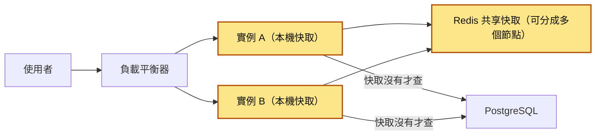
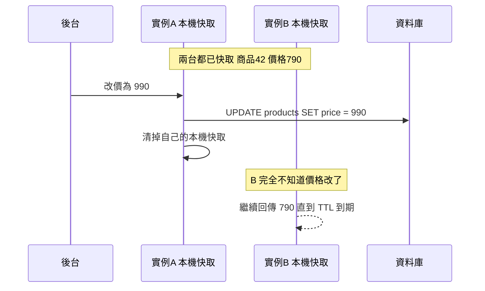
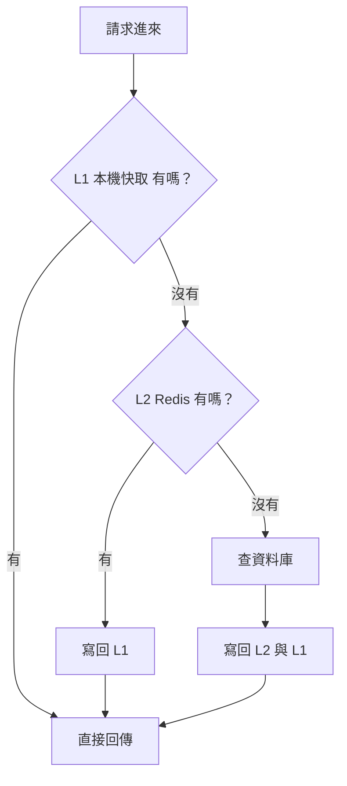
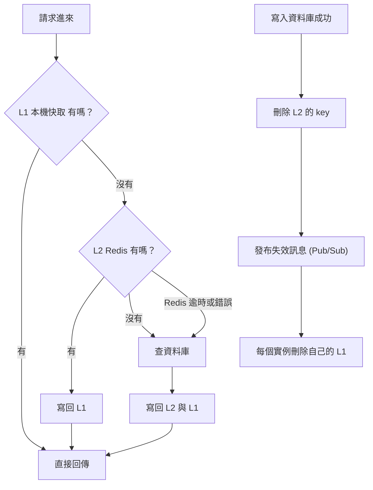

# 24｜分散式快取（Distributed Cache）

> 分散式快取（distributed cache）是把快取從每台應用伺服器自己的記憶體，搬到一組所有應用伺服器共用的快取伺服器（例如 Redis）上，讓大家看到同一份資料，代價是每次讀取都要走一趟網路。

**難度**：★★☆　**閱讀時間**：約 25 分鐘　**前置知識**：[快取失效](21-快取失效.md)、[Redis 驅逐](22-Redis%20驅逐.md)（知道 TTL、cache-aside 是什麼就能讀）

## 為什麼要在意：一個具體的情境

以下是假設的情境，分成兩次事故，剛好對應本篇的兩個主軸。

### 第一次事故：價格跳來跳去

你們的商品 API 跑在 8 個實例上（同一支程式同時跑 8 份），前面的負載平衡器把每個請求分給其中一台。為了加速，程式用 `cachetools.TTLCache` 把商品資料（含價格）放在每個實例自己的記憶體裡 10 分鐘。開發和測試環境只有 1 個實例，一切正常。

❌ 出事的寫法：

```python
from cachetools import TTLCache

# 存在「這個實例自己」的記憶體裡，600 秒（10 分鐘）後過期
local_cache = TTLCache(maxsize=10_000, ttl=600)


def get_product(product_id):
    key = f"product:{product_id}"
    value = local_cache.get(key)
    if value is not None:
        return value
    value = load_from_db(key)
    local_cache[key] = value
    return value


def update_price(product_id, price):
    db_update_price(product_id, price)               # UPDATE products SET price = ...
    local_cache.pop(f"product:{product_id}", None)   # 只清得到自己這台的快取
```

限時特價結束時，營運在後台把商品 42 的價格從 790 改回 990。下表只列 8 台裡的 A 和 C 兩台，其他 6 台的情況跟 A 一樣：

| 時間 | 發生什麼 | 實例 A 的本機快取 | 實例 C 的本機快取 | 資料庫的 price |
|---|---|---|---|---|
| T1 | 特價中，A 和 C 都已經把商品 42 快取起來 | 790 | 790 | 790 |
| T2 | 營運改價，`update_price(42, 990)` 這支請求被負載平衡器送到 C；C 寫入資料庫，再清掉自己的快取 | 790 | 沒有 | 990 |
| T3 | 使用者打開商品頁，被分到 C；C 的快取沒有，查資料庫 | 790 | 990 | 990 |
| T4 | 使用者重新整理，被分到 A；A 的快取還沒過期，直接回傳 | 790 | 990 | 990 |
| T5 | 使用者加入購物車，被分到 A：購物車顯示 790 | 790 | 990 | 990 |
| T6 | 使用者按結帳，被分到 C：金額算出 990 | 790 | 990 | 990 |
| T7（改價後最多 10 分鐘） | A 的快取 TTL 到期，下次讀取才查到 990 | 990 | 990 | 990 |

**使用者看到的**：重新整理商品頁，價格在 790 和 990 之間跳；購物車寫 790，結帳卻要付 990，以為標價不實。

**工程師看到的**：資料庫裡已經是 990，日誌裡沒有任何錯誤，因為每台實例都照著程式在跑；在只有 1 個實例的測試環境怎麼試都重現不了。

**根因**：`update_price` 最後一行的 `local_cache.pop(...)` 只清得到處理這支請求的 C；另外 7 台記憶體裡的 790，要等 TTL 600 秒到期才會消失。本機快取是每個實例各一份，只清一台等於沒清。

**怎麼修**：團隊把商品快取搬到所有實例共用的 Redis，改價時只要清 Redis 那一份，問題就解決了。為什麼本機快取一定會不一致、哪些資料還能放本機，見「它是怎麼運作的」的前兩節。

### 第二次事故：一個爆款拖垮全站

後來流量變大，一台 Redis 扛不住，團隊改用 Redis Cluster：把資料分給 3 台 Redis 主節點，每台主節點各配 1 台副本（主節點的即時複本，主節點掛了可以頂上）。每個 key 依它的名字，固定只會放在其中一台主節點上。雙十一零點，一款限量耳機上架，它的 key `product:9527` 被瘋狂讀取。這次是一連串的連鎖反應：

| 步驟 | 發生什麼 | 數字 |
|---|---|---|
| 1 | 耳機上架，大家同時打開商品頁 | `product:9527` 每秒被讀 8 萬次 |
| 2 | 這個 key 只放在 3 台主節點中的一台 | 8 萬次全部打到同一台，另外兩台很閒 |
| 3 | Redis 執行指令主要是單執行緒（一次只處理一條），CPU 滿了之後指令只能排隊 | 那台 CPU 100%，延遲從 0.3ms 飆到幾百毫秒 |
| 4 | 同一台上的其他 key（購物車、登入 session）也跟著排隊 | 「一個商品很熱」變成「全站都慢」 |
| 5 | 應用程式的 Redis client 沒設 `socket_timeout`（讀寫逾時），每個請求都卡著等 Redis 回應 | gunicorn worker（Python 網站裡負責處理請求的工作程序）全部被占滿 |
| 6 | [健康檢查](49-健康檢查.md)（負載平衡器定期確認實例還能回應）失敗，負載平衡器開始把實例踢掉 | 整站掛了 20 分鐘 |

**使用者看到的**：不只耳機頁，整個網站都打不開。

**工程師看到的**：3 台 Redis 主節點裡只有一台 CPU 100%，另外兩台很閒；應用程式的健康檢查一直失敗。

**根因**：一個 key 只會在一台節點上，熱門商品的讀取全部壓在那一台；client 又沒設逾時，讓「Redis 變慢」直接變成「應用程式卡死」。

**怎麼修**：事後檢討的修法有三條。熱門商品在應用程式內多加一層 2 秒的本機快取（這層叫 L1，Redis 那層叫 L2），讓 8 萬次讀取大多在本機就結束；Redis client 設逾時，出錯就降級查資料庫，並限制同時回源（快取沒有、改去查資料庫）的數量；監控加上「每個 Redis 節點的 CPU 與指令數」，熱點一出現就有告警。細節在「多層快取」「熱 key 與大 key」「快取掛掉時，系統要能降級」三節。

這兩次事故剛好就是本篇的兩個主軸：**本機與共享快取怎麼選、怎麼搭**，以及**資料分散到多節點之後，會出現哪些單機時沒有的問題**。

## 全貌：它在系統裡的位置

下面這張圖是一個讀取請求從使用者到資料庫會經過的元件，黃色是本篇在講的地方。



本篇講的是黃色這幾格：每個實例自己記憶體裡的本機快取，以及所有實例共用的 Redis（量大時再分成多個節點）。請求先經過[負載平衡](31-負載平衡.md)被分到其中一台實例，這就是本機快取會不一致的起點；快取都沒有時才查 PostgreSQL。資料改了之後怎麼讓快取跟上，見[快取失效](21-快取失效.md)；熱門 key 過期造成大量請求同時查資料庫，見[快取踩踏](23-快取踩踏.md)。

## 生活比喻

把資料庫想成公司地下室的檔案室：資料最完整、最權威，但走一趟很遠。

- **本機快取**是每個人桌上抽屜裡的影本。拿最快，但每個人的影本是自己印的。檔案室那邊改了一份合約，不會有人跑來換掉你抽屜裡那份，你就會拿著舊版去跟客戶談。
- **共享快取**是每層樓茶水間旁邊的公用檔案櫃。比抽屜遠一點，要走幾步路，但大家拿到的都是同一份；檔案更新時，只要換掉櫃子裡那一份就好。
- **分散式快取叢集**是檔案櫃太多，一個放不下，於是擺了好幾個，再定一條規則：「編號尾數 0–3 放 1 號櫃、4–6 放 2 號櫃……」。大家照規則就知道該去哪個櫃子拿。
- **熱 key** 是全公司都要看同一份公告，所有人擠在同一個櫃子前面。你多買十個櫃子也沒用，因為那份公告只放在其中一個。

**比喻失準的地方**：真人發現檔案櫃壞了，會自己轉身走去地下室；程式不會。Redis client 沒設逾時，就會一直傻等下去，連帶把整個請求、整個 worker 卡住。另外，走去茶水間的幾步路看起來很短，但一個請求在迴圈裡拿 200 次，就變成走 200 趟，這點真人不太會做，程式卻很常這樣寫。

## 它是怎麼運作的

### 本機快取 vs 共享快取

應用程式只跑 1 個實例時，快取放在哪裡差別不大。一跑多個實例，就得決定快取要放在每個實例自己的記憶體，還是放在大家共用的 Redis。前者叫本機快取，存在應用程式行程（process，也就是正在執行的那支程式）的記憶體裡；後者叫共享快取。兩邊的差別如下：

| | 本機記憶體快取（行程內） | 共享快取（Redis / Memcached） |
|---|---|---|
| 讀取延遲 | 奈秒到微秒，就是一次記憶體存取 | 同機房通常不到 1 毫秒，跨區更多；比本機慢 2、3 個數量級 |
| 序列化 | 不用，直接存物件 | 要，存進去前轉成位元組，拿出來再轉回物件 |
| 多實例一致性 | 每個實例一份，彼此不同步 | 大家看同一份 |
| 容量 | 受限於每個實例的記憶體，而且 N 個實例就存 N 份 | 獨立擴充，資料只存一份（加副本另計） |
| 重啟或部署 | 快取全部清空，剛上線的實例都是冷的 | 應用程式重啟不影響快取 |
| 故障模式 | 跟著行程一起活、一起死 | 多了一個會掛的外部依賴，要處理逾時與降級 |
| 適合放 | 幾乎不變、舊幾秒也沒差的資料：設定、國家代碼、功能開關快照、熱 key | 要跨實例一致、量大的資料：session、商品、使用者資料 |

延遲的差距大約是這樣：一個 Python `dict` 查詢大約是 0.1 微秒以下；同機房 Redis 一次 `GET` 含網路來回，大約 100 到 500 微秒，實際數字依網路環境而異。單看一次都很快，次數多了才會累積，所以要看**每個請求要拿幾次**。一個頁面在迴圈裡打 200 次 `GET`，光網路就花掉幾十毫秒，這就是快取版的 [N+1 查詢](09-N+1%20查詢.md)。

### 多實例下，本機快取為什麼一定會不一致

你在後台改價時，這支請求只會被負載平衡送到其中一台實例。接下來依序發生的事如下：



只要快取存在每個行程的記憶體裡，寫入那一台就沒辦法直接碰到別台的記憶體。解法只有幾種：

1. **TTL 設短**：接受「最多舊 N 秒」。最簡單，大多數情況夠用。
2. **失效廣播**：寫入後透過 Redis Pub/Sub（發布／訂閱：一個實例發出訊息，所有訂閱同一個頻道的實例都收得到）或[訊息佇列](35-訊息佇列.md)通知所有實例「把某個 key 清掉」。
3. **乾脆不用本機快取**，全部放共享快取。

### 多層快取：L1 本機 + L2 Redis

只用本機快取，多實例之間會不一致；只用 Redis，每次讀取都要付網路來回。規模變大之後，常見的組合是兩層一起用：L1 是每個實例的本機快取，容量小、TTL 短（幾秒）；L2 是 Redis，容量大、TTL 長（幾分鐘到幾小時）。

你的請求進來時，程式依序找 L1、L2，都沒有才查資料庫，查到後再一路寫回：



下面這張多了兩樣東西：Redis 逾時或出錯時直接改查資料庫，以及資料寫入後的失效流程（刪 L2，再廣播叫每個實例刪自己的 L1）：



用這個組合時要注意：

- **L1 的 TTL 是安全網**。Redis Pub/Sub 是「送了就忘」：訂閱端剛好斷線、重連的那段時間，訊息就漏掉了，不會補送。所以 L1 一定要有短 TTL，就算漏收失效訊息，最多也只舊那幾秒。
- **L1 只放讀多寫少、而且能容忍短暫舊資料的東西**。熱門商品、設定檔很適合；餘額、庫存這種「舊一秒就會出事」的資料不要放 L1。
- **L1 的容量要設上限**。每個實例都存一份，10 個實例就是 10 份，沒設 `maxsize` 很容易把記憶體吃光。
- 刪快取與寫資料庫的順序、刪除失敗怎麼補，屬於[快取失效](21-快取失效.md)的範圍，這裡不展開。

Redis 6 之後另外提供「client-side caching」（`CLIENT TRACKING`）：伺服器會記住每個 client 讀過哪些 key，key 被改時主動通知 client 失效。概念跟上面的 L1 + 失效廣播一樣，只是由 Redis 幫你追蹤。先知道有這個東西就好，用之前要確認你的 client 函式庫有沒有支援。

### 資料怎麼分散到多個節點

一台 Redis 的記憶體或 CPU 不夠時，就要把 key 分散到多台。問題是：**給一個 key，怎麼知道它在哪一台？**

這裡會用到雜湊函式（hash）：它把任意字串算成一個數字，同一個字串永遠算出同一個數字。

**最直覺的做法：`hash(key) % N`。** 有 N 台，就把 key 算出的數字除以 N 取餘數，3 台就是餘數 0、1、2。問題出在 N 改變的時候：從 3 台加到 4 台，大約只有 1/4 的 key 餘數不變，其餘 3/4 的 key 都換了位置。對快取來說，等於一瞬間大部分快取都失效，流量全部打回資料庫，這就是[快取踩踏](23-快取踩踏.md)的大型版本。

**Redis Cluster 的做法是固定的 hash slot**。slot 是「格子」的意思：Redis 先把所有 key 分到固定 16384 個格子裡，再把格子分給各台主節點。CRC16 是 Redis 選用的雜湊函式：

```
            slot = CRC16(key) mod 16384

  slot:  0 ─────────── 5460 │ 5461 ────────── 10922 │ 10923 ────────── 16383
              主節點 A       │        主節點 B        │        主節點 C
              └ 副本 A1      │        └ 副本 B1       │        └ 副本 C1

  加入主節點 D：從 A、B、C 各搬一部分 slot 給 D，key 跟著 slot 一起搬
```

- key 空間固定切成 **16384 個 slot**，每個 slot 屬於一個主節點。加減節點時只搬 slot，key 跟著所屬的 slot 一起走，每個 key 的 slot 編號不會變。
- client 會快取一份「每個 slot 在哪個節點」的對照表，直接把指令送到對的節點。如果送錯了（例如 slot 剛被搬走），節點會回 `MOVED` 告訴 client 新位置；slot 搬遷進行中則可能回 `ASK`。這些重導向由 client 函式庫處理，但你要知道它存在，看到日誌才不會慌。Python 的 redis-py 從 4.1 起內建 `redis.cluster.RedisCluster`。
- 每個主節點可以有副本，主節點掛了，副本會自動升級成主節點，這個過程叫 failover。偵測與切換需要時間（跟 `cluster-node-timeout` 有關，`redis.conf` 預設值是 15000 毫秒），這段時間該主節點負責的 slot 沒辦法讀寫（除非 client 設定成從副本讀）。
- 一般建議至少 3 個主節點；Redis Cluster 只支援編號 0 的資料庫（database 0），不能用 `SELECT 1` 切到別的編號。

Redis Cluster 之外，另一種常見做法是**一致性雜湊（consistent hashing）**：把雜湊值的範圍頭尾接起來排成一個環，節點和 key 都依雜湊值放在環上，每個 key 從自己的位置順時針找到的第一個節點，就是存放它的節點。加一台節點時，只有新節點和前一個節點之間那一段的 key 要搬到新節點，平均大約 1/(N+1)。實務上每個實體節點會在環上放很多個「虛擬節點（virtual node）」，讓資料分布更平均。Memcached 本身不做叢集，分散是由 client 函式庫做的，很多 client 用的就是一致性雜湊。

**多 key 操作的限制**：`MGET`、`MSET`、`DEL k1 k2`、Lua 腳本、`MULTI/EXEC` 交易，裡面所有 key 都必須在**同一個 slot**，否則 Redis 會回：

```
(error) CROSSSLOT Keys in request don't hash to the same slot
```

檢查的單位是 slot：就算兩個 slot 剛好在同一台機器上，一樣會報錯。

### Hash tag：讓相關的 key 落在同一個 slot

如果 key 裡有 `{...}`，Redis 只拿**第一個 `{` 和它後面第一個 `}` 之間**的字串來算 slot（中間至少要有一個字元）。

| key | 實際拿去算 slot 的字串 | slot |
|---|---|---|
| `user:1001:profile` | 整個 key | 2549 |
| `user:1001:cart` | 整個 key | 6577 |
| `{user:1001}:profile` | `user:1001` | 5712 |
| `{user:1001}:cart` | `user:1001` | 5712 |
| `foo{}bar` | 整個 key（`{}` 中間是空的，不算） | 14292 |
| `foo{bar}{zap}` | `bar`（只看第一組） | 5061，跟 `bar` 一樣 |

例如同一個使用者的 profile、購物車、偏好設定常常要一起讀，就都加上 `{user:1001}`，可以一次 `MGET`，也可以用 Lua 腳本原子性地一起改。

**但不要濫用**。把 hash tag 設成 `{tenant}` 或 `{2024}` 這種範圍很大的東西，等於把一大群 key 全塞進同一個 slot、同一台節點，叢集的分散效果就沒了，還會人工製造出熱點。hash tag 的粒度應該是「一個使用者」、「一張訂單」這種小單位。

### 熱 key 與大 key

**熱 key（hot key）**：某一個 key 的讀取量遠高於其他 key。因為一個 key 永遠只在一個 slot，**加節點對熱 key 完全沒幫助**。常見處理方式：

1. **L1 本機快取**：熱 key 在每個實例本機放 1 到 5 秒。8 萬 QPS（每秒 8 萬次查詢）、8 個實例、每台每秒只回源 1 次，Redis 那邊就只剩每秒個位數的讀取。這是最常用、最有效的一招。
2. **拆成多份副本**：寫入時同時寫 `product:9527:r0` 到 `product:9527:r7`，讀取時隨機挑一份。這幾個 key **不能**加同一個 hash tag，否則又全落回同一個 slot。代價是寫入要寫 8 次，而且 8 份之間會有短暫不一致。
3. **讀副本節點**：Redis Cluster 的 client 可以對副本送 `READONLY`，讓讀取分給副本。但副本有[複寫延遲](18-複寫延遲.md)，可能讀到舊值。

怎麼找熱 key：`redis-cli --hotkeys` 可以掃出來，但它需要 `maxmemory-policy` 設成 LFU 類（依使用頻率決定先丟掉誰的策略，`allkeys-lfu` 或 `volatile-lfu`）才能用（驅逐策略見 [Redis 驅逐](22-Redis%20驅逐.md)）。更實際的做法是在應用程式端統計 key 的存取次數，或看每個 Redis 節點的 CPU 與每秒指令數是否明顯不平均。`MONITOR` 指令會把所有指令印出來，但會大幅拖慢 Redis，正式環境不要隨便開。

**大 key（big key）**：一個 value 好幾 MB，或一個 hash、list 裡有幾十萬個元素。Redis 執行指令是一條一條跑的，讀寫或刪除一個大 key 時，同一台節點上的其他指令都要排隊；網路傳輸和序列化也很花時間。`redis-cli --bigkeys` 可以掃描。原則是單一 value 保持在幾十 KB 以內，大東西拆開存。

### 序列化成本

共享快取裡只能存位元組，所以每次寫入都要序列化、每次讀取都要反序列化。value 小的時候感覺不到，value 一大，CPU 時間可能比網路還多。

- **JSON**：可讀、跨語言，除錯時用 `redis-cli` 直接看得懂。大多數情況的預設選擇。
- **MessagePack 這類二進位格式**：更小、通常更快，但用 `redis-cli` 看不懂。
- **Python 的 `pickle`**：方便，但有兩個大問題。第一，反序列化不受信任的資料等於執行任意程式碼，有安全風險；第二，它綁死你的類別定義，部署新版、改了類別結構之後，舊快取可能讀不回來。共享快取建議不要用 `pickle`。
- **格式要有版本**：資料結構改了，就把 key 前綴從 `v1:product:42` 改成 `v2:product:42`。新舊版本在滾動部署期間同時跑時才不會互相讀到看不懂的格式。

### 快取掛掉時，系統要能降級

**快取掛掉時，系統應該只是變慢，還能繼續回應請求**。下面 5 點都要顧到：

1. **一定要設逾時**。redis-py 的 `socket_connect_timeout`（連線逾時）和 `socket_timeout`（讀寫逾時），在 7.x 以前預設都是 `None`（永遠不逾時），8.0 起預設改成 5 秒。不管哪一版，對快取來說都太長，一定要自己設。快取的逾時應該比查資料庫還短，例如 100 到 300 毫秒，因為 Redis 慢到這種程度，等下去也沒意義。
2. **讀快取出錯就當作 miss**，改查資料庫，記日誌與指標，但不要讓例外往上丟到使用者那邊。
3. **連續出錯就暫時跳過快取**，不要每個請求都再付一次逾時的時間。這就是[斷路器](29-斷路器.md)的概念。
4. **回源要限流**。平常 95% 的讀取被快取擋掉，快取一掛，資料庫瞬間要扛 20 倍流量。要用 semaphore（號誌，限制同時進行數量的計數器）、[速率限制](30-速率限制.md)或[背壓](47-背壓.md)控制同時打資料庫的數量，超過就快速失敗或回傳降級內容（例如舊資料、預設值）。
5. **快取恢復後的冷啟動**也要注意：Redis 重啟後是空的，這時一樣會有大量 miss，見[快取踩踏](23-快取踩踏.md)。

## 動手看看

以下需要 Docker 和 Python（用 `uv run --with redis,cachetools` 就不用另外裝套件）。

### 實驗一：hash slot、CROSSSLOT 與 hash tag

起一個單節點的 Redis Cluster，把 16384 個 slot 全部分給它（`CLUSTER ADDSLOTSRANGE` 需要 Redis 7.0 以上）：

```powershell
# 啟動一個開啟 cluster 模式的 Redis
docker run -d --name redis-cluster-demo redis:7.2 redis-server --port 7000 --cluster-enabled yes

# 把所有 slot 指派給這個節點
docker exec redis-cluster-demo redis-cli -p 7000 CLUSTER ADDSLOTSRANGE 0 16383

# 確認狀態，應該看到 cluster_state:ok（剛指派完可能要等幾秒；還是 fail 時下指令會收到 CLUSTERDOWN The cluster is down）
docker exec redis-cluster-demo redis-cli -p 7000 CLUSTER INFO

# 進入互動模式（-c 代表 cluster 模式，遇到 MOVED 會自動跟著跳）
docker exec -it redis-cluster-demo redis-cli -c -p 7000
```

在 `redis-cli` 裡輸入：

```
CLUSTER KEYSLOT somekey
# (integer) 11058

CLUSTER KEYSLOT user:1001:profile
# (integer) 2549
CLUSTER KEYSLOT user:1001:cart
# (integer) 6577

MSET user:1001:profile a user:1001:cart b
# (error) CROSSSLOT Keys in request don't hash to the same slot
# 就算只有一台節點也會報錯：檢查的是 slot，不是機器

CLUSTER KEYSLOT {user:1001}:profile
# (integer) 5712
MSET {user:1001}:profile a {user:1001}:cart b
# OK  ← 加了 hash tag，兩個 key 在同一個 slot
```

你也可以用 Python 自己算 slot，驗證你真的懂規則（不用連 Redis）：

```python
# hash_slot.py：照 Redis Cluster 規格計算 key 的 slot
def crc16(data: bytes) -> int:
    """CRC16-XMODEM，Redis Cluster 用的就是這個版本。"""
    crc = 0
    for b in data:
        crc ^= b << 8
        for _ in range(8):
            crc = ((crc << 1) ^ 0x1021) if crc & 0x8000 else (crc << 1)
            crc &= 0xFFFF
    return crc


def hash_slot(key: str) -> int:
    k = key.encode()
    start = k.find(b"{")
    if start != -1:
        end = k.find(b"}", start + 1)
        # 有找到 } 而且 {} 中間不是空的，才只拿中間那段算
        if end != -1 and end != start + 1:
            k = k[start + 1:end]
    return crc16(k) % 16384


for key in ["somekey", "user:1001:profile", "{user:1001}:profile", "{user:1001}:cart", "foo{}bar"]:
    print(f"{key:24} -> {hash_slot(key)}")
# 預期：11058、2549、5712、5712、14292，跟 CLUSTER KEYSLOT 一樣
```

做完記得清掉：`docker rm -f redis-cluster-demo`。

### 實驗二：本機與 Redis 的延遲差多少

```powershell
docker run -d --name redis-demo -p 6379:6379 redis:7.2
```

```python
# latency.py：比較本機 dict、Redis 單次 GET、Redis pipeline 的平均耗時
import time

import redis

r = redis.Redis(socket_connect_timeout=0.5, socket_timeout=0.5)
r.set("k", "v")
local = {"k": "v"}
N = 10_000

t = time.perf_counter()
for _ in range(N):
    local.get("k")
print(f"本機 dict    ：每次約 {(time.perf_counter() - t) / N * 1e6:.2f} µs")

t = time.perf_counter()
for _ in range(N):
    r.get("k")  # 每次都是一趟網路來回
print(f"Redis GET    ：每次約 {(time.perf_counter() - t) / N * 1e6:.2f} µs")

t = time.perf_counter()
pipe = r.pipeline(transaction=False)  # 一次送出、一次收回
for _ in range(N):
    pipe.get("k")
pipe.execute()
print(f"Redis pipeline：平均每個約 {(time.perf_counter() - t) / N * 1e6:.2f} µs")
```

預期：本機 `dict` 大約不到 0.1 微秒；Redis 單次 `GET` 大約幾十到幾百微秒（在 Windows 的 Docker Desktop 上通常更慢）；pipeline 平均下來又回到個位數微秒。數字依機器而異，要看的是**數量級差距**，以及「批次送」能省掉大部分的網路來回。

### 實驗三：L1 + L2、失效廣播與降級

延續上面的 `redis-demo` 容器。這支程式在同一個行程裡模擬兩個應用程式實例 A、B，各自有自己的 L1。程式比較長，先抓三個部分就好：`get` 是讀取（依序找 L1、L2，都沒有才查資料庫），`invalidate` 是改資料之後的失效（清 L1、刪 L2、發廣播），`_listen` 在背景接收失效廣播。其餘是逾時、斷路和回源限流這些降級用的保護。

```python
# two_level_cache.py
# 執行：uv run --with redis,cachetools python two_level_cache.py
import json
import logging
import threading
import time

import redis
from cachetools import TTLCache
from redis.backoff import NoBackoff
from redis.retry import Retry

logging.basicConfig(level=logging.INFO, format="%(asctime)s %(message)s")
log = logging.getLogger("cache")

CHANNEL = "cache-invalidate"

# 假裝這是資料庫（真實世界是 PostgreSQL）
FAKE_DB = {"product:42": {"id": 42, "name": "保溫瓶", "price": 790}}
# 同時最多 5 個請求能回源打資料庫：快取掛掉時保護資料庫
DB_GATE = threading.BoundedSemaphore(5)


def load_from_db(key):
    if not DB_GATE.acquire(timeout=0.5):
        raise RuntimeError("資料庫回源已滿載，請稍後再試")
    try:
        time.sleep(0.05)  # 模擬一次 50ms 的查詢
        return dict(FAKE_DB[key])
    finally:
        DB_GATE.release()


class TwoLevelCache:
    def __init__(self, name, host="localhost", port=6379):
        self.name = name
        # L1：本機記憶體，有容量上限、TTL 短；漏收失效訊息時最多舊 5 秒
        self.l1 = TTLCache(maxsize=10_000, ttl=5)
        self.l1_lock = threading.Lock()  # cachetools 的快取不是執行緒安全的
        # L2：Redis。一定要設逾時，否則 Redis 卡住時請求跟著卡住
        # retry=Retry(NoBackoff(), 0)：關掉 client 內建的自動重試，讓降級行為容易觀察
        # （各版 redis-py 預設的重試設定不同；正式環境怎麼重試見「重試機制」篇）
        self.r = redis.Redis(host=host, port=port, decode_responses=True,
                             socket_connect_timeout=0.2, socket_timeout=0.2,
                             retry=Retry(NoBackoff(), 0))
        # 訂閱專用連線明確設 socket_timeout=None（不逾時），因為它本來就要一直等訊息
        # （redis-py 8 起 socket_timeout 預設是 5 秒，所以這裡寫明比較保險）
        self.sub = redis.Redis(host=host, port=port, decode_responses=True,
                               socket_connect_timeout=0.2, socket_timeout=None)
        self.skip_redis_until = 0.0  # 簡易斷路：出錯後 10 秒內直接跳過 Redis
        threading.Thread(target=self._listen, daemon=True).start()

    # ---------- 讀取 ----------
    def get(self, key, ttl=300):
        with self.l1_lock:
            value = self.l1.get(key)
        if value is not None:
            return value                      # L1 命中
        value = self._get_l2(key)             # L2 命中，或 Redis 出錯時回 None
        if value is None:
            value = load_from_db(key)         # 回源資料庫
            self._set_l2(key, value, ttl)
        with self.l1_lock:
            self.l1[key] = value
        return value

    def _redis_usable(self):
        return time.monotonic() >= self.skip_redis_until

    def _redis_failed(self, err):
        log.warning("[%s] Redis 出錯，10 秒內先跳過快取：%r", self.name, err)
        self.skip_redis_until = time.monotonic() + 10

    def _get_l2(self, key):
        if not self._redis_usable():
            return None
        try:
            raw = self.r.get(key)
            return json.loads(raw) if raw is not None else None
        except redis.RedisError as e:         # 逾時、連不上都算：當作 miss
            self._redis_failed(e)
            return None

    def _set_l2(self, key, value, ttl):
        if not self._redis_usable():
            return
        try:
            self.r.set(key, json.dumps(value, ensure_ascii=False), ex=ttl)
        except redis.RedisError as e:
            self._redis_failed(e)

    # ---------- 失效 ----------
    def invalidate(self, key):
        """資料庫寫入成功之後呼叫：清自己的 L1、刪 L2、廣播叫其他實例清 L1。"""
        with self.l1_lock:
            self.l1.pop(key, None)
        try:
            self.r.delete(key)
            self.r.publish(CHANNEL, key)
        except redis.RedisError as e:
            # 真實系統要把失敗記下來補做（見「快取失效」篇）
            log.error("[%s] 失效 %s 失敗：%r", self.name, key, e)

    def _listen(self):
        disconnected = False
        while True:
            ps = self.sub.pubsub(ignore_subscribe_messages=True)
            try:
                ps.subscribe(CHANNEL)
                if disconnected:
                    # 重新訂閱成功：斷線期間可能漏收訊息，保守做法是整個 L1 清空
                    with self.l1_lock:
                        self.l1.clear()
                    disconnected = False
                for msg in ps.listen():
                    with self.l1_lock:
                        self.l1.pop(msg["data"], None)
                    log.info("[%s] 收到失效通知，清掉 L1 的 %s", self.name, msg["data"])
            except redis.RedisError:
                disconnected = True  # 先記著，等重連成功再清 L1（斷線期間 L1 照常服務）
                time.sleep(1)
            finally:
                ps.close()


if __name__ == "__main__":
    a = TwoLevelCache("實例A")
    b = TwoLevelCache("實例B")
    time.sleep(0.5)  # 等訂閱建立
    a.r.delete("product:42")  # 清掉上次執行留下的快取

    print("A 讀：", a.get("product:42"))  # L1、L2 都沒有 → 查資料庫，填回 L2、L1
    print("B 讀：", b.get("product:42"))  # B 的 L1 沒有、L2 有 → 從 Redis 拿

    FAKE_DB["product:42"]["price"] = 990  # 改價：先寫資料庫
    a.invalidate("product:42")            # 再失效快取
    time.sleep(0.5)                       # 等廣播送達
    print("B 再讀：", b.get("product:42"))  # 應該看到 990

    input("\n另開終端機執行 docker stop redis-demo，等 6 秒讓 L1 過期，再按 Enter…")
    for i in range(3):
        t0 = time.perf_counter()
        v = b.get("product:42")
        print(f"第 {i + 1} 次讀：price={v['price']}，耗時 {(time.perf_counter() - t0) * 1000:.0f} ms")
```

預期會看到：

1. A 第一次讀是回源資料庫；B 讀到同樣的資料（price=790），來自 Redis。
2. `invalidate` 之後，A 和 B 都印出「收到失效通知」（A 自己也有訂閱，所以也會收到），B 再讀拿到 990。
3. 停掉 Redis 之後，第 1 次讀會印出一行「Redis 出錯，10 秒內先跳過快取」，接著回源資料庫，耗時是「一次連線失敗的時間（被 0.2 秒的連線逾時封頂，Windows 上若 `localhost` 先試 IPv6 再試 IPv4，可能到 400ms 左右）＋ 50ms 查詢」，照樣拿到 price=990；第 2、3 次讀直接落在 L1，耗時接近 0ms，完全不碰 Redis。**Redis 掛了，服務變慢但沒有掛**，這就是降級。

如果你把 `self.r` 的 `socket_timeout` 改成 `None`，再用 `docker pause redis-demo`（讓容器凍結、連線不會斷）取代 `docker stop`，就會看到讀取直接卡住不回來，這就是第二次事故裡 worker 被卡死的樣子。（只是把參數刪掉的話，redis-py 8 起會套用預設的 5 秒逾時，你會看到第 1 次讀取卡 5 秒左右才降級，之後才由斷路和 L1 接手；在真實流量下，斷路打開前同時進來的每個請求都要白等這 5 秒，一樣會把 worker 占住。）實驗完用 `docker unpause redis-demo` 恢復，最後 `docker rm -f redis-demo`。

## 常見地雷

### 1. 多實例用本機快取放「要一致」的資料

- ❌ 錯誤做法：在 Flask/FastAPI 程式裡用 `functools.lru_cache` 或全域 `dict` 快取使用者權限、商品價格，改資料時只清「處理這個請求的那一台」。
- 為什麼錯：其他實例的記憶體裡還是舊資料，使用者會隨著負載平衡分配看到不同結果。`lru_cache` 甚至沒有 TTL，不重啟就永遠不會更新。
- ✅ 正確做法：要一致的資料放共享快取。真的要用本機快取，就只放能容忍短暫舊資料的東西，設短 TTL 與容量上限，必要時加失效廣播。

### 2. Redis client 沒設逾時，快取一慢整站就卡死

- ❌ 錯誤做法：`redis.Redis(host="cache")` 直接用預設值，呼叫時也不 `try`。
- 為什麼錯：redis-py 7.x 以前預設不逾時；8.0 起雖然預設 5 秒，但對一個應該在 1 毫秒內回應的快取來說，5 秒跟卡死差不多。Redis 卡住（CPU 滿載、網路分割、正在 failover）時，每個請求都停在等回應，worker 或執行緒被占光，連不需要快取的 API 都一起掛掉。
- ✅ 正確做法：設 `socket_connect_timeout` 與 `socket_timeout`（例如 0.1 到 0.3 秒），讀取錯誤當作 miss，連續出錯就暫時跳過快取（斷路器）。

### 3. 快取掛掉時，所有流量毫無節制地灌進資料庫

- ❌ 錯誤做法：降級邏輯寫成「Redis 錯了就查資料庫」，除此之外什麼都沒做。
- 為什麼錯：平常快取擋掉了 90% 以上的讀取，資料庫的規格是照「剩下那 10%」買的。快取一掛，資料庫瞬間承受 10 倍以上的流量，[連線池](08-連線池.md)被借光，接著資料庫也倒，從「快取故障」升級成「全站故障」。
- ✅ 正確做法：回源加上並行上限（semaphore）或速率限制；超過上限就快速失敗、回傳舊資料或預設值。並且演練過「Redis 掛掉」這個情境，確認資料庫撐得住降級後的流量。

### 4. 在 Redis Cluster 上用多 key 指令，卻沒想過 slot

- ❌ 錯誤做法：開發環境是單機 Redis，`MGET user:1:name user:2:name`、`DEL a b c`、Lua 腳本動多個 key 都正常；一上正式環境的 Cluster 就報 `CROSSSLOT`。
- 為什麼錯：Cluster 要求同一個指令裡的所有 key 在同一個 slot。單機 Redis 沒有這個限制，所以測試抓不到。
- ✅ 正確做法：開發或 CI 環境用跟正式環境一樣的拓樸（有幾台節點、怎麼連在一起；至少起一個單節點 cluster）。真的需要一起操作的 key 用小粒度的 hash tag（例如 `{user:1001}`）；跨很多使用者的批次讀取，改用 pipeline，或 redis-py `RedisCluster` 提供的非原子版本（例如 `mget_nonatomic`），讓 client 依 slot 拆開送。

### 5. 把 hash tag 設得太大，自己做出熱點

- ❌ 錯誤做法：為了方便一次操作，所有 key 都加 `{tenant:acme}` 或 `{2024}`。
- 為什麼錯：大客戶的所有資料、整年的所有訂單都擠進同一個 slot，一台節點的記憶體和 CPU 被吃滿，其他節點閒著，叢集等於沒有分散。
- ✅ 正確做法：hash tag 的範圍越小越好，以「需要原子性一起操作的最小單位」為準，通常是一個使用者或一張訂單。

### 6. 以為加節點就能解決熱 key

- ❌ 錯誤做法：某個 key 每秒幾萬次讀取，Redis 節點 CPU 滿了，於是把叢集從 3 主擴到 6 主。
- 為什麼錯：一個 key 只會在一個 slot、一台節點上，擴充只是讓其他節點更閒。
- ✅ 正確做法：熱 key 加 L1 本機快取（1 到 5 秒），或拆成多份不同 slot 的副本隨機讀取。並在監控上看「各節點 CPU 與指令數是否平均」，提早發現熱點。

### 7. 在迴圈裡一個一個 `GET`，或把巨大物件整包塞進快取

- ❌ 錯誤做法：列表頁 100 筆商品，迴圈裡每筆 `r.get(f"product:{id}")`；或把整份 5MB 的商品目錄 `pickle` 成一個 key。
- 為什麼錯：前者是快取版的 N+1，100 次網路來回；後者每次讀都要傳 5MB、反序列化 5MB，而且讀寫大 key 時，同節點的其他指令都要排隊。`pickle` 還有安全與版本相容問題。
- ✅ 正確做法：批次讀取用 `MGET`（同 slot）或 pipeline；value 保持小，用 JSON 這類跨語言格式，key 加版本前綴（`v2:product:42`）。

## 重點整理

- **本機快取快，共享快取一致。** 本機快取存在應用程式行程自己的記憶體裡，一次讀取不到 1 微秒，但每個實例各一份、彼此不同步；Redis 這種共享快取大家看同一份，代價是每次都要走一趟網路加序列化，同機房大約不到 1 毫秒。
- **應用程式跑多個實例時，只清一台的本機快取等於沒清。** 本機快取只放舊幾秒也沒關係的資料，配上短 TTL 與容量上限，必要時加失效廣播；價格、權限、庫存這類要一致的資料放共享快取。
- **一台 Redis 放不下或扛不住，才需要 Redis Cluster。** 它把 key 分到 16384 個 hash slot，`slot = CRC16(key) mod 16384`；多 key 指令的所有 key 要在同一個 slot，否則會收到 `CROSSSLOT` 錯誤。要讓相關的 key 落在一起，就用粒度小的 hash tag `{...}`。
- **加節點解決的是總量，解決不了熱 key。** 一個 key 永遠只在一個 slot、一台節點上，熱 key 要靠 L1 本機快取或拆成多份副本來分攤。
- **快取只負責加速，資料以資料庫為準。** Redis client 一定要設逾時；快取掛掉時要能降級回資料庫，而且回源的流量要限流，不然資料庫會跟著倒。

## 新人必知清單

### 一定要會（基本功）

- [ ] 說得出本機快取與共享快取在延遲、一致性、容量、故障模式上的差異，並能判斷一筆資料該放哪邊
- [ ] 知道應用程式多實例時，本機快取「只清一台」等於沒清；用本機快取一定要設 TTL 與容量上限
- [ ] 建立 Redis client 時一定設 `socket_connect_timeout` 與 `socket_timeout`，快取錯誤當作 miss 處理
- [ ] 知道快取掛掉時要能降級回資料庫，並限制回源流量，不讓資料庫跟著倒
- [ ] 知道 Redis Cluster 有 16384 個 slot、多 key 指令要同 slot、`CROSSSLOT` 錯誤是什麼意思
- [ ] 會用 hash tag `{...}` 讓相關 key 落在同一個 slot，也知道粒度要小
- [ ] 批次讀取會用 `MGET` 或 pipeline，不在迴圈裡逐一 `GET`
- [ ] 快取的 value 用 JSON 之類的格式序列化，key 加版本前綴，不用 `pickle` 存共享快取

### 知道有這回事就好

- 一致性雜湊與虛擬節點的原理，以及 `hash % N` 在加減節點時為什麼會讓大部分 key 搬家
- `MOVED`、`ASK` 重導向是 Cluster 正常運作的一部分，client 函式庫會處理
- 熱 key 的處理方式：L1、拆副本、讀副本節點（要接受複寫延遲）
- `redis-cli --bigkeys`、`--hotkeys`（需要 LFU 驅逐策略）可以找出問題 key；`MONITOR` 在正式環境很危險
- Redis 6 的 client-side caching（`CLIENT TRACKING`），由伺服器追蹤並通知失效
- Redis Cluster 的 failover 需要時間，期間部分 slot 不能寫入；Cluster 只能用 database 0
- 很多團隊用不到 Cluster：一主多副本加 Sentinel（Redis 官方提供、主節點掛掉時自動切換的工具），或雲端託管服務，常常就夠用了

### 先不用管（等你遇到再學）

- 手動 resharding、slot 遷移的細節與 `redis-cli --cluster` 的各種子指令
- Cluster bus、gossip 協定、configuration epoch 這些叢集內部機制
- 跨區域（multi-region）的快取複寫與衝突處理
- 自己實作一致性雜湊環或 client 端分片

## Code Review 時可以問的問題

1. 這份快取放在本機記憶體還是 Redis？服務跑多個實例時，資料更新後其他實例多久才會看到新值？這個延遲業務上能接受嗎？
2. Redis client 有設連線逾時和讀寫逾時嗎？Redis 連不上、變慢時，這段程式碼會怎麼表現？會不會把例外直接丟給使用者？
3. 快取全掛的時候，資料庫要多扛幾倍流量？回源有沒有並行上限或降級內容？
4. 這裡的多 key 操作（`MGET`、`DEL` 多個 key、Lua、交易）在 Cluster 上會不會 `CROSSSLOT`？如果用了 hash tag，粒度會不會太大？
5. 這是不是可能變成熱 key 的東西（首頁、爆款商品、全域設定）？需要 L1 嗎？
6. value 有多大？用什麼格式序列化？資料結構以後改了，新舊版本同時在跑時會不會互相讀到看不懂的格式？

## 情境演練

**1. 你的服務跑在多個實例上，現在要替兩種資料加快取：（a）國家與幣別代碼清單，一年改不到一次；（b）使用者購物車。你會各放在本機快取還是 Redis？為什麼？**

<details markdown="1"><summary>看答案</summary>

（a）適合放本機快取，可以再配一個幾分鐘的 TTL。它幾乎不變、容量小、讀取非常頻繁，放本機能省掉每次的網路來回；就算更新後各實例晚幾分鐘才看到新值，通常也沒影響。

（b）要放共享快取（Redis）。購物車是每個使用者自己的資料、會頻繁修改，而且使用者的下一個請求可能被分到任何一個實例。放本機的話，加完商品重新整理頁面，換到另一台就看不到了。

</details>

**2. 你的程式在開發環境（單機 Redis）一切正常，上了正式環境的 Redis Cluster 後，`MGET user:1:name user:2:name` 回傳 `CROSSSLOT` 錯誤。為什麼單機 Redis 沒問題？你會怎麼修？**

<details markdown="1"><summary>看答案</summary>

Redis Cluster 規定一個指令裡的所有 key 必須在同一個 slot，因為不同 slot 可能在不同節點上，一個節點沒辦法替別台的資料回答。這兩個 key 算出來的 slot 不同，所以報錯。單機 Redis 只有一台、沒有 slot 的概念，就沒有這個限制。

修法有兩種，看需求選：

- 如果這兩個 key 不需要原子性地一起讀，就改用 pipeline，或 client 提供的非原子批次讀取（例如 redis-py `RedisCluster` 的 `mget_nonatomic`），讓 client 依 slot 拆開分送，再合併結果。
- 如果是同一個實體的多個欄位要一起讀寫，就用 hash tag，例如 `{user:1}:name`、`{user:1}:email`。

不應該為了這個指令把所有使用者的 key 都加上同一個 hash tag，那會把所有使用者塞進同一個 slot。

</details>

**3. 你在 review 一個 PR，同事把訂單 key 命名成 `order:{2024}:{user:7}`。Redis Cluster 會用哪一段字串來算 slot？如果整個系統的訂單 key 都這樣命名，會發生什麼事？你會怎麼建議？**

<details markdown="1"><summary>看答案</summary>

Redis 只看**第一個** `{` 和它後面第一個 `}` 之間的字串，所以拿來算 slot 的是 `2024`，後面的 `{user:7}` 不會被當成 hash tag。

結果是 2024 年的所有訂單都落在同一個 slot、同一台節點上：那台的記憶體和 CPU 會被吃滿，其他節點很閒，叢集的分散效果完全消失，熱門年份還會變成熱點。正確做法是以單一訂單或單一使用者當 hash tag，例如 `order:{user:7}:2024:123`，而且只在真的需要多 key 原子操作時才加。

</details>

**4. 直播帶貨時，主持人喊出一個商品，那個商品的快取 key 瞬間每秒被讀 10 萬次。Redis Cluster 中某一台節點 CPU 到 100%，其他節點都在 20% 左右。同事建議把叢集從 3 主擴到 6 主，你怎麼看？你會怎麼處理？**

<details markdown="1"><summary>看答案</summary>

擴節點沒用。這是熱 key 問題：一個 key 只屬於一個 slot，一個 slot 只在一台主節點上，加多少節點，那個 key 還是只在那一台。擴充只會讓已經很閒的節點更閒。

處理方式：

- **立即有效**：在應用程式加 L1 本機快取，熱門商品在每個實例本機只放 1 到 3 秒。假設有 20 個實例，每台每秒最多回源 Redis 1 次左右，打到 Redis 的 10 萬 QPS 就降到每秒 20 次左右。
- **進一步**：把這類商品資料拆成多份不同 slot 的副本（`product:123:r0`～`r7`，不加共同 hash tag），讀取時隨機挑一份，寫入時全部更新。
- **監控**：加上「各節點 CPU 與指令數是否平均」的告警，並在活動前預先把已知的熱門商品放進 L1（預熱）。

同時也要檢查 Redis client 有沒有設逾時：熱點節點變慢時，沒有逾時的 client 會把應用程式的 worker 一起拖死，讓問題從一個商品擴散到全站。

</details>

**5. Redis 主節點掛了，副本升級成主節點花了大約 20 秒。這 20 秒裡，你們的 API 應該有什麼表現？程式要怎麼寫，API 才會只是變慢、不會掛掉？**

<details markdown="1"><summary>看答案</summary>

理想表現：API 回應變慢一些（因為部分讀取改查資料庫），錯誤率小幅上升或不變，failover 完成後自動恢復，不需要人工介入。

程式該有的設計：

1. **逾時**：Redis client 設短的連線與讀寫逾時（例如 0.2 秒），請求不會卡在等一個已經掛掉的節點。
2. **錯誤當 miss**：快取讀取出錯就改查資料庫，寫入快取出錯就略過，只記日誌和指標。
3. **斷路**：連續出錯後短時間內直接跳過 Redis，不要每個請求都再白付一次逾時的時間。
4. **回源限流**：用 semaphore 或速率限制控制同時打資料庫的數量，超過就回傳舊資料、預設值或快速失敗，保護資料庫。
5. **L1 撐場**：熱門資料在 L1 還有幾秒的有效期，能吸收一部分流量。
6. **失效的補償**：這段期間刪快取可能失敗，要記下來事後補刪，或依賴 TTL 讓舊資料自然過期（細節見[快取失效](21-快取失效.md)）。

另外要先做過演練：在測試環境真的把 Redis 停掉，看資料庫撐不撐得住降級後的流量。沒演練過的降級邏輯，通常在真正出事時才會發現它沒用。

</details>

## 相關主題

- [快取失效](21-快取失效.md)：資料改了之後怎麼讓快取跟上，L1 + L2 的失效流程建立在它之上。
- [Redis 驅逐](22-Redis%20驅逐.md)：記憶體滿了 Redis 會丟掉哪些 key；`--hotkeys` 需要的 LFU 策略也在那篇。
- [快取踩踏](23-快取踩踏.md)：快取重啟、節點重分配、熱 key 過期時，大量請求同時回源的問題。
- [資料庫分片](19-資料庫分片.md)：把資料分散到多台的同一套問題，換成在資料庫層面發生，分片鍵的選法跟 hash tag 的取捨很像。
- [斷路器](29-斷路器.md)：快取連續出錯時「暫時跳過」的正式做法。
- [複寫延遲](18-複寫延遲.md)：從 Redis 副本讀熱 key 時，會讀到多舊的資料。

## 延伸閱讀

- Redis 官方：Redis cluster specification（hash slot、hash tag、`MOVED`／`ASK` 重導向的完整規格）：https://redis.io/docs/latest/operate/oss_and_stack/reference/cluster-spec/
- Redis 官方：Scale with Redis Cluster（建立叢集、加減節點的操作教學）：https://redis.io/docs/latest/operate/oss_and_stack/management/scaling/
- Redis 官方：Client-side caching reference（`CLIENT TRACKING` 的運作方式，以及斷線時為什麼要清空本機快取）：https://redis.io/docs/latest/develop/reference/client-side-caching/
- David Karger 等人，1997，〈Consistent Hashing and Random Trees〉：一致性雜湊的原始論文
