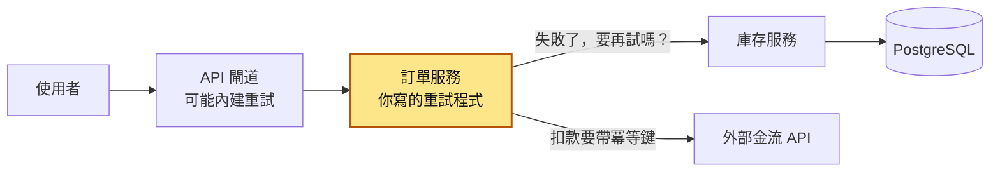
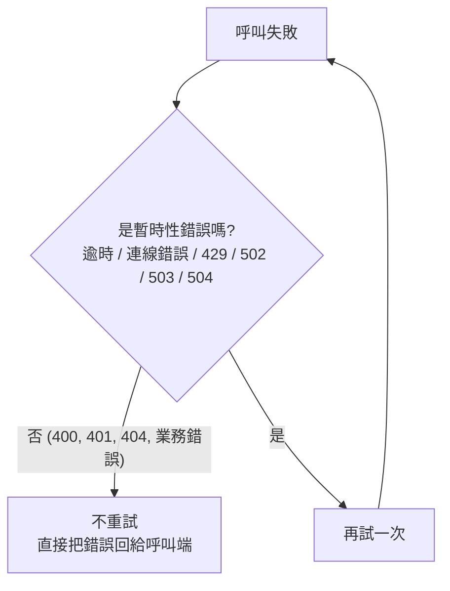
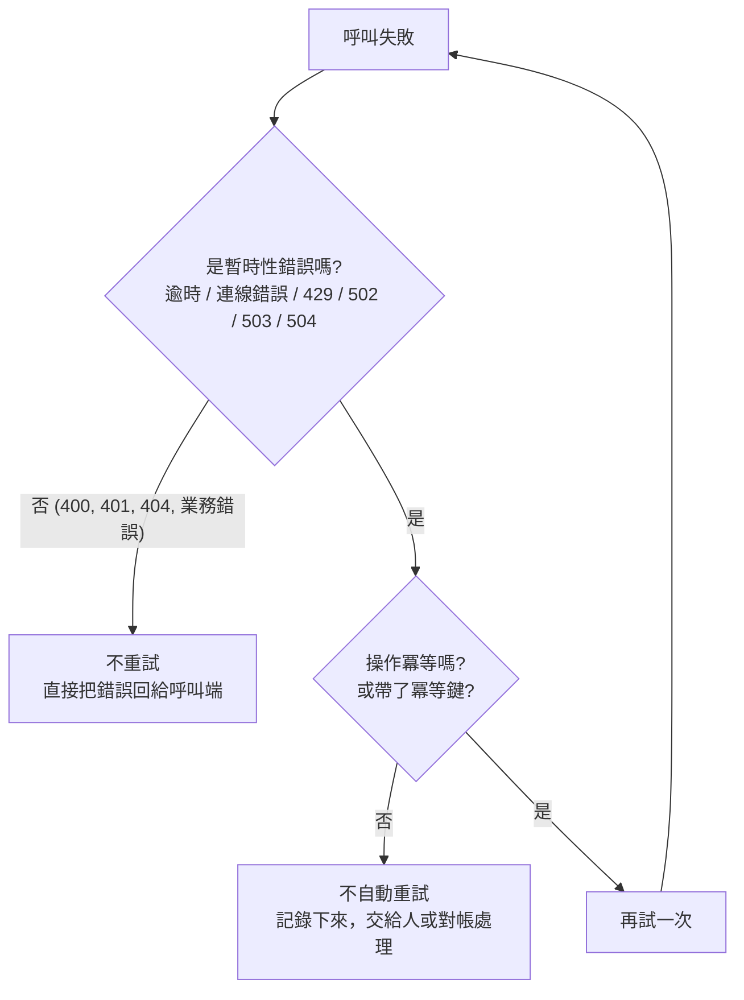
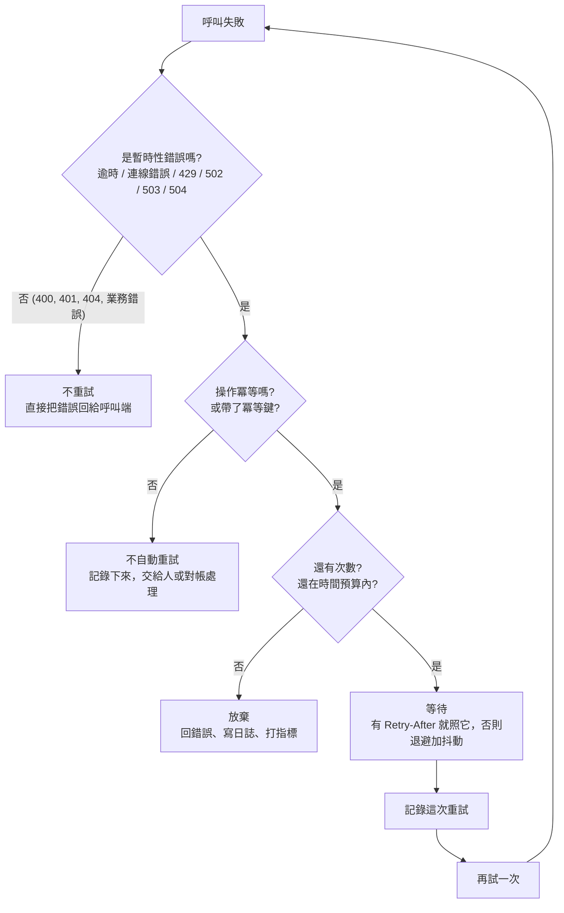
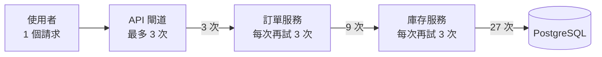

# 26｜重試機制（Retry）

> 重試（retry）是在遇到「等一下可能就好」的暫時性錯誤時，有節制地再試一次，而且要確定再試不會把事情做兩遍。

**難度**：★★☆　**閱讀時間**：約 20 分鐘　**前置知識**：[冪等性](25-冪等性.md)

## 為什麼要在意：一個具體的情境

這是一個假設情境。假設你負責一個電商的結帳，一個結帳請求依序經過三個程式，最後才到資料庫：`API 閘道（API Gateway）` → `訂單服務` → `庫存服務` → PostgreSQL。API 閘道是所有外部請求的入口，負責把請求轉給後面的服務。平常每秒有 500 個結帳請求，庫存服務查一次資料庫只要 20ms。

三個團隊各自覺得「網路難免會抖，加個重試比較保險」：閘道設定成上游（它後面的訂單服務）失敗或逾時就重試，最多 3 次嘗試；訂單服務呼叫庫存服務時寫了下面這段；庫存服務查資料庫也照樣寫了一段一樣的「最多 3 次」。

❌ 出事的寫法：

```python
# ❌ 出事的寫法：訂單服務呼叫庫存服務，什麼錯誤都再試，最多 3 次
for _ in range(3):
    try:
        resp = requests.get(f"https://inventory.internal/items/{sku}", timeout=5)
        resp.raise_for_status()
        break
    except Exception:
        time.sleep(1)

# 庫存服務查資料庫、API 閘道轉送給訂單服務，也各自有一樣的「最多 3 次」
```

某次促銷開跑，一個慢查詢讓庫存資料庫的回應時間從 20ms 拉長到 2 秒，部分請求開始逾時。一步一步看資料庫被打成什麼樣子：

| 步驟 | 發生什麼 | 每秒打到資料庫的查詢 |
|---|---|---|
| 1 | 平常：500 個結帳請求，每個查一次資料庫 | 500 |
| 2 | 資料庫變慢，庫存服務的查詢逾時失敗，自己再試，每個請求最多 3 次 | 最多 1,500 |
| 3 | 訂單服務等庫存服務等到 5 秒逾時，照上面那段 `for` 迴圈再呼叫，最多 3 次，每次都會讓庫存服務再試 3 次 | 最多 4,500 |
| 4 | API 閘道等不到訂單服務，也再轉送一次 `POST /orders`，最多 3 次 | 最多 13,500（500 × 27） |
| 5 | 使用者看畫面一直轉，自己又按一次「結帳」 | 再往上加 |
| 6 | 資料庫的[連線池](08-連線池.md)（事先開好、大家輪流借用的資料庫連線）被借光，原本只是「有點慢」，變成「完全不能用」 | 幾乎全部失敗，失敗又觸發更多重試 |
| 7 | 慢查詢修好了，但重試流量還是一直灌進來，資料庫爬不起來 | 仍然是平常的好幾倍 |
| 8 | 團隊先把閘道的流量關掉一半，資料庫才恢復；前後掛了 40 分鐘 | 降到資料庫應付得了的量 |

- **使用者看到的**：結帳頁一直轉圈，最後失敗；有些人重按之後，隔天發現同一份東西下了兩張訂單。
- **工程師看到的**：監控上，資料庫每秒查詢數衝到平常的好幾十倍，連線全被占滿；但日誌裡看不到任何「重試」的紀錄，因為三層的重試都沒有寫日誌。事後對帳發現 200 多筆**重複訂單**：閘道轉給訂單服務的「建立訂單」`POST` 其實已經成功了，只是回應晚到、被閘道判定逾時，閘道重試又建了一筆（再加上使用者自己按的第二次）。

**根因**：慢查詢只是起頭。把它放大成 40 分鐘停擺的，是上面那段程式的 `for _ in range(3):` 在三層各寫了一次，次數相乘成 27 倍；`except Exception:` 不管什麼錯誤都重試，也沒有總時間上限，使用者早就放棄了，後端還在替一個已經沒人等的請求重試；閘道對不冪等的 `POST /orders` 自動重試，又沒有冪等鍵（讓伺服器認出「這是同一個請求的重試」的唯一值，見[冪等性](25-冪等性.md)）；三層都沒留下重試紀錄，平常「1% 請求要重試兩次才成功」的徵兆一直沒人看見。

**怎麼修**：只重試暫時性錯誤（第 1 節）、非冪等操作要有冪等鍵才重試（第 2 節）、次數上限加總時間預算（第 3 節）、只在一層重試（第 5 節）、每次重試都留紀錄（第 7 節）。下面「它是怎麼運作的」會一節一節講。

## 全貌：它在系統裡的位置

這張圖看的是一個請求從使用者到資料庫會經過哪些程式，以及重試發生在哪裡：



重試發生在「呼叫別人」的那一端（黃色）：你的程式呼叫下游失敗時，決定要不要再送一次。左邊的閘道、你用的 HTTP 函式庫和雲端 SDK 也可能自己重試，所以次數會相乘（第 5 節）。重試要安全，前提是[冪等性](25-冪等性.md)；兩次重試之間等多久見[指數退避](27-指數退避.md)和[抖動](28-抖動.md)；下游一直失敗時改用[斷路器](29-斷路器.md)。

## 生活比喻

重試就像**打電話給客服**。

電話沒人接（逾時）、忙線中（`503`）、語音說「目前線路忙碌，請 5 分鐘後再撥」（`Retry-After`），這些情況等一下再打很合理。但如果客服說「你的身分證字號格式錯誤」（`400`）或「你不是會員」（`401`），你再撥 10 次，答案還是一樣，只是浪費雙方時間。

再撥之前也要先想：剛剛那通電話斷掉之前，**客服到底有沒有幫我把訂單送出？** 如果不確定就再訂一次，可能會收到兩箱貨。比較好的做法是報上「訂單編號 A123」（冪等鍵），讓客服查得到「這筆已經處理過了」。

最後，如果全台灣的人都在同一秒按下「重撥」，客服中心只會更塞。這就是為什麼重試要有上限、要等一下、還要錯開時間（等待策略見[指數退避](27-指數退避.md)與[抖動](28-抖動.md)）。

**比喻失準的地方**：人打電話會自己判斷「算了，明天再打」，程式不會。程式碼裡的重試迴圈不會累、不會不耐煩，你沒寫停止條件，它就會一直打下去，而且是成千上萬個請求同時這樣做。重試真正的危險在這種「規模」，生活經驗很難感受到。

## 它是怎麼運作的

前面的事故裡，重試把一次變慢放大成停擺。要讓重試只用在救得回來的請求上、不額外製造流量，你的程式在呼叫失敗、準備再試之前，要依序確認 3 件事：這個錯誤值得再試嗎？再試會不會做兩遍？還有沒有次數和時間？下面一節一節講。

### 1. 先分類：這個錯誤值得再試嗎？

重試只對**暫時性錯誤（transient error）**有意義：這次失敗是因為「時機不好」，請求本身沒有問題。

看下面這張表之前，先分清楚兩種失敗的時間點。「連線階段失敗」是連都連不上，請求還沒送出去；「已送出後失敗」是請求已經送到對方，卻等不到回應或連線中途斷掉，這時對方可能已經做完了。兩者能不能重試差很多：

| 類別 | 範例 | 要不要重試 |
|---|---|---|
| 連線階段失敗 | 連不上（connection refused）、DNS 暫時查不到、連線逾時（connect timeout） | ✅ 要。請求根本沒送出去，連 POST 都相對安全 |
| 已送出後失敗 | 讀取逾時（read timeout）、連線被重設（connection reset） | ⚠️ 只有冪等操作才可以，因為對方**可能已經做完了** |
| `429 Too Many Requests` | 你被限流了（見[速率限制](30-速率限制.md)） | ✅ 要，但一定要等，最好照 `Retry-After` |
| `503 Service Unavailable` | 對方暫時過載或維護中 | ✅ 要，有 `Retry-After` 就照著等 |
| `502 Bad Gateway`、`504 Gateway Timeout` | 代理後面的服務掛了或太慢 | ✅ 要（冪等的話） |
| `408 Request Timeout` | 伺服器等你送完請求等到逾時 | ✅ 通常可以 |
| `500 Internal Server Error` | 對方程式出錯 | ⚠️ 灰色地帶：可能是暫時性，也可能是 bug，重試一次就好，不要硬試 |
| `400`、`422` | 參數錯、格式錯 | ❌ 不要。再送一樣的東西，答案一樣 |
| `401`、`403` | 沒登入、沒權限 | ❌ 不要。該做的是更新憑證或回報錯誤，不是重送 |
| `404`、`409` | 找不到、狀態衝突 | ❌ 通常不要（`409` 有時要先重新讀取最新狀態，再決定，不是原封不動重送） |
| 業務錯誤 | 餘額不足、庫存不足、優惠券過期 | ❌ 絕對不要 |

資料庫也有暫時性錯誤。在 PostgreSQL 裡，`40001`（serialization_failure，見[隔離等級](05-隔離等級.md)）和 `40P01`（deadlock_detected，見[死鎖](02-死鎖.md)）都是「重來一次很可能就會過」的錯誤，但要**整個交易從頭重來**，不能只重跑失敗的那一句 SQL。

呼叫失敗時，第一個判斷就是這個錯誤是不是暫時性的：



### 2. 前提：操作必須冪等

**重試時，你不知道失敗的那一次對方到底有沒有做完。**

讀取逾時常常發生在「對方做完了，只是回應在路上丟了或太慢」的時候。所以：

- HTTP 規範（RFC 9110）定義 `GET`、`HEAD`、`OPTIONS`、`TRACE`、`PUT`、`DELETE` 是冪等方法，重送語意上不會造成額外效果。但這是**規範對語意的要求**，實作要自己遵守：你家的 `DELETE /cart/items/last` 如果是「刪掉最後一個」，那它就不冪等。
- `POST`、`PATCH` 預設不冪等。要重試就要讓伺服器端支援冪等鍵：用戶端產生一個唯一值放在標頭（常見寫法是 `Idempotency-Key`，Stripe 等金流 API 都用這個名字），伺服器看到同一個冪等鍵就回上次的結果。怎麼實作請看[冪等性](25-冪等性.md)。
- **冪等鍵要在第一次嘗試之前產生，每次重試都帶同一個。** 每次重試都產生新的冪等鍵，就等於沒有冪等鍵。

所以流程圖在「是暫時性錯誤」之後，要多一個判斷：



### 3. 上限：次數與總時間預算

只設「最多 3 次」還不夠。假設每次逾時 10 秒，3 次加上中間等待，使用者可能要等 30 秒以上，而前端或閘道早在 15 秒就放棄了。後端還在努力，等於白做。

所以要兩個條件一起用，**哪個先到就停**：

- **次數上限**：一般 2～3 次嘗試（含第一次）就夠了。重試到 10 次，通常只會加重災情。
- **總時間預算（deadline）**：從第一次呼叫開始算，整件事最多花多久。每次嘗試的逾時、每次等待，都要從剩下的預算裡扣。剩下的時間不夠再試一次，就直接放棄。

注意不同函式庫算「次數」的方式不一樣：Python 的 `tenacity` 用 `stop_after_attempt(3)` 是**總共嘗試 3 次**；`urllib3` 的 `Retry(total=3)` 是**再重試 3 次**，加上第一次最多是 4 次。設定前先看清楚。

把上限也放進流程圖，就是完整的判斷順序。這張多了「還有次數和時間嗎」，以及重試前的等待和紀錄（等待見第 6 節，紀錄見第 7 節）：



### 4. 逾時：沒有逾時的重試是假的

重試靠的是「失敗」來觸發。如果呼叫永遠不逾時，它就永遠不會失敗，執行緒、連線全卡在那裡，重試根本不會發生。

幾個 Python 生態常見的事實：

- `requests` **預設沒有逾時**，不傳 `timeout` 就是一直等下去。
- `requests` 的 `timeout=(3.05, 5)` 是「連線逾時 3.05 秒、讀取逾時 5 秒」（3.05 是 requests 官方文件的建議：連線逾時設成略大於 3 的倍數，因為 3 秒是 TCP 預設的封包重送間隔）。
- **讀取逾時限制的是兩個位元組之間最多等多久，整個回應花多久它不管**。對方每 4 秒吐一個位元組，這個呼叫就會一直等下去。要控制總時間，就得自己算 deadline（第 3 節講的總時間預算）。
- `httpx` 預設逾時是 5 秒（依版本而異，請查官方文件）。

逾時要**由外往內遞減**：閘道給 10 秒，訂單服務呼叫庫存服務就應該小於 10 秒，庫存服務查資料庫再更短（例如 PostgreSQL 的 `statement_timeout`，也就是一句 SQL 最多能跑多久的設定）。如果下游的逾時比上游還長，上游早就放棄了，下游還在做，這些工作全部浪費。

剩下多少時間，要能往下游傳。gRPC（另一種服務之間互相呼叫的協定）內建 deadline 的概念，只要把收到的請求 context 傳給下一個呼叫，多數語言的實作（例如 Go、Java）會把剩餘時間一起帶下去；HTTP 則要自己傳（例如把剩餘時間放進自訂標頭）。

### 5. 多層重試會相乘

這張圖畫的是開頭情境的那條路線：每一層都「最多 3 次」，而且下游一直失敗時，每一層各會收到幾次呼叫：



每層最多 N 次嘗試、共 K 層，最底層最多會被打 N 的 K 次方次。3 層是 27 倍，4 層是 81 倍。這個放大只在**下游已經出問題的時候**才發生，下游處理能力最低的時候，反而收到好幾倍的流量。下游被自己這邊的重試流量壓垮，這叫重試風暴（retry storm），開頭情境的 40 分鐘停擺就是一場重試風暴。

對策：

- **原則上只在一層重試**。通常選最外層（最清楚使用者還願不願意等），或最靠近失敗點、最清楚錯誤語意的那一層。其他層遇到錯誤就快速失敗（fail fast），把錯誤往上回。
- 盤點那些「你沒寫、但它會自己重試」的地方：HTTP 用戶端函式庫、雲端 SDK（AWS、GCP 的 SDK 大多內建重試）、服務網格（service mesh，在每個服務旁邊替它轉送流量的一層基礎設施）、反向代理（擋在服務前面替它轉送請求的伺服器，它後面的服務叫「上游」）。例如 Nginx 的 `proxy_next_upstream` 預設值是 `error timeout`，也就是連線出錯或逾時就把請求轉給下一台上游（見[反向代理](34-反向代理.md)）；不過從 1.9.13 起，`POST`、`PATCH` 這類非冪等請求只要已經送出去，預設就不會轉，除非你加上 `non_idempotent`。
- 進階做法是**重試預算（retry budget）**：例如規定重試流量不能超過正常流量的 10%，或每個行程每分鐘最多重試 60 次，超過就不重試。Google SRE 書的〈Handling Overload〉與〈Addressing Cascading Failures〉兩章都有談到這個做法。
- 下游真的掛了，重試只是拖延時間，這時候要用[斷路器](29-斷路器.md)：直接不打，讓下游有時間恢復。

### 6. `Retry-After` 標頭

伺服器可以用 `Retry-After` 標頭告訴你「什麼時候再來」，常跟 `503` 和 `429`（`429` 定義在 RFC 6585）一起出現，也可以出現在 `3xx` 轉址回應裡。它有兩種格式（RFC 9110）：

```http
Retry-After: 120
Retry-After: Fri, 31 Dec 1999 23:59:59 GMT
```

第一種是秒數，第二種是 HTTP 日期。兩種都要能解析。對方明說了「120 秒後」，你 0.5 秒後就打過去，只會被限流得更久，甚至被封鎖。

`Retry-After` 也要對照自己的預算。如果它說要等 1 小時，而你的時間預算只剩 3 秒，就**直接放棄**，不要讓請求睡 1 小時。

### 7. 重試要留下紀錄

重試會把錯誤藏起來。使用者最後看到成功，下游卻可能已經有 30% 的請求要靠重試才過得去，離真正掛掉只差一步。

每次重試至少記錄：呼叫的目標、第幾次嘗試、失敗原因（狀態碼或例外）、等了多久、冪等鍵或追蹤 ID（見[分散式追蹤](50-分散式追蹤.md)）。另外要有指標：重試次數、重試後成功率、重試用完仍失敗的次數。這些指標上升，往往比錯誤率上升更早出現。

## 動手看看

不需要 Docker，只要 Python 3.10 以上和 `requests`。我們做兩件事：一個「時好時壞」的假下游、一個有分寸的重試用戶端。

假下游有三個網址，各對應一種情況：`/flaky` 每 3 次只成功 1 次，其餘回 `503` 和 `Retry-After: 1`；`/bad` 一律回 `400`；`/slow` 要 10 秒才回應。

**第一步：假下游服務** `flaky_server.py`

```python
# flaky_server.py：模擬一個「時好時壞」的下游服務
import threading
import time
from http.server import BaseHTTPRequestHandler, ThreadingHTTPServer

counter = 0
lock = threading.Lock()


class Handler(BaseHTTPRequestHandler):
    def do_GET(self):
        global counter
        with lock:
            counter += 1
            n = counter

        if self.path == "/flaky":
            # 每 3 次只成功 1 次，其餘回 503 並請對方 1 秒後再來
            if n % 3 != 0:
                return self._reply(503, b"busy\n", {"Retry-After": "1"})
            return self._reply(200, b"ok\n")
        if self.path == "/bad":
            # 請求本身有問題：重試幾次都一樣
            return self._reply(400, b"invalid parameter\n")
        if self.path == "/slow":
            time.sleep(10)  # 模擬下游卡住
            return self._reply(200, b"finally\n")
        return self._reply(404, b"not found\n")

    def _reply(self, status, body, headers=None):
        self.send_response(status)
        for k, v in (headers or {}).items():
            self.send_header(k, v)
        self.send_header("Content-Length", str(len(body)))
        self.end_headers()
        self.wfile.write(body)

    def log_message(self, fmt, *args):
        # 伺服器端印出每一次真的收到的請求，方便數「下游被打了幾次」
        print(f"[server] {self.command} {self.path} -> {args[1]}", flush=True)


if __name__ == "__main__":
    print("listening on http://127.0.0.1:8000", flush=True)
    ThreadingHTTPServer(("127.0.0.1", 8000), Handler).serve_forever()
```

**第二步：重試用戶端** `retry_client.py`

```python
# retry_client.py：一個「有分寸」的重試函式
import logging
import sys
import time
from datetime import datetime, timezone
from email.utils import parsedate_to_datetime

import requests

logging.basicConfig(level=logging.INFO, format="%(asctime)s %(levelname)s %(message)s")
log = logging.getLogger("retry")

# 這些狀態碼代表「暫時性」問題，值得再試
RETRYABLE_STATUS = {408, 429, 502, 503, 504}
# HTTP 規範裡本身就是冪等的方法（RFC 9110）
IDEMPOTENT_METHODS = {"GET", "HEAD", "OPTIONS", "TRACE", "PUT", "DELETE"}


class RetryExhausted(Exception):
    """重試次數或時間預算用完，仍然失敗。"""


def parse_retry_after(value: str | None) -> float | None:
    """Retry-After 可能是秒數（"120"）或 HTTP 日期，兩種都要處理。"""
    if not value:
        return None
    value = value.strip()
    if value.isdigit():
        return float(value)
    try:
        when = parsedate_to_datetime(value)
    except (TypeError, ValueError):
        return None  # 格式看不懂就當作沒給
    if when.tzinfo is None:
        when = when.replace(tzinfo=timezone.utc)
    return max(0.0, (when - datetime.now(timezone.utc)).total_seconds())


def call_with_retry(method, url, *, json=None, idempotency_key=None,
                    max_attempts=3, budget_s=8.0, connect_timeout=3.05, read_timeout=5.0):
    method = method.upper()
    headers = {"Idempotency-Key": idempotency_key} if idempotency_key else {}

    # 前提檢查：不是冪等操作、也沒有冪等鍵 → 只准打一次
    if method not in IDEMPOTENT_METHODS and not idempotency_key:
        max_attempts = 1

    deadline = time.monotonic() + budget_s  # 整體時間預算，從第一次就開始算
    last_error = None

    for attempt in range(1, max_attempts + 1):
        remaining = deadline - time.monotonic()
        if remaining <= 0:
            break
        try:
            resp = requests.request(
                method, url, json=json, headers=headers,
                # 每次嘗試的逾時不能超過剩下的預算
                timeout=(min(connect_timeout, remaining), min(read_timeout, remaining)),
            )
        except (requests.ConnectionError, requests.Timeout) as exc:
            last_error, retry_after = repr(exc), None
        else:
            if resp.status_code not in RETRYABLE_STATUS:
                # 成功，或是 400/401/404 這類「再試也沒用」的錯誤：直接交回去
                return resp
            last_error = f"HTTP {resp.status_code}"
            retry_after = parse_retry_after(resp.headers.get("Retry-After"))

        if attempt == max_attempts:
            break

        # 等待時間：有 Retry-After 就聽對方的；沒有就先用簡單的遞增（細節見 27、28 篇）
        wait = retry_after if retry_after is not None else 0.5 * attempt
        if wait >= deadline - time.monotonic():
            log.warning("放棄重試：等 %.1fs 會超過時間預算 url=%s", wait, url)
            break

        # 每次重試都要留下紀錄：第幾次、為什麼、等多久、哪個冪等鍵
        log.warning("重試 %s %s attempt=%d/%d error=%s wait=%.1fs key=%s",
                    method, url, attempt, max_attempts, last_error, wait, idempotency_key)
        time.sleep(wait)

    raise RetryExhausted(f"{method} {url} 失敗：{last_error}")


if __name__ == "__main__":
    path = sys.argv[1] if len(sys.argv) > 1 else "/flaky"
    try:
        r = call_with_retry("GET", f"http://127.0.0.1:8000{path}")
        log.info("結果：HTTP %d %s", r.status_code, r.text.strip())
    except RetryExhausted as e:
        log.error("最終失敗：%s", e)
```

> 這裡的等待時間故意寫得很陽春（`0.5 * attempt`），因為這個範例只示範「什麼時候該試、什麼時候該停」。正式環境要用指數退避加抖動，請看下兩篇。

**第三步：跑起來**

```shell
# 終端機 A：啟動假下游
python flaky_server.py

# 終端機 B：先用 curl 看看 503 和 Retry-After 長什麼樣
# （Windows PowerShell 5.1 的 curl 是別名，請改打 curl.exe）
curl -i http://127.0.0.1:8000/flaky

# 再用重試用戶端打三種情境
uv run --with requests python retry_client.py /flaky
uv run --with requests python retry_client.py /bad
uv run --with requests python retry_client.py /slow
```

預期會看到：

- `curl -i` 的回應有 `HTTP/1.0 503 Service Unavailable` 和 `Retry-After: 1`。
- `/flaky`：前兩次拿到 503，用戶端照 `Retry-After` 各等 1 秒，第三次成功。日誌會有兩行 `重試 ... attempt=1/3`、`attempt=2/3`。（如果你剛剛先用 curl 打過一次，計數器會錯開，次數可能不同。）
- `/bad`：拿到 400，**一次都沒重試**，直接回傳。
- `/slow`：第一次讀取逾時（5 秒），等 0.5 秒後再試；第二次的讀取逾時被縮成剩下的預算（約 2.5 秒），又逾時；這時剩下的時間不夠再等再試，印出「放棄重試」。整件事大約 8 秒結束，不會拖到 30 秒。再看終端機 A：**伺服器那邊其實還在把那兩個請求做完**，10 秒後照樣印出 `GET /slow -> 200`（後面可能還跟著 `BrokenPipeError` 或 `ConnectionResetError` 之類的錯誤，Windows 上常見的是 `ConnectionAbortedError`，因為用戶端早就斷線了，這是正常的）。這就是「逾時不等於對方沒做」的現場。

**第四步：體會一下多層重試的放大**

```python
# amplification.py：算算看「每層都重試」會把最底層打成幾倍
def call(layer: int, layers: int, attempts: int, hits: list[int]) -> bool:
    if layer == layers:
        hits[0] += 1      # 打到最底層（例如資料庫）一次
        return False      # 假設它正在過載，一律失敗
    for _ in range(attempts):            # 這一層最多試 attempts 次
        if call(layer + 1, layers, attempts, hits):
            return True
    return False


for layers in range(1, 5):
    hits = [0]
    call(0, layers, attempts=3, hits=hits)
    print(f"{layers} 層各自重試、每層最多 3 次 → 使用者 1 個請求，最底層被打 {hits[0]} 次")
```

輸出會是 3、9、27、81。把這個數字乘上尖峰時段每秒的請求數，就知道為什麼「每層都加一點重試比較保險」是錯的。

## 常見地雷

### 地雷 1：什麼錯誤都重試

❌ 錯誤示範：

```python
# ❌ 錯誤示範：抓所有例外、所有狀態碼都重試
for _ in range(3):
    try:
        resp = requests.post(url, json=payload, timeout=5)
        resp.raise_for_status()
        break
    except Exception:
        time.sleep(1)
```

**為什麼錯**：`400` 參數錯、`401` token 過期、程式自己的 `KeyError`，全部都被當成「網路問題」重試。浪費時間、浪費下游資源，最後真正的錯誤訊息還被吞掉了。而且這是 POST，下一個地雷也一起踩了。

✅ 正確做法：明確列出可重試的例外和狀態碼（白名單），其他一律直接往上丟。

下面用的 `tenacity` 是 Python 常用的重試套件，把 `@retry` 裝飾器加在函式上，就能用參數寫清楚「什麼情況重試、試幾次、等多久」。

```python
# ✅ 正確寫法：用 tenacity 明確指定「哪些情況才重試」
import logging
import requests
from tenacity import (retry, retry_if_exception, stop_after_attempt,
                      stop_after_delay, wait_random_exponential, before_sleep_log)

log = logging.getLogger(__name__)
RETRYABLE_STATUS = {408, 429, 502, 503, 504}


def is_transient(exc: BaseException) -> bool:
    if isinstance(exc, (requests.ConnectionError, requests.Timeout)):
        return True
    if isinstance(exc, requests.HTTPError) and exc.response is not None:
        return exc.response.status_code in RETRYABLE_STATUS
    return False  # 其他例外（含 400、401、程式 bug）一律不重試


@retry(
    retry=retry_if_exception(is_transient),
    stop=stop_after_attempt(3) | stop_after_delay(8),  # 次數和總時間，哪個先到就停
    wait=wait_random_exponential(multiplier=0.5, max=4),  # 退避加抖動，細節見 27、28 篇
    before_sleep=before_sleep_log(log, logging.WARNING),  # 每次重試前寫日誌
    reraise=True,  # 用完次數後丟出原本的例外，而不是 tenacity 的 RetryError
)
# 注意：這個範例沒有讀 Retry-After；要照它等，得自己寫一個 wait 函式，從 exc.response 取標頭
def get_inventory(sku: str) -> dict:
    resp = requests.get(f"https://inventory.internal/items/{sku}", timeout=(3.05, 5))
    resp.raise_for_status()
    return resp.json()
```

### 地雷 2：非冪等操作直接重試

❌ 錯誤做法：建立訂單、扣款、寄簡訊的 POST 遇到逾時就重送。

**為什麼錯**：逾時只代表「你沒等到回應」，不代表「對方沒做」。重送一次，就可能多一筆訂單、多扣一次款、多寄一封簡訊給客戶。

✅ 正確做法：要嘛不自動重試，交給對帳或人工處理；要嘛讓伺服器支援冪等鍵，用戶端在**第一次呼叫前**產生一個冪等鍵（例如 `uuid.uuid4()`），之後每次重試都帶同一個。

```python
# ✅ 正確寫法：冪等鍵在迴圈外產生，所有重試共用
import uuid
key = str(uuid.uuid4())
resp = call_with_retry("POST", "https://pay.internal/charges",
                       json={"order_id": 123, "amount": 990}, idempotency_key=key)
```

### 地雷 3：每一層都加重試

❌ 錯誤做法：閘道重試、服務重試、SDK 也重試，大家都覺得「多一層保險」。

**為什麼錯**：重試次數是相乘的。平常沒感覺，下游一慢就是 27 倍、81 倍的流量，把一個小故障放大成全站停擺，而且下游恢復了也爬不起來。

✅ 正確做法：團隊講好由哪一層負責重試，其他層快速失敗。檢查函式庫和 SDK 的預設重試設定（很多都預設會重試），不需要的就關掉或調小。下游持續失敗時交給[斷路器](29-斷路器.md)。

### 地雷 4：沒設逾時，或逾時比上游還長

❌ 錯誤示範：

```python
# ❌ 錯誤示範：requests 預設沒有逾時，下游卡住這個執行緒就永遠卡住
resp = requests.get("https://inventory.internal/items/A001")
```

**為什麼錯**：不逾時就不會失敗，重試永遠不會觸發，執行緒和連線池卻一個個被卡死。另一種情況是有設逾時，但比呼叫你的上游還長：上游 5 秒就放棄，你還在等第 30 秒，做完了也沒人要。

✅ 正確做法：每個對外呼叫都設逾時，而且由外往內遞減；需要控制總時間時，自己算 deadline，把剩餘預算傳下去。

```python
# ✅ 正確寫法：連線逾時與讀取逾時分開設，而且要比上游給你的時間短
resp = requests.get("https://inventory.internal/items/A001", timeout=(3.05, 5))
```

### 地雷 5：只有次數，沒有總時間預算（或乾脆無限重試）

❌ 錯誤做法：`while True:` 一直試到成功，或「最多 5 次、每次逾時 30 秒」。

**為什麼錯**：使用者早就關掉頁面了，你的服務還為這個請求佔著執行緒、連線和下游資源。很多請求都這樣，就是資源耗盡。

✅ 正確做法：次數上限加總時間預算，兩個條件哪個先到就停。剩下的時間不夠完成一次嘗試，就不要開始。真的需要「一定要成功」的工作（例如通知第三方），改丟進[訊息佇列](35-訊息佇列.md)交給[背景工作者](37-背景工作者.md)慢慢重試，失敗太多次的放進[死信佇列](36-死信佇列.md)，不要在使用者的請求裡硬撐。

### 地雷 6：收到 429 或 503 立刻重試，無視 `Retry-After`

❌ 錯誤做法：被限流後馬上再打，或固定每 100ms 打一次。

**為什麼錯**：`429` 的意思就是「你打太快了」。立刻重試只會讓你繼續被拒絕，有些 API 會因此把你封鎖更久，甚至停用金鑰。

✅ 正確做法：有 `Retry-After` 就照它等（秒數和 HTTP 日期都要能解析）；沒有的話用[指數退避](27-指數退避.md)加[抖動](28-抖動.md)。如果要等的時間超過你的預算，直接放棄並回報。

### 地雷 7：默默重試，不留紀錄

❌ 錯誤做法：重試成功了就當作沒發生過，日誌和指標都沒有。

**為什麼錯**：重試把問題藏起來了。下游可能已經有一大半請求要試兩三次才會成功，延遲早就變長，但錯誤率看起來還是 0%。等到重試也撐不住，錯誤率會一下子跳上來，而且沒人知道問題是從什麼時候開始的。

✅ 正確做法：每次重試寫一筆 WARNING 日誌（目標、第幾次、原因、等待時間、冪等鍵或追蹤 ID），並記錄重試次數與「重試用完仍失敗」的指標，設定告警。

## 重點整理

- **只重試暫時性錯誤**：逾時、連線失敗、`429`、`502`、`503`、`504`。`400`、`401`、`403`、`404`、`422` 和「餘額不足」這類業務錯誤，再試 100 次結果都一樣。
- **重試的前提是操作冪等。** 讀取逾時的時候，對方可能已經做完了。`GET` 可以放心重試；建立訂單、扣款這類 `POST` 沒有冪等鍵就不要自動重試，冪等鍵要在第一次嘗試前產生，每次重試都帶同一個。
- **次數上限加總時間預算，哪個先到就停。** 每次嘗試都要設逾時（`requests` 預設沒有），逾時由外往內遞減，剩下的時間不夠再試一次就直接放棄。
- **只在一層重試。** 每層 3 次、3 層就是 27 倍，下游一變慢就被自己這邊的重試流量壓垮，這就是重試風暴。閘道、HTTP 函式庫、SDK 內建的重試也要算進去。
- **對方給了 `Retry-After` 就照著等**，要等的時間超過預算就放棄；每次重試都寫日誌、打指標，不然「其實一直在失敗，只是被重試蓋掉」的問題不會被發現。

## 新人必知清單

### 一定要會（基本功）

- [ ] 分得出哪些錯誤可以重試（逾時、連線錯誤、`429`、`502`、`503`、`504`），哪些不行（`400`、`401`、`403`、`404`、`422`、業務錯誤）
- [ ] 知道「讀取逾時不等於對方沒做」，非冪等操作沒有冪等鍵就不自動重試
- [ ] 冪等鍵在第一次呼叫前產生，所有重試共用同一個
- [ ] 每個對外呼叫都設逾時；知道 `requests` 預設沒有逾時
- [ ] 重試要同時有次數上限和總時間預算
- [ ] 知道多層重試會相乘，寫重試前先問「上下游有沒有已經在重試」
- [ ] 會解析並遵守 `Retry-After`（秒數與 HTTP 日期兩種格式）
- [ ] 每次重試都寫日誌，不要默默吞掉

### 知道有這回事就好

- 等待策略：[指數退避](27-指數退避.md)與[抖動](28-抖動.md)，避免大家同時重試
- 下游持續失敗時用[斷路器](29-斷路器.md)直接停打，比一直重試更好
- 重試預算（retry budget）：限制重試流量佔總流量的比例
- deadline 傳遞：gRPC 只要把 context 傳下去就能帶上剩餘時間，HTTP 要自己處理
- PostgreSQL 的 `40001`、`40P01` 要整個交易從頭重來，不能只重跑一句 SQL
- 各家函式庫「次數」定義不同：`tenacity` 的 `stop_after_attempt(3)` 是總共 3 次，`urllib3` 的 `Retry(total=3)` 是再重試 3 次
- 反向代理、服務網格、雲端 SDK 可能已經內建重試，例如 Nginx 的 `proxy_next_upstream`
- 非同步工作的重試交給佇列，Webhook 的重試見[Webhook 重試](41-Webhook%20重試.md)

### 先不用管（等你遇到再學）

- 服務網格（Istio、Envoy）的重試策略細節與 `retry_on` 條件
- 對沖請求（hedged request）：慢的時候同時再送一份，誰先回來用誰
- 自適應重試（adaptive retry）：根據最近的成功率動態調整重試速率
- gRPC service config 裡的重試政策設定

## Code Review 時可以問的問題

1. **這個重試會捕捉哪些錯誤？** 有沒有用 `except Exception` 把 `400`、`401` 和程式 bug 也一起重試了？
2. **這個操作冪等嗎？** 如果是 POST 或會改資料的操作，冪等鍵在哪裡產生？是不是每次重試都帶同一個？
3. **最多會花多久？** 次數上限乘上單次逾時再加上等待時間，會不會超過呼叫端（閘道、前端）願意等的時間？
4. **上游或下游有沒有也在重試？** 用到的 HTTP 用戶端、SDK、閘道設定裡，有沒有內建重試？加起來最壞是幾倍？
5. **有沒有處理 `Retry-After`？** 被 `429` 時會不會立刻又打過去？
6. **重試的時候看得到嗎？** 有沒有日誌、指標、追蹤 ID？重試用完失敗時，錯誤有沒有完整往上回報？

## 情境演練

**1. 你在寫呼叫庫存服務的用戶端。翻日誌時，看到它遇過這 5 種失敗：`401 Unauthorized`、連線被拒（connection refused）、`422 Unprocessable Entity`、`503 Service Unavailable`、「庫存不足」業務錯誤。你會讓哪些自動重試？**

<details markdown="1"><summary>看答案</summary>

只有**連線被拒**和 **`503`** 適合。

- 連線被拒代表請求根本沒送到對方，等一下對方可能就起來了，而且因為沒送出去，就算是非冪等操作也比較安全。
- `503` 是對方暫時無法服務，標準的暫時性錯誤，有 `Retry-After` 就照著等。
- `401` 是憑證問題，重送一樣的憑證還是 `401`；`422` 是請求內容有問題；庫存不足是業務事實。這三種重試多少次結果都一樣，只會浪費資源。

</details>

**2. 你接手一段程式，所有 HTTP 呼叫都套同一個重試裝飾器，包括「建立訂單」的 POST。PM 希望下單在網路抖動時也能自動重試。這個 POST 可以直接沿用那個裝飾器嗎？要怎麼做？**

<details markdown="1"><summary>看答案</summary>

不能直接沿用。重試的時候，你不知道上一次對方有沒有做完。GET 只是讀取，做兩次結果一樣（冪等）；POST 通常是「建立一筆新資料」，對方如果其實已經做完了，重送就會再建一筆。

要讓 POST 可以安全重試，就要讓它變成冪等：用戶端在第一次呼叫前產生唯一的冪等鍵（例如放在 `Idempotency-Key` 標頭），每次重試都帶同一個；伺服器端記住處理過的冪等鍵，遇到重複的就回上次的結果，不重做。細節見[冪等性](25-冪等性.md)。

</details>

**3. 上游閘道只給你的服務 5 秒。你呼叫下游時寫了 `requests.get(url, timeout=5)`，心想這樣最多 5 秒就會結束，不會超過上游給的時間。這樣寫夠嗎？**

<details markdown="1"><summary>看答案</summary>

不夠。`timeout=5` 會同時套用到連線逾時和讀取逾時，而讀取逾時限制的是「兩次收到資料之間最多等多久」，整個回應的總時間它不管。對方如果每 4 秒送一點資料，這個呼叫可以拖得比 5 秒長很多。另外連線逾時和讀取逾時是分開算的，加起來也可能超過 5 秒。

要控制整件事的總時間，就要自己算 deadline：記下開始時間，每次嘗試前算剩下多少，把逾時和等待都限制在剩下的預算之內。

</details>

**4. 一個請求會經過 4 層服務，每層都設定「失敗就再試，最多 3 次嘗試」。某天最底層的資料庫開始變慢，最壞情況下，使用者的 1 個請求會讓資料庫收到幾次查詢？該怎麼改？**

<details markdown="1"><summary>看答案</summary>

3 的 4 次方 = **81 次**。每一層的每一次嘗試，都會觸發下一層完整的 3 次嘗試，所以次數是相乘的。尖峰時段每秒 1,000 個請求，資料庫就可能收到 81,000 次查詢，本來只是變慢，馬上就被壓垮，而且就算根因修好了，重試流量也會讓它爬不起來。

改法：

- 只留一層負責重試（通常是最外層或最清楚錯誤語意的那層），其他層快速失敗。
- 加上總時間預算，並把 deadline 往下傳，上游放棄了下游就不要再做。
- 下游持續失敗時用[斷路器](29-斷路器.md)停止呼叫，或用重試預算限制重試流量的比例。
- 重試之間要退避加抖動，避免所有人同時重試。

</details>

**5. 你負責的訂單服務呼叫外部金流的「建立扣款」API。某次呼叫等了 10 秒後讀取逾時。同事說：「逾時就是沒成功，直接再打一次就好。」你會怎麼回？金流 API 同時回傳過 `429` 並帶了 `Retry-After: 30`，而你的請求總預算只剩 5 秒，又該怎麼做？**

<details markdown="1"><summary>看答案</summary>

**第一部分**：讀取逾時只代表「你沒有在 10 秒內收到回應」，金流那邊很可能已經扣款成功，只是回應慢了或在路上丟了。直接再打一次，客戶可能被扣兩次錢。正確做法是：

- 如果金流 API 支援冪等鍵（大多數都有），第一次呼叫前就產生一個，重試時帶同一個，金流會回「這筆已經處理過」的結果。
- 如果不支援，就不要自動重試。先用訂單編號去查詢扣款狀態，或把這筆標記成「待確認」，交給對帳流程或背景工作處理。

**第二部分**：對方明確要求 30 秒後再來，而你只剩 5 秒預算，就**不要等也不要重試**。立刻放棄，回一個明確的錯誤給上游（例如告訴使用者「付款處理中，請稍後確認」），並寫日誌。如果這筆扣款一定要完成，就丟進佇列，由背景工作者照 `Retry-After` 稍後再處理，不要讓使用者的請求卡 30 秒。

</details>

## 相關主題

- [冪等性](25-冪等性.md)：重試的前提。沒有冪等，重試就是在賭會不會做兩次。
- [指數退避](27-指數退避.md)：每次重試之間要等多久、怎麼越等越久。
- [抖動](28-抖動.md)：讓大量用戶端不要在同一瞬間一起重試。
- [斷路器](29-斷路器.md)：下游持續失敗時乾脆不打，和重試互補。
- [速率限制](30-速率限制.md)：`429` 和 `Retry-After` 從哪裡來，以及伺服器端怎麼擋住重試洪水。
- [Webhook 重試](41-Webhook%20重試.md)：非同步情境下「由送出方負責重試」的做法。

## 延伸閱讀

- RFC 9110 HTTP Semantics：Retry-After 標頭（10.2.3 節）與冪等方法定義（9.2.2 節）：https://www.rfc-editor.org/rfc/rfc9110.html#section-10.2.3
- Google SRE Book，Addressing Cascading Failures（談重試放大與重試預算）：https://sre.google/sre-book/addressing-cascading-failures/
- AWS Builders' Library，Timeouts, retries, and backoff with jitter（Marc Brooker）：https://builder.aws.com/content/3EumjoZascWd1oZiEgL8ORlv3qE/timeouts-retries-and-backoff-with-jitter
- urllib3 官方文件，`urllib3.util.Retry`：https://urllib3.readthedocs.io/en/stable/reference/urllib3.util.html
