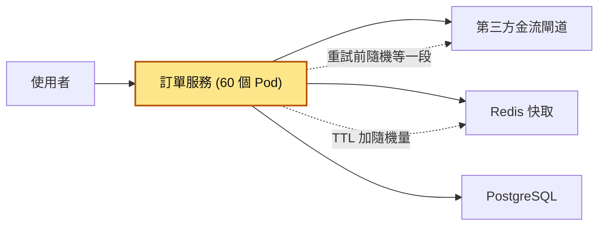
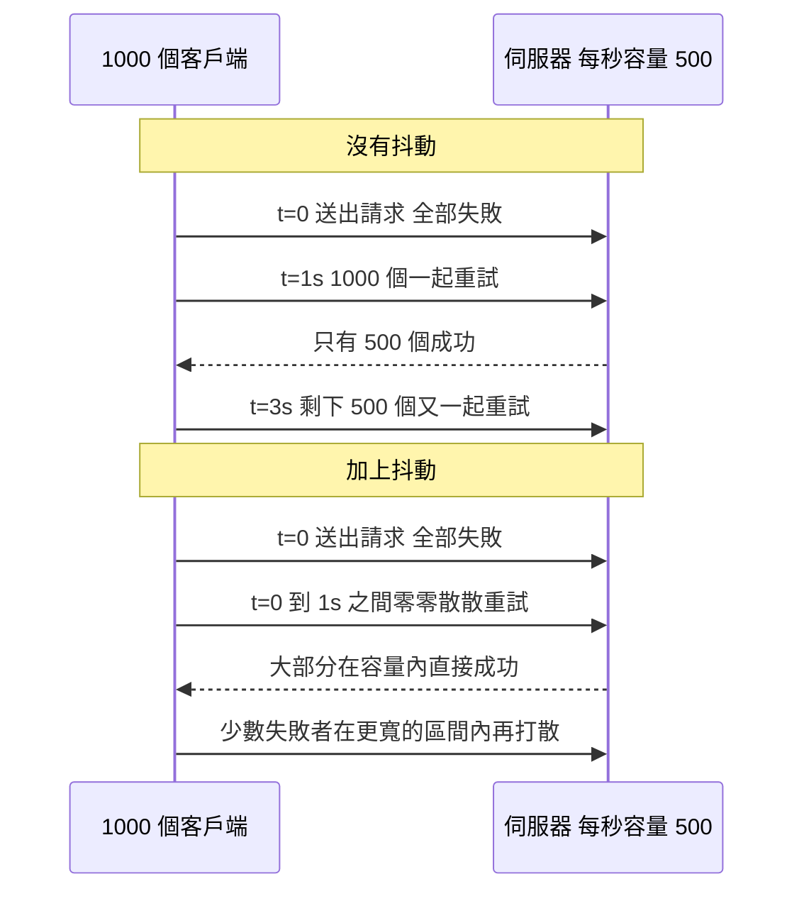
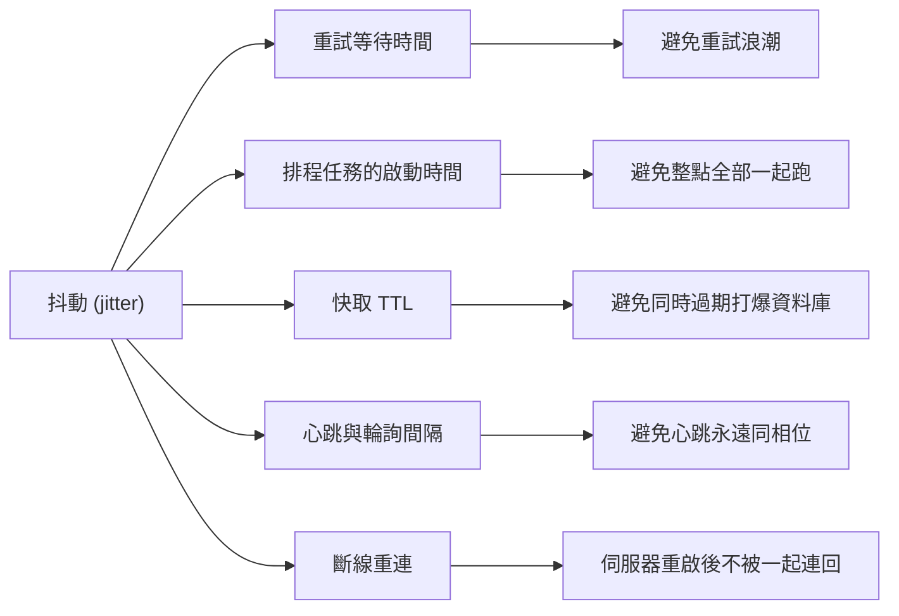

# 28｜抖動（Jitter）

> 抖動（jitter）：在「等多久再做」的等待時間裡故意加一段隨機量，讓一大群用戶端不會在同一瞬間一起動作。

**難度**：★☆☆　**閱讀時間**：約 16 分鐘　**前置知識**：[重試機制](26-重試機制.md)、[指數退避](27-指數退避.md)

## 為什麼要在意：一個具體的情境

以下是假設的情境。你負責電商的訂單服務，使用者結帳時，訂單服務要呼叫第三方金流閘道（幫你向信用卡公司收款的外部服務）建立付款。訂單服務有 60 個 Pod，也就是同一份程式同時跑了 60 份，一起分擔流量。

工程師照著[指數退避](27-指數退避.md)那篇寫了重試：失敗後等 1、2、4、8、16 秒，之後每次等 30 秒（上限），最多重試 7 次。

❌ 出事的寫法：等待時間只看「第幾次重試」，每一筆請求算出來的數字都一樣。

```python
# ❌ 錯誤示範：有指數退避，但沒有抖動
delay = min(30, 1 * 2 ** attempt)
time.sleep(delay)
```

大促期間，22:00:00 金流閘道換憑證、重啟了大約 20 秒。60 個 Pod 上正在處理的 3,000 多筆請求，**在同一秒全部失敗**。它們在同一秒失敗、又用同一行公式算等待時間，所以接下來每一筆的時間表都一模一樣：

| 時間 | 3,000 多筆請求在做什麼 | 金流閘道 | 監控上閘道收到的流量 |
|---|---|---|---|
| 22:00:00 | 全部失敗。`attempt = 0`，算出 `delay = 1`，一起睡 1 秒 | 開始重啟 | |
| 22:00:01 | 第 1 次重試，全部一起打，全部失敗，下次等 2 秒 | 重啟中 | 閘道還沒起來，請求直接失敗 |
| 22:00:03 | 第 2 次重試，全部失敗，下次等 4 秒 | 重啟中 | 同上 |
| 22:00:07 | 第 3 次重試，全部失敗，下次等 8 秒 | 重啟中 | 同上 |
| 22:00:15 | 第 4 次重試，全部失敗，下次等 16 秒 | 重啟中 | 同上 |
| 22:00:20 | 大家都在睡，沒有人打 | **恢復了** | 幾乎沒有流量 |
| 22:00:31 | 第 5 次重試，剩下的全部一起打。只有閘道容量那麼多筆成功，其他拿到 503，下次等 30 秒 | 被打到回 503，自己的速率限制被觸發 | 一根尖刺，平常流量的 20～30 倍 |
| 22:00:32～22:01:00 | 還沒成功的都在睡 | 明明有空，卻沒有請求進來 | 幾乎沒有流量 |
| 22:01:01 | 第 6 次重試，同樣一起打，大部分又拿到 503，下次等 30 秒 | 回 503 | 一根尖刺，平常的 20～30 倍 |
| 22:01:31 | 第 7 次重試，也是最後一次；這次還沒成功的就直接失敗 | 回 503 | 一根尖刺，平常的 20～30 倍 |

你會看到的症狀：

- **使用者**：結帳後要等很久才知道付款結果，有一批人等了 90 多秒，最後收到付款失敗。
- **工程師**：監控圖上 22:00:31、22:01:01、22:01:31 各有一根尖刺，尖刺之間閘道幾乎沒有流量；每根尖刺都換來一大批 503；閘道的速率限制被觸發，連帶影響其他正常商家。從圖上看，像是閘道恢復後又掛了好幾次，很容易誤判成閘道本身不穩。

**根因**在 `delay = min(30, 1 * 2 ** attempt)` 這一行：它只看 `attempt`，同一秒失敗的 3,000 多筆請求算出一樣的等待時間，所以在 1、3、7、15、31、61、91 秒後（等待時間的累加）**準時一起回來**。前 4 波撞在閘道還沒恢復的時候，後 3 波就是監控上那 3 根尖刺。每一波都只有閘道容量那麼多筆成功，其他又一起失敗、一起進入下一輪等待。系統在「全部擠進來」和「完全沒人」之間來回擺盪，閘道只停了 20 秒，訂單卻拖了 90 秒還沒消化完。

**怎麼修**：只要改一行，把 `delay` 改成 `random.uniform(0, delay)`，讓每筆請求在 0 到 `delay` 之間各自隨機挑一個等待時間。這種寫法叫 Full Jitter，後面「它是怎麼運作的」的「三種公式」會講。隔週演練同樣的重啟，流量曲線變成一條平滑往下的斜坡，40 秒內全部處理完。

同一場事後檢討還挖出第二個問題：商品快取的 TTL（快取的存活時間，到期就自動刪掉）全部寫死 3600 秒，部署時又一次把全部商品預先寫進快取（預熱），所以每整點全站快取同時過期，資料庫 CPU 每小時跳一次。成因一樣是大家在同一個時間點動作，解法也一樣，TTL 加抖動，「動手看看」的實驗二會示範。（快取部分詳見 [快取踩踏](23-快取踩踏.md)。）

## 全貌：它在系統裡的位置

這張圖看的是結帳時訂單服務會連到哪些元件，以及抖動加在哪裡：



抖動寫在發起動作的那一方，也就是黃色的訂單服務：重試前要等多久、快取 key 設多久過期，都是它算出來的。等待區間有多大由[指數退避](27-指數退避.md)決定；擋在訂單服務和金流閘道之間、失敗太多就先停手的是[斷路器](29-斷路器.md)；快取同時過期打爆資料庫的問題在[快取踩踏](23-快取踩踏.md)。

## 生活比喻

想像公司樓下只有一台電梯，中午 12 點整，整棟樓 300 個人同時按下電梯。電梯滿了，沒擠上的人說「好，我 5 分鐘後再來」。問題是，**300 個人都說 5 分鐘**，於是 12:05 又是 300 個人擠在電梯口，又只有十幾個上得去。後來大家學聰明，改成「沒搭到就等 5 分鐘、再沒搭到等 10 分鐘、再等 20 分鐘」，這就是指數退避。但如果每個人都照同一張表，12:05、12:15、12:35 照樣是一大群人準時出現。

抖動就是每個人在等待時間上各自擲骰子：有人等 1 分鐘、有人等 4 分鐘、有人等 7 分鐘。電梯口的人流變成一條穩定的細水，電梯每趟都載得滿，大家反而更快吃到飯。

**比喻失準的地方**：人會看現場排隊的長度自己調整，用戶端通常不會，因為它看不到別人，只知道自己失敗了。所以在電腦系統裡，「打散」必須寫在程式裡，不能指望大家自動錯開。另外，電梯的容量是固定的，但伺服器在被打爆時，容量還會**往下掉**（連線、執行緒、記憶體被吃光），所以同步重試在系統裡的傷害比在電梯口大得多。

## 它是怎麼運作的

### 問題的本質：相關性（correlation）

一大群用戶端如果「同時開始」又「用一樣的規則」，它們之後的每一個動作都會同時發生。這種現象常被叫做驚群效應（thundering herd）或重試浪潮（retry storm）。指數退避讓每一波的間隔越拉越長，但**每一波的高度沒變**，因為所有人還是擠在同一個時間點。

下面這張時序圖分上下兩段對照：上半段沒有抖動，下半段加了抖動。左邊是同時失敗的 1000 個用戶端，右邊是每秒只能處理 500 個請求的伺服器。



抖動做的事，就是把「每個人都一樣」的等待時間，換成「每個人都不一樣」的等待時間，讓請求在時間軸上均勻散開。散開之後，同樣的總量可以被伺服器在容量內慢慢吃掉，不會一波一波把它打掛。

### 三種公式

先定義符號：`base` 是起始等待時間，`cap` 是上限，`attempt` 是第幾次重試（從 0 開始），`random(a, b)` 是在 a 到 b 之間均勻取亂數。

**沒有抖動（對照組）**

```
sleep = min(cap, base * 2 ** attempt)
```

**Full Jitter（完全抖動）**：整個區間都隨機。

```
sleep = random(0, min(cap, base * 2 ** attempt))
```

**Equal Jitter（半抖動）**：保留一半、隨機一半。保證至少等一半，不會出現「幾乎沒等就重試」。

```
temp  = min(cap, base * 2 ** attempt)
sleep = temp / 2 + random(0, temp / 2)
```

**Decorrelated Jitter（去相關抖動）**：不看第幾次，而是以「上一次睡了多久」為基準往上隨機。`sleep` 的初始值是 `base`。式子右邊的 `sleep` 是上一次睡的時間，算出來的結果就是這一次要睡的時間，下一次重試再拿它來算。

```
sleep = min(cap, random(base, sleep * 3))
```

畫成區間比較好懂（以 base = 1 秒、attempt = 3（也就是第 4 次重試）為例，指數值為 8 秒）：

```
No Jitter      |                               ● 8s           （所有人都在這一點）
Full Jitter    |●━━━━━━━━━━━━━━━━━━━━━━━━━━━━━━● 0 ~ 8s       （整段都可能）
Equal Jitter   |               ●━━━━━━━━━━━━━━━● 4 ~ 8s       （後半段）
               0s             4s              8s

Decorrelated：範圍是 base ~ 上一次等待時間 × 3，跟著上一次走，不看第幾次

```

### 該選哪一個

AWS 那篇文章用模擬比較了這幾種做法，結論大致是：

- **不加抖動是最差的**，總工作量和完成時間都明顯落後。
- 有加抖動的 3 種裡，Equal Jitter 表現最弱；Full Jitter 和 Decorrelated Jitter 互有勝負（原文的模擬裡 Full Jitter 的總呼叫數最少，Decorrelated 的完成時間略短）。

下面「動手看看」的模擬模型跟 AWS 的不一樣，排名也跟著換了：在那個模型裡，Decorrelated 的呼叫數最少。**3 種抖動之間的差異取決於情境，「有抖動」和「沒抖動」之間的差距則是數量級的**。新人的實務建議：

1. 用你的語言或框架**現成的重試函式庫**，選它的 jitter 模式，通常就是 Full Jitter。
2. 如果業務上不希望「失敗後幾毫秒就立刻重打」（例如對方明確要求至少間隔一段時間），用 Equal Jitter，或在 Full Jitter 外面包一個 `max(最小值, ...)`。
3. 不要自己發明第四種公式，也不要為了選哪種在 PR 上吵半天。

### 抖動的其他用途

抖動做的是打散同時發生的事，所以只要符合「很多台、同一時間、同一件事」就適用：



- **排程任務**：100 台機器都設 `0 * * * *`（cron 排程的寫法，意思是每小時整點），整點的那一秒全部一起去打同一個 API 或資料庫。做法是啟動前先睡一段隨機時間。細節見 [工作排程](38-工作排程.md)。
- **排程工具內建的抖動**：systemd timer（Linux 內建的排程機制）有 `RandomizedDelaySec=` 可以直接設；Jenkins 的 cron 語法用 `H` 代替固定分鐘（例如 `H * * * *`），會依任務名稱算出一個固定但每個任務不同的時間。這種「用雜湊值決定偏移」叫做**確定性抖動**：每台都不同，但同一台每次都一樣，方便除錯。
- **快取 TTL**：批次寫入或部署時預熱的快取，如果 TTL 都一樣，就會同時過期。設 TTL 時加 ±10%～20% 的隨機量即可。這是預防[快取踩踏](23-快取踩踏.md)最便宜的一招。
- **心跳與輪詢**：心跳是用戶端每隔一段時間送給伺服器的小請求，用來告訴它「我還活著」。一群用戶端在同一個時間點啟動、每 30 秒回報一次心跳，就會「永遠」在同一個相位上（同一個節奏的同一個時間點）一起打過來。每次間隔加 ±10% 的抖動，幾輪之後相位就散開了。
- **斷線重連**：WebSocket、資料庫連線、訊息佇列消費者在伺服器重啟時同時斷線，如果大家都「斷線後 1 秒重連」，伺服器一起來就被全部連線同時擠爆。重連一樣要用指數退避加抖動。

### 跟相鄰機制的關係

抖動只負責「打散」，不負責「減量」。如果下游真的掛很久，大家再怎麼錯開，總量還是在。所以它要跟這些一起用：

- [指數退避](27-指數退避.md)決定「等待的區間有多大」，抖動決定「在區間裡的哪個位置」。
- [斷路器](29-斷路器.md)在下游明顯掛掉時直接停止送出，連重試都不做。
- [速率限制](30-速率限制.md)和重試預算（retry budget，限制重試請求最多佔總請求的多少比例）限制「整體最多能重試多少」。
- 重試本身要搭配[冪等性](25-冪等性.md)，否則打散了也只是把重複扣款分散在不同時間。

## 動手看看

### 實驗一：模擬一千個用戶端同時失敗

這支程式只用 Python 標準函式庫，不需要 Docker。情境是：1,000 個用戶端在 t=0 同時失敗，伺服器每 100ms 只能處理 50 個請求（每秒 500 個），超過容量的請求直接失敗、照各自的策略重試。程式把時間切成每 100ms 一格（程式裡叫「時間格」），每一格最多 50 個請求成功，第 51 個開始就算失敗。存成 `jitter_sim.py` 後執行 `python jitter_sim.py`。

```python
"""
jitter_sim.py：1000 個客戶端在同一瞬間失敗，各自用不同的退避策略重試。
伺服器每 100ms 只吃得下 50 個請求（= 每秒 500 個），超過的直接失敗。
只用標準函式庫：python jitter_sim.py
"""
import heapq
import random
from collections import Counter

CLIENTS = 1000      # 同時失敗的客戶端數量
CAPACITY = 50       # 伺服器每個時間格能處理的請求數
SLOT_MS = 100       # 一個時間格 = 100ms
BASE_MS = 100       # 退避起始值
CAP_MS = 10_000     # 退避上限
MAX_ATTEMPTS = 30   # 最多嘗試次數，避免模擬跑不完


def no_jitter(attempt, prev, rng):
    # 純指數退避：每個客戶端算出來的數字一模一樣
    return min(CAP_MS, BASE_MS * 2 ** attempt)


def full_jitter(attempt, prev, rng):
    # Full Jitter：0 到「指數上限」之間均勻隨機
    return rng.uniform(0, min(CAP_MS, BASE_MS * 2 ** attempt))


def equal_jitter(attempt, prev, rng):
    # Equal Jitter：一半固定、一半隨機
    temp = min(CAP_MS, BASE_MS * 2 ** attempt)
    return temp / 2 + rng.uniform(0, temp / 2)


def decorrelated_jitter(attempt, prev, rng):
    # Decorrelated Jitter：以「上一次睡多久」為基準往上隨機
    return min(CAP_MS, rng.uniform(BASE_MS, prev * 3))


def simulate(strategy, seed=42):
    rng = random.Random(seed)   # 固定 seed，讓每次跑的結果可重現
    load = Counter()            # 每個時間格收到幾個請求
    calls, finish_ms, gave_up = 0, 0.0, 0
    # 事件：(送出時間 ms, 客戶端編號, 第幾次嘗試, 上一次睡多久)
    events = [(0.0, cid, 0, BASE_MS) for cid in range(CLIENTS)]
    heapq.heapify(events)
    while events:
        t, cid, attempt, prev = heapq.heappop(events)
        slot = int(t // SLOT_MS)
        load[slot] += 1
        calls += 1
        if load[slot] <= CAPACITY:          # 這一格還有容量：成功
            finish_ms = max(finish_ms, t)
            continue
        if attempt + 1 >= MAX_ATTEMPTS:     # 失敗太多次：放棄
            gave_up += 1
            continue
        sleep = strategy(attempt, prev, rng)
        heapq.heappush(events, (t + sleep, cid, attempt + 1, sleep))
    # 重試浪潮的尖峰：第一格是「大家一起失敗」那一刻，不算
    retry_peak = max(n for s, n in load.items() if s > 0)
    return calls, finish_ms / 1000, retry_peak, gave_up, load


def timeline(load, bucket_ms=500, until_ms=7000):
    # 把負載彙整成每 500ms 一格，畫成橫條圖
    for start in range(0, until_ms, bucket_ms):
        n = sum(v for s, v in load.items()
                if start <= s * SLOT_MS < start + bucket_ms)
        print(f"  {start / 1000:>4.1f}s {n:>5} " + "#" * (n // 50))


if __name__ == "__main__":
    strategies = [
        ("No Jitter", no_jitter),
        ("Full Jitter", full_jitter),
        ("Equal Jitter", equal_jitter),
        ("Decorrelated Jitter", decorrelated_jitter),
    ]
    print(f"{'策略':<20}{'總呼叫':>8}{'完成(秒)':>10}{'重試尖峰/100ms':>16}{'放棄':>6}")
    for name, fn in strategies:
        calls, done, peak, gave_up, _ = simulate(fn)
        print(f"{name:<20}{calls:>10}{done:>12.1f}{peak:>18}{gave_up:>8}")

    for name, fn in strategies[:2]:
        *_, load = simulate(fn)
        print(f"\n[{name}] 每 500ms 收到的請求數（伺服器容量 250 / 500ms）")
        timeline(load)
```

在 Windows 上如果中文輸出變亂碼，先設 `$env:PYTHONUTF8 = '1'`。我在本機（Python 3.14）跑出來的結果如下，seed 固定所以你應該會看到一樣的數字。第一張表的 4 個數字依序是：總共呼叫了幾次、最後一個用戶端成功時是第幾秒、重試期間單一個 100ms 時間格最多湧進幾個請求、有幾個用戶端放棄：

```
策略                       總呼叫     完成(秒)      重試尖峰/100ms    放棄
No Jitter                10500       132.7               950       0
Full Jitter               5005         5.8               603       0
Equal Jitter              4854         5.6               729       0
Decorrelated Jitter       3742         3.8               556       0

[No Jitter] 每 500ms 收到的請求數（伺服器容量 250 / 500ms）
   0.0s  2850 #########################################################
   0.5s   850 #################
   1.0s     0
   1.5s   800 ################
   2.0s     0
   2.5s     0
   3.0s   750 ###############
   ...（之後每一波只少 50 個，間隔越來越長）

[Full Jitter] 每 500ms 收到的請求數（伺服器容量 250 / 500ms）
   0.0s  3793 ###########################################################################
   0.5s   650 #############
   1.0s   272 #####
   1.5s   150 ###
   2.0s    93 #
   2.5s    21
   3.0s    15
   ...
```

怎麼解讀：

- **No Jitter**：每一波都是「剩下的人全部一起來」，伺服器每波只能放 50 個成功，其餘 900 多個一起失敗、一起進入下一輪。等待時間碰到 10 秒上限後，每 10 秒才一波，所以要 **132 秒**才全部完成，總共打了 10,500 次。注意圖上那些 `0`：伺服器明明有空，卻沒人來。
- **Full Jitter**：一開始的重試比較密（第一個 500ms 的量比沒抖動還多），之後是一條平滑往下的斜坡，**6 秒內**全部完成，總呼叫數只有一半。
- 3 種抖動之間差距不到 2 倍；跟「沒抖動」相比，完成時間差了 20～30 倍，總呼叫數也差了 2 倍以上。所以「有沒有加」比「選哪種」重要得多。

可以自己改參數玩：把 `CLIENTS` 改成 5000、把 `CAPACITY` 調小，或把 `seed` 換掉看看結果穩不穩定。

### 實驗二：快取 TTL 加抖動（Redis）

先起一個 Redis：

```shell
docker run -d --name redis-jitter -p 6379:6379 redis:7
```

```python
# ttl_jitter.py：比較固定 TTL 與加抖動的 TTL
# 執行：uv run --with redis python ttl_jitter.py
import random
import redis

r = redis.Redis(host="localhost", port=6379, decode_responses=True)

BASE_TTL = 3600  # 1 小時


def ttl_with_jitter(base: int, ratio: float = 0.1) -> int:
    """回傳 base ±ratio 範圍內的隨機 TTL（秒），例如 3600 ±10% → 3240～3960。"""
    delta = int(base * ratio)
    return base + random.randint(-delta, delta)


for i in range(5):
    # ❌ 錯誤示範：批次預熱時 TTL 全部一樣，一小時後會同時過期
    r.set(f"product:fixed:{i}", "...", ex=BASE_TTL)
    # ✅ 正確寫法：每個 key 的 TTL 都稍微不同，過期時間自然錯開
    r.set(f"product:jitter:{i}", "...", ex=ttl_with_jitter(BASE_TTL))

for i in range(5):
    print(f"fixed  TTL={r.ttl(f'product:fixed:{i}')}   "
          f"jitter TTL={r.ttl(f'product:jitter:{i}')}")
```

預期會看到左邊一排都是 `3600`（或 3599），右邊是 3240 到 3960 之間各不相同的數字。在正式環境裡，這個差異就是「整點資料庫被打爆」和「流量平平」的差別。做完記得收掉容器：`docker rm -f redis-jitter`。

### 實際專案裡怎麼寫

正式程式碼不要自己刻重試迴圈，用函式庫。以 Python 的 tenacity 為例：

```python
# 需要：pip install tenacity（或 uv add tenacity）
import httpx
from tenacity import retry, stop_after_attempt, wait_random_exponential, retry_if_exception_type


@retry(
    # Full Jitter：第 n 次嘗試失敗後，等待時間在 0 到 min(0.5 × 2^(n-1), 30) 秒之間隨機
    wait=wait_random_exponential(multiplier=0.5, max=30),
    stop=stop_after_attempt(5),                      # 最多嘗試 5 次
    retry=retry_if_exception_type(httpx.TransportError),  # 只重試網路層錯誤（含逾時）
)
def create_payment(client: httpx.Client, payload: dict, idempotency_key: str) -> dict:
    # 逾時時對方可能其實已經建立了付款，所以每次重試都要帶「同一個」冪等鍵，
    # 由呼叫端產生一次後傳進來（例如 str(uuid.uuid4())），不能在這個函式裡面產生
    resp = client.post("/payments", json=payload, timeout=5.0,
                       headers={"Idempotency-Key": idempotency_key})
    resp.raise_for_status()
    return resp.json()
```

tenacity 的 `wait_random_exponential` 在原始碼註解裡就寫明對應 AWS 文章的 Full Jitter；另外還有 `wait_exponential_jitter`，是「指數值再加上 0 到 `jitter` 秒的隨機量」，屬於另一種加法式抖動。用哪一個前先看文件，確認你拿到的是你以為的那種。

需要自己寫時（例如寫底層 SDK），把亂數來源設計成可以注入，也就是由呼叫端把亂數產生器傳進函式，測試才能固定結果：

```python
import random


def full_jitter_backoff(attempt: int, base: float = 0.5, cap: float = 30.0,
                        rng: random.Random | None = None) -> float:
    """回傳第 attempt 次重試前要等幾秒（Full Jitter）。attempt 從 0 開始。"""
    rng = rng or random.Random()          # 正式環境：每次用系統亂數
    return rng.uniform(0, min(cap, base * 2 ** attempt))


# 測試時注入固定 seed 的亂數產生器，結果可以重現
assert full_jitter_backoff(3, rng=random.Random(1)) == full_jitter_backoff(3, rng=random.Random(1))
```

## 常見地雷

### 1. 有指數退避，但忘了加抖動

- ❌ 錯誤做法：`time.sleep(min(cap, base * 2 ** attempt))`。
- 為什麼錯：同一時間失敗的用戶端會在同一時間重試，指數退避只是讓每一波的間隔變長，每一波的高度完全沒降。事故情境裡那種「恢復後又被打掛好幾次」就是這樣來的。
- ✅ 正確做法：至少用 Full Jitter，`random.uniform(0, min(cap, base * 2 ** attempt))`。PR 裡看到沒有 random 的退避，直接標出來。

### 2. 抖動範圍太小，等於沒加

- ❌ 錯誤做法：等待 8 秒，再加 `random.uniform(0, 0.01)`（10 毫秒）。
- 為什麼錯：1000 個請求擠進 10 毫秒，對伺服器來說跟同時到達沒兩樣。抖動要有效，打散的範圍要跟「伺服器消化這批請求需要的時間」同一個量級。
- ✅ 正確做法：讓抖動跟著等待時間一起放大，例如 Full Jitter 是整段區間、Equal Jitter 是一半區間。如果是固定間隔的任務（心跳、輪詢），抖動至少抓間隔的 10%～20%。

### 3. 所有行程用同一個 seed

- ❌ 錯誤做法：程式啟動時寫 `random.seed(42)`，或用「啟動當下的秒數」當 seed。
- 為什麼錯：seed（亂數種子）決定亂數序列從哪裡開始。同一批部署的 Pod 幾乎在同一秒啟動，seed 一樣，「隨機」出來的序列就一模一樣，大家依然同步。其他語言也有類似的坑，例如 Go 在 1.20 之前，`math/rand` 的全域產生器沒有自己設 seed 的話，每次執行都從同一個 seed 開始。
- ✅ 正確做法：正式環境不要自己設 seed，讓函式庫用作業系統的亂數來源。Python 的 `random` 模組預設就會用系統亂數初始化，而且在 `os.fork()` 之後子行程會自動重設 seed（gunicorn 這類 prefork 伺服器，也就是先複製出好幾個子行程來處理請求的伺服器，不會因此全部同序列）。固定 seed 只留在測試和模擬裡。

### 4. 只在重試加抖動，排程和 TTL 照樣對齊

- ❌ 錯誤做法：重試寫得很漂亮，但 200 台機器的報表任務全部設 `0 3 * * *`，快取全部 `ex=3600`。
- 為什麼錯：同步問題不只來自失敗，也來自「大家用同一個時間表」。整點的流量尖峰、每小時一次的資料庫 CPU 高峰，都是這樣來的。
- ✅ 正確做法：排程任務啟動前隨機延遲（或用 `RandomizedDelaySec=`、Jenkins 的 `H`），TTL 加 ±10%～20%，心跳間隔加抖動。

### 5. 加了抖動就以為可以無限重試

- ❌ 錯誤做法：抖動加了、上限設了，但沒有最大次數，也沒有整體重試量的限制。
- 為什麼錯：抖動只是把請求在時間上攤平，總量沒有減少。下游如果掛了 1 小時，1000 個用戶端還是在這 1 小時裡不停打，加上新進來的正常流量，下游一恢復就被這些累積的請求壓住。
- ✅ 正確做法：抖動要搭配最大嘗試次數、整體期限（deadline）、[斷路器](29-斷路器.md)和重試預算。對方回了 `Retry-After` 標頭時，至少等到它指定的時間，可以在那之後再加一點抖動。

### 6. 抖動讓總等待時間超過呼叫端的逾時

- ❌ 錯誤做法：API 處理請求時，內部呼叫下游的重試最多可以睡 30 秒，但前面的閘道 10 秒就逾時了。
- 為什麼錯：使用者早就收到逾時錯誤、可能還自己按了重新整理，你的服務卻還在背景繼續睡、繼續重試，白白佔著執行緒和連線，還放大了流量。
- ✅ 正確做法：重試要看剩餘時間預算，下一次的等待加上請求本身的時間會超過期限，就直接放棄並回錯誤。同步的使用者請求，重試次數和上限都要比背景工作保守得多。

### 7. 測試因為隨機而時好時壞

- ❌ 錯誤做法：單元測試直接呼叫有抖動的重試函式，斷言「第三次重試前等了 2 秒」。
- 為什麼錯：每次跑的亂數都不一樣，測試會隨機失敗；有人為了讓測試穩定，乾脆在程式裡把抖動拿掉。
- ✅ 正確做法：把亂數產生器（或 sleep 函式）設計成可注入，測試時傳入固定 seed 或假的 sleep；斷言「等待時間落在預期區間內」，而不是等於某個值。

## 重點整理

- **只有指數退避還不夠**。同時失敗的用戶端用同一個公式算等待時間，會在同一個時間點一起重試；每一波的間隔越來越長，高度卻沒降，就像情境裡那 3 根尖刺。抖動讓每個人的等待時間不一樣，請求在時間軸上散開。
- **預設用 Full Jitter**：`random(0, min(cap, base * 2 ** attempt))`。大部分重試函式庫都有現成的實作，例如 tenacity 的 `wait_random_exponential`，用之前先確認它實際是哪一種公式。
- **Full Jitter、Equal Jitter、Decorrelated Jitter 3 種都遠勝不加抖動**，彼此差距不大，排名還會隨情境改變。選一個用就好，抖動範圍要跟著等待時間一起放大。
- **只要是「很多台、同一時間、同一件事」都該加抖動**：排程任務、快取 TTL、心跳與輪詢、斷線重連。
- **抖動只打散、不減量**，還是要搭配最大次數、整體期限和[斷路器](29-斷路器.md)。
- **正式環境不要自己設固定 seed**；測試時反過來，傳入固定 seed 的亂數產生器，讓結果可以重現。

## 新人必知清單

### 一定要會（基本功）

- [ ] 說得出為什麼「只有指數退避」還是會造成重試浪潮：同時失敗的用戶端會同時重試。
- [ ] 寫得出 Full Jitter 的公式：`random(0, min(cap, base * 2 ** attempt))`。
- [ ] 知道自己專案用的重試函式庫怎麼開啟抖動，以及它實際是哪一種公式。
- [ ] 設定快取 TTL 時會順手加隨機量，排程任務不會讓所有機器對齊在同一秒。
- [ ] 知道抖動只打散、不減量，一定要搭配最大次數、期限與斷路器。
- [ ] 正式環境不要自己設固定 seed；測試時反過來，把亂數來源注入。

### 知道有這回事就好

- Equal Jitter 和 Decorrelated Jitter 的公式與差異；Equal Jitter 保證最少等一半，Decorrelated 以上一次的等待時間為基準。
- Decorrelated Jitter 到達上限後，`random(base, sleep × 3)` 有大約三分之二的機率超過 `cap`，被 `min` 截成剛好等於 `cap`，所以在上限附近的打散效果會變差。有些函式庫（例如 .NET 的 Polly）改用修正過的版本。
- 確定性抖動：用主機名稱、任務名稱或使用者 ID 的雜湊值決定偏移，每台不同但每次相同，方便排查。
- 加法式抖動（指數值 + 固定範圍的隨機量）與乘法式抖動（指數值 × 0.8～1.2 這類比例）也很常見，例如 gRPC 的連線重試規格就用比例式的抖動。
- 伺服器端回 `Retry-After` 時，那是對方給的最低等待時間，要尊重它。

### 先不用管（等你遇到再學）

- 自適應重試、token bucket 式的重試配額（例如 AWS SDK 的重試模式）怎麼設計。
- 用排隊理論或模擬去精確調校 base、cap 與抖動比例。
- 網路協定層的退避演算法（例如乙太網路的二進位指數退避）。
- 大規模叢集裡的同步化現象研究，例如路由協定週期性訊息自己慢慢對齊的問題。

## Code Review 時可以問的問題

1. 這段重試的等待時間有沒有隨機成分？如果所有實例同時失敗，它們會不會同時重試？
2. 用的是哪個函式庫的哪個 wait 策略？它實際的公式是什麼？上限（cap）和最大次數是多少？
3. 這個重試最壞情況總共會等多久？有沒有超過呼叫端或閘道的逾時？
4. 這裡新增的快取 TTL、排程時間、心跳間隔，是固定值嗎？上線後會不會很多台、很多 key 對齊在同一個時間點？
5. 程式裡有沒有寫死 `random.seed(...)`？測試裡的隨機性有沒有被控制住？
6. 被重試的操作是不是冪等的？下游掛很久時，有沒有斷路器或重試預算擋住？

## 情境演練

**第 1 題**：你在 PR 上看到重試寫成 `time.sleep(min(cap, base * 2 ** attempt))`，留言建議加抖動。作者回覆：「已經越等越久了，為什麼還要加隨機？」你會怎麼回他？

<details markdown="1"><summary>看答案</summary>

指數退避控制的是「每一波之間隔多久」，但同時失敗的用戶端用的是同一個公式，算出來的等待時間完全一樣，所以每一波還是所有人一起來。伺服器看到的是一根一根的尖刺，每根的高度等於「還沒成功的用戶端總數」，很容易每一波都把它打掛。抖動讓每個用戶端的等待時間不一樣，請求在時間軸上均勻散開，尖峰才會降下來。具體改法是換成 Full Jitter：`random.uniform(0, min(cap, base * 2 ** attempt))`。

</details>

**第 2 題**：你在調一個背景工作的重試，設定是 `base = 1` 秒、`cap = 20` 秒，想估算第 5 次重試（attempt = 4，attempt 從 0 開始）最快和最慢會在等多久之後打向下游。用 Full Jitter 和 Equal Jitter 時，等待時間範圍各是多少？

<details markdown="1"><summary>看答案</summary>

先算指數值：`min(20, 1 × 2^4) = min(20, 16) = 16` 秒。

- Full Jitter：`random(0, 16)`，所以是 0～16 秒。
- Equal Jitter：`16 / 2 + random(0, 8)`，所以是 8～16 秒。

2 種最慢都是 16 秒；最快的話，Full Jitter 可能幾乎馬上重試，Equal Jitter 至少等 8 秒。Full Jitter 打散的範圍比較大，但有可能「幾乎沒等就重試」；Equal Jitter 保證至少等一半，代價是打散範圍只有一半。

</details>

**第 3 題**：同事說：「我的重試有加抖動啊，`sleep(2 ** attempt + random.random() * 0.05)`。」這樣夠嗎？

<details markdown="1"><summary>看答案</summary>

不夠。`random.random() * 0.05` 只有 0～50 毫秒的變化，到了 attempt = 5，指數值已經是 32 秒，大家還是擠在 32 秒附近的 50 毫秒內，對伺服器來說幾乎等於同時到達。抖動範圍要跟著等待時間一起放大，例如改成 Full Jitter `random.uniform(0, min(cap, 2 ** attempt))`，或至少是指數值的一半（Equal Jitter）。另外這段也沒有 cap，要補上限和最大次數。

</details>

**第 4 題**：你們有 300 台邊緣伺服器，每台每 60 秒向設定中心拉一次設定。某天設定中心重啟了 2 分鐘，恢復後 CPU 每分鐘整點都衝到 100%，持續了好幾個小時都沒緩解。為什麼？要怎麼改？

<details markdown="1"><summary>看答案</summary>

設定中心重啟期間，300 台的拉取全部失敗，恢復後大家大約在同一時間成功、重新開始計時。之後每台都是「固定 60 秒拉一次」，相位完全對齊，所以每分鐘都是 300 台同時打過來。因為間隔是固定的，這個對齊不會自己散開，可以一直持續下去。

改法：

1. 輪詢間隔加抖動，例如每次等 `60 × random.uniform(0.9, 1.1)` 秒，幾輪之後相位就會散開。
2. 失敗後的重試用指數退避加 Full Jitter，不要「失敗就固定隔幾秒再試」。
3. 啟動時（包括恢復後第一次拉取）先隨機延遲 0～60 秒。
4. 設定中心端可以加[速率限制](30-速率限制.md)，回 `429` 並帶 `Retry-After`，用戶端要尊重它。

</details>

**第 5 題**：你在 code review 看到一個背景工作的重試設定：Decorrelated Jitter，`base = 1` 秒、`cap = 300` 秒、沒有最大次數。作者說「有抖動了，不會造成重試浪潮」。你會提出哪些問題？

<details markdown="1"><summary>看答案</summary>

抖動本身選得沒問題，但還有幾個缺口：

1. **沒有最大次數或期限**：下游如果掛一整天，這些工作會一直重試下去，佔著 worker 和佇列，該放棄的要放棄，送進[死信佇列](36-死信佇列.md)讓人處理。
2. **抖動不減量**：大量工作同時失敗時，打散之後的總量還是那麼多，要搭配[斷路器](29-斷路器.md)或重試預算，下游明顯掛掉時直接停止送出。
3. **cap 附近的效果**：Decorrelated Jitter 到達上限後，大約三分之二的機率會被截成剛好 300 秒，等待時間會逐漸集中在上限，可以考慮 Full Jitter 或函式庫的修正版。
4. **冪等性**：背景工作被重試，要確認重複執行不會造成重複扣款或重複寄信（見[冪等性](25-冪等性.md)）。

</details>

## 相關主題

- [重試機制](26-重試機制.md)：什麼錯誤該重試、什麼不該，抖動是重試等待時間的一部分。
- [指數退避](27-指數退避.md)：決定等待區間有多大，抖動決定在區間裡的哪個位置，兩者幾乎總是一起出現。
- [斷路器](29-斷路器.md)：抖動只打散不減量，下游真的掛了要靠斷路器停止送出。
- [快取踩踏](23-快取踩踏.md)：TTL 加抖動是預防大量 key 同時過期最便宜的手段。
- [工作排程](38-工作排程.md)：排程任務的啟動時間要錯開，避免整點流量尖峰。
- [Webhook 重試](41-Webhook%20重試.md)：送 Webhook 的一方同樣要用指數退避加抖動，避免接收端恢復後被一起打爆。

## 延伸閱讀

- Marc Brooker，〈Exponential Backoff And Jitter〉，AWS Architecture Blog：https://aws.amazon.com/blogs/architecture/exponential-backoff-and-jitter/ （本文 3 種公式與模擬比較的出處）
- Marc Brooker，〈Timeouts, retries, and backoff with jitter〉，Amazon Builders' Library：https://builder.aws.com/content/3EumjoZascWd1oZiEgL8ORlv3qE/timeouts-retries-and-backoff-with-jitter （舊網址 aws.amazon.com/builders-library/… 會自動轉到這裡）（從實務角度談逾時、重試與抖動，也提到排程工作要加抖動）
- Google Cloud Storage〈Retry strategy〉：https://docs.cloud.google.com/storage/docs/retry-strategy （指數退避加抖動的官方建議）
- Tenacity 文件（Python 重試函式庫）：https://tenacity.readthedocs.io/
