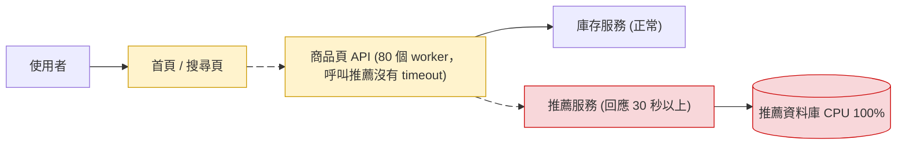
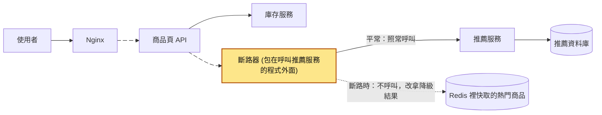
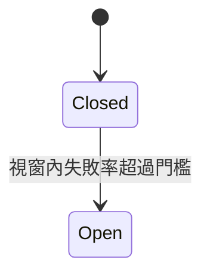
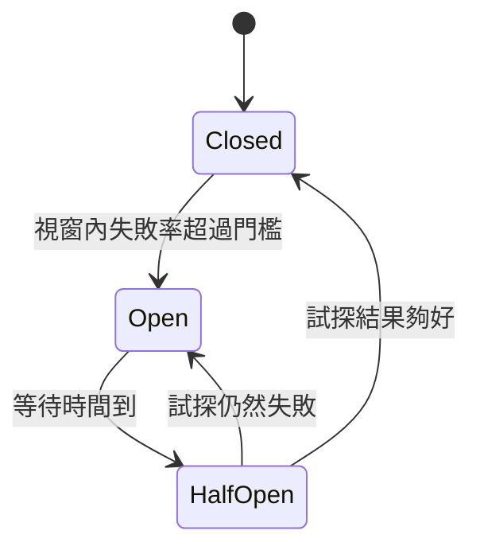
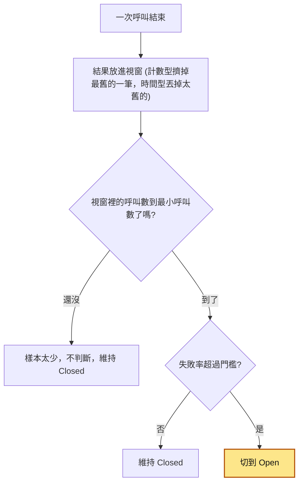
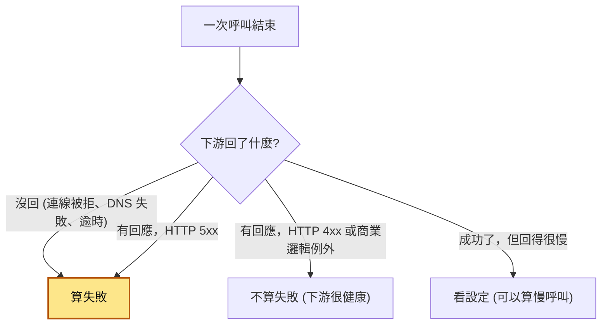
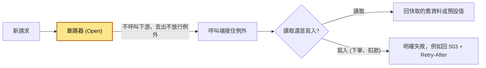
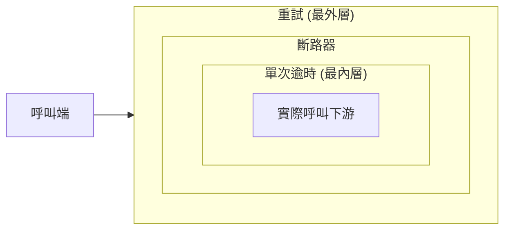
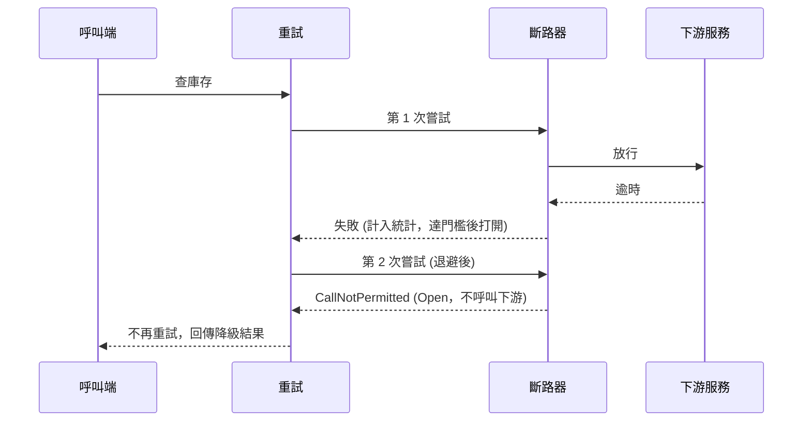
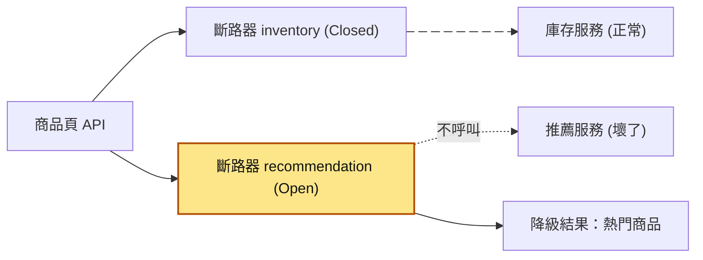

# 29｜斷路器（Circuit Breaker）

> 斷路器（circuit breaker）是包在「呼叫別的服務」那段程式外面的一層保護：被呼叫的服務一直失敗時，它就先「跳電」，暫時不再呼叫對方，直接回一個備用結果（叫降級結果，fallback），過一段時間再派一兩個請求去試對方好了沒。

**難度**：★★☆　**閱讀時間**：約 20 分鐘　**前置知識**：[重試機制](26-重試機制.md)、[指數退避](27-指數退避.md)

## 核心問題與理念

**它要解決的問題**：商品頁 API 要呼叫推薦服務，顯示「看了這個的人也看了」。推薦服務某天變慢、一直不回，商品頁 API 的 80 個 worker（一次只能處理一個請求的工作行程）全卡在等它，連同樣要靠商品頁 API 的首頁和搜尋頁也跟著打不開（下面的情境會完整走一遍）。

**核心理念**：對方最近一直失敗，就先停手不打，直接回備用答案。

**想通的那一步**：

- **卡住的地方**：直覺的做法是重試，或乾脆等對方回應；可是每個請求都要等到逾時才知道失敗，worker 就一個個被綁死，重試還讓已經過載的推薦服務收到更多請求。
- **火花**：用「最近這一批呼叫的失敗率」決定這一次要不要送，最近大多失敗，這次就直接不送、馬上回備用答案。至於對方好了沒，只要過一陣子放少數幾個請求去試，不用讓所有請求一起陪著等。

## 閱讀前推薦具備知識

| 知識 | 要會到什麼程度 | 這篇哪裡會用到 | 不熟的話先看 |
|---|---|---|---|
| Python 的 class 與例外 | **必備**：看得懂 `class CircuitOpenError(Exception)` 是自訂一種例外，也看得懂 `try`／`except`／`raise` 怎麼把例外接住，或繼續往外丟 | 「動手看看」的 `breaker_demo.py`、`inventory_client.py`，以及〈情境演練〉第 3 題 | [Python 官方教學（中文）](https://docs.python.org/zh-tw/3/tutorial/index.html) 第 8 章與第 9 章 |
| HTTP 狀態碼 4xx 與 5xx | **必備**：能分出 `404`、`422` 是請求內容有問題，`500`、`503` 是對方自己出問題 | 〈什麼算「失敗」〉那張表、〈地雷 2〉 | [MDN：HTTP 狀態碼](https://developer.mozilla.org/en-US/docs/Web/HTTP/Reference/Status) |
| [重試機制](26-重試機制.md) | **必備**：知道 `requests` 預設沒有逾時，也知道一個重試迴圈會把一次失敗放大成好幾次請求 | 情境裡的 `for attempt in range(4)`、〈和重試的搭配順序〉、〈地雷 1〉 | 本系列第 26 篇 |
| [指數退避](27-指數退避.md) | **加分**：知道重試之間要越等越久，不要立刻重打 | 情境最後的修法、〈和重試的搭配順序〉序列圖裡的「退避後」 | 本系列第 27 篇 |
| 執行緒與鎖 | **加分**：知道 `with self.lock:` 讓同一時間只有一個執行緒能改斷路器的狀態 | `breaker_demo.py` 的 `_before_call`、`_on_result` | [Python threading（中文）](https://docs.python.org/zh-tw/3/library/threading.html) |

**快速自我檢查**：下面這段程式，下游回了 `503`，函式最後回傳什麼？如果下游一直不回應，這段程式會等多久？

```python
def get_stock(sku):
    try:
        resp = requests.get(f"http://inventory.internal/stock/{sku}")
        resp.raise_for_status()
        return resp.json()["stock"]
    except requests.HTTPError:
        return None
```

<details markdown="1"><summary>看答案</summary>

回 `503` 時，`raise_for_status()` 丟出 `HTTPError`，被 `except` 接住，函式回傳 `None`。下游一直不回應的話，這段程式會一直等下去：`requests.get` 沒給 `timeout` 就不會逾時，也就不會丟例外，`except` 永遠等不到它。第一個答不出來，先看 Python 官方教學第 8 章；第二個答不出來，先看[重試機制](26-重試機制.md)第 4 節〈逾時〉。

</details>

## 為什麼要在意：一個具體的情境

這是一個假設情境。假設你負責一個電商的商品頁 API，用 Python 寫，跑在 Gunicorn 上。Gunicorn 是執行 Python 網頁程式的伺服器，它會開好幾個 worker（工作行程）來接請求。這裡用的是 sync worker：一個 worker 同一時間只能處理一個請求，手上的請求沒做完，就不能接下一個。每台機器 8 個 worker，部署 10 台，所以全部加起來只有 80 個 worker 能同時處理請求。最前面還有 Nginx，負責把使用者的請求轉給 Gunicorn。

商品頁除了查自家資料庫，還會呼叫兩個內部服務：**庫存服務**（顯示「剩 3 件」）和**推薦服務**（顯示「看了這個的人也看了」）。這裡商品頁 API 是發出呼叫的一方，叫「呼叫端」或「上游」；推薦服務是被呼叫的一方，叫「下游」。

呼叫推薦服務的程式做了三件事：

1. 用 `requests.get(f"http://reco.internal/users/{user_id}")` 發請求，沒有給 `timeout` 參數。
2. 收到回應後呼叫 `resp.raise_for_status()`，下游回 5xx 時會丟例外。
3. 整段包在 `for attempt in range(4)` 裡：第 1 次失敗後再重試 3 次，4 次都失敗才放棄。

逾時（timeout）的意思是「等超過幾秒就放棄，當成失敗」。`requests.get` 沒有給 `timeout` 參數時，預設**不會逾時**：對方不回，它就一直等。

某天，推薦服務的資料庫被一個大查詢吃滿 CPU，推薦 API 的回應時間從平常的 50ms 變成 30 秒以上。它沒有報錯，只是**一直不回**。接下來發生的事：

| 時間 | 推薦服務 | 商品頁 API 的 80 個 worker | 使用者看到 |
|---|---|---|---|
| T1 | 大查詢吃滿推薦資料庫的 CPU，回應時間變成 30 秒以上，但不報錯 | 大多空閒，有請求就處理 | 商品頁正常 |
| T2（幾秒內） | 收到的請求全部卡著不回 | worker 跑到 `requests.get` 那一行就停住等，很快 80 個全部卡住，空閒的是 0 個 | 商品頁一直轉圈 |
| T3 | 繼續不回 | 新進來的商品頁請求沒有 worker 可以接，在 Gunicorn 前面排隊 | Nginx 回 `504 Gateway Timeout` |
| T4 | 繼續不回 | 首頁、搜尋結果頁也會呼叫商品頁 API，一樣排不到 worker | 首頁、搜尋頁也打不開，看起來像「整個網站掛了」 |
| T5（卡滿 30 秒） | 繼續不回 | Gunicorn 預設 30 秒的 worker timeout 把卡住的 worker 砍掉重啟，新 worker 又卡在同一行 | 還是打不開 |
| T6 | 少數請求等到推薦服務自己的資料庫查詢逾時，回了 500 | `raise_for_status()` 丟例外，`for` 迴圈重試，一次失敗變成 4 次請求打向已經過載的推薦服務 | 還是打不開 |
| T7（約 5 分鐘後） | DBA 砍掉大查詢，但推薦服務還被重試流量壓著 | 還是卡住 | 還是打不開 |
| T8（再過約 10 分鐘） | 終於恢復，回應時間回到 50ms | 恢復正常 | 網站恢復 |

工程師在日誌和監控上看到的是：

- Nginx 的日誌一整排都是 `504 Gateway Timeout`。
- Gunicorn 的日誌一直出現 worker 逾時、被砍掉重啟的紀錄。
- 推薦服務的回應時間 30 秒以上，錯誤率卻幾乎是 0，因為它沒有報錯，只是不回。
- 庫存服務和商品頁自家的資料庫都很正常。

真正壞掉的只有「看了這個的人也看了」這一個區塊，上游卻因為等它，把 worker 全部用光，跟著一起掛。這種「一個服務壞掉，把呼叫它的服務也一個個拖下水」的狀況，叫做**連鎖故障（cascading failure）**。

這張圖看的是請求從使用者一路流到推薦服務，卡在哪裡：



圖裡黃色是「被拖下水」的服務：它們本身沒壞，卻因為等待紅色的下游而耗盡資源。

下游一定會掛，這是常態，所以要修的是商品頁這一端。根因在呼叫推薦服務的那三步：`requests.get(...)` 那一行沒有設 timeout，worker 被慢回應整個綁住；推薦服務明顯壞了，每個請求還是照樣去打，`for attempt in range(4)` 還把每次失敗放大成 4 次。

修法是給推薦服務的呼叫加上 300ms 逾時、包一個斷路器，斷路時改回 Redis 裡快取的「熱門商品」清單當降級結果；重試減為 1 次、放在斷路器外層，而且帶退避和抖動。斷路器怎麼判斷要不要斷，看後面的「它是怎麼運作的」；斷路時回什麼，看「Open 時要回什麼：降級結果」；重試為什麼放外層，看「和重試的搭配順序」。修好之後，推薦服務再出事，商品頁只是推薦區塊變成熱門商品，告警響了，但使用者察覺不到網站有問題。

## 全貌：它在系統裡的位置

這張圖看的是一個商品頁請求會經過哪些元件，以及斷路器裝在哪裡：



斷路器裝在呼叫端，夾在「商品頁 API」和「推薦服務」中間，每次呼叫推薦服務都要先經過它（正式環境裡庫存服務也該有自己的一個，圖裡為了簡潔只畫一個）。包在它外面的是[重試機制](26-重試機制.md)，負責決定失敗後要不要再打一次。斷路器保護的是呼叫的一方；方向相反的[速率限制](30-速率限制.md)，保護的是被呼叫的一方。

## 生活比喻

最直接的比喻就是家裡的**電箱無熔絲開關**。

某條線路短路、電流過大，開關就「啪」一聲跳掉，那條線路斷電。這樣電線不會燒起來，其他房間的電也照常能用。你不會讓它一直通電硬撐，也不會因為跳一次就把整棟樓的總開關關掉。

套到軟體上：

- **電流過大** ＝ 下游錯誤率或逾時比例超過門檻。
- **跳電** ＝ 進入 Open，後面的請求不再送去下游，直接回傳錯誤或降級結果。
- **其他房間照常有電** ＝ 其他不依賴這個下游的功能不受影響。

**比喻失準的地方**有兩個：

1. 家裡的開關跳掉後要人去手動扳回來；軟體的斷路器會自己等一段時間後進入 Half-Open，**自動**派試探請求去看下游恢復了沒。
2. 家裡跳電就是沒電；軟體斷路時通常會給一個**降級結果（fallback）**，例如回傳快取裡的舊資料、預設值，或請使用者稍後再試。斷路不等於畫面整個爛掉。

## 它是怎麼運作的

斷路器要處理的狀況是下游已經壞了，呼叫端還一直打、一直等。它包在每一次對下游的呼叫外面，記下每次呼叫的結果，再依結果決定下一個請求要不要送出去。

### 三個狀態與四條轉換線

先看最基本的兩個狀態。平常是 Closed，失敗太多就切到 Open：



只有這兩個狀態的話，斷路器打開後就回不來了。所以再加一個 Half-Open，負責試探下游好了沒：



你的程式呼叫下游時，請求先經過斷路器。斷路器在 Closed 就照常送出、記下結果；在 Open 就直接丟例外，不碰下游；在 Half-Open 就看還有沒有試探名額，有才送出。下面一個一個看。

**Closed（關閉，電路接通）**
正常狀態。所有請求都照常送去下游，斷路器在旁邊記錄每次呼叫的結果。命名照電路的意思：**Closed 是「通」，Open 是「斷」**。常見的誤解是照門的意思，以為 Open 才放行。

**Open（打開，電路斷開）**
失敗率超過門檻就切到這裡。這段期間**完全不呼叫下游**，請求一進來就立刻丟出「不放行」的例外（resilience4j 叫 `CallNotPermittedException`，Polly 叫 `BrokenCircuitException`，pybreaker 叫 `CircuitBreakerError`），由呼叫端接住、回傳降級結果。好處有兩個：

- 上游不用浪費執行緒和連線等一個大概率會失敗的呼叫，回應時間從「逾時秒數」變成「幾乎 0」。
- 下游少了一大堆流量，負載降下來，比較有機會恢復。

**Half-Open（半開，試探中）**
Open 狀態維持一段設定好的時間（例如 30 秒）後，斷路器進入半開，**只放行少量請求**去試探，這幾個名額叫試探名額。超過試探名額的其他請求，在半開期間一樣會被快速拒絕。

「試探結果夠好」怎麼判斷，各實作不一樣。簡單的實作（例如後面「動手看看」的教學程式、pybreaker）是試探成功就回 Closed，有一次失敗就回 Open。resilience4j 則是等試探名額用完後，把這幾次的結果算一次失敗率，低於門檻回 Closed，否則回 Open 再等一輪（它還會一起看「回得太慢的呼叫佔多少比例」，後面「什麼算失敗」會講）。

把三個狀態串起來，看下游從壞掉到恢復的過程中，斷路器怎麼切換（等待時間以 30 秒為例）：

<figure class="draw-fig">
<iframe class="draw-fig__frame" src="../figures/29-breaker-states.html" title="按播放或點 T1～T7，看推薦服務從壞掉到恢復時，斷路器怎麼在 Closed、Open、Half-Open 之間切換，以及每個狀態下請求是送去下游、等到逾時，還是直接拿熱門商品。" loading="lazy" style="height: 600px;"></iframe>
<figcaption>按播放或點 T1～T7，看推薦服務從壞掉到恢復時，斷路器怎麼在 Closed、Open、Half-Open 之間切換，以及每個狀態下請求是送去下游、等到逾時，還是直接拿熱門商品。</figcaption>
</figure>

| 時間 | 下游 | 斷路器狀態 | 新進來的請求 |
|---|---|---|---|
| T1 | 正常 | Closed | 照常送出，結果記進統計 |
| T2 | 開始逾時 | Closed | 照常送出，等到逾時才算失敗 |
| T3 | 還在壞 | Closed → Open | 失敗率超過門檻，斷路器打開 |
| T4 | 還在壞 | Open | 不送出，馬上丟「不放行」例外，回降級結果 |
| T5（Open 滿 30 秒） | 還在壞 | Open → Half-Open | 放少量試探請求，其他的照樣快速拒絕 |
| T6 | 還在壞 | Half-Open → Open | 試探失敗，再斷開等 30 秒 |
| T7（再等 30 秒） | 已恢復 | Open → Half-Open → Closed | 試探結果夠好，恢復照常送出 |

> 小細節：「等待時間到」這條線，很多實作沒有另外用計時器，要等**下一個請求進來時**才檢查時間、順便轉成半開。resilience4j 預設就是這樣，要自動轉換得開 `automaticTransitionFromOpenToHalfOpenEnabled`。

### 「失敗率超過門檻」怎麼算：滑動視窗

斷路器不能看到 1 次失敗就跳，也不能拿「開機以來」的總數來算（那樣過去的成功會稀釋現在的失敗）。所以它只看**最近一段**的呼叫，叫做滑動視窗（sliding window）。常見兩種：

| 類型 | 怎麼算 | 適合 |
|---|---|---|
| 計數型（count-based） | 最近 N 次呼叫裡失敗幾次 | 流量穩定的服務 |
| 時間型（time-based） | 最近 N 秒內的呼叫裡失敗幾次 | 流量起伏大的服務 |

另外一定會搭配**最小呼叫數（minimum number of calls）**：視窗裡的樣本太少時不做判斷。不然凌晨流量低，2 次呼叫有 1 次失敗就是 50%，斷路器會亂跳。

這張圖看的是每次呼叫結束後，斷路器在 Closed 狀態下怎麼決定要不要打開：



也有比較簡單的實作只看**連續失敗次數**，例如 pybreaker 的 `fail_max=5`：連續失敗 5 次就打開，中間只要成功一次計數就歸零。好懂，但遇到「一半成功一半失敗」這種半死不活的狀況，它可能永遠不會跳。下面是成功、失敗輪流出現時，連續失敗次數的變化：

| 步驟 | 這次呼叫 | 連續失敗次數 | 到目前為止的失敗比例 |
|---|---|---|---|
| 1 | 失敗 | 1 | 1/1 |
| 2 | 成功 | 0（歸零） | 1/2 |
| 3 | 失敗 | 1 | 2/3 |
| 4 | 成功 | 0（歸零） | 2/4 |
| 5 | 失敗 | 1 | 3/5 |
| 6 | 成功 | 0（歸零） | 3/6 |

一半的呼叫都失敗了，連續失敗次數卻從沒超過 1，離 5 還很遠。

### 什麼算「失敗」

斷路器依失敗率決定要不要打開，所以「什麼算失敗」設錯，它就會在下游健康時打開，或在下游壞掉時不打開。判斷方式是：**只有「下游壞了」才算失敗，「呼叫端自己錯了」不算。**

| 狀況 | 算不算失敗 | 原因 |
|---|---|---|
| 連線被拒、DNS 失敗、逾時 | 算 | 下游不可用 |
| HTTP 5xx（500、502、503、504） | 算 | 下游自己出問題 |
| 回應很慢但最後成功了 | 看設定（可以算「慢呼叫」） | 慢本身就會拖垮上游 |
| HTTP 4xx（400、404、422） | **不算** | 是請求內容有問題，下游很健康 |
| 商業邏輯例外（餘額不足、找不到商品） | **不算** | 同上 |

這張圖把上面的表畫成一次呼叫結束後的分岔：



HTTP 429（Too Many Requests）比較特別：下游沒壞，只是要求你降低送出的速度。要不要算失敗看情境，比較好的做法是照著它的 `Retry-After` 標頭退避，並且搭配 [速率限制](30-速率限制.md) 控制自己的送出量。

resilience4j 有「慢呼叫率」的設定（`slowCallDurationThreshold` 搭配 `slowCallRateThreshold`），可以讓「超過 2 秒才回」也計入門檻，對付「沒掛但很慢」的下游特別有用。

### Open 時要回什麼：降級結果

斷路器打開後丟出的例外，呼叫端要接住並決定要回什麼。常見選擇：

- **回快取裡的舊資料**：推薦清單、商品介紹、匯率這類稍微舊一點也可以接受的資料。
- **回預設值或空結果**：推薦區塊就不顯示、運費先顯示「結帳時計算」。
- **明確告訴使用者稍後再試**：回 `503 Service Unavailable` 並帶 `Retry-After` 標頭。
- **改走別條路**：主要的金流閘道斷路時改用備援閘道（要先確認業務上允許）。

這張圖看的是斷路器打開後，一個新請求怎麼走到降級結果，以及讀取和寫入為什麼要分開處理：



降級要回什麼是**業務決策**，要跟產品一起決定。寫入類的操作（下單、扣款）通常不能偷偷「假裝成功」，這時寧可明確失敗，也不要回一個讓使用者誤會的結果。

### 和重試的搭配順序

重試和斷路器常常一起用，順序放錯會互相抵消。常見的做法是**重試包在外面、斷路器在裡面、每次嘗試各自有逾時**。這張圖看的是這三層由外到內怎麼包：



這樣每一次嘗試都會經過斷路器、被它統計。斷路器一打開，下一次重試馬上拿到「不放行」例外，這時重試邏輯要**把這個例外視為不可重試**，直接放棄、走降級。resilience4j 在 Spring Boot 的預設組合順序就是重試在最外層；.NET 的 `Microsoft.Extensions.Http.Resilience` 標準組合也是「重試在外、斷路器在內、單次逾時最內層」。

下面這張圖是一次「查庫存」從呼叫端出發，依序經過重試、斷路器、下游服務的過程。第 1 次嘗試逾時，剛好讓失敗率達到門檻、斷路器打開，所以第 2 次嘗試連下游都沒碰到：



反過來把斷路器放在重試外面，斷路器看到的是「重試 3 次後的總結果」，統計會變遲鈍，而且一次失敗背後其實已經打了下游好幾次。重試本身的細節（次數上限、退避、抖動）請看 [重試機制](26-重試機制.md)、[指數退避](27-指數退避.md) 和 [抖動](28-抖動.md)。

### 每個斷路器管多大範圍

這張圖看的是一個下游各配一個斷路器時，推薦服務斷路了，庫存服務的呼叫照常流動：



- **一個下游依賴一個斷路器**，不要全服務共用一個。庫存服務壞了，不該連推薦服務一起斷。
- 下游如果有幾個特性差很多的 API（例如一個很快的查詢、一個很慢的報表），可以各自一個。
- 斷路器的狀態**預設存在各自的行程記憶體裡**（行程就是一支正在執行的程式，像前面情境裡的每個 Gunicorn worker），別台機器看不到。10 台機器就有 10 個獨立的斷路器，各自判斷、各自打開。這在大多數情況是可以接受的，甚至是好事（某台機器自己的網路壞掉，不會影響其他台）。真的需要共用狀態時，pybreaker 支援把狀態存到 Redis，但會多一個依賴，先想清楚值不值得。

### 現成函式庫怎麼選

| 函式庫 | 語言 | 判斷方式 | 備註 |
|---|---|---|---|
| resilience4j | Java / Kotlin | 滑動視窗失敗率 ＋ 慢呼叫率 | Netflix Hystrix 已停止開發（維護模式），新專案用它 |
| Polly | .NET | 取樣期間內的失敗比例 | v8 起改用 `ResiliencePipelineBuilder` 組合，API 跟 v7 差很多 |
| pybreaker | Python | 連續失敗次數 | 輕量好上手，可以接 listener 做監控、可以用 Redis 存狀態 |
| 服務網格（Istio / Envoy） | 不限 | 依設定 | 在基礎設施層做，不用改程式碼，見「知道有這回事就好」 |

## 動手看看

### 1. 純 Python 小斷路器：親眼看三態轉換

下面這支程式不用裝任何套件，Python 3.10 以上直接跑（型別註記用了 `int | None`）。它模擬一個庫存服務在第 3 到 14 秒之間掛掉，每次呼叫都要等 0.5 秒才逾時。這是**教學用**的簡化版，正式環境請用函式庫。

程式有點長，第一次讀先看三個地方就好：`_before_call` 決定這次要不要放行，`_on_result` 記下結果、決定要不要換狀態，最下面的 `call_inventory` 是模擬出來的壞掉的下游。

```python
# breaker_demo.py：教學用簡化版斷路器，正式環境請用 resilience4j / Polly / pybreaker
import collections
import threading
import time

START = time.monotonic()

def now() -> float:
    """從程式啟動到現在的秒數，方便看時間軸。"""
    return time.monotonic() - START

class CircuitOpenError(Exception):
    """斷路器不放行時丟出的例外（對應 resilience4j 的 CallNotPermittedException）。"""

class CircuitBreaker:
    def __init__(
        self,
        name: str,
        failure_rate_threshold: float = 0.5,  # 失敗率 >= 50% 就打開
        window_size: int = 10,                # 只看最近 10 次呼叫（計數型滑動視窗）
        min_calls: int = 5,                   # 樣本少於 5 次不判斷，避免 1 次失敗就 100%
        open_seconds: float = 5.0,            # 打開後等 5 秒才進半開
        half_open_max_calls: int = 3,         # 半開時放 3 個試探請求
        record_exceptions: tuple = (Exception,),  # 哪些例外算「下游壞了」
    ):
        self.name = name
        self.failure_rate_threshold = failure_rate_threshold
        self.min_calls = min_calls
        self.open_seconds = open_seconds
        self.half_open_max_calls = half_open_max_calls
        self.record_exceptions = record_exceptions
        self.window = collections.deque(maxlen=window_size)  # True 代表失敗
        self.state = "CLOSED"
        self.opened_at = 0.0
        self.half_open_permits = 0
        self.half_open_successes = 0
        self.lock = threading.Lock()

    def _transition(self, new_state: str) -> None:
        print(f"{now():5.1f}s  *** {self.name}: {self.state} -> {new_state} ***")
        self.state = new_state
        if new_state == "OPEN":
            self.opened_at = time.monotonic()
        elif new_state == "HALF_OPEN":
            self.half_open_permits = self.half_open_max_calls
            self.half_open_successes = 0
        elif new_state == "CLOSED":
            self.window.clear()  # 重新開始統計

    def _before_call(self) -> None:
        with self.lock:
            if self.state == "OPEN":
                # 不靠計時器：下一個請求進來時才檢查等待時間到了沒
                if time.monotonic() - self.opened_at >= self.open_seconds:
                    self._transition("HALF_OPEN")
                else:
                    raise CircuitOpenError(f"{self.name} 斷路中，快速失敗")
            if self.state == "HALF_OPEN":
                if self.half_open_permits <= 0:
                    raise CircuitOpenError(f"{self.name} 半開試探名額已滿")
                self.half_open_permits -= 1

    def _on_result(self, failed: bool) -> None:
        with self.lock:
            if self.state == "HALF_OPEN":
                if failed:
                    self._transition("OPEN")  # 試探失敗：再斷開等下一輪
                else:
                    self.half_open_successes += 1
                    if self.half_open_successes >= self.half_open_max_calls:
                        self._transition("CLOSED")  # 試探全部成功：恢復正常
            elif self.state == "CLOSED":
                self.window.append(failed)
                if len(self.window) >= self.min_calls:
                    rate = sum(self.window) / len(self.window)
                    if rate >= self.failure_rate_threshold:
                        self._transition("OPEN")
            # 狀態已經是 OPEN 才回來的結果（呼叫開始時還是 CLOSED）直接忽略

    def call(self, func, *args, **kwargs):
        self._before_call()
        try:
            result = func(*args, **kwargs)
        except self.record_exceptions:
            self._on_result(failed=True)
            raise
        except Exception:
            # 不在 record_exceptions 裡的例外（例如商業邏輯錯誤）不影響統計，直接往外丟；
            # 但半開時要把試探名額還回去，不然名額會漏光，斷路器永遠卡在半開
            self._release_permit()
            raise
        self._on_result(failed=False)
        return result

    def _release_permit(self) -> None:
        with self.lock:
            if self.state == "HALF_OPEN":
                self.half_open_permits += 1

# ---- 模擬下游：庫存服務在第 3～14 秒掛掉，每次都要等 0.5 秒才逾時 ----
def call_inventory(sku: str) -> int:
    if 3 <= now() < 14:
        time.sleep(0.5)
        raise TimeoutError("inventory timeout")
    time.sleep(0.02)
    return 42

# 只有逾時和連線錯誤算「下游壞了」
breaker = CircuitBreaker("inventory", record_exceptions=(TimeoutError, ConnectionError))

def get_stock(sku: str) -> tuple[int | None, str]:
    """有斷路器保護、斷路時回傳降級結果的版本。"""
    try:
        return breaker.call(call_inventory, sku), "ok"
    except CircuitOpenError:
        return None, "fallback(快速失敗)"  # 降級：前端顯示「庫存查詢中」
    except TimeoutError:
        return None, "fallback(逾時)"

if __name__ == "__main__":
    while now() < 22:
        t0 = time.monotonic()
        stock, how = get_stock("SKU-1")
        ms = (time.monotonic() - t0) * 1000
        print(f"{now():5.1f}s  state={breaker.state:<9} {how:<16} {ms:6.0f} ms")
        time.sleep(0.2)
```

執行：

```shell
python breaker_demo.py
```

你應該會看到類似這樣的時間軸（秒數會有些許誤差）：

```
  3.6s  state=CLOSED    fallback(逾時)        500 ms   ← 下游開始壞，每次都等滿 0.5 秒
  ...（再失敗 4 次）
  6.4s  *** inventory: CLOSED -> OPEN ***             ← 視窗 10 次裡 5 次失敗 = 50%，跳開
  6.6s  state=OPEN      fallback(快速失敗)      0 ms   ← 不呼叫下游，0 ms 就回
  ...
 11.4s  *** inventory: OPEN -> HALF_OPEN ***          ← 等滿 5 秒，派試探請求
 11.9s  *** inventory: HALF_OPEN -> OPEN ***          ← 下游還沒好，試探失敗，再斷開
  ...
 16.9s  *** inventory: OPEN -> HALF_OPEN ***          ← 再試一次
 17.4s  *** inventory: HALF_OPEN -> CLOSED ***        ← 下游 14 秒就好了，3 個試探都成功
```

觀察重點：

- **Open 期間每次呼叫是 0 ms**，而 Closed 狀態下打到壞掉的下游每次要 500 ms。正式環境裡，這差距就是「worker 被綁住」和「worker 還能處理別的請求」的差別。
- 把 `min_calls` 改成 1，再跑一次：下游一壞，第 1 次失敗就直接跳開。凌晨流量很少時，偶發一次失敗就會讓它斷路。
- 把 `open_seconds` 改成 20：下游早就好了，你卻還在回降級結果。這就是等待時間設太長的代價。
- 試著讓 `call_inventory` 在某些情況丟 `ValueError`（模擬 4xx），確認它不會讓斷路器跳開。

### 2. 用 pybreaker 寫成正式一點的樣子

```shell
uv run --with pybreaker,requests python inventory_client.py
```

```python
# inventory_client.py：pybreaker + requests 的實際用法（片段，網址請換成你的服務）
import logging

import pybreaker
import requests

log = logging.getLogger(__name__)

class BreakerLogger(pybreaker.CircuitBreakerListener):
    """狀態變化一定要留日誌、送監控，不然斷路器打開了沒人知道。"""

    def state_change(self, cb, old_state, new_state):
        log.warning("circuit %s: %s -> %s", cb.name, old_state.name, new_state.name)

class InventoryClientError(Exception):
    """4xx：呼叫端自己的問題，不該讓斷路器跳開。"""

inventory_breaker = pybreaker.CircuitBreaker(
    name="inventory",
    fail_max=5,                    # 連續失敗 5 次就打開（pybreaker 看的是連續次數）
    reset_timeout=30,              # 打開 30 秒後進入半開
    exclude=[InventoryClientError],  # 這類例外不計入失敗
    listeners=[BreakerLogger()],
)

@inventory_breaker
def fetch_stock(sku: str) -> int:
    # ✅ 一定要設 timeout：(連線逾時, 讀取逾時)，單位秒
    resp = requests.get(f"http://inventory.internal/stock/{sku}", timeout=(0.5, 1.0))
    if 400 <= resp.status_code < 500:
        raise InventoryClientError(f"{resp.status_code} for {sku}")
    resp.raise_for_status()  # 5xx 會丟 HTTPError，計入失敗
    return resp.json()["stock"]

def get_stock_for_page(sku: str) -> int | None:
    try:
        return fetch_stock(sku)
    except pybreaker.CircuitBreakerError:
        # 斷路中（包含「剛好讓它跳開的那一次」，pybreaker 預設也會丟這個）
        return None  # 降級：前端顯示「庫存查詢中」
    except (requests.Timeout, requests.ConnectionError, requests.HTTPError):
        return None
```

注意 pybreaker 對 `exclude` 裡的例外是**當成成功處理**的：它不會讓斷路器跳開，還會把連續失敗計數歸零。所以 `get_stock_for_page` 沒有接 `InventoryClientError`，4xx 會照常往上丟，交給呼叫端處理成「參數錯誤」之類的回應。

pybreaker 的 `current_state` 屬性可以拿到 `'closed'`、`'open'`、`'half-open'`，方便做健康檢查頁或監控指標。

### 3. 對照：resilience4j 的設定長什麼樣子

不寫 Java 也值得看一眼，因為這些參數名稱幾乎就是斷路器的「標準詞彙」，其他函式庫的概念都對得上：

```yaml
# Spring Boot application.yml（片段）
resilience4j:
  circuitbreaker:
    instances:
      inventory:
        slidingWindowType: COUNT_BASED       # 計數型視窗（另一種是 TIME_BASED）
        slidingWindowSize: 20                # 看最近 20 次呼叫
        minimumNumberOfCalls: 10             # 至少 10 次才開始判斷
        failureRateThreshold: 50             # 失敗率 >= 50% 打開
        slowCallDurationThreshold: 2s        # 超過 2 秒算慢呼叫
        slowCallRateThreshold: 80            # 慢呼叫比例 >= 80% 也打開
        waitDurationInOpenState: 30s         # Open 維持 30 秒
        permittedNumberOfCallsInHalfOpenState: 3   # 半開時放 3 個試探
        automaticTransitionFromOpenToHalfOpenEnabled: true
        ignoreExceptions:
          - com.example.inventory.ClientErrorException   # 4xx 不計入
```

resilience4j 的預設值是視窗 100 次、最少 100 次呼叫才判斷、失敗率門檻 50%、Open 等 60 秒、半開放 10 個請求。對大多數內部服務來說，「最少 100 次」偏保守，低流量的服務可能要很久才跳得起來，所以通常要依流量調整。

## 常見地雷

### 1. 有斷路器，但沒有逾時

❌ 錯誤做法：`requests.get(url)` 包進斷路器就以為安全了。

為什麼錯：`requests` 預設不會逾時。下游「不回應」時，呼叫永遠不會結束，斷路器根本收不到「失敗」這個結果，自然也不會跳。worker 照樣被綁死。

✅ 正確做法：每一個對外呼叫都設連線逾時和讀取逾時，數值參考下游平常 P99 延遲再留一點餘裕（P99 延遲：把請求依回應時間排好，100 個裡只有 1 個比它慢的那個時間）。能用慢呼叫率的函式庫（resilience4j）就一起設。

### 2. 把 4xx 和商業錯誤也算成失敗

❌ 錯誤做法：只要丟例外就計入失敗，包括 `404 Not Found`、`422` 驗證失敗、「餘額不足」。

為什麼錯：某個前端 bug 送出一堆格式錯誤的請求，下游正確地回 400，結果斷路器判定「下游壞了」並打開，連正常使用者的請求也被擋下來。斷路器變成自己製造故障。

✅ 正確做法：明確設定哪些例外算失敗（逾時、連線錯誤、5xx），4xx 和商業例外放進 ignore / exclude 清單。

### 3. 斷路器打開了還在重試

❌ 錯誤做法：外層重試邏輯看到任何例外都重試 3 次，包括斷路器的 `CallNotPermittedException` / `CircuitBreakerError`。

為什麼錯：「不放行」例外代表斷路器已經判定現在不該呼叫下游，重試只是在浪費時間，還可能讓重試迴圈在 Open 期間空轉，拉長使用者等待時間。

✅ 正確做法：重試在外、斷路器在內，並把「不放行」例外列為**不可重試**。拿到它就直接走降級。

### 4. 全服務共用一個斷路器

❌ 錯誤做法：寫一個全域的 `breaker`，所有對外呼叫都用它。

為什麼錯：推薦服務壞了，斷路器打開，結果庫存、會員、運費服務的呼叫也全部被擋下來。斷路器的初衷是**隔離**故障，共用反而把故障擴大。

✅ 正確做法：每個下游依賴各自一個斷路器實例，用名稱區分（`inventory`、`recommendation`），監控也依名稱分開看。

### 5. 參數憑感覺設，低流量時亂跳或跳不起來

❌ 錯誤做法：`min_calls=1`、`fail_max=1`，或直接沿用預設的「最少 100 次呼叫」卻用在每分鐘只有 10 個請求的服務上。

為什麼錯：門檻太敏感，偶發一次網路抖動就斷路；門檻太保守，下游壞了好幾分鐘斷路器還在等樣本數。

✅ 正確做法：先看這個依賴的正常流量和正常錯誤率。最小呼叫數要讓「一個視窗內」湊得到；失敗率門檻要明顯高於平常的錯誤率；Open 等待時間大概抓下游「通常多久會恢復」的量級（幾秒到幾十秒）。上線後看監控再調。

### 6. 打開了沒人知道，或降級結果偷偷騙人

❌ 錯誤做法：斷路器靜靜地打開、靜靜地回快取資料，沒有日誌、沒有指標；或寫入操作斷路時回傳「成功」。

為什麼錯：使用者看到的資料已經舊了兩小時，團隊卻沒人發現下游一直在壞。寫入操作更危險，使用者以為訂單成立了，其實根本沒送出。

✅ 正確做法：狀態變化一定要寫日誌並送指標，Open 要能觸發告警；降級結果要讓呼叫端知道它是降級的（例如回傳時帶一個 `degraded=True` 標記）；寫入類操作斷路時明確失敗，或改成先寫進佇列稍後處理（見 [訊息佇列](35-訊息佇列.md)）。

## 重點整理

- 斷路器有三個狀態：Closed（照常呼叫下游，邊呼叫邊記錄結果）、Open（不呼叫下游，直接丟「不放行」例外，由呼叫端回降級結果）、Half-Open（放少量試探請求，結果夠好回 Closed，不好回 Open）。記住這三個狀態和四條轉換線，就懂了八成。
- 它防的是連鎖故障：下游變慢時，上游的 worker 全部卡在等它，上游也跟著掛。斷路器讓上游失敗得快，把 worker 留給其他還正常的功能。
- **沒有逾時的斷路器幾乎沒用。** 下游最常見的壞法是變慢、遲遲不回；沒有逾時，這種呼叫永遠不會被記成失敗。先設逾時，再加斷路器。
- 只有「下游壞了」才算失敗（逾時、連線錯誤、5xx），4xx 和商業邏輯錯誤不算。
- 跟重試一起用時，**重試在外、斷路器在內**，而且「不放行」例外不要重試。
- 正式環境用現成函式庫（resilience4j、Polly、pybreaker），一個下游依賴一個斷路器，參數看實際流量來調，**狀態變化一定要有日誌和告警**，不然它在背後打開了你都不知道。

## 新人必知清單

### 一定要會（基本功）

- [ ] 講得出 Closed / Open / Half-Open 三個狀態各自的行為，以及四條轉換線的觸發條件。
- [ ] 知道「Closed 是通、Open 是斷」，不要跟門搞反。
- [ ] 每個對外呼叫都設逾時，並知道 Python `requests` 預設不會逾時。
- [ ] 能分辨哪些錯誤該計入失敗（逾時、連線錯誤、5xx），哪些不該（4xx、商業錯誤）。
- [ ] 知道重試和斷路器的搭配順序：重試在外、斷路器在內，「不放行」例外不重試。
- [ ] 斷路時能寫出合理的降級結果，並且分得出讀取（可以回舊資料）和寫入（不能假裝成功）的差別。
- [ ] 一個下游依賴一個斷路器，狀態變化要有日誌和監控。

### 知道有這回事就好

- 滑動視窗有計數型和時間型兩種，還有「最小呼叫數」避免低流量誤判。
- 慢呼叫率（slow call rate）：下游沒報錯但變慢時也能斷路。
- 斷路器狀態預設存在各個行程的記憶體裡，每台機器各自判斷；需要時可以用 Redis 共享狀態，但多了一個依賴。
- 服務網格裡的 Envoy / Istio 也有類似機制，但名稱容易混淆：Envoy 文件中的「circuit breaking」指的是**連線數、待處理請求數上限**，比較接近艙壁隔離；跟本文「依失敗率暫停呼叫」比較像的是 **outlier detection**（把連續出錯的實例暫時踢出負載平衡）。
- 艙壁隔離（bulkhead）：限制每個下游能用的執行緒或連線數，跟斷路器互補。斷路器管「要不要打」，艙壁管「最多同時打多少」。
- Netflix Hystrix 是早期最有名的斷路器函式庫，已停止開發，看到舊專案在用時知道它是什麼就好。

### 先不用管（等你遇到再學）

- 自己從零實作一個能在正式環境用的斷路器（並行安全、指標、各種邊界狀況都不簡單）。
- 根據即時延遲和錯誤率動態調整門檻的自適應斷路（adaptive concurrency / load shedding）。
- 多區域、多叢集之間的斷路與流量切換策略。
- 各函式庫的進階狀態（例如 resilience4j 的 `FORCED_OPEN`、`DISABLED`、`METRICS_ONLY`）。

## Code Review 時可以問的問題

1. 這個對外呼叫有沒有設逾時？數值是怎麼決定的？
2. 斷路器把哪些錯誤算成失敗？4xx 和商業例外有沒有被排除？
3. 斷路器打開時，呼叫端回什麼？這個降級結果對使用者來說合理嗎？如果是寫入操作，會不會讓人誤以為成功？
4. 重試和斷路器誰包誰？「不放行」例外會不會被重試？
5. 這個斷路器是不是只保護一個下游？名稱有沒有讓監控分得出來？
6. 門檻、視窗、最小呼叫數、Open 等待時間是依據什麼設定的？跟這個依賴的實際流量對得上嗎？狀態變化有沒有日誌和告警？

## 情境演練

**1. 你在監控面板上看到 `inventory` 斷路器的狀態是 Open。同事說：「Open 就是正常放行吧，庫存服務應該沒事。」這時候庫存服務有收到請求嗎？你會怎麼回他？**

<details markdown="1"><summary>看答案</summary>

沒有收到。Closed 會送，Open 不會送。命名跟電路一樣：電路「閉合」才通電，「打開」就斷了。同事是照「門打開才能過」在理解，剛好反過來。Open 代表斷路器判定庫存服務壞了，請求一進來就快速失敗、回降級結果，要去查的是庫存服務為什麼失敗。記住「Closed＝正常放行並統計，Open＝快速失敗不呼叫」。

</details>

**2. 一個內部後台服務凌晨每分鐘只有兩三個請求。同事設斷路器時說：「最小呼叫數沒什麼用，設成 1 最靈敏。」你會怎麼回？**

<details markdown="1"><summary>看答案</summary>

不建議設成 1。失敗率是比例，樣本太少時比例會劇烈跳動。凌晨只有 2 個請求、其中 1 個剛好網路抖動失敗，失敗率就是 50%，沒有最小呼叫數的話斷路器會直接打開，接下來一段時間所有請求都被擋下來。最小呼叫數確保有足夠的樣本才做判斷。反過來，這個值設太大，低流量服務會很久都湊不到樣本數，下游壞了也跳不起來，所以要依流量調整。

</details>

**3. 同事送來一個 PR，裡面這樣呼叫推薦服務。你 review 時會留什麼意見？**

```python
# ❌ 錯誤示範
breaker = pybreaker.CircuitBreaker(fail_max=5, reset_timeout=30)

@breaker
def get_recommendations(user_id):
    return requests.get(f"http://reco.internal/users/{user_id}").json()
```

<details markdown="1"><summary>看答案</summary>

最大的問題是**沒有 timeout**。推薦服務如果變慢但不報錯，`requests.get` 會一直等，呼叫永遠不會失敗，斷路器永遠不會跳開，worker 一樣被綁死。

次要問題有兩個：

- 沒有檢查狀態碼。下游回 500 時，`requests` 不會丟例外，斷路器可能把它當成功（或因為錯誤頁不是 JSON，在 `.json()` 才莫名其妙地失敗），「什麼算失敗」完全看運氣。
- 呼叫端沒有降級處理，斷路器一打開，`CircuitBreakerError` 就直接炸到頁面上。

```python
# ✅ 正確寫法
class RecoClientError(Exception):
    """4xx：呼叫端的問題，不計入斷路器失敗。"""

breaker = pybreaker.CircuitBreaker(fail_max=5, reset_timeout=30, exclude=[RecoClientError])

@breaker
def get_recommendations(user_id):
    resp = requests.get(f"http://reco.internal/users/{user_id}", timeout=(0.3, 0.5))
    if 400 <= resp.status_code < 500:
        raise RecoClientError(resp.status_code)
    resp.raise_for_status()  # 5xx 丟 HTTPError，計入失敗
    return resp.json()

def recommendations_for_page(user_id):
    try:
        return get_recommendations(user_id)
    except (pybreaker.CircuitBreakerError, RecoClientError, requests.RequestException):
        return get_cached_popular_items()  # 降級：回傳快取的熱門商品
```

</details>

**4. 你接手一個服務，發現它是先「重試 3 次」再經過斷路器（斷路器在外、重試在內）。你會建議改嗎？為什麼？**

<details markdown="1"><summary>看答案</summary>

建議改。斷路器看到的是「重試完之後」的總結果：一次對外呼叫失敗，背後其實已經打了下游 4 次（1 次加 3 次重試）。所以：

- 斷路器的統計變遲鈍，要累積到門檻時，下游實際已經被打了好幾倍的流量。
- 即使斷路器打開了，在打開之前的那些請求仍然帶著重試流量，持續加重下游負擔。

改成重試在外、斷路器在內，每一次嘗試都被斷路器統計，打開後下一次重試立刻拿到「不放行」例外，重試邏輯就該停止、走降級。

</details>

**5. 結帳服務呼叫「運費計算服務」，你加了斷路器，Open 時回傳固定運費 100 元。上線一週後，財務發現有一批訂單的運費明顯不對。發生了什麼事？你會怎麼改？**

<details markdown="1"><summary>看答案</summary>

運費服務在某段時間出了問題，斷路器打開，結帳流程拿到降級的 100 元運費並**照樣成立訂單**。偏遠地區或大型商品的運費其實遠超過 100 元，公司就吃了差價；而且斷路器打開沒有告警，沒人知道這段期間的訂單都是用假運費。

運費會**直接影響金額**，舊一點的資料或寫死的預設值都不能拿來偷偷頂替。改法：

- 結帳這種寫入／金額相關的流程，斷路時應該**明確失敗**，回 503 請使用者稍後再試；或在購物車頁顯示「運費稍後計算」，但不允許在拿不到真實運費時送出訂單。
- 如果業務真的接受預估運費，要在訂單上標記「運費為預估值」，並有後續補算或人工審核流程。
- 斷路器狀態變化要送指標並設告警，Open 狀態出現就要有人知道。

**降級策略是業務決策**，要跟產品、財務一起決定，不能由工程師自己挑一個看起來合理的數字。

</details>

## 相關主題

- [重試機制](26-重試機制.md)：斷路器最常見的搭檔，本文講的是兩者怎麼組合，重試本身的設計看這篇。
- [指數退避](27-指數退避.md)：重試之間要等多久，避免在下游恢復前把它打垮。
- [抖動](28-抖動.md)：讓大量用戶端的重試時間錯開，避免半開時一窩蜂湧上去。
- [速率限制](30-速率限制.md)：斷路器保護「你」不被下游拖垮，速率限制保護「下游」不被你打垮，兩者方向相反。
- [背壓](47-背壓.md)：系統過載時把壓力往上游傳遞，跟斷路器一樣是避免連鎖故障的手段。
- [健康檢查](49-健康檢查.md)：斷路器的狀態可以作為健康檢查的資訊，但要小心不要因為下游斷路就讓自己被判定不健康而被重啟。

## 延伸閱讀

- Martin Fowler〈CircuitBreaker〉：https://martinfowler.com/bliki/CircuitBreaker.html
- resilience4j 官方文件 CircuitBreaker 章節：https://resilience4j.readme.io/docs/circuitbreaker
- Microsoft Azure Architecture Center〈Circuit Breaker pattern〉：https://learn.microsoft.com/en-us/azure/architecture/patterns/circuit-breaker
- Michael T. Nygard《Release It!》：斷路器、艙壁、逾時這些穩定性模式的經典來源。
