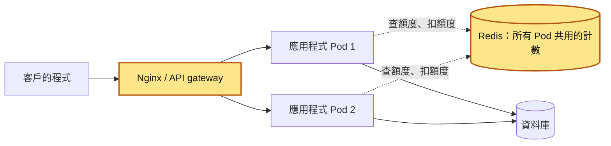
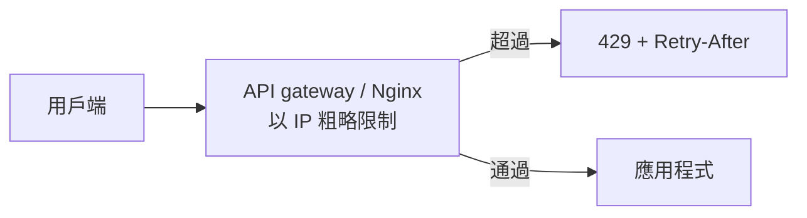
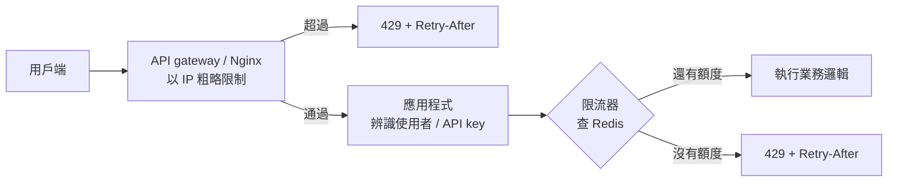
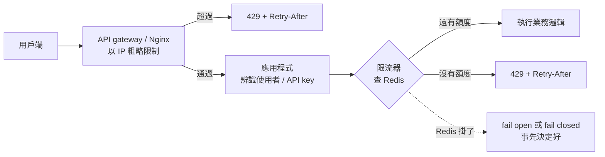
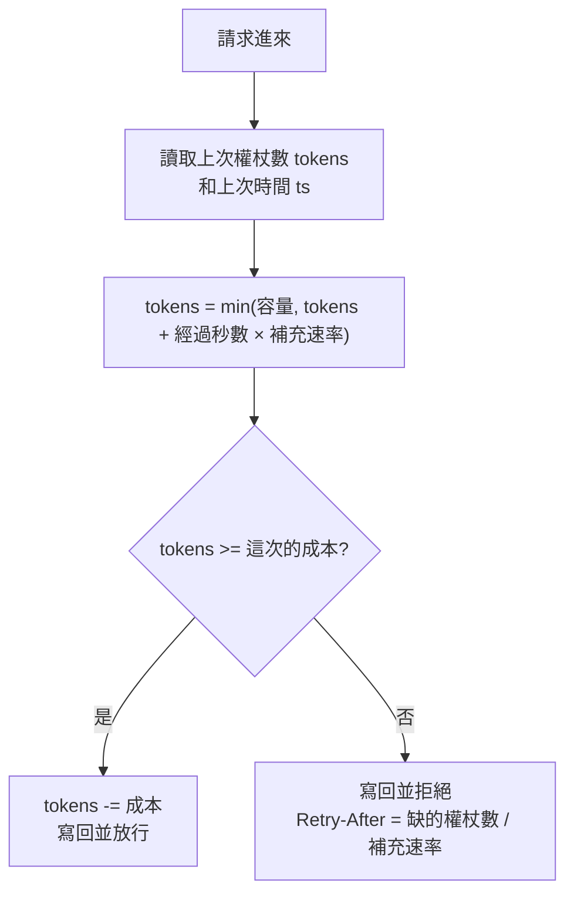

# 30｜速率限制（Rate Limiting）

> 速率限制（rate limiting，常簡稱「限流」）規定每個呼叫者在一段時間內最多能送幾次請求，超過的直接擋掉，請它晚點再來。

**難度**：★★☆　**閱讀時間**：約 20 分鐘　**前置知識**：[競爭條件](01-競爭條件.md)、[重試機制](26-重試機制.md)

## 為什麼要在意：一個具體的情境

這是一個假設情境。假設你在一家 B2B SaaS 公司負責公開 API，合約寫明每個 API key「每分鐘最多 600 次」。服務用 Python 寫，跑在 Kubernetes 上：平常有 3 個 Pod（可以先想成 3 台跑著同一份程式的機器），每個 Pod 用 Gunicorn 開 4 個 worker（4 個各自獨立在跑的 Python 程式），所以總共有 12 個 worker，同一個 API key 的請求會被分散到這 12 個 worker 上。Kubernetes 另外開了 HPA（自動擴展），負載一高就自動多開幾個 Pod。

限流是這樣寫的：

```python
# ❌ 出事的寫法：每個 worker 各自有一份計數
counts = {}   # 存在這個 worker 自己的記憶體裡
LIMIT = 600   # 合約：每個 API key 每分鐘最多 600 次

def allow(api_key: str) -> bool:
    counts[api_key] = counts.get(api_key, 0) + 1
    return counts[api_key] <= LIMIT

# 另外有一個排程，每分鐘整點執行一次 counts.clear()
```

這段程式單看沒有錯。問題在每個 worker 都是獨立的程式，各自有一份 `counts`，彼此看不到對方的數字。被擋下來的請求會回 `429 Too Many Requests`（意思是「你打太多了」），日誌會記一筆。接下來發生的事：

| 步驟 | 發生什麼事 | 計數有幾份 | 這個 API key 每分鐘實際能打幾次 |
|---|---|---|---|
| T1 平常 | 同一個 API key 的請求被分散到 3 個 Pod × 4 個 worker | 12 份，每份上限 600 | 600 × 12 = 7200，平常沒有客戶打這麼多，一直沒人發現 |
| T2 某天 | 一家客戶上線新的同步腳本：每分鐘整點把所有資料拉一次，迴圈裡沒有任何間隔 | 12 份 | 7200 |
| T3 整點 | 排程把 12 份 `counts` 都清成 0；同一秒，客戶的腳本開始連續送請求 | 12 份，全部從 0 開始 | 7200 |
| T4 整點後幾秒 | 每個 worker 只分到這個 API key 總量的 1/12，算到的次數都沒超過 600，全部放行 | 12 份，都還沒到 600 | 一筆 429 都沒有 |
| T5 | 請求全部進到資料庫，資料庫 CPU 衝到 100%，所有客戶的 API 延遲從 80ms 變成好幾秒；客戶的腳本遇到逾時就立刻重試，沒有退避也沒有[抖動](28-抖動.md)，流量越重試越多 | 12 份 | 7200 |
| T6 | HPA 看到負載變高，把 Pod 從 3 個拉到 12 個 | 12 × 4 = 48 份 | 600 × 48 = 28800，限流器等於完全沒作用 |

使用者看到的：不只這家客戶，**所有客戶**的 API 延遲都從 80ms 變成好幾秒，還有大量 504。

工程師在監控上看到的：某一個 API key 佔了 70% 的流量，但限流日誌裡一筆 429 都沒有。

根因在上面那段程式：`counts = {}` 放在每個 worker 自己的記憶體裡，限制值被乘上 worker 數，Pod 一擴展還會自動放大；`counts.clear()` 每分鐘整點清零，這種算法叫固定視窗，前一分鐘最後一秒和下一分鐘第一秒各打滿一次，兩秒內就能放過兩倍（後面「演算法一」有圖）。另外 `allow` 只回 `True`／`False`，就算擋住了，也沒告訴用戶端要等多久（`Retry-After` 標頭），用戶端只會一直重試。

修正方式：把計數搬到所有 Pod 共用的 Redis，用 Lua 腳本實作權杖桶；在 Nginx 先做一層以 IP 為單位的粗略限制；超過限制回 429 並附上 `Retry-After`；另外寫信請客戶的腳本改用[指數退避](27-指數退避.md)。為什麼一定要用 Lua 看後面的「分散式下的原子性」，權杖桶看「演算法四」，回應格式看「回應：429、Retry-After 與 RateLimit 標頭」，實際跑一次看「動手看看」的實驗二。

## 全貌：它在系統裡的位置

這張圖看的是客戶的程式送出一個 API 請求後，會經過哪些元件，限流發生在哪裡：



限流發生在黃色的兩個地方：入口的 Nginx 或 API gateway 先以 IP 擋掉明顯打太多的請求，應用程式再到 Redis 查這個 API key 還有沒有額度，有額度才去碰資料庫。Nginx 這類[反向代理](34-反向代理.md)適合放第一層；Redis 裡的「查額度、扣額度」要一次做完，不然就會出現[競爭條件](01-競爭條件.md)。速率限制擋的是單一呼叫者打太多，整個系統處理不完要靠[背壓](47-背壓.md)；方向相反的[斷路器](29-斷路器.md)裝在呼叫的一方，保護自己不被壞掉的服務拖垮。

## 生活比喻

速率限制像**熱門餐廳的叫號機**。

餐廳每小時只能出那麼多份餐，所以門口發號碼牌：每個人一次只能拿一張，牌子發完就請後面的人「30 分鐘後再來」。這樣廚房不會被塞爆，也不會有人一口氣拿走 50 張牌，讓其他客人都吃不到。

權杖桶可以想成：門口有一個籃子最多放 10 張號碼牌，店員每 6 分鐘放一張進去。客人來了就拿一張，籃子空了就得等。剛開店時籃子是滿的，一群人同時到也能一次發出 10 張（允許爆量），但長期來看一小時就是發 10 張（平均速率固定）。

「30 分鐘後再來」就是 `Retry-After`。好的客人會照時間回來；沒禮貌的客人每 10 秒來敲一次門，只會讓店員更忙，這就是用戶端不尊重 429、沒有做[指數退避](27-指數退避.md)的下場。

**比喻失準的地方**：餐廳只有一個門口、一個店員，號碼牌數量不會算錯。真實的後端有十幾台伺服器同時在發牌，如果每台各自記帳，客人只要換一個門進去就能再拿一輪。所以分散式環境的速率限制必須集中計數，而且計數動作必須是原子的（中間不會被其他請求插隊）。

## 它是怎麼運作的

限流器要在每個請求進來時回答一個問題：這個呼叫者在這段時間內還有沒有額度？有就放行，沒有就回 429。下面先看請求會經過哪幾層，再看「額度」怎麼算。

### 一個請求進來會經過哪些關卡

速率限制通常分層做：外層（CDN、API gateway、[反向代理](34-反向代理.md)）擋掉明顯的濫用，便宜又快；內層（應用程式）做跟業務有關、需要知道「這是誰」的細緻限制。CDN 是把網站內容放在各地節點、離使用者最近的那一層服務；API gateway 是擋在所有 API 前面、統一做驗證和轉發的服務。

用戶端送出一個請求時，第一個碰到的是 gateway 或 Nginx。它只看 IP，超過就直接回 429：



通過外層的請求進到應用程式。應用程式先辨識是哪個使用者或 API key，再去 Redis 查這個 key 還有沒有額度：



最後補上 Redis 出事的那條路。Redis 掛了的時候要放行還是拒絕，得事先決定好（細節見後面的地雷 6）：



### 限制的 key：到底在限制誰

演算法再好，key 選錯也沒用。常見的選擇：

| key | 適用時機 | 要注意 |
|---|---|---|
| IP | 還沒登入的端點（登入、註冊、忘記密碼） | 公司、學校、行動網路常有很多人共用一個對外 IP（NAT、CGNAT），限太緊會誤傷；在 proxy 後面拿到的可能是 proxy 的 IP |
| 使用者 ID | 登入後的操作 | 攻擊者可以註冊很多帳號，要搭配其他限制 |
| API key / 租戶 ID | B2B API、依方案收費 | 通常對應合約，限制值可能要從資料庫或設定讀 |
| 組合 key | 例如「IP + 帳號」限制登入失敗次數 | key 越細，Redis 裡的 key 越多，要設好過期時間 |

另外，不同端點的成本差很多。一個「匯出報表」可能等於一百個「查詢單筆」，所以有些系統會讓不同端點扣不同的額度（權杖桶的 `cost` 參數），或分開設定限制。

### 演算法一：固定視窗（fixed window）

把時間切成一格一格（例如每分鐘一格），每格一個計數器，超過上限就擋。Redis 實作就是一個 `INCR` 加上過期時間，非常便宜。

問題在**視窗交界**：

```
限制：每分鐘 100 次

        視窗 A (12:00:00–12:00:59)    視窗 B (12:01:00–12:01:59)
  ─────────────────────────────┬─────────────────────────────
                       100 次 ▲│▲ 100 次
                    12:00:59   │  12:01:00
                     └──── 2 秒內放過 200 次 ────┘
```

在 12:00:59 打 100 次、12:01:00 再打 100 次，兩次都合法，但 2 秒內實際放進來 200 次，是限制值的兩倍。對一般查詢 API 可能還能接受；對登入、發簡訊驗證碼這種敏感端點就不夠。

### 演算法二：滑動視窗 log（sliding window log）

把每一次請求的時間戳都記下來（Redis 用 sorted set，一種每筆資料都帶一個分數、可以依分數範圍刪除或計數的資料結構），每次請求進來時先刪掉「現在往前一分鐘」以外的紀錄，再數剩幾筆。

- 優點：完全精準，任何連續 60 秒內都不會超過上限。
- 缺點：每個 key 要存最多 N 筆紀錄，限制值是每分鐘 10000 次時，就要存 10000 筆。被擋下來的請求如果也記錄，攻擊者打越多你存越多。
- 小地雷：sorted set 的成員（member）不能重複，如果直接拿時間戳當成員，同一毫秒內的兩個請求會被當成同一筆，少算次數。成員要加上唯一值（例如時間戳加隨機字串或請求 ID），時間戳放在分數（score）。

適合限制值很小、又很要求精準的場景，例如「每小時最多寄 5 封驗證信」。

### 演算法三：滑動視窗 counter（sliding window counter）

> 第一次讀可以先跳過這一節，等你需要比固定視窗平滑、又不想存每一筆時間戳的做法時再回來看。

滑動視窗 log 精準但要存每一筆時間戳；固定視窗便宜但交界會放過兩倍。滑動視窗 counter 取中間：只存「上一格」和「這一格」兩個計數器，用比例估算：

```
估算值 = 上一格的次數 × (1 − 這一格已經過的比例) + 這一格的次數

範例：限制每分鐘 100 次，現在是 12:01:15（這一格過了 25%）
上一格 (12:00) 有 80 次，這一格 (12:01) 目前 30 次
估算值 = 80 × 0.75 + 30 = 90  → 還沒到 100，放行
```

它假設上一格的請求是平均分布的，所以是近似值，但記憶體固定是兩個整數，精準度通常夠用，在精準度和成本之間取了折衷。

### 演算法四：權杖桶（token bucket）

每個 key 有一個桶，有兩個參數：

- **容量（capacity）**：桶最多能裝幾個權杖，決定可以爆量多少。
- **補充速率（refill rate）**：每秒補多少個權杖，決定長期平均速率。

請求來了就拿一個權杖（或依成本拿多個），拿得到就放行，拿不到就擋。實作上不需要真的有計時器在「補」，只要記住「上次的權杖數」和「上次的時間」，下次請求進來時用經過的時間算出現在應該有多少權杖就好。



權杖桶的好處是很符合真實使用情境：使用者打開頁面時一口氣發 10 個請求很正常，不該被擋；但持續每秒 100 次就不正常。容量 20、速率每秒 5 個，就是「可以一次衝 20 個，長期平均每秒 5 個」。

### 演算法五：漏桶（leaky bucket）

漏桶常見有兩種說法，新人容易搞混：

- **當成佇列**：請求先進一個固定大小的佇列，後端用固定速率從佇列裡取出來處理，佇列滿了就丟掉。輸出非常平滑，但請求會被**延遲**處理，不會立刻被拒絕。
- **當成計量器**：用來判斷「這個請求有沒有超速」，邏輯上跟權杖桶等價，只是一個在算「水位」、一個在算「剩餘權杖」。

Nginx 的 `limit_req` 官方文件就說它用的是 leaky bucket。它有一個 `burst` 參數，代表允許暫時多出來的名額。沒加 `nodelay` 時，超出速率但還在 `burst` 範圍內的請求會被排隊延遲處理；加了 `nodelay` 則是立刻處理，但 burst 的名額要照速率慢慢釋放。

### 五種演算法比較

| 演算法 | 精準度 | 每個 key 的記憶體 | 爆量時的行為 | 實作難度 | 適合 |
|---|---|---|---|---|---|
| 固定視窗 | 交界處可能放過 2 倍 | 1 個整數 | 視窗內可一次用完 N 次；跨交界最多 2N | 最低 | 粗略保護、內部工具 |
| 滑動視窗 log | 精準 | 最多 N 筆時間戳 | 可一次用完 N 次，但任何連續一個視窗長度內都不會超過 N | 中 | 限制值小又要精準 |
| 滑動視窗 counter | 近似 | 2 個整數 | 跟滑動視窗 log 接近，但因為是估算，可能略多或略少放行 | 中 | 大流量、要比固定視窗平滑 |
| 權杖桶 | 精準（依參數） | 2 個數值 | 最多一次衝到「容量」個，之後照補充速率 | 中 | 一般 API 的預設選擇 |
| 漏桶（佇列） | 精準 | 佇列 | 進來的爆量先排隊，送到後端的速率固定不變 | 中 | 要保護下游固定處理速率 |

### 分散式下的原子性

只要有兩個以上的行程在共用同一個計數器，「讀出來、判斷、寫回去」三步就一定要原子（三步一次做完，中間不會有別的請求插進來），否則就是[競爭條件](01-競爭條件.md)：兩個請求同時讀到「還剩 1 個」，兩個都放行。

Redis 有幾種做法：

- **單一指令本身就是原子的**：`INCR` 回傳加完的值，用回傳值判斷就不會有競爭。固定視窗靠這個就夠了，前提是過期時間也要正確設定。
- **`MULTI`／`EXEC` 交易**：可以把多個指令包在一起執行，但交易中拿不到前面指令的結果來做判斷，寫權杖桶這種需要「先算再決定」的邏輯不方便。
- **Lua 腳本（`EVAL`／`EVALSHA`）**：整個腳本在 Redis 裡一次執行完，中間不會插入其他用戶端的指令。權杖桶、滑動視窗這類邏輯最適合用它。

使用 Lua 腳本時要記得：

- 腳本執行時 Redis 會被它佔住，所以腳本要短，不要在裡面跑迴圈掃大量資料。
- 用到的 key 一律透過 `KEYS` 傳入，不要在腳本裡自己拼 key 名稱。Redis Cluster 是把資料分散存到好幾台 Redis 的部署方式，每個 key 依名稱被分到某個 hash slot；在 Redis Cluster 上，同一個腳本用到的所有 key 必須在同一個 hash slot（可以用 `{user:42}` 這種 hash tag）。
- 時間的來源要一致。各台應用程式伺服器的時鐘可能差幾百毫秒，在腳本裡用 Redis 的 `TIME` 指令取時間，所有人看到的就是同一個時鐘。（Redis 5 起腳本預設以「效果」複寫，可以在腳本裡呼叫 `TIME`；更舊的版本有限制，請查官方文件。）

### 回應：429、Retry-After 與 RateLimit 標頭

被限流時的標準回應是 **`429 Too Many Requests`**（定義在 RFC 6585）。可以搭配：

- **`Retry-After`**（定義在 HTTP 語意規範 RFC 9110）：值可以是秒數（例如 `Retry-After: 30`）或 HTTP 日期。建議用整數秒數，無條件進位，避免用戶端和伺服器時鐘不同步的問題。
- **剩餘額度標頭**：讓用戶端在被擋之前就知道還剩多少。常見的是 `X-RateLimit-Limit`、`X-RateLimit-Remaining`、`X-RateLimit-Reset` 這組非標準標頭（例如 GitHub API，它的 `X-RateLimit-Reset` 是 UTC epoch 秒數）。

    IETF 有一份 `RateLimit` 標頭的草案在標準化這件事，早期版本用 `RateLimit-Limit`／`RateLimit-Remaining`／`RateLimit-Reset`，後來的版本改成 `RateLimit` 和 `RateLimit-Policy` 兩個欄位。**草案還在變動，格式依版本而異**，要實作前請先看最新版本，並在 API 文件裡寫清楚你用的是哪一種。

```http
HTTP/1.1 429 Too Many Requests
Content-Type: application/json
Retry-After: 12

{"error": "rate_limited", "message": "每分鐘最多 600 次，請 12 秒後再試"}
```

`429` 跟 `503 Service Unavailable` 的差別：429 是「**你**打太多了」，503 是「**我**現在撐不住」。用戶端看到 429 應該檢討自己的呼叫頻率，看到 503 則是伺服器端的問題。兩者都可以帶 `Retry-After`。

### 放在哪一層做

- **CDN／WAF**（WAF 是網站應用程式防火牆）：擋 DDoS 和大量爬蟲，最便宜，但不知道使用者是誰。
- **API gateway 或反向代理（Nginx、Envoy、Kong 等）**：以 IP、API key、路徑為單位，設定集中、不用改程式。Nginx 的 `limit_req` 是每台 Nginx 各自計數，多台 Nginx 時限制值一樣會被乘上台數。
- **應用程式**：需要業務資訊時才在這層做，例如「免費方案每天 100 次、付費方案每天 10000 次」「同一張卡每小時最多刷 3 次」。

實務上通常兩層都有：外層防止被打爆，內層處理公平性和商業規則。

## 動手看看

### 起一個 Redis

```shell
docker run --rm -d --name rl-redis -p 6379:6379 redis:7
# 準備 Python 環境（不污染系統）
uv run --with redis python -c "import redis; print(redis.Redis().ping())"
# 預期輸出：True
```

### 實驗一：固定視窗的錯誤與正確寫法

```python
# fixed_window.py — 用 uv run --with redis python fixed_window.py 執行
import redis

r = redis.Redis(decode_responses=True)

# ❌ 錯誤示範：INCR 和 EXPIRE 分兩個請求送
def allow_bad(key: str, limit: int, window: int) -> bool:
    count = r.incr(key)
    if count == 1:
        # 如果程式在這一行之前當掉、被 kill、或網路斷了，
        # 這個 key 就永遠沒有過期時間，使用者會被永久封鎖
        r.expire(key, window)
    return count <= limit

# ✅ 正確寫法：用 Lua 腳本把 INCR 和 EXPIRE 綁成一個原子操作
FIXED_WINDOW_LUA = """
local c = redis.call('INCR', KEYS[1])
if c == 1 then
  -- 只有第一次建立 key 時設定過期，避免每次請求都把視窗往後推
  redis.call('EXPIRE', KEYS[1], ARGV[1])
end
return c
"""
fixed_window = r.register_script(FIXED_WINDOW_LUA)

def allow_good(key: str, limit: int, window: int) -> bool:
    count = fixed_window(keys=[key], args=[window])
    return count <= limit

if __name__ == "__main__":
    key = "rl:fw:user:42"
    r.delete(key)
    results = [allow_good(key, limit=5, window=10) for _ in range(8)]
    print(results)        # 預期：前 5 個 True，後 3 個 False
    print(r.ttl(key))     # 預期：10 以內的正整數，代表有設定過期
```

想親眼看到 ❌ 寫法出事：把 `__main__` 裡的 `allow_good` 改成 `allow_bad`，並在 `allow_bad` 的 `r.incr(key)` 下一行加上 `raise SystemExit`（模擬程式在 `EXPIRE` 送出前就當掉），執行一次後再到 `redis-cli` 查：

```shell
docker exec -it rl-redis redis-cli TTL rl:fw:user:42
# 預期看到 (integer) -1：key 存在但沒有過期時間，這個使用者被永久卡住
```

### 實驗二：Redis + Lua 權杖桶，並用並行請求測試

這段 Lua 做的事，就是前面「演算法四」那張流程圖：讀出上次的權杖數和時間、依經過的時間補權杖、夠就扣掉並放行、不夠就算出要等幾秒。Python 那邊用 `ThreadPoolExecutor` 開 50 個執行緒同時送請求，模擬很多請求在同一瞬間到達。

```python
# token_bucket.py — 用 uv run --with redis python token_bucket.py 執行
import time
from concurrent.futures import ThreadPoolExecutor

import redis

r = redis.Redis(decode_responses=True)

TOKEN_BUCKET_LUA = """
-- KEYS[1]：桶的 key
-- ARGV[1]：容量  ARGV[2]：每秒補充幾個  ARGV[3]：這次要扣幾個
local capacity = tonumber(ARGV[1])
local rate     = tonumber(ARGV[2])
local cost     = tonumber(ARGV[3])

-- 用 Redis 自己的時鐘，避免各台應用伺服器時間不一致
local t   = redis.call('TIME')
local now = tonumber(t[1]) + tonumber(t[2]) / 1000000

local data   = redis.call('HMGET', KEYS[1], 'tokens', 'ts')
local tokens = tonumber(data[1])
local ts     = tonumber(data[2])
if tokens == nil then
  -- 第一次看到這個 key：桶是滿的
  tokens = capacity
  ts = now
end

-- 依經過時間補充權杖，但不能超過容量
tokens = math.min(capacity, tokens + math.max(0, now - ts) * rate)

local allowed = 0
local retry_after = 0
if tokens >= cost then
  tokens = tokens - cost
  allowed = 1
else
  -- 還差幾個權杖，除以補充速率就是要等幾秒
  retry_after = (cost - tokens) / rate
end

redis.call('HSET', KEYS[1], 'tokens', tokens, 'ts', now)
-- 桶從空到滿所需時間的兩倍後自動清掉，閒置的 key 不會一直佔記憶體
redis.call('EXPIRE', KEYS[1], math.ceil(capacity / rate) * 2)

-- 注意：Lua 的小數回傳給 Redis 會被截成整數，所以小數要轉成字串回傳
return {allowed, tostring(tokens), tostring(retry_after)}
"""
token_bucket = r.register_script(TOKEN_BUCKET_LUA)

def check(key: str, capacity: int, rate: float, cost: int = 1):
    allowed, tokens, retry_after = token_bucket(keys=[key], args=[capacity, rate, cost])
    return allowed == 1, float(tokens), float(retry_after)

if __name__ == "__main__":
    key = "rl:tb:apikey:demo"
    r.delete(key)

    # 50 個執行緒同時打 30 次，桶容量 10、每秒補 1 個
    with ThreadPoolExecutor(max_workers=50) as pool:
        results = list(pool.map(lambda _: check(key, 10, 1.0), range(30)))
    passed = sum(1 for ok, _, _ in results if ok)
    print("同時 30 個請求，放行：", passed)   # 預期：10（原子操作，不會多放）

    ok, tokens, wait = check(key, 10, 1.0)
    print("馬上再打一次：", ok, f"建議 {wait:.2f} 秒後重試")  # 預期：False，約 1 秒

    time.sleep(3)
    ok, tokens, _ = check(key, 10, 1.0)
    print("等 3 秒後：", ok, f"剩 {tokens:.2f} 個")         # 預期：True，剩約 2 個
```

你可以把 Lua 換成「先 `HMGET`、在 Python 裡算、再 `HSET`」三步走的寫法跑同一個測試，放行數通常會超過 10，因為多個執行緒讀到了同一個舊值。

### 實驗三：把結果轉成 HTTP 回應

```python
# 片段：在你的框架裡（FastAPI、Flask 皆可）把限流結果轉成回應標頭
import math

def rate_limit_headers(allowed: bool, tokens: float, retry_after: float, capacity: int) -> dict:
    headers = {
        "X-RateLimit-Limit": str(capacity),
        "X-RateLimit-Remaining": str(max(0, math.floor(tokens))),
    }
    if not allowed:
        # Retry-After 用整數秒、無條件進位；至少 1 秒
        headers["Retry-After"] = str(max(1, math.ceil(retry_after)))
    return headers
# allowed 為 False 時，回傳狀態碼 429 並附上這些標頭
```

### 實驗四：Nginx 的 limit_req

```nginx
# 以下都寫在 nginx.conf 的 http { } 區塊裡（limit_req_zone 只能放在 http 層級）

# 以用戶端 IP 為 key，10 MB 的共享記憶體區，每秒 10 個請求
limit_req_zone $binary_remote_addr zone=per_ip:10m rate=10r/s;

server {
    listen 80;

    location /api/ {
        # 允許短暫多出 20 個，nodelay 表示這 20 個立刻處理不排隊
        limit_req zone=per_ip burst=20 nodelay;
        # 預設被擋時回 503，改成 429 語意比較正確
        limit_req_status 429;
        # app_upstream 要另外用 upstream 區塊定義，這裡省略
        proxy_pass http://app_upstream;
    }
}
```

`hey` 和 `ab` 都是壓測工具，用來對一個網址一口氣送大量請求。用 `hey -n 100 -c 100 http://localhost/api/` 這類高並行的方式一口氣打 100 次，應該會看到大約 21 個成功（1 個正常名額 + 20 個 burst），其餘回 429；之後名額每 100 毫秒釋放 1 個（每秒 10 個）。如果是一個接一個慢慢送（例如 `ab` 預設的並行數 1），送的過程中名額也在恢復，成功數大約是 21 再加上「送完所花秒數 × 10」（在本機打、100 個請求零點幾秒就送完的話，看到的還是 21 個左右；每個請求間隔 20 毫秒、總共花約 2 秒，就會是 40 個上下）。注意 Nginx 預設**不會**自動加 `Retry-After`，要的話得自己設定。

實驗完記得關掉 Redis：

```shell
docker stop rl-redis
```

## 常見地雷

### 地雷 1：計數放在行程記憶體裡

❌ 錯誤做法：用一個全域字典或 in-memory 函式庫記錄次數，部署成多個 Pod、多個 worker。

為什麼錯：每個 worker 各算各的，實際上限是「限制值 × 實例數 × worker 數」，而且自動擴展時會自己放大。重啟一次計數就歸零。

✅ 正確做法：計數放在所有實例共用的 Redis。行程內限流只適合單機工具，或當作 Redis 掛掉時的備援。

### 地雷 2：INCR 和 EXPIRE 分開下，或每次都重設 EXPIRE

❌ 錯誤做法：`INCR` 之後在另一個請求裡判斷是不是 1 再 `EXPIRE`；或者反過來，每次 `INCR` 之後都 `EXPIRE` 一次。

為什麼錯：前者在兩個指令之間程式當掉或網路斷線時，key 永遠不會過期，使用者被永久封鎖（`TTL` 會回 `-1`）。後者會讓視窗一直往後延：使用者只要持續在打，計數永遠不會歸零，等於只要曾經超過一次就一直被擋。

✅ 正確做法：用 Lua 腳本把「`INCR`，若為 1 就 `EXPIRE`」綁成原子操作；Redis 7 以上也可以用 `EXPIRE key seconds NX`（只在 key 沒有過期時間時才設定）搭配 `MULTI`／`EXEC`。

### 地雷 3：先讀再寫的檢查

❌ 錯誤做法：

```python
# ❌ 錯誤示範：讀取、判斷、寫入分三步
count = int(r.get(key) or 0)
if count < limit:
    r.incr(key)
    return True
return False
```

為什麼錯：兩個請求同時讀到 `count = 99`，兩個都判斷小於 100，兩個都放行，典型的[競爭條件](01-競爭條件.md)。流量越大越容易發生。

✅ 正確做法：

```python
# ✅ 正確寫法：用 INCR 的回傳值判斷（搭配上面的原子化過期設定）
count = fixed_window(keys=[key], args=[window])
return count <= limit
```

需要更複雜的判斷時一律寫進 Lua 腳本。

### 地雷 4：只看 IP，或盲目相信 X-Forwarded-For

❌ 錯誤做法：直接拿 TCP 連線的來源 IP 當 key，或直接讀 `X-Forwarded-For` 的第一個值。

為什麼錯：在負載平衡器或反向代理後面，TCP 來源 IP 全都是代理的 IP，所有使用者共用一個桶，一個人打太多就全站被擋。`X-Forwarded-For` 是用戶端可以自己塞的標頭，攻擊者每次換一個值，就能無限繞過限制。

✅ 正確做法：只信任你自己的代理寫入的值。Nginx 用 `set_real_ip_from` 指定可信任的代理網段、`real_ip_header` 指定標頭；應用程式框架通常有「信任幾層 proxy」的設定。登入後改用使用者 ID 或 API key 當 key，IP 只用在登入前。

### 地雷 5：被擋時回錯狀態碼，或不給 Retry-After

❌ 錯誤做法：限流時丟例外變成 500，或回 200 加一個錯誤訊息，或者直接斷線。

為什麼錯：用戶端分不出「伺服器壞了」跟「我打太多了」，監控也會把限流誤判成服務故障而告警。沒有 `Retry-After`，用戶端只能亂猜，通常就是立刻重試，越擋越多。

✅ 正確做法：回 429，附 `Retry-After`（整數秒）。自己寫用戶端呼叫別人的 API 時，也要反過來做：看到 429 就照 `Retry-After` 等待，沒有的話用[指數退避](27-指數退避.md)加[抖動](28-抖動.md)，不要無限重試。

### 地雷 6：Redis 掛掉時整個 API 跟著掛

❌ 錯誤做法：限流器呼叫 Redis 沒設逾時，Redis 一慢或一掛，每個請求都卡住或直接丟 500。

為什麼錯：限流器本來是用來保護系統的，結果自己變成單點故障。

✅ 正確做法：Redis 呼叫要設短逾時（例如幾十毫秒），失敗時依端點事先決定：一般 API 通常 **fail open**（放行，可能搭配行程內的寬鬆備援限制），登入、付款、發簡訊這類被濫用代價很高的端點則考慮 **fail closed**（拒絕）。不管選哪個，都要有監控和告警，讓人知道限流器失效了。

## 重點整理

- 速率限制有兩個目的：**保護系統**（不被一個人、一支壞掉的腳本或一波攻擊打垮）和**維持公平**（不讓一個大客戶把資源吃光）。它擋的是「單一呼叫者打太多」；「整個系統處理不完」要靠擴展和[背壓](47-背壓.md)。
- 演算法要分得清楚：**固定視窗**最簡單，但在視窗交界可能放過兩倍；**滑動視窗 log** 精準但吃記憶體，**滑動視窗 counter** 是兩者的折衷；**權杖桶**允許短暫爆量、長期維持平均速率，是一般 API 的預設選擇；**漏桶**把請求排隊、用固定速率送出，Nginx 的 `limit_req` 就是這一派。
- 服務跑超過一個實例，計數就**一定要放在共用的地方**（通常是 Redis），而且「讀取、判斷、更新」必須是原子的。用 Lua 腳本最穩；`INCR` 之後另外下 `EXPIRE` 是經典地雷。
- 被擋下來要回 **`429 Too Many Requests`**，並附上 **`Retry-After`**，讓用戶端知道要等多久。不要回 500，也不要直接斷線。
- 限制的 key 選錯，整個機制就是假的：只看 IP 會誤傷同一個 NAT 後面的人，還可能被偽造的 `X-Forwarded-For` 繞過。登入前用 IP、登入後用使用者 ID 或 API key，是比較穩的組合。

## 新人必知清單

### 一定要會（基本功）

- [ ] 說得出速率限制的兩個目的：保護系統、維持公平。
- [ ] 解釋固定視窗、滑動視窗、權杖桶、漏桶的差別，知道固定視窗在交界處會放過兩倍流量。
- [ ] 知道多實例部署時計數要放在 Redis 這類共用儲存，不能放行程記憶體。
- [ ] 能寫出原子化的 Redis 限流：知道 `INCR` 回傳值可以直接判斷，複雜邏輯用 Lua 腳本，`INCR`＋`EXPIRE` 不能拆開下。
- [ ] 被限流時回 `429` 並附 `Retry-After`；呼叫外部 API 時，自己的用戶端要尊重對方的 429。
- [ ] 選對限制的 key：知道 IP 的限制（NAT、代理、偽造的 `X-Forwarded-For`）。

### 知道有這回事就好

- 滑動視窗 counter 的加權估算法，和它的近似誤差。
- GCRA（Generic Cell Rate Algorithm）：只用一個時間戳就能實作等價於權杖桶的限流，一些函式庫和 Redis 模組用它。
- IETF `RateLimit` 標頭草案，以及各家服務自己的 `X-RateLimit-*` 標頭。
- Nginx `limit_req` 的 `burst`、`nodelay`、`delay` 參數，以及 `limit_req_dry_run` 這種只記錄不擋的試跑模式。
- 依端點成本扣不同額度（加權限流），以及依方案設定不同額度。
- Redis Cluster 上 Lua 腳本的 key 必須在同一個 hash slot。

### 先不用管（等你遇到再學）

- 跨資料中心、跨區域的全域限流，以及用「本地預先分配額度 + 定期同步」換取低延遲的做法。
- 自適應限流（adaptive concurrency limit）：根據延遲自動調整並行上限，屬於[背壓](47-背壓.md)和降載的範疇。
- 用 Envoy、Istio 這類 service mesh 做集中式限流服務。
- 機器學習式的異常流量偵測、反爬蟲指紋辨識。

## Code Review 時可以問的問題

1. 這個限流的計數存在哪裡？服務擴展成 10 個實例時，實際上限會不會跟著變大？
2. 「讀取、判斷、更新」是不是原子的？有沒有 `GET` 完再 `SET`、或 `INCR` 和 `EXPIRE` 分開送的寫法？
3. 限制的 key 是什麼？如果是 IP，拿到的是真實用戶端 IP 還是代理的 IP？`X-Forwarded-For` 有沒有限定只信任自己的代理？
4. 被擋的時候回什麼狀態碼？有沒有 `Retry-After`？API 文件有沒有寫清楚限制值和標頭格式？
5. Redis 慢了或掛了會怎樣？有沒有設逾時？這個端點應該 fail open 還是 fail closed？
6. Redis 裡的限流 key 都有過期時間嗎？使用者數量成長十倍時記憶體會用多少？

## 情境演練

**1. 你要幫一支 API 加限流，同事提議用固定視窗「每分鐘 100 次」，因為最好寫。最壞情況下，一個使用者在 2 秒內最多能成功打幾次？你會在什麼情況下接受這個寫法？**

<details markdown="1"><summary>看答案</summary>

最多 200 次。在前一個視窗的最後一秒打 100 次，下一個視窗的第一秒再打 100 次，兩邊的計數器各自都沒超過，所以全部放行。這就是固定視窗的交界問題。一般查詢 API 可能還能接受；如果是登入、發簡訊驗證碼這種敏感端點，或需要更平滑的流量，改用滑動視窗或權杖桶。

</details>

**2. 你們 API 的權杖桶設成容量 20、每秒補充 5 個。客戶來信問：「我們的程式閒置很久之後一口氣送出 30 個請求，為什麼有 10 個拿到 429？之後我們每秒能送多少？」你會怎麼回？**

<details markdown="1"><summary>看答案</summary>

閒置很久代表桶是滿的（20 個，補充不會超過容量），所以前 20 個通過，後 10 個被擋（在同一瞬間送出，幾乎沒有時間補充）。之後每秒補 5 個，長期平均每秒最多 5 個請求。這正是權杖桶的特性：允許有上限的爆量，同時維持長期平均速率。

</details>

**3. 客服轉來一張單：某個使用者好幾個小時以來每個請求都拿到 429。你用 `redis-cli TTL` 查他的限流 key，回傳 `-1`。程式碼裡是先 `INCR`，回傳 1 時再另外送一個 `EXPIRE`。發生了什麼事？怎麼修？**

<details markdown="1"><summary>看答案</summary>

`INCR` 和 `EXPIRE` 是兩個獨立請求，兩個指令之間不是原子的。如果 `INCR` 成功後，應用程式當掉、被 kill、逾時或網路斷線，`EXPIRE` 就沒有送出去，這個 key 會變成沒有過期時間（`TTL` 回 `-1`），計數永遠不會歸零，使用者被永久封鎖。修法是用 Lua 腳本把兩個動作綁在一起（腳本在 Redis 裡一次執行完），或在 Redis 7 以上用 `MULTI`／`EXEC` 包 `INCR` 加 `EXPIRE key seconds NX`。注意不要改成「每次都 `EXPIRE`」，那樣會讓視窗不斷往後延。

</details>

**4. 你們的服務在每個 Pod 裡用 in-memory 限流「每個使用者每分鐘 100 次」，平常 3 個 Pod。大促時 HPA 把 Pod 拉到 10 個，資料庫被打掛了，限流日誌卻幾乎沒有 429。發生什麼事？怎麼改？**

<details markdown="1"><summary>看答案</summary>

每個 Pod 各自計數，負載平衡器把同一個使用者的請求分散到各個 Pod，所以有效上限變成 100 × Pod 數（如果每個 Pod 還有多個 worker 行程，要再乘上 worker 數）。從 3 個 Pod 變成 10 個，上限就從 300 變成 1000 以上，每個 Pod 看到的量都沒超過，所以幾乎不會觸發 429。改法是把計數搬到共用的 Redis，用 Lua 腳本做原子化的權杖桶或滑動視窗；同時在 gateway 層加一層粗略限制，並設好 Redis 失效時的處理方式。另外要注意，資料庫被打掛也可能是整體流量太大，而不只是單一使用者打太多，那部分要靠擴展、[背壓](47-背壓.md)或降載，速率限制不能解決所有過載問題。

</details>

**5. 登入 API 以 IP 限制「每分鐘 10 次」。上線一週後客服說「整間公司的人都登不進去」，同一時間，資安團隊發現有人用大量不同的 `X-Forwarded-For` 值在暴力破解密碼，完全沒被擋。可能的原因是什麼？**

<details markdown="1"><summary>看答案</summary>

兩個問題可能同時存在：

- 「整間公司登不進去」：那間公司所有人透過同一個對外 IP（NAT）連進來，共用一個桶，十幾個人登入就把額度用完了。也可能是你們的程式拿到的是負載平衡器或 CDN 的 IP，所有使用者共用一個桶。
- 「攻擊者沒被擋」：程式直接相信用戶端送來的 `X-Forwarded-For`，攻擊者每次換一個假 IP，每次都是新的桶。

修法：只信任自己的代理寫入的用戶端 IP（Nginx 的 `set_real_ip_from`／`real_ip_header`，或框架的 trusted proxy 設定）；登入失敗的限制改成「帳號」加「IP」兩個維度都限，例如同一個帳號每小時失敗 5 次就鎖定或要求額外驗證，同一個 IP 的限制則放寬一點，避免誤傷 NAT 後面的使用者。

</details>

## 相關主題

- [競爭條件](01-競爭條件.md)：分散式限流最常見的 bug 就是「讀取、判斷、寫入」不原子，本質上就是競爭條件。
- [重試機制](26-重試機制.md)：用戶端收到 429 之後怎麼重試、哪些情況不該重試。
- [指數退避](27-指數退避.md)：沒有 `Retry-After` 時，用戶端該怎麼拉長等待時間。
- [斷路器](29-斷路器.md)：速率限制保護「被呼叫的一方」，斷路器保護「呼叫的一方」不要一直打一個已經壞掉的依賴。
- [反向代理](34-反向代理.md)：Nginx 這類代理是放第一層限流的好位置，也是取得真實用戶端 IP 要設定好的地方。
- [背壓](47-背壓.md)：速率限制處理「某個人打太多」，背壓處理「整個系統處理不完」，兩者常常一起用。

## 延伸閱讀

- RFC 6585：Additional HTTP Status Codes（定義 429）：https://www.rfc-editor.org/rfc/rfc6585
- Nginx 官方文件 `ngx_http_limit_req_module`：https://nginx.org/en/docs/http/ngx_http_limit_req_module.html
- Redis 官方文件 `INCR` 指令（文件裡有限流器的範例模式）：https://redis.io/docs/latest/commands/incr/
- IETF 草案 RateLimit header fields for HTTP：https://datatracker.ietf.org/doc/draft-ietf-httpapi-ratelimit-headers/
