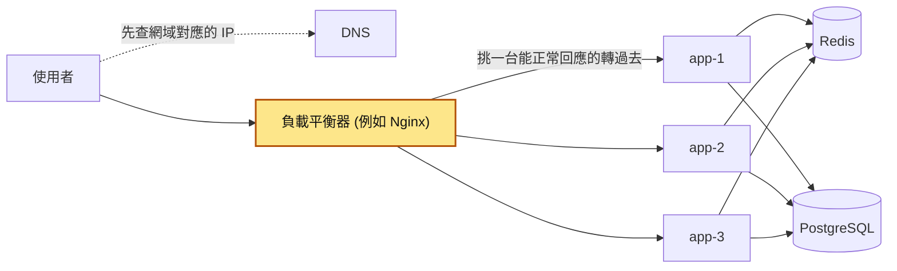
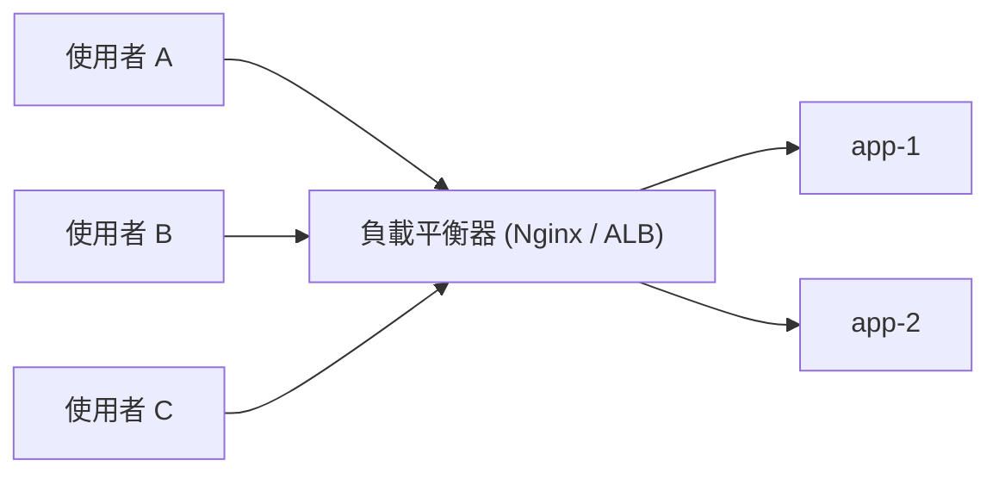
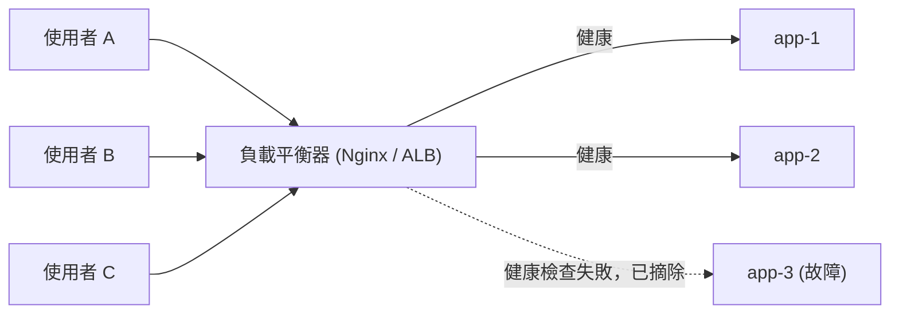
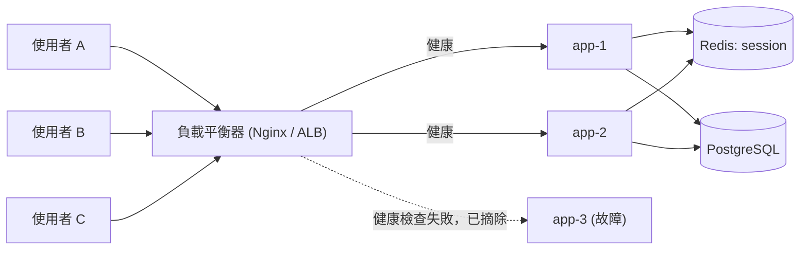
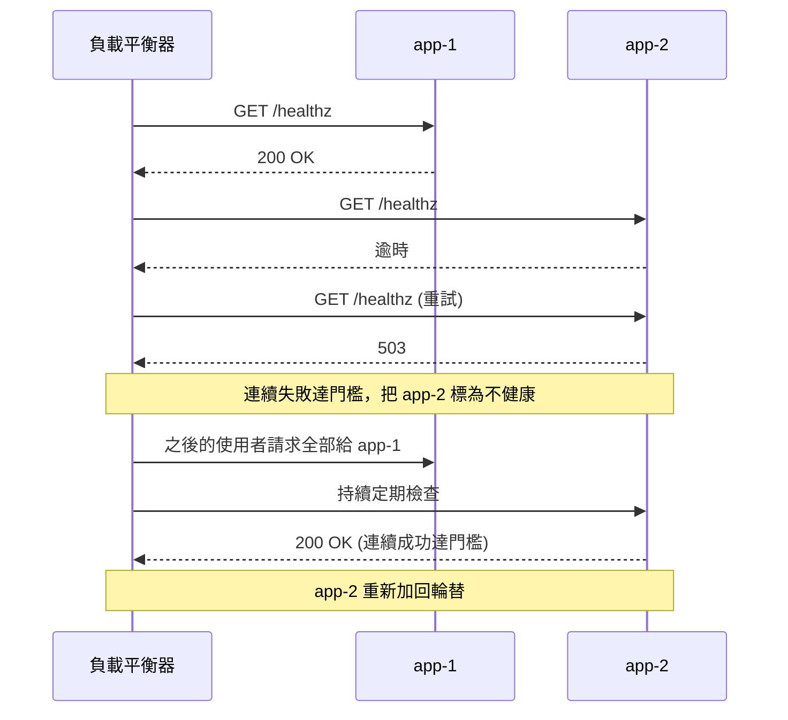

# 31｜負載平衡（Load Balancing）

> 負載平衡（load balancing）是在多台伺服器前面放一個負載平衡器，把進來的請求分給目前還能正常回應的那幾台，流量大時撐得住，壞一台服務也不會停。

**難度**：★★☆　**閱讀時間**：約 18 分鐘　**前置知識**：無（建議搭配 [水平擴展](32-水平擴展.md) 與 [健康檢查](49-健康檢查.md) 一起看）

## 為什麼要在意：一個具體的情境

以下是假設情境。你負責一個票務平台的訂票 API，用 Python（Flask + Gunicorn）寫，跑在 4 台 VM（VM-1 到 VM-4）上，前面放一台 Nginx 當負載平衡器，把使用者的請求分給這 4 台。為了好懂，先假設每台 Gunicorn 只開 1 個 worker 行程。

最早的工程師為了省事，把使用者的登入狀態（session）存在每台 VM 自己的記憶體裡。這樣使用者一換到別台就會被當成沒登入，所以他又在 Nginx 設了 `ip_hash`，讓同一個 IP 的請求固定送到同一台。這種「同一個使用者固定送到同一台」的做法叫 **sticky session**。

❌ 出事的寫法：

```python
# ❌ 出事的寫法：session 只存在這台 VM 的行程記憶體裡（省略 import）
SESSIONS: dict[str, dict] = {}

def login(user_id: int) -> str:
    sid = secrets.token_urlsafe(32)
    SESSIONS[sid] = {"user_id": user_id}  # 只有這一台記得
    return sid
```

```nginx
# ❌ 出事的寫法：同一個 IP 固定送到同一台
upstream app {
    ip_hash;
    server vm1:80;
    server vm2:80;
    server vm3:80;
    server vm4:80;
}
```

平常一切正常。某天熱門演唱會開賣，事情依序這樣發生：

| 時間 | 發生什麼 | VM-2 | VM-1、VM-3、VM-4 |
|---|---|---|---|
| T1 | 開賣。一家大公司的員工都從同一個對外 IP 連進來（公司裡很多台電腦共用一個對外 IP，這叫 NAT）。`ip_hash` 把這個 IP 的請求全部送到 VM-2 | CPU 衝到 100% | CPU 約 20% |
| T2 | VM-2 記憶體耗盡，行程被 OOM killer（Linux 在記憶體不夠時強制結束行程的機制）收掉 | 停止回應 | CPU 約 20% |
| T3 | Nginx 轉給 VM-2 的請求一直連不上，失敗次數到了門檻，Nginx 就把 VM-2 標成失敗，之後的請求改分給另外三台 | 不再收到請求 | 開始接手原本 VM-2 的使用者 |
| T4 | 原本固定在 VM-2 的使用者被分到 VM-3。VM-3 的 `SESSIONS` 裡沒有他們的 `sid`，全部當作沒登入 | 停止回應 | VM-3 回傳登入頁 |
| T5 | 這些使用者一再重新登入、重新整理，流量翻一倍，把 VM-3 也拖垮 | 停止回應 | VM-3 也停止回應 |
| T6 | 有些使用者剛好在 VM-2 掛掉的那一刻按下「付款」。第一筆訂單已經建好，但回應沒送回去；前端等到逾時，自動重試一次，請求送到另一台 | 第一筆訂單已寫進資料庫 | 又建了第二筆訂單 |

T1 還有一個加重因素：Nginx 的 `ip_hash` 對 IPv4 只取前三段（例如 `203.0.113.x` 整個網段算同一個 key），所以電信業者的大量行動網路使用者也會擠在同一台。

**使用者看到的**：搶票搶到一半跳回登入頁，重新登入後過一下又被登出；有些人的訂單列表出現兩筆一樣的訂單，款項也被扣了兩次。

**工程師看到的**：監控上 VM-2 的 CPU 是 100%，其他三台只有 20%，四條曲線差很多；接著 VM-2 的行程被 OOM killer 結束，Nginx 不再把請求送給它；然後登入 API 的請求量突然翻倍，VM-3 也倒下，形成連鎖故障。

**根因**：`SESSIONS[sid] = ...` 這一行讓 session 只存在一台 VM 上，只好用 `ip_hash;` 把使用者硬綁在同一台，負載平衡等於失效了一半；而 `ip_hash` 用 IP 決定分到哪台，遇到 NAT 和行動網路就嚴重不均。另外付款 API 沒有做冪等（同一個請求送兩次，結果跟送一次一樣），重試就重複建單、重複扣款（見 [冪等性](25-冪等性.md)）。

**怎麼修**：session 改存 Redis，任何一台都讀得到（〈常見地雷〉第 1 點有完整寫法）；拿掉 `ip_hash` 改用 `least_conn`（〈分流演算法〉那節會講）；付款 API 加上冪等鍵（idempotency key）。修完後同樣規模的開賣，四台的 CPU 曲線幾乎疊在一起。

## 全貌：它在系統裡的位置

這張圖看的是一個請求從使用者走到資料庫，中間經過哪些元件，負載平衡器站在哪裡：



負載平衡發生在黃色那一格：請求進來後，由它決定交給後面哪一台 app。它前面的 DNS 負責把網域換成 IP，DNS 也能做比較粗略的分流，在〈DNS 負載平衡〉那節會講。後面的 app 能隨便換一台處理，是因為 session 和資料都放在共用的 Redis 和 PostgreSQL，這件事在 [水平擴展](32-水平擴展.md) 會再展開；怎麼判斷一台 app 還能不能正常回應，則在 [健康檢查](49-健康檢查.md)。

## 生活比喻

比喻裡括號內的英文，是後面〈分流演算法〉會正式介紹的名稱，這裡先看懂動作就好。

負載平衡器就像大賣場的**結帳區引導員**。

客人推著車到結帳區，引導員看哪一櫃空著就指過去（least connections），或乾脆一櫃一櫃輪流指（round robin）。有一櫃收銀機壞了，引導員就不再往那裡指（健康檢查摘除）。新手收銀員手比較慢，就少分一點客人給他（weighted）。

這個比喻也能說明 sticky session 的問題：如果規定「會員卡登記在 3 號櫃的人，永遠只能去 3 號櫃結帳」，那 3 號櫃大排長龍時，其他櫃也幫不上忙；3 號櫃店員一請假，這些會員的「集點紀錄」就跟著不見了。好的做法是把集點紀錄放在總部系統（共用儲存），客人去哪一櫃都查得到。

**比喻失準的地方**：

- 引導員一次只處理一個客人。真實的負載平衡器有一種（後面會講的 L4）分的是「連線」：瀏覽器先跟伺服器建好一條連線，之後可以在同一條連線上送上千個請求，等於一個客人推著一千台推車進同一櫃。
- 賣場引導員看得到每一櫃排了幾個人；真實的 LB 通常只知道「自己」轉過去的連線數。如果前面有好幾台 LB 各自分流，它們彼此不知道對方的數字。
- 收銀機壞了看得出來；伺服器「半壞」（還能回應，但每個請求都慢 10 秒、或都回 500）就很難判斷，這要靠設計良好的健康檢查。

## 它是怎麼運作的

### 負載平衡器站在哪裡

一台伺服器的 CPU、記憶體和連線數都有上限，而且它一壞，服務就停了。負載平衡器要解決這兩件事：讓好幾台伺服器一起接流量，並自動跳過壞掉的那台。

你送出一個請求時，請求先到負載平衡器，它從後端清單裡挑一台，把請求轉過去：



負載平衡器會定期確認每一台還能不能正常回應，這叫健康檢查（做法在後面〈健康檢查與摘除壞節點〉）。下面這張多了 app-3，它的健康檢查失敗，負載平衡器把它從清單裡摘除，之後的請求只分給 app-1 和 app-2：



最後補上後端共用的 Redis 和 PostgreSQL，請求分到哪一台，讀到的 session 和資料都一樣：



後端的 app 彼此**可以互相替代**，因為狀態都放在共用的 Redis 和資料庫。只要做到這點，LB 把請求交給哪一台都可以，加機器也只是在清單上多加一台（見 [水平擴展](32-水平擴展.md)）。

### L4 和 L7 的差別

先補一個背景：HTTP 請求是跑在 TCP 連線上的。瀏覽器先跟伺服器建好一條 TCP 連線，再透過這條連線送出 HTTP 請求，一條連線上可以先後送很多個請求。

負載平衡器能依什麼分流，要看它讀得懂哪一層。網路分層常用的 OSI 模型裡，第 4 層是傳輸層（TCP/UDP，只管「從哪個 IP 和 port 連到哪個 IP 和 port」），第 7 層是應用層（HTTP，看得到網址路徑、標頭這些內容）。只看第 4 層的叫 L4 負載平衡，看到第 7 層的叫 L7 負載平衡。

下面表格最後一列的產品名稱先有印象就好。其中 Kubernetes 是管理大量容器的平台，它把一個執行中的應用程式容器稱為 Pod，Service 和 Ingress 是它內建的分流元件，在〈常見產品對照〉會再提。

| | L4 負載平衡 | L7 負載平衡 |
|---|---|---|
| 看得到什麼 | 來源/目的 IP、port | 完整 HTTP：方法、路徑、Host、標頭、cookie |
| 分流單位 | 一條 TCP 連線（或 UDP 流） | 一個 HTTP 請求 |
| 能做的事 | 純轉發，可支援任何 TCP/UDP 協定（資料庫、MQTT、遊戲） | 依路徑路由（`/api` 給 A、`/static` 給 B）、改寫標頭、TLS 終結、HTTP 層重試、依 cookie 黏著 |
| 效能 | 高、延遲低 | 要解析 HTTP，成本較高（但對一般 Web 服務通常不是瓶頸） |
| 代表產品 | AWS NLB、HAProxy `mode tcp`、Nginx `stream` 模組、Kubernetes Service（kube-proxy） | AWS ALB、Nginx `http` 模組、HAProxy `mode http`、Envoy、Kubernetes Ingress / Gateway |

**L4 有個新人很常踩的坑**：它是「連線建立時」決定要轉給誰，之後這條連線上所有的資料都走同一台。HTTP/1.1 的 keep-alive（一個請求送完不關連線，接著送下一個）、HTTP/2、gRPC（服務之間互相呼叫用的一種協定，跑在 HTTP/2 上）都會長時間重用同一條連線，所以如果用戶端只有少數幾個（例如服務 A 只開 3 條 gRPC 連線打服務 B），就算 B 有 10 台，也最多只有其中 3 台在忙。這時候要用 L7（能看懂 HTTP/2 的代理，例如 Envoy），或在用戶端自己做負載平衡。

L7 負載平衡器就是一個反向代理（reverse proxy，站在後端伺服器前面替它們收請求的程式）。表裡的 TLS 終結指的是由 LB 負責 HTTPS 的加解密，這個和 `X-Forwarded-For` 的細節放在 [反向代理](34-反向代理.md) 那篇。

### 分流演算法

LB 每收到一個請求（L4 是每一條新連線），都要決定交給哪一台。分流演算法就是做這個決定的規則。

**1. Round robin（輪流）**

依序 1、2、3、1、2、3……最簡單，也是 Nginx 和 ALB 的預設。前提是每台機器規格一樣、每個請求成本差不多。如果有些請求要 10 毫秒、有些要 10 秒，輪流分下去還是可能讓某台卡一堆慢請求。

**2. Weighted round robin（加權輪流）**

給每台一個權重，權重 3 的機器拿到的請求是權重 1 的三倍。用在機器規格不一樣，或**金絲雀部署**（canary）時只讓新版本吃 5% 流量。

**3. Least connections（最少連線）**

每次挑「目前正在處理中的連線數最少」的那台。請求處理時間差異大時（有些查詢很重），這比 round robin 公平得多，因為卡著慢請求的機器連線數會比較高，新請求自然會避開它。AWS ALB 有類似的「least outstanding requests」。

**4. Hash（雜湊）類**

用某個 key（來源 IP、使用者 ID、URL）算 hash，同一個 key 永遠到同一台。

- **IP hash**：同一個 IP 固定一台，常拿來做簡易的 sticky session。缺點如上面的事故：NAT 後面的大量使用者會擠在一起。
- **一般取餘數**：`hash(key) % N`。問題是 N 一變（加一台或掛一台），幾乎所有 key 都會換到別台。如果後端是快取，等於整片快取瞬間失效，可能引發 [快取踩踏](23-快取踩踏.md)。
- **一致性雜湊（consistent hashing）**：把節點和 key 都放到一個圓環上，key 順時針找到的第一個節點就是它的歸屬。加減一台時，只有大約 1/N 的 key 需要搬家。通常會讓每台實體節點在環上放很多個「虛擬節點」，分布才會均勻。這兩種做法差多少，後面〈動手看看〉的實驗二會用程式實際算給你看。

什麼時候需要 hash？**後端本身有「這筆資料在我這裡」的特性時**，例如快取節點、有本機狀態的 WebSocket 服務、分片的資料（見 [分散式快取](24-分散式快取.md)、[資料庫分片](19-資料庫分片.md)）。一般無狀態的 Web API 不需要也不應該用 hash。

### 健康檢查與摘除壞節點

後端隨時可能掛掉或卡住。LB 要先知道哪幾台還能接請求，才不會把請求送進壞掉的機器。它判斷後端死活有兩種方式：

- **主動健康檢查（active）**：LB 每隔幾秒主動打一個端點（例如 `GET /healthz`），連續失敗 N 次就摘除，連續成功 M 次再加回來。HAProxy 的 `check`、ALB 的 target group health check 都屬於這種。Kubernetes 的 readiness probe（判斷 Pod 能不能接流量的檢查）也是主動檢查，只是由每個節點上的 kubelet（Kubernetes 在每台機器上負責管理 Pod 的程式）去打，結果再反映到 Service 的後端清單。
- **被動健康檢查（passive）**：不另外發請求，而是觀察真實流量。轉過去的請求連線失敗或逾時，就記一次失敗，短時間內失敗太多就暫時不分給它。開源版 Nginx 的 `max_fails` / `fail_timeout` 就是這種（主動健康檢查的 `health_check` 指令是 NGINX Plus 商業版才有）。



健康檢查端點要檢查什麼、怎麼避免「資料庫一慢就把所有機器同時摘除」這種反效果，請看 [健康檢查](49-健康檢查.md)。部署時怎麼讓 LB 先停止送新請求、等手上的請求做完再關機，請看 [優雅關閉](48-優雅關閉.md)。

### Sticky session 的代價

sticky session（又叫 session affinity）是讓同一個使用者固定打到同一台，常見做法是 LB 發一個 cookie（ALB 的 `AWSALB`）或用 IP hash。它的代價：

1. **負載不均**：重度使用者黏在某台，LB 想平衡也平衡不了。
2. **單點遺失**：那台一掛或一重新部署，上面的使用者狀態全部不見。
3. **擴容效果打折**：新加的機器只會接到「新來的」使用者，舊使用者還黏在舊機器上，擴容後壓力沒有馬上分散。
4. **部署變慢**：要等黏著的使用者離開才能安全關機。

真正需要 sticky 的場景不多，例如 WebSocket 連線本來就綁在某台、或後端有昂貴的本機快取。其他情況下，先想辦法讓服務無狀態。

### 為什麼服務要無狀態

「無狀態」指的是**任何一個請求進來，任何一台機器都能處理，不需要依賴「上一個請求剛好也在我這台」**。系統還是有資料，只是不放在單台機器上。常見的「偷偷有狀態」：

| 偷藏的狀態 | 改放哪裡 |
|---|---|
| 登入 session 存在行程記憶體 | Redis，或改用簽章過的 token |
| 使用者上傳的檔案先存在本機 `/tmp` 再處理 | 物件儲存（S3 這類），或直接丟進 [訊息佇列](35-訊息佇列.md) 交給 worker |
| 速率限制計數器放在本機 dict | Redis（見 [速率限制](30-速率限制.md)） |
| 本機記憶體快取 | 可以有，但要能接受各台內容不一致，或改用共用快取 |
| 排程工作每台都跑 | 用分散式鎖或專門的排程服務（見 [工作排程](38-工作排程.md)） |

### DNS 負載平衡

另一種做法是在 DNS 層分流：同一個網域設多筆 A 紀錄（A 紀錄就是「這個網域對應到哪個 IPv4 位址」的設定），或用雲端 DNS 依地區、權重回不同 IP。下面會用到 TTL，它是 DNS 結果可以被快取多久的秒數。它常用在**最外層**（跨資料中心、跨區域），但有幾個限制要知道：

- **快取不受你控制**：DNS 結果會被作業系統、瀏覽器、ISP、程式語言的 runtime 快取。TTL 設 60 秒，實際上可能有用戶端好幾分鐘甚至更久都不換。
- **不知道後端死活**：一般 DNS 回應不會管那台機器還活不活著（雲端 DNS 有加健康檢查的版本，但切換速度仍受 TTL 限制）。
- **分配粗糙**：同一個 DNS 解析器後面可能有上萬個使用者，拿到的都是同一個 IP。

所以常見的架構是先由 DNS 把使用者分到某個區域，區域內再由 ALB 或 NLB 分流，最後進到 Kubernetes Service 或 Nginx，分給各個 Pod。

### 常見產品對照

> 第一次讀可以先跳過這一節，等遇到要挑 LB 產品或設定 Kubernetes 時再回來看。

- **Nginx**：最常見的 L7 反向代理兼負載平衡。`upstream` 區塊定義後端，預設 round robin，支援 `weight`、`least_conn`、`ip_hash`、`hash ... consistent`。開源版只有被動健康檢查。
- **HAProxy**：專業的負載平衡器，L4（`mode tcp`）、L7（`mode http`）都行，主動健康檢查、統計頁面都內建，演算法有 `roundrobin`、`leastconn`、`source` 等。
- **AWS ALB / NLB**：ALB 是 L7（HTTP/HTTPS/gRPC，可依路徑、Host 路由）；NLB 是 L4（TCP/UDP/TLS，超低延遲、可固定 IP）。GCP、Azure 也有對應產品，概念相同。
- **Kubernetes Service**：叢集內的 L4 負載平衡，由 kube-proxy 在每個節點設定轉發規則，readiness probe 沒過的 Pod 不會被放進後端清單。iptables（Linux 內建的封包轉發規則）模式下每次隨機挑一個後端，所以分配不會剛好輪流。要做 L7 路由用 Ingress 或 Gateway API。

## 動手看看

### 實驗一：用 Nginx 分流到三台後端，再弄壞一台

用 `traefik/whoami` 這個小映像檔當後端，它會回傳自己的主機名稱，方便看請求被分到哪裡。

建立 `nginx.conf`：

```nginx
# nginx.conf：最小可執行的負載平衡設定
events {}

http {
    upstream app {
        # 預設演算法是 round robin
        # 想試別的演算法，把下面這行取消註解：
        # least_conn;

        # max_fails / fail_timeout 是被動健康檢查：
        # 10 秒內失敗 2 次，就在接下來 10 秒內不分流量給它
        server app1:80 max_fails=2 fail_timeout=10s;
        server app2:80 max_fails=2 fail_timeout=10s;
        server app3:80 max_fails=2 fail_timeout=10s;   # 沒寫 weight 就是預設 1
    }

    server {
        listen 80;
        location / {
            proxy_pass http://app;
            # 連不上就快點放棄，改送下一台（預設 60 秒太久，實驗用調短）
            proxy_connect_timeout 1s;
            # 回應裡加一個標頭，看這次實際轉給哪個 upstream（用 curl.exe -si 才看得到標頭）
            add_header X-Upstream $upstream_addr always;
        }
    }
}
```

啟動（在 pwsh 執行，注意 `${PWD}` 是 pwsh 的寫法）：

```powershell
# 建立一個 docker 網路，讓 nginx 能用容器名稱找到後端
docker network create lbdemo

# 啟動三台後端
docker run -d --name app1 --network lbdemo traefik/whoami
docker run -d --name app2 --network lbdemo traefik/whoami
docker run -d --name app3 --network lbdemo traefik/whoami

# 啟動 nginx，把剛寫的設定檔掛進去
docker run -d --name lb --network lbdemo -p 8080:80 `
  -v "${PWD}/nginx.conf:/etc/nginx/nginx.conf:ro" nginx:1.27

# 連打 9 次，只印出 Hostname 那一行
1..9 | ForEach-Object { (curl.exe -s http://localhost:8080 | Select-String '^Hostname') }
```

**預期看到**：三個不同的 Hostname（容器 ID）輪流出現，每個大約三次。

接著弄壞一台：

```powershell
docker stop app2
1..9 | ForEach-Object { (curl.exe -s http://localhost:8080 | Select-String '^Hostname') }
```

**預期看到**：一開始可能有一兩個請求稍微慢一點（Nginx 在試 app2、1 秒逾時後改送下一台，`proxy_next_upstream` 預設在連線錯誤和逾時時會換下一台），之後只剩兩個 Hostname 輪流出現。使用者幾乎沒感覺，這就是「摘除」的效果。

再試試看（先 `docker start app2` 把它救回來。開源版 Nginx 啟動時就要解析 `upstream` 裡的主機名稱，app2 沒在跑的話，`docker restart lb` 會因為 `host not found in upstream` 起不來）：

- 把 `app1` 那行加上 `weight=3`，`docker restart lb` 後再打，會看到 app1 出現的次數明顯比較多。
- 換成 `ip_hash;`，你從本機打的請求會全部落在同一台，這就是 sticky 的樣子。

收拾：

```powershell
docker rm -f lb app1 app2 app3
docker network rm lbdemo
```

### 實驗二：取餘數 vs 一致性雜湊，加一台機器時有多少 key 要搬家

這段純 Python，不需要任何套件：

```python
# consistent_hash_demo.py
import bisect
import hashlib


def h(s: str) -> int:
    """把字串轉成整數雜湊值（md5 只是拿來分散，不是為了安全）"""
    return int(hashlib.md5(s.encode()).hexdigest(), 16)


def modulo_pick(key: str, nodes: list[str]) -> str:
    """一般取餘數：hash(key) % N"""
    return nodes[h(key) % len(nodes)]


class ConsistentHashRing:
    def __init__(self, nodes: list[str], vnodes: int = 100):
        # 每台實體節點在環上放 vnodes 個虛擬節點，讓分布更均勻
        self.ring: list[tuple[int, str]] = sorted(
            (h(f"{node}#{i}"), node) for node in nodes for i in range(vnodes)
        )
        self.hashes = [hv for hv, _ in self.ring]

    def pick(self, key: str) -> str:
        # 順時針找第一個比 hash(key) 大的虛擬節點，超過尾端就繞回開頭
        idx = bisect.bisect(self.hashes, h(key)) % len(self.ring)
        return self.ring[idx][1]


keys = [f"user:{i}" for i in range(100_000)]
before = ["cache-1", "cache-2", "cache-3", "cache-4"]
after = before + ["cache-5"]  # 擴容：加一台

moved_mod = sum(modulo_pick(k, before) != modulo_pick(k, after) for k in keys)

ring_before, ring_after = ConsistentHashRing(before), ConsistentHashRing(after)
moved_ring = sum(ring_before.pick(k) != ring_after.pick(k) for k in keys)

print(f"取餘數：{moved_mod / len(keys):.1%} 的 key 換了節點")
print(f"一致性雜湊：{moved_ring / len(keys):.1%} 的 key 換了節點")
```

```powershell
python consistent_hash_demo.py
```

**預期看到**：取餘數大約 80% 的 key 換了節點（4 台變 5 台，只有剛好同餘的才留在原地）；一致性雜湊大約 20%（理論值 1/5），實際數字會因虛擬節點數量有些誤差。如果這些 key 是快取，取餘數等於八成快取瞬間失效，一致性雜湊只失效兩成。

## 常見地雷

### 1. 把狀態存在單台機器上，再用 sticky session 硬撐

❌ **錯誤做法**：

```python
# ❌ 錯誤示範：session 存在行程記憶體，換一台機器就不見了
import secrets

SESSIONS: dict[str, dict] = {}

def login(user_id: int) -> str:
    sid = secrets.token_urlsafe(32)
    SESSIONS[sid] = {"user_id": user_id}
    return sid
```

**為什麼錯**：Gunicorn 開 4 個 worker 就有 4 份互不相通的 dict，更別說 4 台機器。為了讓它「看起來能用」只好開 sticky session，結果帶來負載不均和單點遺失。

✅ **正確做法**：

```python
# ✅ 正確寫法：session 放 Redis，任何一台機器、任何一個 worker 都讀得到
import json
import secrets

import redis

r = redis.Redis(host="redis", port=6379, decode_responses=True)
SESSION_TTL = 60 * 60 * 24  # 一天

def login(user_id: int) -> str:
    sid = secrets.token_urlsafe(32)
    r.set(f"session:{sid}", json.dumps({"user_id": user_id}), ex=SESSION_TTL)
    return sid

def get_session(sid: str) -> dict | None:
    raw = r.get(f"session:{sid}")
    return json.loads(raw) if raw else None
```

### 2. L4 負載平衡配上長連線，以為有分流

❌ **錯誤做法**：服務 A 透過 Kubernetes Service（L4）打服務 B 的 gRPC，B 擴到 10 個 Pod，監控卻顯示只有兩三個 Pod 在忙。

**為什麼錯**：gRPC 跑在 HTTP/2 上，一條連線會一直重用。L4 只在連線建立時分一次，之後所有請求都走同一個 Pod。新擴出來的 Pod 也分不到既有連線的流量。

✅ **正確做法**：使用能看懂 HTTP/2 的 L7 代理（Envoy、service mesh；service mesh 是在每個服務旁邊各放一個代理，由代理負責分流），或在用戶端做負載平衡（gRPC 的 client-side load balancing 搭配 headless Service；headless Service 不幫你轉發，而是把所有 Pod 的 IP 直接交給用戶端自己挑），或至少設定連線的最長存活時間，讓用戶端定期重連、重新分配。

### 3. 健康檢查只回「我還活著」，或檢查得太深

❌ **錯誤做法**：`/healthz` 直接 `return "ok"`，行程卡死在資料庫連線池耗盡時照樣回 200；或反過來，`/healthz` 去查資料庫，資料庫慢一下，所有機器同時被摘除，整個服務直接 503。

**為什麼錯**：前者讓 LB 一直把流量送給半殘的機器；後者讓共用相依的小抖動放大成全面停擺。

✅ **正確做法**：分清楚 liveness（要不要重啟）和 readiness（要不要接流量），readiness 只檢查「這台自己能不能服務」，共用相依的狀態用監控和告警處理。細節見 [健康檢查](49-健康檢查.md)。

### 4. 部署時直接把機器關掉

❌ **錯誤做法**：滾動部署（一台一台換成新版本）時直接 `kill -9` 舊行程，或容器一收到 SIGTERM（系統通知行程「請準備結束」的訊號）就馬上退出。

**為什麼錯**：LB 還不知道這台要下線（健康檢查有間隔），仍會送新請求過來；手上正在處理的請求也被切斷，使用者看到 502。

✅ **正確做法**：先讓 LB 停止送新流量（ALB 的 deregistration delay，讓 LB 停送新請求後再等一段時間才真的切斷；Kubernetes 的 readiness 失敗加上 `preStop` 等待，`preStop` 是容器關閉前先執行的步驟），再讓應用程式把手上的請求做完才退出。AWS ALB 的 deregistration delay 預設 300 秒，請依你的最長請求時間調整。詳見 [優雅關閉](48-優雅關閉.md)。

### 5. 讓 LB 自動重試非冪等的請求

❌ **錯誤做法**：為了「提高成功率」，在 Nginx 設 `proxy_next_upstream error timeout non_idempotent;`，或在 LB 上對所有請求開啟逾時重試。

**為什麼錯**：後端可能已經收到 POST、建好訂單，只是回應太慢被判逾時；LB 再送給另一台，就變成兩筆訂單。Nginx 預設**不會**把已經送出的 POST、PATCH、LOCK 請求轉給下一台，就是為了避免這件事。

✅ **正確做法**：維持預設；真的需要重試的寫入 API，先做好冪等鍵（見 [冪等性](25-冪等性.md)），重試策略交給有能力判斷的用戶端（見 [重試機制](26-重試機制.md)）。

### 6. 用 IP 當 hash key，或從錯的地方拿使用者 IP

❌ **錯誤做法**：用 `ip_hash` 做分流；或在後端程式直接讀 TCP 連線的來源 IP 當作使用者 IP，拿來做速率限制或稽核。

**為什麼錯**：NAT、公司出口、行動網路會讓大量使用者共用一個 IP（Nginx `ip_hash` 對 IPv4 還只取前三段），分布會非常不均。至於來源 IP，經過 L7 LB 之後後端看到的都是 LB 自己的 IP，所有人會被當成同一個使用者，一起被速率限制擋下來。

✅ **正確做法**：無狀態服務用 round robin 或 least connections；真的要 hash，用使用者 ID 這類分布均勻的 key。要拿真實 IP，從 `X-Forwarded-For` 讀，並且**只信任你自己 LB 加上去的那一段**，細節見 [反向代理](34-反向代理.md)。

### 7. 以為 DNS 改了就馬上切過去

❌ **錯誤做法**：機器要下線，改掉 DNS 紀錄後馬上關機。

**為什麼錯**：用戶端和中間的解析器會快取舊紀錄，TTL 到期前（甚至之後，有些 runtime 會自己快取更久）還是有人連舊 IP。

✅ **正確做法**：事先把 TTL 調低、等舊 TTL 過期，改完後觀察舊機器的流量真的歸零才關機。叢集內部的切換交給 LB 和健康檢查，不要靠 DNS。

## 重點整理

- 負載平衡器（LB）做兩件事：**分流**（把請求分給多台後端）和**摘除**（健康檢查失敗的那台不再分給它）。只會分流、不會摘除，壞一台還是會有使用者出錯。
- **L4** 只看 IP 和 port，以「一條 TCP 連線」為單位分一次；**L7** 看得懂 HTTP，以「一個請求」為單位分，可以依路徑、`Host`、cookie 分流。用戶端很少、又一直重用同一條連線（keep-alive、HTTP/2、gRPC）時，L4 會分不均。
- 分流演算法先記四個：round robin（輪流）、weighted（依權重）、least connections（給目前處理中連線最少的）、hash（同一個 key 固定到同一台）。一般 Web API 用 round robin 或 least connections 就夠；後端是快取這種「資料在我這台」的服務才用 hash，而且要用一致性雜湊，加減機器時才不會大部分 key 都換位置。
- 想讓 LB 隨便把請求丟給任何一台，服務本身要**無狀態**：session、上傳檔、計數器不要放在單台機器的記憶體或本機磁碟，改放 Redis、資料庫或物件儲存。
- **sticky session 只能當過渡方案**：它會造成負載不均，那台機器一掛，固定在上面的使用者狀態就一起不見，像開頭情境裡的大批登出。

## 新人必知清單

### 一定要會（基本功）

- [ ] 說得出 L4 和 L7 的差別，特別是「L4 分連線、L7 分請求」，以及它對長連線（keep-alive、HTTP/2、gRPC）的影響
- [ ] 知道 round robin、weighted、least connections、hash 各適合什麼情況，以及無狀態 API 為什麼不需要 hash
- [ ] 能判斷自己寫的服務是不是無狀態：session、上傳檔、計數器、排程有沒有偷藏在單台機器上
- [ ] 知道健康檢查會把壞節點摘除，以及主動、被動兩種檢查的差別
- [ ] 知道 sticky session 的代價，不會把它當成狀態問題的解法
- [ ] 經過 LB 之後，要從 `X-Forwarded-For` 拿使用者 IP，而且只信任自家 LB
- [ ] 部署時要先摘流量、再關機，不然會有 502

### 知道有這回事就好

- 一致性雜湊與虛擬節點的原理，以及它為什麼對快取叢集重要
- DNS 負載平衡、GeoDNS、Anycast 用在跨區域的最外層
- Kubernetes Service 由 kube-proxy 實作，iptables 模式是隨機挑選；L7 路由走 Ingress 或 Gateway API
- 用戶端負載平衡（client-side load balancing）與 service mesh（Envoy、Istio 等）
- 慢啟動（slow start）：新加入的機器先給少量流量，等它暖機再加量
- LB 本身也要高可用性，不能變成新的單點故障（雲端 LB 已經幫你處理；自架要做主備）

### 先不用管（等你遇到再學）

- Maglev、P2C（power of two choices）、EWMA 這類進階演算法
- Direct Server Return（DSR）、ECMP 等網路層技巧
- 自己調 IPVS、eBPF（例如 Cilium）的負載平衡細節
- 全域流量管理與多區域容災切換的完整設計

## Code Review 時可以問的問題

1. 這個改動有沒有在行程記憶體或本機磁碟存放「下一個請求還要用」的東西？換一台機器處理下一個請求，還會對嗎？
2. 這個新的健康檢查端點檢查了什麼？它會不會因為共用的資料庫或第三方服務變慢，就讓所有機器同時被摘除？
3. LB 或 HTTP 用戶端有沒有對 POST 之類的寫入請求開啟自動重試？那個 API 是冪等的嗎？
4. 這裡要拿使用者 IP，是從哪裡讀的？如果是 `X-Forwarded-For`，有沒有只信任自家 LB 那一段？
5. 這個服務之間的呼叫走 L4 還是 L7？是長連線（gRPC、HTTP/2）嗎？擴容後新機器真的分得到流量嗎？
6. 為什麼要開 sticky session（或 `ip_hash`）？能不能改成把狀態移到共用儲存？

## 情境演練

**Q1. 你們要在 AWS 上架一個入口：`/api/*` 送到 API 伺服器群，`/static/*` 送到靜態檔案伺服器群，`admin.example.com` 這個 `Host` 再分給另一組服務。同事問要用 NLB 還是 ALB，你怎麼判斷？**

<details markdown="1"><summary>看答案</summary>

選 ALB。這三條規則都要讀 HTTP 的路徑和 `Host` 標頭，只有 L7 看得到。L4 只看 IP 和 port，以 TCP 連線（或 UDP 流）為單位分流，不解析內容，NLB 屬於這種，所以做不到；L7 看得懂 HTTP，以每個請求為單位分流，ALB 屬於這種。同樣只有 L7 做得到的還有依 cookie 做 sticky session、在 LB 上改寫或加入 HTTP 標頭。

</details>

**Q2. 你負責的一組 API 伺服器，大部分請求 20 毫秒就回應，但報表匯出要 30 秒。LB 用 round robin 和用 least connections，各會怎樣？你會選哪個？**

<details markdown="1"><summary>看答案</summary>

Round robin 不管每台機器現在多忙，照順序分下去，某台剛好連續拿到幾個報表請求時，還是會繼續收新請求，那台的延遲就會飆高。Least connections 會挑目前處理中連線最少的機器，卡著報表請求的那台連線數高，新請求自然會避開它，整體比較平均。更根本的做法是把報表匯出改成非同步，丟給 [背景工作者](37-背景工作者.md) 處理，不要讓它佔著 Web 伺服器。

</details>

**Q3. 你們的快取叢集有 4 台，用 `hash(key) % 4` 決定 key 放哪台。下週要擴成 5 台，直接改成 `% 5` 上線會發生什麼事？怎麼改善？**

<details markdown="1"><summary>看答案</summary>

N 從 4 變 5，`hash % N` 的結果幾乎全變，大約 80% 的 key 會被分到不同的節點，等於八成快取同時失效，所有請求一起打到資料庫，很可能造成 [快取踩踏](23-快取踩踏.md)。改用一致性雜湊（搭配虛擬節點），加一台時只有大約 1/5 的 key 需要搬家，其他 key 仍然命中原本的節點。

</details>

**Q4. 你們把服務搬上 Kubernetes，服務 A 透過 ClusterIP Service 用 gRPC 呼叫服務 B。B 從 3 個 Pod 擴到 12 個，但 B 的 p99 延遲（把請求依回應時間排序，第 99% 那一個的延遲，代表最慢那一批請求）沒有改善，監控顯示新的 9 個 Pod 幾乎沒流量。可能的原因是什麼？怎麼處理？**

<details markdown="1"><summary>看答案</summary>

Kubernetes ClusterIP Service 是 L4 負載平衡，只在 TCP 連線建立時選一次後端。gRPC 跑在 HTTP/2 上，A 的每個 Pod 通常只開少數幾條長連線並且一直重用，所以這些連線還是黏在原本那 3 個 Pod 上，新 Pod 分不到既有連線的請求。

處理方式：（1）改用懂 HTTP/2 的 L7 代理（Envoy、service mesh），以請求為單位分流；（2）用 headless Service 讓 A 拿到所有 Pod IP，在 gRPC 用戶端開 round robin 的用戶端負載平衡；（3）至少在 B 的伺服器端設定連線最長存活時間，讓用戶端定期重連、重新分配。

</details>

**Q5. 同事說：「我們用 sticky session 就好，不用把 session 搬到 Redis，反正使用者都會固定在同一台。」你會怎麼回應？**

<details markdown="1"><summary>看答案</summary>

sticky session 只解決了「平常」的情況，以下情況都會出問題：（1）那台機器掛掉或重新部署，黏在上面的使用者 session 全部不見，會被強制登出；（2）重度使用者或 NAT 後面的大量使用者黏在同一台，造成負載不均，LB 想平衡也平衡不了；（3）擴容時新機器只接到新使用者，舊使用者的壓力不會馬上分散；（4）部署要等黏著的使用者離開才能安全關機。把 session 放到 Redis 之後，任何一台都能處理任何請求，上面這些問題一次消失，成本只是一次 Redis 查詢。

</details>

## 相關主題

- [水平擴展](32-水平擴展.md)：負載平衡是水平擴展的前提，沒有它，加機器也沒人分流量給新機器。
- [反向代理](34-反向代理.md)：L7 負載平衡器本身就是反向代理，TLS 終結與 `X-Forwarded-For` 的細節在那篇。
- [健康檢查](49-健康檢查.md)：LB 靠健康檢查決定要不要摘除節點，端點怎麼設計決定了摘除準不準。
- [優雅關閉](48-優雅關閉.md)：部署時如何先摘流量、再關機，避免 502。
- [冪等性](25-冪等性.md)：LB 或用戶端重試時，寫入 API 不冪等就會重複執行。
- [分散式快取](24-分散式快取.md)：一致性雜湊最典型的應用場景。

## 延伸閱讀

- Nginx 官方文件：[Using nginx as HTTP load balancer](https://nginx.org/en/docs/http/load_balancing.html)，以及 [ngx_http_upstream_module](https://nginx.org/en/docs/http/ngx_http_upstream_module.html)（`weight`、`max_fails`、`least_conn`、`hash` 等參數的正式說明）
- HAProxy 官方設定手冊（Configuration Manual），`balance` 與 `check` 相關章節
- Kubernetes 官方文件：[Service](https://kubernetes.io/docs/concepts/services-networking/service/) 與 [Virtual IPs and Service Proxies](https://kubernetes.io/docs/reference/networking/virtual-ips/)
- AWS 官方文件：Elastic Load Balancing 使用者指南（Application Load Balancer 與 Network Load Balancer 各自的章節）
