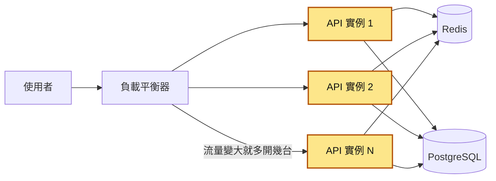
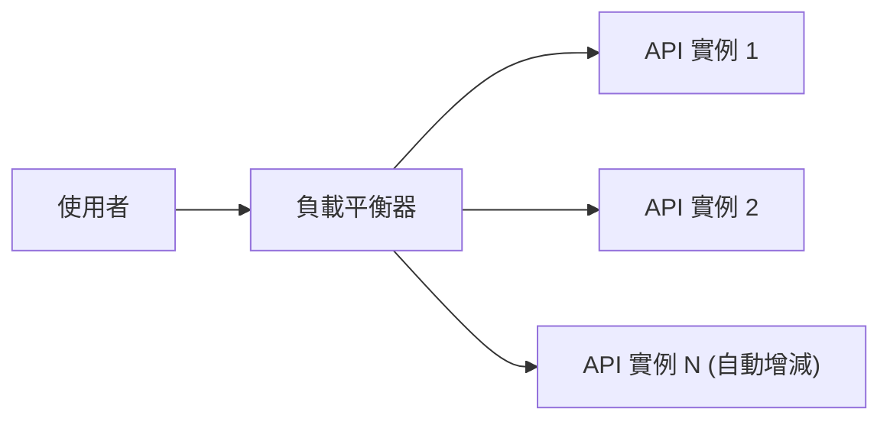
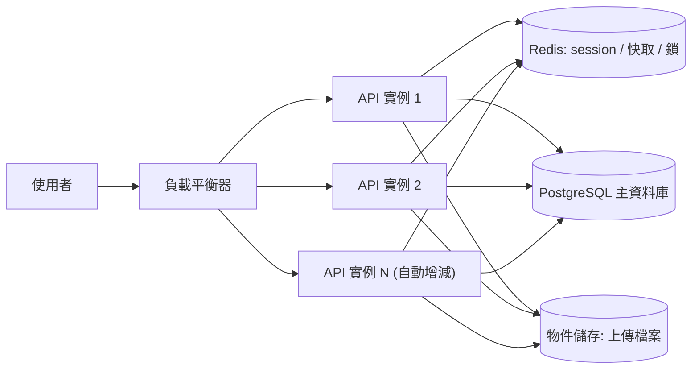
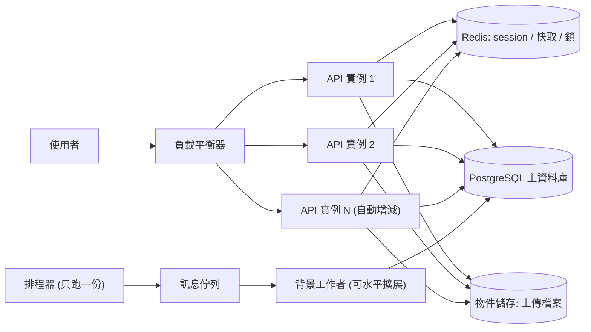
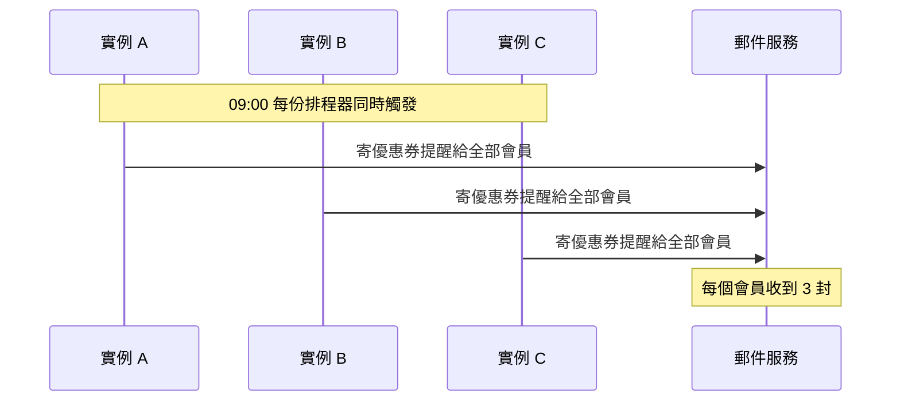

# 32｜水平擴展（Horizontal Scaling）

> 水平擴展（horizontal scaling）是流量變大時，把同一份程式多跑幾份（每一份叫一個「實例」），由負載平衡器把請求分給它們一起處理。

**難度**：★★☆　**閱讀時間**：約 18 分鐘　**前置知識**：[負載平衡](31-負載平衡.md)、[連線池](08-連線池.md)

## 為什麼要在意：一個具體的情境

以下是假設情境。你負責一個線上課程平台，原本只有一台 VM，跑 Gunicorn 開 2 個 worker（worker 是同一台機器上同時在跑的 Python 行程，每個行程有自己的一份記憶體），用了三年都沒事。年底大促銷前，團隊判斷一台撐不住，就在前面放一台負載平衡器，後面開成 4 台一模一樣的 VM（VM-A 到 VM-D），負載平衡器輪流把請求分給它們。壓測只打了不用登入的 `/courses` 列表頁，很順，就上線了。

程式裡有這三段，單機時從來沒出過問題：

```python
# ❌ 出事的寫法（三段片段，省略 import）
SESSIONS = {}  # 登入 session 只存在這個行程的記憶體裡

def login(user_id):
    sid = secrets.token_urlsafe(32)
    SESSIONS[sid] = {"user_id": user_id}
    return sid

# 使用者上傳的大頭貼，寫進這台 VM 的本機硬碟
file.save(f"/var/app/uploads/{filename}")

# web 程式啟動時就啟動 APScheduler 排程器，每個 worker 各一份
scheduler = BackgroundScheduler()
scheduler.add_job(send_coupon_emails, "cron", hour=9)
scheduler.start()
```

促銷當天，事情依序這樣發生：

| 時間 | 發生什麼 | 結果 |
|---|---|---|
| T1 | 早上 09:00，4 台 × 2 個 worker = 8 份排程器同時觸發，每份都把優惠券提醒寄給全部會員 | 每個會員收到 8 封一樣的信 |
| T2 | 一位使用者登入，請求分到 VM-A，`SESSIONS[sid]` 寫進 VM-A 這個 worker 的記憶體 | 只有 VM-A 的這個 worker 記得這個 `sid` |
| T3 | 他點下一頁，負載平衡器輪到 VM-B。VM-B 的 `SESSIONS` 裡沒有這個 `sid` | VM-B 當作沒登入，導回登入頁 |
| T4 | 他重新登入後上傳大頭貼，這個請求落在 VM-C，檔案存進 VM-C 的 `/var/app/uploads` | 只有 VM-C 的硬碟上有這張圖 |
| T5 | 頁面載入大頭貼，請求分到 VM-D，VM-D 的硬碟上沒有這個檔案 | 回 404，圖片破掉；重新整理幾次剛好分到 VM-C 才出現 |
| T6 | 下午流量更大，手動加到 10 台。每個 worker 的連線池（預先開好、重複使用的一組資料庫連線）上限 15 條，10 台 × 2 個 worker × 15 = 300 條 | PostgreSQL 的 `max_connections` 還是預設的 100 |
| T7 | 尖峰時各個 worker 把連線開到上限，總數超過 100 | PostgreSQL 拒絕新連線，整站掛掉 |

**使用者看到的**：剛登入、點下一頁又要重新登入；大頭貼時有時無；一早收到 8 封「優惠券即將到期」信；到了下午整站打不開。

**工程師看到的**：郵件服務商因為發信量暴增，把網域暫時列入限制；下午所有實例的日誌開始出現 `FATAL: sorry, too many clients already`。如果應用程式不是用超級使用者連線，會更早看到 `FATAL: remaining connection slots are reserved for roles with the SUPERUSER attribute`，因為最後幾條連線保留給超級使用者。加機器不但沒有變快，整站還掛了（細節見[連線池](08-連線池.md)）。

**根因**：程式碼裡藏著「全世界只有我這一台、這一個行程」的假設。`SESSIONS = {}` 和 `file.save(...)` 把狀態留在單一行程、單一台機器上；`scheduler.start()` 寫在 web 程式裡，有幾個 worker 就跑幾份；每個 worker 各開一組連線池，連線數跟著機器數用乘法長上去。單機時這些假設都成立，所以三年來沒人發現。

**怎麼修**：要水平擴展，得先把這些假設從程式碼裡拿掉，再加機器。session 改放 Redis、上傳檔改放物件儲存（〈無狀態：把狀態搬出去〉會講）；排程拆出去只跑一份（〈排程任務：每台都會跑一次〉會講）；加機器前先算連線總數（〈瓶頸會搬家〉會講）。

## 全貌：它在系統裡的位置

這張圖看的是一個請求從使用者走到資料庫，中間經過哪些元件，水平擴展改變的是哪一層：



水平擴展發生在黃色那一排 API 實例：流量變大就多開幾台，變小就關掉幾台。它前面的負載平衡器負責把請求分給這些實例，見 [負載平衡](31-負載平衡.md)；它後面的 Redis 和 PostgreSQL 通常不會跟著變多，所以加機器之後最先撐不住的常常是資料庫，相關的有 [連線池](08-連線池.md) 和 [讀取副本](17-讀取副本.md)。另一條路是把單台機器換大，見 [垂直擴展](33-垂直擴展.md)。

## 生活比喻

水平擴展就像**連鎖便當店開分店**。

一間店生意太好，你可以把店面打通、換更大的爐子（垂直擴展），但店面再大也有極限。另一個做法是在附近多開幾間一模一樣的分店，客人由門口的帶位員（[負載平衡器](31-負載平衡.md)）分到人比較少的那間（水平擴展）。

要能這樣做，有一個前提：**每間分店都要能服務任何一位客人**。如果某位熟客的集點卡只記在 A 店的筆記本上，他今天被帶到 B 店，點數就不見了。所以集點紀錄要放在總部的系統（Redis／資料庫），不能放在各店的抽屜裡（本機記憶體、本機硬碟）。

還有兩件事也對得上：

- 分店開再多，**中央廚房只有一間**（資料庫）。分店越多，打給中央廚房的電話就越多，最後是中央廚房先撐不住。
- 總部規定「每天早上九點打電話給會員提醒優惠券到期」。如果每間分店都照做，會員一早會接到五通一樣的電話（排程重複執行）。

**比喻失準的地方**：開分店要租店面、招人，要花好幾個月；雲端開一台新實例只要幾十秒到幾分鐘，關掉也很快。正因為來來去去這麼快，實例隨時可能被關掉，所以除了不能有狀態，關掉之前還要把手上的請求做完（[優雅關閉](48-優雅關閉.md)）。這點便當店不太需要擔心。

## 它是怎麼運作的

### 整體架構

一台機器的 CPU 和記憶體有上限，流量超過了，請求就只能排隊或逾時。水平擴展用多台實例分擔流量（英文也叫 scale out；把單台機器換大則是垂直擴展，scale up），但前提是這些實例要能互相替代，負載平衡器才能把請求隨便分。

你送出一個請求時，負載平衡器先挑一台 API 實例處理：



那台實例需要的 session、快取、資料、上傳檔案，都從後面的共用元件讀寫，所以換哪一台處理，結果都一樣。這張多了共用元件：



定時要做的工作不放在 API 實例裡。這張再多了只跑一份的排程器，它把工作丟進訊息佇列（讓工作排隊等著被處理的地方），交給背景工作者（從佇列拿工作出來做的程式）處理：



API 實例**彼此不直接溝通、不交換資料**，所有需要「大家都看得到」的狀態都放在後面的共用元件。這樣負載平衡器把請求交給哪一台都沒差，要加一台、關一台也都不用通知別台。

### 無狀態：把狀態搬出去

「無狀態」指的是**應用程式這一層不保存請求和請求之間的狀態**。系統還是有狀態，只是搬到所有實例共用的地方：

| 狀態 | ❌ 放在實例本身 | ✅ 搬到哪裡 |
|---|---|---|
| 登入 session | 行程記憶體裡的 dict、本機檔案 | Redis（伺服器端 session），或簽章過的 token／cookie（JWT 之類） |
| 使用者上傳的檔案 | 本機硬碟 `/uploads` | 物件儲存（S3、GCS 等），資料庫只存檔案路徑 |
| 快取 | 行程內的 dict／`lru_cache` | Redis（見[分散式快取](24-分散式快取.md)）；本機快取只放「各台不一致也沒差」的東西 |
| 計數器、限流額度 | 全域變數 | Redis `INCR`（見[速率限制](30-速率限制.md)） |
| 簽章用的金鑰 | 每台啟動時隨機產生 | 環境變數或金鑰管理服務，所有實例共用同一把 |
| 排程「今天跑過沒」 | 行程裡的旗標 | 資料庫或 Redis 的紀錄 |

session 的兩種做法各有代價。存 Redis 的話可以隨時把某人踢下線，但每個請求都要多查一次 Redis；用 JWT（JSON Web Token，把使用者是誰和一段簽章一起放進 token，伺服器驗過簽章就能信任內容）的話完全不用查，但 token 簽出去以後，在過期之前很難撤銷。**這兩種都可以水平擴展，存在行程記憶體裡的不行**。

> 那「sticky session」呢？讓負載平衡器把同一個使用者固定送到同一台，確實能讓舊程式先撐著。但那台一重啟或被縮掉，上面的人還是會被登出，流量也容易分配不均。它只能當過渡方案，細節見[負載平衡](31-負載平衡.md)。

### 自動擴展：依什麼指標加減機器

手動加機器太慢，正式環境通常交給自動擴展（autoscaling），依指標自動增減實例。先認識幾個詞：Kubernetes 是管理大量容器的平台，它把一個執行中的實例叫做 Pod，同一個服務跑幾個 Pod 叫做副本數（replicas）。Kubernetes 的 HPA（Horizontal Pod Autoscaler）就是負責自動調整副本數的元件，設定裡的 `minReplicas`、`maxReplicas` 是副本數的下限和上限。它用這個公式算出要幾個副本：

```
期望副本數 = ceil( 目前副本數 × 目前指標值 / 目標指標值 )
```

例如目前 4 個 Pod、平均 CPU 使用率 90%、目標 60%，就會算出 ceil(4 × 90 / 60) = 6 個。

常見的指標怎麼選：

| 指標 | 適合 | 注意 |
|---|---|---|
| CPU 使用率 | 計算密集的 API | 大部分時間在等資料庫、等外部 API 的服務，CPU 可能一直很低，永遠不會觸發擴展 |
| 每秒請求數／同時處理中的請求 | 一般 web API | 要另外接自訂指標（custom metrics） |
| 佇列長度 | [背景工作者](37-背景工作者.md) | 佇列積越多就開越多 worker，是最直覺的指標；常用 KEDA 這類工具接 |

還有幾個一定要知道的行為：

- **HPA 的 CPU 使用率是相對於 `resources.requests` 算的**。`resources.requests` 是 Pod 設定裡宣告「我需要多少 CPU、記憶體」的欄位。Pod 沒設 requests，CPU 使用率就算不出來，HPA 也不會動。
- **縮容比擴容保守**。HPA 預設的縮容穩定期是 300 秒，避免流量一抖動就開開關關。
- **新實例不是瞬間就能接流量**。開機器、拉映像檔、程式啟動、暖機都要時間。如果流量是瞬間衝上來的（整點開賣），自動擴展常常來不及，要提前手動拉高 `minReplicas`。
- 新實例要通過[健康檢查](49-健康檢查.md)才收流量；被縮掉的實例要[優雅關閉](48-優雅關閉.md)，把手上的請求做完再走。

### 瓶頸會搬家：通常搬到資料庫

應用程式層無狀態以後，要加 10 台還是 50 台都很容易。但所有實例最後都打到同一個資料庫，**資料庫不會因為 API 機器變多就變強**。

```
           實例數 × 每實例行程數 × 每行程連線池上限 = 總連線數
平常：       4    ×      2       ×        15       =   120
擴到 20 台： 20   ×      2       ×        15       =   600   ← PostgreSQL 預設 max_connections 只有 100
```

這裡算的是「上限」。你可能注意到平常的 120 也已經超過 100：以 SQLAlchemy 預設 `pool_size=5`、`max_overflow=10` 為例（`pool_size` 是池子平常留著的連線數，`max_overflow` 是忙的時候最多再臨時多開幾條，兩個加起來就是上限 15），每個池平常只會留著 5 條左右（4 × 2 × 5 = 40），只有尖峰時才會臨時多開到 15 條。「平常沒事」只代表還沒遇到尖峰；實例一多，尖峰一來就爆。

而且就算連線數夠，資料庫的 CPU 和 I/O 也是有限的。API 從 4 台加到 20 台，打到資料庫的查詢也跟著變成 5 倍，查詢慢的地方會先爆。所以水平擴展前後要一起檢查：

- 連線總數：設定自動擴展的 `maxReplicas` 時，先把上面這個乘法算過一遍，必要時加 PgBouncer（見[連線池](08-連線池.md)）。
- 讀多寫少：讀取可以分流到[讀取副本](17-讀取副本.md)。
- 熱門資料：用快取擋在資料庫前面，但要處理[快取踩踏](23-快取踩踏.md)。
- 真的單台寫不下：才考慮[資料庫分片](19-資料庫分片.md)，這是很晚才需要走的一步。

### 排程任務：每台都會跑一次

只要把排程器寫在 web 程式裡，有幾個行程就會跑幾份。例如 3 台實例、每台一份排程器，早上 9 點時：



解法由好到普通大概是：

1. **把排程拆出來，只跑一份**：用 Kubernetes CronJob（Kubernetes 內建的定時工作）、雲端的排程服務，或一個獨立且固定只有 1 個副本的 scheduler 程式。排程器只負責「時間到了，丟一個工作進[訊息佇列](35-訊息佇列.md)」，真正的工作交給可以水平擴展的 worker 去做。
2. **每台都會觸發，但要先搶鎖**：用 Redis `SET key value NX EX 秒數`（`NX` 是 key 不存在才寫入，所以只有第一個成功；`EX` 是幾秒後自動過期）或資料庫的[唯一約束](14-唯一約束.md)，只有搶到的那台才執行。
3. **不管哪一種，工作本身都要做成冪等**（跑兩次和跑一次的結果一樣）：Kubernetes 官方文件也講明 CronJob 在少數情況下可能建立兩個 Job，所以「跑兩次也不會出事」才是最後一道防線（見[冪等性](25-冪等性.md)、[工作排程](38-工作排程.md)）。

## 動手看看

我們用 Docker Compose 在本機開 3 個 API 實例，前面放 Nginx 當負載平衡器，親眼看到「本機狀態」和「共用狀態」的差別，再看排程搶鎖。

建立一個空資料夾，放三個檔案。

`app.py`：

```python
import os
import socket

import redis
from flask import Flask

app = Flask(__name__)
r = redis.Redis.from_url(os.environ["REDIS_URL"])
HOST = socket.gethostname()  # 容器名稱，用來看是哪一台回應

local_counter = 0  # ❌ 錯誤示範：狀態放在行程記憶體裡，每台各自一份


@app.get("/local")
def local():
    global local_counter
    local_counter += 1
    return {"host": HOST, "count": local_counter}


@app.get("/shared")
def shared():
    # ✅ 正確寫法：狀態放在共用的 Redis，INCR 是原子操作
    return {"host": HOST, "count": r.incr("visits")}


if __name__ == "__main__":
    # 示範用的開發伺服器，正式環境請用 Gunicorn 之類
    app.run(host="0.0.0.0", port=8000)
```

`nginx.conf`：

```nginx
upstream api {
    # Docker 內建 DNS 會把服務名稱 app 解析成所有副本的 IP，
    # Nginx 啟動時解析到幾個 IP，就把它們都當成後端，預設輪流分配（round robin）
    # zone：讓所有 worker 行程共用同一份輪流狀態。官方映像檔預設 worker_processes auto，
    # 沒有這行時每個 worker 各輪各的，一個一個打請求可能會一直落在同一台
    zone api 64k;
    server app:8000;
}

server {
    listen 80;
    location / {
        proxy_pass http://api;
    }
}
```

`compose.yaml`：

```yaml
services:
  redis:
    image: redis:7
  app:
    image: python:3.12-slim
    working_dir: /app
    volumes:
      - ./app.py:/app/app.py:ro
      - ./job.py:/app/job.py:ro
    environment:
      REDIS_URL: redis://redis:6379/0
    command: sh -c "pip install -q flask redis && python app.py"
    depends_on: [redis]
  lb:
    image: nginx:1.27
    ports:
      - "8080:80"
    volumes:
      - ./nginx.conf:/etc/nginx/conf.d/default.conf:ro
    depends_on: [app]
```

另外放一個 `job.py`，模擬「每天只能跑一次」的排程工作：

```python
import datetime
import os
import socket

import redis

r = redis.Redis.from_url(os.environ["REDIS_URL"])
HOST = socket.gethostname()


def send_daily_report():
    print(f"[{HOST}] 寄出日報（假裝寄信）")


def main():
    today = datetime.date.today().isoformat()
    key = f"cron:daily-report:{today}"
    # NX：key 不存在才寫入，等於「搶鎖」，只有第一個成功
    # EX：幾秒後自動過期，避免 key 永遠留著；這裡設 26 小時，涵蓋一整天
    acquired = r.set(key, HOST, nx=True, ex=26 * 3600)
    if not acquired:
        owner = (r.get(key) or b"?").decode()
        print(f"[{HOST}] 今天已經由 {owner} 執行過，跳過")
        return
    send_daily_report()


if __name__ == "__main__":
    main()
```

啟動 3 個副本（`--scale app=3` 會把 `app` 這個服務開成 3 個容器；第一次要下載映像檔和安裝套件，等個幾十秒）：

```shell
docker compose up -d --scale app=3
```

**實驗一：本機狀態 vs 共用狀態**（pwsh 寫法，bash 可改成 `for i in $(seq 6); do curl -s localhost:8080/local; echo; done`）

```powershell
1..6 | ForEach-Object { curl.exe -s http://localhost:8080/local; "" }
1..6 | ForEach-Object { curl.exe -s http://localhost:8080/shared; "" }
```

預期會看到：

- `/local`：`host` 在三個容器之間輪流，`count` 大概是 `1, 1, 1, 2, 2, 2`。每台都只記得自己被打了幾次。把這個 `count` 換成「購物車」或「登入狀態」，就是前面事故裡的隨機登出。
- `/shared`：`host` 一樣在輪流，但 `count` 是 `1, 2, 3, 4, 5, 6`，因為大家看的是同一份 Redis。

如果 Nginx 啟動時 app 還沒準備好而報錯，或你中途改了副本數，執行 `docker compose restart lb` 讓 Nginx 重新解析一次。

**實驗二：排程在多實例下只跑一次**

```shell
docker compose exec --index 1 app python job.py
docker compose exec --index 2 app python job.py
docker compose exec --index 3 app python job.py
```

預期第一台印出「寄出日報」，後面兩台印出「今天已經由 xxx 執行過，跳過」。鎖會留 26 小時，所以同一天再跑一次三台都會跳過；想重來一次，先刪掉今天的 key：`docker compose exec redis redis-cli DEL cron:daily-report:YYYY-MM-DD`（把 `YYYY-MM-DD` 換成 `job.py` 印出時用的日期；容器裡的時區通常是 UTC，可以先用 `docker compose exec redis redis-cli KEYS 'cron:*'` 看實際的 key）。

想看沒有鎖會怎樣：把 `main()` 裡搶鎖的那幾行（`acquired = ...` 到 `return`）刪掉，只留 `send_daily_report()`，再跑一次上面三行，就會看到三台都寄了。

> 這個鎖的語意是「每天最多跑一次」：搶到鎖的那台如果寄到一半掛掉，今天就不會有人補寄。要「保證跑完且只跑一次」，要在資料庫記錄執行狀態，再加上工作本身的冪等，見[工作排程](38-工作排程.md)。

玩完記得收掉：

```shell
docker compose down
```

## 常見地雷

### 1. session 放在行程記憶體裡

❌ 錯誤做法：

```python
import secrets

SESSIONS = {}  # ❌ 錯誤示範：只存在這一個行程的記憶體裡

def login(user_id):
    sid = secrets.token_urlsafe(32)
    SESSIONS[sid] = {"user_id": user_id}
    return sid
```

**為什麼錯**：下一個請求被分到別台、或同一台的另一個 worker 行程，就查不到；實例重啟也會全部消失。

✅ 正確做法：

```python
import json
import secrets

def login(r, user_id):
    sid = secrets.token_urlsafe(32)
    # ✅ 存到共用的 Redis，並設定過期時間（這裡 7 天）
    r.set(f"session:{sid}", json.dumps({"user_id": user_id}), ex=7 * 24 * 3600)
    return sid
```

### 2. 每台實例的簽章金鑰都不一樣

❌ 錯誤做法：

```python
app.secret_key = os.urandom(32)  # ❌ 錯誤示範：每個行程啟動時各自隨機產生
```

**為什麼錯**：Flask 預設的 session 是簽章過的 cookie，本身就不依賴伺服器記憶體。但如果每台的金鑰不同，A 台簽的 cookie 到 B 台會驗不過，效果跟第一個地雷一樣：隨機登出。JWT 的簽章金鑰、CSRF token 的金鑰也是同樣的問題。

✅ 正確做法：從環境變數或金鑰管理服務讀，所有實例共用同一把。

```python
app.secret_key = os.environ["FLASK_SECRET_KEY"]  # ✅ 所有實例同一把
```

### 3. 上傳檔案寫到本機硬碟

❌ 錯誤做法：`file.save(f"/var/app/uploads/{filename}")`，再由同一台提供下載。

**為什麼錯**：只有那一台有這個檔案；在容器環境裡，容器一重建檔案就沒了。

✅ 正確做法：上傳到物件儲存，資料庫只記物件的 key；讀取時由物件儲存或 CDN 直接提供，大檔案可以讓前端用預先簽章的網址（presigned URL）直接上傳，不經過 API 實例。

### 4. 排程器寫在 web 程式啟動時

❌ 錯誤做法：

```python
# ❌ 錯誤示範：每個 Gunicorn worker、每台實例都會各啟動一份
from apscheduler.schedulers.background import BackgroundScheduler

scheduler = BackgroundScheduler()
scheduler.add_job(send_coupon_emails, "cron", hour=9)
scheduler.start()
```

**為什麼錯**：份數 = 實例數 × 每台的 worker 數。單機開發時只有一份，所以測不出來。

✅ 正確做法：排程拆成獨立的程式，只跑一份（Kubernetes CronJob 可設 `concurrencyPolicy: Forbid`，避免上一次還沒跑完就又開一次）；做不到就在工作開頭先搶鎖（見上面的 `job.py`）；最後工作本身要冪等。

### 5. 自動擴展上限只看流量，沒算資料庫連線

❌ 錯誤做法：`maxReplicas: 50`，因為「反正雲端資源很多」。

**為什麼錯**：每多一個實例就多一組連線池。擴到上限時，總連線數遠超過 `max_connections`，新連線全部被拒絕，整站一起掛。上限開得越高，越容易撞上連線上限。

✅ 正確做法：用「實例數 × 行程數 × 池上限 + 背景工作和排程的連線」反推 `maxReplicas`，必要時前面加 PgBouncer；監控資料庫連線數，接近上限就告警。

### 6. 用 CPU 擴展一個整天都在等 I/O 的服務

❌ 錯誤做法：HPA 只設 CPU 70%，Pod 也沒設 `resources.requests`。

**為什麼錯**：沒設 requests，CPU 使用率算不出來，HPA 根本不會動。就算設了，一個大部分時間在等資料庫和外部 API 的服務，延遲已經爆了，CPU 可能還停在 20%。

✅ 正確做法：一定要設 requests；依服務特性選指標：web API 看同時處理中的請求數或延遲，背景工作者看佇列長度。上線前用壓測確認真的會觸發擴展。

### 7. 限流、快取各台各算各的

❌ 錯誤做法：用行程內的 dict 實作「每個使用者每分鐘 60 次」的限流。

**為什麼錯**：開 5 台、每台 4 個 worker，實際上限變成 60 × 20 = 1200 次，而且會隨著擴展自己變大。本機快取也一樣，各台內容不一致，使用者重新整理一下就看到不同的資料。

✅ 正確做法：限流計數放 Redis（見[速率限制](30-速率限制.md)）；需要各台一致的快取放 Redis，本機快取只放「短時間不一致也沒差」的資料，並設很短的過期時間（見[快取失效](21-快取失效.md)）。

## 重點整理

- 水平擴展（scale out）是「加機器」，多開幾個一樣的實例一起分擔流量；[垂直擴展](33-垂直擴展.md)（scale up）是「把機器加大」。水平擴展理論上可以一直加，而且掛一台還有別台。
- 前提是服務要**無狀態**：任何一個請求丟給任何一個實例處理，結果都一樣。session 放 Redis 或用 JWT、上傳檔案放物件儲存、計數器和限流放 Redis，不要靠單一行程的記憶體或本機硬碟。
- 自動擴展依 CPU、每秒請求數、佇列長度這類指標增減實例。指標要能反映服務真的有多忙，Pod 也要設 `resources.requests`，不然該擴的時候不會擴。
- API 加到 20 台很容易，**資料庫通常還是那一台**。實例數 × 每台行程數 × 每個連線池上限，要先跟 PostgreSQL 的 `max_connections` 比過。
- 排程寫在 web 程式裡，有幾個 worker 就跑幾次。把排程拆出去只跑一份，或在工作開頭先搶鎖，而且工作本身要做成[冪等](25-冪等性.md)。

## 新人必知清單

### 一定要會（基本功）

- [ ] 說得出水平擴展和垂直擴展的差別、各自的極限。
- [ ] 能判斷一段程式碼是不是「無狀態」：session、上傳檔案、快取、計數器、金鑰有沒有放在實例本身。
- [ ] 知道 session 放 Redis 和用 JWT 的取捨（能不能撤銷、每次要不要查）。
- [ ] 會算「實例數 × 行程數 × 連線池上限」，並和資料庫的 `max_connections` 比較。
- [ ] 知道排程寫在 web 程式裡會重複執行，會用「拆成獨立排程」或「搶鎖 + 冪等」解決。
- [ ] 知道新實例要通過健康檢查才收流量、被縮掉的實例要優雅關閉。

### 知道有這回事就好

- Kubernetes HPA 的計算公式、CPU 使用率是相對於 `requests`、縮容預設有穩定期。
- 依佇列長度擴展 worker（KEDA 這類工具）、依自訂指標擴展 API。
- sticky session 可以讓舊程式先撐著，但只能當過渡方案。
- WebSocket 這類長連線是「連在某一台」上，要廣播給所有人時需要 Redis Pub/Sub 之類的機制在實例間轉發。
- 定時拉高 `minReplicas`（排程式擴展）可以應付可預期的尖峰，例如整點開賣。
- 十二要素應用（The Twelve-Factor App）的「行程應無狀態」原則。

### 先不用管（等你遇到再學）

- Redlock 這類多節點分散式鎖演算法，以及它的正確性爭議。
- 叢集自動擴展（Cluster Autoscaler，加的是節點而不是 Pod）的調校。
- 跨區域、多活（multi-region active-active）部署。
- 資料庫本身的分片與水平擴展（等[資料庫分片](19-資料庫分片.md)那篇再說）。

## Code Review 時可以問的問題

1. 這段程式有沒有把狀態存在全域變數、類別屬性、行程內快取或本機檔案？開 3 台、每台 4 個 worker 時，行為還一樣嗎？
2. 這個新的定時工作會在哪裡執行？會不會每個實例、每個 worker 都跑一次？跑兩次會出事嗎？
3. 簽章、加密用的金鑰是從哪裡來的？所有實例拿到的是同一把嗎？
4. 這個改動有沒有改變連線池大小、worker 數或 `maxReplicas`？擴到上限時，資料庫連線總數算過了嗎？
5. 這個服務的自動擴展指標，真的能反映它的忙碌程度嗎？Pod 有設 `resources.requests` 嗎？
6. 實例被縮掉時，正在處理的請求和背景工作會怎樣？有處理 SIGTERM 嗎？

## 情境演練

**Q1. 你們的服務目前跑在一台 VM 上。主管問：「下個月流量會翻倍，要直接把 VM 升級成更大台，還是多開幾台？」除了撐不撐得住流量，你還會從什麼角度回答？**

<details markdown="1"><summary>看答案</summary>

升級成更大台是垂直擴展，把同一台機器換成更多 CPU、更大記憶體；多開幾台是水平擴展，讓幾台一樣的實例一起分擔流量。除了容量，還要看有沒有單一故障點。垂直擴展有硬體上限，而且永遠只有一台，那台掛了服務就停。水平擴展有多台，負載平衡器發現某台不健康就把流量轉給其他台，所以在分擔流量的同時，也消除了單一實例這個故障點。不過前提是後面共用的元件（資料庫、Redis）也要有自己的高可用方案，否則故障點只是搬到後面去。

</details>

**Q2. 同事寫的登入功能把 session 存在 Python 的全域 dict 裡。他說：「我們現在只有一台機器，等要開多台再改就好。」你會怎麼回？**

<details markdown="1"><summary>看答案</summary>

現在就該改。全域 dict 只存在那一個行程的記憶體裡。多台時，登入請求寫在 A 台，下一個請求被分到 B 台就查不到，使用者看起來就是被登出了。就算只有一台機器，只要 Gunicorn 開了多個 worker 行程，每個 worker 也各有一份 dict，會出現一樣的問題；另外，程式重啟或部署時，dict 裡的東西也會全部消失。所以「多行程」就已經算小規模的水平擴展了。

</details>

**Q3. 你接手的服務設了 HPA，目標 CPU 使用率 60%，目前 5 個 Pod，平均 CPU 使用率 84%。HPA 會把副本數調成多少？另一個服務的 Pod 沒設 `resources.requests`，同事抱怨它的 HPA 從來沒擴過，原因是什麼？**

<details markdown="1"><summary>看答案</summary>

依公式 ceil(5 × 84 / 60) = ceil(7) = 7，會調成 7 個（實際上還會受 `maxReplicas` 和容忍範圍影響；容忍範圍預設 10%，目前值和目標值差不到 10% 時 HPA 不會動，這題差了 40%，所以會擴）。HPA 的 CPU 使用率是「實際用量 ÷ requests」，沒設 requests 就算不出百分比，HPA 會無法取得指標而不調整副本數。這是「明明設了自動擴展卻從來沒擴過」最常見的原因之一。

</details>

**Q4.** 你們的訂單 API 平常 4 台，每台 Gunicorn 4 個 worker，SQLAlchemy 預設 `pool_size=5`、`max_overflow=10`。PostgreSQL `max_connections = 200`。主管說「大促那天把 `maxReplicas` 開到 20 就好」。你會怎麼回？

<details markdown="1"><summary>看答案</summary>

先算連線數：每個 worker 最多 5 + 10 = 15 條，平常 4 × 4 × 15 = 240 條上限，其實已經超過 200，只是平常用不滿所以沒出事。擴到 20 台是 20 × 4 × 15 = 1200 條，大促尖峰時很可能真的用到，資料庫會開始拒絕連線，而且還沒算排程、背景工作和管理工具要用的連線。

可以提的做法：調小每個 worker 的池上限；前面加 PgBouncer，讓大量用戶端共用少量實體連線；把 `maxReplicas` 設在連線預算算得過的範圍內；讀取流量分到讀取副本；大促前先壓測，看資料庫 CPU 和慢查詢，不要只看 API 撐不撐得住。API 加機器之後，瓶頸會搬到資料庫。

</details>

**Q5.** 有人提議用 Redis 鎖解決排程重複執行：工作開頭 `SET lock:settle NX EX 60`，結束時 `DEL lock:settle`。這個結算工作平常跑 30 秒，偶爾會跑到 2 分鐘。會出什麼問題？要怎麼改？

<details markdown="1"><summary>看答案</summary>

鎖只有 60 秒。工作跑超過 60 秒時，鎖已經自動過期，其他實例在這段時間可以搶到鎖，開始第二份結算，兩份同時跑，可能重複入帳。更糟的是，第一份跑完時執行 `DEL`，刪掉的其實是第二份的鎖，第三份又能進來。

改法：（1）鎖的值放一個唯一 token，刪除前確認是自己的才刪（通常用 Lua 腳本把「比對 + 刪除」做成原子操作；Redis 會把一段 Lua 腳本一次執行完，中間不會插進別人的指令）；（2）過期時間要遠大於最長執行時間，或在執行中定期延長；（3）最根本的是，結算工作本身要冪等，例如用資料庫的唯一約束記錄「這一期已經結算過」，就算鎖失效、兩份同時跑，第二份也只會寫入失敗，不會重複入帳；（4）更好的是一開始就把排程拆成只跑一份。鎖只能減少重複，冪等才能確保重複時不出錯。

</details>

## 相關主題

- [負載平衡](31-負載平衡.md)：水平擴展的入口，決定請求分給哪一台，也講 sticky session 的取捨。
- [垂直擴展](33-垂直擴展.md)：另一條路，什麼時候「直接換大台」反而比較划算。
- [連線池](08-連線池.md)：擴展時連線數暴增的計算方式和 PgBouncer。
- [工作排程](38-工作排程.md)：多實例下怎麼讓排程只跑一次、跑失敗怎麼補。
- [分散式快取](24-分散式快取.md)：把快取從實例本身搬出去以後要面對的問題。
- [優雅關閉](48-優雅關閉.md)：自動縮容時，實例怎麼把手上的工作做完再走。

## 延伸閱讀

- Kubernetes 官方文件：[Horizontal Pod Autoscaling](https://kubernetes.io/docs/tasks/run-application/horizontal-pod-autoscale/)
- The Twelve-Factor App：[VI. Processes](https://12factor.net/processes)（行程應無狀態、不共享任何東西）
- PostgreSQL 官方文件：[Connections and Authentication](https://www.postgresql.org/docs/current/runtime-config-connection.html)（`max_connections` 的說明）
- Redis 官方文件：[SET 指令](https://redis.io/docs/latest/commands/set/)（`NX`、`EX` 選項）
