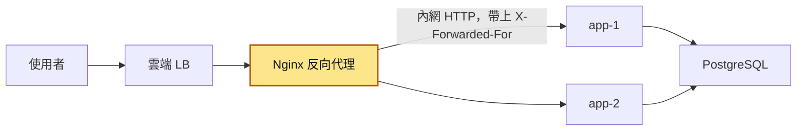
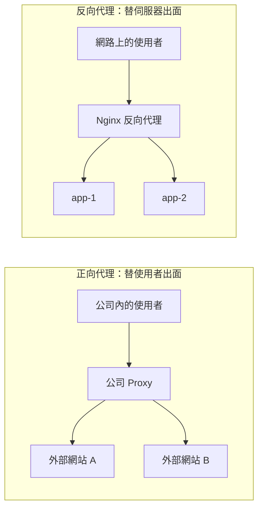
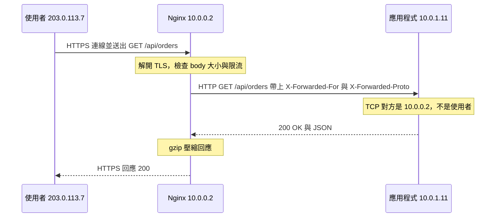
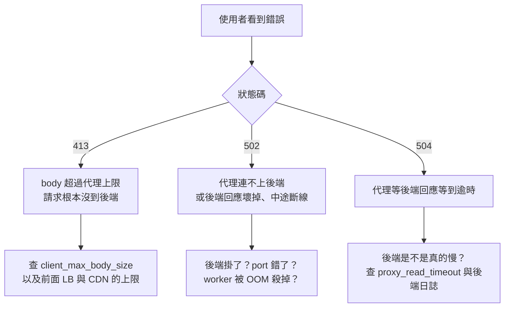

# 34｜反向代理（Reverse Proxy）

> 反向代理是擋在你的後端伺服器前面、替它們接下所有外部請求再轉進去的那台伺服器；使用者只看得到它，看不到後面是誰。

**難度**：★★☆　**閱讀時間**：約 22 分鐘　**前置知識**：[負載平衡](31-負載平衡.md)（不讀也能看懂，讀過更好）

## 為什麼要在意：一個具體的情境

以下是假設的情境。假設你負責一個會員制電商的 API，架構是 `使用者 → Nginx → Python 應用程式`，Nginx 就是擋在應用程式前面的反向代理。這個系統有兩道保護：

- **Nginx 的速率限制**：同一個 IP 每秒最多 10 個請求。Nginx 替每個 IP 開一個「桶」計數，超過就拒絕。用來分辨 IP 的是 `$binary_remote_addr`，也就是「直接跟 Nginx 建立 TCP 連線的那一端」的 IP（後面簡稱 TCP 對方）。
- **應用程式的登入保護**：同一個 IP 登入失敗 5 次，鎖 15 分鐘。

情境裡還會出現一個標頭 `X-Forwarded-For`：代理轉送請求時寫進去的「來源 IP 清單」，用逗號分隔，**每經過一層代理就在最右邊附加一個**它看到的 TCP 對方。使用者自己送請求時，也可以隨便帶這個標頭。

出事的是下面這兩段。第一段在搬遷前完全正常，第二段是事後緊急加上的：

```nginx
# ❌ 出事的寫法 1：Nginx 搬到雲端 LB 後面，限流設定照舊
limit_req_zone $binary_remote_addr zone=api_limit:10m rate=10r/s;
```

```python
# ❌ 出事的寫法 2：緊急修正時，直接拿 X-Forwarded-For 最左邊當使用者 IP
def client_ip(headers: dict, peer: str) -> str:
    xff = headers.get("X-Forwarded-For")
    return xff.split(",")[0].strip() if xff else peer
```

某個週末，維運把 Nginx 搬到雲端負載平衡器（LB，把流量分給多台機器的那一層，見[負載平衡](31-負載平衡.md)）後面，架構變成 `使用者 → 雲端 LB → Nginx → 應用程式`。LB 有兩個內網 IP：`10.0.0.5`、`10.0.0.6`。

| 時間 | 誰送出請求 | Nginx 收到的 `X-Forwarded-For` | Nginx 看到的 TCP 對方 | 被當成「使用者 IP」的值 | 結果 |
|---|---|---|---|---|---|
| T1（搬遷前） | 使用者 `198.51.100.23` | 沒有 | `198.51.100.23` | Nginx 限流用 `198.51.100.23` | 每個使用者各自一個限流桶，正常 |
| T2（週末搬到 LB 後面） | 同一個使用者，經過 LB | LB 附加後是 `198.51.100.23` | `10.0.0.5` | Nginx 限流用 `10.0.0.5` | 測試環境流量小，沒人發現 |
| T3（週一 9:00） | 上千個使用者，全部經過 LB | 各自的真實 IP | 只有 `10.0.0.5`、`10.0.0.6` 兩個 | Nginx 限流只看到兩個 LB 的 IP | 全公司的使用者擠在兩個限流桶裡，每秒 10 個一下就滿，大量請求被拒絕，回 503 |
| T4（緊急修正） | 同一個使用者 | `198.51.100.23` | `10.0.0.5` | Nginx 限流拿掉；應用程式改用寫法 2，取最左邊：`198.51.100.23` | 503 消失 |
| T5（兩週後） | 攻擊者 `203.0.113.9`，自己帶 `X-Forwarded-For: 6.6.6.6` | LB 附加後是 `6.6.6.6, 203.0.113.9` | `10.0.0.5` | 應用程式取最左邊：`6.6.6.6` | 登入失敗，記在 `6.6.6.6` 名下 1 次 |
| T6 | 同一個攻擊者，這次帶 `7.7.7.7` | `7.7.7.7, 203.0.113.9` | `10.0.0.6` | 應用程式取最左邊：`7.7.7.7` | 又記在新的 IP 名下，每個「IP」都只失敗 1 次，永遠到不了 5 次 |

**使用者看到的**：T3 開始，大量使用者打開網站就看到 503 錯誤頁。Nginx 限流拒絕時預設回 503，限流常用的 429 要另外設定，所以一開始還被誤判成「後端掛了」。

**工程師看到的**：T3 查 Nginx 日誌，所有請求的來源 IP 都是同兩個 `10.0.x.x`。兩週後資安團隊發現，有人對登入 API 做撞庫攻擊（credential stuffing，拿外洩的帳號密碼大量嘗試登入），幾十萬次嘗試，「登入失敗鎖 IP」的機制完全沒擋到。

**根因**：兩段寫法都沒有設定「信任哪些代理」。寫法 1 的 `$binary_remote_addr` 在搬到 LB 後面之後，拿到的是 LB 的 IP；寫法 2 的 `xff.split(",")[0]` 拿到的是最左邊那個值，那是使用者自己可以亂填的。

**怎麼修**：讓 Nginx 只相信 LB 網段送來的 `X-Forwarded-For`，從右往左跳過可信代理，第一個不是可信代理的 IP 才是真實使用者；應用程式則只信任 Nginx。設定方法在「X-Forwarded-* 標頭：誰寫的、能不能信」，常見地雷 1、2 也會再講一次。

## 全貌：它在系統裡的位置

這張圖看的是一個請求從使用者到資料庫會經過哪些元件，反向代理站在哪裡：



反向代理就是黃色的 Nginx：使用者的請求都先到它，再由它開新的連線轉給後面的應用程式，所以應用程式看到的 TCP 對方是 Nginx。前面的雲端 LB 其實也是一層反向代理，這就是情境裡「多一層、IP 就變了」的原因。它把請求分給 app-1、app-2 的方式在[負載平衡](31-負載平衡.md)，在它這層擋濫用流量的做法在[速率限制](30-速率限制.md)，它怎麼知道哪台後端該拿掉在[健康檢查](49-健康檢查.md)。

## 生活比喻

反向代理像一棟辦公大樓的**總機櫃台**。

訪客（使用者）只知道大樓的地址和櫃台。訪客說「我要找業務部」，櫃台查一下哪個業務有空（負載平衡），幫訪客換證（TLS 終止），檢查有沒有帶違禁品、一次來太多人就請他們排隊（速率限制），大型包裹先擋下來（body 大小限制）。業務部的人在幾樓、分機幾號，訪客完全不知道（隱藏後端）。傳單、簡介這類東西櫃台直接發（靜態檔案、快取），不用麻煩樓上。

正向代理則像**你公司派去幫你跑腿的祕書**：你要去外面辦事，祕書替你出面，對方只看到祕書，不知道是你。

**比喻失準的地方**：

1. 櫃台會記下「訪客是誰」再通報樓上；但反向代理轉請求時，樓上看到的「來訪者」預設是櫃台本人。要讓後端知道真正的使用者，得**明確**用標頭把資訊帶進去，而且後端得知道該相信哪一段。
2. 真實櫃台不會「等太久就自己跟訪客說業務不在」。反向代理會：它有自己的逾時，時間一到就回 504 給使用者，**但樓上的業務可能還在繼續處理那件事**。這是很多「明明失敗了資料卻寫進去」的來源。
3. 櫃台通常只有一層。實際系統的請求常常依序經過 CDN、雲端 LB、Nginx 才到應用程式，好幾層代理串在一起，每一層都有自己的逾時、上限和標頭處理規則。

## 它是怎麼運作的

後端服務如果直接面對網際網路，每一台都要自己處理 TLS、擋濫用流量，還得另外想辦法做負載平衡，而且每一台都暴露在外。反向代理把這些事集中到前面一層處理。

### 正向代理 vs 反向代理

兩種代理都是「替別人出面」，差別在替哪一邊出面：



| | 正向代理 | 反向代理 |
|---|---|---|
| 誰架的 | 使用者端（公司 IT、使用者自己） | 服務提供者（你們團隊） |
| 隱藏誰 | 隱藏使用者 | 隱藏後端伺服器 |
| 使用者知道它存在嗎 | 通常知道（要設定 proxy） | 通常不知道，以為它就是網站本人 |
| 常見用途 | 上網管制、內容過濾、內網統一出口 | TLS、負載平衡、快取、限流 |

後端工程師日常碰到的幾乎都是反向代理。正向代理會在「伺服器要呼叫外部 API，但公司規定一定要走出口 proxy」時遇到，知道有這回事就好。

### 反向代理常做的七件事

1. **TLS 終止（TLS termination）**：TLS 是 HTTPS 裡負責加密的那一層。HTTPS 在代理這裡解開，代理到後端走內網的 HTTP。好處是憑證集中管理、後端不用處理加解密。代價是後端**不知道**使用者原本用的是 https，要靠 `X-Forwarded-Proto` 告訴它。
2. **負載平衡（load balancing）**：把請求分給多台後端，詳見 [負載平衡](31-負載平衡.md)。
3. **快取（caching）**：把可以快取的回應存起來，下一個人直接拿，不打後端。快取什麼、多久過期，要跟 [快取失效](21-快取失效.md) 的考量一起看。
4. **壓縮（compression）**：gzip／brotli 壓縮 JSON、CSS、JS，減少傳輸量，後端不用自己做。
5. **速率限制（rate limiting）**：在最外層就把濫用流量擋掉，不讓它吃到後端資源，演算法詳見 [速率限制](30-速率限制.md)。
6. **送靜態檔案**：圖片、前端打包檔直接由 Nginx 從磁碟送出，比 Python 應用程式送快很多，也不佔應用程式的 worker。
7. **隱藏後端**：外部只看得到代理的 IP 和 port。後端可以換機器、換語言、加減台數，使用者完全無感；後端也不用直接暴露在網際網路上。

另外它還常負責：把 HTTP 轉址到 HTTPS、依路徑分流到不同服務（`/api` 給 Python、`/` 給前端）、統一加安全標頭、產生 request id 方便 [分散式追蹤](50-分散式追蹤.md)。

### 一個請求經過代理時發生了什麼

使用者送出一個 HTTPS 請求時，依序會發生這些事：



圖裡「TCP 對方是 10.0.0.2，不是使用者」那個 Note 的意思是，**代理會開一條全新的 TCP 連線到後端**。對後端來說，`request.remote_addr`、`client_address` 這類東西拿到的是代理的 IP，Host 和協定也可能被改掉。原始資訊只能靠代理「寫在標頭裡帶過去」。

### X-Forwarded-* 標頭：誰寫的、能不能信

常見的三個（都是業界慣例，沒有寫進正式標準；正式標準是 RFC 7239 的 `Forwarded` 標頭，但實務上用得遠不如 `X-Forwarded-*` 普遍）：

| 標頭 | 內容 | 例子 |
|---|---|---|
| `X-Forwarded-For` | 經過的每一跳的來源 IP，逗號分隔，**每經過一層代理就在最右邊附加一個** | `198.51.100.23, 10.0.0.5` |
| `X-Forwarded-Proto` | 使用者連到第一層代理時用的協定 | `https` |
| `X-Forwarded-Host` | 使用者原本請求的 Host | `shop.example.com` |

Nginx 的 `$proxy_add_x_forwarded_for` 變數的意思是：「收到的 `X-Forwarded-For` 原值，後面再加上 `$remote_addr`」；如果收到的請求沒有這個標頭，就只有 `$remote_addr`。

**`X-Forwarded-For` 只有右邊那段是可信的**。每一層代理只對「我看到的 TCP 對方是誰」負責，附加在最右邊。左邊的東西是前面的人說的，可能是上一層代理，也可能是使用者自己亂寫的。

```
使用者自己送：     X-Forwarded-For: 6.6.6.6            ← 偽造的
LB 附加真實來源：  X-Forwarded-For: 6.6.6.6, 198.51.100.23
Nginx 再附加 LB：  X-Forwarded-For: 6.6.6.6, 198.51.100.23, 10.0.0.5
                                    ^^^^^^^  ^^^^^^^^^^^^^  ^^^^^^^^
                                    不能信    LB 寫的，可信   Nginx 寫的，可信
```

取真實 IP 的正確演算法：**從最右邊往左走，跳過所有可信代理的 IP，遇到的第一個不是可信代理的 IP，就是真實使用者。**

在 Nginx 用 `ngx_http_realip_module` 做這件事：

```nginx
# 只信任雲端 LB 所在的網段送來的 X-Forwarded-For
set_real_ip_from 10.0.0.0/24;
real_ip_header   X-Forwarded-For;
real_ip_recursive on;   # 從右往左跳過所有可信任的 IP，取第一個不可信的
```

設定之後 `$remote_addr` 就會變成真實使用者 IP，`limit_req`、存取日誌都會跟著用對的值。開頭情境的寫法 1 加上這三行，就不會再把所有使用者算成 LB。

有一個看日誌時會遇到的細節：`$proxy_add_x_forwarded_for` 附加的也是這個「改過的」`$remote_addr`。上例轉給後端的會是 `6.6.6.6, 198.51.100.23, 198.51.100.23`（真實 IP 出現兩次，LB 的 IP 不見了）。這不影響正確性，後端只信任一層、取最右邊，拿到的還是真實 IP，但看日誌時別被嚇到。

這個模組不在原始碼預設編譯清單裡（要 `--with-http_realip_module`），但 nginx.org 的官方套件和官方 Docker 映像檔都有，可以用 `nginx -V` 確認。

應用程式那一端也要做同樣的事：只信任 Nginx，也就是開頭情境寫法 2 該改的地方。「可信代理」指的是你們自己架、確定會正確附加標頭的那幾台代理。不同框架有不同設定，做的事都一樣，就是告訴它「前面有幾層／哪些 IP 是可信代理」：

- Flask／Werkzeug：`app.wsgi_app = ProxyFix(app.wsgi_app, x_for=1, x_proto=1)`（`from werkzeug.middleware.proxy_fix import ProxyFix`），數字是「這個標頭要信任最右邊幾個值」，也就是前面有幾層會寫這個標頭的可信代理。
- Uvicorn：`--proxy-headers`（預設就開啟）只會採信 `--forwarded-allow-ips` 清單裡的 IP 送來的標頭；這個清單預設只有本機（`127.0.0.1`，新版也含 `::1`）。Nginx 在別台機器或別的容器時，要改成 Nginx 的 IP。
- Gunicorn：`forwarded_allow_ips` 決定信任哪些 IP 送來的 `X-Forwarded-Proto` 這類協定標頭，預設值依版本而異，請查官方文件。它不會用 `X-Forwarded-For` 改寫 `REMOTE_ADDR`，真實 IP 要交給框架層（例如上面的 `ProxyFix`）處理。
- Django：`SECURE_PROXY_SSL_HEADER = ("HTTP_X_FORWARDED_PROTO", "https")` 讓它認得 https；真實 IP 則要自己處理或用套件。

### 502、504、413：代理回的錯誤碼

這三個碼通常由**代理產生**，回應並非出自你的應用程式。分辨的第一步是看應用程式日誌裡有沒有這個請求。下面的圖和表裡，upstream 是 Nginx 對「後端」的稱呼，Nginx 的錯誤日誌都用這個詞。



| 狀態碼 | Nginx 錯誤日誌常見內容 | 典型原因 |
|---|---|---|
| 413 | `client intended to send too large body` | 上傳超過 `client_max_body_size`（預設 1m） |
| 502 | `connect() failed (111: Connection refused) while connecting to upstream` | 後端沒在聽、port 錯、正在重啟 |
| 502 | `upstream prematurely closed connection while reading response header from upstream` | 後端 worker 處理到一半被殺（OOM、逾時被 gunicorn 砍掉） |
| 504 | `upstream timed out (110: Connection timed out) while reading response header from upstream` | 後端處理超過 `proxy_read_timeout`（預設 60s） |

Nginx 跟後端相關的三個逾時預設都是 60 秒：

- `proxy_connect_timeout`：建立 TCP 連線的等待時間。
- `proxy_send_timeout`：送請求給後端時，**兩次寫入之間**的最長間隔。
- `proxy_read_timeout`：讀後端回應時，**兩次讀取之間**的最長間隔。後端如果每 30 秒吐一點資料，可以一直不逾時。常見的誤解是把它當成整個回應的總時間。

還有一個 Nginx 特有的碼 **499**：使用者那端在 Nginx 回應前就關掉連線了（例如使用者按了重新整理、前端自己的逾時比較短）。它只會出現在 Nginx 日誌，使用者不會看到。

Nginx 回 504、放棄等待之後，**後端那個請求通常還在跑**，可能最後成功寫進資料庫，只是沒人收到結果。使用者看到錯誤再按一次，就會產生重複資料，所以寫入 API 要考慮 [冪等性](25-冪等性.md)。

## 動手看看

用 Docker Compose 起一個 Nginx 加一個 Python 小程式，親眼看標頭長什麼樣、502／504／413 怎麼出現。建一個空資料夾，放三個檔案。

`app.py`（只用標準函式庫）：

```python
# app.py：把收到的標頭吐回去，方便觀察代理做了什麼
import json
import time
from http.server import BaseHTTPRequestHandler, ThreadingHTTPServer
from urllib.parse import parse_qs, urlparse


class Handler(BaseHTTPRequestHandler):
    def _reply(self, body: dict) -> None:
        data = json.dumps(body, ensure_ascii=False, indent=2).encode()
        self.send_response(200)
        self.send_header("Content-Type", "application/json; charset=utf-8")
        self.send_header("Content-Length", str(len(data)))
        self.end_headers()
        self.wfile.write(data)

    def do_GET(self) -> None:
        url = urlparse(self.path)
        if url.path.startswith("/slow"):
            # /slow?s=5 會睡 5 秒，用來觸發代理逾時
            secs = float(parse_qs(url.query).get("s", ["5"])[0])
            time.sleep(secs)
            print(f"/slow 睡了 {secs} 秒，處理完畢", flush=True)
        self._reply({
            "path": self.path,
            "peer": self.client_address[0],  # TCP 連線的對方，也就是 Nginx
            "host": self.headers.get("Host"),
            "x_forwarded_for": self.headers.get("X-Forwarded-For"),
            "x_real_ip": self.headers.get("X-Real-IP"),
            "x_forwarded_proto": self.headers.get("X-Forwarded-Proto"),
        })

    def do_POST(self) -> None:
        length = int(self.headers.get("Content-Length", 0))
        self.rfile.read(length)
        self._reply({"received_bytes": length})


if __name__ == "__main__":
    ThreadingHTTPServer(("0.0.0.0", 8000), Handler).serve_forever()
```

`nginx.conf`：

```nginx
server {
    listen 80;

    location / {
        proxy_pass http://app:8000;
        proxy_set_header Host              $host;
        proxy_set_header X-Real-IP         $remote_addr;
        proxy_set_header X-Forwarded-For   $proxy_add_x_forwarded_for;
        proxy_set_header X-Forwarded-Proto $scheme;
        proxy_read_timeout 3s;   # 故意設很短，方便重現 504
        # client_max_body_size 沒設，就是預設的 1m
    }

    location /down/ {
        proxy_pass http://app:9999;   # 故意指到沒人在聽的 port，重現 502
    }
}
```

`compose.yaml`：

```yaml
services:
  app:
    image: python:3.12-slim
    command: python -u /app/app.py
    volumes:
      - ./app.py:/app/app.py:ro
  nginx:
    image: nginx:1.30
    ports:
      - "8080:80"
    volumes:
      - ./nginx.conf:/etc/nginx/conf.d/default.conf:ro
    depends_on:
      - app
```

接著逐一執行。下面的 `curl` 參數：`-s` 不顯示進度，`-H` 自己加一個標頭，`-o /dev/null` 把回應內容丟掉，`-w "%{http_code}\n"` 只印出狀態碼（Windows 上用 pwsh 跑也可以：把 `-o /dev/null` 換成 `-o NUL`，`curl` 要確定叫到的是 `curl.exe`，`"@big.bin"` 的引號不能省，否則 pwsh 會把 `@` 當成特殊語法）：

```bash
docker compose up -d

# 1) 正常請求：看後端眼中的世界
curl -s http://localhost:8080/hello

# 2) 自己偽造 X-Forwarded-For
curl -s -H "X-Forwarded-For: 6.6.6.6" http://localhost:8080/hello

# 3) 504：後端睡 5 秒，代理只等 3 秒
curl -s -o /dev/null -w "%{http_code}\n" "http://localhost:8080/slow?s=5"

# 4) 502：代理連不上後端
curl -s -o /dev/null -w "%{http_code}\n" http://localhost:8080/down/

# 5) 413：上傳 2MB，超過預設 1m
python -c "open('big.bin','wb').write(b'0' * 2_000_000)"
curl -s -o /dev/null -w "%{http_code}\n" --data-binary "@big.bin" http://localhost:8080/upload

# 看兩邊的日誌
docker compose logs nginx --tail 20
docker compose logs app --tail 20

# 收工
docker compose down
```

預期會看到：

1. `peer` 是 Nginx 容器的 IP（類似 `172.18.0.3`），你自己的 IP 不會出現在這裡。`x_forwarded_for` 和 `x_real_ip` 是 Docker 網路閘道的 IP（Linux 上類似 `172.18.0.1`；Docker Desktop 上可能是 `192.168.65.1` 這類位址，以你實際看到的為準，下面的說明以 `172.18.0.1` 為例），因為從你的電腦經過 port 對映進來時，Nginx 看到的就是它。
2. `x_forwarded_for` 變成 `"6.6.6.6, 172.18.0.1"`。你隨手寫的假 IP 原封不動被帶到後端了，而且在**最左邊**。如果程式拿最左邊當使用者 IP，就被騙了。`x_real_ip` 則還是 `172.18.0.1`，因為它用的是 `$remote_addr`，偽造不了。
3. 印出 `504`。過幾秒看 app 日誌，會看到「/slow 睡了 5.0 秒，處理完畢」，可能還有 `BrokenPipeError`：**後端把事情做完了，只是沒人在等結果**。
4. 印出 `502`，Nginx 日誌有 `connect() failed (111: Connection refused)`。
5. 印出 `413`，Nginx 日誌有 `client intended to send too large body`。app 日誌裡**完全沒有這個請求**，證明它在代理那層就被擋掉了。

### 正式環境的 Nginx 設定長怎樣

> 第一次讀可以先跳過這一節，等你要寫或審正式環境的 Nginx 設定時再回來看。

上面的實驗設定是故意簡化的。設定裡的 `upstream` 區塊列出後端有哪幾台，`keepalive` 是讓 Nginx 跟後端重複使用同一條連線、不用每個請求都重新連。把前面講的觀念組起來，正式環境大概長這樣。這是片段，實際路徑、網段、憑證位置依你的環境調整：

```nginx
# 後端群組：兩台應用程式，保持長連線
upstream app_backend {
    server 10.0.1.11:8000 max_fails=3 fail_timeout=10s;
    server 10.0.1.12:8000 max_fails=3 fail_timeout=10s;
    keepalive 32;   # 跟後端保留的閒置長連線數（每個 worker）；1.29.7 起預設就有開，寫明比較清楚
}

# 以「真實使用者 IP」限流：每秒 10 個請求
limit_req_zone $binary_remote_addr zone=api_limit:10m rate=10r/s;

# 前面有雲端 LB：只信任它送來的 X-Forwarded-For
set_real_ip_from  10.0.0.0/24;
real_ip_header    X-Forwarded-For;
real_ip_recursive on;

server {
    listen 80;
    server_name api.example.com;
    return 301 https://$host$request_uri;   # http 一律導去 https
}

server {
    listen 443 ssl;
    http2 on;                    # Nginx 1.25.1 起的寫法；舊版寫在 listen 上
    server_name api.example.com;

    ssl_certificate     /etc/nginx/certs/fullchain.pem;
    ssl_certificate_key /etc/nginx/certs/privkey.pem;
    ssl_protocols       TLSv1.2 TLSv1.3;

    client_max_body_size 2m;     # 一般 API 的上限

    gzip on;
    gzip_types application/json text/css application/javascript;   # text/html 預設就會壓
    gzip_min_length 1024;

    # 靜態檔案由 Nginx 直接送，不打後端
    location /static/ {
        alias /var/www/static/;
        expires 7d;
    }

    location /api/ {
        limit_req zone=api_limit burst=20 nodelay;
        limit_req_status 429;    # 預設是 503，改成語意正確的 429

        proxy_pass http://app_backend;
        proxy_http_version 1.1;           # 1.29.7 以前預設是 1.0，要用 keepalive 必須改 1.1
        proxy_set_header Connection "";   # 舊版預設送 Connection: close，要清掉長連線才會生效
                                          # （1.29.7 起這兩項都是預設行為，寫上可相容舊版）

        proxy_set_header Host              $host;
        proxy_set_header X-Real-IP         $remote_addr;   # realip 處理後已是真實 IP
        proxy_set_header X-Forwarded-For   $proxy_add_x_forwarded_for;
        proxy_set_header X-Forwarded-Proto https;          # 這層就是 TLS 終止點，寫死 https
        proxy_set_header X-Request-ID      $request_id;    # 給日誌與追蹤用

        proxy_connect_timeout 5s;   # 內網連線 5 秒還連不上，就是有問題了
        proxy_read_timeout    30s;  # 一般 API 30 秒還沒回，該檢討 API 本身
        proxy_send_timeout    30s;
    }

    # 上傳要大一點的上限，只在這個 location 放寬
    location /api/uploads/ {
        client_max_body_size 20m;
        include /etc/nginx/snippets/proxy_headers.conf;   # 見常見地雷 4：這裡要重新帶標頭
        proxy_http_version 1.1;           # 兄弟 location 之間不會互相繼承，/api/ 那兩行這裡要再寫一次
        proxy_set_header Connection "";
        proxy_pass http://app_backend;
    }
}
```

## 常見地雷

### 地雷 1：直接拿 `X-Forwarded-For` 最左邊當使用者 IP

❌ **錯誤示範**

```python
# ❌ 錯誤示範：最左邊的 IP 是使用者自己可以填的
def client_ip(headers: dict, peer: str) -> str:
    xff = headers.get("X-Forwarded-For")
    return xff.split(",")[0].strip() if xff else peer
```

**為什麼錯**：任何人都能自己帶這個標頭。用它來做限流、封鎖、登入失敗鎖定、稽核日誌，全部可以被輕鬆繞過，就像前面情境裡的撞庫攻擊。

✅ **正確寫法**：從右往左，跳過可信代理。能在 Nginx 用 realip 模組處理掉最好；要在程式裡做的話：

```python
# ✅ 正確寫法：只信任自己的代理附加的部分
import ipaddress

# 你自己的代理所在網段（Nginx、雲端 LB），依實際環境設定
TRUSTED_PROXIES = [ipaddress.ip_network(n) for n in ("10.0.0.0/16", "127.0.0.1/32")]


def is_trusted(ip: str) -> bool:
    try:
        addr = ipaddress.ip_address(ip)
    except ValueError:
        return False  # 格式不對的值一律當作不可信
    return any(addr in net for net in TRUSTED_PROXIES)


def client_ip(xff: str | None, peer: str) -> str:
    """peer 是 TCP 連線對方的 IP；xff 是 X-Forwarded-For 原始字串。"""
    if not is_trusted(peer):
        return peer  # 不是自己的代理直接連進來的，標頭一律不信
    hops = [h.strip() for h in (xff or "").split(",") if h.strip()]
    # 從最右邊往左走，第一個不是自己人的，就是真實使用者
    for ip in reversed(hops):
        if not is_trusted(ip):
            return ip
    return hops[0] if hops else peer  # 整串都是內部 IP（例如內部服務呼叫）


# 範例：使用者偽造了 6.6.6.6
print(client_ip("6.6.6.6, 198.51.100.23", peer="10.0.0.5"))  # 198.51.100.23
```

實務上優先用框架內建的機制（`ProxyFix`、`--forwarded-allow-ips`），不要每個專案自己寫一份。

### 地雷 2：在 LB 後面用 `$binary_remote_addr` 限流

❌ **錯誤做法**：Nginx 前面加了雲端 LB 或 CDN，但 `limit_req_zone $binary_remote_addr ...` 照舊。

**為什麼錯**：`$remote_addr` 現在是 LB 的 IP，所有使用者被算成同一個人，流量一大就全體被擋。而且 `limit_req` 預設回 **503**，很容易被誤判成後端故障。

✅ **正確做法**：先用 realip 模組（`set_real_ip_from` 填 LB／CDN 的網段）把 `$remote_addr` 還原成真實 IP，再限流；並加上 `limit_req_status 429;`，讓被限流的請求回 429，不會跟後端故障的 503 混在一起。

### 地雷 3：應用程式不知道外面是 HTTPS

❌ **錯誤做法**：TLS 在 Nginx 終止，Nginx 用 http 打後端，但沒傳 `X-Forwarded-Proto`，或應用程式沒設定信任它。

**為什麼錯**：應用程式只看得到 http 連線，會判斷自己跑在 http 上。結果包括：產生的重導和絕對網址都是 `http://`；開了「強制 https」的框架會一直把使用者導去 https，代理又用 http 轉進來，形成**無限重導**；`Secure` cookie、OAuth callback 網址出錯。

✅ **正確做法**：Nginx 設 `proxy_set_header X-Forwarded-Proto $scheme;`（多層代理時，只有最外層用 `$scheme`，內層要沿用外層傳來的值），應用程式設定信任這個標頭（例如 Django 的 `SECURE_PROXY_SSL_HEADER`）。前提是**你的代理一定會覆寫這個標頭**，否則使用者可以自己送 `X-Forwarded-Proto: https` 騙過檢查。

### 地雷 4：在 location 裡多加一行 `proxy_set_header`，結果其他標頭全不見

❌ **錯誤示範**

```nginx
# ❌ 錯誤示範
server {
    proxy_set_header Host            $host;
    proxy_set_header X-Forwarded-For $proxy_add_x_forwarded_for;

    location /api/ {
        proxy_set_header X-Request-ID $request_id;   # 只想多加這一行
        proxy_pass http://app_backend;
    }
}
```

**為什麼錯**：Nginx 的規則是：**當前層級只要有任何一行 `proxy_set_header`，就完全不繼承上一層的 `proxy_set_header`**。上面 `/api/` 實際只會送 `X-Request-ID`，`Host` 和 `X-Forwarded-For` 都沒了（`Host` 會變回預設的 `$proxy_host`）。`add_header` 預設也是同樣的繼承規則（Nginx 1.29.3 起可以用 `add_header_inherit` 改成合併，但舊版沒有，別依賴它）。

✅ **正確寫法**：把共用的標頭寫在獨立檔案裡，每個需要的 location 都 `include` 一次；或在 location 裡把需要的全部重寫一遍。`include` 進來的行，效果等同直接寫在那個 location 裡，所以跟同一層的其他 `proxy_set_header` 會一起生效。

```nginx
# /etc/nginx/snippets/proxy_headers.conf：共用的那幾行
proxy_set_header Host              $host;
proxy_set_header X-Real-IP         $remote_addr;
proxy_set_header X-Forwarded-For   $proxy_add_x_forwarded_for;
proxy_set_header X-Forwarded-Proto $scheme;
```

```nginx
# ✅ 正確寫法
location /api/ {
    include /etc/nginx/snippets/proxy_headers.conf;  # 共用的那幾行
    proxy_set_header X-Request-ID $request_id;
    proxy_pass http://app_backend;
}
```

### 地雷 5：`proxy_pass` 結尾有沒有斜線，路徑完全不同

❌ **錯誤做法**：以為下面兩種寫法一樣。

```nginx
location /api/ { proxy_pass http://app:8000;  }   # 請求 /api/users → 後端收到 /api/users
location /api/ { proxy_pass http://app:8000/; }   # 請求 /api/users → 後端收到 /users
```

**為什麼錯**：`proxy_pass` 的網址**有帶路徑**（哪怕只有一個 `/`）時，Nginx 會把 location 比對到的前綴換成那段路徑；沒帶路徑時，原始 URI 原封不動送過去。寫錯時最常見的症狀是後端一律 404，而且很難從錯誤訊息看出原因。

✅ **正確做法**：先決定後端要不要看到 `/api` 前綴，再選寫法。改完用前面「動手看看」那種回顯程式確認後端實際收到的 `path`。

### 地雷 6：遇到 504 就把逾時調大

❌ **錯誤做法**：匯出報表的 API 要跑 90 秒，使用者看到 504，就把 `proxy_read_timeout` 調成 300s。

**為什麼錯**：

- 前面還有其他層：雲端 LB、CDN、前端 HTTP 用戶端都有自己的逾時。你只改 Nginx，最外層照樣在 60 秒左右把連線切掉。
- 長請求會一直佔著後端的 worker 和資料庫連線（見 [連線池](08-連線池.md)），流量一大就把整個服務拖垮。
- 部署重啟時，這種長請求最難 [優雅關閉](48-優雅關閉.md)。

✅ **正確做法**：耗時的工作改成非同步。API 立刻回 `202 Accepted` 和一個工作 id，交給 [背景工作者](37-背景工作者.md) 處理，前端用 id 輪詢結果。逾時設定則要**由外往內遞減**或至少對齊：最外層的逾時 ≥ Nginx 的 `proxy_read_timeout` ≥ 應用程式自己的請求逾時，這樣錯誤會在最靠近原因的地方發生，日誌也比較好查。

### 地雷 7：上傳功能在本機好好的，上線就 413

❌ **錯誤做法**：本機直接打應用程式測上傳，沒經過 Nginx；上線後超過 1MB 的檔案全失敗。

**為什麼錯**：Nginx 的 `client_max_body_size` 預設只有 `1m`。而且應用程式框架、雲端 LB、CDN 可能各自有上限，任何一層比較小都會擋。

✅ **正確做法**：上傳上限是**產品規格**，要明確定義，然後每一層都設成一致的值，並且只在需要的 location 放寬，不要整個 server 一起開大。真的很大的檔案，考慮讓前端直接上傳到物件儲存（例如 S3 的 presigned URL），不經過你的代理。

## 重點整理

- 反向代理（reverse proxy）代表**伺服器端**接請求；正向代理（forward proxy）代表**使用者端**發請求。分辨方法：問「這台代理是誰架的、替誰出面」。
- 正式環境幾乎一定有它（Nginx、雲端 LB、CDN 都算）。它通常負責 TLS 終止、負載平衡、壓縮、快取、速率限制、送靜態檔案，以及把後端藏起來。
- 有了代理，**後端看到的 TCP 對方永遠是代理**。真實 IP 和原始協定（http/https）要靠 `X-Forwarded-For`、`X-Forwarded-Proto` 傳進來，而且**只能信任你自己的代理寫進去的部分**：`X-Forwarded-For` 要從右往左跳過可信代理，最左邊那個 IP 是使用者自己可以亂填的。
- 看到 502、504、413，先想到代理：502 是後端連不上或回了壞掉的回應，504 是後端太慢、代理等不及（後端可能還在跑），413 是 body 超過代理的上限（Nginx 預設 `client_max_body_size 1m`）。
- 調逾時、調 body 上限之前，先搞清楚是「設定太小」還是「後端本來就不該這樣做」。90 秒的 API 該改成非同步工作，不該靠把逾時調大來解決。

## 新人必知清單

### 一定要會（基本功）

- [ ] 用自己的話講清楚正向代理和反向代理的差別。
- [ ] 知道有反向代理時，應用程式拿到的 TCP 對方 IP 是代理的，真實 IP 要從 `X-Forwarded-For` 取，而且**要從右往左、只信任自己的代理**。
- [ ] 知道 TLS 終止之後，應用程式要靠 `X-Forwarded-Proto` 才知道是 https，並且會設定所用框架的「信任代理」選項。
- [ ] 看到 502／504／413 能立刻說出可能原因，並知道先去看 Nginx 錯誤日誌、再看應用程式日誌有沒有這個請求。
- [ ] 知道 Nginx 三個 proxy 逾時預設 60 秒、`client_max_body_size` 預設 1m。
- [ ] 知道 504 時後端可能還在跑、而且可能成功了，所以寫入操作要考慮冪等性。
- [ ] 看得懂基本的 Nginx `server`／`location`／`proxy_pass`／`proxy_set_header` 設定，並知道 `proxy_set_header` 的繼承陷阱和 `proxy_pass` 結尾斜線的差別。

### 知道有這回事就好

- RFC 7239 的 `Forwarded` 標頭是正式標準，但大多數系統還是用 `X-Forwarded-*`。
- Nginx 特有的 499：使用者先關掉連線。
- `proxy_buffering` 預設開啟，Nginx 會先把後端回應收進緩衝區再送出；做 Server-Sent Events 或串流回應時要關掉（或讓後端回 `X-Accel-Buffering: no`）。
- WebSocket 需要 `proxy_http_version 1.1` 加上 `Upgrade`／`Connection` 標頭，而且閒置超過 `proxy_read_timeout` 會被切掉。
- `proxy_next_upstream`：一台後端失敗時 Nginx 會自動改送下一台。從 1.9.13 起，POST、PATCH 這類非冪等請求只要已經送出給後端，預設就**不會**再改送下一台，除非你加了 `non_idempotent`。這個參數別亂加。
- 後端（或中間層）的 keep-alive 閒置逾時比前面代理的短時，代理可能拿一條剛被後端關掉的連線去送請求，偶發 502。
- 除了 Nginx，還有 HAProxy、Envoy、Traefik、Caddy，以及雲端的 LB、API Gateway、CDN，概念相通。

### 先不用管（等你遇到再學）

- Nginx 的 `proxy_cache` 詳細調校（cache key、`proxy_cache_lock`、stale 回應）。
- mTLS：代理跟後端之間也用憑證互相驗證。
- Service mesh 與 sidecar proxy（Istio、Linkerd）。
- PROXY protocol：在 TCP 層（而非 HTTP 標頭）傳遞真實來源 IP。
- Nginx 原始碼編譯、動態模組、OpenResty／Lua 擴充。

## Code Review 時可以問的問題

1. 這段程式取使用者 IP 的方式，是用框架的信任代理設定，還是自己解析 `X-Forwarded-For`？如果自己解析，是從右往左、只信任自己的代理嗎？
2. 這個 API 最慢可能跑多久？比整條鏈上最短的那個逾時（CDN、LB、Nginx、前端）還長嗎？如果會，是不是該改成非同步工作？
3. 這個 location 新增了 `proxy_set_header` 或 `add_header`，上一層的設定還有被帶到嗎？
4. 這個上傳功能的大小上限是多少？Nginx、LB、應用程式框架三層都設了一致的值嗎？
5. `proxy_pass` 結尾有沒有斜線？後端預期收到的路徑有沒有 `/api` 前綴？
6. 這個寫入 API 被代理逾時、使用者重按的時候，會不會產生重複資料？

## 情境演練

**1. 你寫的服務要呼叫一支外部 API，公司規定所有伺服器對外連線都要經過 `proxy.corp.internal:3128`；你們的服務前面另外有一台 Nginx 接使用者的請求。同事問你：外部 API 看到的是誰的 IP？使用者看得到後面的應用程式嗎？這兩台各算哪一種代理？**

<details markdown="1"><summary>看答案</summary>

`proxy.corp.internal` 是**正向代理**：它代表「發出請求的一方」（你們的伺服器）去連外部，外部 API 看到的是代理的 IP，不知道是哪台伺服器。Nginx 是**反向代理**：它代表「接收請求的一方」（你們的服務）接下外部請求，使用者看不到後面的應用程式。判斷方法就是問：這台代理是誰架的、替誰出面。

</details>

**2. 使用者回報上傳 5MB 的頭像一直失敗，前端拿到 413，但應用程式日誌裡完全找不到這些請求。最可能的原因是什麼？要改哪裡？**

<details markdown="1"><summary>看答案</summary>

413 是 body 太大，而且應用程式日誌沒有紀錄，代表請求在代理層就被擋掉了。最可能是 Nginx 的 `client_max_body_size` 還是預設的 `1m`。在上傳的 location 設定合理的上限（例如 `client_max_body_size 10m;`），並確認前面的 LB／CDN、後面的應用程式框架上限也夠。不要直接設成 `0`（不檢查）或整個 server 開很大，否則任何 API 都能被塞超大 body。

</details>

**3. 一支「匯出年度報表」的 API 平常要跑 70–90 秒。使用者常看到 504，但 DBA 說查詢都有跑完，而且有使用者抱怨收到兩份一模一樣的匯出 email。發生了什麼事？怎麼修？**

<details markdown="1"><summary>看答案</summary>

Nginx 的 `proxy_read_timeout` 預設 60 秒，超過就回 504 給使用者，但**後端那個請求沒有被取消**，繼續跑完查詢、寄出 email。使用者看到錯誤以為失敗，再按一次，於是又跑一次、又寄一封。

修法：

- 不要只是把逾時調大：前面的 LB、前端用戶端可能還有自己的逾時，而且長請求會佔住 worker 和資料庫連線。
- 改成非同步：API 立刻回 `202 Accepted` 和工作 id，交給背景工作者執行，前端輪詢或等通知。
- 匯出請求加上冪等鍵（例如同一個使用者、同一個報表參數，在一段時間內只建立一個工作），重按也不會重複產生。

</details>

**4. 架構是 `使用者 → 雲端 LB（10.0.0.5）→ Nginx → 應用程式`。Nginx 收到的請求 `$remote_addr` 是 `10.0.0.5`，`X-Forwarded-For` 是 `1.2.3.4, 198.51.100.23`。真實使用者 IP 是哪一個？為什麼不是另一個？**

<details markdown="1"><summary>看答案</summary>

是 `198.51.100.23`。

`X-Forwarded-For` 每經過一層代理就在最右邊附加「這層看到的 TCP 對方」。LB 是你們的，可信，它附加的是它看到的連線來源 `198.51.100.23`。`1.2.3.4` 在那之前就已經存在於標頭裡，代表是使用者送進來時自己帶的，可能是使用者端的正向代理加的，也可能是偽造的，你無法驗證，所以不能拿來做限流或封鎖。

正確演算法：從右往左，跳過可信代理（`10.0.0.5` 是 TCP 對方、已知是 LB），第一個不在信任清單裡的就是答案。在 Nginx 用 `set_real_ip_from 10.0.0.0/24; real_ip_header X-Forwarded-For; real_ip_recursive on;` 就會得到這個結果。

</details>

**5. 新服務上線，TLS 在 Nginx 終止，Django 開了 `SECURE_SSL_REDIRECT = True`。結果瀏覽器顯示「重新導向次數過多」。為什麼？怎麼修？修的時候要注意什麼？**

<details markdown="1"><summary>看答案</summary>

使用者用 https 連到 Nginx，Nginx 解開 TLS 後用 **http** 轉給 Django。Django 看到 http，依設定回 301 導去 https；瀏覽器照做，又經 Nginx 以 http 進來，再被導一次，無限循環。

修法：Nginx 加 `proxy_set_header X-Forwarded-Proto $scheme;`（或在 TLS 終止那層直接寫 `https`），Django 設 `SECURE_PROXY_SSL_HEADER = ("HTTP_X_FORWARDED_PROTO", "https")`，讓它從標頭得知原始協定。

要注意：Django 會無條件相信這個標頭，所以**必須確保**請求只能經過你的代理進來，而且代理一定會覆寫（不是附加）`X-Forwarded-Proto`。如果應用程式的 port 直接對外開放，任何人都能自己帶 `X-Forwarded-Proto: https` 騙過檢查。

</details>

## 相關主題

- [負載平衡](31-負載平衡.md)：反向代理最常做的工作之一，分流演算法和健康判斷都在那篇。
- [速率限制](30-速率限制.md)：在代理層限流前，先確定你拿到的是真實使用者 IP。
- [水平擴展](32-水平擴展.md)：後端能隨意增減台數，靠的就是前面有一層代理擋著。
- [冪等性](25-冪等性.md)：代理逾時後使用者重按、或代理自動改送下一台時，寫入 API 不會重複執行的關鍵。
- [健康檢查](49-健康檢查.md)：代理怎麼知道哪台後端該被拿掉。
- [優雅關閉](48-優雅關閉.md)：部署時讓代理先停止送新請求、等舊請求做完，才不會冒出一堆 502。

## 延伸閱讀

- Nginx 官方文件：Module ngx_http_proxy_module — https://nginx.org/en/docs/http/ngx_http_proxy_module.html
- Nginx 官方文件：Module ngx_http_realip_module — https://nginx.org/en/docs/http/ngx_http_realip_module.html
- RFC 7239：Forwarded HTTP Extension — https://www.rfc-editor.org/rfc/rfc7239
- MDN：X-Forwarded-For — https://developer.mozilla.org/en-US/docs/Web/HTTP/Reference/Headers/X-Forwarded-For
