# 36｜死信佇列（Dead Letter Queue）

> 死信佇列（Dead Letter Queue，DLQ）是一條專門收失敗訊息的佇列：一則訊息失敗太多次，就移到這裡隔離起來等人來看，不會無限重試，也不會直接消失。

**難度**：★★☆　**閱讀時間**：約 20 分鐘　**前置知識**：[冪等性](25-冪等性.md)、[重試機制](26-重試機制.md)、[訊息佇列](35-訊息佇列.md)

## 核心問題與理念

**它要解決的問題**：有些訊息不管重試幾次都會失敗，例如裡面的資料格式本身就錯了。一直放回佇列重試，它會佔住處理程式、拖慢後面正常的訊息；直接丟掉，該做的事就默默沒做，要很久以後才有人發現（下面的情境兩種都會遇到）。

**核心理念**：失敗太多次的訊息，移到旁邊另一條佇列放著，並叫人來看。

**想通的那一步**：

- **卡住的地方**：處理失敗時，直覺只有兩個選項：放回佇列再試，或放棄這則。選放回的話，一則資料有錯的訊息（例如統一編號是空的訂單）會一秒被重試幾十次，卡住正常訂單；改成放棄的話，這類訊息就被默默丟掉，可能要到月底對帳才發現少開了上千張發票。
- **火花**：把「停止重試」和「丟掉資料」拆成兩件事：停止重試的訊息搬到另一條佇列保存起來，裡面一有東西就告警。這一步讓壞訊息不再卡住佇列，資料也一筆不少，修好之後還能送回去重做。

## 閱讀前推薦具備知識

| 知識 | 要會到什麼程度 | 這篇哪裡會用到 | 不熟的話先看 |
|---|---|---|---|
| [訊息佇列](35-訊息佇列.md) | **必備**：能說出 ack 是消費者告訴 broker「這則處理完了，可以刪」，沒 ack 的訊息在斷線或逾時後會被重新投遞 | 情境的 `basic_ack`／`basic_nack(requeue=True)` 流程圖、「一則訊息的一生」三張圖 | 本系列第 35 篇 |
| HTTP 狀態碼 | **必備**：分得出 `400`、`422` 是「你送的資料有問題」，`429`、`503` 是「對方暫時忙不過來或暫時掛了」 | 情境裡發票服務回 `400`、「毒訊息 vs 暫時性失敗」的分類表 | [MDN：HTTP 狀態碼](https://developer.mozilla.org/en-US/docs/Web/HTTP/Reference/Status) |
| Python 的例外處理 | **加分**：看得懂自訂例外類別（`class RetryableError(Exception)`），以及同一個 `try` 底下接好幾個 `except` 分別處理 | 「動手看看」第 3 步的 `worker.py` | [Python 官方教學（中文）](https://docs.python.org/zh-tw/3/tutorial/index.html) |
| [重試機制](26-重試機制.md) | **加分**：知道重試要有次數上限，而且只重試「等一下可能會好」的錯誤 | 「DLQ 不等於重試機制」、地雷 3 和地雷 4 | 本系列第 26 篇 |
| [冪等性](25-冪等性.md) | **加分**：知道同一則訊息被處理兩次，結果要跟處理一次一樣，例如不能重複扣款 | 「進了 DLQ 之後」的 redrive、地雷 6 | 本系列第 25 篇 |
| RabbitMQ 與 pika | **加分**：看得懂 `ch.basic_consume(queue="orders", on_message_callback=on_message)` 是訂閱一條佇列，每來一則訊息就呼叫一次 `on_message` | 「動手看看」的 `setup.py`、`worker.py`、`redrive.py` | [RabbitMQ 官方教學](https://www.rabbitmq.com/tutorials) |

**快速自我檢查**：worker 呼叫發票服務，處理某一則訊息時對方回 `503`，處理另一則時回 `400`。哪一則等幾分鐘再試有機會成功？如果 worker 對這兩則都執行 `basic_nack(requeue=True)`，那則 `400` 的訊息接下來會去哪裡？

<details markdown="1"><summary>看答案</summary>

`503` 那則有機會，對方只是暫時無法服務；`400` 代表送過去的資料本身有問題，重送一模一樣的內容只會再拿到 `400`。`requeue=True` 會把訊息放回佇列，很快又被 worker 拿出來處理，所以 `400` 那則會一直回到佇列。答不出來也沒關係：第一題沒把握，先看 MDN 的狀態碼頁；第二題沒把握，先看第 35 篇「ack 時機」那一節。

</details>

## 為什麼要在意：一個具體的情境

這是一個假設情境。假設你負責一個電商的「發票 worker」：訂單服務在訂單成立後，會發一則 `order.created` 訊息到 RabbitMQ 的 `orders` 佇列，發票 worker 從佇列拿訊息出來，呼叫電子發票服務開立發票。worker 是執行 consumer 程式的背景程序，consumer 就是 [訊息佇列](35-訊息佇列.md) 那篇講的消費者，負責把訊息從佇列拿出來處理。

worker 的處理邏輯用到兩個 RabbitMQ 動作：`basic_ack` 是回報「這則處理完了，可以刪掉」；`basic_nack` 是回報「這則處理失敗」，`requeue=True` 代表把訊息放回佇列，等一下再被拿出來處理。下面這張圖是 worker 收到一則訊息後的流程（❌ 出事的寫法）：

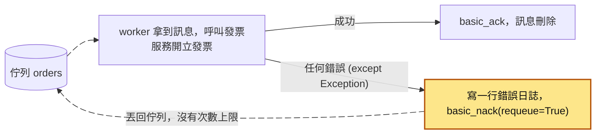

出問題的是兩行：`except Exception:` 把所有錯誤一起接住，`ch.basic_nack(method.delivery_tag, requeue=True)` 把訊息丟回佇列，而且沒有任何上限。

平常完全沒事。某天前端改版，一個 bug 讓公司戶的統一編號欄位送成了空字串，發票服務對這種訂單一律回 `400 Bad Request`。

### 第一階段：無限重試

下面這張圖把整個情境的三條路放在一起：① 是這一階段的無限重試，② 是下一階段的默默丟掉，③ 是如果一開始就有死信佇列（DLQ）會怎樣。圖後的表格先一格一格看第一階段。

<figure class="draw-fig">
<iframe class="draw-fig__frame" src="../figures/36-dlq-three-paths.html" title="按播放從頭看同一則統編為空的訂單走三條路：① 丟回佇列無限重試、② 沒設 DLX 直接丟掉、③ 移到死信佇列；看下排哪個出口亮起，以及告警、沒開出的發票和 DLQ 則數怎麼變。也可以拖時間軸或點停點。" loading="lazy" style="height: 480px;"></iframe>
<figcaption>按播放從頭看同一則統編為空的訂單走三條路：① 丟回佇列無限重試、② 沒設 DLX 直接丟掉、③ 移到死信佇列；看下排哪個出口亮起，以及告警、沒開出的發票和 DLQ 則數怎麼變。也可以拖時間軸或點停點。</figcaption>
</figure>

| 時間 | 發生什麼事 | 佇列裡的狀況 |
|---|---|---|
| T1 | 前端 bug 上線，第一張統編為空的公司戶訂單成立，`order.created` 進佇列 | 1 則壞訊息，其他都正常 |
| T2 | worker 拿到這則訊息，發票服務回 `400`，程式進到 `except`，執行 `basic_nack(requeue=True)` | 壞訊息回到佇列 |
| T3 | 同一則訊息馬上又被拿出來，又是 `400`，又被丟回去，一秒好幾十次 | 壞訊息在佇列和 worker 之間一直來回 |
| T4 | 更多公司戶訂單進來，壞訊息變成好幾則，一直佔著 worker | 正常訂單排在後面，佇列長度一路往上爬 |
| T5 | 「佇列堆積」告警響起，值班工程師判斷是那幾則壞訊息在卡，把 `requeue=True` 改成 `requeue=False`，重新部署 | 佇列很快清空，告警解除 |

這種不管重試幾次都一定會失敗的訊息，叫**毒訊息**（poison message）。

- **使用者看到的**：正常訂單的發票越拖越晚。
- **工程師看到的**：worker 的 CPU 衝到 100%；日誌一分鐘多出好幾萬行一模一樣的「開立發票失敗」，連帶把日誌平台的額度燒光；佇列長度的告警。

### 第二階段：默默丟掉

改成 `requeue=False` 之後，RabbitMQ 會看這條佇列有沒有設定 **dead-letter-exchange**（死信交換器，簡稱 DLX）。DLX 是佇列上的一個設定，告訴 RabbitMQ 被拒絕的訊息要轉送到哪裡。問題是這條佇列沒有設定 DLX。在 RabbitMQ，`requeue=False` 又沒有 DLX 的話，訊息就直接被丟掉。

| 時間 | 發生什麼事 | 沒開出的發票 | 告警 |
|---|---|---|---|
| T6 | 一張公司戶訂單進來，發票服務回 `400`，worker 執行 `basic_nack(requeue=False)`，沒有 DLX，訊息被丟掉 | 1 張 | 沒有 |
| T7 | 接下來 3 天，每一張公司戶訂單都照 T6 的流程被丟掉 | 1,200 多張 | 沒有 |
| T8 | 會計月底對帳，發現發票數量對不起來 | 只能從訂單資料庫反查、一張一張補開 | |

- **使用者看到的**：下單一切正常，只是公司戶的訂單都沒有開出發票。
- **工程師看到的**：什麼都沒有。從 worker 的角度看，它「正常處理完了」每一則訊息，佇列長度正常，也沒有任何告警。

**根因**（對照上面的流程圖）：

1. 沒有區分錯誤種類。`except Exception:` 那一行把 `400`（資料有問題）和逾時（對方暫時掛掉）同樣對待。
2. 沒有重試上限。`basic_nack(..., requeue=True)` 那一行讓毒訊息可以無限佔用 worker。
3. 沒有 DLQ，所以把 `requeue` 改成 `False` 之後，「停止重試」就等於「丟掉資料」。
4. 沒有針對「處理失敗」的監控，只監控了佇列長度。

**怎麼修**：把錯誤分成可重試和不可重試兩類，設重試上限，設好 DLX 和 DLQ，再對 DLQ 設告警。錯誤怎麼分，在「毒訊息 vs 暫時性失敗」小節；上限和 DLX 怎麼設，在「失敗幾次是誰在數」小節；完整的程式在「動手看看」。

如果一開始就有 DLQ 加告警，這件事會變成下面這樣。表裡的 redrive 就是把 DLQ 裡的訊息送回原本的佇列重新處理。

| 時間 | 發生什麼事 | DLQ 裡的訊息 |
|---|---|---|
| T1 | 前端 bug 上線，統編為空的訂單一進來就被送進 DLQ | 開始累積 |
| T2 | 上線 10 分鐘後，DLQ 告警響起 | 十幾則 |
| T3 | 工程師打開 DLQ，失敗原因都寫著「統一編號為空」 | 十幾則 |
| T4 | 修好前端、補正資料 | 十幾則 |
| T5 | 把 DLQ 的訊息 redrive 回去，補開發票，不用等到月底 | 0 |

## 全貌：它在系統裡的位置

下面這張圖畫的是上面那個發票流程，加上 DLQ 之後，訊息會經過哪些元件。

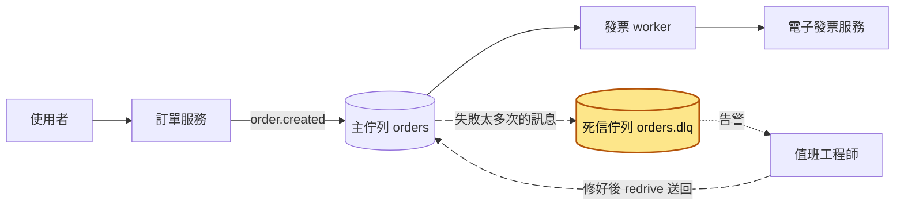

這篇講的是黃色那一格：主佇列旁邊多出來、專門收失敗訊息的死信佇列，以及它後面的告警和 redrive。主佇列本身怎麼投遞訊息、consumer 怎麼 ack，是 [訊息佇列](35-訊息佇列.md) 那篇；worker 什麼時候該重試、隔多久再試，是 [重試機制](26-重試機制.md) 和 [指數退避](27-指數退避.md)；redrive 會讓訊息再被處理一次，所以 worker 要做到 [冪等](25-冪等性.md)。

## 生活比喻

郵局有個「無法投遞郵件」的處理區。一封信地址寫錯，郵差跑了三次都送不到，他不會一直跑下去（無限重試），也不會順手丟進垃圾桶（丟掉）。他會蓋個章「查無此人」，把信放進待處理區。之後有專人來看：是地址少寫一個字可以補上再送？還是要退回寄件人？

這樣一來，**那封送不到的信，就不會害郵差今天其他幾百封信都送不完。**

**比喻失準的地方**：

- 郵局的待處理區有人每天固定去看。軟體的 DLQ 如果沒設告警，**沒有人會去看**，它會一直堆到訊息過期被刪掉。
- 信件重新寄一次通常不會造成傷害；訊息 redrive 卻可能讓同一筆扣款、同一封 email 被處理兩次。所以 redrive 之前，consumer 必須是[冪等](25-冪等性.md)的。
- 郵差知道「查無此人」是什麼意思；你的程式則要自己判斷錯誤屬於哪一種，還要把原因寫下來，不然 DLQ 裡只是一堆看不出原因的訊息。

## 它是怎麼運作的

### 一則訊息的一生

重試也救不了的訊息，需要一個不會卡住其他訊息、也不會弄丟資料的去處。下面三張圖一張比一張多一個部分，畫出你送出一則訊息之後，它可能經過哪些地方。

第一張只有主佇列：成功就 ack，暫時性失敗就回到主佇列重試。

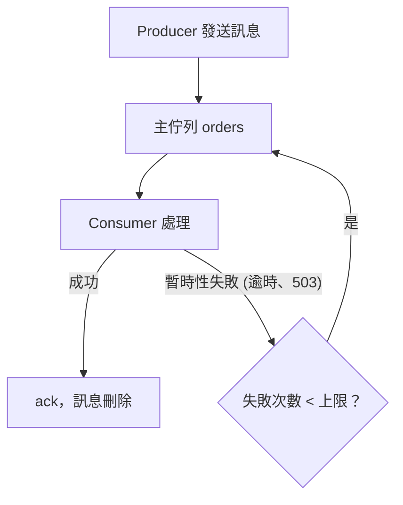

第二張加上 DLQ：重試次數用完的訊息，以及一開始就判定為永久性失敗的訊息，都移到 DLQ。

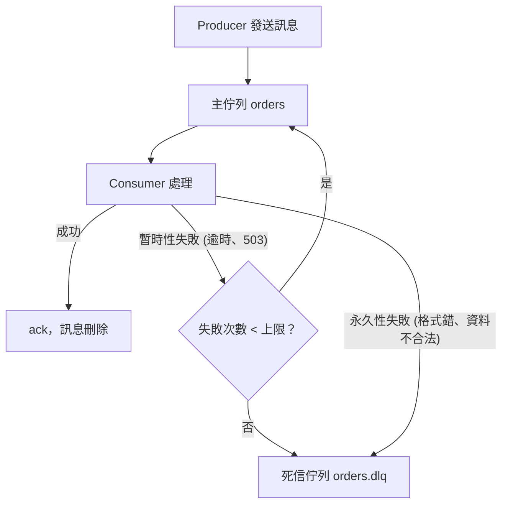

第三張加上 DLQ 後面的人：告警叫人來檢查，修好之後 redrive 回主佇列，確認不需處理的就記錄後刪除。

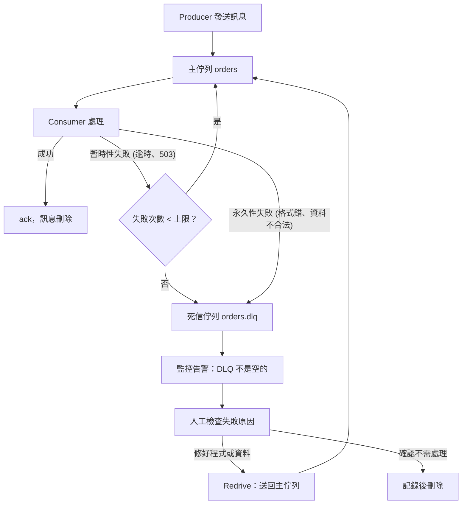

DLQ 本身是**一般的佇列**，差別只在它專門收失敗的訊息。DLQ 後面一定要接著**人**（或至少是一個有人負責的流程）。

### 毒訊息 vs 暫時性失敗

毒訊息（poison message）是指**不管重試幾次都一定會失敗**的訊息。它麻煩的地方是會一直回來：每次被拿出來都會讓 worker 報錯，甚至讓 worker 程序直接崩潰（例如觸發記憶體爆掉、無窮迴圈）。如果 worker 崩潰後訊息又回到佇列，下一個 worker 拿到又崩潰，整個 consumer 群組就會輪流崩潰。下面用兩個 worker 看這個循環：

| 時間 | worker A | worker B | 毒訊息在哪 |
|---|---|---|---|
| T1 | 拿到毒訊息，程序崩潰 | 處理正常訊息 | 還沒 ack，連線斷掉後回到佇列 |
| T2 | 重啟中 | 拿到毒訊息，程序崩潰 | 回到佇列 |
| T3 | 重啟完成，又拿到毒訊息，又崩潰 | 重啟中 | 回到佇列 |
| T4 | 重啟中 | 重啟完成，又拿到毒訊息，又崩潰 | 回到佇列 |

兩個 worker 輪流崩潰，正常訊息幾乎沒人處理。

處理錯誤前，先問自己「這個錯，等一下再試有可能成功嗎？」下面這張圖是判斷的流程，下面的表列出常見的錯誤各屬於哪一類：

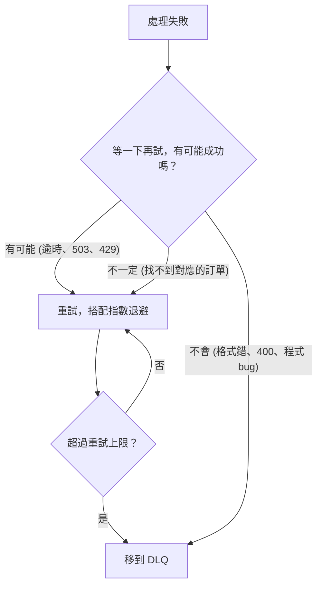

| 錯誤 | 類型 | 該怎麼做 |
|---|---|---|
| 連線逾時、對方回 `503`（服務暫時無法使用）、`429`（請求太多）、資料庫[死鎖](02-死鎖.md) | 暫時性 | 重試（搭配[指數退避](27-指數退避.md)），超過上限才進 DLQ |
| JSON 解析失敗、必填欄位缺漏、schema 版本不認得 | 永久性 | 不要重試，直接進 DLQ |
| 對方回 `400`、`422`（資料不合法） | 通常是永久性 | 直接進 DLQ |
| 找不到對應的訂單（可能是[複寫延遲](18-複寫延遲.md)或事件順序問題） | 不一定 | 重試幾次，還是不行就進 DLQ |
| 程式 bug（`KeyError`、`TypeError`） | 對這版程式是永久性 | 進 DLQ，修好程式後 redrive |

**DLQ 最能派上用場的，就是最後一列這種程式 bug 造成的失敗。** 這時訊息內容完全正確，出錯的是程式，修好部署後把 DLQ 的訊息送回去，一筆都不會少。

### 「失敗幾次」是誰在數

要設重試上限，得有東西幫你數次數。不同系統的做法不一樣：

**Amazon SQS**：每次 consumer 收到（receive）一則訊息，SQS 就把它的 `ApproximateReceiveCount` 加一。consumer 處理成功要自己呼叫 `DeleteMessage`；沒刪的話，等可見性逾時（visibility timeout，預設 30 秒）一過，訊息會重新變成可被收到。當收到次數超過 redrive policy（設在來源佇列上的一份設定，寫明 DLQ 是哪一條、最多收幾次）裡的 `maxReceiveCount`，SQS 就把訊息移到你指定的 DLQ。redrive policy 裡只要寫兩個值：`deadLetterTargetArn` 填 DLQ 的 ARN（AWS 資源的完整識別名稱，例如 `arn:aws:sqs:ap-northeast-1:123456789012:orders-dlq`），`maxReceiveCount` 填上限（例如 `"5"`）。

下面這張表是 `maxReceiveCount` 設成 5 時，一則每次都處理失敗的訊息怎麼走到 DLQ：

| 步驟 | 發生什麼事 | `ApproximateReceiveCount` | 訊息在哪 |
|---|---|---|---|
| 1 | worker 收到訊息 | 1 | 主佇列，別人暫時收不到 |
| 2 | 處理失敗，沒有呼叫 `DeleteMessage` | 1 | 主佇列，別人暫時收不到 |
| 3 | 可見性逾時（預設 30 秒）一過 | 1 | 主佇列，又可以被收到 |
| 4 | 又被收到、又失敗，一路重複到第 5 次 | 5 | 主佇列 |
| 5 | 第 5 次的可見性逾時一過，收到次數就要超過 5 | 超過 5 | 移到 DLQ `orders-dlq` |

注意 SQS 數的是「被收到幾次」，跟處理有沒有失敗無關。只要收到了沒刪，就算一次：worker 處理到一半被重啟、處理時間超過可見性逾時，都會被算進去。另外 SQS 的 DLQ 要跟來源佇列在同一個帳號、同一個區域，而且類型要一致（FIFO 佇列的 DLQ 也要是 FIFO）。

**RabbitMQ**：先知道 RabbitMQ 常用的佇列有兩種類型：classic queue 是傳統的佇列；quorum queue 是較新的類型，會把資料複製到多台伺服器，也能設定「最多重新投遞幾次」的 `delivery-limit`。RabbitMQ 的設計是「死信交換器」（dead-letter exchange，DLX）。你在佇列上設定 `dead-letter-exchange`（以及可選的 `dead-letter-routing-key`），訊息在以下情況會被「死信」，改送到那個交換器，再由交換器路由到你綁定的 DLQ：

1. consumer 用 `basic.reject` 或 `basic.nack` 拒絕，而且 `requeue=false`。
2. 訊息存活時間（TTL）到期。
3. 佇列超過長度上限，被擠出去的訊息。
4. （quorum queue）重新投遞次數超過 `delivery-limit`。

下面這張圖把這四種情況畫在一起，也畫出 DLX 沒設好時訊息的下場：

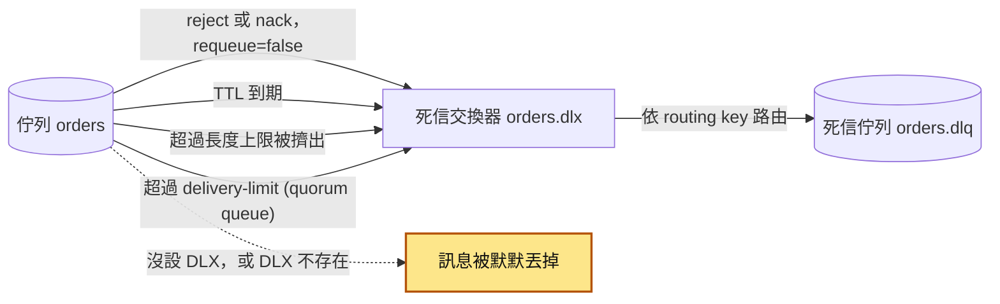

被死信的訊息會多一個 `x-death` header，裡面記錄它是從哪個佇列、因為什麼原因（`rejected`、`expired`、`maxlen`、`delivery_limit`）、死了幾次。之後排查時，先看這個 header。

這裡有三個細節要知道：

- **classic queue 沒有重新投遞次數上限。** 如果你用 classic queue，又在 consumer 裡一律 `nack(requeue=True)`，那就是無限迴圈，跟前面的事故一模一樣。要嘛改用 quorum queue 的 `delivery-limit`，要嘛自己數次數（例如用 header 記錄重試次數），超過就 `requeue=False`。
- **quorum queue 也不是每種「退回」都會被算進次數。** 從 RabbitMQ 4.3 開始，`delivery-limit` 只數「真的失敗」的投遞：`basic.reject`、consumer 斷線或 channel（consumer 跟 RabbitMQ 之間開在連線裡的邏輯通道）關閉時還沒 ack 的訊息會算；但 `basic.nack` 被當成「主動放回去」，**不會**讓 `x-delivery-count`（quorum queue 記在訊息上的重新投遞次數）增加。所以想靠 `delivery-limit` 擋住重試，consumer 退回訊息時要用 `basic.reject(requeue=True)`，不要用 `basic.nack(requeue=True)`，否則上限永遠不會觸發。
- **設了 DLX，但那個交換器不存在，訊息會被默默丟掉。** RabbitMQ 不會報錯給你。設定好之後一定要實際測一次訊息有沒有真的進到 DLQ。

官方建議用 policy（用 `rabbitmqctl` 套用到名稱符合條件的佇列上的設定）設定 DLX，而不是寫死在程式的佇列宣告參數裡，因為 policy 之後可以改，佇列參數一旦宣告就不能改：

```bash
# 對名稱剛好是 orders 的佇列套用 DLX 設定（pattern 是正規表示式；要套用到既有佇列時用 policy 比較方便）
rabbitmqctl set_policy orders-dlx "^orders$" \
  '{"dead-letter-exchange":"orders.dlx","dead-letter-routing-key":"orders"}' \
  --apply-to queues
```

**其他系統**：Kafka 本身沒有內建 DLQ，常見做法是在 consumer 端自己把失敗的訊息寫到另一個 topic（Kafka Connect 和 Spring Kafka 都有現成機制）。如果你用 PostgreSQL 的資料表當工作佇列，DLQ 通常就是一個狀態欄位。下面這張圖是 `jobs` 資料表裡一筆工作的 `status` 怎麼切換：

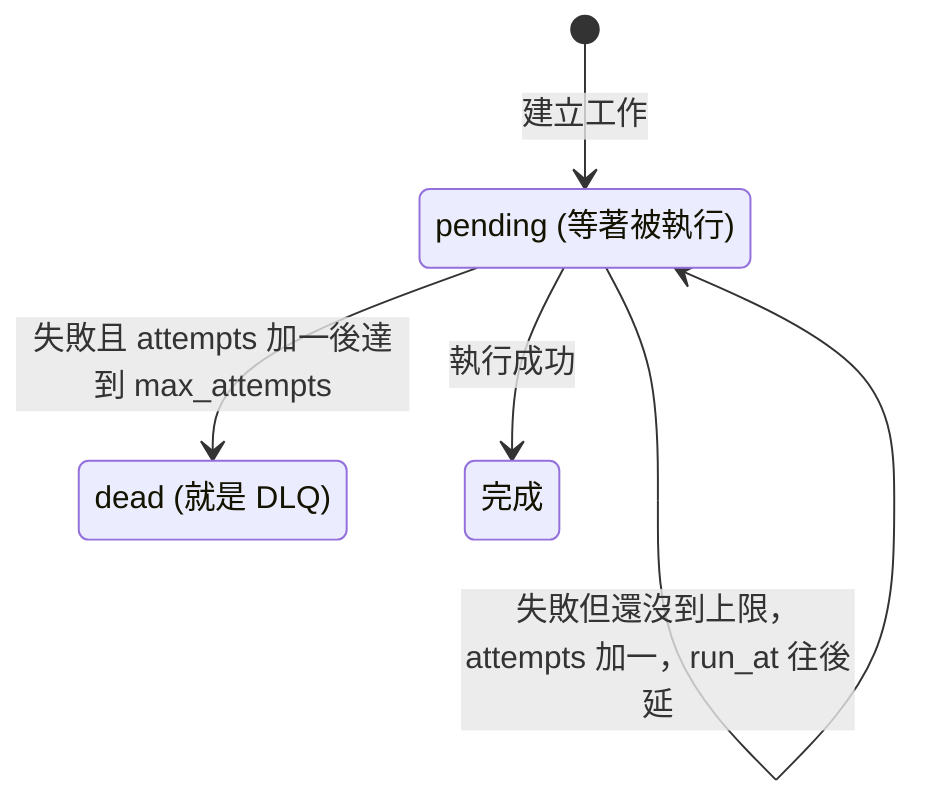

失敗時用一句 `UPDATE` 同時做三件事：`attempts` 加一、`last_error` 記下原因（例如 `'invoice api 400: tax_id is empty'`）、用 `CASE WHEN attempts + 1 >= max_attempts THEN 'dead' ELSE 'pending' END` 決定新狀態。下次執行時間用 `run_at = now() + interval '30 seconds' * power(2, attempts)` 做指數退避。注意 `UPDATE` 的 `SET` 裡引用 `attempts`，拿到的都是更新前的舊值，所以判斷上限時要寫 `attempts + 1`。

### DLQ 不等於重試機制

新人常把兩者混在一起。**重試**負責「暫時性失敗再給一次機會」，應該要有間隔（[指數退避](27-指數退避.md)加[抖動](28-抖動.md)）；**DLQ** 負責「重試也救不了的，先隔離起來」。

broker 內建的重新投遞都沒有指數退避：RabbitMQ 的訊息一被退回，幾乎馬上又被拿出來；SQS 則是固定等可見性逾時（預設 30 秒）一到就重新出現，每次間隔都一樣。如果對方服務掛了 5 分鐘，RabbitMQ 5 秒內就把 5 次重試用光，SQS 用預設值也撐不過 3 分鐘，然後一大批正常的訊息全進 DLQ。下面這張表假設兩邊的上限都是 5 次、每次一呼叫下游就失敗：

| 時間 | 經過多久 | 下游服務 | RabbitMQ（立刻重新投遞） | SQS（每次等 30 秒可見性逾時） |
|---|---|---|---|---|
| T1 | 0 秒 | 掛了 | 第 1 次失敗 | 第 1 次失敗 |
| T2 | 5 秒內 | 掛著 | 5 次用光，進 DLQ | 等可見性逾時 |
| T3 | 30 秒 | 掛著 | 已在 DLQ | 第 2 次失敗 |
| T4 | 2 分鐘 | 掛著 | 已在 DLQ | 第 5 次失敗 |
| T5 | 2 分 30 秒 | 掛著 | 已在 DLQ | 收到次數要超過 5，進 DLQ |
| T6 | 5 分鐘 | 恢復 | 已在 DLQ | 已在 DLQ |

實務上常見的做法是在主佇列和 DLQ 中間再加一層「延遲重試佇列」（例如 RabbitMQ 用帶 TTL 的佇列，TTL 到期後再死信回主佇列；SQS 可以用 `ChangeMessageVisibility` 拉長下次出現的時間）。下面這張圖是 RabbitMQ 的延遲重試佇列：

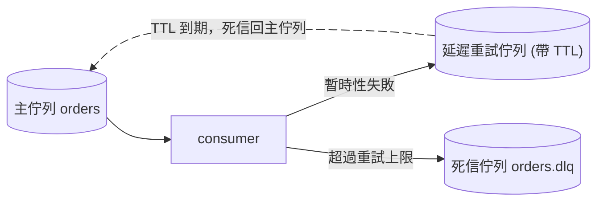

每一輪重試中間都隔了一段 TTL，下游有時間恢復。細節看[重試機制](26-重試機制.md)那篇；**重試次數上限要搭配重試間隔一起設計。**

### 進了 DLQ 之後：監控、檢查、修正、送回

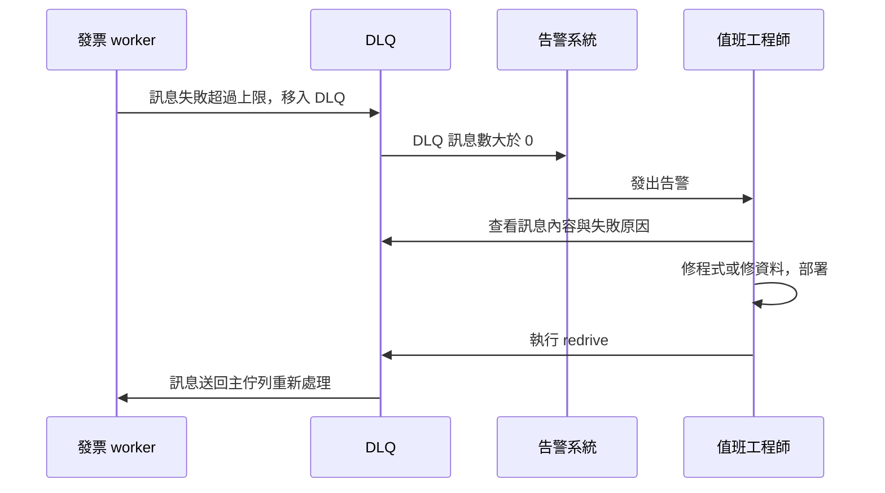

**1. 監控告警**：最基本的條件是「DLQ 訊息數 > 0」。SQS 看 DLQ 的 `ApproximateNumberOfMessagesVisible`；RabbitMQ 看 DLQ 的 messages ready 數量（Prometheus 外掛或管理介面都有）。量大的系統也可以改成「DLQ 訊息增加速率」或「DLQ 最老訊息的年齡」。不管用哪個條件，**一定要有人收到通知，而且告警要寫清楚是哪條佇列、對應哪個 worker、誰負責。**

**2. 檢查**：打開 DLQ 看幾則訊息，搞清楚它們失敗的原因是不是同一個。這一步的前提是失敗原因有被記下來（見下一小節）。

**3. 修正**：根因可能在程式（修 bug、部署）、在資料（補正上游資料）、或在外部服務（等對方恢復）。**根因沒修好之前不要 redrive**，不然訊息只會再走一輪、再回到 DLQ。

**4. Redrive（送回主佇列）**：把 DLQ 的訊息送回原本的佇列。它跟 broker 在主佇列裡自動做的重新投遞（redelivery）不同：redrive 搬的是已經進了 DLQ 的訊息。SQS 有原生支援，主控台上有「Start DLQ redrive」，也可以用 API：`aws sqs start-message-move-task` 加上 `--source-arn`（DLQ 的 ARN）和 `--max-number-of-messages-per-second 50`。後者是限速，避免一次全部灌回去把下游打爆；不指定 `--destination-arn` 時，預設送回原本的來源佇列。

RabbitMQ 沒有一鍵 redrive，常見做法是用 Shovel 外掛把 DLQ 的訊息搬回去，或寫一支小腳本（下面「動手看看」會示範）。不管哪種方式，**都要限速**，而且要確認 consumer 是冪等的。

有些訊息不該送回去，例如測試資料、已經人工處理過的訂單。這種要記錄下來（誰、什麼時候、為什麼決定不處理）再刪掉，不要讓 DLQ 永遠堆著舊訊息，否則下次告警響的時候，你分不出哪些是新的問題。

### 記錄失敗原因

DLQ 裡如果只有訊息原文，排查時你只能猜。至少要能回答：**它在哪個服務、什麼時候、因為什麼錯誤失敗？試了幾次？**

有兩種做法，下面這張圖對照它們各自的步驟：

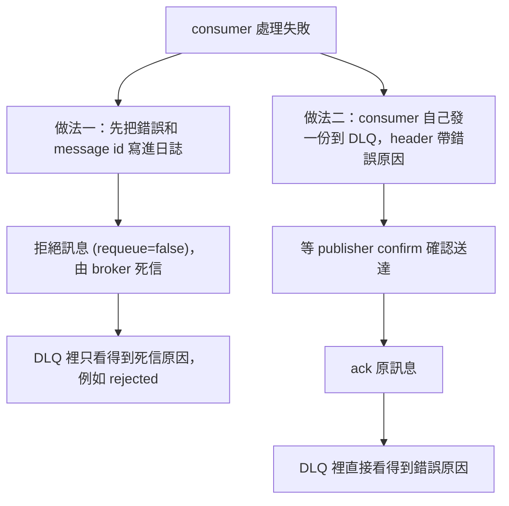

- **讓 broker 死信（`requeue=false` 拒絕或靠次數上限）**：搬移由 broker 負責，程式最簡單（但 RabbitMQ 預設的死信是「最多一次」：訊息從主佇列搬到 DLQ 的途中，DLQ 收不下時仍可能掉訊息），而且它只記錄「為什麼被死信」（例如 `rejected`），不知道你程式裡的錯誤訊息。所以你要在 nack 之前，**把錯誤和訊息的識別資訊（message id、訂單編號）寫進日誌**，之後用 id 去日誌系統找。
- **consumer 自己把訊息發到 DLQ**：發送時在 header 帶上 `x-error-type`、`x-error-message`、`x-failed-at`、`x-service` 這類欄位，然後 ack 原訊息。好處是 DLQ 裡直接看得到原因；代價是你要自己處理「發到 DLQ 成功了、ack 原訊息前程式掛掉」造成的重複，所以發送要開 publisher confirm（broker 回報「這則訊息我收到了」的機制），確認送達後才 ack。

兩種都可以，挑一種、全團隊一致就好。另外要注意：錯誤訊息和訊息內容可能含有個資或 token，寫進日誌或 header 前要遮罩。

## 動手看看

用 RabbitMQ 重現「正常訊息、毒訊息、一直暫時失敗的訊息」三種情況，看它們各自的下場。

**1. 起一個 RabbitMQ**（4.x，含管理介面）：

```bash
docker run -d --name rmq -p 5672:5672 -p 15672:15672 rabbitmq:4-management
# 管理介面：http://localhost:15672，帳密 guest / guest
pip install pika   # 或 uv run --with pika python xxx.py
```

**2. 建立佇列並發送測試訊息**（`setup.py`）：

```python
import json
import pika

conn = pika.BlockingConnection(pika.ConnectionParameters("localhost"))
ch = conn.channel()

# 死信交換器 + DLQ
# DLQ 用 classic queue：RabbitMQ 4.x 的 quorum queue 有預設 delivery-limit，
# 反覆「偷看」DLQ 可能把次數用完，讓訊息從 DLQ 裡消失
ch.exchange_declare(exchange="orders.dlx", exchange_type="direct", durable=True)
ch.queue_declare(queue="orders.dlq", durable=True)
ch.queue_bind(queue="orders.dlq", exchange="orders.dlx", routing_key="orders")

# 主佇列：quorum queue，最多重新投遞 3 次，超過就死信到 orders.dlx
# 示範方便才直接寫在 x-arguments；正式環境建議用前面的 policy 設定
ch.queue_declare(
    queue="orders",
    durable=True,
    arguments={
        "x-queue-type": "quorum",
        "x-delivery-limit": 3,
        "x-dead-letter-exchange": "orders.dlx",
        "x-dead-letter-routing-key": "orders",
    },
)

messages = [
    json.dumps({"order_id": 1001, "amount": 500}),          # 正常
    "這不是 JSON",                                           # 毒訊息：永久性失敗
    json.dumps({"order_id": 1003, "simulate": "timeout"}),  # 一直暫時性失敗
]
for body in messages:
    ch.basic_publish(
        exchange="",
        routing_key="orders",
        body=body.encode(),
        properties=pika.BasicProperties(delivery_mode=2),  # 持久化
    )
print("已發送 3 則訊息")
conn.close()
```

**3. 啟動 consumer**（`worker.py`）：

```python
import json
import logging
import pika

logging.basicConfig(level=logging.INFO, format="%(asctime)s %(message)s")
log = logging.getLogger("worker")

class NonRetryableError(Exception):
    """重試也不會好的錯誤：直接送 DLQ"""

class RetryableError(Exception):
    """暫時性錯誤：值得再試"""

def handle(body: bytes) -> None:
    try:
        data = json.loads(body)
    except json.JSONDecodeError as e:
        raise NonRetryableError(f"payload 不是合法 JSON: {e}") from e
    if data.get("simulate") == "timeout":
        raise RetryableError("呼叫發票服務逾時")
    log.info("處理成功 order_id=%s", data["order_id"])

def on_message(ch, method, properties, body):
    # quorum queue 會在重新投遞的訊息上帶 x-delivery-count
    count = (properties.headers or {}).get("x-delivery-count", 0)
    try:
        handle(body)
        ch.basic_ack(method.delivery_tag)
    except NonRetryableError as e:
        # 先把原因寫進日誌（broker 不會幫你記），再拒絕且不 requeue → 進 DLQ
        log.error("毒訊息，直接送 DLQ: %s body=%r", e, body[:200])
        ch.basic_nack(method.delivery_tag, requeue=False)
    except RetryableError as e:
        # 丟回佇列；超過 x-delivery-limit 後 broker 會自動送 DLQ
        # 用 basic_reject 而不是 basic_nack：RabbitMQ 4.3 起 nack 不會增加 x-delivery-count，
        # 用 nack(requeue=True) 的話上限永遠不會觸發，又變回無限重試
        # 注意：這裡是「立即」重試，正式環境要搭配延遲重試
        log.warning("暫時性失敗（已重新投遞 %s 次）: %s", count, e)
        ch.basic_reject(method.delivery_tag, requeue=True)

conn = pika.BlockingConnection(pika.ConnectionParameters("localhost"))
ch = conn.channel()
ch.basic_qos(prefetch_count=1)
ch.basic_consume(queue="orders", on_message_callback=on_message)
log.info("等待訊息中，Ctrl+C 結束")
try:
    ch.start_consuming()
except KeyboardInterrupt:
    conn.close()
```

**預期會看到**：

- `order_id=1001` 一次就處理成功。
- `"這不是 JSON"` 只出現一次「毒訊息，直接送 DLQ」，沒有浪費任何重試次數。
- `order_id=1003` 出現好幾行「暫時性失敗」，`x-delivery-count` 一路往上加，超過上限後就不再出現。
- 打開管理介面，`orders` 是 0 則，`orders.dlq` 有 2 則。

**4. 檢查 DLQ 裡的訊息**（`inspect_dlq.py`）：

```python
import pika

conn = pika.BlockingConnection(pika.ConnectionParameters("localhost"))
ch = conn.channel()

# 只看不取走：用 basic_get 拿出來但不 ack，連線關閉時訊息會自動回到 DLQ
while True:
    method, props, body = ch.basic_get(queue="orders.dlq", auto_ack=False)
    if method is None:
        break
    headers = props.headers or {}
    print("body          :", body.decode(errors="replace"))
    print("first death   :", headers.get("x-first-death-reason"))
    for d in headers.get("x-death", []):
        print("x-death       :", d.get("queue"), d.get("reason"), "count=", d.get("count"))
    print("-" * 40)

conn.close()
```

你會看到 `"這不是 JSON"` 的原因是 `rejected`（consumer 主動拒絕），`order_id=1003` 的原因是 `delivery_limit`（重新投遞次數用完）。光看原因就能分辨「程式判定為壞資料」還是「一直暫時性失敗」，排查方向完全不同。

**5. 修好之後 redrive**（`redrive.py`）：

```python
import time
import pika

conn = pika.BlockingConnection(pika.ConnectionParameters("localhost"))
ch = conn.channel()
ch.confirm_delivery()  # 開啟 publisher confirm：確定送達主佇列，才從 DLQ 刪除

moved = 0
while True:
    method, props, body = ch.basic_get(queue="orders.dlq", auto_ack=False)
    if method is None:
        break
    # 篩選：這裡只送回 delivery_limit 的（暫時性失敗），被判定為壞資料的留著人工處理
    if (props.headers or {}).get("x-first-death-reason") != "delivery_limit":
        continue  # 不 ack，連線結束時自動放回 DLQ
    headers = dict(props.headers or {})
    headers["x-redriven-at"] = int(time.time())  # 留下「這則被 redrive 過」的痕跡
    ch.basic_publish(
        exchange="",
        routing_key="orders",
        body=body,
        properties=pika.BasicProperties(delivery_mode=2, headers=headers),
        mandatory=True,  # 沒有任何佇列收（例如 orders 被刪了）就退回並丟例外，否則 broker 會默默丟掉
    )  # 開了 confirm + mandatory 後，送不到會丟出例外，就不會走到下面的 ack
    ch.basic_ack(method.delivery_tag)  # 確認送達後才從 DLQ 刪掉
    moved += 1
    time.sleep(0.02)  # 限速

print(f"送回 {moved} 則")
conn.close()
```

如果你沒修 `simulate: timeout` 的邏輯就 redrive，會看到它在主佇列再失敗三四次後又回到 DLQ，這就是「根因沒修好就 redrive」的樣子。再跑一次 `inspect_dlq.py` 會發現，它的 `x-death` 仍然是 `count= 1`，只有時間變新：RabbitMQ 會忽略 client 重新發布時自己帶的 `x-death`，所以 `x-death` 的 count 不能拿來數「被 redrive 過幾次」，要限制 redrive 次數就得自己用 header（例如上面的 `x-redriven-at`，或另外記一個次數）來數。另外注意：publish 成功、ack 之前如果腳本掛掉，同一則訊息會同時存在主佇列和 DLQ，這也是為什麼 consumer 必須冪等。

玩完記得清掉：`docker rm -f rmq`。

## 常見地雷

**1. 只設了「停止重試」，沒設 DLQ**

- ❌ 錯誤做法：RabbitMQ consumer 改成 `nack(requeue=False)` 或 `reject`，但佇列沒有設定 dead-letter-exchange。
- 為什麼錯：訊息直接被丟掉，沒有錯誤、沒有告警。就是前面事故的第二階段。
- ✅ 正確做法：先設好 DLX 和 DLQ（用 policy），實際發一則測試訊息確認真的會進 DLQ，才把 consumer 改成 `requeue=False`。

**2. DLQ 沒有監控告警**

- ❌ 錯誤做法：建了 DLQ 就當作完成，從來沒人去看。
- 為什麼錯：DLQ 會一路堆到訊息過期被自動刪掉（SQS 訊息最長保留 14 天），結果跟直接丟掉一樣，只是晚幾天。而且 SQS 有個小陷阱：因為處理失敗被自動移進 DLQ 的訊息，不會算進 DLQ 的 `NumberOfMessagesSent` 指標，拿這個指標設告警會永遠不響。
- ✅ 正確做法：對 DLQ 的「目前訊息數」（SQS 的 `ApproximateNumberOfMessagesVisible`）設告警，大於 0 就通知負責的團隊。DLQ 的保留期也要設得比來源佇列長（SQS 標準佇列的過期時間是從訊息最初進入來源佇列時開始算，不是從進 DLQ 才開始）。

**3. `maxReceiveCount` 設成 1，或可見性逾時比處理時間短**

- ❌ 錯誤做法：「失敗就該進 DLQ」，所以 `maxReceiveCount` 設成 1；或者可見性逾時用預設 30 秒，但處理一則要跑 1 分鐘。
- 為什麼錯：上限設 1 等於沒有重試，網路抖一下正常訊息就進 DLQ，DLQ 被雜訊淹沒，大家開始忽略告警。可見性逾時太短則會讓還在處理中的訊息又被別的 worker 收到，收到次數一直被灌高，最後正常訊息被誤判送進 DLQ（還可能被處理兩次）。
- ✅ 正確做法：上限通常設 3～10 次，搭配退避間隔；可見性逾時要大於最慢的處理時間，處理時間長的工作，處理過程中要延長可見性逾時。

**4. 所有錯誤一視同仁**

- ❌ 錯誤做法：`except Exception: nack(requeue=True)`，JSON 壞掉也重試五次。
- 為什麼錯：永久性失敗重試只是浪費資源、拖慢其他訊息。反過來，把逾時也直接送 DLQ，則會讓下游一抖動就塞滿 DLQ。
- ✅ 正確做法：在 consumer 裡把錯誤分成可重試／不可重試兩類（像上面的 `RetryableError` / `NonRetryableError`），不可重試的直接送 DLQ。

**5. 根因沒修就 redrive，或一次全部灌回去**

- ❌ 錯誤做法：看到 DLQ 有 1 萬則，直接全部 redrive。
- 為什麼錯：根因還在，訊息只是再繞一圈回到 DLQ。就算根因修好了，1 萬則同時湧進來也可能把下游服務打掛，引發新的事故（這時就需要[背壓](47-背壓.md)和[速率限制](30-速率限制.md)了）。
- ✅ 正確做法：先抽幾則看原因、確認已修好，先 redrive 少量觀察結果，沒問題再限速送回剩下的。

**6. consumer 不冪等就 redrive**

- ❌ 錯誤做法：DLQ 裡的訊息有些其實已經處理到一半（例如扣款成功但後續寫資料庫失敗），直接 redrive。
- 為什麼錯：redrive 等於再處理一次，非冪等的操作會被重做：重複扣款、重複寄信。
- ✅ 正確做法：consumer 一律用[冪等性](25-冪等性.md)的設計（例如以訊息 id 或業務 key 搭配唯一約束去重），這不只是為了 redrive，訊息佇列本來就是「至少一次」投遞。

**7. classic queue 加上無腦 requeue**

- ❌ 錯誤做法：RabbitMQ classic queue，例外時一律 `nack(requeue=True)`，以為 broker 會幫你數次數。
- 為什麼錯：classic queue 沒有 delivery-limit，毒訊息會無限循環。
- ✅ 正確做法：改用 quorum queue 並設 `delivery-limit`，或自己在 header 數重試次數、超過就 `requeue=False`。用 quorum queue 時，退回訊息要用 `basic.reject(requeue=True)`；RabbitMQ 4.3 起 `basic.nack` 不計入投遞次數，用 nack 等於沒有上限。

## 重點整理

- **失敗的訊息只有三條路：無限重試、丟掉、移到死信佇列（DLQ）。** 無限重試會讓毒訊息卡住整條佇列、灌爆日誌；丟掉則是資料默默不見，幾天後才有人發現。DLQ 是第三條路：先隔離，晚點再處理。
- **一定要設「最多重試幾次」。** SQS 用 `maxReceiveCount`，RabbitMQ 用 dead-letter-exchange 加上 quorum queue 的 `delivery-limit`。沒設上限的佇列，遲早會遇到一則毒訊息把 worker 卡死。
- **先分清楚暫時性失敗和永久性失敗。** 逾時、對方回 `503` 值得重試；JSON 格式壞掉、欄位缺漏重試一萬次也一樣錯，應該直接送 DLQ，不要浪費重試次數。
- **DLQ 是一份待辦清單。** 進 DLQ 的每一則訊息都代表「某件該做的事沒做」。DLQ 一定要有監控和告警，條件很簡單：裡面有東西就叫人。
- **進 DLQ 之後要能做三件事：看得到原因、修得了根因、送得回去（redrive）。** 所以失敗原因要記下來；redrive 要靠 consumer 是冪等的，因為訊息一定會被處理不只一次。

## 新人必知清單

### 一定要會（基本功）

- [ ] 說得出失敗訊息的三條路（無限重試、丟掉、DLQ），以及前兩條各自會出什麼事
- [ ] 解釋什麼是毒訊息，以及它為什麼會卡住整條佇列
- [ ] 在 consumer 裡區分可重試和不可重試的錯誤
- [ ] 知道你們公司用的 broker 怎麼設重試上限和 DLQ（SQS 的 `maxReceiveCount` + redrive policy，或 RabbitMQ 的 DLX + `delivery-limit`）
- [ ] 每一個新的 consumer 上線前，確認它有 DLQ，而且 DLQ 有告警、有負責人
- [ ] 失敗時記下原因：至少要有訊息 id、錯誤類型、錯誤訊息、時間、服務名稱
- [ ] 知道 redrive 的正確順序：先看原因、修好根因，再少量試送，最後限速送回
- [ ] 知道 redrive 依賴 consumer 冪等

### 知道有這回事就好

- RabbitMQ 的 `x-death` header 結構，以及 `rejected`、`expired`、`maxlen`、`delivery_limit` 四種死信原因
- RabbitMQ 4.x 的 quorum queue 有預設的 delivery-limit（4.0 起預設 20），不設也會有上限；4.3 起只有 `reject`、斷線這類「真的失敗」才計入次數，`nack` 不算（升級前請查你們版本的官方文件）
- RabbitMQ 預設的死信是「最多一次」，quorum queue 可以設成 at-least-once 死信，代價是要搭配特定的溢位設定
- SQS 的 `RedriveAllowPolicy`：限制哪些來源佇列可以把某個佇列當成 DLQ
- SQS FIFO 佇列的 DLQ 也要是 FIFO，訊息進 DLQ 後原本的順序保證就不存在了
- Lambda 消費 SQS 時，一批裡有一則失敗，預設整批都會被視為失敗、重回佇列；可以用 partial batch response（`ReportBatchItemFailures`）只回報失敗的那幾則
- Kafka 沒有內建 DLQ，要靠 consumer 框架或自己寫到另一個 topic
- 用延遲佇列（TTL + 死信）做退避重試的模式

### 先不用管（等你遇到再學）

- 多層 DLQ（retry-1m、retry-10m、retry-1h、最後才 dead）的完整設計
- 跨區域、跨帳號的 DLQ 架構
- 自動化 redrive（偵測到下游恢復就自動送回）
- DLQ 訊息的長期歸檔與稽核（例如定期匯出到物件儲存）

## Code Review 時可以問的問題

1. 這個 consumer 失敗時會發生什麼事？有重試上限嗎？超過上限訊息去哪裡？
2. 哪些錯誤會重試、哪些直接送 DLQ？`except Exception` 是不是把兩種都混在一起了？
3. 這條佇列的 DLQ 有告警嗎？告警會送到哪個團隊？runbook 裡有寫怎麼 redrive 嗎？
4. 失敗原因記在哪裡？從 DLQ 裡的一則訊息，能不能找到當初的錯誤日誌？日誌和 header 裡有沒有個資或 token 沒遮罩？
5. 這個 consumer 冪等嗎？同一則訊息被 redrive 再處理一次會不會出事？
6. （SQS）可見性逾時夠不夠長？`maxReceiveCount` 跟退避間隔加起來，能不能撐過下游一次幾分鐘的故障？

## 情境演練

**Q1. worker 的日誌一分鐘多出幾萬行一模一樣的錯誤，都是同一則訊息的 JSON 解析失敗，佇列長度一路往上爬。同事說：「應該是下游暫時不穩，等一下就好。」你會怎麼判斷？**

<details markdown="1"><summary>看答案</summary>

JSON 解析失敗是永久性失敗，等多久都不會好，這則就是毒訊息：不管重試幾次都一定會失敗的訊息，例如格式壞掉、觸發程式 bug。它危險的地方在於「一直回來」：沒有重試上限的話，它會被反覆拿出來處理，佔用 worker、灌爆日誌，讓後面正常的訊息延遲；如果它會讓 worker 崩潰，還會讓整個 consumer 群組輪流崩潰。一般的暫時性失敗過一陣子就好了，毒訊息不會自己好，所以要讓這類錯誤直接進 DLQ，並設好重試上限。

</details>

**Q2. 你把 RabbitMQ consumer 的錯誤處理改成 `basic_nack(requeue=False)`，打算讓失敗的訊息進 DLQ。上線前你會先確認什麼？**

<details markdown="1"><summary>看答案</summary>

先確認訊息真的會進 DLQ。只有在佇列設定了 dead-letter-exchange，而且那個交換器存在、有綁定到 DLQ 時，訊息才會進 DLQ。沒有設 DLX，或 DLX 不存在，或交換器沒有任何綁定能路由到，訊息都會直接消失，而且不會有錯誤。所以設定完一定要實際發一則測試訊息，確認它進了 DLQ。

</details>

**Q3. SQS 的 `maxReceiveCount` 設成 5。你在日誌裡看到某則訊息其實每次都處理成功，卻還是進了 DLQ。你會先查哪裡？**

<details markdown="1"><summary>看答案</summary>

最常見的原因是 consumer 沒有在處理完後呼叫 `DeleteMessage`（或刪除失敗），SQS 不知道你處理完了，可見性逾時一過就讓它重新出現。另一個原因是可見性逾時比處理時間短：處理還沒結束，訊息就又可以被收到，收到次數被灌高。SQS 數的是「被收到幾次」，不是「失敗幾次」，所以這兩種情況都會累積次數，最後被送進 DLQ（而且通常已經被重複處理好幾次了）。

</details>

**Q4. 週一早上你收到告警：`payment-events` 的 DLQ 在週末累積了 3,000 則訊息。主管說「先全部 redrive 回去，讓它們處理掉」。你會怎麼做？**

<details markdown="1"><summary>看答案</summary>

不要直接全部 redrive。建議的步驟：

1. **先看原因**：抽幾十則看失敗原因（日誌或 header），確認是同一個原因還是好幾種。3,000 則通常是同一個根因造成的，例如某次部署帶進的 bug，或下游服務週末維護。
2. **確認根因已排除**：bug 修好部署了沒？下游恢復了沒？如果是資料本身有問題（壞資料），redrive 也沒用，要先修資料或改成人工處理。
3. **確認冪等**：付款相關的 consumer 是否能安全地處理重複訊息？有些訊息可能處理到一半才失敗，再處理一次會不會重複扣款？
4. **少量試**：先 redrive 幾十則，觀察成功率和下游負載。
5. **限速送回剩下的**：避免 3,000 則同時湧進去把下游打掛。
6. **事後**：檢討為什麼告警週末就響了卻沒人處理，以及這個錯誤是不是應該被歸類成可重試、需要更長的退避。

</details>

**Q5. 有人提議：「既然 DLQ 的訊息最後通常都要 redrive，不如寫個排程，每 10 分鐘自動把 DLQ 全部送回主佇列。」這樣有什麼問題？什麼情況下可以接受？**

<details markdown="1"><summary>看答案</summary>

主要問題是：它把 DLQ 變回了「無限重試」，只是間隔變成 10 分鐘。毒訊息會永遠在主佇列和 DLQ 之間循環，DLQ 的告警也失去意義（數字一直被清空，看不出有沒有新問題），而且永久性失敗會一直消耗資源。

可以接受的情況是：只自動 redrive「暫時性失敗」那一類（例如死信原因是 `delivery_limit`，或 header 標記為可重試），而且要有「最多 redrive 幾次」的上限，超過就留在 DLQ 等人；被判定為壞資料的訊息不能自動送回。換句話說，這其實是在做一層很慢的延遲重試，比較好的做法是直接設計延遲重試佇列，讓 DLQ 保持「只放真的需要人處理的訊息」。

</details>

## 相關主題

- [訊息佇列](35-訊息佇列.md)：DLQ 建立在訊息佇列的 ack／投遞語意之上，先懂「至少一次」投遞再來看這篇。
- [重試機制](26-重試機制.md)：DLQ 是重試的終點，重試上限和該不該重試的判斷在那篇有完整說明。
- [指數退避](27-指數退避.md)：重試要有間隔，否則重試次數一下就用光，正常訊息也被送進 DLQ。
- [冪等性](25-冪等性.md)：redrive 一定會造成重複處理，consumer 不冪等就不能放心 redrive。
- [背景工作者](37-背景工作者.md)：大部分 DLQ 裡的訊息都是背景工作者處理失敗的結果，worker 的錯誤處理和 DLQ 要一起設計。
- [Webhook 重試](41-Webhook%20重試.md)：對外送 webhook 時，重試用完的事件也需要一個類似 DLQ 的地方讓人檢查、手動重送。

## 延伸閱讀

- RabbitMQ 官方文件：Dead Letter Exchanges — https://www.rabbitmq.com/docs/dlx
- RabbitMQ 官方文件：Quorum Queues（含 poison message handling 與 delivery-limit）— https://www.rabbitmq.com/docs/quorum-queues
- Amazon SQS Developer Guide：Using dead-letter queues in Amazon SQS — https://docs.aws.amazon.com/AWSSimpleQueueService/latest/SQSDeveloperGuide/sqs-dead-letter-queues.html
