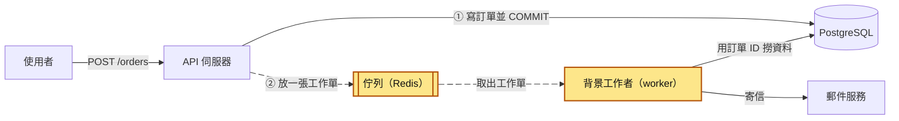
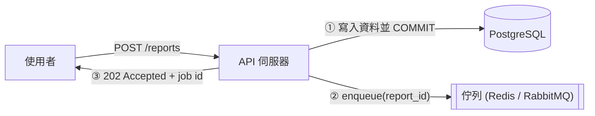
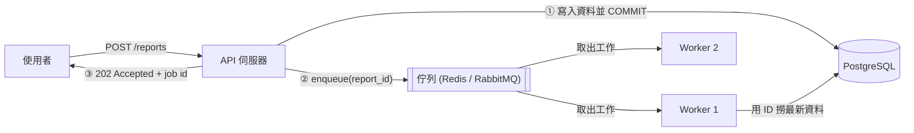
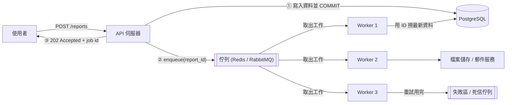
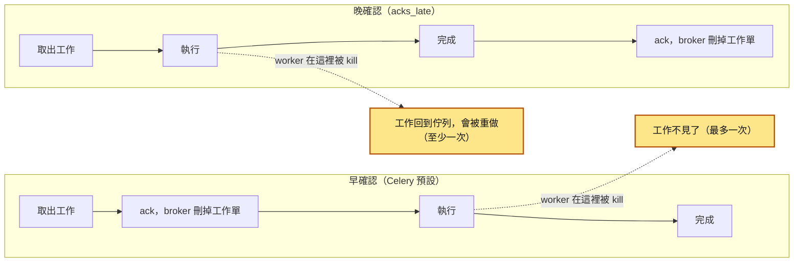
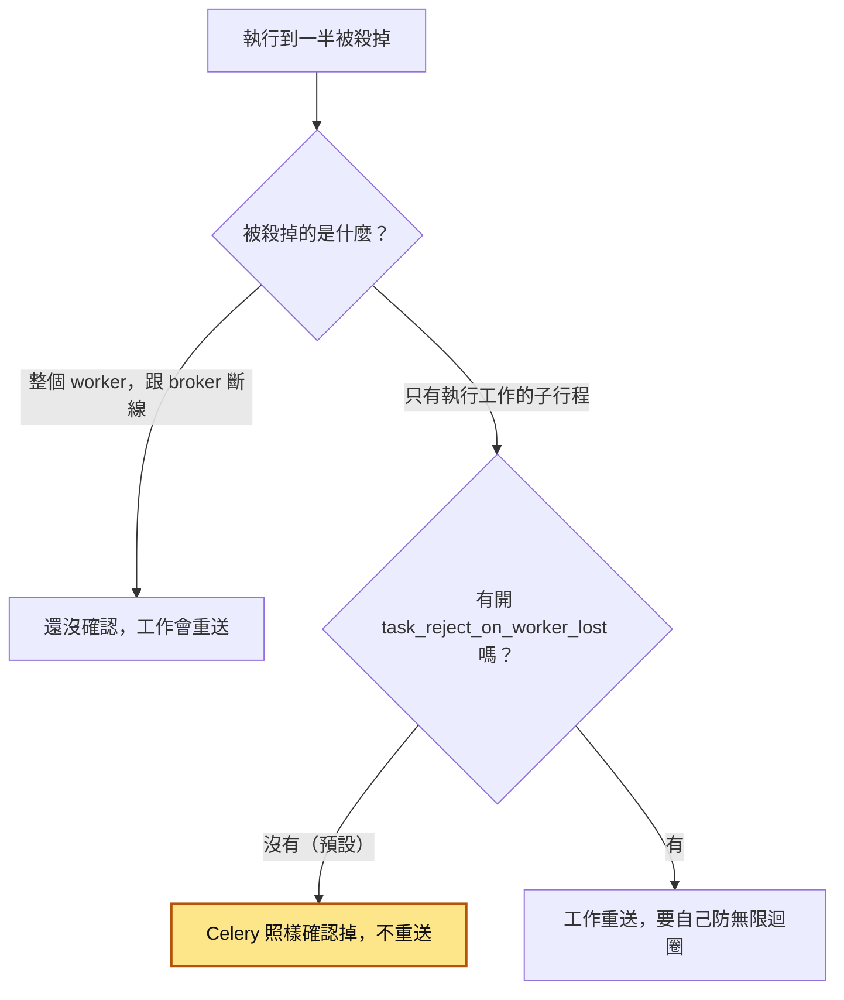
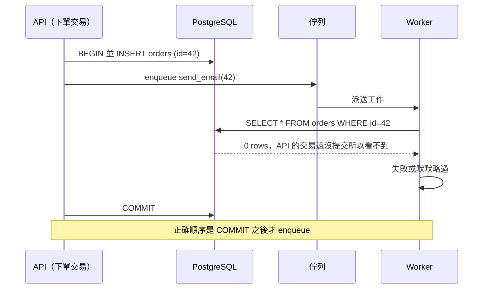
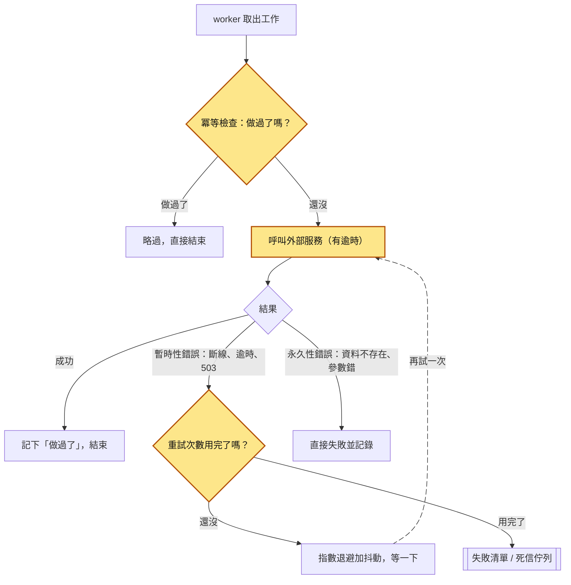

# 37｜背景工作者（Background Worker）

> 背景工作者（background worker）是跟 API 分開跑的另一支程式，專門處理「不用馬上給使用者答案」的耗時工作，例如寄信、產報表。API 只把「要做什麼」寫成一張工作單，放進佇列（排隊等人處理的待辦清單），背景工作者再從佇列一張一張拿出來做。

**難度**：★★☆　**閱讀時間**：約 20 分鐘　**前置知識**：[資料庫交易](03-資料庫交易.md)、[唯一約束](14-唯一約束.md)、[冪等性](25-冪等性.md)、[訊息佇列](35-訊息佇列.md)

## 核心問題與理念

**它要解決的問題**：寄確認信這類慢工作放在下單請求裡做，郵件服務一慢，下單就跟著慢，最慢的 1% 請求從 0.3 秒拖到 8 秒。搬到背景去做之後又冒出新問題：寄信的工作單在訂單還沒真正存好之前就送了出去，背景程式去查訂單查不到，那封信就沒寄（下面的情境會完整走一遍）。

**核心理念**：使用者不用馬上看到結果的事，等資料存好後開一張只寫 ID 的工作單，交給另一支程式做。

**想通的那一步**：

- **卡住的地方**：直覺的做法是讓 API 自己把信寄完再回應，郵件服務一慢，下單就跟著慢。改成在同一支程式裡另外開一條執行緒去寄，程式一重啟，還沒寄的信就跟著消失。
- **火花**：把「要做什麼」寫成一張工作單，放進獨立的佇列（排隊等人處理的待辦清單），由另一支程式照單去做。工作單上只寫訂單 ID，真正動手時才去資料庫讀最新資料，所以排隊排了 10 分鐘也不會拿到過期的內容。

## 閱讀前推薦具備知識

| 知識 | 要會到什麼程度 | 這篇哪裡會用到 | 不熟的話先看 |
|---|---|---|---|
| [資料庫交易](03-資料庫交易.md) | **必備**：知道在 PostgreSQL 預設設定下，交易 `COMMIT` 之前寫入的資料，別的連線查不到；交易 `ROLLBACK` 之後，那些寫入就像沒發生過 | 情境表 T1～T7「別的連線查得到訂單 42 嗎」那一欄、「為什麼要在交易提交後才送出」、地雷 1 | 本系列第 03 篇 |
| Python 的函式、`with` 區塊與裝飾器 | **必備**：看得懂 `with psycopg.connect(DSN) as conn:` 區塊和 `raise LookupError(...)`；看到函式上方的 `@transaction.atomic`、`@shared_task(...)`，知道它們是替這個函式加上額外的行為 | 情境的 `create_order()`、「動手看看」的 `tasks.py` 和 `api.py`、地雷 5 的 Celery 範例 | [Python 官方教學（中文）](https://docs.python.org/zh-tw/3/tutorial/index.html) |
| [唯一約束](14-唯一約束.md) | **加分**：知道主鍵讓同一組值只能寫進一次，`INSERT ... ON CONFLICT DO NOTHING RETURNING ...` 遇到重複時什麼都不寫、也不回傳任何列 | `tasks.py` 用 `email_log` 的主鍵占位、判斷「寄過了沒」 | 本系列第 14 篇 |
| [冪等性](25-冪等性.md) | **加分**：知道同一個工作做兩次，結果要跟做一次一樣 | 「冪等、逾時、重試：三件套」、地雷 3、「動手看看」第 5 步 | 本系列第 25 篇 |
| [訊息佇列](35-訊息佇列.md) | **加分**：知道生產者把訊息放進佇列、消費者取出處理，以及 ack 的早晚決定當機時是「工作不見」還是「工作重做」 | 「全貌」那張圖、「工作的生命週期與確認時機」 | 本系列第 35 篇 |
| Docker 與 Linux 終端機 | **加分**：會用 `docker run` 起容器，並在 WSL、macOS 或 Linux 的終端機開兩個視窗，分別跑 worker 和 API | 「動手看看」第 1 步和第 4 步 | [Docker 入門](https://docs.docker.com/get-started/) |

**快速自我檢查**：API 的交易裡已經 `INSERT` 了訂單 42，但還沒 `COMMIT`。這時 worker 用另一條資料庫連線執行 `SELECT * FROM orders WHERE id = 42`，查得到嗎？如果 API 的交易後來 `ROLLBACK` 了呢？

<details markdown="1"><summary>看答案</summary>

查不到。在 PostgreSQL 預設的 Read Committed 隔離等級下，還沒提交的資料只有那個交易自己看得到。如果後來 `ROLLBACK`，訂單 42 就永遠不會出現，worker 什麼時候查都查不到。答不出來也沒關係，先看第 03 篇資料庫交易「動手看看」裡「未提交的修改別人看不到」那一步。

</details>

## 為什麼要在意：一個具體的情境

下面是一個假設情境。假設你負責一個電商網站的下單 API，用 Python 的 Django 框架寫成。原本的流程是同步的：建立訂單、呼叫郵件服務寄確認信、回傳 `201`。郵件服務一慢，下單 API 就跟著慢，最慢的那 1% 請求（p99 延遲）從 300ms 變成 8 秒。

團隊決定把寄信交給 Celery（Python 最常用的背景工作框架）：API 只把「寄信」這張工作單放進佇列（這裡用 Redis 當佇列），另一支叫 worker 的程式再從佇列拿出來寄。改完的下單函式 `create_order()` 加上了 `@transaction.atomic`，整個函式包成一個交易，函式結束時才 `COMMIT`。函式裡依序做 4 件事：

1. 建立訂單。
2. 逐一建立訂單品項，一張訂單常常有十幾個品項。
3. 呼叫 `send_order_email.delay(order.id)` 送出寄信工作，這時交易還沒結束。
4. 呼叫 `reserve_inventory(order)` 扣庫存，偶爾要等鎖。

4 件事都做完，交易才 `COMMIT`，API 回傳 `201`。

`send_order_email.delay(order.id)` 是 Celery 的寫法，意思是「把『寄確認信給這張訂單』這張工作單放進佇列」，呼叫完馬上回來，不會等信寄出。另外要記得[資料庫交易](03-資料庫交易.md)的一個性質：在 PostgreSQL 預設的設定（Read Committed 隔離等級）下，交易還沒 `COMMIT` 之前，寫進去的資料只有這個交易自己看得到，別的連線查不到。

上線後 API 延遲降下來了，但大約 2～3% 的訂單沒寄出確認信，尖峰時段特別多。下面一格一格看其中一張訂單（id 42）發生了什麼：

<figure class="draw-fig">
<iframe class="draw-fig__frame" src="../figures/37-enqueue-before-commit.html" title="按播放或點 T1～T7，看寄信工作單怎麼在交易 COMMIT 之前就進了佇列、被 worker 取走去查訂單 42，查回 0 筆而失敗；注意時間軸上「worker 查詢」落在「COMMIT」之前。" loading="lazy" style="height: 720px;"></iframe>
<figcaption>按播放或點 T1～T7，看寄信工作單怎麼在交易 COMMIT 之前就進了佇列、被 worker 取走去查訂單 42，查回 0 筆而失敗；注意時間軸上「worker 查詢」落在「COMMIT」之前。</figcaption>
</figure>

| 時間 | API（下單請求） | Redis 佇列 | Worker | 別的連線查得到訂單 42 嗎 |
|---|---|---|---|---|
| T1 | 交易開始，`INSERT` 訂單 42 | 空 | 閒著 | 查不到（還沒提交） |
| T2 | `INSERT` 十幾筆 `OrderItem` | 空 | 閒著 | 查不到 |
| T3 | 呼叫 `send_order_email.delay(42)` | 多一張工作單：寄信給訂單 42 | 閒著 | 查不到 |
| T4 | 進入 `reserve_inventory()`，等庫存的鎖 | 工作單被 worker 取走 | 幾毫秒內拿到工作單，去查訂單 42 | 查不到 |
| T5 | 還在等鎖 | 空 | 查詢回來 0 筆，丟出 `Order.DoesNotExist`，工作失敗 | 查不到 |
| T6 | 扣完庫存，`COMMIT`，回傳 `201` | 空 | 閒著 | 查得到 |
| T7 | 結束 | 空 | 工作單已經用掉了，沒有人會再寄這封信 | 查得到 |

使用者看到的是「下單成功」的頁面，卻一直等不到確認信，只好去問客服。工程師在 worker 的日誌裡看到一堆這一行：

```
Order.DoesNotExist: Order matching query does not exist.
```

可是去資料庫查，訂單 42 明明就在。

根因在 `send_order_email.delay(order.id)` 那一行：工作在 `COMMIT` 之前就進了佇列，worker 在 T4 去查的時候，訂單還只有 API 自己的交易看得到。尖峰時扣庫存等鎖等得更久，T3 到 T6 拉得更長，所以失敗率更高。

修法是把送工作移到交易提交之後，例如 `transaction.on_commit(lambda: send_order_email.delay(order.id))`；交易如果回滾（ROLLBACK，整筆作廢），工作根本不會送出去。細節在後面「它是怎麼運作的」的「為什麼要在交易提交後才送出」和地雷 1。

有人的第一反應是「加重試就好」，於是加了 `autoretry_for=(Exception,)`（遇到任何例外就自動重試）。結果冒出新問題：郵件服務有時已經把信寄出去、回應卻逾時，worker 把逾時當失敗又重寄，客人收到兩三封一樣的信；有些訂單後來因為庫存不足整筆回滾，worker 重試幾次都查不到，最後停在失敗清單裡沒人發現。為什麼工作要寫成「跑兩次也沒關係」、重試要挑錯誤，在「冪等、逾時、重試：三件套」和地雷 3、地雷 5 會講。

## 全貌：它在系統裡的位置

這張圖看的是一筆下單請求從使用者走到資料庫的路線，以及寄信這件事被搬到了哪裡；會動的兩條箭頭是工作單走的路。



上色的佇列和背景工作者是這篇的主角：它們把耗時的寄信從 API 的請求裡拿出去，API 只負責 ① 和 ②，然後就回應使用者。佇列本身怎麼保證工作單不會弄丟，在[訊息佇列](35-訊息佇列.md)；重試用完的工作去哪裡，在[死信佇列](36-死信佇列.md)；照時間表觸發、不用等使用者操作的工作，在[工作排程](38-工作排程.md)。

## 生活比喻

想像一家照相館。客人進來說「我要洗 100 張照片」。

- **沒有背景工作者**：櫃台人員收下底片，自己走進暗房開始洗，客人在櫃台站一個小時。後面排隊的客人全部卡住。
- **有背景工作者**：櫃台開一張工單（job），寫上「客人編號 1234，洗 100 張」，丟進後面的待辦籃（佇列），給客人一張取件單就讓他走。暗房裡的技師（worker）一張一張拿工單來做。客人多的時候就多請幾個技師。

這個比喻有幾個地方會失準：

1. **工單上只寫客人編號，不寫客人的完整資料**，技師要做時再去查最新資料。這就是「傳 ID 不傳物件」，現實的照相館不會想到這點，因為客人資料不會在你洗照片時改掉，系統裡的資料卻會。
2. **現實的技師洗到一半跌倒，會記得自己洗到哪裡。** 程式的 worker 被 `kill -9`（作業系統直接強制砍掉行程）就什麼都不記得了，工單可能直接消失，也可能被另一個技師重新拿去做一遍。所以工作要能從頭再做而不出事。
3. **櫃台開了工單，但客人的付款還沒刷過卡，** 技師就跑來拿工單去做，這在照相館很荒謬，在程式裡卻天天發生：交易還沒提交，工作就已經送出去了。

## 它是怎麼運作的

### 基本架構

使用者按下「產生報表」時，如果 API 自己把報表做完才回應，使用者要一直等，API 的連線和行程也一直被佔著。背景工作者把這件事拆成兩段：API 只負責收下請求、記下要做什麼；實際的工作交給另一群行程。

你送出 `POST /reports` 時，API 這一段依序做 3 件事：把資料寫進資料庫並提交、把工作放進佇列（enqueue）、回應使用者。



這張多了 worker：它們從佇列取出工作，用工作裡的 ID 回資料庫撈最新資料。



最後一張再加上 worker 對外呼叫的服務，以及重試用完的工作要去的失敗區：



整個流程分 3 個角色：

- **生產者（producer）**：通常是你的 API。它只做上面那 3 件事：把必要資料寫進資料庫並提交、把「工作」放進佇列、回應使用者（常見是 `202 Accepted` 加一個 job id，讓前端之後可以查進度）。
- **佇列（queue）／broker**：放工作的地方。Celery 常用 RabbitMQ 或 Redis；Sidekiq、BullMQ、RQ 都用 Redis。佇列本身的性質（至少一次投遞、確認機制）在[訊息佇列](35-訊息佇列.md)那篇有詳細講。
- **消費者（consumer）／worker**：獨立的行程，跟 API 分開部署、分開擴展。它不斷從佇列取工作、執行、回報結果。

一個「工作」通常長這樣：要呼叫哪個函式（例如 `tasks.send_order_email`）、參數（例如 `[42]`）、一些中繼資料（重試次數、逾時、建立時間）。框架會把它序列化成 JSON 或其他格式放進佇列。

### 常見框架

| 框架 | 語言 | 常用 broker | 特色 |
|---|---|---|---|
| Celery | Python | RabbitMQ、Redis | Python 世界最普及，功能多、設定也多 |
| RQ（Redis Queue） | Python | Redis | 輕量好上手，適合中小規模 |
| Sidekiq | Ruby | Redis | Rails 生態的標準選擇 |
| BullMQ | Node.js | Redis | Node 生態常見，支援延遲、優先序、重複工作 |

框架雖然不同，核心概念幾乎一樣：enqueue、worker、重試、逾時、失敗清單。學會一套，換另一套只是換 API 名字。

### 工作的生命週期與「確認」時機

worker 拿到工作之後，什麼時候告訴佇列「這個我做完了，可以刪了」？這叫確認（acknowledgement，ack），時機決定了當機時會發生什麼事。這張圖看的是兩種時機下，worker 在「執行」途中被 kill 會怎樣：



晚確認的「重做」用時間軸看最清楚。下面是開了晚確認的寄信工作，Worker 1 寄完信、還沒來得及 ack 就被 kill：

| 步驟 | Worker 1 | broker 手上的工作單 | Worker 2 | 客人收到幾封信 |
|---|---|---|---|---|
| 1 | 取出「寄信給訂單 42」 | 已派給 Worker 1，等確認 | 閒著 | 0 |
| 2 | 信寄出去了 | 還在等確認 | 閒著 | 1 |
| 3 | 還沒 ack 就被 kill | 等不到確認，工作單回到佇列 | 閒著 | 1 |
| 4 | 已停止 | 派給 Worker 2 | 取出同一張工作單 | 1 |
| 5 | 已停止 | 還在等確認 | 從頭再寄一次 | 2 |
| 6 | 已停止 | 收到 ack，刪掉工作單 | 送出 ack | 2 |

工作單沒有遺失，代價是同一封信寄了 2 次；工作寫成冪等，第 5 步就會發現「寄過了」而略過。

- **早確認**：工作不會重複，但 worker 被強制終止（部署、OOM 也就是記憶體用光被系統砍掉、機器掛掉）時工作會遺失。Celery 預設是這樣（`task_acks_late = False`）。
- **晚確認**：工作不會遺失，但可能被執行兩次。Celery 官方文件也明講：開了 `acks_late`，worker 執行到一半當掉時工作可能被執行不只一次，所以工作要是冪等的。

對大多數重要工作（寄帳單、扣點數、產生對帳報表），「做兩次」比「沒做」好處理，前提是你把工作寫成冪等。所以常見的做法是**開晚確認，並把工作寫成冪等**。

### 晚確認的兩個細節（Celery、Redis）

> 第一次讀可以先跳過這一節，等你真的要在 Celery 開 `acks_late` 時再回來看。

Celery 的 worker 是一個主行程帶著好幾個子行程，真正執行工作的是子行程。晚確認有個容易誤會的細節：上圖的「被 kill」指的是整個 worker 跟 broker 斷線（機器掛掉、整個容器被砍）。如果只是**執行工作的子行程**被殺掉（例如子行程被 OOM killer 砍掉、撞到 `time_limit` 被強制終止），Celery 預設還是會把這則訊息確認掉，工作不會重送。理由是「每次重送都會讓 worker 掛掉」的工作會變成無限迴圈。真的需要重送，要另外開 `task_reject_on_worker_lost`，並自己想清楚無限迴圈的風險。

這張圖看的是開了 `acks_late` 之後，被殺掉的對象不同，工作會不會重送：



另外，用 Redis 當 Celery broker 時有個「可見性逾時（visibility timeout）」的概念：工作被取走後，如果超過這段時間還沒確認，就會被重新派給別的 worker（預設 1 小時，用 `broker_transport_options = {"visibility_timeout": 秒數}` 調整）。所以有 2 件事要注意：worker 當掉後，工作要等到可見性逾時過了才會被重送，中間會空一段時間；如果你開了晚確認、工作又跑得比這個時間還久，就會被重複執行。

第二件事用時間軸看：可見性逾時是預設的 1 小時，開了晚確認，有一個工作要跑 70 分鐘。

| 時間 | Worker A | Redis 裡的工作單 | Worker B |
|---|---|---|---|
| T1（00:00） | 取出工作，開始跑 | 已取走，等確認 | 閒著 |
| T2（00:30） | 跑了 30 分鐘 | 還在等確認 | 閒著 |
| T3（01:00） | 跑了 60 分鐘 | 超過可見性逾時，重新派送 | 閒著 |
| T4（01:00 之後） | 還在跑 | 已派給 Worker B | 取出同一張，從頭開始跑 |
| T5（01:10） | 跑完 70 分鐘，送出 ack | 收到 ack | 跑了約 10 分鐘 |
| T6（約 02:10） | 閒著 | 收到 ack | 也跑完了：同一個工作做了 2 次 |

### 為什麼要在交易提交後才送出

開頭的情境就是這個問題。你在交易裡就呼叫 enqueue（放進佇列）時，事情依序這樣發生：



資料庫和佇列是兩個不同的系統，沒辦法放在同一個交易裡（細節見[分散式交易](43-分散式交易.md)）。所以你只能選順序：

| 順序 | 可能的問題 |
|---|---|
| 交易內 enqueue | worker 撈不到資料；交易回滾了工作卻已經送出 |
| COMMIT 後 enqueue | COMMIT 成功但 enqueue 失敗（Redis 剛好掛掉、行程剛好被 kill），工作就漏了 |
| 信箱模式 | 工作和資料在同一個交易寫進資料庫，另一個行程負責轉送，不會漏也不會早到 |

大部分場景「COMMIT 後 enqueue」就夠了，漏送的機率很低，而且可以靠定期掃描補送。如果是「漏一筆就出大事」的工作（扣款、對帳），就該上[信箱模式](44-信箱模式.md)。

### 冪等、逾時、重試：三件套

前面提過，工作會被執行不只一次，也可能卡住，也可能失敗。下面 3 件事分別對付這 3 種狀況。這張圖看的是一個工作從被取出到結束，3 件事各自擋在哪裡；會動的箭頭是重試一次次打回下游的那條路：



- **冪等**：同一個工作執行 2 次，結果跟執行一次一樣。常見做法是用資料庫的唯一約束記錄「這件事做過了」，或者呼叫外部服務時帶 idempotency key（每次請求附上一個固定的識別碼，對方看到同一個碼只處理一次）。原理見[冪等性](25-冪等性.md)。
- **逾時**：每個工作都要有執行時間上限，每個對外呼叫（HTTP、資料庫）也要有自己的逾時。沒有逾時的工作卡住時，會一直佔著 worker，最後所有 worker 都卡死，佇列無限堆積。Python 的 `requests` 預設**沒有**逾時，不設就可能永遠等下去。
- **重試**：只重試「再試可能會好」的錯誤（網路斷線、逾時、`503`），不要重試「再試一百次也一樣」的錯誤（資料不存在、參數格式錯）。重試間隔要用[指數退避](27-指數退避.md)加[抖動](28-抖動.md)，重試次數要有上限，用完就進失敗清單或[死信佇列](36-死信佇列.md)。

## 動手看看

我們用 RQ（比 Celery 好設定）加 PostgreSQL 重現「交易內送工作」的 bug，再修好它，最後驗證冪等。

> RQ 的 worker 依賴 `fork()`（Unix 系統複製出一個子行程的功能），Windows 原生環境跑不起來，請在 WSL、macOS 或 Linux 上操作。

### 1. 起 Redis 和 PostgreSQL

```bash
docker run -d --name bg-redis -p 6379:6379 redis:7
docker run -d --name bg-pg -e POSTGRES_PASSWORD=pg -p 5432:5432 postgres:16

# PostgreSQL 剛啟動要幾秒才能連，等它準備好
until docker exec bg-pg pg_isready -U postgres; do sleep 1; done

# 建表：users 是業務資料，email_log 用來做冪等
docker exec -i bg-pg psql -U postgres <<'SQL'
CREATE TABLE users (
  id    bigserial PRIMARY KEY,
  email text NOT NULL
);
CREATE TABLE email_log (
  user_id bigint NOT NULL,
  kind    text   NOT NULL,
  sent_at timestamptz NOT NULL DEFAULT now(),
  PRIMARY KEY (user_id, kind)      -- 同一個人同一種信只能有一筆
);
SQL

python -m venv .venv && source .venv/bin/activate
pip install rq "psycopg[binary]"
```

### 2. 工作本體：`tasks.py`

```python
# tasks.py
import os
import time
import psycopg

DSN = os.environ.get("DSN", "postgresql://postgres:pg@localhost:5432/postgres")

def fake_send_email(to: str) -> None:
    """假裝呼叫郵件服務。真實世界這裡要設逾時，例如 requests.post(..., timeout=10)"""
    time.sleep(0.5)
    print(f"📧 寄出歡迎信給 {to}")

def send_welcome_email(user_id: int) -> str:
    # 只收 ID，自己去資料庫撈最新資料
    # psycopg 3：離開 with 時，沒有例外就 COMMIT，有例外就 ROLLBACK，然後關閉連線
    with psycopg.connect(DSN) as conn:
        row = conn.execute(
            "SELECT email FROM users WHERE id = %s", (user_id,)
        ).fetchone()
        if row is None:
            # 找不到資料：可能是交易還沒提交，也可能資料真的被刪了
            raise LookupError(f"user {user_id} 不存在")

        # 冪等：先占位。主鍵衝突代表已經寄過。
        # 如果另一個 worker 正在寄（它的交易還沒結束），這行會先等它的交易結束：
        # 它提交了，這裡就衝突、回傳空；它回滾了，這裡就占位成功。
        claimed = conn.execute(
            """
            INSERT INTO email_log (user_id, kind) VALUES (%s, 'welcome')
            ON CONFLICT DO NOTHING
            RETURNING user_id
            """,
            (user_id,),
        ).fetchone()
        if claimed is None:
            print(f"⏭️ user {user_id} 已經寄過，略過")
            return "skipped"

        # 寄信失敗會丟例外 → 交易回滾 → 占位取消，下次重試還能再寄
        # 代價：寄信期間交易是開著的，所以對外呼叫一定要有短逾時
        # 極端情況：信寄出去了，但 COMMIT 前 worker 剛好當掉 → 占位跟著回滾，重試時會再寄一次。
        # 「剛好一次」在分散式系統裡做不到，冪等設計是把重複壓到極少，外部服務支援的話再帶 idempotency key
        fake_send_email(row[0])
    return "sent"
```

### 3. API 端：`api.py`

```python
# api.py
import sys
import time
import psycopg
from redis import Redis
from rq import Queue, Retry
from tasks import DSN, send_welcome_email

q = Queue(connection=Redis())
mode, email = sys.argv[1], sys.argv[2]   # 用法：python api.py bad|good someone@example.com

with psycopg.connect(DSN) as conn:
    user_id = conn.execute(
        "INSERT INTO users (email) VALUES (%s) RETURNING id", (email,)
    ).fetchone()[0]

    if mode == "bad":
        # ❌ 錯誤示範：交易還沒提交就送出工作
        q.enqueue(send_welcome_email, user_id)

    time.sleep(3)   # 模擬交易裡還有別的事要做（扣庫存、寫稽核日誌…）
# ← 離開 with，這裡才真正 COMMIT

if mode == "good":
    # ✅ 正確寫法：COMMIT 之後才送；同時設逾時與有限次數的重試
    q.enqueue(
        send_welcome_email,
        user_id,
        job_timeout=30,                          # 這個工作最多跑 30 秒
        retry=Retry(max=3, interval=[5, 15, 30]),  # 最多重試 3 次，間隔遞增
    )

print(f"建立 user {user_id}，模式 {mode}")
```

### 4. 跑起來看

開一個終端機跑 worker（`--with-scheduler` 是讓有間隔的重試能被排程執行）：

```bash
rq worker --with-scheduler
```

另一個終端機：

```bash
python api.py bad  alice@example.com
```

**預期**：worker 幾乎立刻拿到工作，丟出 `LookupError: user 1 不存在`，工作被移到失敗清單（FailedJobRegistry）。可是 3 秒後你去資料庫查，`alice` 明明就在：

```bash
docker exec bg-pg psql -U postgres -c "SELECT * FROM users;"
```

這就是開頭情境的縮小版。再跑正確版：

```bash
python api.py good bob@example.com
```

**預期**：等 3 秒交易提交後才送出工作，worker 印出「📧 寄出歡迎信給 bob@example.com」。

### 5. 驗證冪等：同一個工作送三次

把下面的 `2` 換成 bob 的 user id：

```bash
python -c "
from redis import Redis
from rq import Queue
from tasks import send_welcome_email
q = Queue(connection=Redis())
for _ in range(3):
    q.enqueue(send_welcome_email, 2)
"
```

**預期**：3 個工作都成功結束，但一封信都沒寄，3 個都印「已經寄過，略過」，因為 bob 在上一步已經收過了。換成 alice 的 id（她在 bad 模式那次沒寄成）再送 3 次，就會看到 1 次「寄出」加 2 次「略過」：同一個工作跑 3 次，副作用只發生 1 次。

### 6. 看佇列狀態

```bash
rq info                                              # 各佇列長度、worker 狀態
docker exec bg-redis redis-cli LLEN rq:queue:default # 直接看 default 佇列堆了幾筆
```

試試看：先把 worker 停掉，連送 20 個工作，`LLEN` 就會是 20。這個數字在正式環境就是你要畫在監控面板上、設告警的東西。

收尾：`docker rm -f bg-redis bg-pg`。

## 常見地雷

### 地雷 1：在交易裡送出工作

- ❌ 錯誤做法：`with transaction.atomic(): order = ...; send_email.delay(order.id)`
- 為什麼錯：worker 可能比 `COMMIT` 快，撈不到資料；交易後來回滾的話，工作卻已經送出去了，等於幫一筆不存在的訂單寄信。
- ✅ 正確做法：Django 用 `transaction.on_commit(lambda: send_email.delay(order.id))`（Celery 5.4 以上也可以直接寫 `send_email.delay_on_commit(order.id)`，效果一樣）；其他框架就是確定交易結束後再 enqueue。不能漏的工作用[信箱模式](44-信箱模式.md)。

### 地雷 2：把整個物件塞進工作參數

- ❌ 錯誤做法：`generate_invoice.delay(order)`，或把一大包 dict（含使用者資料、所有品項）序列化塞進去。
- 為什麼錯：工作可能排隊排了 10 分鐘才執行，這期間訂單可能被修改或取消，worker 拿到的是過期快照；ORM 物件常常不能乾淨地序列化；大參數會吃掉 Redis 記憶體；用 pickle（Python 內建、能把物件直接存成位元組的格式）序列化的話，新舊版本的程式碼對不上還會反序列化失敗。另外，個資也會留在佇列和日誌裡。
- ✅ 正確做法：只傳 ID 和少量不可變的參數（例如 `order_id`、`locale`），worker 自己去資料庫讀最新狀態，並檢查狀態是否還需要處理（例如訂單已取消就直接結束）。

### 地雷 3：工作不冪等，又開了重試

- ❌ 錯誤做法：`autoretry_for=(Exception,)`，工作內容是「扣點數 100 點」或「寄一封信」，沒有任何防重複機制。
- 為什麼錯：外部呼叫逾時不代表沒成功。重試、晚確認、worker 被重啟，都會讓工作跑 2 次以上，使用者被扣 2 次點數、收到 2 封信。
- ✅ 正確做法：用唯一約束記錄「這件事做過了」（像上面的 `email_log`），或把「扣 100 點」改成「把這筆 `point_transaction_id` 標記為已處理」；呼叫外部服務時帶 idempotency key。

### 地雷 4：沒有逾時，worker 一個一個卡死

- ❌ 錯誤做法：工作裡 `requests.get(url)` 沒帶 `timeout`，也沒設工作層級的時間上限。
- 為什麼錯：對方伺服器不回應時，這個呼叫會一直等。每卡住一個工作就少一個 worker，幾小時後全部 worker 都在等，佇列堆了幾萬筆，看起來 worker 都「活著」但什麼事都沒做。
- ✅ 正確做法：2 層逾時都要有。對外呼叫設 `timeout=(連線, 讀取)`；工作本身設上限，例如 Celery 的 `soft_time_limit`／`time_limit`、RQ 的 `job_timeout`。工作上限要大於所有對外呼叫逾時加總。

### 地雷 5：什麼錯誤都重試，而且馬上重試

- ❌ 錯誤做法：`except Exception: raise self.retry(countdown=1)`，無限次數。
- 為什麼錯：參數錯誤、資料不存在這種錯，重試一萬次也不會好，只會塞爆佇列；外部服務掛掉時，所有 worker 每秒一起重打，把剛要恢復的服務再打趴。
- ✅ 正確做法：只對暫時性錯誤重試，搭配指數退避、抖動和次數上限；永久性錯誤直接失敗並記錄。Celery 範例：

```python
import requests
from celery import shared_task

@shared_task(
    bind=True,
    # 只重試暫時性錯誤。注意 requests 的 ConnectionError 不是 Python 內建的 ConnectionError
    autoretry_for=(requests.exceptions.ConnectionError, requests.exceptions.Timeout),
    retry_backoff=True,       # 指數退避：上限依序是 1s、2s、4s…
    retry_backoff_max=600,    # 單次等待最多 10 分鐘（這也是預設值）
    retry_jitter=True,        # 加抖動（預設就是 True）：實際等待在 0～上面算出的值之間隨機取
    max_retries=5,            # 重試次數上限（不設的話預設 3 次）
    acks_late=True,           # 做完才確認，worker 當掉時工作會被重送（所以工作必須冪等）
    soft_time_limit=60,       # 60 秒時丟 SoftTimeLimitExceeded，讓你有機會清理
    time_limit=90,            # 90 秒強制終止
)
def sync_order_to_erp(self, order_id: int) -> None:
    order = Order.objects.filter(id=order_id).first()
    if order is None or order.status == "cancelled":
        return  # 永久性狀況：不需要重試，直接結束
    resp = requests.post(ERP_URL, json=order.to_erp_payload(),
                         headers={"Idempotency-Key": f"order-{order_id}"},
                         timeout=(3, 20))
    resp.raise_for_status()   # 4xx/5xx 會丟 HTTPError；要不要重試 5xx 請自己判斷再處理
```

### 地雷 6：所有工作擠同一個佇列

- ❌ 錯誤做法：寄驗證碼簡訊和「產生全公司年度報表」都丟進 `default` 佇列，由同一組 worker 處理。
- 為什麼錯：幾百個大報表一進來，驗證碼簡訊就排在後面等半小時，使用者收不到驗證碼無法登入。
- ✅ 正確做法：依「急迫程度」和「執行時間」拆佇列（例如 `critical`、`default`、`bulk`），給不同的 worker 群組，各自擴展。長時間工作的 worker 把預取數（worker 一次先從佇列拿幾個工作放在手上）調低（Celery 的 `worker_prefetch_multiplier`，長工作常設成 1），避免一個 worker 先囤好幾個大工作，其他 worker 卻閒著。

### 地雷 7：背景工作失敗了沒人知道

- ❌ 錯誤做法：worker 部署上去就不管了，失敗只寫在 worker 的日誌裡。
- 為什麼錯：背景工作沒有使用者在前面等，失敗不會變成 500 錯誤頁，也不會有人來報 bug。等客服發現「怎麼最近都沒人收到報表」，可能已經壞了一週。
- ✅ 正確做法：監控佇列長度、最舊工作等待時間、失敗率和 worker 數量，並設告警；失敗清單要有人定期看、能重送。

## 重點整理

- **請求只做使用者當下需要結果的事。** 寄信、產報表、轉檔、呼叫很慢的第三方 API，交給背景工作者；API 寫好資料、把一張工作單放進佇列，就可以回 `202 Accepted` 加 job id。
- **交易提交之後才送出工作。** 在交易裡就 enqueue，worker 可能比 `COMMIT` 還快，查不到資料；交易回滾時工作也已經送出去了。用 `transaction.on_commit()`，漏一筆就出大事的工作用[信箱模式](44-信箱模式.md)。
- **每個工作都當成「會被執行不只一次」來寫。** 重試、晚確認、worker 當掉重送，都會讓同一個工作跑 2 次以上，所以工作要冪等、要有逾時，只重試暫時性錯誤，重試用完就進失敗清單或死信佇列。
- **佇列裡只放 ID 和少量不會變的參數。** worker 執行時自己去資料庫撈最新資料，並檢查還需不需要做（例如訂單已取消就直接結束）。
- **背景工作失敗不會變成使用者眼前的錯誤頁，一定要監控。** 至少看佇列長度、最舊工作等了多久、失敗率、worker 數量，失敗清單要有人定期看、能重送。

## 新人必知清單

### 一定要會（基本功）

- [ ] 判斷一段邏輯該不該搬到背景：使用者需不需要「當下」拿到結果？超過幾百毫秒、會呼叫外部服務、可能失敗要重試的，都是候選。
- [ ] 寫出「API 先寫資料並提交，再 enqueue，最後回 202」的流程，並知道為什麼 enqueue 要放在提交之後（或用 `on_commit`）。
- [ ] 工作參數只傳 ID 和少量不可變值，worker 自己讀最新資料，並檢查狀態是否還需要處理。
- [ ] 把工作寫成冪等：用唯一約束或狀態欄位記錄「做過了」，外部呼叫帶 idempotency key。
- [ ] 每個工作都有執行時間上限，每個對外呼叫都有逾時。
- [ ] 重試只針對暫時性錯誤，有次數上限，用指數退避加抖動。
- [ ] 知道自己用的框架預設是早確認還是晚確認，以及 worker 被 kill 時工作會怎樣。
- [ ] 會看佇列長度和失敗清單（`rq info`、Flower、Sidekiq Web UI、Bull Board 之類），知道去哪裡重送失敗的工作。

### 知道有這回事就好

- **信箱模式**：資料和「要送的工作」在同一個交易寫入，保證不漏送，見[信箱模式](44-信箱模式.md)。
- **工作狀態查詢**：回 `202` 時附 job id，前端輪詢 `GET /jobs/{id}` 或用 WebSocket 推送進度。
- **優雅關閉**：worker 收到 `SIGTERM`（系統請程式結束的訊號）時要做完手上的工作再退出，部署腳本要給它足夠時間，見[優雅關閉](48-優雅關閉.md)。
- **框架的行程內背景任務**（例如 FastAPI 的 `BackgroundTasks`）：在同一個行程裡、回應送出後才執行，行程重啟就沒了，只適合「丟了也無所謂」的小事。
- **工作串接**：Celery 的 chain／group／chord、BullMQ 的 flow，用來組合多步驟工作，複雜度會快速上升。
- **定時工作**：每天凌晨跑對帳，是另一個主題，見[工作排程](38-工作排程.md)。
- **背壓**：佇列堆積時要不要讓 API 限流或拒收新工作，見[背壓](47-背壓.md)。

### 先不用管（等你遇到再學）

- 用 PostgreSQL 的 `SELECT ... FOR UPDATE SKIP LOCKED` 自己做工作佇列（例如 Python 的 Procrastinate、Rails 的 Solid Queue 走這條路）。
- 長時間工作流程的編排引擎（Temporal、AWS Step Functions 這類）。
- worker 依佇列長度自動擴縮（例如 Kubernetes 上的 KEDA）。
- 工作的優先序、速率限制、去重（unique jobs）這類框架進階功能的細節調校。

## Code Review 時可以問的問題

1. **這個工作是在交易提交之後才送出的嗎？** 如果交易回滾，工作會不會已經送出去了？
2. **這個工作跑 2 次會怎樣？** 有沒有唯一約束、狀態檢查或 idempotency key 擋住重複？
3. **參數裡傳的是 ID 還是整個物件？** worker 執行時，資料如果已經被改掉或刪掉，程式會怎麼處理？
4. **逾時設了嗎？** 工作本身的上限是多少？裡面每個 HTTP／資料庫呼叫有沒有自己的逾時？
5. **哪些錯誤會重試、重試幾次、間隔多久？** 重試用完之後工作去哪裡，有沒有告警？
6. **這個工作應該放哪個佇列？** 它會不會跑很久、擋住其他急迫的工作？

## 情境演練

**Q1. 產品經理說 API 太慢，請你把「適合的部分」搬到背景。你手上有 4 段邏輯：(a) 登入時驗證密碼、(b) 使用者上傳影片後轉檔成多種解析度、(c) 下單後寄確認信、(d) 查詢商品列表。你會搬哪幾個？**

<details markdown="1"><summary>看答案</summary>

搬 (b) 和 (c)。判斷標準是「使用者需不需要當下拿到結果」以及「工作是不是很耗時或依賴外部服務」。

- (a) 登入需要當下知道成功或失敗，不能丟背景。
- (b) 轉檔可能要幾分鐘，使用者可以先看到「處理中」，完成後再通知。
- (c) 寄信依賴外部郵件服務，可能慢、可能失敗要重試，使用者不需要等它寄完才看到「下單成功」。
- (d) 查詢本來就要立刻回資料。它慢的話，就做[查詢最佳化](11-查詢最佳化.md)或加快取；丟到背景，使用者也不會比較快拿到資料。

</details>

**Q2. Code review 時，你看到同事寫 `generate_invoice.delay(order)`，把整個訂單物件傳進工作。你會建議他怎麼改？理由是什麼？**

<details markdown="1"><summary>看答案</summary>

建議改成只傳 `order_id`，讓 worker 執行時自己去資料庫讀。理由：

1. **資料會過期**：工作可能排隊好幾分鐘才執行，這段時間訂單可能被改或被取消。傳 ID 讓 worker 執行時讀到最新狀態，並能判斷「已取消就不用做了」。
2. **序列化問題**：ORM 物件常帶著資料庫連線、延遲載入的關聯，不一定能乾淨序列化；用 pickle 的話，程式碼改版後新舊版本對不上，可能反序列化失敗。
3. **佇列負擔**：大物件會吃掉 broker（例如 Redis）的記憶體，傳輸也慢。
4. **個資外流**：完整資料會留在佇列、失敗清單、日誌裡，擴大個資暴露範圍。

</details>

**Q3. 你們用 Celery 寄歡迎信。每次部署時 worker 會被強制終止，事後總有幾個使用者沒收到信。同事提議在任務上開 `acks_late=True`。開了之後會有什麼變化？工作本身要先改什麼？**

<details markdown="1"><summary>看答案</summary>

預設情況下，Celery worker 在**開始執行之前**就向 broker 確認（ack）工作，broker 隨即刪掉它。`acks_late=True` 改成**執行完成之後**才確認。

好處是：worker 執行到一半整個掛掉（機器當機、容器被砍、部署時被強制終止），因為還沒確認，工作會回到佇列被重新派送，不會遺失。（例外：如果只是執行工作的子行程被殺掉，Celery 預設仍會確認掉，要重送得另外開 `task_reject_on_worker_lost`。）

代價是：工作可能已經做了一半甚至做完了（例如信已經寄出），只差最後的確認沒送出去就被殺掉，重新派送後就會再做一次。所以開之前要先把寄信工作寫成冪等（例如用唯一約束記錄寄過沒有），重做才不會出事。這就是「至少一次」語意：用「可能重複」換「不會遺失」，再用冪等把重複的副作用消掉。

</details>

**Q4. 你們的「匯出 CSV 報表」功能，使用者回報按了之後永遠顯示「處理中」。你查了一下，worker 行程都活著、CPU 幾乎是 0，但 `reports` 佇列堆了 3,000 多筆，而且數字還在增加。最可能是什麼問題？你會怎麼查、怎麼修？**

<details markdown="1"><summary>看答案</summary>

**最可能**：worker 全部卡在某個沒有逾時的呼叫上。CPU 是 0，代表它們在等 I/O：例如等一個不回應的外部 API、等資料庫的鎖、等一個很慢的查詢。每個 worker 都卡住一個工作，就沒有人去消化佇列，於是越堆越多。

**怎麼查**：
- 看 worker 目前在跑哪些工作、跑了多久（Celery 可以用 Flower 或 `celery inspect active`；RQ 用 `rq info`）。
- 看這些工作卡在哪一行：worker 日誌、APM、或對卡住的行程用 `py-spy dump` 看堆疊。
- 去資料庫看有沒有長時間執行或在等鎖的查詢（`pg_stat_activity`）。

**怎麼修**：
- 短期：重啟 worker 讓它們脫困，並確認工作是冪等的，重跑才不會出事。
- 根本：每個對外呼叫加逾時、工作本身加執行時間上限（`soft_time_limit`／`job_timeout`）；報表查詢太慢的話做最佳化或改成分批。
- 監控：除了佇列長度，加上「最舊工作等待時間」和「工作執行時間」的告警，下次在堆到 3,000 筆之前就能發現。
- 如果報表和其他重要工作共用 worker，順便拆成獨立佇列。

</details>

**Q5. 某個工作在交易內 enqueue，同事說：「反正有重試，worker 第一次撈不到資料，重試時交易就提交了，沒差吧？」你會怎麼回他？**

<details markdown="1"><summary>看答案</summary>

這個說法至少有 3 個問題：

1. **交易回滾時工作還是會送出**：如果 API 的交易後來失敗回滾（例如庫存不足），資料永遠不會存在，worker 只會白白重試到次數用完，最後掛在失敗清單裡，還會觸發誤報告警。更糟的情況是工作不需要讀資料就能執行（例如只帶 email 地址就寄信），那就會對一筆不存在的訂單寄出確認信。
2. **重試會把 bug 藏起來**：「第一次失敗、第二次成功」在日誌裡看起來像暫時性錯誤，大家會習慣性忽略，時序問題就一直留著，尖峰時段交易變長，失敗率就會升高。
3. **浪費資源且讓重試失去意義**：重試本來是給暫時性故障用的，拿來補程式的時序錯誤，會讓 worker 做很多白工，也讓重試指標失去參考價值。

正確做法是在交易提交後才 enqueue（例如 Django 的 `transaction.on_commit()`），或者用信箱模式把工作和資料寫在同一個交易裡。

</details>

## 相關主題

- [訊息佇列](35-訊息佇列.md)：背景工作者底下的那條佇列，投遞語意、確認機制都在那篇。
- [死信佇列](36-死信佇列.md)：重試用完的工作要去哪裡、怎麼處理。
- [冪等性](25-冪等性.md)：讓「工作被執行 2 次」不出事的核心技巧。
- [重試機制](26-重試機制.md)：哪些錯該重試、要重試幾次，搭配[指數退避](27-指數退避.md)與[抖動](28-抖動.md)。
- [信箱模式](44-信箱模式.md)：徹底解決「資料提交了但工作沒送出／工作送出了但資料沒提交」。
- [工作排程](38-工作排程.md)：照時間表觸發的工作，例如「每天幾點跑」，不用等使用者操作。

## 延伸閱讀

- Celery 官方文件：Tasks（含重試、`acks_late`、冪等性的說明）：https://docs.celeryq.dev/en/stable/userguide/tasks.html
- RQ 官方文件：https://python-rq.org/docs/
- Django 官方文件：Database transactions（`transaction.on_commit()` 的說明）：https://docs.djangoproject.com/en/stable/topics/db/transactions/
- Sidekiq Wiki：Best Practices（「參數要小而簡單」「工作要冪等」等原則，不寫 Ruby 也值得看）：https://github.com/sidekiq/sidekiq/wiki/Best-Practices
