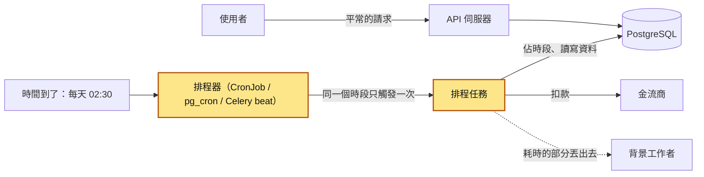
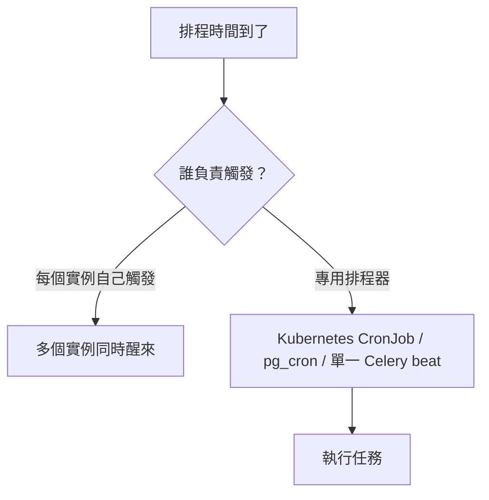
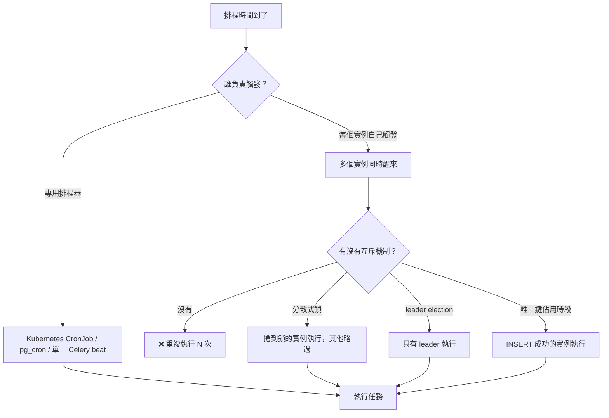
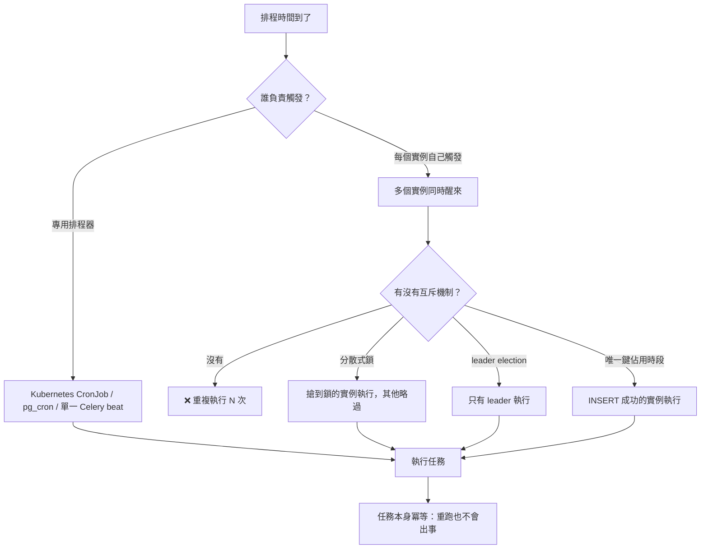

# 38｜工作排程（Job Scheduling）

> 工作排程（job scheduling）讓程式在指定的時間自動跑某件事；在多台機器、會當機、會跨時區的正式環境裡，還要保證它不多跑、不漏跑、跑重了也不出事。

**難度**：★★☆　**閱讀時間**：約 22 分鐘　**前置知識**：[冪等性](25-冪等性.md)、[背景工作者](37-背景工作者.md)

## 為什麼要在意：一個具體的情境

下面是一個假設情境。假設你負責一個訂閱制線上課程平台的後端，月費 299 元。平台每天要做一件事：找出今天到期的會員，向金流商發起自動續約扣款，再寄一封「續約成功」的信。

一開始服務只有一台機器，工程師在 Flask 應用程式裡用 APScheduler（Python 的排程套件，能在程式裡設定「每天幾點跑某個函式」）寫了這個任務，跑了一年都沒事：

```python
# ❌ 出事的寫法：排程寫在 Web 服務的行程裡，服務一啟動就跟著啟動
from apscheduler.schedulers.background import BackgroundScheduler

def renew_subscriptions():
    members = db.query("SELECT id FROM members WHERE expires_on = current_date")
    for m in members:
        payment.charge(m.id, amount=299)
        mailer.send_renewal_mail(m.id)
    db.execute("UPDATE members SET expires_on = expires_on + 30 WHERE expires_on = current_date")

scheduler = BackgroundScheduler()
scheduler.add_job(renew_subscriptions, "cron", hour=2)   # 每天 02:00，沒有指定時區
scheduler.start()
```

後來業務成長，團隊把服務搬上 Kubernetes（幫你管理一堆容器的平台），開了 3 個 replica 撐流量，也就是同一份程式跑成 3 個一模一樣的 Pod（可以先想成 3 台跑著同樣程式的機器）。上線那週沒人想到排程的事，因為「程式碼又沒改」。

上線後第 3 天，會員 #1001 剛好今天到期。下面一格一格看那天早上發生了什麼：

| 時間 | Pod 1 | Pod 2 | Pod 3 | #1001 被扣了幾次 |
|---|---|---|---|---|
| T1（UTC 02:00，台灣 10:00） | 排程器觸發 `renew_subscriptions` | 排程器觸發 `renew_subscriptions` | 排程器觸發 `renew_subscriptions` | 0 |
| T2 | 查到今天到期的會員，包含 #1001 | 查到同一批，包含 #1001 | 查到同一批，包含 #1001 | 0 |
| T3 | 扣 #1001 299 元，寄續約信 | | | 1 |
| T4 | | 扣 #1001 299 元，寄續約信 | | 2 |
| T5 | | | 扣 #1001 299 元，寄續約信 | 3 |
| T6 | `UPDATE` 到期日 +30 天，改到今天到期的那批會員 | `UPDATE` 改到 0 筆，因為到期日已經不是今天 | `UPDATE` 改到 0 筆 | 3 |

到期日只延長了一次，錢卻扣了 3 次。

會員看到的是信箱裡 3 封一樣的「續約成功」信，信用卡帳單上 3 筆 299 元。另外，早上 9 點要上課的會員發現帳號已經過期被鎖住，因為續約到台灣時間 10:00 才跑。工程師去查日誌，看到 3 個 Pod 在同一秒各自開始跑 `renew_subscriptions`，時間是 UTC 02:00；整段日誌沒有任何錯誤，因為每一次扣款都「成功」了。

根因有 3 層，都指得回上面的程式碼：

1. **觸發層**：`scheduler.start()` 在每個 Pod 啟動時都會執行，3 個 Pod 就有 3 個排程器，每天觸發 3 次。
2. **任務層**：`payment.charge()` 在迴圈裡先扣款，最後才 `UPDATE` 狀態，扣款前也不檢查「這個會員這一期扣過沒」，所以 3 個 Pod 在 T2 查到同一批會員，各扣一次。
3. **時區層**：`hour=2` 沒有指定時區，就用容器的時區，而容器是 UTC，所以實際是台灣時間 10:00 才跑。舊主機剛好設成台北時區才沒出事，這次搬家問題才曝光。

修法是 3 層各擋一種失敗：把排程從 Web 服務拆出來，改用 Kubernetes CronJob，並設 `timeZone`（時區）與 `concurrencyPolicy: Forbid`（上一次還沒跑完就不開新的）；任務開頭先在 `job_runs` 表用「任務名稱 + 預定執行時間」佔一個唯一的執行時段；每筆扣款帶上「會員 ID + 續約週期」組成的冪等鍵（idempotency key）送金流商，就算重跑也不會重複扣款。觸發層在「多實例下的重複執行」和地雷一，任務層在地雷二，時區層在「時區與夏令時間」，CronJob 的設定在地雷四。

觸發端的保護能減少重複，任務本身做成「觸發幾次都沒關係」才是最後一道防線。

## 全貌：它在系統裡的位置

這張圖看的是兩條路：平常使用者發請求的那條，以及「時間到了」自己觸發的那條。



上色的排程器和排程任務是這篇的主角。它們跟使用者的請求無關，是時鐘觸發的，所以出事時沒有人在畫面前等著看錯誤。任務裡耗時的部分（例如寄信）常常再交給[背景工作者](37-背景工作者.md)；任務要能安全重跑，靠的是[冪等性](25-冪等性.md)和[唯一約束](14-唯一約束.md)；會出現「多個實例同時觸發」，是因為服務做了[水平擴展](32-水平擴展.md)。

## 生活比喻

想像一間連鎖早餐店，總部規定「每天早上 6:00 要把冰箱的過期品丟掉」。

- 只有一間店、一個店長時，很簡單：店長設個鬧鐘就好。這就是單機 crontab。
- 後來開了 3 個班，3 個員工都設了 6:00 的鬧鐘。結果 3 個人同時去清冰箱，一個丟過期品，一個把剛進的貨也當過期品丟了，一個在登記本上記了 3 次「已清理」。這就是**多實例重複執行**。
- 解法有幾種：只讓店長的鬧鐘有效（**專用排程器 / leader election**）；冰箱門上掛一把鎖，先拿到鑰匙的人才能清（**分散式鎖**）；或者在登記本上規定「每天只能簽一格，簽過的那格別人不能再簽」（**用唯一鍵佔用執行時段**）。
- 某天店長請假，6:00 沒人清。隔天要不要補清？補清 1 次就好，還是要「補 2 次」？這就是**錯過的排程要不要補跑**。
- 如果清冰箱要花 2 小時，而規定是「每小時清一次」，那上一輪還沒清完、下一輪就開始了，這就是**任務重疊**。

**比喻失準的地方**：人會看一眼就知道「冰箱已經有人在清了」，程式不會，它只會照鬧鐘行動，所以「互相知道對方在做」這件事一定要靠外部的東西（資料庫、Redis、排程器）來保證。另外，現實中的鬧鐘不會因為「時區設錯」而在下午 3 點響，但伺服器會。

## 它是怎麼運作的

### cron 語法基礎

排程器要先能描述「什麼時候跑」。cron 是 Unix 上的傳統排程工具，它的時間表示法被幾乎所有排程器沿用（Kubernetes CronJob、pg_cron、Celery 的 `crontab()`、GitHub Actions 都是）。標準格式是 5 個欄位：

```
┌───────────── 分鐘 (0 - 59)
│ ┌─────────── 小時 (0 - 23)
│ │ ┌───────── 日 (1 - 31)
│ │ │ ┌─────── 月 (1 - 12)
│ │ │ │ ┌───── 星期 (0 - 6，0 是星期日；Vixie cron／cronie、pg_cron 也接受 7，但 Kubernetes CronJob 文件只列 0 - 6，寫 0 最保險)
│ │ │ │ │
* * * * *  要執行的指令
```

常用寫法：

| 寫法 | 意思 |
|---|---|
| `*/15 * * * *` | 每 15 分鐘（00、15、30、45 分） |
| `0 3 * * *` | 每天 03:00 |
| `30 2 * * 1-5` | 週一到週五的 02:30 |
| `0 0 1 * *` | 每月 1 號 00:00 |
| `0 9,18 * * *` | 每天 09:00 和 18:00 |
| `@daily` / `@hourly` | 多數實作支援的縮寫，等於 `0 0 * * *` / `0 * * * *` |

新人很常誤會的地方有 2 個：

1. **「日」和「星期」同時指定時，兩個條件是「或」的關係。** `0 9 13 * 5` 會在「每月 13 號」和「每個星期五」都跑；常見的誤讀是「13 號剛好是星期五才跑」。這是傳統 cron 的規則（crontab(5) 有明寫），Kubernetes CronJob 使用的解析器也照做。只要其中一欄是 `*`，就只看另一欄。
2. **`*/N` 指的是「能被 N 整除的時間點」，跟程式什麼時候啟動無關。** `*/7 * * * *` 會在 0、7、14 … 56 分跑，然後下一個小時又從 0 分開始，所以 56 分到下一個 0 分只隔 4 分鐘。

有些排程器有第 6 個欄位（秒），例如 Quartz、Spring 的 `@Scheduled`；pg_cron 則另外支援 `'30 seconds'` 這種間隔寫法。看到 6 個欄位時要先確認是哪一套語法，不要直接套。

### 時區與夏令時間

cron 運算式只寫了「幾點幾分」，沒寫「哪個時區的幾點幾分」。到底用哪個時區，取決於執行它的程式：

- Linux 的 crontab：預設用系統時區（容器裡通常是 UTC）。
- Kubernetes CronJob：沒設 `spec.timeZone` 時，用 kube-controller-manager（Kubernetes 裡負責照時間表建立 Job 的元件）所在環境的時區；設了就用你指定的 IANA 時區名稱（例如 `Asia/Taipei`）。
- pg_cron：預設以 GMT 解讀排程；新版本有 `cron.timezone` 設定可以改，請依你用的版本查 README。

夏令時間（Daylight Saving Time，DST）會讓牆上時鐘一年有 2 天不連續。以美東（`America/New_York`）為例：

```
春天撥快（3 月第二個星期日）：
  01:59 EST  →  03:00 EDT       ← 02:00～02:59 這一小時「不存在」
  排在 02:30 的任務：這天要跑嗎？在什麼時間跑？

秋天撥慢（11 月第一個星期日）：
  01:59 EDT  →  01:00 EST       ← 01:00～01:59 這一小時「出現兩次」
  排在 01:30 的任務：這天要跑一次還是兩次？
```

不同排程器對這兩天的處理方式不一樣，有的會在跳過的時段結束後立刻補跑，有的直接略過，有的在重複的那一小時跑兩次。**不要假設，要查你用的那套的文件，或乾脆避開。** 實務上的做法：

- 排程器內部統一用 UTC 思考與儲存；只在「業務規則本來就是當地時間」時（例如「台灣時間每天早上 8 點發報表」）才指定當地時區。
- 有 DST 的時區，避免把任務排在當地時間 01:00～03:00 之間。
- 業務邏輯裡的「今天」用明確的時區算，不要用 `datetime.now()` 這種會套用系統時區的寫法。

台灣（`Asia/Taipei`）目前沒有夏令時間，固定 UTC+8，所以只服務台灣的系統比較少遇到 DST，但「伺服器是 UTC、業務是台北時間」這個 8 小時落差的坑一定會遇到。

### 多實例下的重複執行

這是正式環境最常出事的地方。當你的服務[水平擴展](32-水平擴展.md)到多個實例，你要選一種方式確保「一個時間點只做一次」。

排程時間到的時候，第一個要回答的是「誰負責觸發」：交給專用排程器，觸發點只有一個；讓每個實例自己觸發，就會有多個實例同時醒來。



開頭的情境走的就是左邊那條：3 個 Pod 各自觸發。這時需要互斥機制，也就是「同一時間只讓一個實例通過」的機制，常見的有 3 種：

- **分散式鎖（distributed lock）**：所有實例去同一個地方（例如 Redis 或 PostgreSQL）搶一把鎖，搶到的才執行。
- **leader election**：實例之間選出一個負責人（leader），只有它執行排程。
- **唯一鍵佔用時段**：每個實例都試著在資料庫寫一筆「這個任務、這個時段由我來跑」，靠唯一約束只讓第一筆寫入成功。

這張多了「多個實例同時醒來」之後的分岔：沒有互斥機制就會重複執行，有的話只有一個實例會往下跑。



最後一張在「執行任務」後面加上最後一道防線：任務本身冪等。前面哪一層漏了，重跑也不會出事。



4 種做法比較：

| 做法 | 怎麼做 | 優點 | 要小心 |
|---|---|---|---|
| 專用排程器 | 排程只在一個地方定義，由它啟動任務 | 概念最單純，不用自己寫鎖 | 排程器本身要高可用；它掛了就全部不跑 |
| 分散式鎖（distributed lock） | Redis `SET key value NX PX`、PostgreSQL advisory lock | 每個實例都能帶排程，好部署 | 鎖的過期時間比任務短，就會有第二個人拿到鎖 |
| leader election | 用 Kubernetes Lease、etcd、ZooKeeper 選出一個 leader | 適合「一直有任務在跑」的服務 | 實作和除錯成本高，新人通常不需要自己寫 |
| 唯一鍵佔用時段 | `INSERT INTO job_runs (job_name, scheduled_for)`，靠[唯一約束](14-唯一約束.md)擋重複 | 簡單、可稽核，還順便留下執行紀錄 | 要正確算出「這次是哪個時段」 |

就算用了專用排程器，也不能保證只觸發一次：Kubernetes 官方文件直接寫了，CronJob 在少數情況下可能建出兩個 Job，也可能一個都沒建，所以任務本身要能安全重跑。

實務上常見的組合是**專用排程器負責觸發，`job_runs` 唯一鍵負責防重，任務本身再做成冪等**，3 層各擋一種失敗。

### 任務重疊：上一次還沒跑完

假設任務每 5 分鐘跑一次，平常 1 分鐘跑完。某天資料量暴增，一次要 12 分鐘：

```
時間軸（分）   0    5    10   15   20
第 1 次        [=============]
第 2 次             [=============]
第 3 次                  [=============]
                ↑ 三個同時在跑，搶同一批資料、互相鎖表、越跑越慢
```

這會變成惡性循環：任務一重疊就互相搶資源，搶資源讓每次跑得更慢，跑得更慢又造成更多重疊。你要選一種政策：

- **跳過（Forbid / skip）**：上一次還在跑，這次就不跑。最常用，適合「每次都處理目前所有待辦」的任務（例如清理過期資料）。
- **排隊（queue）**：等上一次跑完再跑。pg_cron 就是這樣，同一個 job 同時最多一個在跑，下一次會等前一次結束後才開始。
- **取代（Replace）**：砍掉舊的，跑新的。適合「只有最新結果有意義」的任務（例如重算即時排行榜）。
- **允許（Allow）**：同時跑。只有在任務彼此完全獨立、且你確定資源撐得住時才用。

不管選哪個，都要幫任務設**最長執行時間**。否則一個卡死的任務在 Forbid 政策下會讓之後所有排程都被跳過，而且不會有任何錯誤訊息。

### 錯過的排程要不要補跑

排程器重開、部署中、叢集故障，都會讓某些排程時間點「錯過」。恢復後要不要補，看任務性質：

| 任務類型 | 建議 | 原因 |
|---|---|---|
| 每日結算、每月帳單 | 要補，而且每個錯過的時段都要補 | 漏一天就是帳不平 |
| 每 5 分鐘同步一次資料 | 補一次就好（合併） | 補 12 次和補 1 次結果一樣，只是浪費 |
| 早上 8 點發的推播通知 | 超過一定時間就不補 | 下午 3 點收到「早安」更奇怪 |

各家排程器有對應的設定：Kubernetes CronJob 的 `startingDeadlineSeconds`（超過這個秒數就不補）、APScheduler 的 `misfire_grace_time` 與 `coalesce`、systemd timer 的 `Persistent=true`（開機後補跑錯過的那次）。傳統 crontab 沒有補跑機制，機器關機時錯過的就是錯過了（另一個工具 anacron 才有「開機後補跑」）。

多數排程器的「補跑」只會補 **1 次**，不會幫你把每個錯過的時段都補回來。例如 Kubernetes CronJob 停擺 2 小時後恢復，在期限內也只會建立 1 個 Job。如果你的任務屬於「每個時段都要補」，就要自己記錄時段（下面的 `job_runs` 表）來補。

如果你用 `job_runs` 表記錄每個時段，補跑也變得簡單：找出「應該存在但沒有成功紀錄」的時段，一個個補。

### 三種常見的排程載體

**1. Kubernetes CronJob**：最常見的「專用排程器」。每到時間建立一個 Job（Kubernetes 裡「跑完就結束」的一次性工作），Job 再建 Pod 去執行。重要欄位：

- `concurrencyPolicy`：`Allow`（預設）、`Forbid`、`Replace`，對應上面的重疊政策。
- `startingDeadlineSeconds`：錯過排程多久之內還要補（補的時候只建一個 Job）。沒設的話，控制器會從「上一次排程時間」算到現在錯過了幾次，超過 100 次就直接不啟動 Job，並記錄 `too many missed start times` 錯誤。注意在 `Forbid` 政策下「因為上一個還在跑而跳過」也算錯過一次。
- `timeZone`：指定 IANA 時區（Kubernetes 1.27 起為正式功能）。不要在 `schedule` 裡寫 `CRON_TZ=` 或 `TZ=`，官方不支援，新版本會直接驗證失敗。
- `suspend`：暫停排程，維護時很好用。
- Job 層的 `activeDeadlineSeconds`（最長執行時間）和 `backoffLimit`（失敗重試次數，預設 6）。

**2. 資料庫型排程（pg_cron）**：PostgreSQL 的擴充套件，排程直接存在資料庫裡，由資料庫的背景行程觸發。適合純 SQL 的維護工作（清理舊資料、刷新 materialized view（把查詢結果實際存起來的檢視表）、建立下個月的[分割](20-分割.md)）。好處是不用多一個元件；缺點是它只能跑 SQL（或呼叫預存程序），而且讓資料庫做太多事會搶到正式流量的資源。

**3. 工作佇列的延遲任務（delayed task）**：排的是「這件事 30 分鐘後做」這種相對時間，例如「下單 30 分鐘沒付款就取消訂單」。做法是把任務丟進[訊息佇列](35-訊息佇列.md)並指定執行時間，由[背景工作者](37-背景工作者.md)在時間到時取出執行。Celery 的 `apply_async(countdown=1800)`、Redis 的 sorted set（score 放執行時間戳）都是這類。

這類延遲任務有個常見的坑：以 Celery 搭配 Redis broker 為例，延遲時間如果超過 broker 的 `visibility_timeout`（預設 1 小時；工作被取走後超過這段時間沒確認就會重新派送，見[背景工作者](37-背景工作者.md)），任務可能被重新投遞給其他 worker，結果執行 2 次。長延遲的任務比較適合存在資料庫，例如加一個 `cancel_at` 欄位、每分鐘掃一次，不要塞在佇列裡等。

## 動手看看

下面用 Docker 起一個 PostgreSQL 和一個 Redis，示範 4 件事：用唯一鍵防止多實例重複執行、用 advisory lock 防止任務重疊、用 Redis 做分散式鎖、時區與夏令時間的行為。指令以 bash（Linux、macOS、WSL 或 Git Bash）為準。

### 準備環境

```shell
docker run -d --name sched-pg -e POSTGRES_PASSWORD=pw -p 5432:5432 postgres:16
docker run -d --name sched-redis -p 6379:6379 redis:7

# 建立 job_runs 表
docker exec -i sched-pg psql -U postgres <<'SQL'
CREATE TABLE job_runs (
    id            bigserial PRIMARY KEY,
    job_name      text        NOT NULL,
    scheduled_for timestamptz NOT NULL,          -- 這次「預定」的執行時間，不是實際開始時間
    worker        text        NOT NULL,
    status        text        NOT NULL DEFAULT 'running',  -- running / succeeded / failed
    started_at    timestamptz NOT NULL DEFAULT now(),
    finished_at   timestamptz,
    UNIQUE (job_name, scheduled_for)             -- 同一個任務的同一個時段只能有一筆
);
SQL
```

### 實驗一：兩個實例同時醒來，只有一個會執行

把下面存成 `claim_demo.py`：

```python
# claim_demo.py：模擬多個實例在同一時間點被觸發
import socket
import sys
import time
from datetime import datetime, timezone

import psycopg

DSN = "postgresql://postgres:pw@localhost:5432/postgres"
JOB = "nightly_report"


def current_slot(now: datetime) -> datetime:
    """把現在時間往下取整到「這次排程的時間點」。
    這裡假設每分鐘跑一次，所以取整到分鐘。
    這個值就是這次執行的身分證：不管幾個實例同時醒來，算出來都一樣。"""
    return now.replace(second=0, microsecond=0)


def try_claim(conn, slot: datetime, worker: str) -> bool:
    """嘗試佔用這個時段。INSERT 成功才代表輪到我執行。"""
    row = conn.execute(
        """
        INSERT INTO job_runs (job_name, scheduled_for, worker)
        VALUES (%s, %s, %s)
        ON CONFLICT (job_name, scheduled_for) DO NOTHING
        RETURNING id
        """,
        (JOB, slot, worker),
    ).fetchone()
    return row is not None


def mark_done(conn, slot: datetime, status: str) -> None:
    conn.execute(
        """
        UPDATE job_runs SET status = %s, finished_at = now()
        WHERE job_name = %s AND scheduled_for = %s
        """,
        (status, JOB, slot),
    )


def main() -> None:
    worker = f"{socket.gethostname()}-{sys.argv[1] if len(sys.argv) > 1 else 'x'}"
    slot = current_slot(datetime.now(timezone.utc))  # 一律用 UTC 計算時段

    # autocommit：每個 SQL 各自提交，佔位紀錄馬上對其他實例可見
    with psycopg.connect(DSN, autocommit=True) as conn:
        if not try_claim(conn, slot, worker):
            print(f"[{worker}] {slot} 已經有人在跑了，略過")
            return

        print(f"[{worker}] 搶到 {slot}，開始執行")
        try:
            time.sleep(3)  # 假裝在做事；真正的任務邏輯本身也要冪等
            mark_done(conn, slot, "succeeded")
            print(f"[{worker}] 完成")
        except Exception:
            mark_done(conn, slot, "failed")
            raise


if __name__ == "__main__":
    main()
```

開兩個終端機，幾乎同時執行（或在同一個 shell 裡用 `&` 一次啟動兩個）：

```shell
uv run --with "psycopg[binary]" python claim_demo.py A &
uv run --with "psycopg[binary]" python claim_demo.py B &
wait
```

**預期結果**：一個印出「搶到 … 開始執行」，另一個印出「已經有人在跑了，略過」。查表會看到同一分鐘只有一筆：

```shell
docker exec sched-pg psql -U postgres -c "SELECT job_name, scheduled_for, worker, status FROM job_runs ORDER BY id"
```

如果 2 個實例剛好跨過分鐘邊界（一個在 :59 秒、一個在 :00 秒），2 個都會執行，因為它們算出的時段不同。所以**時段必須由「排程時間」決定**，跟實例實際醒來的時間無關。正式環境應該由排程器把預定時間傳給任務（例如當成參數），不要讓任務自己用 `now()` 猜。

這個做法有個要注意的地方：如果搶到的實例在執行到一半時整個當掉，`status` 會永遠停在 `running`，之後也沒人會補跑這個時段。正式環境需要額外的機制處理「卡住的 running 紀錄」，例如超過預期時間就視為失敗並允許重跑（重跑之所以安全，還是因為任務本身冪等）。

### 實驗二：用 advisory lock 防止任務重疊

PostgreSQL 的 advisory lock 是「應用程式自己定義意義」的鎖，很適合拿來保證「同一個任務同時只有一個在跑」。開 2 個 psql 視窗：

```shell
docker exec -it sched-pg psql -U postgres
```

```sql
-- 視窗 A：用一個固定的整數代表 nightly_report 這個任務
SELECT pg_try_advisory_lock(38001);   -- 回傳 t，拿到鎖

-- 視窗 B：同一個號碼
SELECT pg_try_advisory_lock(38001);   -- 回傳 f，馬上回來、不會卡住等

-- 視窗 A：做完了，釋放
SELECT pg_advisory_unlock(38001);     -- 回傳 t

-- 視窗 B：再試一次
SELECT pg_try_advisory_lock(38001);   -- 這次回傳 t
```

`pg_try_advisory_lock` 是 session 層級的鎖，連線斷掉時會自動釋放，所以行程當掉不會留下一把永遠解不開的鎖。但也因為綁在 session 上，**如果你透過 PgBouncer 的 transaction pooling 模式連線，同一個 session 可能在不同交易間換人用，session 層級的鎖會失效**。這時改用 `pg_try_advisory_xact_lock`，它在交易結束時自動釋放，並且把整個任務包在一個交易裡（只適合不會跑太久的任務）。連線池的細節見[連線池](08-連線池.md)。

### 實驗三：用 Redis 做分散式鎖

```shell
docker exec -it sched-redis redis-cli
```

```
# 實例 A：拿鎖，值放自己的識別碼，60 秒後自動過期
SET lock:nightly_report worker-a NX EX 60
# → OK

# 實例 B：同一把鎖
SET lock:nightly_report worker-b NX EX 60
# → (nil)，沒搶到

TTL lock:nightly_report
# → 剩下的秒數
```

釋放鎖時，要確認「這把鎖還是我的」才刪。「比對」和「刪除」要一起做，中間不能被別的指令插隊，所以用 Redis 的 Lua 腳本：Redis 執行一段 Lua 腳本時，會整段做完才處理下一個指令。

```python
import redis

r = redis.Redis()

# ❌ 錯誤示範：直接刪除
# 如果我的任務跑超過 60 秒，鎖已經過期並被 worker-b 拿走，
# 這行會把「別人的鎖」刪掉，讓第三個實例也能進來（刻意註解掉，別照抄）
# r.delete("lock:nightly_report")

# ✅ 正確寫法：用 Lua 腳本，「比對值」和「刪除」在 Redis 裡原子地一起做
RELEASE = """
if redis.call('GET', KEYS[1]) == ARGV[1] then
    return redis.call('DEL', KEYS[1])
else
    return 0
end
"""
released = r.eval(RELEASE, 1, "lock:nightly_report", "worker-a")
print("釋放成功" if released == 1 else "鎖已經不是我的了，任務可能跑太久")
```

**鎖的過期時間代表「最多信任你多久」，到期時任務不一定做完了。** 任務跑得比 TTL 久，就會有 2 個實例同時在做。所以鎖只能降低重複，不能取代冪等。

### 實驗四：夏令時間的不存在時刻與重複時刻

```python
# dst_demo.py：觀察 America/New_York 在 2026 年 DST 切換日的行為
from datetime import datetime, timezone
from zoneinfo import ZoneInfo

ny = ZoneInfo("America/New_York")

# 2026-03-08 是 DST 開始日，02:00～02:59 不存在
t = datetime(2026, 3, 8, 2, 30, tzinfo=ny)
print("寫的是：", t)
print("換成 UTC 再換回來：", t.astimezone(timezone.utc).astimezone(ny))
# 換回來會變成 03:30，因為 02:30 這個牆上時間根本不存在

# 2026-11-01 是 DST 結束日，01:00～01:59 出現兩次
first = datetime(2026, 11, 1, 1, 30, tzinfo=ny, fold=0)   # 第一次的 01:30（EDT）
second = datetime(2026, 11, 1, 1, 30, tzinfo=ny, fold=1)  # 第二次的 01:30（EST）
print("第一次 01:30 =", first.astimezone(timezone.utc))
print("第二次 01:30 =", second.astimezone(timezone.utc))
# 兩個是同一個牆上時間，卻差了一小時
```

```shell
# Windows 沒有內建的 IANA 時區資料庫，要多帶 tzdata 套件
uv run --with tzdata python dst_demo.py
```

**預期結果**：第一段的 02:30 換回來會變成 03:30；第二段兩個 01:30 換成 UTC 會差一小時。「排在 02:30 的任務那天到底跑不跑」「排在 01:30 的任務那天跑幾次」這 2 個問題就是從這裡來的。

### 選讀：pg_cron 長什麼樣子

pg_cron 不在官方 postgres 映像檔裡，要另外安裝（套件名稱與安裝方式請依 [pg_cron README](https://github.com/citusdata/pg_cron) 為準），並在 `postgresql.conf` 設 `shared_preload_libraries = 'pg_cron'`，重啟後在 `cron.database_name` 指定的資料庫（預設是 `postgres`）執行 `CREATE EXTENSION pg_cron;`。用起來像這樣：

```sql
-- 每天 UTC 18:00（台灣時間凌晨 2 點）刪除 90 天前的稽核日誌
SELECT cron.schedule(
    'purge-audit-log',
    '0 18 * * *',
    $$DELETE FROM audit_log WHERE created_at < now() - interval '90 days'$$
);

-- 看有哪些排程
SELECT jobid, jobname, schedule, command FROM cron.job;

-- 看最近的執行紀錄（成功、失敗、花多久）
SELECT jobid, status, start_time, end_time, return_message
FROM cron.job_run_details ORDER BY start_time DESC LIMIT 10;

-- 取消排程
SELECT cron.unschedule('purge-audit-log');
```

注意上面的排程時間是用 UTC 寫的，因為 pg_cron 預設用 GMT 解讀。這種「註解寫台灣時間、運算式寫 UTC」的習慣，能幫下一個看的人少踩一次坑。

### 收拾

```shell
docker rm -f sched-pg sched-redis
```

## 常見地雷

### 地雷一：排程寫在 Web 服務的行程裡

❌ **錯誤做法**：在 FastAPI / Flask / Django 啟動時順便啟動 APScheduler 或 `schedule` 套件，然後把服務擴展到多個實例。

**為什麼錯**：每個實例都有自己的排程器，排程會被觸發 N 次。而且 Web 服務會因為部署、自動擴縮而頻繁重啟，排程器跟著重啟，錯過或重複的機率都很高。Gunicorn 開多個 worker 時，就算只有一台機器也會重複。

✅ **正確做法**：排程拆成獨立的元件：Kubernetes CronJob、單一實例的 Celery beat（Celery 文件明講同一份排程同時只能有一個 beat 在跑）、或 pg_cron。如果一定要放在應用程式裡，至少要加上分散式鎖或 `job_runs` 唯一鍵。

### 地雷二：任務不冪等，假設「只會跑一次」

❌ **錯誤做法**：

```python
# ❌ 錯誤示範：重跑就會重複扣款、重複寄信
def renew_subscriptions():
    members = db.query("SELECT id FROM members WHERE expires_on = current_date")
    for m in members:
        payment.charge(m.id, amount=299)
        mailer.send_renewal_mail(m.id)
    db.execute("UPDATE members SET expires_on = expires_on + 30 WHERE expires_on = current_date")
```

**為什麼錯**：跑到第 500 個會員時當掉，重跑會從頭再扣一次前 499 個；2 個實例同時跑，每個人被扣 2 次。

✅ **正確做法**：每一筆都要能獨立判斷「做過沒」，並且把「做過」的狀態和副作用綁在一起。

```python
# ✅ 正確寫法：逐筆處理，每筆有自己的冪等鍵與狀態
def renew_subscriptions(period: str):  # period 例如 "2026-10"，由排程器傳入
    while True:
        with db.transaction():
            # 一次拿一筆、鎖住它，SKIP LOCKED 讓多個 worker 不會搶同一筆
            m = db.query_one("""
                SELECT id FROM members
                WHERE expires_on <= current_date AND renewed_period IS DISTINCT FROM %s
                ORDER BY id LIMIT 1
                FOR UPDATE SKIP LOCKED
            """, (period,))
            if m is None:
                break
            # 冪等鍵 = 會員 + 續約週期；金流商看到同一個鍵只會扣一次
            payment.charge(m.id, amount=299, idempotency_key=f"renew:{m.id}:{period}")
            db.execute("""
                UPDATE members
                SET expires_on = expires_on + 30, renewed_period = %s
                WHERE id = %s
            """, (period, m.id))
        # 寄信放進佇列，由背景工作者處理，寄信端也用同樣的鍵去重
        enqueue("send_renewal_mail", member_id=m.id, dedup_key=f"renew-mail:{m.id}:{period}")
```

在交易裡呼叫外部 API 會讓交易拉長，這裡為了示範冪等鍵簡化了。更嚴謹的做法是先記錄「待扣款」，再由[信箱模式](44-信箱模式.md)送出，細節見[冪等性](25-冪等性.md)。

### 地雷三：用 `now()` 決定「這次處理哪一段資料」

❌ **錯誤做法**：每小時跑一次的彙總任務，處理「`now() - 1 hour` 到 `now()`」之間的資料。

**為什麼錯**：任務延遲 3 分鐘才啟動，就有 3 分鐘的資料被涵蓋 2 次、另外 3 分鐘被漏掉；補跑時更是完全不知道該處理哪段。

✅ **正確做法**：處理範圍由「預定執行時間」決定，例如「`scheduled_for - 1 hour` 到 `scheduled_for`」，並且要是左閉右開區間（`>= start AND < end`）。這樣不管什麼時候跑、跑幾次，處理的都是同一段資料，補跑時也知道該補哪段。

### 地雷四：重疊政策用預設值

❌ **錯誤做法**：Kubernetes CronJob 沒寫 `concurrencyPolicy`，也沒設 `activeDeadlineSeconds`。

**為什麼錯**：預設是 `Allow`，任務一變慢就會疊起來；改成 `Forbid` 但沒設最長執行時間，則一個卡死的 Job 會讓之後所有排程都被跳過，頂多在 CronJob 的事件裡留下一筆一般等級（Normal）的紀錄，不會有任何失敗告警。

✅ **正確做法**：明確寫出政策和上限：

```yaml
apiVersion: batch/v1
kind: CronJob
metadata:
  name: nightly-report
spec:
  schedule: "30 2 * * *"          # 每天 02:30
  timeZone: "Asia/Taipei"         # 明確指定時區，不依賴叢集設定
  concurrencyPolicy: Forbid       # 上一次還在跑，這次就跳過
  startingDeadlineSeconds: 1800   # 錯過 30 分鐘內還補跑，超過就放棄
  successfulJobsHistoryLimit: 3
  failedJobsHistoryLimit: 3
  jobTemplate:
    spec:
      activeDeadlineSeconds: 3600 # 跑超過 1 小時就砍掉，避免卡死擋住後面
      backoffLimit: 2             # 失敗最多重試 2 次（預設是 6）
      template:
        spec:
          restartPolicy: Never
          containers:
            - name: report
              image: registry.example.com/myapp:1.4.2
              command: ["python", "-m", "jobs.nightly_report"]
```

### 地雷五：crontab 裡的環境與 `%` 符號

❌ **錯誤做法**：

```shell
# ❌ 錯誤示範
0 3 * * * backup.sh > /var/backups/db-$(date +%F).sql
```

**為什麼錯**：一、cron 執行時的 `PATH` 很精簡，也不會載入你的 `.bashrc`，所以 `backup.sh`、`pg_dump` 可能找不到。二、在 crontab 的指令欄裡，`%` 有特殊意義（會被當成換行，之後的內容變成標準輸入），所以 `date +%F` 會被切斷。三、錯誤輸出沒導向任何地方，失敗了你也不知道。

✅ **正確做法**：

```shell
# ✅ 正確寫法：完整路徑、% 用反斜線跳脫、輸出寫進日誌
SHELL=/bin/bash
PATH=/usr/local/bin:/usr/bin:/bin
0 3 * * * /opt/scripts/backup.sh >> /var/log/backup.log 2>&1
# 檔名裡的日期交給 backup.sh 自己處理；真的要寫在這行就用 \%F
```

### 地雷六：只監控「失敗」，沒監控「沒跑」

❌ **錯誤做法**：任務失敗時發告警，覺得這樣就夠了。

**為什麼錯**：排程器掛了、CronJob 被 `suspend` 忘了打開、時區設錯跑在別的時間、Forbid 政策一直跳過，這些情況都不會產生「失敗」，任務就是沒跑，也不會留下錯誤。最常見的發現方式是使用者來抱怨「報表 3 天沒更新了」。

✅ **正確做法**：用「心跳」反過來監控（常被叫做 dead man's switch）：任務成功時回報一次，監控系統在預期時間內沒收到回報就告警。有 `job_runs` 表的話，也可以直接寫一條查詢：「`nightly_report` 最近一筆 `succeeded` 是不是超過 26 小時前」。

## 重點整理

- **多實例環境最難的是決定「誰來觸發」。** 寫在 Web 服務裡的排程，每個實例都會各觸發一次；改用專用排程器（Kubernetes CronJob、pg_cron、單一 Celery beat），或用分散式鎖、`job_runs` 唯一鍵，讓同一個時段只跑一次。
- **排程任務一定要冪等。** 專用排程器也可能偶爾多觸發一次，任務還會跑到一半掛掉再重跑。用「任務名稱 + 預定執行時間」當唯一鍵，對外扣款帶冪等鍵，讓重跑不出事。
- **每個排程都要說得出是哪個時區。** 容器通常是 UTC，台灣差 8 小時；業務上的「今天」用明確時區算。有夏令時間的地區，一年有一天某個時刻不存在、另一天某個時刻出現兩次，任務避開當地 01:00～03:00。
- **事先決定重疊政策和補跑政策，並設最長執行時間。** 不寫就交給預設值，例如 Kubernetes 的 `concurrencyPolicy` 預設是 `Allow`，任務一變慢就疊起來。
- **處理範圍用預定執行時間推算，不用 `now()`。** 這樣不管晚多久啟動、重跑幾次，處理的都是同一段資料，補跑時也知道該補哪段。
- **「沒跑」比「跑失敗」更難發現。** 重要排程要有「該跑沒跑就告警」的心跳監控。

## 新人必知清單

### 一定要會（基本功）

- [ ] 看得懂、寫得出 5 欄位的 cron 運算式，知道「日」和「星期」同時指定是「或」
- [ ] 每個排程都能回答「這是哪個時區的時間」，業務邏輯裡的「今天」用明確時區計算
- [ ] 知道多實例部署時，寫在應用程式裡的排程會重複觸發，並能說出至少 2 種解法
- [ ] 排程任務一律設計成冪等：用「任務名稱 + 預定執行時間」或業務上的唯一鍵防重
- [ ] 處理範圍由「預定執行時間」推算，不用 `now()`
- [ ] 每個排程都有明確的重疊政策和最長執行時間
- [ ] 重要排程有「該跑沒跑」的監控

### 知道有這回事就好

- 夏令時間會讓某些時刻不存在或重複，各排程器處理方式不同
- Kubernetes CronJob 的 `startingDeadlineSeconds`、`suspend`、`successfulJobsHistoryLimit`
- Redis 鎖的 TTL 比任務短時會失效；嚴格場景要搭配 fencing token（每次拿鎖都發一個遞增號碼，寫入資料時檢查號碼，比目前記錄的舊就拒絕）
- PostgreSQL advisory lock 在 PgBouncer transaction pooling 下的限制
- pg_cron 適合純 SQL 的維護工作；同一個 job 不會同時跑 2 個
- Celery 延遲任務超過 broker 的 visibility timeout 可能被重複投遞
- systemd timer 的 `Persistent=true` 可以補跑關機期間錯過的排程

### 先不用管（等你遇到再學）

- 自己實作 leader election（用 Kubernetes Lease、etcd、ZooKeeper）
- Redlock 演算法與它的爭議
- 工作流程引擎（Airflow、Temporal、Argo Workflows）的 DAG 排程與相依管理
- 大量排程（數百萬個使用者各自的提醒時間）的分片與時間輪（timing wheel）設計

## Code Review 時可以問的問題

1. **這個排程在幾個地方會被觸發？** 服務有幾個 replica、幾個 Gunicorn worker？如果答案不是「一個」，防重機制在哪裡？
2. **這個任務跑 2 次會怎樣？跑到一半掛掉再重跑會怎樣？** 有沒有冪等鍵或唯一約束擋住重複的副作用（扣款、寄信、發券）？
3. **這個 cron 運算式是哪個時區？** 註解有沒有寫清楚？如果是 UTC，換算成台灣時間對不對？
4. **任務跑得比排程間隔還久時會怎樣？** 重疊政策是什麼？有沒有最長執行時間？
5. **錯過的排程要不要補？補幾次？** 處理範圍是用預定時間算，還是用 `now()` 算？
6. **它沒跑的話，誰會發現、多久會發現？**

## 情境演練

**第 1 題**：同事想讓一個清帳任務只在「1 號剛好是星期一」那天跑，寫了 `0 0 1 * 1`。上線前你幫他 review，這個運算式實際會在什麼時候執行？你會怎麼建議？

<details markdown="1"><summary>看答案</summary>

它會在每月 1 號的 00:00，**以及**每個星期一的 00:00 執行，比同事預期的多很多次。

傳統 cron 的規則是：「日」和「星期」兩個欄位都有指定（都不是 `*`）時，只要符合其中一個就執行。「1 號且是星期一」用 cron 運算式表達不了，可以建議他排成每月 1 號執行，然後在程式裡判斷今天是不是星期一。
</details>

**第 2 題**：你的服務部署在 Kubernetes 上，Deployment 有 4 個 replica，程式啟動時會用 APScheduler 註冊一個「每天 03:00 清除過期 session」的任務。會發生什麼事？這個任務剛好是冪等的（`DELETE FROM sessions WHERE expires_at < now()`），那還有問題嗎？

<details markdown="1"><summary>看答案</summary>

每天 03:00 會有 4 個 Pod 同時執行這個 DELETE。

因為 DELETE 本身是冪等的，資料結果不會錯。但還是有問題：一、4 個大 DELETE 同時跑，會搶同一批列的鎖，互相等待，資料庫負載瞬間變成 4 倍，可能拖慢正式流量；二、replica 數量隨自動擴縮變化，你很難預測負載；三、如果之後有人在這個任務裡加了非冪等的邏輯（例如「刪除後寄一封統計報告」），就會直接出事。

比較好的做法是把它改成 Kubernetes CronJob 或 pg_cron，觸發點只有一個；大量刪除也最好分批做。
</details>

**第 3 題**：一個每小時跑一次的任務，負責「把上一小時的訂單彙總寫進 `hourly_sales` 表」。目前寫法是處理 `created_at >= now() - interval '1 hour'` 的訂單，然後 `INSERT` 一筆彙總。你接手後發現 `hourly_sales` 的數字偶爾對不上訂單明細。你會先懷疑哪裡？怎麼改？

<details markdown="1"><summary>看答案</summary>

問題一：**用 `now()` 決定範圍。** 任務如果晚了 2 分鐘才啟動，有 2 分鐘的資料會跟上一輪重疊、另外 2 分鐘的資料被漏掉。補跑時也完全不知道該處理哪一段。

問題二：**`INSERT` 不冪等。** 重跑一次就會多一筆彙總，報表數字翻倍。

改法：排程器把預定時間（例如 `2026-10-24 14:00:00+08`）傳給任務，處理範圍固定為 `created_at >= '13:00' AND created_at < '14:00'`（左閉右開，邊界不重複不遺漏）。`hourly_sales` 以 `hour_start` 當唯一鍵，寫入用 `INSERT ... ON CONFLICT (hour_start) DO UPDATE SET ...`，這樣重跑只會覆蓋成同一個正確數字。補跑時只要找出缺的小時，一個個傳進去就好。
</details>

**第 4 題**：你用 Redis 分散式鎖確保只有一個實例執行月結任務：`SET lock:monthly NX EX 300`，做完 `DEL lock:monthly`。某個月的資料量特別大，任務跑了 8 分鐘。會發生什麼事？

<details markdown="1"><summary>看答案</summary>

鎖在第 5 分鐘自動過期。如果這時有其他實例來搶（例如排程器重試、或另一個實例的觸發稍晚），它會成功拿到鎖並開始執行，變成兩個實例同時在跑月結。更糟的是，第一個實例在第 8 分鐘做完時執行 `DEL`，刪掉的是第二個實例的鎖，於是第三個實例也能進來。

修正方向：一、釋放鎖時先比對值是不是自己的（用 Lua 腳本原子地比對再刪除）；二、TTL 要遠大於任務最長執行時間，或在任務進行中定期延長 TTL；三、最根本的是任務本身要冪等，例如月結結果以「月份」為唯一鍵寫入，這樣就算鎖失效、2 個實例都跑完，結果也只有一份。鎖只能減少重複浪費，結果對不對要靠冪等。
</details>

**第 5 題**：公司在美國有客戶，產品經理希望「每天美東時間凌晨 2:30 幫每個美國客戶產生前一天的帳單」。你會怎麼設計排程？要注意什麼？

<details markdown="1"><summary>看答案</summary>

美東有夏令時間，3 月 DST 開始那天根本沒有 02:30；11 月 DST 結束那天的 01:00～01:59 會出現 2 次（02:30 本身不會重複）。另外，切換日當天只有 23 或 25 小時，隔天產生「前一天」帳單時，那一天的長度不是 24 小時。

設計建議：
1. 先跟產品經理確認：「凌晨 2:30」是硬性要求，還是「每天美東凌晨、上班前產出」就好？如果可以，改成 04:00 或 05:00，就能避開最容易出事的切換時段。
2. 排程器明確指定 `America/New_York` 時區（例如 Kubernetes CronJob 的 `timeZone`），不要自己用 UTC 換算後寫死，否則半年後 DST 一切換就差一小時。
3. 「前一天」用美東時區計算日期，再把那天的開始和結束轉成 UTC 去查資料。DST 切換日那天只有 23 或 25 小時，用「減 24 小時」會算錯。
4. 帳單以「客戶 + 帳單日期」為唯一鍵，任務冪等，萬一切換日跑了兩次或補跑也不會產生重複帳單。
5. 加上「該跑沒跑」的監控，特別在 DST 切換那 2 天要留意。
</details>

## 相關主題

- [背景工作者](37-背景工作者.md)：排程負責「什麼時候觸發」，背景工作者負責「實際把工作做完」，兩者常常搭配使用。
- [冪等性](25-冪等性.md)：排程任務一定會遇到重複執行，冪等是讓重複變得無害的根本方法。
- [唯一約束](14-唯一約束.md)：用「任務名 + 預定時間」佔用執行時段，靠的就是唯一約束。
- [悲觀鎖定](07-悲觀鎖定.md)：`FOR UPDATE SKIP LOCKED` 和 advisory lock 都是排程任務常用的鎖定手法。
- [訊息佇列](35-訊息佇列.md)：延遲任務通常建立在佇列之上，佇列的投遞語意會直接影響任務會不會重複。
- [優雅關閉](48-優雅關閉.md)：部署時正在跑的排程任務要能安全中斷或完成，否則會留下做一半的狀態。

## 延伸閱讀

- Kubernetes 官方文件：CronJob — https://kubernetes.io/docs/concepts/workloads/controllers/cron-jobs/
- pg_cron（GitHub README，含安裝、時區設定與 `cron.job_run_details` 說明）— https://github.com/citusdata/pg_cron
- PostgreSQL 官方文件：Advisory Locks — https://www.postgresql.org/docs/current/explicit-locking.html#ADVISORY-LOCKS
- crontab(5) man page（cron 運算式的完整規則，包含日與星期的「或」邏輯、`%` 的意義）— https://man7.org/linux/man-pages/man5/crontab.5.html
