# 39｜事件驅動架構（Event-Driven Architecture）

> 事件驅動架構（event-driven architecture）是讓每個服務把「我這邊發生了什麼事」（例如「訂單成立了」）寫成一則訊息，放到一個大家都收得到的地方，這則訊息就叫事件；在乎這件事的服務自己登記要收（訂閱）、自己處理，發事件的一方不用知道誰會收。

**難度**：★★☆　**閱讀時間**：約 22 分鐘　**前置知識**：[冪等性](25-冪等性.md)、[訊息佇列](35-訊息佇列.md)、[死信佇列](36-死信佇列.md)

## 核心問題與理念

**它要解決的問題**：訂單成立後要扣庫存、寄確認信、加點數，如果都由訂單服務一個一個去呼叫，每多一件事就要改一次訂單服務。（下面的情境會完整走一遍）

**核心理念**：訂單服務不用知道下游有誰；多一件要跟著做的事，就多一個服務自己來訂閱。

**想通的那一步**：

- **卡住的地方**：直覺的做法是由訂單服務依序呼叫庫存、通知、會員服務，等於訂單服務在指揮每個下游做事。這樣它得知道下游有誰、各要做什麼，下游換做法或多一個推薦服務，都要回頭改訂單服務。
- **火花**：把「叫誰去做什麼」換成「宣布發生了什麼」。訂單服務只發一句「訂單成立了」（`OrderPlaced`，事件用過去式命名），要不要跟著做、怎麼做由各服務自己決定，所以新增功能時改的是新服務自己。

## 閱讀前推薦具備知識

| 知識 | 要會到什麼程度 | 這篇哪裡會用到 | 不熟的話先看 |
|---|---|---|---|
| Python 的 dict 與 JSON | **必備**：看得懂 `data["customer_id"]` 和 `data.get("user_id")` 在欄位不存在時差在哪：前者丟 `KeyError`，後者回 `None` | 情境裡的 `if not user_id: return`、「動手看看」`consumer.py` 的 `handle()` 和 `except KeyError` | [Python 官方教學（中文）](https://docs.python.org/zh-tw/3/tutorial/index.html) 第 5 章、[JSON（中文）](https://www.json.org/json-zh.html) |
| [訊息佇列](35-訊息佇列.md) | **必備**：能說出 ack 是什麼：消費者處理完回報 broker，broker 才把這則訊息標成完成；一直沒收到 ack，broker 會再送一次 | 情境時間表的 T5、「至少一次」投遞那張時間表、`consumer.py` 的 `r.xack(...)` | 本系列第 35 篇 |
| [冪等性](25-冪等性.md) | **必備**：能說出同一個事件收到兩次時，怎麼用一個唯一 ID 讓點數只加一次 | 「至少一次」投遞的時間表、`consumer.py` 的 `dedup_key`、地雷 3 | 本系列第 25 篇 |
| [死信佇列](36-死信佇列.md) | **加分**：知道處理不了的訊息會被移到另一個地方等人來看，不會直接丟掉 | 情境的修法、`consumer.py` 把事件送進 `DLQ` 的兩段、地雷 6 | 本系列第 36 篇 |
| Redis 的基本操作 | **加分**：知道 Redis 是一個用 key 存資料的伺服器，會用 `redis-cli` 下一行指令看結果 | 「動手看看」的 `XADD`、`XREADGROUP`、`XACK`、`XPENDING` | [Redis 資料型別](https://redis.io/docs/latest/develop/data-types/) |

**快速自我檢查**：一個消費者收到的事件內容是 `{"order_id": 8812, "customer_id": 501}`。它的程式先 `user_id = data.get("user_id")`，接著 `if not user_id: return`，跳出來之後照常 ack。這筆事件之後 broker 還會再送一次嗎？會員 501 的點數會加嗎？

<details markdown="1"><summary>看答案</summary>

不會再送，點數也不會加。事件裡沒有 `user_id`，`.get("user_id")` 回 `None`，`if not user_id` 成立就直接 `return`，什麼都沒做；但程式照樣 ack 了，broker 收到 ack 就當成「處理完了」，不會再送。結果是事件被安靜地丟掉，這就是開頭情境的狀況。

答不出 `.get` 那一半，先看上表「Python 的 dict 與 JSON」；答不出 ack 那一半，先看「訊息佇列」那一列。

</details>

## 為什麼要在意：一個具體的情境

假設你負責一個電商的會員服務，管「每筆訂單加 10% 購物點數」這件事。系統拆成幾個服務：訂單服務在訂單成立後發出一個叫 `OrderPlaced` 的事件，事件先交給一個專門保存、轉送訊息的中介程式（下文叫 broker，這個情境用的是 Redis Streams），再由 broker 各送一份給三個訂閱它的服務：庫存服務扣庫存、通知服務寄確認信、你的會員服務加點數。這樣跑了一年多都很順，訂單團隊已經不太記得有誰在訂閱。

某個週二，訂單團隊做了一次重構，把事件內容裡的 `user_id` 欄位改名成 `customer_id`。他們改了自己的程式、單元測試全綠，也通知了庫存團隊。庫存服務本來就不讀這個欄位，通知服務用的是 email 欄位，都沒事。重構前後，事件內容只差在會員 ID 的欄位名稱：

| 欄位 | 週一以前 | 週二重構之後 |
|---|---|---|
| 訂單編號 | `order_id: 8812` | `order_id: 8812` |
| 會員 ID | `user_id: 501` | `customer_id: 501` |
| 金額 | `total_amount: 700` | `total_amount: 700` |

你的點數消費者（負責接收事件並處理的那段程式）用 `event["data"].get("user_id")` 讀會員 ID，接著寫了 `if not user_id: return`，拿不到會員 ID 就直接跳過。當初寫的人覺得這是「防呆」。

會員 501 在週二下了一張 700 元的訂單 8812，照規則應該加 70 點。一步一步看發生了什麼：

| 時間 | 訂單服務 | broker | 會員服務（點數消費者） | 會員 501 的點數 |
|---|---|---|---|---|
| T1 | 訂單 8812 成立，發出 `OrderPlaced`，內容是 `customer_id: 501` | 收下事件 | | 1200 |
| T2 | | 各送一份給庫存、通知、會員服務 | | 1200 |
| T3 | | | `.get("user_id")` 拿到 `None` | 1200 |
| T4 | | | 走進 `if not user_id: return`，沒有加點數，也沒有印任何錯誤 | 1200 |
| T5 | | 收到會員服務的 ack（「這筆處理完了」的確認），把事件標成已完成 | | 1200 |
| T6 | 週三、週四，每一張新訂單都重複 T1 到 T5 | | | 一直沒變 |

使用者看到的是：訂單成立、確認信也收到了，但點數一直停在原本的數字。工程師看到的是：沒有任何錯誤日誌，消費者每一筆都正常回傳、正常 ack，broker 上沒有卡住的訊息，監控面板一片綠。直到週五客服湧進大量「我的點數怎麼沒加」的抱怨才有人開始查，會員團隊先懷疑自己的資料庫，再懷疑 broker 掉訊息，花了大半天才發現是上游把欄位改名了，最後還要寫腳本從訂單資料庫撈三天份的訂單重新補點數。

下面這張圖把上表 T1～T6 畫出來：週二的事件從訂單服務經過 broker 送到三個服務，黃色那幾步是點數消費者把事件安靜丟掉的地方：

<figure class="draw-fig">
<iframe class="draw-fig__frame" src="../figures/39-silent-drop.html" title="按播放或點 T1～T6，看改名後的事件怎麼一路被照常處理、照常 ack，琥珀色那幾步是事件被安靜丟掉的地方，而監控始終一片綠、點數一直停在 1200。" loading="lazy" style="height: 520px;"></iframe>
<figcaption>按播放或點 T1～T6，看改名後的事件怎麼一路被照常處理、照常 ack，琥珀色那幾步是事件被安靜丟掉的地方，而監控始終一片綠、點數一直停在 1200。</figcaption>
</figure>

根因是兩件事碰在一起：訂單服務把 `user_id` 改名，對它來說只是重構，對訂閱者來說卻是格式被改掉；而點數消費者的 `if not user_id: return` 把「看不懂的事件」當成「不用處理的事件」，安靜地跳過，所以三天都沒人發現。

修法也是兩邊各一件：發布者對已經有人在收的事件只加欄位、不改名，見「常見地雷」的地雷 4；消費者必要欄位缺了要大聲失敗，把事件送進[死信佇列](36-死信佇列.md)（存放處理不了的訊息的地方）並發告警，見「動手看看」的 `consumer.py` 和地雷 6。

## 全貌：它在系統裡的位置

下面這張圖畫的是使用者下單之後，事件從訂單服務送到各個訂閱者的路線，會動的箭頭是開頭情境裡那個事件走的路：

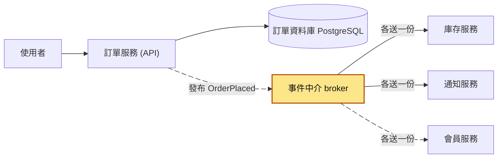

這篇講的是黃色的 broker 前後那一段：訂單服務寫完資料庫後把事件交給 broker，broker 再把同一個事件分送給每個訂閱者。broker 怎麼保存訊息、怎麼確認送達，在[訊息佇列](35-訊息佇列.md)講過；「寫資料庫」和「發事件」怎麼綁在一起，見[信箱模式](44-信箱模式.md)；訂閱者處理不了的事件放去哪裡，見[死信佇列](36-死信佇列.md)。

## 生活比喻

想像公司的「公告欄」跟「主管派工」兩種做事方式。

- **派工（命令）**：主管走到你桌邊說「幫我訂明天的會議室」。他知道要找誰、要你做什麼，也會等你回報結果。
- **公告欄（事件）**：人資在公告欄貼一張「新同事小陳下週一報到」。貼的人不用知道誰會看：IT 看到就去準備電腦，行政看到就去辦門禁卡，福委會看到就把他加進群組。明年多了一個「導師制度」，負責的人自己來看公告欄就好，人資完全不用改流程。

在事件驅動裡，發布者只負責把事實寫清楚發出去，後續動作由各個訂閱者自己決定。

**比喻失準的地方**：
1. 真實公告欄貼了就在那裡，大家看的是同一張紙；系統裡的事件會被複製給每個訂閱者，各自的處理進度不同，有人已經處理完、有人還在排隊，所以同一時間各服務看到的狀態會不一樣。
2. 公告欄上的字寫錯了，大家會來問你；系統裡的事件格式寫錯或改掉，消費者常常是「默默處理失敗」，你根本不知道誰壞了。
3. 公告欄不會「同一張公告貼兩次」，但訊息系統會重送，所以每個訂閱者都要能處理重複的事件。

## 它是怎麼運作的

### 基本架構：發布者、事件中介、訂閱者

訂單成立之後要做的事會越來越多：扣庫存、寄信、加點數。如果由訂單服務一個一個去呼叫，每多一件事就要改一次訂單服務。事件驅動在中間放一個事件中介，訂單服務只要發一次事件。事件中介是一個專門收下訊息、保存起來、再轉送給訂閱者的程式，常見的有 Kafka、RabbitMQ、Redis Streams，下文都直接叫它 broker。

你下單成功、訂單服務發出 `OrderPlaced` 時，先看最簡單的情況，只有一個訂閱者。訂單服務把事件交給事件中介就算完成，事件中介再把它投遞給庫存服務：

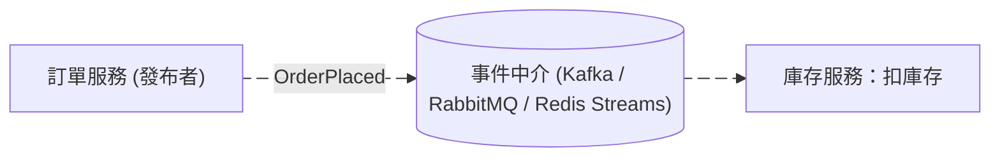

接著加上另外兩個訂閱者。事件中介把同一個事件各投遞一份給每個訂閱者，三個服務各自處理、各自記錄進度：

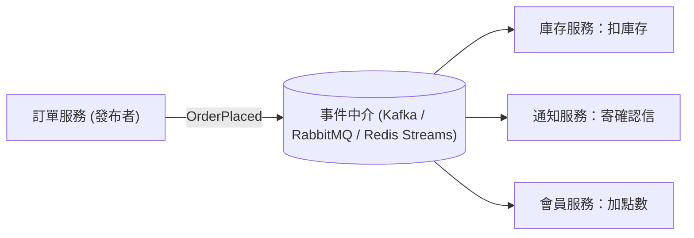

之後要加推薦服務，它自己訂閱 `OrderPlaced` 就好，訂單服務不用改：

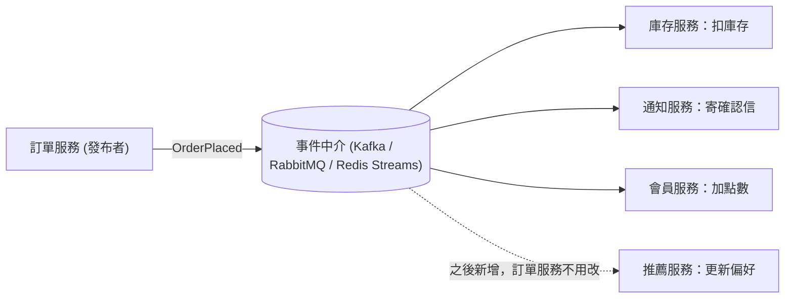

發布者不用知道誰在收，加一個訂閱者也不用改發布者，這種彼此改動不會互相牽動的關係叫鬆耦合（loose coupling），是事件驅動最大的好處。

三個角色：

- **發布者（producer / publisher）**：在自己的業務完成後，發出一個描述「發生了什麼事」的事件。
- **事件中介（broker）**：負責保存和投遞事件。除了上面提到的 Kafka、RabbitMQ、Redis Streams，雲端也有 SNS/SQS、Google Pub/Sub。它跟[訊息佇列](35-訊息佇列.md)用的是同一類基礎設施，差別在用法。
- **訂閱者（subscriber，下文也叫消費者 consumer）**：各自訂閱感興趣的事件類型，**每一個訂閱者都會拿到一份完整的事件**，各自處理、各自記錄進度。

事件跟「工作佇列」的用法不同。工作佇列是一件工作只給一個工作者做（分工）；事件是一件事實廣播給所有訂閱者（每個人都知道）。在 Kafka 裡這靠「不同的 consumer group」實現：consumer group 是消費者群組，同一個服務開的多個實例算一組，組跟組之間各收一份，同一組裡面則分工。在 RabbitMQ 裡則靠 fanout / topic exchange（把一則訊息複製到多個佇列的分送規則）綁到多個佇列。

下面這張圖是「動手看看」會跑出來的樣子：庫存服務開了兩個實例 `i1`、`i2`，點數服務開一個 `p1`，同一個事件進來時兩個群組各拿一份：

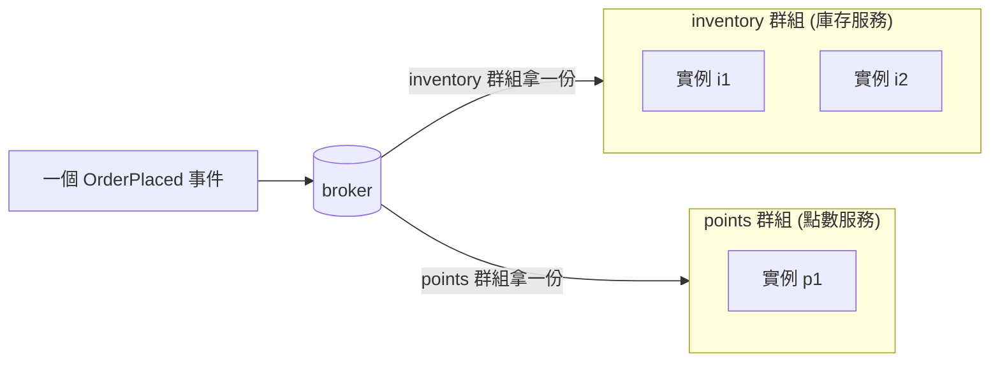

在 `inventory` 群組裡，這份事件只會交給 `i1` 或 `i2` 其中一個處理，這就是「群組之間廣播、群組之內分工」。

### 事件 vs 命令

事件和命令都可能是一包送進 broker 的訊息。分清楚是哪一種，才知道誰擁有格式、接收者能不能拒絕。

下面這張圖並排看兩種訊息怎麼走：事件發出去就結束，不知道誰會收；命令有指定的接收者，而且會等它回覆。

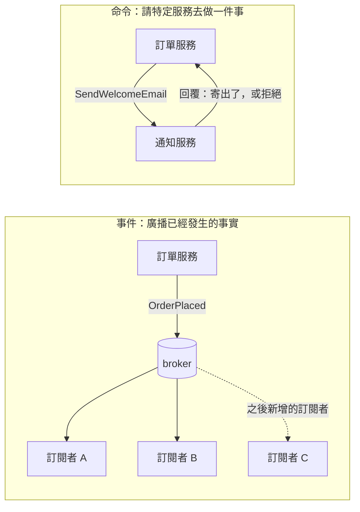

| | 事件（Event） | 命令（Command） |
|---|---|---|
| 意義 | 已經發生的事實 | 希望某人去做的事 |
| 命名 | 過去式：`OrderPlaced`、`UserRegistered` | 祈使句：`PlaceOrder`、`SendWelcomeEmail` |
| 接收者 | 0 到 N 個，發布者不知道是誰 | 通常剛好 1 個，發送者知道是誰 |
| 能不能拒絕 | 不能，事情已經發生了 | 可以，接收者可以說「不行」 |
| 誰擁有格式 | 發布者 | 接收者（它定義自己接受什麼命令） |

**如果你發出去之後，心裡想的是「某某服務應該要去做 X」，那它其實是命令**。需要命令時就明確用命令。把命令包裝成事件，兩個服務照樣綁死，只是這層依賴從架構圖上看不出來。

### 事件通知 vs 事件攜帶狀態

事件裡要放多少資料？有兩種主流做法（Martin Fowler 的分類）：

兩種做法放進事件的欄位，並排看是這樣：

| 欄位 | 事件通知 | 事件攜帶狀態 |
|---|---|---|
| `event_type` | `OrderPlaced` | `OrderPlaced` |
| `order_id` | 8812 | 8812 |
| `customer_id` | 不放 | 501 |
| `items`（品項） | 不放 | `sku` A-100、`qty` 2、`unit_price` 350 |
| `total_amount` | 不放 | 700 |
| `currency` | 不放 | TWD |

下面這張圖看消費者收到事件之後要做什麼。上半段是事件通知，消費者要回頭問訂單服務；下半段是事件攜帶狀態，消費者拿到就能直接處理：

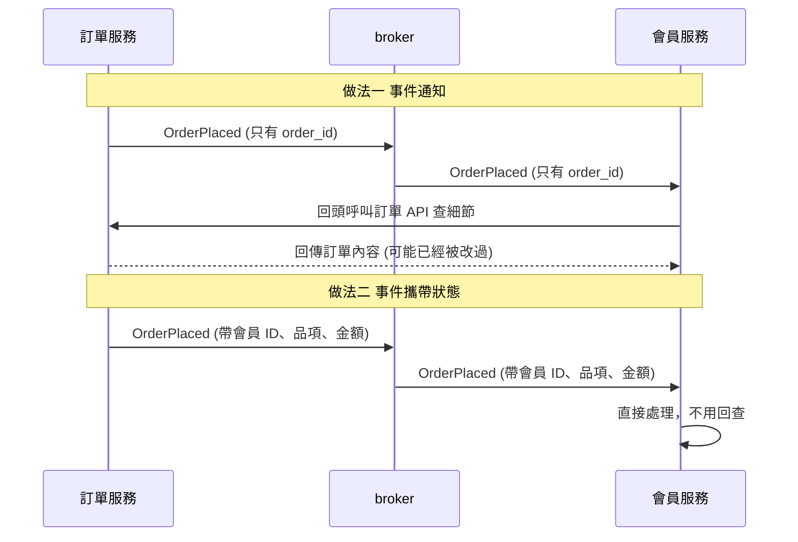

**1. 事件通知（Event Notification）**：只說「發生了什麼」和 ID，例如只帶 `order_id: 8812`。

- 優點：事件小、格式穩定、不會把資料散播到各處。
- 缺點：消費者想知道細節就得回頭呼叫訂單 API。三個消費者就是三倍的回查流量，而且訂單服務掛掉時大家都卡住，消費者又變回依賴訂單服務在線。另外，等消費者回頭查的時候，訂單可能已經被改過（例如已取消），查到的不是事件發生當下的狀態。

**2. 事件攜帶狀態（Event-Carried State Transfer）**：把消費者需要的資料直接放進事件，像上表右欄那樣帶著會員 ID、品項、金額和幣別。

- 優點：消費者不用回頭查，訂單服務掛了也能繼續處理；消費者可以在自己的資料庫存一份副本，查詢更快。
- 缺點：事件變大、欄位變多，要維護的合約範圍也變大；個資（姓名、地址、電話）跟著事件散到各個服務，資安和個資法遵的麻煩變多；副本會過期，是[最終一致](42-最終一致性.md)的。

實務上常見的折衷是放「這個事件本身的事實」（訂單內容、金額），不放「順便附上的周邊資料」（使用者完整個人檔案）。

> 補充：Fowler 的文章裡還有另外兩種「事件驅動」，分別是[事件來源](46-事件來源.md)和 [CQRS](45-CQRS.md)。它們是更進一步的模式，用了事件驅動也不一定要用，這裡先不展開。

### 事件長什麼樣子：信封與內容

消費者要去重、要判斷自己看不看得懂、出事時要追查，都需要一些跟業務內容無關的固定欄位。所以不管用哪種 broker，建議每個事件外面都包一層固定的「信封（envelope）」，業務內容放在裡面的 `data`。一個信封裡的欄位長這樣：

| 欄位 | 範例值 | 用途 |
|---|---|---|
| `event_id` | `9b2f7c1e-5d0a-4f3e-9a71-1c2d3e4f5a6b` | 全域唯一，消費者靠它做去重（冪等） |
| `event_type` | `OrderPlaced` | 跟 `event_version` 一起讓消費者判斷看不看得懂 |
| `event_version` | `2` | 同上 |
| `occurred_at` | `2026-10-24T03:15:22.481Z` | 事件發生時間（不是送出時間），用 UTC |
| `source` | `order-service` | 發出這個事件的服務 |
| `trace_id` | `4bf92f3577b34da6a3ce929d0e0e4736` | 串起整條流程的追蹤 ID，出事時靠它找出同一條流程經過的每個服務（見[分散式追蹤](50-分散式追蹤.md)） |
| `data` | 訂單內容 | 業務內容 |

消費者收到一個事件時，會依序用到信封裡的這幾個欄位：

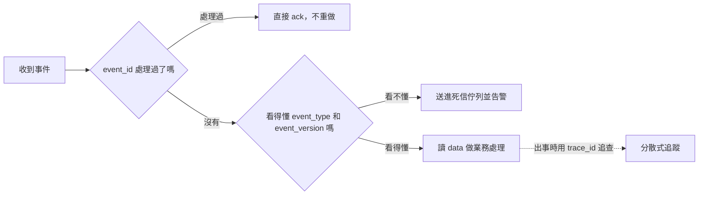

這個順序跟「動手看看」的 `consumer.py` 一樣。

業界有一個中立的事件格式規格叫 CloudEvents（CNCF 專案），它的必填屬性是 `id`、`source`、`specversion`、`type`。不一定要照用，但設計自己的信封時很值得參考。

### 編舞（Choreography）vs 指揮（Orchestration）

> 第一次讀可以先跳過這一節，等遇到一個流程要好幾個服務接力完成時再回來看。

當一個業務流程要好幾個服務合作完成（例如依序下單、扣庫存、扣款、出貨），有兩種組織方式。

**Choreography（編舞／各自跳舞）**：沒有中央指揮，每個服務聽到事件就做自己的事，再發出新事件。你下單之後，訂單服務發出 `OrderPlaced`，庫存服務收到後保留庫存並發出 `StockReserved`，付款服務收到後扣款，依此類推：

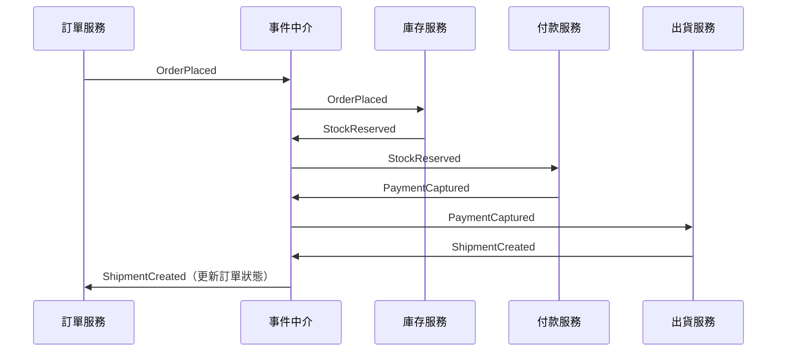

**Orchestration（指揮）**：有一個流程協調者（orchestrator）負責按步驟下命令、收結果、決定下一步，失敗時也由它負責補償（把前面已經做完的步驟撤銷，例如把保留的庫存放回去）。下圖是扣款失敗的情況，協調者收到 `PaymentFailed` 後，下命令把剛才保留的庫存釋放掉：

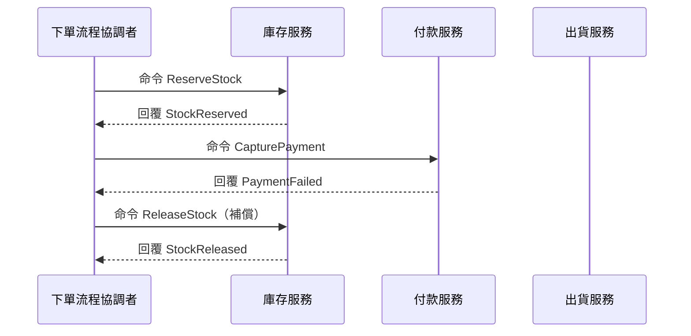

| | Choreography | Orchestration |
|---|---|---|
| 流程定義在哪 | 散在各服務的訂閱邏輯裡 | 集中在協調者一處 |
| 新增一個步驟 | 新服務訂閱事件就好 | 要改協調者 |
| 回答「這張訂單卡在哪一步」 | 難，要拼湊各服務日誌 | 容易，看協調者狀態 |
| 失敗補償 | 每個服務要自己聽失敗事件做回滾 | 協調者統一處理 |
| 風險 | 流程散在各處，沒人看得到全貌 | 協調者變成什麼都管的大泥球 |

經驗法則：
- **「通知類」的旁支動作**（寄信、加點數、更新搜尋索引、寫報表）用 choreography 很合適，它們失敗了也不影響主流程。
- **「有先後順序、要補償、要能查進度」的核心流程**（下單扣款出貨）傾向用 orchestration，工具可以是自己寫的狀態機，或 Temporal、AWS Step Functions 這類工作流引擎。
- 兩者可以混用：主流程用 orchestration，主流程結束時發一個 `OrderCompleted` 事件給其他人 choreography。

跨服務的補償流程（Saga 模式）細節在[分散式交易](43-分散式交易.md)。

### 這些代價具體是什麼

1. **流程難追蹤**：程式碼裡找不到「下單之後呼叫了誰」，因為根本沒有呼叫。要靠文件、事件目錄（event catalog）或追蹤系統才看得出全貌。
2. **最終一致性**：使用者下單後馬上去看點數，可能還沒加上去。產品和客服要接受這件事，UI 也要設計成能處理「處理中」狀態。
3. **除錯困難**：錯誤發生在離原因很遠的地方，時間上也可能晚好幾分鐘。沒有 `trace_id` 和集中式日誌，幾乎無從查起。
4. **重複與亂序**：大部分 broker 只保證「至少一次（at-least-once）」投遞，消費者會收到重複事件；順序也只在特定範圍內保證。例如 Kafka 會把一個事件流切成好幾段平行處理，每一段叫一個 partition，它只保證同一個 partition 內有序。
5. **schema 演進**：事件的欄位格式（schema）一旦被訂閱，就是公開 API。而且比 HTTP API 更難改，因為舊事件可能還躺在 broker 裡、或被重播（replay，把 broker 保存的舊事件重新讀一遍），新版消費者也要看得懂舊事件。

第 1、3、5 點在開頭情境裡全碰上了。下面這張圖把原因和症狀放在同一條線上，可以看到兩者隔了幾個服務、幾天：

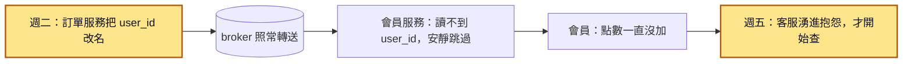

第 4 點的「至少一次」投遞，可以一步一步看重複事件是怎麼來的。假設會員 501 原本有 1200 點，訂單 8812 該加 70 點，最後兩欄比較消費者有沒有用 `event_id` 去重：

| 時間 | broker | 會員服務 | 點數（沒去重） | 點數（有去重） |
|---|---|---|---|---|
| T1 | 投遞 `OrderPlaced`（訂單 8812） | 收到，加 70 點 | 1270 | 1270 |
| T2 | | 加完點數、還沒 ack 就重啟 | 1270 | 1270 |
| T3 | 一直沒收到 ack，當成還沒處理完 | | 1270 | 1270 |
| T4 | 重新投遞同一個事件 | 又收到一次 | 1270 | 1270 |
| T5 | | 沒去重：再加 70 點。有去重：看到處理過，直接 ack | 1340 | 1270 |

怎麼擋，見「常見地雷」的地雷 3。

## 動手看看

用 Redis Streams 模擬一個事件流：訂單服務發 `OrderPlaced`，兩個不同的訂閱者（庫存、點數）各自收到一份，同一個訂閱者開兩個實例時則會分工。Redis Streams 從 Redis 5.0 開始支援，consumer group 的概念跟 Kafka 很接近，很適合拿來理解。

### 1. 起一個 Redis

```powershell
docker run --rm -d --name eda-redis -p 6379:6379 redis:7
```

### 2. 發布者：`producer.py`

```python
# producer.py：模擬訂單服務發出 OrderPlaced 事件
import json
import sys
import uuid
from datetime import datetime, timezone

import redis

STREAM = "events:orders"
r = redis.Redis(host="localhost", port=6379, decode_responses=True)

def publish(event_type: str, data: dict, version: int = 1) -> str:
    envelope = {
        "event_id": str(uuid.uuid4()),          # 消費者去重用
        "event_type": event_type,               # 過去式命名
        "event_version": version,               # schema 版本
        "occurred_at": datetime.now(timezone.utc).isoformat(),
        "source": "order-service",
        "data": data,
    }
    # Stream 的每筆訊息是扁平的「欄位→字串」對應（數字也會被存成字串），
    # 不能直接放巢狀的 dict，所以把整包 JSON 序列化後放進一個欄位
    msg_id = r.xadd(STREAM, {"payload": json.dumps(envelope, ensure_ascii=False)})
    print(f"已發布 {event_type} v{version} → {msg_id}")
    return msg_id

if __name__ == "__main__":
    version = int(sys.argv[1]) if len(sys.argv) > 1 else 1
    order_id = uuid.uuid4().int % 100000
    publish(
        "OrderPlaced",
        {"order_id": order_id, "customer_id": 501, "total_amount": 700, "currency": "TWD"},
        version=version,
    )
```

> 注意：這裡為了簡單直接寫 Redis。正式環境「寫訂單資料庫」和「發事件」必須綁在一起，否則會出現訂單成立了但事件沒發出去的情況，做法見[信箱模式](44-信箱模式.md)。

### 3. 訂閱者：`consumer.py`

```python
# consumer.py：用法 python consumer.py <訂閱者群組> <實例名稱>
import json
import sys

import redis

STREAM = "events:orders"
DLQ = "events:orders:dlq"
SUPPORTED_VERSIONS = {1}            # 這個消費者看得懂的版本

group = sys.argv[1]                 # 例如 inventory、points
consumer = sys.argv[2] if len(sys.argv) > 2 else "c1"
r = redis.Redis(host="localhost", port=6379, decode_responses=True)

# 建立 consumer group；id="0" 表示從頭讀，已存在就忽略
try:
    r.xgroup_create(STREAM, group, id="0", mkstream=True)
except redis.ResponseError as e:
    if "BUSYGROUP" not in str(e):
        raise

def handle(evt: dict) -> None:
    data = evt["data"]
    # 必要欄位缺了就「大聲失敗」，不要默默 return
    customer_id = data["customer_id"]
    print(f"[{group}/{consumer}] 處理訂單 {data['order_id']}，會員 {customer_id}")

print(f"[{group}/{consumer}] 開始監聽…")
while True:
    # ">" 表示只拿還沒分給這個群組任何成員的新訊息；block 單位是毫秒
    resp = r.xreadgroup(group, consumer, {STREAM: ">"}, count=10, block=5000)
    # 預設回傳 [[stream, [(id, fields), ...]]]；逾時沒訊息時是空的
    # （redis-py 8 若設 legacy_responses=False 會改成 dict，這裡用預設值）
    for _stream, messages in resp or []:
        for msg_id, fields in messages:
            evt = json.loads(fields["payload"])
            dedup_key = f"processed:{group}:{evt['event_id']}"

            # 冪等：同一個 event_id 處理過就直接確認
            if r.exists(dedup_key):
                r.xack(STREAM, group, msg_id)
                continue

            # 看不懂的版本：送去死信佇列並告警，不要假裝處理完
            if evt.get("event_version") not in SUPPORTED_VERSIONS:
                r.xadd(DLQ, {"group": group, "reason": "unsupported_version",
                             "payload": fields["payload"]})
                r.xack(STREAM, group, msg_id)
                print(f"[{group}/{consumer}] ⚠ 不支援的版本 {evt.get('event_version')}，已送 DLQ")
                continue

            try:
                handle(evt)
            except KeyError as e:
                r.xadd(DLQ, {"group": group, "reason": f"missing_field:{e}",
                             "payload": fields["payload"]})
                r.xack(STREAM, group, msg_id)
                print(f"[{group}/{consumer}] ⚠ 缺欄位 {e}，已送 DLQ")
                continue

            # 先處理、再記錄、最後 ack。如果在 handle 之後、記錄之前當掉，
            # 這筆會被重送一次，所以 handle 本身也要能承受重複。
            # 正式環境建議把去重紀錄跟業務資料寫在同一個資料庫交易裡。
            r.set(dedup_key, 1, ex=7 * 24 * 3600)
            r.xack(STREAM, group, msg_id)
```

### 4. 跑起來觀察

開四個終端機：

```powershell
uv run --with redis python consumer.py inventory i1   # 庫存服務實例 1
uv run --with redis python consumer.py inventory i2   # 庫存服務實例 2
uv run --with redis python consumer.py points p1      # 點數服務
uv run --with redis python producer.py                # 發幾次看看
```

預期會看到：

- **每發一個事件，`points` 一定收到一次，`inventory` 也收到一次**，但只會落在 `i1` 或 `i2` 其中一個。這就是「群組之間廣播、群組之內分工」。
- 關掉 `points`，多發幾個事件，再把它開回來：它會補處理錯過的事件。事件被 broker 保存著，訂閱者可以晚到，這是跟同步呼叫最大的差別。
- 執行 `uv run --with redis python producer.py 2` 發一個 v2 事件：`inventory` 和 `points` 兩個群組各自都會把它送進 DLQ（所以 DLQ 裡會多兩筆，每個群組一筆）。這就是「看不懂就大聲失敗」；開頭情境裡的點數消費者遇到看不懂的事件，則是默默跳過。

### 5. 看 broker 的內部狀態

```powershell
docker exec -it eda-redis redis-cli XINFO GROUPS events:orders     # 每個群組的進度、待確認數量
docker exec -it eda-redis redis-cli XPENDING events:orders points  # 已投遞但還沒 ack 的訊息
docker exec -it eda-redis redis-cli XRANGE events:orders:dlq - +   # 死信佇列內容
```

想觀察「消費者當掉」：在 `handle()` 裡加一行 `raise SystemExit` 讓它處理到一半就結束，再看 `XPENDING`，會發現那筆訊息卡在 pending（已經交給消費者、但還沒收到 ack 的狀態）。

本範例只用 `>` 讀新訊息，所以就算用同一個實例名稱重啟，也**不會**自動補做自己 pending 的那筆；要讀回來，得用 `XREADGROUP` 搭配 ID `0` 讀自己的 pending 清單，或由其他實例認領（Redis 5.0 起有手動指定的 `XCLAIM`，6.2 起有會自動掃描閒置訊息的 `XAUTOCLAIM`）。這就是 broker 層面的「重新投遞」，也是為什麼消費者一定要冪等。

用完記得收掉：

```powershell
docker stop eda-redis
```

## 常見地雷

### 地雷 1：把命令偽裝成事件

❌ **錯誤做法**：訂單服務發一個叫 `SendOrderConfirmationEmail` 的「事件」，或者事件名稱雖然是 `OrderPlaced`，但裡面塞了 `"email_template": "order_v3"`、`"should_add_points": true` 這種給特定下游看的欄位。

**為什麼錯**：發布者其實在指揮下游做事，只是透過 broker 繞了一圈。結果兩邊照樣綁死：通知團隊要改信件範本，得請訂單團隊改事件；而且因為是「事件」，沒有回覆，訂單服務不知道信有沒有寄成功。

✅ **正確做法**：事件只描述事實（`OrderPlaced` 加上訂單內容），由通知服務自己決定要寄什麼信。如果你真的需要「某服務去做某事並告訴我結果」，就明確用命令：直接呼叫 API，或發到該服務專屬的命令佇列。

### 地雷 2：先寫資料庫、再發事件（雙寫）

❌ **錯誤做法**：

```python
# ❌ 錯誤示範：資料庫和 broker 是兩個系統，中間任何一步失敗就不一致
with db.transaction():
    order_id = insert_order(...)
publish("OrderPlaced", {...})   # 這行之前當掉 → 訂單成立但沒人知道
```

反過來先發事件再寫資料庫也一樣糟：事件發了，資料庫交易卻回滾，下游扣了一筆不存在的訂單的庫存。

**為什麼錯**：你沒辦法讓「資料庫 commit」和「broker 收下訊息」同時成功或同時失敗。

✅ **正確做法**：用信箱模式，在同一個資料庫交易裡同時寫訂單和一筆 outbox 紀錄，再由另一個程序把 outbox 轉送到 broker：

```python
# ✅ 正確寫法：同一個交易，要嘛都成功、要嘛都沒發生
with db.transaction():
    order_id = insert_order(...)
    insert_outbox(event_type="OrderPlaced", payload={...})
# 另外有一個 relay 程序負責把 outbox 裡的紀錄發到 broker
```

細節見[信箱模式](44-信箱模式.md)。

### 地雷 3：消費者不冪等

❌ **錯誤做法**：收到 `OrderPlaced` 就 `UPDATE members SET points = points + 70`，沒有任何去重。

**為什麼錯**：broker 幾乎都是「至少一次」投遞。消費者處理完、還沒 ack 就重啟，或 ack 在網路上掉了，同一個事件就會再來一次。點數被加兩次，而且日誌看起來一切正常。

✅ **正確做法**：用 `event_id`（或業務上的唯一鍵，例如 `order_id`）做去重，最穩的做法是靠資料庫的唯一約束：

```sql
-- ✅ 正確寫法：點數異動紀錄以 order_id 為唯一鍵，重複事件會被擋下
CREATE TABLE point_transactions (
    order_id    bigint PRIMARY KEY,
    member_id   bigint NOT NULL,
    points      integer NOT NULL,
    created_at  timestamptz NOT NULL DEFAULT now()
);

INSERT INTO point_transactions (order_id, member_id, points)
VALUES (8812, 501, 70)
ON CONFLICT (order_id) DO NOTHING;
-- 再依實際插入的列數決定要不要更新點數餘額（同一個交易內）
```

原理見[冪等性](25-冪等性.md)和[唯一約束](14-唯一約束.md)。

### 地雷 4：直接修改已發布的事件 schema

❌ **錯誤做法**：把 `user_id` 改名成 `customer_id`、刪掉「沒人在用」的欄位、把 `amount` 的單位從「元」改成「分」、把字串欄位改成整數。

**為什麼錯**：你不知道所有消費者是誰，也不知道他們讀了哪些欄位。更麻煩的是 broker 裡可能還有舊格式的事件，或有人在重播歷史事件，新舊格式會同時存在一段時間。改語意（單位、意義）比改名更危險，因為程式不會報錯，只會算錯。

✅ **正確做法**：
- **只加欄位，不改名、不刪除、不改型別或語意**。新增的欄位對舊消費者要是可以忽略的。
- 真的要破壞性變更時，**升版本**（`event_version: 2`，或發一個新的事件類型），過渡期間**新舊兩版同時發**，確認所有消費者都切換後才停發舊版。
- 消費者採用「寬容讀取（tolerant reader）」：只讀自己需要的欄位，忽略看不懂的新欄位；但**必要欄位缺了要大聲失敗**。
- 規模大了可以用 schema registry（集中登記每種事件格式的服務，例如 Confluent Schema Registry）搭配 Avro / Protobuf / JSON Schema 這類有固定欄位定義的格式，在發布前就自動檢查相容性。

### 地雷 5：假設事件會照順序到

❌ **錯誤做法**：消費者收到 `OrderShipped` 就把狀態設成「已出貨」，收到 `OrderCancelled` 就設成「已取消」，完全照收到的順序覆蓋。

**為什麼錯**：重試、多個消費者實例並行處理、跨 partition 都會造成亂序。例如訂單先出貨、後來被退貨取消，但重試讓較早的 `OrderShipped` 比 `OrderCancelled` 晚到，消費者就會把「已取消」蓋回「已出貨」：早發生的事件晚到，舊狀態就蓋掉新狀態。Kafka 只保證同一個 partition 內有序，RabbitMQ 在多個消費者或重新投遞時也不保證順序。

✅ **正確做法**：
- 需要順序的事件，用同一個鍵（例如 `order_id`）當 partition key（決定事件落在哪個 partition 的欄位），讓同一張訂單的事件落在同一個 partition。
- 事件帶上單調遞增的版本號（例如訂單的 `version` 欄位），消費者只接受比本地版本新的事件：

```sql
-- ✅ 正確寫法：只有事件版本比現有的新才更新，舊事件自動被忽略
UPDATE order_projection
SET status = 'shipped', version = 7
WHERE order_id = 8812 AND version < 7;
```

- 能設計成「與順序無關」最好，例如狀態機只允許合法的轉換（已取消的訂單不能變成已出貨）。

### 地雷 6：消費者吞掉錯誤直接 ack

❌ **錯誤做法**：

```python
# ❌ 錯誤示範：任何錯誤都吞掉，訊息照樣確認，問題永遠沒人發現
try:
    handle(evt)
except Exception:
    pass
ack(msg)
```

或是像開頭情境那樣，欄位缺了就 `return`。

**為什麼錯**：事件驅動系統的故障本來就很難發現，這種寫法等於把唯一的線索也丟了。

✅ **正確做法**：分清楚兩種錯誤。**暫時性錯誤**（資料庫連線斷了、下游逾時）不要 ack，讓它[重試](26-重試機制.md)並搭配退避；**永久性錯誤**（格式不對、版本不支援、資料不合法）重試一百次也不會好，送進[死信佇列](36-死信佇列.md)，同時記錄日誌和指標、觸發告警。DLQ 長度要有監控，大於 0 就該有人去看。

### 地雷 7：用事件做需要立刻知道結果的事

❌ **錯誤做法**：結帳 API 發出 `CheckoutRequested` 事件，然後前端每秒輪詢「庫存夠不夠、付款成功沒」，或後端在 API 裡等另一個事件回來才回應使用者。

**為什麼錯**：使用者要的是同步的答案，你卻用非同步的工具去做，換來更長的延遲、更複雜的程式（要配對請求和回應、要處理逾時），而且一點鬆耦合的好處都沒拿到，因為結帳本來就必須依賴庫存和付款的結果。

✅ **正確做法**：使用者在等的核心步驟（檢查庫存、扣款）用同步呼叫，或用 orchestration 明確管理；等主流程完成後再發 `OrderPlaced`，讓寄信、加點數、分析這些「不用等」的事情走事件。

## 重點整理

- **事件是已經發生的事實，用過去式命名**（`OrderPlaced`、`PaymentFailed`），發布者不知道也不在乎誰會收；命令是要某個特定服務去做的事（`PlaceOrder`、`SendEmail`），對方可以拒絕。心裡想著「某服務應該去做 X」時，就該用命令。
- **事件驅動換來鬆耦合**：訂單服務只發 `OrderPlaced`，之後要加點數、寄信、更新推薦，都是新服務自己訂閱，訂單服務不用改。
- **代價是流程難追蹤、只能最終一致、除錯困難**（錯誤可能出現在離原因好幾個服務、好幾分鐘之外）；事件的 schema 一旦有人訂閱就是合約，開頭情境的欄位改名就是這樣弄壞點數服務的。
- **三件基本功**：消費者要冪等（broker 至少送一次、可能更多）、寫資料庫和發事件要用[信箱模式](44-信箱模式.md)綁在一起、schema 只加不改，破壞性變更就升版本並新舊並行。
- **看不懂的事件要大聲失敗**：送進死信佇列並發告警，不要 `return` 或 `except: pass` 之後照樣 ack。
- **使用者在等結果的步驟用同步呼叫**，主流程完成後再發事件，讓不用等的工作走事件。

## 新人必知清單

### 一定要會（基本功）

- [ ] 分得出事件和命令：事件用過去式、描述事實、發布者不在乎誰收；看到「名為事件、實為命令」的設計要能指出來。
- [ ] 知道事件通知和事件攜帶狀態的差別與取捨，設計事件時能說出為什麼放這些欄位。
- [ ] 每個事件都有 `event_id`、`event_type`、`event_version`、`occurred_at`，最好再加 `trace_id`。
- [ ] 消費者一定要冪等，能用唯一約束或去重紀錄擋住重複事件。
- [ ] 知道「寫資料庫 + 發事件」是雙寫問題，要用信箱模式解決。
- [ ] 事件 schema 只加不改；破壞性變更要升版本、新舊並行一段時間。
- [ ] 消費者遇到看不懂的事件要大聲失敗（DLQ + 告警），不能默默 ack。
- [ ] 不要假設順序；需要順序時知道用 partition key 和版本號處理。
- [ ] 能判斷一個流程該用同步呼叫還是事件，知道「使用者在等結果」的步驟通常不適合用事件。

### 知道有這回事就好

- Choreography vs orchestration 的取捨，以及 Temporal、AWS Step Functions 這類工作流引擎的存在。
- CloudEvents 規格，以及它的必填屬性 `id`、`source`、`specversion`、`type`。
- Schema registry 與相容性模式（backward / forward / full），還有 Avro、Protobuf 這類有 schema 的序列化格式。
- 事件目錄（event catalog）或 AsyncAPI 規格，用來記錄「有哪些事件、誰發、誰收」。
- 事件重播（replay）：Kafka 這類保留歷史的 broker 可以讓新消費者從頭處理一遍，但前提是消費者冪等、而且看得懂舊版事件。
- PostgreSQL 的 `LISTEN/NOTIFY` 不會持久化，listener 斷線期間發的通知就掉了，預設 payload 也要小於 8000 bytes，適合當「提醒有變化」的訊號，不適合當可靠的事件匯流排。
- 「至少一次」、「最多一次」、「恰好一次（exactly-once）」投遞語意的差別；所謂恰好一次通常有嚴格的適用範圍，跨系統時還是要靠冪等。

### 先不用管（等你遇到再學）

- [事件來源](46-事件來源.md)：用事件序列當作唯一的資料來源，是完全不同層級的決定。
- Kafka 的 partition 數規劃、retention 與 log compaction、consumer rebalance 調校。
- Kafka Streams、Flink 這類串流處理框架。
- 跨資料中心的事件複寫。
- CDC（Change Data Capture，例如 Debezium）從資料庫 WAL 產生事件的做法。

## Code Review 時可以問的問題

1. **這個「事件」真的是事件嗎？** 名稱是過去式嗎？發布者是不是其實在期待某個特定服務做某件事？
2. **事件跟資料庫寫入綁在一起了嗎？** 如果在 commit 之後、發事件之前當掉，會發生什麼事？有沒有用 outbox？
3. **消費者收到同一個事件兩次會怎樣？** 去重是靠什麼？有沒有落在資料庫的唯一約束上？
4. **這次有沒有改到已發布事件的格式？** 有沒有改名、刪欄位、改型別或改語意？誰在訂閱這個事件，他們知道嗎？
5. **處理失敗時會怎樣？** 暫時性錯誤會重試嗎？永久性錯誤會進 DLQ 並告警嗎？有沒有 `except: pass` 或缺欄位就 `return` 的寫法？
6. **事件亂序或延遲到達時，結果還對嗎？** 有沒有用版本號或狀態機防止舊事件蓋掉新狀態？

## 情境演練

**第 1 題**：你在 code review 看到同事的 PR 新增了五種要發到 broker 的訊息：`UserRegistered`、`CreateInvoice`、`PaymentFailed`、`SendSms`、`InventoryLow`，全都當成事件發布。哪些可以照原樣發布，哪些你會請他改？

<details markdown="1"><summary>看答案</summary>

`UserRegistered`、`PaymentFailed`、`InventoryLow` 可以照原樣當事件：它們描述已經發生的事實或狀態，發布者不需要知道誰會處理。

`CreateInvoice`、`SendSms` 要請他改：它們是祈使句，表示「希望某人去做這件事」，而且通常有一個明確的接收者，對方也可以拒絕或失敗。這兩個是命令，需要時就明確用命令（直接呼叫 API，或發到該服務專屬的命令佇列），不要包裝成事件發布。`InventoryLow` 雖然不是過去式動詞，但它描述的是一個已經成立的狀態，仍然屬於事件；有些團隊會命名成 `InventoryFellBelowThreshold` 讓語意更清楚。

</details>

**第 2 題**：你在設計 `OrderPlaced` 的內容。點數服務需要會員 ID 和金額，報表服務需要訂單明細。同事 A 主張事件只帶 `order_id`（事件通知），要什麼再回頭查訂單 API；同事 B 主張把完整訂單內容放進去（事件攜帶狀態）。你會怎麼權衡？

<details markdown="1"><summary>看答案</summary>

先把兩種做法的取捨攤開來看。

**事件通知**：
- 優點：事件小、格式穩定，個資不會跟著散播到各服務。
- 缺點：消費者要回頭呼叫發布者的 API 拿細節，增加流量和依賴；發布者掛了消費者也跟著卡住；而且回頭查到的可能已經不是事件發生當下的狀態。

**事件攜帶狀態**：
- 優點：消費者可以獨立處理，不依賴發布者在線；可以在本地存副本加速查詢。
- 缺點：事件變大、合約範圍變大，schema 更難演進；資料（包含個資）複製到多處；本地副本是最終一致的，可能過期。

這個情境裡兩個消費者都需要訂單內容，只帶 `order_id` 的話，兩個服務每收到一個事件都要回查一次訂單 API，訂單服務掛掉時兩個都卡住。比較合理的是採用事件攜帶狀態，但只放訂單本身的事實（會員 ID、明細、金額），不放使用者的完整個人檔案。

</details>

**第 3 題**：你在幫點數消費者加去重邏輯，同事說：「我們的 broker 有開 exactly-once，所以不用做去重。」你會怎麼回？

<details markdown="1"><summary>看答案</summary>

還是要做。大部分 broker 的投遞保證是「至少一次」：消費者處理完但還沒 ack 就重啟、ack 在網路上遺失、消費者處理太久被判定逾時而重新分配，都會讓同一個事件再送一次。

就算 broker 宣稱支援 exactly-once（例如 Kafka 的交易機制），它的保證通常只在 broker 內部的讀取、處理、寫回這個範圍內成立。只要你的消費者會去寫外部的資料庫、呼叫第三方 API、寄 email，broker 就管不到了，重複仍然可能發生。所以最可靠的做法還是在消費端用 `event_id` 或業務唯一鍵加上資料庫唯一約束做去重。

</details>

**第 4 題**：你的團隊負責訂單服務，`OrderPlaced` 事件裡有一個 `amount` 欄位，單位是「元」的整數。財務團隊希望改成「分」以支援小數金額。你會怎麼做？

<details markdown="1"><summary>看答案</summary>

**不能直接把 `amount` 的值改成以分為單位**。這是語意變更，舊消費者的程式不會報錯，只會把金額放大一百倍，例如點數算成一百倍、報表金額全錯，而且可能好幾天才被發現。

比較安全的做法：
1. **新增欄位**，例如 `amount_minor`（以分為單位）加上 `currency`，同時保留原本的 `amount` 照舊發送。這是只加不改，舊消費者完全不受影響。
2. 找出所有訂閱者（查事件目錄、broker 的 consumer group 清單、問各團隊），請他們改讀新欄位。
3. 確認都切換後，才考慮在新版本（`event_version: 2` 或新事件類型）裡移除舊欄位，並且新舊版本並行發送一段時間。
4. 如果欄位語意改變很大，乾脆直接定義新版事件，不要在同一個欄位名稱上換意義。

事件 schema 是你跟一群可能不認識的消費者之間的合約，修改時要用 API 版本管理的標準來處理。

</details>

**第 5 題**：新功能是「使用者下單時，要檢查庫存是否足夠，不夠就直接告訴使用者無法下單」。同事提議：訂單服務發 `OrderRequested` 事件，庫存服務檢查後發 `StockChecked` 事件，訂單服務收到後再回應使用者。你怎麼看？

<details markdown="1"><summary>看答案</summary>

不太適合。這個流程的特徵是：**使用者正在等結果、必須拿到結果才能決定下一步**。用事件來做會遇到：

- API 要卡住等另一個事件回來，必須自己做請求和回應的配對、處理逾時（庫存服務慢了或掛了，使用者要等多久？）。
- 延遲變長：多了兩次經過 broker 的時間。
- 一點鬆耦合的好處都沒有：訂單服務本來就必須依賴庫存檢查的結果，只是把同步依賴藏到了非同步管線裡，反而更難除錯。
- 其實 `OrderRequested` 背後的意思是「請檢查庫存」，本質上是命令。

比較好的做法：下單 API 直接同步呼叫庫存服務（加上逾時、[斷路器](29-斷路器.md)），庫存足夠並且訂單成立後，再發 `OrderPlaced` 事件，讓寄信、加點數、更新推薦這些不用等的工作非同步去做。如果流程步驟多、需要補償，就考慮 orchestration。

</details>

## 相關主題

- [訊息佇列](35-訊息佇列.md)：事件驅動底層用的就是訊息基礎設施，佇列的投遞保證、ack 機制要先懂。
- [冪等性](25-冪等性.md)：事件至少送達一次，消費者不冪等就會重複處理。
- [信箱模式](44-信箱模式.md)：解決「寫資料庫」和「發事件」無法同時成功的雙寫問題。
- [最終一致性](42-最終一致性.md)：事件驅動之後各服務的資料只能最終一致，要知道怎麼跟產品和使用者溝通。
- [死信佇列](36-死信佇列.md)：處理不了的事件要有地方放，而且要有人看。
- [分散式追蹤](50-分散式追蹤.md)：事件串起的流程沒有 stack trace，要靠 `trace_id` 和追蹤系統還原全貌。

## 延伸閱讀

- Martin Fowler, "What do you mean by 'Event-Driven'?"：https://martinfowler.com/articles/201701-event-driven.html （事件通知、事件攜帶狀態、事件來源、CQRS 四種模式的經典分類）
- Redis 官方文件：Redis Streams：https://redis.io/docs/latest/develop/data-types/streams/ （本篇範例用到的 consumer group、XREADGROUP、XACK、XPENDING）
- CloudEvents 規格：https://cloudevents.io/ （CNCF 的中立事件格式規格）
- Chris Richardson, Saga 模式（choreography 與 orchestration 的比較）：https://microservices.io/patterns/data/saga.html
