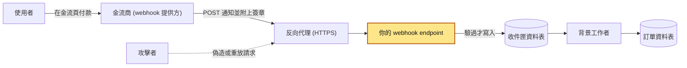
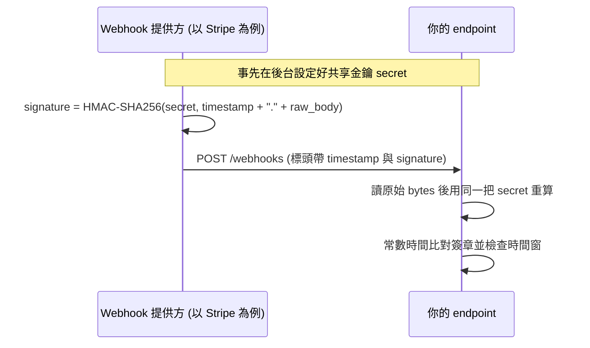
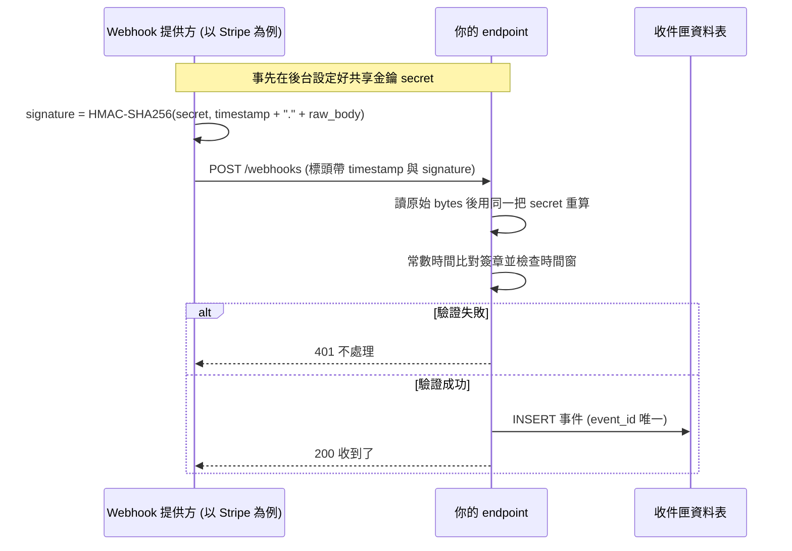
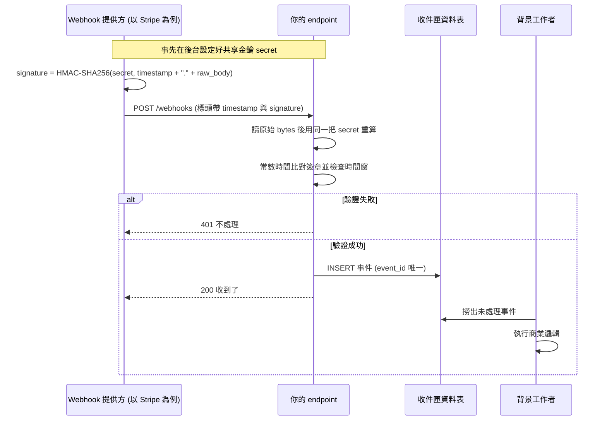
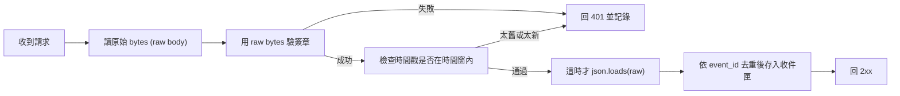
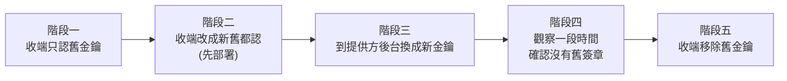

# 40｜Webhook 驗證（Webhook Signature Verification）

> Webhook 是別的服務在某件事發生時，主動送一個 HTTP POST 到你的網址來通知你，例如金流商通知「這筆付款成功了」。Webhook 簽章驗證（webhook signature verification）是收到通知時，用雙方事先約好的一把金鑰，對收到的內容重算一串驗證碼（簽章），跟對方附上的簽章比對，確認這包資料真的是對方送的、內容沒被改過，也不是舊的被拿來重送。

**難度**：★★☆　**閱讀時間**：約 20 分鐘　**前置知識**：[冪等性](25-冪等性.md)、[背景工作者](37-背景工作者.md)

## 為什麼要在意：一個具體的情境

假設你負責一個電商的付款通知 API。使用者在第三方金流的頁面付款，金流商確認付款成功後，會打 `POST https://shop.example.com/webhooks/payment` 通知你，body 是一包 JSON，`type` 是 `payment.succeeded`，裡面帶著 `order_id`。你的程式收到後把訂單改成「已付款」，倉庫看到「已付款」就出貨。這個收通知的網址就叫 webhook endpoint。

### 第一次出事：沒驗簽章

當初寫這支 endpoint 的工程師覺得「這個網址又沒公開，誰會知道」，所以收到 JSON 就照著 `order_id` 改狀態：

```python
# ❌ 出事的寫法：沒有任何驗證，誰送來都照單全收
@app.post("/webhooks/payment")
def receive():
    event = request.get_json()
    if event["type"] == "payment.succeeded":
        mark_order_paid(event["data"]["order_id"])  # 把訂單改成「已付款」
    return {"received": True}, 200
```

半年後，有人在一個外包團隊公開的 Postman collection 裡看到了這個網址和一包範例 payload（請求 body 裡帶的資料）。接下來發生的事：

| 步驟 | 誰 | 做了什麼 | 你的系統怎麼反應 | 訂單 1002 的狀態 |
|---|---|---|---|---|
| 1 | 攻擊者 | 在網站上下一張高單價訂單 1002，但不付款 | 建立訂單 | 待付款 |
| 2 | 攻擊者 | 照範例 payload 自己捏一包 `{"type": "payment.succeeded", "data": {"order_id": 1002}}`，直接 POST 到 endpoint | `request.get_json()` 照常 parse | 待付款 |
| 3 | 你的 endpoint | 看到 `type` 是 `payment.succeeded`，執行 `mark_order_paid(1002)` | 回 `200 OK` | 已付款 |
| 4 | 倉庫 | 看到訂單已付款 | 出貨 | 已出貨 |
| 5 | 財務 | 對帳 | 金流商那邊找不到訂單 1002 的交易紀錄 | 已出貨，但沒收到錢 |

兩週內陸續有幾十筆高單價訂單這樣被出貨。使用者端看不出任何異狀，攻擊者照常收到貨。工程師這邊，日誌裡每一筆偽造請求都回了 `200 OK`，監控一片綠，直到對帳才發現。

根因在 `event = request.get_json()` 那一行：程式完全相信 body 寫的內容，沒有檢查它是不是金流商送的。網址不公開不算安全措施，網址很容易從文件、日誌、分享的檔案外流。

### 第二次出事：修補時驗錯了 bytes

緊急修補時，工程師加了簽章驗證：金流商會用金鑰對 body 算出一串簽章放在標頭裡，你用同一把金鑰再算一次，對得上才處理（算法叫 HMAC，下面「HMAC-SHA256」一節會講）。但他是這樣算的：

```python
# ❌ 錯誤示範：拿 parse 後的 JSON 重新序列化來算簽章
payload = request.get_json()
body = json.dumps(payload)                  # 跟對方送來的 bytes 不一樣
expected = hmac.new(SECRET, body.encode(), hashlib.sha256).hexdigest()
```

本機測試會過，因為測試用的「假金流」剛好也是用 Python 的 `json.dumps` 產生 body。一上線，真正的金流商送來的是另一種排法的 JSON：

| 步驟 | 發生什麼 | 被拿去算簽章的內容 |
|---|---|---|
| 1 | 金流商對它要送出的這串 bytes 算出簽章，放進標頭一起送過來 | `{"id":"evt_1","amount":1990}` |
| 2 | 你的程式 `request.get_json()` 把它 parse 成 Python dict | |
| 3 | `json.dumps(payload)` 再轉回字串，預設會在冒號和逗號後面加空白 | `{"id": "evt_1", "amount": 1990}` |
| 4 | 兩串 bytes 不同，算出來的簽章也完全不同，比對失敗 | |
| 5 | 回 401（未授權，表示驗證沒過），金流商以為沒送到，開始重送 | |
| 6 | 每次重送都一樣 401，失敗累積到一定次數，金流商把這個 endpoint 停用 | |

這次使用者看到的是：付款成功了，訂單卻一直停在「待付款」。工程師看到的是：每一個合法通知都回 401，那一個晚上的所有付款都沒有同步進訂單系統。

根因在 `body = json.dumps(payload)` 那一行：簽章是對 bytes 算的，兩段 JSON 意思一樣，只要差一個空白，簽章就對不上。

兩次的修法合起來就是這篇的內容：每個請求都要驗簽章，而且要用收到的原始 bytes 驗。細節在下面「為什麼一定要用原始 body」一節，完整可跑的收端寫法在「動手看看」的 `receiver.py`。

## 全貌：它在系統裡的位置

下面這張圖畫的是一筆付款通知從金流商進到你系統的路線。收件匣資料表是一張先把收到的通知原樣存下來、之後再慢慢處理的表：



驗簽章發生在黃色的 endpoint：請求進來之後、寫進資料庫之前。前面的反向代理負責 HTTPS，它會不會改到 body 也會影響驗證，見[反向代理](34-反向代理.md)；後面存進收件匣、交給背景工作者處理，見[背景工作者](37-背景工作者.md)；金流商沒收到成功回應時怎麼重送，見 [Webhook 重試](41-Webhook%20重試.md)。

## 生活比喻

想像你家大樓的管理室收包裹。任何人都可以走到櫃台說：「我是物流公司，這是 12 樓王先生的包裹，請簽收。」

- **沒驗證**：管理員看對方穿得像快遞員就收了。結果有人冒充快遞，把東西寄放進來，或是謊稱「王先生的退貨已經收走了」。
- **有驗證**：物流公司跟大樓事先約好一個只有雙方知道的暗號規則。每張託運單上，物流公司都會用「暗號＋託運單的完整內容」算出一串驗證碼。管理員拿到單子，自己用同一套規則再算一次，對得上才簽收。單子上任何一個字被塗改，算出來的驗證碼就不一樣。
- **加上時間戳**：驗證碼裡也包含了「開單時間」。有人撿到一張上個月的舊單子拿來冒充，管理員一看時間超過五分鐘，直接拒收。

**比喻失準的地方**：現實中的管理員可以「看筆跡、看長相」，webhook 收端沒有這些線索，**唯一能信任的就是數學**：簽章對上了才算數，其他什麼 User-Agent、來源 IP、看起來像不像，都只是輔助。另外，現實中的暗號被偷聽到就完了；HMAC 的金鑰本身從來不會出現在請求裡，網路上只看得到算出來的簽章，從簽章反推金鑰在實務上做不到。

## 它是怎麼運作的

### 先想清楚要防什麼

webhook 收端要面對三種攻擊：

| 威脅 | 攻擊者做的事 | 用什麼擋 |
|---|---|---|
| 偽造（forgery） | 自己捏一包「付款成功」送進來 | HMAC 簽章：沒有金鑰就算不出正確簽章 |
| 竄改（tampering） | 攔下合法請求，把金額或訂單號改掉 | HMAC 簽章：body 改一個 byte 簽章就對不上；HTTPS 讓中間人很難攔截 |
| 重放（replay） | 把一包**合法、簽章正確**的舊請求原封不動再送一次 | 時間戳＋時間窗，加上事件 ID 去重 |

重放的請求簽章是**完全正確**的，因為它本來就是對方簽的。所以只驗簽章擋不住第三種攻擊。

### HMAC-SHA256：雙方共享一把金鑰

要擋偽造和竄改，收端得能確認「這包 body 是持有金鑰的人算出簽章的」。做法是雙方事先共享一把金鑰，提供方每送一包就用它算簽章，收端用同一把金鑰重算。

算簽章用的是 HMAC（Hash-based Message Authentication Code），可以想成「帶金鑰的雜湊」。雜湊是把任意長度的資料算成一串固定長度的值，SHA-256 就是一種雜湊；HMAC 的輸入是金鑰和訊息，輸出也是一串固定長度的值，搭配 SHA-256 時就叫 HMAC-SHA256。它有兩個關鍵性質：

- **沒有金鑰就算不出來**：攻擊者看得到 body、看得到簽章，但沒有金鑰，就算不出「改過的 body」對應的簽章。
- **訊息改一點點，輸出就完全不同**：不存在「改一點點 body，簽章也只差一點點」這回事。

提供方送一個 webhook 到你的 endpoint 時，先看簽章怎麼算、怎麼比（timestamp 是送出時間，後面「時間戳與容許時間窗」一節會講它的用途）：



接著加上驗證結果的兩條路。驗不過就回 401；驗過了就把事件寫進收件匣資料表（先把通知原樣存下來的表，`event_id` 設成唯一，同一個事件存不進第二次），再回 200：



最後加上背景工作者。商業邏輯不在 endpoint 裡跑，由背景工作者從收件匣撈出事件再執行：



為什麼不直接在標頭帶一個固定 token（例如 `Authorization: Bearer xxx`）？因為固定 token 跟 body 沒有綁在一起。token 一旦從日誌或代理伺服器外洩，攻擊者就能配任何 body 一起送。HMAC 的簽章每一包都不同，而且只對那一包 body 有效。

### 為什麼一定要用原始 body

HMAC 算的是 **bytes**。下面兩段 JSON 語意一模一樣，但 bytes 不同，簽章就不同：

```text
{"id":"evt_1","amount":1990}
{"id": "evt_1", "amount": 1990}
```

parse 再序列化會改變的東西包括：空白與換行、key 的順序、數字格式（`1.0` 變 `1`）、Unicode 跳脫（`"中"` 變成 `"\u4e2d"` 或反過來，Python 的 `json.dumps` 預設就會這樣轉）、尾端換行。所以正確的順序永遠是下圖這樣（圖裡的 2xx 指 200 到 299 之間的成功狀態碼）：



各框架拿原始 body 的方式：

- Flask：`request.get_data()`（回傳 `bytes`）
- FastAPI / Starlette：`await request.body()`
- Django：`request.body`
- Node.js Express：那條路由要用 `express.raw({ type: 'application/json' })`，不能讓全域的 `express.json()` 先把 body 吃掉

### 常數時間比較：為什麼不能用 `==`

一般的字串比較是「從第一個字元開始比，一遇到不同就立刻回傳 False」。這代表「前面對了越多個字元，比較花的時間就越長」。攻擊者如果能大量送請求、精準量回應時間，理論上可以一個字元一個字元猜出正確簽章，這叫時序攻擊（timing attack）。

透過網路要量出這種奈秒級差異很難，但不是不可能，而且防禦成本幾乎是零：

```python
import hmac

# ✅ 不管在哪裡出現差異，花的時間都一樣
hmac.compare_digest(expected_bytes, received_bytes)
```

`hmac.compare_digest` 只接受兩個 `bytes`，或兩個**只含 ASCII 的** `str`。標頭值如果混了非 ASCII 字元，傳 `str` 進去會丟 `TypeError`，變成 500。所以實務上兩邊都先 `.encode()` 成 bytes 再比。

### 時間戳與容許時間窗：擋重放

簽章擋不住重放，因為重放的請求本來就是對方簽的。擋重放的作法是對方把「送出時的 Unix 時間戳」（從 1970-01-01 UTC 起算的秒數）也一起簽進去，例如簽 `"{timestamp}.{raw_body}"`。收端做兩件事：

1. 用標頭裡的時間戳和 body 一起重算簽章。因為時間戳被簽進去了，攻擊者改時間戳，簽章就對不上。
2. 檢查 `|現在時間 - 時間戳|` 是否在容許範圍內，常見設定是 300 秒。

提供方的正常重送不會被時間窗擋掉。以 Stripe 為例，每一次重送都會用當下的時間戳重新簽一次，所以就算隔一小時才重送，合法的重送也一定落在時間窗內；被擋下的只有「別人把舊請求原封不動再送一次」。

時間窗不能太小：雙方伺服器時鐘會有誤差（伺服器要開 NTP，讓系統自動跟時間伺服器對時）、網路會有延遲，太嚴格會把合法請求擋掉。也不能太大：時間窗就是攻擊者能重放的期限。**時間窗內的重放還是擋不住**，所以最後一道防線是用事件 ID 去重（存到有唯一約束的欄位），這也剛好處理了對方「正常重送」造成的重複，詳見 [冪等性](25-冪等性.md)。

### 金鑰輪替（secret rotation）

> 第一次讀可以先跳過這一節，等你要換 webhook 金鑰時再回來看。

金鑰總有一天要換：員工離職、金鑰不小心進了 git、定期輪替政策。如果收端只認一把金鑰，換的那一瞬間一定會有一批請求驗不過。正確做法是讓收端**同時接受新舊兩把**：



**先讓收端能接受新金鑰，再去提供方那邊切換**。順序反過來的話，從提供方切換到收端部署完成之間，webhook 都會驗不過。

Stripe 在後台「輪替（roll）」endpoint 金鑰時，可以讓舊金鑰延後一段時間（最多 24 小時）才失效，這段期間 `Stripe-Signature` 標頭會帶多個 `v1` 簽章（新舊金鑰各一個），收端只要任一個對上就算通過。GitHub 的 webhook 只能設一把金鑰，所以要靠收端自己做「新舊都認」的過渡期。

### Stripe 和 GitHub 實際怎麼做

| | GitHub | Stripe |
|---|---|---|
| 簽章標頭 | `X-Hub-Signature-256` | `Stripe-Signature` |
| 標頭格式 | `sha256=<hex>` | `t=<時間戳>,v1=<hex>`（可能有多個 `v1`） |
| 被簽的內容 | 原始 body | `"{t}.{原始 body}"` |
| 演算法 | HMAC-SHA256 | HMAC-SHA256 |
| 時間戳防重放 | 沒有，要自己用 `X-GitHub-Delivery`（每次投遞的唯一 ID）去重 | 有，官方 SDK 預設容許 300 秒 |
| 金鑰 | 設定 webhook 時自己填的 secret | 每個 endpoint 一把，`whsec_` 開頭 |

GitHub 另外還會送舊的 `X-Hub-Signature`（HMAC-SHA1），那是為了相容舊系統保留的，新程式一律驗 `X-Hub-Signature-256`。

有官方 SDK 時，優先用 SDK 的驗證函式，例如 Stripe：

```python
import stripe

# raw 是原始 bytes，sig_header 是 Stripe-Signature 標頭
try:
    event = stripe.Webhook.construct_event(
        payload=raw, sig_header=sig_header, secret=endpoint_secret
    )  # 內建檢查時間戳，預設容許 300 秒
except ValueError:
    ...  # body 不是合法 JSON
except stripe.error.SignatureVerificationError:
    ...  # 簽章不對（新版 SDK 也可寫 stripe.SignatureVerificationError，依版本而異）
```

GitHub 沒有官方 Python 驗證函式（Node.js 可以用 `@octokit/webhooks` 的 `verify`），自己寫也很短：

```python
import hashlib
import hmac

def verify_github(raw: bytes, secret: bytes, header: str | None) -> bool:
    """驗證 GitHub 的 X-Hub-Signature-256 標頭"""
    if not header or not header.startswith("sha256="):
        return False  # 沒帶簽章一律拒絕，不要「沒帶就略過」
    expected = "sha256=" + hmac.new(secret, raw, hashlib.sha256).hexdigest()
    return hmac.compare_digest(expected.encode(), header.encode())
```

### HTTPS：簽章不能取代加密

簽章保證的是「真實性」和「完整性」，不保證「機密性」。webhook 的 payload 裡常常有使用者 email、地址、訂單內容，走 HTTP 就是明文在網路上跑。另外，被動竊聽到的合法請求，攻擊者在時間窗內就能拿去重放。所以：

- endpoint 一律用 HTTPS，憑證要是正常簽發的。
- 提供方後台如果有「停用 SSL 驗證」之類的選項，不要開。
- TLS（HTTPS 底下負責加密的那一層）通常在反向代理就解開，後面的服務收到的已經是解密後的請求（見 [反向代理](34-反向代理.md)）。要確認代理和中間的 API gateway（擋在服務前面、統一轉送請求的一層）不會改寫 body（解壓縮、轉碼、重新格式化），否則簽章會對不上。

### 快速回 2xx，再非同步處理

提供方送出 webhook 後只會等幾秒，GitHub 文件要求 10 秒內回 2xx，超過就算失敗。如果你在 webhook handler 裡同步做「改訂單、寄信、呼叫物流 API」，任何一個下游慢一點就逾時，對方以為失敗就重送，結果同一件事被做好幾次。

正確分工：

- **handler 只做三件事**：驗簽章、把事件存進收件匣（inbox）資料表、回 2xx。
- **背景工作者**從收件匣撈事件出來執行商業邏輯，失敗就自己重試，不依賴對方重送。見 [背景工作者](37-背景工作者.md)、[訊息佇列](35-訊息佇列.md)。

回應碼也有講究。4xx 表示「送來的請求有問題」，5xx 表示「收端自己出了問題」。驗不過回 4xx（401 或 400）；**已經收過的重複事件也回 2xx**，否則對方會一直重送；只有你自己真的出問題（資料庫掛了）才回 5xx，讓對方重送。不過不少提供方（例如 Stripe）只要不是 2xx 就會重送，4xx 也一樣，所以回應碼的分類主要是讓雙方的投遞紀錄、日誌和監控看得懂「是誰的問題」，不要期待回 4xx 就能讓對方停止重送。對方怎麼重送、多久重送一次，見 [Webhook 重試](41-Webhook%20重試.md)。

## 動手看看

我們自己定一個仿 Stripe 的簽章格式（`X-Demo-Signature: t=<時間戳>,v1=<hex>`），起一個 PostgreSQL，寫一支收端和一支送端，實際看各種攻擊被擋下來。

### 1. 起資料庫、建收件匣資料表

```powershell
docker run --rm -d --name pg-webhook -e POSTGRES_PASSWORD=pw -p 5432:5432 postgres:16
# 等幾秒讓資料庫起來
docker exec -i pg-webhook psql -U postgres -c "
CREATE TABLE webhook_inbox (
  event_id     text PRIMARY KEY,          -- 用唯一性擋重複
  event_type   text NOT NULL,
  payload      jsonb NOT NULL,
  received_at  timestamptz NOT NULL DEFAULT now(),
  processed_at timestamptz                -- 背景工作者處理完才填
);"
```

### 2. 收端 `receiver.py`

```python
import hashlib
import hmac
import json
import os
import time

import psycopg
from flask import Flask, abort, request

app = Flask(__name__)
app.config["MAX_CONTENT_LENGTH"] = 1 * 1024 * 1024  # 先限制 body 大小，免得被灌爆

# 用逗號分隔多把金鑰：輪替期間新舊並存
SECRETS = [s.encode() for s in os.environ["WEBHOOK_SECRETS"].split(",")]
TOLERANCE_SECONDS = 300
DSN = "postgresql://postgres:pw@localhost:5432/postgres"


def parse_signature_header(header: str) -> tuple[str | None, list[str]]:
    """把 't=170000,v1=abc,v1=def' 拆成時間戳和簽章清單"""
    ts, sigs = None, []
    for part in header.split(","):
        key, _, value = part.strip().partition("=")
        if key == "t":
            ts = value
        elif key == "v1":
            sigs.append(value)
    return ts, sigs


def verify(raw: bytes, header: str | None) -> bool:
    if not header:
        return False
    ts, sigs = parse_signature_header(header)
    if ts is None or not ts.isdigit() or not sigs:
        return False
    # 先檢查時間窗：太舊（重放）或太新（時鐘怪怪的）都拒絕
    if abs(time.time() - int(ts)) > TOLERANCE_SECONDS:
        return False
    signed_payload = ts.encode() + b"." + raw  # 時間戳也簽進去，改不了
    for secret in SECRETS:
        expected = hmac.new(secret, signed_payload, hashlib.sha256).hexdigest().encode()
        for sig in sigs:
            if hmac.compare_digest(expected, sig.encode()):  # 常數時間比較
                return True
    return False


@app.post("/webhooks/demo")
def receive():
    raw = request.get_data()  # ✅ 原始 bytes，驗完之前不要碰 request.json
    if not verify(raw, request.headers.get("X-Demo-Signature")):
        abort(401)

    event = json.loads(raw)  # 驗證通過才 parse
    with psycopg.connect(DSN) as conn:
        cur = conn.execute(
            """INSERT INTO webhook_inbox (event_id, event_type, payload)
               VALUES (%s, %s, %s::jsonb)
               ON CONFLICT (event_id) DO NOTHING""",
            (event["id"], event["type"], raw.decode()),
        )
        duplicate = cur.rowcount == 0
    # 重複事件也回 200：代表之前已經收過了，不需要對方再送
    return {"received": True, "duplicate": duplicate}, 200
```

啟動（`whsec_demo_old` 只是本機示範用的假金鑰）：

```powershell
$env:WEBHOOK_SECRETS = "whsec_demo_old"
uv run --with flask --with "psycopg[binary]" flask --app receiver run
```

### 3. 送端 `sender.py`

```python
import hashlib
import hmac
import json
import sys
import time
import urllib.error
import urllib.request

URL = "http://127.0.0.1:5000/webhooks/demo"


def sign(raw: bytes, ts: int, secret: bytes) -> str:
    sig = hmac.new(secret, str(ts).encode() + b"." + raw, hashlib.sha256).hexdigest()
    return f"t={ts},v1={sig}"


def post(raw: bytes, header: str) -> None:
    req = urllib.request.Request(
        URL, data=raw, method="POST",
        headers={"Content-Type": "application/json", "X-Demo-Signature": header},
    )
    try:
        with urllib.request.urlopen(req) as resp:
            print(resp.status, resp.read().decode())
    except urllib.error.HTTPError as e:
        print(e.code, "被拒絕")


event = {"id": "evt_001", "type": "order.paid", "data": {"order_id": 42, "amount": 1990}}
raw = json.dumps(event, separators=(",", ":")).encode()  # 送出去的就是這串 bytes
now = int(time.time())
old, new = b"whsec_demo_old", b"whsec_demo_new"

match sys.argv[1]:
    case "ok":          # 正常請求
        post(raw, sign(raw, now, old))
    case "tamper":      # 簽的是原本的 body，送出去前把金額改掉
        post(raw.replace(b"1990", b"1"), sign(raw, now, old))
    case "reformat":    # 內容一樣，但 JSON 多了空白
        post(json.dumps(event).encode(), sign(raw, now, old))
    case "stale":       # 10 分鐘前的請求被拿來重放
        post(raw, sign(raw, now - 600, old))
    case "forged":      # 攻擊者用自己猜的金鑰
        post(raw, sign(raw, now, b"guess"))
    case "new":         # 用新金鑰簽
        post(raw, sign(raw, now, new))
```

### 4. 逐一跑，預期結果

```powershell
uv run python sender.py ok        # 200 {"duplicate":false,"received":true}
uv run python sender.py ok        # 200 {"duplicate":true,...}  同一事件第二次，被唯一約束擋下但仍回 200
uv run python sender.py tamper    # 401 被拒絕：body 改了一個數字，簽章就不對
uv run python sender.py reformat  # 401 被拒絕：語意相同但 bytes 不同
uv run python sender.py stale     # 401 被拒絕：超出 300 秒時間窗
uv run python sender.py forged    # 401 被拒絕：沒有正確金鑰
uv run python sender.py new       # 401 被拒絕：收端還不認新金鑰
```

接著模擬輪替：把收端停掉，改成新舊都認再重啟，`new` 和 `ok` 就都會通過驗證（兩個都會回 `duplicate: true`，因為一直都是同一個 `evt_001`，早就存進收件匣了）：

```powershell
$env:WEBHOOK_SECRETS = "whsec_demo_new,whsec_demo_old"
uv run --with flask --with "psycopg[binary]" flask --app receiver run
```

最後看資料庫，只會有一筆 `evt_001`：

```powershell
docker exec -i pg-webhook psql -U postgres -c "SELECT event_id, event_type, received_at FROM webhook_inbox;"
docker stop pg-webhook   # 玩完記得停掉
```

### 5. 背景工作者怎麼撈（片段）

> 第一次讀可以先跳過這一節，等你要自己寫背景工作者時再回來看。

```sql
-- 多個 worker 同時跑也不會撈到同一筆，細節見「背景工作者」與「悲觀鎖定」
BEGIN;
SELECT event_id, event_type, payload
FROM webhook_inbox
WHERE processed_at IS NULL
ORDER BY received_at
LIMIT 10
FOR UPDATE SKIP LOCKED;
-- ……執行商業邏輯……
-- %s 是從應用程式傳進來的 event_id 陣列（psycopg 參數）
UPDATE webhook_inbox SET processed_at = now() WHERE event_id = ANY(%s);
COMMIT;
```

## 常見地雷

### 1. 先 parse JSON 再序列化回去算簽章

- ❌ 錯誤做法：`hmac.new(secret, json.dumps(request.json).encode(), ...)`
- 為什麼錯：序列化結果的空白、key 順序、Unicode 跳脫都可能跟對方送的不同，合法請求全部驗不過。更糟的是在測試環境可能剛好會過。
- ✅ 正確做法：讀 `request.get_data()`／`await request.body()` 拿原始 bytes，用它驗簽章，驗過之後才 `json.loads`。用 Express 的話，webhook 路由要掛 `express.raw()`。

### 2. 用 `==` 比對簽章

- ❌ 錯誤做法：`if expected == received_signature:`
- 為什麼錯：一般比較在第一個不同字元就提早結束，執行時間會洩漏「猜對了幾個字元」，給時序攻擊留了空間。
- ✅ 正確做法：`hmac.compare_digest(expected.encode(), received.encode())`。其他語言也都有對應函式，例如 Node.js 的 `crypto.timingSafeEqual`（兩邊長度不同會丟例外，要先比長度）。

### 3. 「沒帶簽章就略過驗證」

- ❌ 錯誤做法：

  ```python
  # ❌ 錯誤示範
  sig = request.headers.get("X-Hub-Signature-256")
  if sig and not verify(raw, sig):
      abort(401)
  ```

- 為什麼錯：攻擊者只要**不帶**簽章標頭就直接過關，整個驗證形同虛設。這種寫法常出現在「先上線、之後再補簽章」的過渡期，結果過渡期永遠沒結束。
- ✅ 正確做法：沒帶標頭、格式不對、時間戳解析失敗，一律當成驗證失敗。fail closed（出錯時拒絕），不要 fail open。

### 4. 只驗簽章，不擋重放

- ❌ 錯誤做法：簽章對了就照單全收，不看時間戳也不去重。
- 為什麼錯：攻擊者錄下一包合法的「退款成功」通知，隔天再送一次，簽章完全正確。就算沒有攻擊者，提供方本身的重送也會讓同一事件來好幾次。
- ✅ 正確做法：有簽時間戳的格式就檢查時間窗；不管有沒有時間戳，都用事件 ID（Stripe 的 `event.id`、GitHub 的 `X-GitHub-Delivery`）存進有唯一約束的欄位去重，見 [唯一約束](14-唯一約束.md)。

### 5. 在 handler 裡同步做完所有事

- ❌ 錯誤做法：webhook 進來，handler 裡直接改訂單、寄 email、呼叫物流 API，全部成功才回 200。
- 為什麼錯：任何一個下游慢了，對方就逾時，判定失敗後重送；你這邊可能其實做完了一半，重送又再做一次。下游一出事，webhook 失敗率暴增，有些平台還會因此停用你的 endpoint。
- ✅ 正確做法：handler 只驗證、存收件匣、回 2xx，其餘交給背景工作者。收件匣寫入要跟回應綁在一起：存成功才回 2xx，存失敗回 5xx 讓對方重送。

### 6. 金鑰寫死在程式碼裡、或印進日誌

- ❌ 錯誤做法：`SECRET = b"whsec_9f8e..."` 直接 commit；或為了 debug 把「期望的簽章」和金鑰一起 log 出來。
- 為什麼錯：金鑰一外洩，攻擊者就能簽出任何 payload，簽章驗證完全失效。期望的簽章印進日誌，等於把「這一包的正確答案」送給看得到日誌的人。
- ✅ 正確做法：金鑰放在 secret manager 或環境變數；日誌只記「驗證失敗＋事件 ID＋來源 IP」，不記金鑰和期望簽章。發現外洩就立刻輪替。

### 7. 驗不過時回 5xx，或用錯誤訊息透露太多

- ❌ 錯誤做法：簽章錯誤丟例外變成 500；或回傳 `{"error": "expected sha256=ab12... got sha256=cd34..."}`。
- 為什麼錯：5xx 的意思是「我這邊暫時故障」，會讓投遞紀錄和監控把問題指向錯的地方；有些提供方也會把 5xx 當成可重試、把 4xx 當成不必重試（如果是設定錯金鑰，重送一百次也不會過）。把期望值回給呼叫者，等於直接教攻擊者正確答案。
- ✅ 正確做法：驗證失敗回 401 或 400，body 只寫「invalid signature」這種籠統訊息；詳細原因寫在自己的日誌，並對「簽章失敗率」設告警，突然暴增通常代表金鑰設錯或有人在掃。

## 重點整理

- **webhook endpoint 是任何人都打得到的公開網址。** 「網址很難猜」不算安全措施；沒驗簽章，任何人都能告訴你的系統「這筆訂單付款成功了」，就像開頭情境的訂單 1002。
- **簽章用 HMAC-SHA256，對收到的原始 bytes 算。** 先 parse 成 JSON 再 `json.dumps` 回去，bytes 就變了，合法通知會全部驗不過。
- **比對簽章用 `hmac.compare_digest`，不要用 `==`**，避免時序攻擊；沒帶簽章或格式不對一律拒絕（fail closed）。
- **簽章擋得住偽造和竄改，擋不住重放。** 要把時間戳簽進去並檢查時間窗（常見 300 秒），再用事件 ID 存進有唯一約束的欄位去重。
- **handler 只驗證、存收件匣、回 2xx**，商業邏輯交給背景工作者；驗不過回 4xx，重複事件也回 2xx，自己故障才回 5xx。

## 新人必知清單

### 一定要會（基本功）

- [ ] 說得出為什麼 webhook endpoint 一定要驗簽章：它是公開 URL，任何人都能打。
- [ ] 會用原始 request body（bytes）算 HMAC-SHA256，知道自己用的框架怎麼拿 raw body。
- [ ] 比對簽章一律用 `hmac.compare_digest`（或該語言的常數時間比較函式）。
- [ ] 沒帶簽章、格式錯誤都要拒絕（fail closed）。
- [ ] 知道簽章擋不住重放，要搭配時間戳時間窗和事件 ID 去重。
- [ ] handler 只做驗證、存收件匣、回 2xx；商業邏輯丟背景工作者。
- [ ] 回應碼的語意：驗證失敗回 4xx、重複事件回 2xx、自己故障才回 5xx。
- [ ] 金鑰不進程式碼、不進日誌。

### 知道有這回事就好

- 金鑰輪替的「先讓收端新舊都認，再切換提供方」順序，以及 Stripe 的多個 `v1` 簽章。
- 為什麼用 HMAC 而不是 `SHA256(secret + body)`：後者有長度擴展攻擊（length extension attack）的問題，HMAC 的結構天生避開。
- 有些平台用非對稱簽章（例如 Ed25519），收端只拿公鑰驗證，不用保管共享金鑰；Discord 的互動端點就是這樣。
- 業界有 Standard Webhooks 規格（`webhook-id`、`webhook-timestamp`、`webhook-signature` 三個標頭），想自己對外發 webhook 時可以參考，不用自己發明格式。
- 來源 IP 白名單可以當輔助（GitHub 透過 `https://api.github.com/meta` 公布 webhook 的 IP 範圍），但 IP 會變，不能取代簽章。
- 重要事件（付款、退款）驗證通過後，可以再拿事件裡的 ID 回頭呼叫提供方 API 查最新狀態，順便處理事件亂序的問題。

### 先不用管（等你遇到再學）

- mTLS（雙向 TLS）驗證 webhook 來源。
- 自己對外提供 webhook 時的完整設計：送端的重試策略、投遞紀錄 UI、讓客戶自助輪替金鑰。
- HMAC 的密碼學細節（ipad/opad 的構造、安全性證明）。

## Code Review 時可以問的問題

1. **簽章是用哪個變數算的？** 是原始 bytes，還是某個 parse 過、`json.dumps` 過的東西？有沒有中介軟體（middleware）在這之前把 body 讀掉或改掉？
2. **比對簽章是用常數時間比較嗎？** 還是 `==`、`startswith`、正規表示式？
3. **缺少簽章標頭時會發生什麼事？** 會不會直接略過驗證？時間戳解析失敗呢？
4. **重放和重複怎麼處理？** 有檢查時間窗嗎？事件 ID 有存進有唯一約束的欄位嗎？重複事件回什麼狀態碼？
5. **handler 裡做了多少事？** 有沒有呼叫外部 API、寄信、跑長查詢？最慢會花幾秒？對方的逾時是幾秒？
6. **金鑰從哪裡來？** 有沒有支援多把（輪替用）？日誌裡會不會印出金鑰或期望簽章？

## 情境演練

**1. 你接手一支沒驗簽章的 webhook endpoint，原作者在註解寫：「網址裡有一段很長的隨機字串，外人猜不到，所以不用驗簽章。」你會怎麼跟主管說明這樣不夠？**

<details markdown="1"><summary>看答案</summary>

網址會出現在很多地方：提供方的後台設定、你們的設定檔和 git 歷史、反向代理和 API gateway 的存取日誌、同事分享的 Postman collection、錯誤追蹤工具的截圖。只要其中一個地方外洩，攻擊者就能直接打。而且一旦外洩，你沒辦法知道，因為偽造的請求看起來跟正常的一模一樣。簽章的安全性來自金鑰，金鑰本身不會出現在請求裡，這才是可以依賴的東西。
</details>

**2. 同事說：「我們已經驗了簽章，所以不用擔心重放。」這句話哪裡有問題？**

<details markdown="1"><summary>看答案</summary>

重放攻擊送的是**原封不動的合法請求**，簽章本來就是提供方算的，當然驗得過。簽章只能證明「這包資料是對方送的、沒被改過」，不能證明「這是第一次送」。要擋重放必須另外做：檢查被簽進去的時間戳是否在時間窗內（擋掉舊請求），以及用事件 ID 去重（擋掉時間窗內的重送）。後者同時也處理了提供方正常重送造成的重複。
</details>

**3. 你在 code review 看到 `if expected == received_signature:`，作者說：「網路延遲那麼大，時序攻擊不可能成功，用 `==` 就好。」你會請他改嗎？**

<details markdown="1"><summary>看答案</summary>

會請他改成 `hmac.compare_digest`。`==` 比字串時，遇到第一個不同的字元就會提早結束，所以「前綴猜對越多，比較就越久」。攻擊者若能大量送請求並統計回應時間，理論上可以逐字元猜出正確簽章，這叫時序攻擊。`hmac.compare_digest` 不管差異在哪裡都會比完，執行時間跟內容無關。透過網路實際做到這種攻擊很難，但換成常數時間比較幾乎沒有成本，所以一律這樣寫。
</details>

**4. 你們的服務接 GitHub webhook，上線一年都正常。某天平台組把 webhook 的流量改成先經過一個新的 API gateway，從那之後所有 webhook 都回 401，但金鑰沒有人動過。你會怎麼查？**

<details markdown="1"><summary>看答案</summary>

金鑰沒變卻全部驗不過，最可能是**收端拿到的 bytes 跟 GitHub 簽的 bytes 不一樣了**。依序檢查：

1. 新 gateway 會不會改寫 body：重新格式化 JSON、轉換編碼、解壓縮、加減尾端換行。可以在 gateway 前後各記一次 body 的長度和 SHA-256 雜湊比對。
2. gateway 有沒有把 `X-Hub-Signature-256` 標頭拿掉或改名（有些 gateway 只轉送白名單標頭）。
3. gateway 有沒有 body 大小限制，截斷了大 payload（例如 Nginx 的 `client_max_body_size` 預設是 1m，超過會回 413）。
4. 應用程式這邊是不是因為 gateway 改了 `Content-Type`，導致框架改用不同方式讀 body。

在 GitHub 的 webhook 設定頁可以看最近的投遞紀錄（Recent Deliveries），找一筆失敗的重新投遞（Redeliver），比對 gateway 前後的 bytes，很快就能定位。修好之前，失敗的事件要記得補處理，GitHub 不會自動幫你重送失敗的投遞。
</details>

**5. 同事不小心把 webhook 金鑰 commit 進 git，你要馬上把金鑰換掉。你會照什麼順序做？順序錯了會發生什麼事？**

<details markdown="1"><summary>看答案</summary>

1. 收端先改成「新舊兩把都接受」，部署上線。
2. 到提供方後台把金鑰換成新的（Stripe 可以讓舊金鑰延後失效，這段時間會同時送新舊兩個簽章）。
3. 觀察一段時間，確認收到的請求都已經是用新金鑰簽的、沒有驗證失敗。
4. 收端移除舊金鑰，再部署一次。

如果先在提供方換金鑰、收端還沒更新，從切換那一刻到收端部署完成之間，所有 webhook 都會驗不過。如果收端直接「把舊的換成新的」而不是並存，部署過程中新舊版本的伺服器同時在跑，一樣會有一段時間部分請求失敗。並存的過渡期就是為了讓兩邊不用精準同步。
</details>

## 相關主題

- [冪等性](25-冪等性.md)：webhook 一定會重複抵達，事件 ID 去重就是冪等性的直接應用。
- [Webhook 重試](41-Webhook%20重試.md)：本篇講「收到時怎麼驗」，那篇講「對方沒收到時怎麼重送」，以及收端回什麼狀態碼會觸發重送。
- [背景工作者](37-背景工作者.md)：快速回 2xx 之後，真正的處理工作交給它。
- [訊息佇列](35-訊息佇列.md)：收件匣也可以換成把事件丟進佇列，讓下游非同步消化。
- [反向代理](34-反向代理.md)：TLS 終止、body 大小限制、會不會改寫 body，都影響簽章驗證。
- [唯一約束](14-唯一約束.md)：去重最後要靠資料庫的唯一約束擋，不能只靠「先查再寫」。

## 延伸閱讀

- GitHub Docs：Validating webhook deliveries — https://docs.github.com/en/webhooks/using-webhooks/validating-webhook-deliveries
- Stripe Docs：Receive Stripe events in your webhook endpoint（含 Check the webhook signatures 一節）— https://docs.stripe.com/webhooks
- Python 官方文件：`hmac` 模組（`compare_digest` 的說明）— https://docs.python.org/3/library/hmac.html
- Standard Webhooks 規格 — https://www.standardwebhooks.com/
