# 42｜最終一致性（Eventual Consistency）

> 最終一致性（eventual consistency）是指同一份資料存在好幾個地方時（例如主資料庫、讀取副本、快取、搜尋索引），剛改完的那一小段時間，從不同地方讀可能讀到新舊不同的值；只要不再有新的寫入，過一陣子所有地方都會變成同一個值。

**難度**：★★☆　**閱讀時間**：約 25 分鐘　**前置知識**：[唯一約束](14-唯一約束.md)、[讀取副本](17-讀取副本.md)、[複寫延遲](18-複寫延遲.md)、[訊息佇列](35-訊息佇列.md)

## 核心問題與理念

**它要解決的問題**：使用者下單後被帶到「我的訂單」頁，那一頁讀的是另一份還沒同步到這筆訂單的資料（從主資料庫複製到搜尋引擎的副本），列表一片空白。他以為沒成功又按了兩次，信用卡被扣了三次款（下面的情境會完整走一遍）。

**核心理念**：接受副本會晚一點才跟上，但要管好這段落差：使用者自己剛做的事，一定讓他看得到。

**想通的那一步**：

- **卡住的地方**：直覺的做法是讓每個地方都即時一致：讀取全部走主資料庫，或寫完先等兩秒再讀。前者會讓主資料庫被讀取壓垮、寫入變慢；後者遇到尖峰就失效，例如副本落後的時間從平常的 300 毫秒拉長到 4 分鐘，等兩秒根本不夠。
- **火花**：使用者在意的範圍其實很小，自己看到的東西合理就好。所以只要保證他讀得到自己剛寫的東西（例如寫完回傳版本號，副本還沒追上就改讀主資料庫），別人晚幾秒才看到也沒關係。1994 年 Terry 等人把這類只管單一使用者的保證整理成「會話保證」（session guarantees）。

## 閱讀前推薦具備知識

| 知識 | 要會到什麼程度 | 這篇哪裡會用到 | 不熟的話先看 |
|---|---|---|---|
| [讀取副本](17-讀取副本.md) | **必備**：能說出讀取副本是主庫的複製品：寫入只進主庫，副本之後才跟上；讀取可以分給副本 | 全貌圖、「強一致 vs 最終一致」、「會話保證」裡「副本不夠新就退回主庫」 | 本系列第 17 篇 |
| [訊息佇列](35-訊息佇列.md) | **必備**：能說出消費者從佇列一筆一筆拿事件處理；消費者處理不過來時，事件會在佇列裡越排越長 | 情境裡的消費者延遲（consumer lag）、「強一致 vs 最終一致」的第二、三張序列圖 | 本系列第 35 篇 |
| [複寫延遲](18-複寫延遲.md) | **加分**：知道副本落後主庫的時間平常很短，寫入量大或副本變慢時會拉長 | 「例子：PostgreSQL 的非同步與同步複寫」、地雷 1 | 本系列第 18 篇 |
| [唯一約束](14-唯一約束.md) 的 `INSERT ... ON CONFLICT` | **加分**：看得懂 `ON CONFLICT (order_id) DO UPDATE SET ...`，知道 `EXCLUDED` 指的是這次想寫入的那一列 | 「動手看看」第 2 段的 `order_view`、情境演練第 3 題 | 本系列第 14 篇〈INSERT ... ON CONFLICT（upsert）〉 |
| Python 的 `threading` | **加分**：看得懂 `threading.Timer(0.2, apply).start()` 是 0.2 秒後在另一條執行緒呼叫 `apply`，`with self.lock:` 是一次只讓一條執行緒進去 | 「動手看看」第 1 段的 `ec_demo.py` | [Python threading（中文）](https://docs.python.org/zh-tw/3/library/threading.html) |

**快速自我檢查**：主庫執行 `UPDATE users SET nickname = '阿明' WHERE id = 7` 並 commit 成功，讀取副本用的是 PostgreSQL 預設的非同步複寫。下一毫秒你從副本執行 `SELECT nickname FROM users WHERE id = 7`，一定會拿到「阿明」嗎？

<details markdown="1"><summary>看答案</summary>

不一定。非同步複寫時，主庫 commit 不等副本，變更之後才送到副本、再由副本套用。這一毫秒副本可能還沒套用，查到的還是舊暱稱。

答不出來也沒關係，先看上表「讀取副本」那一列。這篇講的「不一致窗口」，就是從這一毫秒的落差開始的。

</details>

## 為什麼要在意：一個具體的情境

這是一個假設情境。你負責一個電商平台的下單 API，訂單存在 PostgreSQL 主庫。為了讓「我的訂單」頁面查得快、能搜尋，團隊另外存了一份專門給查詢用的資料，叫讀取模型（read model），放在搜尋引擎 Elasticsearch 裡。資料這樣同步過去：下單 API 每建立一筆訂單，就丟一個 `order.created` 事件到[訊息佇列](35-訊息佇列.md)；另一支背景程式從佇列拿事件，寫進 Elasticsearch，這支程式叫消費者（consumer）。

下單流程分成一寫一讀兩條路：

- **寫的那條**：下單 API 用 `db.insert_order` 把訂單寫進主庫並 commit，同時扣款；接著丟一個 `order.created` 事件到佇列；最後 `return redirect("/orders")`，把使用者帶到「我的訂單」。
- **讀的那條**：「我的訂單」頁用 `search_index.query(user_id=user_id)` 查 Elasticsearch。消費者還沒把事件寫進去之前，這裡查不到剛剛那筆。

所以「我的訂單」頁要等事件走完佇列和消費者這段路，才查得到剛下的單。

平常事件從發出到寫進 Elasticsearch 大約 300 毫秒，沒人感覺得到。週年慶當晚 20:00 開賣，訂單量是平常的 30 倍，消費者處理不過來，佇列裡的事件越排越長。到了 20:10，一個事件從發出到寫進 Elasticsearch 要 4 分鐘以上，這段落後的時間叫消費者延遲（consumer lag）。這時有一位使用者下單，下面的圖和表一格一格看他遇到什麼：

<figure class="draw-fig">
<iframe class="draw-fig__frame" src="../figures/42-es-lag-triple-order.html" title="按播放或點 T1–T7，看主庫立刻有訂單、事件卻在佇列裡排了 4 分鐘，「我的訂單」一直是空的，使用者重按到扣款三次。" loading="lazy" style="height: 500px;"></iframe>
<figcaption>按播放或點 T1–T7，看主庫立刻有訂單、事件卻在佇列裡排了 4 分鐘，「我的訂單」一直是空的，使用者重按到扣款三次。</figcaption>
</figure>

| 時間 | 使用者 | 主庫裡他的訂單 | Elasticsearch 裡他的訂單 |
|---|---|---|---|
| T1 20:10:00 | 按「送出訂單」，信用卡扣款 1 次 | 1 筆（#1001） | 0 筆，`#1001` 的事件還在佇列裡排隊 |
| T2 20:10:01 | 跳到「我的訂單」，列表是空的，以為沒成功 | 1 筆 | 0 筆 |
| T3 20:10:30 | 回去再按一次送出，扣款第 2 次 | 2 筆（#1001、#1002） | 0 筆 |
| T4 20:10:31 | 列表還是空的 | 2 筆 | 0 筆 |
| T5 20:11:00 | 第三次送出，扣款第 3 次 | 3 筆 | 0 筆 |
| T6 20:14:05 | 去做別的事 | 3 筆 | 1 筆（消費者處理到 #1001） |
| T7 20:15:05 | 回來看，三筆一模一樣的訂單同時出現 | 3 筆 | 3 筆，兩邊終於一樣 |

**使用者看到的**：按了送出，列表卻沒有剛剛那筆，畫面上也沒有任何「處理中」的提示；過了 5 分鐘回來看，三筆訂單同時出現，信用卡被扣三次。當晚客服接到上千通電話，退款花了兩週。

**工程師看到的**：主庫裡同一個使用者在一分鐘內有三筆內容一樣的訂單；消費者延遲的指標從平常的 300 毫秒爬到 4 分鐘以上，但沒有設告警，堆積了 10 分鐘才有人發現。

**根因**：`return redirect("/orders")` 讓使用者一寫完就去讀 `search_index.query(...)`，讀的是還沒同步的讀取模型，所以看不到自己剛下的單。再加上 `db.insert_order` 沒有冪等鍵（idempotency key，同一次操作重送時帶同一個鍵，後端看到重複就不再建一筆，見 [冪等性](25-冪等性.md)），按幾次就建幾筆。

**怎麼修**：下單後改跳「訂單明細頁」，用訂單編號直接查主庫；「我的訂單」合併顯示這個使用者最近建立、列表還沒出現的訂單，並標示「處理中」；送出加冪等鍵；消費者延遲超過 30 秒就告警。這四項修正都在管「不一致的那段時間」，**系統本身仍然是最終一致的**。做法在後面「會話保證」和「對使用者介面的影響與設計」兩小節。

## 全貌：它在系統裡的位置

這張圖看的是一筆資料寫進主庫之後，還會被複製到哪些地方：

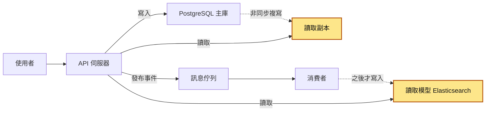

虛線代表「之後才同步過去」。最終一致發生在上色的讀取副本和讀取模型：從這兩個地方讀，可能讀到比主庫舊的值。讀取副本為什麼會落後，見 [複寫延遲](18-複寫延遲.md)；怎麼保證事件一定會發出去，見 [信箱模式](44-信箱模式.md)；把寫入和讀取拆成兩份資料的整套做法，見 [CQRS](45-CQRS.md)。快取也是同一類資料，見 [快取失效](21-快取失效.md)。

## 生活比喻

公司的公告欄。總部發一則新公告，會用公文傳到每個分公司，由各自的行政貼到自己的公告欄上。

- 總部發布的那一刻，台北已經貼了、高雄的公文還在路上，兩邊同事看到的不一樣（**暫時不一致**）。
- 只要總部不再發新公告，過一兩天所有公告欄一定都一樣（**最終收斂**）。
- 你在總部發了公告，到樓下分公司卻找不到，第一反應是「我沒發成功嗎？」（**看不到自己的寫入**）。
- 聰明的做法：發完留一張收據寫「第 128 號」，到任何公告欄先看它貼到第幾號，不到 128 就回總部看（**帶版本號讀取**）。

**比喻失準的地方**：公告欄只有總部一個寫入來源，真實系統常有多個地方同時能寫（多區域部署、離線 App），兩邊同時改同一筆就會「衝突」，要有規則決定誰贏。另外公文不會重送或後發先至，但系統裡的訊息會重複、會亂序，處理不好資料甚至會永遠收斂到錯的值。

## 它是怎麼運作的

### 強一致 vs 最終一致

資料一旦複製到不只一個地方，就會出現「這邊改了、那邊還沒改」的時間。先定義兩種一致性，再看這段時間怎麼產生：

- **強一致（strong consistency）**：寫入一旦成功回應，之後任何人、從任何地方讀，都一定讀得到這個新值（或更新的值）。整個系統看起來就像只有一份資料。學術上最嚴格的版本叫線性一致性（linearizability）。
- **最終一致（eventual consistency）**：寫入成功回應後，不同地方可能暫時讀到舊值；但如果之後沒有新的寫入，所有副本最終會收斂（converge）到同一個值。

用單一台 PostgreSQL 主庫、讀寫都走它，你讀到的就是已經 commit 的最新資料，這是新人最熟悉的世界（細節依[隔離等級](05-隔離等級.md)而定，但「commit 了卻讀不到」不會發生）。一旦資料被**非同步**地複製到別的地方，讀那個地方就進入最終一致的世界。

用情境裡的下單流程走一遍。第一張只有主庫：你送出訂單時，API 把訂單寫進主庫並 commit，成功後回 201。到這裡只有一份資料，還沒有新舊不一致的問題。

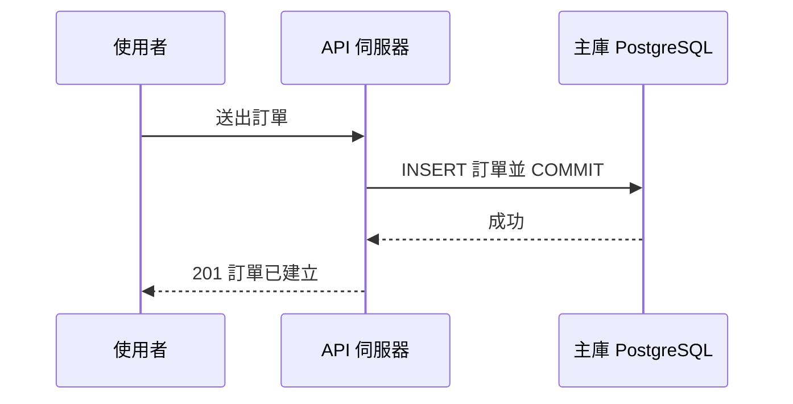

第二張加上訊息佇列：commit 成功後，API 發布一個 `order.created` 事件到佇列，然後才回 201。這時事件還在佇列裡，還沒有人處理。

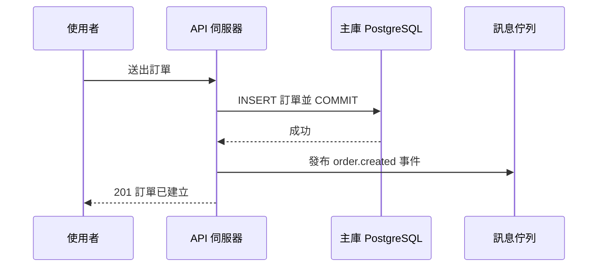

第三張加上讀取模型：使用者接著查「我的訂單」，API 去讀取模型查，但消費者還沒把這筆寫進去，所以列表裡沒有。等消費者寫入之後，兩邊才一致。

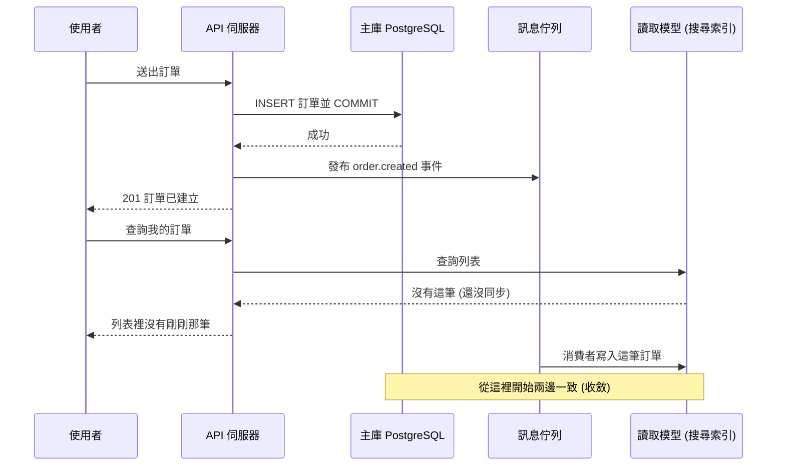

中間那段「主庫已經有、讀取模型還沒有」的時間，叫做**不一致窗口（inconsistency window）**。設計最終一致的系統，就是在管這個窗口：它多長、誰會看到、看到了會怎樣。

### 為什麼不全部做成強一致就好？

因為強一致要付**延遲**（每次寫入都要等其他節點確認；節點指系統裡的一台機器，例如主庫或某一台副本，跨區域往返動輒數十毫秒以上）、**可用性**（其他節點連不上時只能等或拒絕寫入）和**擴展性**（快取、搜尋索引、報表庫都同步更新的話，任何一個慢了整條寫入路徑就慢）。

所以實務上幾乎都是混合的：**核心資料（訂單、帳務）在單一來源強一致，衍生資料（列表、搜尋、統計、快取）最終一致**。

這張圖看的是這種分法：左邊是唯一能寫的來源，右邊都是從它衍生出去、之後才同步的資料。

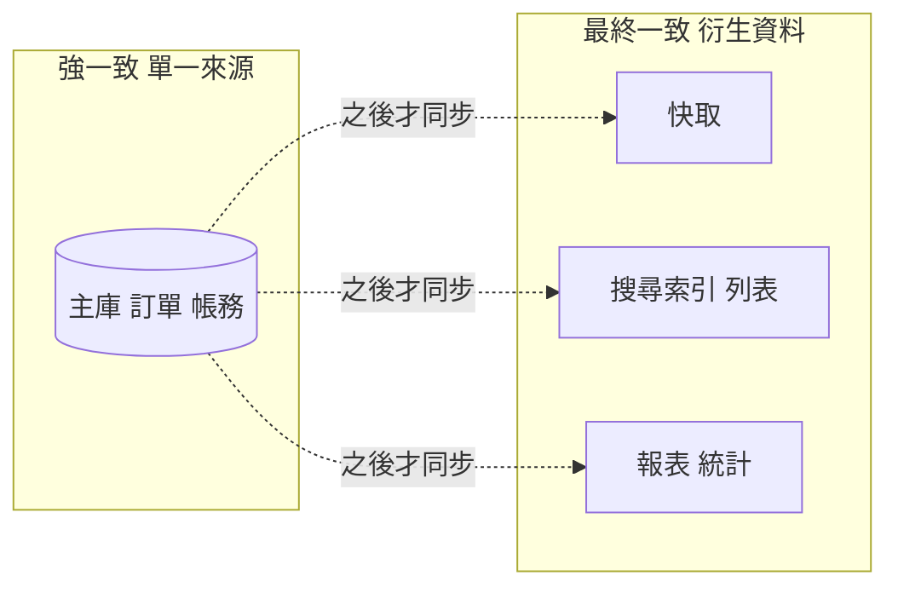

### CAP 的白話版本

CAP 定理（CAP theorem）常被講成「一致性（Consistency）、可用性（Availability）、分區容錯（Partition tolerance）三個只能選兩個」。這個說法很好記，但會誤導人，因為：

1. **P 不是你能選的。** 網路分區指的是節點之間網路斷了或極度不穩，彼此聯絡不上。只要系統跨了兩台以上的機器，這件事遲早會發生。你不能「選擇不要網路斷線」。
2. **所以 CAP 說的是，網路分區發生時，你只能在 C 和 A 之間二選一。**
   - 選 C：聯絡不上其他節點的那一邊，拒絕回應或回傳錯誤，寧可不服務也不給錯的資料。
   - 選 A：每個還活著的節點都繼續回應，但可能回傳舊資料，或接受之後要合併的寫入。
3. **CAP 裡的 C 指的是線性一致性，A 指的是「每個沒壞的節點都必須回應」。** 這兩個定義都很嚴格，跟日常講的「一致」「可用」不完全一樣。很多系統兩個都不完全滿足，也照樣運作得很好。
4. **沒有分區的時候，CAP 什麼都沒說。** 而系統絕大部分的時間是沒有分區的。

這張圖看的是分區發生時，聯絡不上別人的那個節點有哪兩種回應方式：

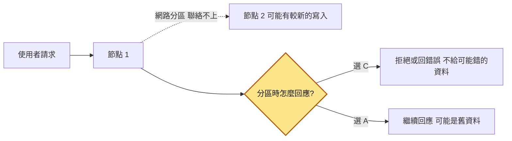

### PACELC：把平常日子也算進來

PACELC 由 Daniel Abadi 提出，讀法是：**if P, then A or C; Else, L or C**。

- 有分區（P）時：在可用性（A）和一致性（C）之間選。這就是 CAP。
- 否則（Else），系統正常時：在延遲（Latency）和一致性（C）之間選。

這張圖把兩句接在一起看：

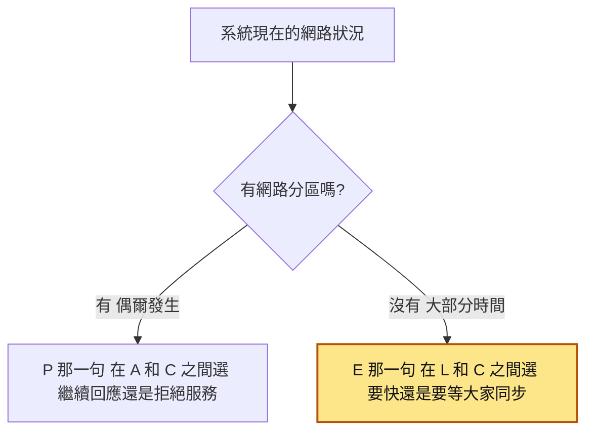

CAP 只講「有分區」那一支。

你每天碰到的是第二句，也就是上色的那一支。開讀取副本、加快取、用事件非同步更新讀取模型，都是**為了低延遲、高吞吐，主動放棄一點即時一致性**，跟網路斷線無關。

### 例子：PostgreSQL 的非同步與同步複寫

> 第一次讀可以先跳過這一節，等你要設定 PostgreSQL 同步複寫時再回來看。

PostgreSQL 的串流複寫（主庫把每一筆變更持續送給副本）可以設成兩種模式，剛好對應 PACELC 的 L 和 C：

- **非同步複寫（預設）**：主庫 commit 不等副本，寫入快，但副本會落後。偏向 L。
- **同步複寫**：設定 `synchronous_standby_names` 後，主庫 commit 要等同步副本確認，寫入變慢。偏向 C。
  - 同步副本連不上時，主庫的 commit 會卡住等待。資料其實已寫進主庫本地，只是遲遲等不到確認，所以不回應。
  - `synchronous_commit` 設成 `remote_apply` 時，還會等到同步副本「重播完成」才回應。重播是副本把收到的變更真的套用到自己的資料上；重播完，從那台同步副本讀才讀得到剛寫的資料。

這張圖看的是兩種模式下，主庫什麼時候回 commit 成功：

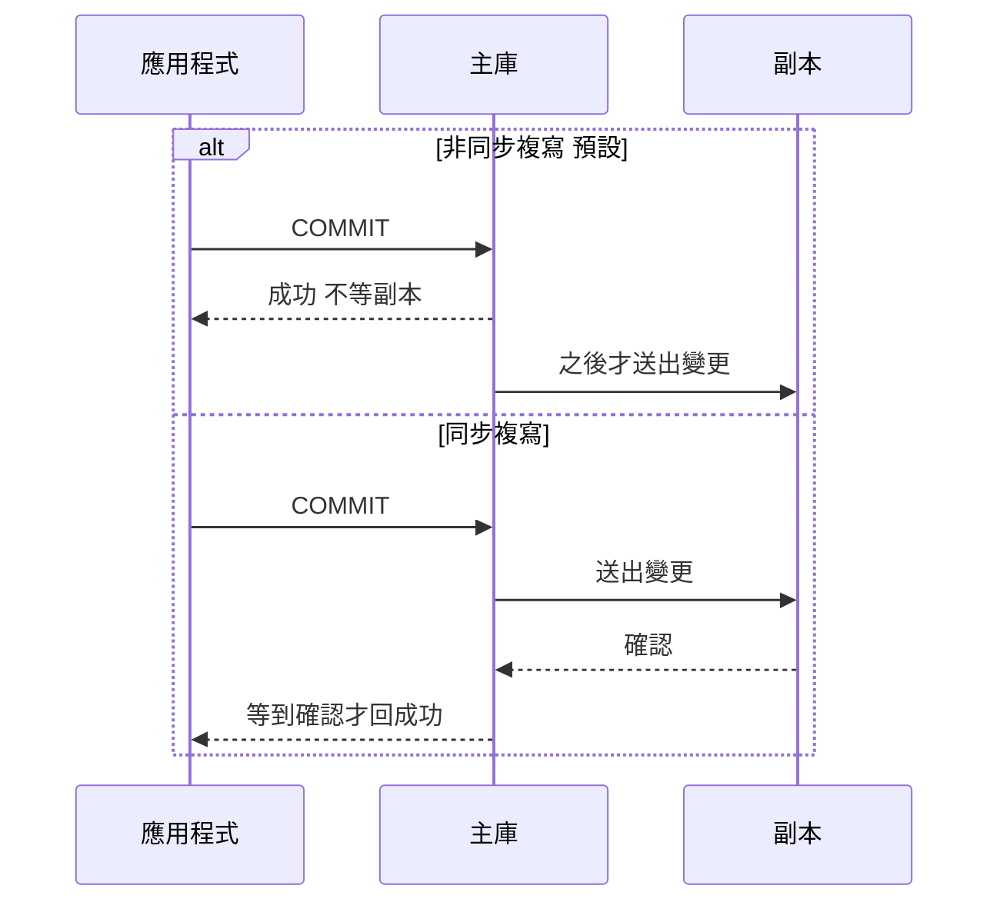

同步副本連不上時，同步複寫那一支會卡在「等確認」。

細節見 [複寫延遲](18-複寫延遲.md)。

### 會話保證：使用者真正在意的那幾件事

完全的強一致很貴。使用者需要的通常只是「我自己看到的東西合理」。1994 年 Terry 等人提出了幾種**會話保證（session guarantees）**，到今天設計系統時還在用。會話（session）指同一個使用者連續的這一串操作，會話保證只管「這個使用者自己看到的順序合不合理」，不管別人：

| 保證 | 白話 | 違反時使用者看到什麼 |
|---|---|---|
| **讀自己的寫入（read-your-writes）** | 我寫過的東西，我之後一定讀得到 | 改了暱稱，重新整理又變回舊的 |
| **單調讀（monotonic reads）** | 我讀過新值之後，不會再讀到更舊的值 | 按讚數 105 → 重新整理變 98 → 又變 106 |
| **單調寫（monotonic writes）** | 我的寫入照我送出的順序生效 | 暱稱先改成 A 再改成 B，副本卻先套用 B 再套用 A，最後停在 A |
| **讀後寫（writes-follow-reads）** | 我看到某個值才做的寫入，順序排在那個值之後 | 回覆了某則留言，別人卻先看到回覆、找不到原留言 |

最常需要做的是前兩個，常見實作：

- **read-your-writes**：
  - 寫入後一段時間內，這個使用者的讀取改走主庫（簡單、常用）。
  - 寫入時回傳一個版本號或位置（PostgreSQL 的 LSN、你自己的 `version` 欄位），讀取時帶著它，副本不夠新就退回主庫或稍等。
  - 只對「自己的資料」這樣做。看別人的個人頁讀副本就好。
- **單調讀**：同一個使用者的讀取黏在同一台副本（例如依 user id 雜湊），或者讀取時帶「我上次看到的版本」，比它舊的副本不讀。

這張圖看的是「帶版本號讀」怎麼做到 read-your-writes（圖裡的版本號只是舉例）：

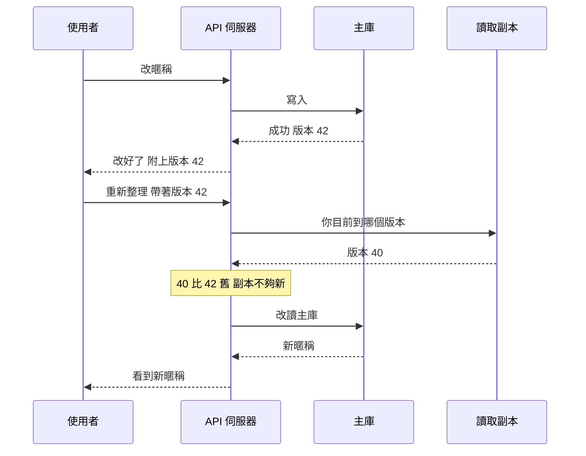

### 「最終」是怎麼收斂的

「最終會一樣」要靠兩個前提：

1. **每一筆更新最後都要送到每一個副本。** 掉了要靠重送，或靠定期對帳（reconciliation，定期拿來源和副本逐筆比對）補回來，這就是為什麼要搭配[重試機制](26-重試機制.md)、[死信佇列](36-死信佇列.md)，以及避免「資料庫有寫、事件沒發」的[信箱模式](44-信箱模式.md)。
2. **所有副本對同一組更新，要得出同一個結果。** 訊息會重複、會亂序，消費者若「收到就覆蓋」，舊事件晚到就把新值蓋掉，然後**永遠停在錯的值**，不會再收斂。

這張圖看的是一筆更新從來源走到副本，兩個前提各由哪裡顧著：

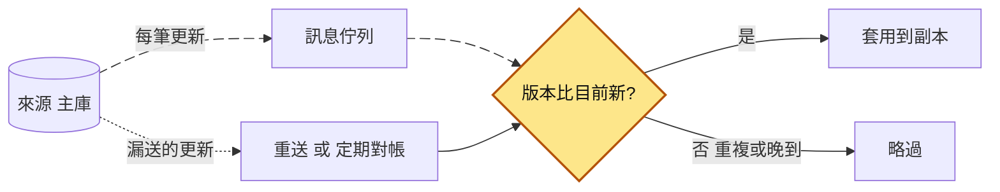

前提 1 靠下面那條虛線補漏，前提 2 靠上色的版本比較。

下面用三個訂單事件 v1 created、v2 paid、v3 shipped 走一遍，其中 v2 晚到。比較兩種消費者寫法，讀取模型裡的狀態怎麼變：

| 步驟 | 抵達的事件 | 收到就覆蓋 | 只接受較新的版本 |
|---|---|---|---|
| 1 | v1 created | created（v1） | created（v1） |
| 2 | v3 shipped | shipped（v3） | shipped（v3） |
| 3 | v2 paid，晚到 | paid（v2）❌ | shipped（v3），v2 比 v3 舊，略過 |
| 4 | 之後沒有新事件 | 停在 paid，不會再被修正 | shipped（v3）✅ |

常見的收斂規則：

- **版本號比大小**：只接受比目前更新的版本。單一寫入來源時，用主庫產生的遞增版本號最可靠。
- **最後寫入者勝（last write wins，LWW）**：多處都能寫時用時間戳記決定誰贏。簡單，但機器時鐘有誤差，輸的那筆會直接消失。
- **可合併的資料結構**：例如計數器記成「每個節點各加了多少」，合併時相加，這類設計統稱 CRDT（conflict-free replicated data type）。知道有這回事就好。

### 生活中的最終一致

- **DNS**：改了網域的 A 紀錄（網域對應到哪個 IP 位址的設定），各地的 DNS 解析器會依 TTL（這筆紀錄可以在快取裡留多久）快取舊值，到期才重查。所以改完「有些人連到新機器、有些人還連舊的」是正常的。老手會在切換到新機器前先把 TTL 調低，而且至少要提前「舊 TTL」那麼久（舊 TTL 是一天，就要提前一天以上調），否則各地快取裡還是舊的長 TTL。
- **信用卡消費**：刷卡後 App 先顯示「授權」或「未入帳」，額度先扣；幾天後商店請款、清算完成才正式入帳，金額還可能因匯率等因素跟授權時不同。銀行把「暫時狀態」明白顯示給你看，這正是處理最終一致的 UI 範本。
- **銀行匯款入帳時間**：網銀跨行匯款如果在銀行營業時間截止後才送出，畫面會顯示「預約」或「處理中」，常要到下一個營業日才真正入對方帳戶。你的帳戶已經扣款、對方還沒入帳，這段時間就是不一致窗口。
- **社群按讚數**：你按讚後自己馬上看到 +1，別人可能幾秒後才更新。沒人在乎差 3 個讚，最適合最終一致。

銀行的帳本本身在核心系統裡是強一致的，最終一致的是**跨系統的流程與顯示**（跨行清算、對帳單）。這種分法叫「核心不變量強一致，周邊流程最終一致」。不變量（invariant）指任何時候都必須成立的規則，例如「餘額不能是負的」。

回到第一個 DNS 的例子，照老手的做法一步步看換機器的過程（假設舊 TTL 是一天）：

| 步驟 | 你做的事 | 各地解析器的快取 | 使用者連到 |
|---|---|---|---|
| 1 | 把 TTL 從一天調低 | 還是舊紀錄，TTL 一天 | 舊機器 |
| 2 | 等一天以上（舊 TTL 那麼久） | 舊快取陸續到期，重查後拿到短 TTL 的紀錄 | 舊機器 |
| 3 | 把 A 紀錄改成新機器的 IP | 還留著舊 IP，等短 TTL 到期 | 有些新、有些舊 |
| 4 | 再等一個短 TTL | 陸續重查，換成新 IP | 新機器 |

### 對使用者介面的影響與設計

不一致窗口一定存在，UI 的工作是讓使用者不困惑、不重複操作：

- **樂觀 UI（optimistic UI）**：送出的同時畫面先假設成功（愛心變紅、留言出現），伺服器回失敗就回滾並告知。適合幾乎不會失敗、失敗也不嚴重的操作：按讚、收藏、標記已讀。
- **顯示處理中**：API 回 `202 Accepted`（收到了但還沒處理完），附上可查進度的 ID，畫面顯示「處理中」，用輪詢（polling）或 WebSocket 等結果。適合下單、付款、匯出報表。
- **顯示資料時間**：報表寫上「資料更新於 10:42」，使用者就不會當成即時資料。
- **送出後的頁面讀強一致來源**：下單後的明細頁用 ID 直接查主庫，不查最終一致的列表。
- **防重複送出**：按鈕送出後停用，再加後端冪等鍵；前端擋不住重新整理和網路重送，要靠後端冪等鍵擋。

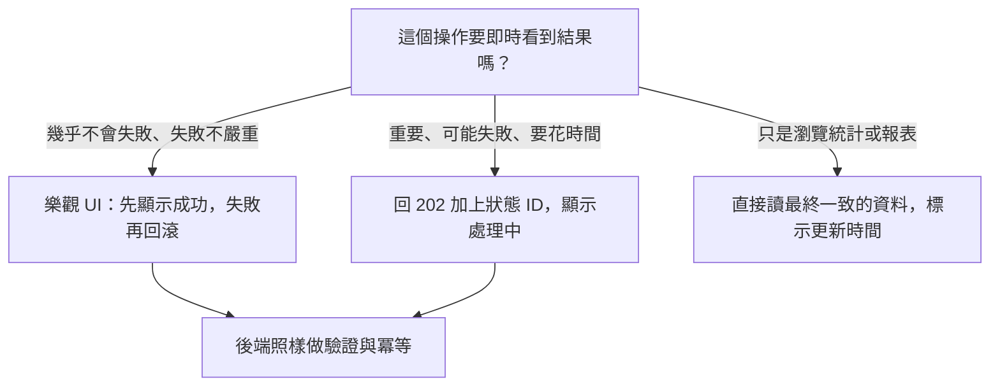

### 如何判斷業務能不能接受

判斷一份資料能不能最終一致，拿下面這幾個問題去問產品、營運，或問你自己：

1. **讀到舊資料，最壞會發生什麼事？** 數字顯示差一點（按讚數）？使用者困惑然後重試（訂單列表）？還是錢算錯、超賣、權限沒收回？
2. **可以舊多久？** 給一個數字：1 秒、30 秒、5 分鐘、隔天。這叫陳舊預算（staleness budget）。沒有數字就無法監控，也無法告警。
3. **有人拿這份資料「做決定」嗎？** 純顯示可以舊；拿來判斷「庫存夠不夠」「餘額夠不夠」「帳號是否已存在」「這個人還有沒有權限」就不行，這些檢查要在強一致的來源做，最好在寫入的那個交易裡、靠約束或鎖來保證。
4. **出錯了能補救嗎？** 有些錯可以事後補償（退款、補發通知、發折價券道歉），有些不能（醫療資料、已經寄出去的實體貨品、法規要求）。
5. **使用者會不會看到「自己的」不一致？** 會的話，至少要做 read-your-writes。

這張圖把其中最常用的三個問題（第 3、5、2 題）串成一條判斷路線：

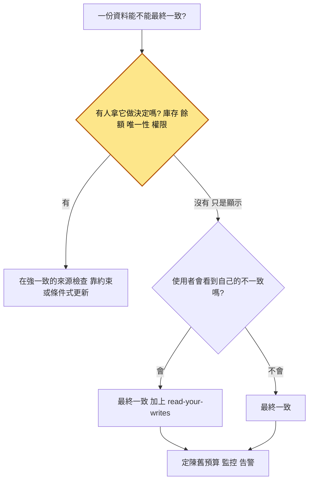

| 場景 | 適合最終一致？ | 理由 |
|---|---|---|
| 按讚數、瀏覽數、追蹤人數 | ✅ | 舊幾秒沒人在意 |
| 搜尋結果、報表、儀表板 | ✅ | 晚幾秒出現可以接受，標示更新時間 |
| 「我的訂單」列表 | ⚠️ 可以，但要處理 read-your-writes | 自己剛下的單一定要看得到 |
| 扣庫存、扣餘額 | ❌ 判斷要強一致 | 讀到舊值就會超賣或透支 |
| 撤銷權限、停用帳號 | ❌ 或要有很短的上限 | 舊資料等於安全漏洞 |
| 唯一性檢查（帳號名稱是否被用過） | ❌ 靠資料庫[唯一約束](14-唯一約束.md) | 先查副本再寫入，必定有競爭 |

## 動手看看

### 1. 用純 Python 看「不一致窗口」與 read-your-writes

不需要任何套件，模擬一個主節點加兩個延遲不同的副本：

```python
# ec_demo.py：用純 Python 模擬「一個主節點 + 兩個延遲不同的副本」
# 只用標準函式庫，python ec_demo.py 就能跑
import threading
import time

class Primary:
    """主節點：所有寫入都到這裡，每次寫入版本號 +1"""

    def __init__(self):
        self.data = {}
        self.version = 0
        self.replicas = []
        self.lock = threading.Lock()

    def write(self, key, value):
        with self.lock:
            self.version += 1
            v = self.version
            self.data[key] = (value, v)
        # 非同步複寫：主節點寫完就回應，副本「之後」才收到
        for r in self.replicas:
            r.replicate_later(key, value, v)
        return v  # 把版本號回給呼叫端，之後拿來做 read-your-writes

class Replica:
    """副本：收到變更後要過 lag 秒才會套用"""

    def __init__(self, name, lag):
        self.name = name
        self.lag = lag
        self.data = {}
        self.lock = threading.Lock()

    def replicate_later(self, key, value, version):
        def apply():
            with self.lock:
                # 只接受比較新的版本，避免舊資料晚到把新值蓋掉
                current = self.data.get(key, (None, 0))
                if version > current[1]:
                    self.data[key] = (value, version)

        threading.Timer(self.lag, apply).start()

    def read(self, key):
        with self.lock:
            return self.data.get(key, (None, 0))

primary = Primary()
fast = Replica("副本A（延遲 0.2 秒）", lag=0.2)
slow = Replica("副本B（延遲 1.5 秒）", lag=1.5)
primary.replicas = [fast, slow]

print("=== 1. 寫完馬上讀副本：讀到舊資料 ===")
primary.write("nickname", "小明")
time.sleep(2)  # 先讓兩個副本都同步到「小明」
v = primary.write("nickname", "阿明")  # 使用者改暱稱
print("寫入完成，版本 =", v)
print("馬上讀", slow.name, "→", slow.read("nickname")[0])  # 還是「小明」

print("\n=== 2. 違反單調讀：先看到新的，又看到舊的 ===")
time.sleep(0.3)  # 副本A 已追上，副本B 還沒
for i, r in enumerate([fast, slow, fast, slow]):  # 負載平衡器輪流挑副本
    print(f"第 {i + 1} 次讀 {r.name} →", r.read("nickname")[0])

print("\n=== 3. 帶版本號讀：副本版本不夠新就改讀主節點 ===")
v = primary.write("nickname", "明哥")

def read_your_writes(key, min_version):
    for r in (fast, slow):
        value, ver = r.read(key)
        if ver >= min_version:
            return f"{value}（來自 {r.name}）"
    with primary.lock:
        value, _ = primary.data[key]
    return f"{value}（副本都還沒追上，退回主節點）"

print("馬上讀 →", read_your_writes("nickname", v))
time.sleep(0.3)
print("0.3 秒後讀 →", read_your_writes("nickname", v))

print("\n=== 4. 不再寫入，等一下：所有副本收斂到同一個值 ===")
time.sleep(1.6)
print(fast.name, "→", fast.read("nickname")[0])
print(slow.name, "→", slow.read("nickname")[0])
```

執行（Windows 上建議先設 `$env:PYTHONUTF8 = '1'` 避免中文輸出亂碼）：

```shell
python ec_demo.py
```

預期輸出大致如下：

```
=== 1. 寫完馬上讀副本：讀到舊資料 ===
寫入完成，版本 = 2
馬上讀 副本B（延遲 1.5 秒） → 小明

=== 2. 違反單調讀：先看到新的，又看到舊的 ===
第 1 次讀 副本A（延遲 0.2 秒） → 阿明
第 2 次讀 副本B（延遲 1.5 秒） → 小明
第 3 次讀 副本A（延遲 0.2 秒） → 阿明
第 4 次讀 副本B（延遲 1.5 秒） → 小明

=== 3. 帶版本號讀：副本版本不夠新就改讀主節點 ===
馬上讀 → 明哥（副本都還沒追上，退回主節點）
0.3 秒後讀 → 明哥（來自 副本A（延遲 0.2 秒））

=== 4. 不再寫入，等一下：所有副本收斂到同一個值 ===
副本A（延遲 0.2 秒） → 明哥
副本B（延遲 1.5 秒） → 明哥
```

四段分別對應：不一致窗口、單調讀被打破、用版本號做 read-your-writes、最終收斂。可以把 `lag` 改大改小，看「最終」的長短怎麼跟著副本延遲變。

### 2. 用 PostgreSQL 看「亂序事件」會不會讓資料收斂到錯的值

讀取模型的消費者最常犯的錯是「收到就覆蓋」。起一個 PostgreSQL 來試：

```shell
docker run --rm -d --name ec-pg -e POSTGRES_PASSWORD=pg -p 5432:5432 postgres:16
# 等幾秒讓資料庫啟動，然後進 psql
docker exec -it ec-pg psql -U postgres
```

```sql
-- 讀取模型：訂單狀態的投影表
CREATE TABLE order_view (
    order_id   bigint PRIMARY KEY,
    status     text   NOT NULL,
    version    bigint NOT NULL  -- 來自訂單服務的遞增版本號
);

-- ❌ 錯誤示範：收到事件就無條件覆蓋
-- 模擬事件到達順序：v1 created → v3 shipped → v2 paid（v2 晚到）
INSERT INTO order_view VALUES (1, 'created', 1)
ON CONFLICT (order_id) DO UPDATE SET status = EXCLUDED.status, version = EXCLUDED.version;
INSERT INTO order_view VALUES (1, 'shipped', 3)
ON CONFLICT (order_id) DO UPDATE SET status = EXCLUDED.status, version = EXCLUDED.version;
INSERT INTO order_view VALUES (1, 'paid', 2)
ON CONFLICT (order_id) DO UPDATE SET status = EXCLUDED.status, version = EXCLUDED.version;

SELECT * FROM order_view;
-- 結果：status = paid, version = 2
-- 已經出貨的訂單被晚到的事件蓋回「已付款」，而且之後不會再有事件來修正它

TRUNCATE order_view;

-- ✅ 正確寫法：只接受比目前版本更新的事件
INSERT INTO order_view VALUES (1, 'created', 1)
ON CONFLICT (order_id) DO UPDATE SET status = EXCLUDED.status, version = EXCLUDED.version
WHERE order_view.version < EXCLUDED.version;
INSERT INTO order_view VALUES (1, 'shipped', 3)
ON CONFLICT (order_id) DO UPDATE SET status = EXCLUDED.status, version = EXCLUDED.version
WHERE order_view.version < EXCLUDED.version;
INSERT INTO order_view VALUES (1, 'paid', 2)
ON CONFLICT (order_id) DO UPDATE SET status = EXCLUDED.status, version = EXCLUDED.version
WHERE order_view.version < EXCLUDED.version;
-- 最後一句會顯示 INSERT 0 0：版本比較舊，被忽略

SELECT * FROM order_view;
-- 結果：status = shipped, version = 3
-- 同一個事件重送幾次結果也一樣（冪等），亂序也不怕
```

做完記得收拾：

```shell
docker stop ec-pg   # 用了 --rm，停掉就會自動刪除容器
```

這個 `WHERE order_view.version < EXCLUDED.version` 是讀取模型消費者的基本功。它同時解決了兩件事：重複的事件不會造成影響、晚到的舊事件不會蓋掉新狀態。

## 常見地雷

### 1. 以為「最終」就是「很快」

❌ **錯誤做法**：「副本延遲平常都 50 毫秒，不用處理啦。」沒有定義上限，也沒有監控。

**為什麼錯**：平常很快，不代表尖峰、批次作業、消費者當機時也很快。最終一致只保證會收斂，不保證時間。情境故事裡的 300 毫秒，在尖峰時變成 4 分鐘。

✅ **正確做法**：為每一份最終一致的資料定一個陳舊預算（例如「搜尋索引落後主庫不超過 30 秒」），監控實際延遲（複寫延遲、consumer lag、事件產生到套用完成的時間差），超過就告警。

### 2. 拿最終一致的資料做決定

❌ **錯誤做法**：

```python
# ❌ 錯誤示範：從快取／副本讀庫存，夠了再扣
stock = redis.get(f"stock:{sku}")          # 這個值可能是幾秒前的
if int(stock) >= qty:
    db.execute("UPDATE inventory SET stock = stock - %s WHERE sku = %s", (qty, sku))
```

**為什麼錯**：你看到的「還有 3 件」可能早就是 0 件了。最終一致的資料只適合顯示，不適合拿來檢查不變量。就算讀的是主庫，先讀再寫也有[競爭條件](01-競爭條件.md)。

✅ **正確做法**：把檢查和寫入放在同一個強一致的操作裡，讓資料庫保證不變量：

```python
# ✅ 正確寫法：條件式更新，資料庫保證不會扣成負數
cur = db.execute(
    "UPDATE inventory SET stock = stock - %s WHERE sku = %s AND stock >= %s",
    (qty, sku, qty),
)
if cur.rowcount == 0:
    raise OutOfStock(sku)  # 庫存不足，交給呼叫端處理
```

畫面上顯示的庫存數字可以讀快取，真正扣庫存的這一步要在主庫。

### 3. 寫完立刻從最終一致的地方讀回來給使用者看

❌ **錯誤做法**：`POST /profile` 寫主庫，成功後前端馬上 `GET /profile`，而 `GET` 一律讀副本或快取。

**為什麼錯**：不一致窗口裡，使用者會看到舊資料，以為沒存成功，然後重試、重複送出，或者打給客服。

✅ **正確做法**：

- 寫入 API 直接在回應裡帶回最新資料，前端不用再查一次。
- 或者寫入後回傳版本號，讀取時帶著，副本不夠新就退回主庫。
- 或者寫入後一小段時間內，這個使用者的讀取走主庫。

### 4. 用 `sleep` 或「等兩秒再重新整理」當解法

❌ **錯誤做法**：

```python
# ❌ 錯誤示範：寫完睡一下，「應該」就同步了
create_order(order)
time.sleep(2)
return redirect("/orders")
```

**為什麼錯**：延遲一變大就失效，而且每個使用者都白等 2 秒，換來的只是「大部分時候沒問題」。

✅ **正確做法**：不要猜時間，用明確的機制：帶版本號檢查、直接讀強一致的來源，或回 `202` 加狀態 ID 讓前端顯示處理中。

### 5. 樂觀 UI 失敗了卻不回滾、不告知

❌ **錯誤做法**：按讚之後畫面先變紅，API 回傳 500 也不理它；或者把下單、付款這種重要操作也做成樂觀 UI，畫面先顯示「下單成功」。

**為什麼錯**：使用者以為成功，重新整理後卻消失，比直接顯示失敗更困惑；重要操作先說成功，失敗時就等於說謊。

✅ **正確做法**：樂觀 UI 只用在幾乎不會失敗的操作，失敗時一定回滾並提示；重要操作用「處理中」，等伺服器確認才顯示成功。

### 6. 消費者「收到就覆蓋」，結果永遠不收斂

❌ **錯誤做法**：事件處理直接 `UPDATE ... SET status = :status`，不看版本，也不處理重複。

**為什麼錯**：訊息佇列多半只保證「至少送達一次（at-least-once）」，事件會重複；重試、多個分區、多個消費者並行處理，也會讓事件亂序。舊事件晚到就會把新狀態蓋掉，而且之後不會再有事件來修正。

✅ **正確做法**：讀取模型帶版本號，只接受更新的版本（上面「動手看看」第 2 段的寫法）；需要的話記錄已處理過的事件 ID 做冪等；定期跟來源對帳，找出並修正漂移的資料。

### 7. 矯枉過正：所有東西都要求強一致

❌ **錯誤做法**：被咬過一次，就要求「所有讀取都走主庫」「每個微服務都用分散式交易」。

**為什麼錯**：主庫被讀取壓垮、寫入變慢、任何下游慢了整條路徑都慢，換來的只是按讚數、報表這類資料也即時一致，而它們根本不需要即時。

✅ **正確做法**：用那五個問題逐項分類。核心不變量強一致，周邊資料最終一致，再用會話保證和 UI 補足體驗。

## 重點整理

- **最終一致只保證「不再寫入時，最後會一樣」，不保證多久會一樣，也不保證中間讀到的順序合理。** 「最終」可能是 300 毫秒，也可能是 4 分鐘。你要自己定陳舊預算（可以舊多久），自己監控、告警。
- **你早就在用它了。** 讀取副本、快取、搜尋索引、讀取模型，只要資料是「之後才同步過去」的，讀那份資料就是最終一致。
- **CAP 講的是網路分區發生時，在一致性和可用性之間選一個；「三選二」的說法會誤導人。** PACELC 再補一句：沒分區的平常日子，也要在延遲和一致性之間取捨。
- **使用者最在意的是看不到自己剛做的事。** 至少做到 read-your-writes，再依操作性質搭配樂觀 UI 或「處理中」狀態，讓使用者在不一致窗口裡不會誤以為失敗、一直重按。
- **能不能用最終一致，看的是業務。** 只拿來顯示的資料可以舊；會影響錢、庫存、權限、唯一性的判斷，一律在強一致的來源做，最好靠條件式更新或約束保證。

## 新人必知清單

### 一定要會（基本功）

- [ ] 能用白話講出強一致和最終一致的差別，以及「不一致窗口」是什麼。
- [ ] 能指出自己負責的系統裡，哪些資料是最終一致的（讀取副本、快取、搜尋索引、讀取模型、其他服務同步過來的資料）。
- [ ] 知道 CAP 講的是分區時的取捨：分區一定會發生，分區時在 C 和 A 之間選；平常則是在延遲和一致性之間選（PACELC）。
- [ ] 會實作 read-your-writes：寫入後回傳最新資料、帶版本號讀，或短時間內讀主庫。
- [ ] 拿來做決定的檢查（庫存、餘額、唯一性、權限）一律在強一致的來源做，最好靠條件式更新或約束保證。
- [ ] 寫讀取模型的消費者時，會用版本號擋掉重複和亂序的事件。
- [ ] 會依操作性質選擇樂觀 UI、處理中狀態或標示資料時間，並處理失敗的情況。
- [ ] 會用那五個問題判斷一個場景能不能接受最終一致，並給出陳舊預算的數字。

### 知道有這回事就好

- 單調讀、單調寫、讀後寫這幾種會話保證，以及「黏著同一台副本」的做法。
- PostgreSQL `synchronous_commit` 各選項（`on`、`remote_write`、`remote_apply` 等）保證到哪一步，以及同步副本掛掉時主庫 commit 會卡住。
- 多寫入來源的衝突解法：LWW 的風險、版本向量（version vector）、CRDT。
- 可調一致性（tunable consistency）：Cassandra 這類系統讓每次讀寫選擇要幾個副本回應，N 個副本中寫入要 W 個確認、讀取要問 R 個，R + W > N 時讀寫的副本必定有交集，通常就讀得到最新寫入（但遇到並行寫入、時鐘誤差、寬鬆法定人數（sloppy quorum）等情況仍有例外，不等於線性一致）。
- 雲端服務的一致性保證：例如 DynamoDB 讀取預設最終一致、可指定強一致讀取；AWS S3 從 2020 年 12 月起提供強一致的 read-after-write。這類保證會改版，用之前查官方文件。
- 定期對帳（reconciliation）是最後一道收斂保險。

### 先不用管（等你遇到再學）

- 線性一致性、循序一致性（sequential consistency）、因果一致性（causal consistency）等一致性模型的正式定義和彼此的強弱關係。
- 共識演算法（Raft、Paxos）怎麼在節點間達成一致。
- 多區域、多主寫入（multi-leader）的資料庫架構設計。
- CAP 定理的正式證明。

## Code Review 時可以問的問題

1. **這個讀取讀的是哪裡？是強一致的來源，還是副本、快取、讀取模型？** 讀到舊資料會怎樣？
2. **使用者寫完之後，下一個畫面讀得到自己剛寫的資料嗎？** 如果讀取走的是最終一致的路徑，有沒有做 read-your-writes？
3. **這段邏輯有沒有拿最終一致的資料做決定？** 例如先讀快取的庫存、餘額、權限，再決定要不要寫入。
4. **事件消費者能處理重複和亂序嗎？** 有沒有版本號或冪等檢查？同一個事件處理兩次、舊事件晚到，結果會不會錯？
5. **這份最終一致的資料可以舊多久？有監控和告警嗎？** 沒有數字的「應該很快」不算答案。
6. **UI 在不一致窗口裡會顯示什麼？** 樂觀更新失敗時會不會回滾？非同步操作有沒有處理中狀態和防重複送出？

## 情境演練

**1. 商品搜尋用的是最終一致的搜尋索引。PM 問你：「賣家改完商品名稱，多久會出現在搜尋結果？會不會先看到新名稱，重新整理又變回舊的？賣家自己一定看得到新名稱嗎？」你會怎麼回答？**

<details markdown="1"><summary>看答案</summary>

最終一致只保證一件事：**如果不再有新的寫入，所有副本最終會收斂到同一個值。**

PM 問的三件事它都沒有保證：**多久會收斂**（毫秒到好幾分鐘都有可能，看負載和故障）、**中間讀到的值合不合理**（可能先讀到新值又讀到舊值）、**賣家讀得到自己的寫入**（要另外實作 read-your-writes）。

所以你不能回「很快」，要先跟 PM 定一個陳舊預算（例如 30 秒），加上監控和告警；賣家自己的商品頁要做 read-your-writes；如果重新整理變回舊值不能接受，再加單調讀。
</details>

**2. 同事說：「CAP 就是三選二，我們選 CA，所以不用擔心分區。」這句話哪裡有問題？**

<details markdown="1"><summary>看答案</summary>

只要系統跨了兩台以上的機器，網路分區就可能發生，你不能「選擇不要分區」。所以 CAP 的意思是：**分區發生時，只能在一致性和可用性之間選一個。**

說「選 CA」，等於沒想過分區時會怎樣。真的分區了，系統還是會偏 C（報錯、卡住）或偏 A（回傳舊資料），只是那個行為沒有經過設計，是意外發生的。另外 CAP 只講分區時；平常系統也在延遲和一致性之間取捨，這是 PACELC 補上的、也是日常最常碰到的那一半。
</details>

**3. 你在 code review 看到，讀取模型的消費者收到事件就執行 `UPDATE order_view SET status = :status WHERE order_id = :id`。這有什麼問題？要怎麼改？**

<details markdown="1"><summary>看答案</summary>

事件可能**重複**和**亂序**：訊息佇列通常是至少送達一次，重試或多個消費者並行處理都會讓事件晚到。訂單事件依序是 `created(v1)`、`paid(v2)`、`shipped(v3)`，若 `paid` 晚到，讀取模型會停在 `paid`，之後沒有新事件，錯誤**永遠不會被修正**。

改法：讀取模型加 `version` 欄位，只接受比目前更新的版本：

```sql
INSERT INTO order_view (order_id, status, version)
VALUES (:id, :status, :version)
ON CONFLICT (order_id) DO UPDATE
SET status = EXCLUDED.status, version = EXCLUDED.version
WHERE order_view.version < EXCLUDED.version;
```

這樣重複的事件不會造成影響（冪等），晚到的舊事件也會被忽略。版本號要由寫入來源（訂單服務）產生，不要用消費者收到事件的時間。
</details>

**4. 你負責一個活動報名系統。使用者報名後會寄確認信，主辦方後台有一個「目前報名人數」的看板，前台也顯示「剩餘名額」。名額上限 200 人。哪些部分可以用最終一致？哪些不行？使用者剛報名完的畫面該怎麼設計？**

<details markdown="1"><summary>看答案</summary>

- **後台人數看板、前台剩餘名額**：只是顯示，可以讀快取或副本，標示更新時間。最壞情況是使用者看到「剩 2 名」、按下去才發現額滿，體驗差但不會出錯。
- **「名額還夠不夠」的判斷**：這是拿資料做決定，**不能用最終一致的資料**。要在主庫用條件式更新保證不超過 200 人，例如 `UPDATE events SET registered = registered + 1 WHERE id = :id AND registered < 200`，`rowcount == 0` 就回額滿；同一人重複報名用唯一約束擋。
- **確認信**：可以非同步寄，晚幾十秒可以接受，但要保證一定寄得出去（信箱模式加重試），重複寄也要用冪等擋掉。

報名完成的畫面：API 在主庫交易成功後直接回傳報名結果，畫面據此顯示「報名成功」，不要再去查最終一致的列表；寫明「確認信將在幾分鐘內寄出」；之後的「我的報名」列表若是讀取模型，要做 read-your-writes；送出按鈕停用加後端冪等鍵，避免重複報名。
</details>

**5. 你們的服務部署在兩個區域，每個區域都可以接受寫入，彼此非同步同步資料。某天兩區之間的網路斷了 10 分鐘，這段時間同一個使用者在 A 區把暱稱改成「小王」，又在 B 區改成「王大」。網路恢復後，暱稱會變成什麼？如果是「帳戶餘額」呢？**

<details markdown="1"><summary>看答案</summary>

這是**多寫入來源的衝突**：分區期間兩區都繼續服務（偏 A），各自接受了寫入，恢復後要靠規則決定結果。常見的是**最後寫入者勝（LWW）**，時間戳記晚的贏，另一筆直接消失；而且兩區時鐘有誤差，「晚」不一定真的晚。對暱稱來說，錯了使用者再改一次就好，通常可以接受。

**帳戶餘額**不行。原本 1000 元，A 區扣 800、B 區扣 600，兩區各自檢查都夠扣。用 LWW 會有一筆扣款憑空消失；兩筆都套用則餘額變 -400，違反「餘額不能是負的」。所以帳務通常在分區時選 C：一個帳戶只允許在一個主區域寫入，聯絡不上就拒絕扣款；或者改記每一筆交易、搭配補償流程，這就進入[分散式交易](43-分散式交易.md)和[事件來源](46-事件來源.md)的範圍。

**能不能接受衝突，決定了分區時該選 A 還是 C**，同一個系統裡不同資料可以有不同選擇。
</details>

## 相關主題

- [複寫延遲](18-複寫延遲.md)：讀取副本的不一致窗口從哪裡來、怎麼量，以及用 LSN 實作 read-your-writes 的細節。
- [快取失效](21-快取失效.md)：快取是最常見的最終一致資料，失效策略決定了快取能舊多久。
- [冪等性](25-冪等性.md)：最終一致的系統裡，重試和重複事件是常態，冪等是讓結果正確的前提。
- [分散式交易](43-分散式交易.md)：當多個服務的資料真的需要一起成功或一起失敗時的選項，以及為什麼大多數時候會改用最終一致加補償。
- [信箱模式](44-信箱模式.md)：確保「資料庫寫入成功就一定會發出事件」，讓最終一致真的能「最終」到達。
- [CQRS](45-CQRS.md)：把寫入模型和讀取模型分開，讀取模型通常就是最終一致的。

## 延伸閱讀

- Werner Vogels，〈Eventually Consistent - Revisited〉：Amazon CTO 用工程師的角度解釋最終一致與各種變體，包含 read-your-writes、單調讀等。https://www.allthingsdistributed.com/2008/12/eventually_consistent.html
- Eric Brewer，〈CAP Twelve Years Later: How the "Rules" Have Changed〉：CAP 提出者本人說明為什麼「三選二」是誤解。https://www.infoq.com/articles/cap-twelve-years-later-how-the-rules-have-changed/
- Jepsen，Consistency Models：各種一致性模型的強弱階層與逐一說明，適合想往下挖的人。https://jepsen.io/consistency
- PostgreSQL 官方文件〈Write Ahead Log〉設定章節中的 `synchronous_commit` 說明：了解同步複寫各選項保證到哪一步。https://www.postgresql.org/docs/current/runtime-config-wal.html
- Martin Kleppmann，《Designing Data-Intensive Applications》（第一版第 5 章複寫、第 9 章一致性與共識；第二版章節編排不同）：本篇大部分概念的完整版本。
