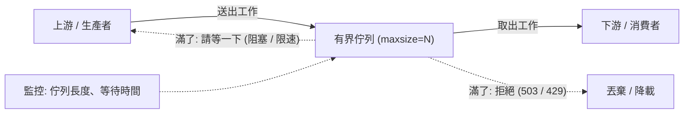
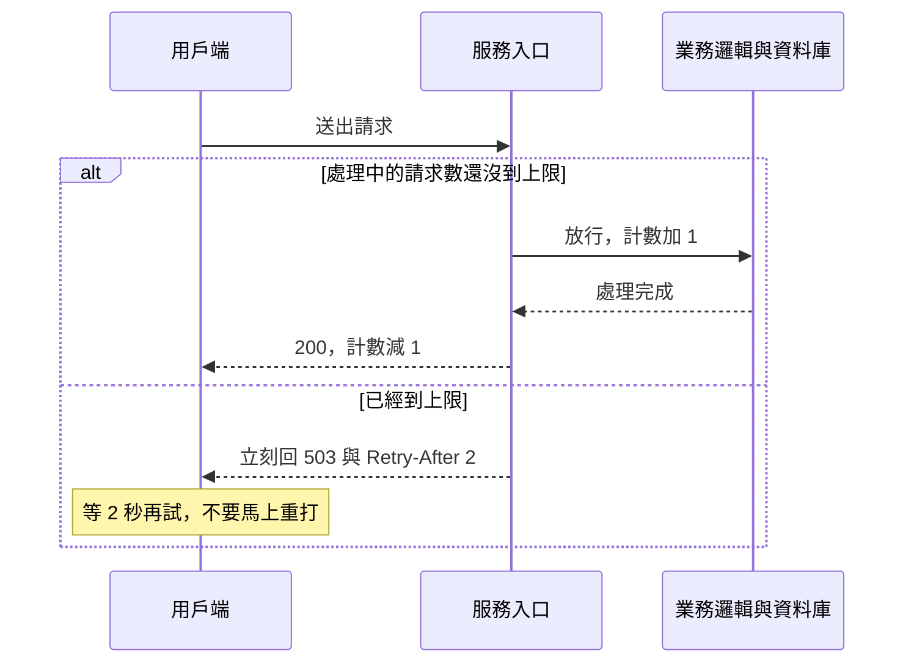
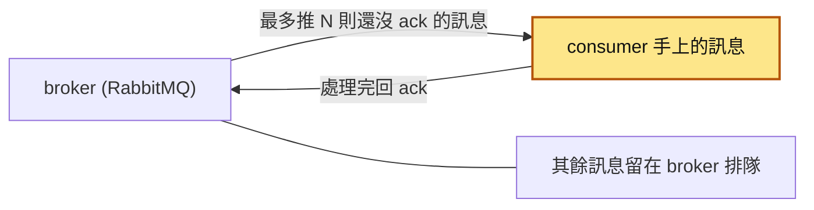
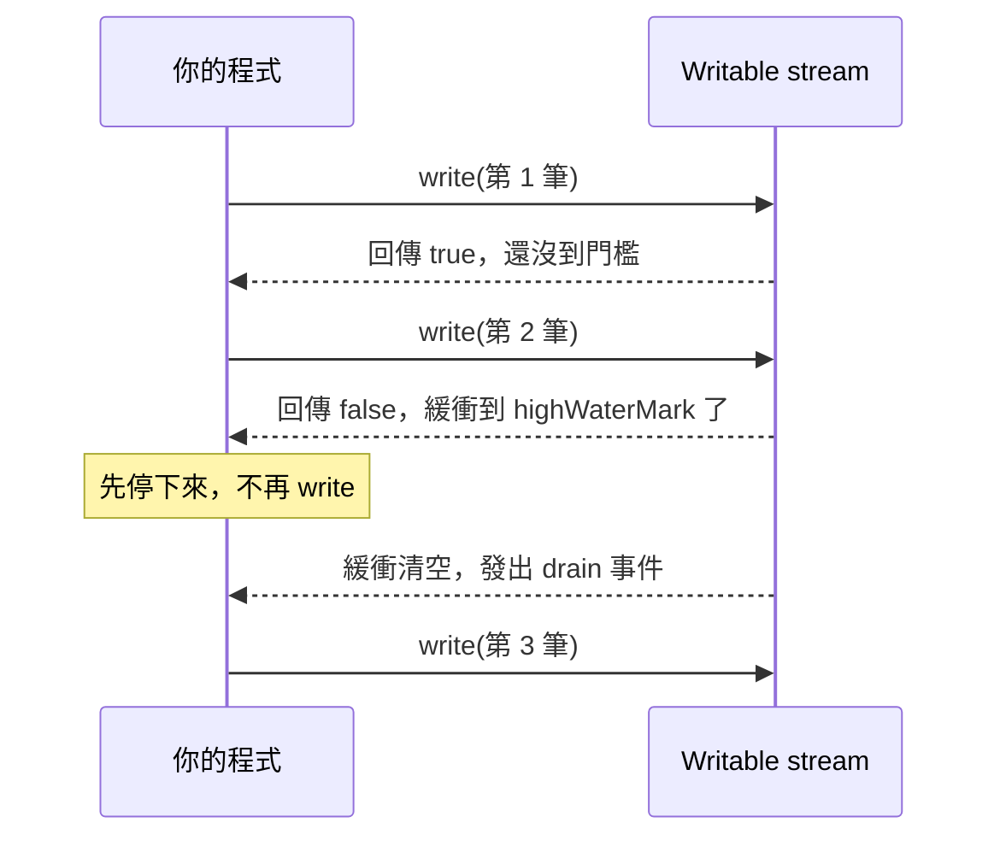
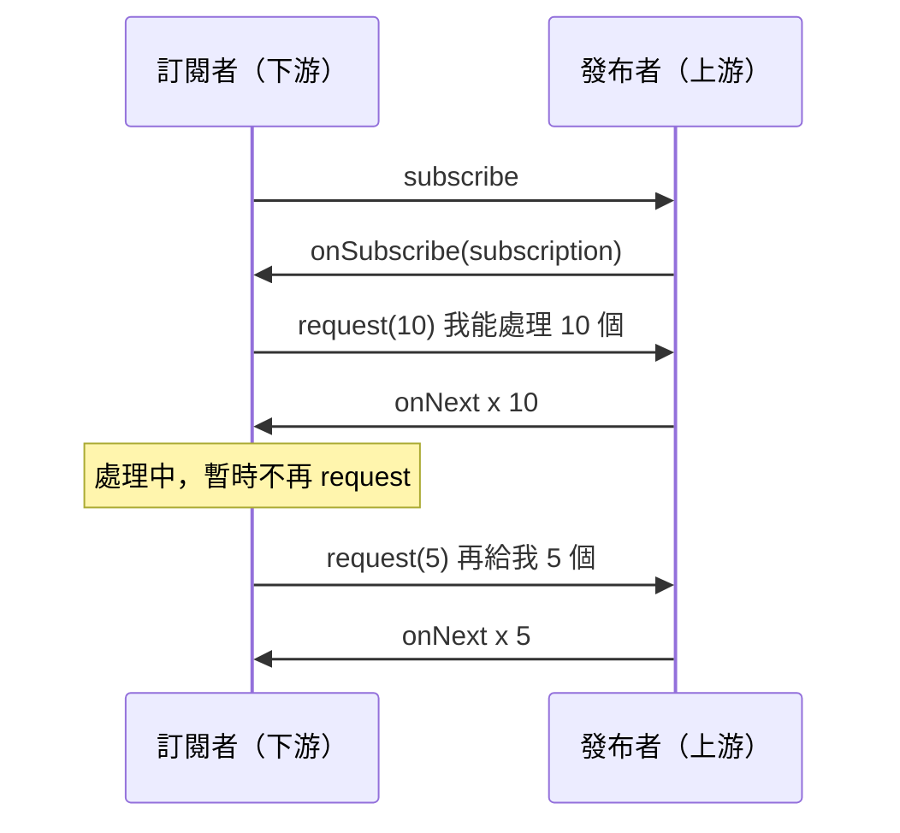
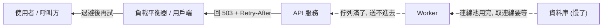

# 47｜背壓（Backpressure）

> 背壓（backpressure）是後段負責處理的一方（下游）處理不過來時，把「慢一點」的訊號傳回前段送工作進來的一方（上游）的機制，讓工作不會在中間無限堆積。

**難度**：★★☆　**閱讀時間**：約 20 分鐘　**前置知識**：[連線池](08-連線池.md)、[重試機制](26-重試機制.md)、[訊息佇列](35-訊息佇列.md)

## 核心問題與理念

**它要解決的問題**：訂單 API 收到訂單，就把「建立出貨單」丟進背景排隊，馬上回應使用者。物流商變慢之後，每秒進來 300 筆、只做得完 2 筆，排隊的工作全堆在記憶體裡，最後程式用光記憶體被強制重啟，幾十萬筆出貨工作一起消失，監控上的回應時間和 CPU 卻一直正常（下面的情境會完整走一遍）。

**核心理念**：每個排隊的地方都設上限，排滿時要先決定好：叫人等、拒絕，還是丟掉。

**想通的那一步**：

- **卡住的地方**：直覺的做法是用一個佇列（排隊等處理的工作清單）把尖峰先收下來，之後慢慢消化。可是下游一直比上游慢時（每秒進 300、出 2），佇列只會越排越長，不會自己消化回來；把上限調大，也只是把爆掉的時間往後延。
- **火花**：佇列「滿了」本身就是有用的訊號，把它傳回給送工作進來的一方，讓它等一下，或收到「現在忙不過來」的回應。壓力會一路往外傳，在最外面、成本最低的地方被擋下，不會悄悄堆在記憶體裡。

## 閱讀前推薦具備知識

| 知識 | 要會到什麼程度 | 這篇哪裡會用到 | 不熟的話先看 |
|---|---|---|---|
| Python 的 `asyncio`（`async def`、`await`、`asyncio.Queue`） | **必備**：看得懂 `await` 是「在這裡等，等的時候讓別的工作先跑」，知道 `asyncio.create_task()` 會讓一個函式在背景跑起來 | 「動手看看」實驗一 `backpressure_demo.py` 的三種模式、實驗二的 middleware、「常見地雷」第 2 點 | [Python asyncio（中文）](https://docs.python.org/zh-tw/3/library/asyncio.html)，裡面的〈佇列〉一節 |
| 執行緒池 | **加分**：知道執行緒池是「固定開幾個執行緒，從一份待辦清單輪流拿工作來做」 | 情境裡的 `ThreadPoolExecutor` 和 `executor.submit()`、「常見地雷」第 1 點的 `BoundedSemaphore` | [Python threading（中文）](https://docs.python.org/zh-tw/3/library/threading.html) |
| HTTP 狀態碼和回應標頭 | **加分**：分得出 `4xx` 是呼叫端的問題、`5xx` 是伺服器端的問題，知道 `Retry-After: 2` 是一行回應標頭 | 「背壓在各層長什麼樣子」的 `503`／`429`、實驗二回傳的 `Retry-After` | [MDN：HTTP 狀態碼](https://developer.mozilla.org/en-US/docs/Web/HTTP/Reference/Status) |
| [訊息佇列](35-訊息佇列.md) | **加分**：能說出 broker、consumer、ack 這三個角色各做什麼 | 情境的「怎麼修」、「訊息佇列的消費端」的 prefetch | 本系列第 35 篇 |
| [連線池](08-連線池.md) | **加分**：知道連線池裡的連線數有上限，用完了要等別人還回來 | 「背壓會沿著鏈往上傳」的第 1、2 步 | 本系列第 08 篇 |
| [重試機制](26-重試機制.md) | **加分**：知道失敗後馬上重試，流量會變成原本的好幾倍 | 「生活比喻」的失準處第 2 點、「常見地雷」第 3 點 | 本系列第 26 篇 |

**快速自我檢查**：下面這段跑在一個 `async def` 函式裡，而且沒有其他程式從 `q` 拿東西。第三行會怎樣？如果改成 `q.put_nowait("c")` 呢？

```python
q = asyncio.Queue(maxsize=2)
await q.put("a")
await q.put("b")
await q.put("c")
```

<details markdown="1"><summary>看答案</summary>

`await q.put("c")` 會一直停在這裡等，直到有人 `get()` 拿走一個、騰出空位才往下走；改成 `q.put_nowait("c")` 就不等，直接拋出 `asyncio.QueueFull`。實驗一的 `block` 和 `shed` 兩種模式就是這兩種寫法。答不出來的話，先看 asyncio 文件，弄懂 `await` 是在等什麼。

</details>

## 為什麼要在意：一個具體的情境

這是一個假設的情境。你負責電商的訂單 API，用 Python 寫，收到訂單之後要呼叫外部的物流 API 建立出貨單。物流 API 平常大約 200ms 回應，為了不讓使用者等這一段，工程師把「建立出貨單」丟給 `ThreadPoolExecutor`（Python 標準函式庫的執行緒池，這裡開了 16 個執行緒在背景做事），HTTP 請求直接回 `202 Accepted`（意思是「收到了，之後會處理」）。

出事的寫法是這樣：handler 先把訂單寫進資料庫，接著用 `executor.submit(create_shipment, order)` 把建出貨單丟給背景執行緒，然後馬上回 `202`。這張圖看的是一筆訂單在服務裡走的路，標色的是出事的地方：

<figure class="draw-fig">
<iframe class="draw-fig__frame" src="../figures/47-unbounded-queue-oom.html" title="按播放或拖時間軸，從 19:58 看到 20:45：沒有上限的佇列一路堆到約 57 萬個工作，監控上的 API 回應時間和 CPU 卻一直正常，只有 Pod 記憶體在爬，直到 OOMKilled 把工作全部清空。" loading="lazy" style="height: 520px;"></iframe>
<figcaption>按播放或拖時間軸，從 19:58 看到 20:45：沒有上限的佇列一路堆到約 57 萬個工作，監控上的 API 回應時間和 CPU 卻一直正常，只有 Pod 記憶體在爬，直到 OOMKilled 把工作全部清空。</figcaption>
</figure>

`executor.submit()` 會把工作放進執行緒池內部的一個佇列，哪個執行緒有空，就從佇列拿一個出來做。這個佇列**沒有長度上限**，所以 `submit()` 從來不會擋，也不會失敗。

平常每秒 30 筆訂單。一筆出貨單 200ms，一個執行緒每秒做得完 5 筆，16 個執行緒每秒做得完 80 筆，綽綽有餘。雙十一晚上 8 點，兩件事同時發生：訂單變成每秒 300 筆，物流商的系統也過載，回應時間從 200ms 變成 8 秒。現在一個執行緒 8 秒才做完一筆，16 個執行緒每秒只做得完 2 筆。

這個服務跑在 Kubernetes 上。Pod 是 Kubernetes 裡跑程式的單位，這裡先把它想成一個有記憶體上限的容器：用超過上限就會被強制結束，狀態會寫成 `OOMKilled`（OOM 是 out of memory，記憶體不足）。

| 時間 | 每秒進來的工作 | 每秒做完的工作 | 佇列裡排隊的工作 | Pod 記憶體 | 監控畫面 |
|---|---|---|---|---|---|
| 20:00 前 | 30 | 30 | 幾乎是 0 | 300 MB | 正常 |
| 20:00 | 300 | 2 | 開始每秒多 298 個 | 300 MB | 正常 |
| 20:05 | 300 | 2 | 約 9 萬（298 × 300 秒） | 一路往上爬 | API 回應時間正常、CPU 20%，沒有告警 |
| 20:20 | 300 | 2 | 約 36 萬 | 2 GB | 還是沒有告警 |
| 20:32 | 0 | 0 | 約 57 萬，接著一瞬間歸零 | 超過上限 | Pod 被 `OOMKilled`，重新啟動 |
| 20:33 之後 | 300 | 2 | 從 0 開始又往上爬 | 從 300 MB 又往上爬 | 20 分鐘後又被殺一次，循環好幾輪 |

**使用者看到的**：下單畫面一切正常，每一筆都馬上顯示訂單成立。可是 20:00 之後的訂單，大部分一直等不到出貨。Pod 被殺的時候，佇列裡幾十萬個還沒做的出貨工作**全部消失**，因為它們只存在記憶體裡。

**工程師看到的**：API 回應時間和 CPU 從頭到尾都正常，因為 `202` 是直接回的，執行緒則都在等物流 API，不太耗 CPU。唯一的異常是 Pod 記憶體從 300 MB 爬到 2 GB，接著 Kubernetes 顯示 `OOMKilled`、Pod 反覆重啟。沒有任何指標告訴你「有幾十萬個工作在排隊」。

**根因**：就是 `executor.submit(create_shipment, order)` 那一行。佇列沒有上限，`submit()` 永遠成功，上游（訂單 API）完全不知道下游（物流 API）已經跟不上，工作就全部堆在記憶體裡。這就是「沒有背壓」。

**怎麼修**：佇列要有上限，並事先決定滿了要叫上游等、拒絕還是丟掉（「四種策略」那一節）；出貨單這種不能掉的工作，要改寫進資料庫或可靠的[訊息佇列](35-訊息佇列.md)，由[背景工作者](37-背景工作者.md)用固定的速度消化，同時監控「待處理工作數」和「最舊工作已經等了多久」（「常見地雷」第 1、4 點）。有了這個監控，20:05 就會看到數字直線上升。

## 全貌：它在系統裡的位置

這張圖看的是一個需要背景處理的請求，從使用者一路走到下游的路徑：


背壓發生在中間標色的佇列：下游（背景執行緒、外部 API、資料庫）變慢時，工作就積在這裡。背壓要做的，是把「滿了」的訊號往回傳給 API，再由 API 回 `503`（伺服器忙不過來，請稍後再試）告訴使用者。佇列可以是程式裡的 `asyncio.Queue`，也可以是獨立的[訊息佇列](35-訊息佇列.md)；從佇列取工作的那一段見[背景工作者](37-背景工作者.md)，用戶端收到 `503` 之後怎麼再試一次見[重試機制](26-重試機制.md)。

## 生活比喻

背壓很像**高速公路的匝道儀控**。

尖峰時段，高速公路主線的容量是固定的。如果交流道不管三七二十一一直放車上去，主線很快就會塞死，結果是所有人都動不了，連原本在主線上的車也一起卡住。匝道儀控的做法是：在匝道口裝紅綠燈，主線越塞，綠燈間隔就越長，讓車子在匝道上等。這就是「下游（主線）把慢下來的訊號傳回上游（匝道）」。

匝道本身的長度有限，這就是**有界佇列**（有長度上限的佇列）。匝道排滿了，車子回堵到平面道路，平面道路的駕駛看到就會改走省道，這就是**拒絕／分流**。廣播說「國道一號目前壅塞，建議改道」，就像伺服器回 `503`（我現在忙不過來），再加上 `Retry-After` 標頭（建議幾秒之後再來）。

**比喻失準的地方**：

1. 車子不會因為等太久就「過期」消失，但請求會。使用者等了 30 秒早就關掉頁面了，伺服器卻可能還在處理那個沒人要的請求。軟體系統裡，**排太久的工作常常是白做**，這點高速公路沒有。
2. 駕駛會自己判斷要不要改道，但程式不會。用戶端收到 `503` 之後如果立刻重試，就像被趕下匝道的車立刻又繞回來排隊，反而讓情況更糟。背壓要有效，上游得「聽得懂」訊號，這需要[重試機制](26-重試機制.md)和[指數退避](27-指數退避.md)配合。

## 它是怎麼運作的

### 先搞懂一條公式：佇列一定會長大的原因

要決定怎麼處理過量，得先知道佇列為什麼會長大、會長多快。設上游的到達速率是 λ（每秒進來幾個），下游的處理速率是 μ（每秒處理得了幾個）。這張圖看的是工作流進、流出佇列的兩個速率：


- λ < μ：佇列偶爾會有一點積壓，但會被消化掉，系統穩定。
- λ > μ：佇列每秒增加 λ − μ 個，**而且永遠不會自己回來**。開頭那個情境，λ = 300、μ = 2，每秒多積 298 個。

知道佇列有多長之後，下一個問題是：新進來的工作要排多久？對先進先出的佇列來說，新工作得等前面的全部處理完，所以**佇列長度除以處理速率，大約就是新工作要排多久**。佇列裡積了 6000 個、下游每秒處理 1000 個，新進來的工作大概要等 6 秒。下面這張表從 λ = 2000、μ = 1000 開始，看佇列和等待時間怎麼一起長大：

| 時間 | 這一秒進來 | 這一秒做完 | 佇列長度 | 新進來的工作大概要等 |
|---|---|---|---|---|
| 第 1 秒 | 2000 | 1000 | 1000 | 1 秒 |
| 第 2 秒 | 2000 | 1000 | 2000 | 2 秒 |
| 第 3 秒 | 2000 | 1000 | 3000 | 3 秒 |
| 第 4 秒 | 2000 | 1000 | 4000 | 4 秒 |
| 第 5 秒 | 2000 | 1000 | 5000 | 5 秒 |
| 第 6 秒 | 2000 | 1000 | 6000 | 6 秒 |

這就是為什麼「佇列長度」和「等待時間」要一起看：一個告訴你積了多少，一個告訴你使用者要等多久。

這個直覺背後有一條正式的關係，叫 **Little's Law**：在穩定狀態下，系統裡平均有幾個工作（L）＝ 到達速率（λ）× 每個工作平均待多久（W）。後面的實驗會用它來反推佇列的上限該設多少。

> 背壓處理的是持續的速度差。短暫的尖峰用緩衝吸收就好；持續的速度差用緩衝只是延後爆炸的時間。

### 四種策略

速度差持續存在時，佇列遲早會滿，滿了之後怎麼辦，就是背壓策略要回答的問題。答案只有四條路：讓上游等、先存一些起來但有上限、直接拒絕或丟掉、只處理一部分。真正的系統通常會混著用，但**「無限緩衝」永遠不在選項裡**，開頭那個情境就是選了它。

先看最基本的一條路：上游把工作放進有上限的佇列，下游從佇列取出來處理。


佇列滿了，訊號要往回傳。這張多了兩條回頭的線：叫上游等，或直接拒絕新工作。另外加上監控，持續看佇列長度和等待時間。



| 策略 | 做法 | 適合 | 代價 |
|---|---|---|---|
| **阻塞／限速上游**（block / throttle） | 佇列滿了，生產者就停下來等 | 上游是你能控制的程式：檔案處理、批次匯入、串流管線 | 上游的資源（執行緒、連線）被佔住，壓力會往更上游傳 |
| **有界緩衝**（bounded buffer） | 允許積一些，但有上限 | 吸收短暫尖峰 | 只解決短期問題，上限到了還是要選其他三種之一 |
| **丟棄／降載**（drop / load shedding） | 滿了就拒絕新工作，或丟掉最舊的 | 對外 API、即時性高的資料（延遲比完整性重要） | 有人會收到錯誤；要決定丟誰 |
| **取樣**（sampling） | 只處理一部分，例如每 10 筆留 1 筆 | 日誌、指標、追蹤資料這種統計上夠用就好的東西 | 資料不完整，不能用在金流、訂單 |

表裡的**降載**（load shedding）就是系統過載時，主動拒絕一部分工作，把要處理的量降下來，保住其他工作的處理速度。

怎麼選？一個簡單的判斷：

- **這筆工作能不能掉？** 不能掉的工作（訂單、付款），就讓上游等，或者把它持久化到可靠的佇列，然後在入口就拒絕新的請求，讓使用者知道「現在不行」。可以掉的工作（點擊事件、監控指標），就丟棄或取樣。
- **上游等得起嗎？** 上游是一個批次腳本，等就等；上游是一個使用者在看轉圈圈的 HTTP 請求，讓它等 30 秒比直接回錯誤更糟。
- **工作會不會過期？** 推播「優惠還剩 5 分鐘」排了 10 分鐘才送出去，送出去反而是錯的。會過期的工作，**丟棄比延遲處理好**。

### 背壓在各層長什麼樣子

背壓是一個設計觀念，從網路層到應用層都看得到，每一層有自己的做法。先看後端新人最常碰到的兩層：HTTP 服務，以及訊息佇列的消費端。

**HTTP 服務的 `503` 和 `429`**：HTTP 沒有辦法讓用戶端「暫停」，所以伺服器的背壓手段是快速拒絕：

- **`503 Service Unavailable`**：伺服器整體過載或暫時無法服務，跟是誰打的無關。
- **`429 Too Many Requests`**（RFC 6585 定義）：這個呼叫者打太多了，是[速率限制](30-速率限制.md)的結果。
- 兩者都可以帶 **`Retry-After`** 標頭（秒數或 HTTP 日期），告訴用戶端多久之後再試。

這張圖看的是服務入口有「同時處理中的請求數上限」時，一個請求進來會走哪一邊：



在服務自己的入口做「同時處理中的請求數上限」，超過就直接回 `503`，這就是最基本的**降載（load shedding）**。快速拒絕比讓請求排隊排到逾時好得多：使用者馬上知道「現在不行」，伺服器也不用替一個沒人在等的請求做白工。Uvicorn 有 `--limit-concurrency` 參數，超過就回 `503`；Nginx 的 `limit_conn`、`limit_req` 也能做到類似的事情（`limit_req` 預設擋下來回的就是 `503`，可以用 `limit_req_status` 改成 `429`）。

**訊息佇列的消費端**：訊息佇列的伺服器叫 broker（例如 RabbitMQ），從它拿訊息來處理的程式叫 consumer，consumer 處理完要回一個確認（ack），broker 才會把那則訊息刪掉。RabbitMQ 的 prefetch（`basic.qos`）、Celery 的 `worker_prefetch_multiplier`，都是在限制「一個 consumer 手上最多同時拿著幾個還沒確認（ack）的訊息」（Celery 實際的上限是這個值乘上 worker 的並行數，預設是 4）。沒有限制的話，broker 會盡快把訊息推給 consumer，塞在它的記憶體裡；結果某個 worker 手上積了一大堆慢慢處理，其他 worker 卻可能閒著。

這張圖看的是 prefetch 的上限怎麼讓訊息留在 broker 裡：



consumer 手上已經拿滿 N 則時，要等它回 ack，broker 才會再推新的過來，所以多出來的訊息留在 broker，consumer 的記憶體不會被塞滿。

### 更底層的背壓：TCP、Node.js、Reactive Streams、Kafka

> 第一次讀可以先跳過這一節，等遇到 Node.js stream、Java 的串流函式庫或 Kafka 時再回來看。

這幾種背壓大多由函式庫或作業系統幫你做好，知道它們存在、知道訊號長什麼樣子就夠了。

**TCP 流量控制（flow control）**：接收端在每個 TCP 封包裡告訴對方「我的接收視窗（receive window）還剩多少空間」。應用程式來不及從 socket 讀資料，接收緩衝區就會滿，視窗縮成 0，傳送端就會停下來。這是作業系統幫你做好的背壓，所以你的程式讀得慢，對方的 `send()` 最後會卡住或回報緩衝區已滿。注意它和**壅塞控制（congestion control）**不一樣：流量控制保護的是「接收端」，壅塞控制保護的是「中間的網路」。

**Node.js stream 的 `highWaterMark`**：Node.js 的 stream 內部有一個緩衝區，`highWaterMark` 是它的門檻。對 Writable 呼叫 `write()` 時，如果緩衝的資料已經達到門檻，`write()` 會回傳 `false`，意思是「先別寫了」，等緩衝清空會發出 `'drain'` 事件，再繼續寫。預設值依版本和平台而異（byte 模式舊版是 16 KiB，Node.js 22 起在 Linux／macOS 調成 64 KiB，Windows 上仍是 16 KiB；objectMode 是 16 個物件；可以用 `stream.getDefaultHighWaterMark(false)` 查目前的值），請以你使用版本的官方文件為準。大多數時候你不用自己處理，用 `pipe()` 或 `stream.pipeline()` 就會自動遵守這個訊號。

這張圖看的是寫入端和 Writable 之間的一來一回：



出事的寫法是在迴圈裡一直 `out.write(...)`，完全不看回傳值，資料就全部堆在記憶體裡。正確寫法的關鍵只有這幾行（`once` 來自 `node:events`；stream 出錯時，`await once(...)` 會拋出例外）：

```js
for (const row of hugeRows) {
  if (!out.write(JSON.stringify(row) + "\n")) {
    await once(out, "drain");   // 回傳 false 就等 'drain' 再繼續寫
  }
}
out.end();
```

> 注意：CommonJS（`require`）的檔案頂層不能直接寫 `await`，所以這段要包在 `async function` 裡。

**Reactive Streams**：這是 JVM 生態（Java 9 起內建成 `java.util.concurrent.Flow`，RxJava、Project Reactor、Akka Streams 都實作它）的一套規格，核心想法是**由消費者拉取**，生產者不能主動硬推。訂閱者透過 `Subscription.request(n)` 告訴發布者「我現在還能處理 n 個」，發布者送出的數量不能超過這個額度。下面這張圖是一次訂閱的來回，箭頭上的 `onNext` 就是「送一筆資料過去」：



Kafka 的 consumer 也是拉取模型：consumer 自己決定什麼時候 `poll()`、一次拿多少，處理不完就是 **consumer lag（消費延遲）**變大，broker 不會主動把資料推給它。這也是背壓，積壓的資料留在 broker 的磁碟上，consumer 的記憶體不會被塞滿。

### 背壓會沿著鏈往上傳

資料庫變慢時，壓力會一步一步往外傳：

| 步驟 | 哪一層 | 發生什麼 | 往上游傳的訊號 |
|---|---|---|---|
| 1 | 資料庫 | 查詢變慢，連線遲遲不還 | 連線池用完 |
| 2 | Worker | 從連線池取連線要等，處理變慢 | 從佇列拿工作的速度變慢 |
| 3 | 佇列 | 工作進來比出去快，排到上限 | 佇列滿了 |
| 4 | API 服務 | 工作送不進佇列 | 回 `503` 加 `Retry-After` |
| 5 | 用戶端 | 收到 `503` | 退避一段時間再試 |

這張圖看的是同一條鏈，箭頭方向就是壓力往外傳的方向：



設計得好的系統，壓力會一層一層往上游傳，最後在最外面、成本最低的地方處理掉（直接回錯誤），免得在最裡面、代價最高的地方出事（資料庫被打掛）。這條鏈上**只要有一段是無界的緩衝，訊號就斷在那裡**，所有壓力都會堆在那一段，直到它爆掉。[連線池](08-連線池.md)本身就是一種有界資源，設好「取連線的等待逾時」，它就是這條鏈上很重要的一環。

## 動手看看

### 實驗一：同樣的速度差，三種下場

下面這支程式模擬上游每秒送 2000 個工作、下游每秒只處理 1000 個，每個工作帶 10 KB 資料，比較三種模式：

- `unbounded`：無界佇列（`asyncio.Queue()` 的預設）
- `block`：有界佇列 + 滿了讓上游等（`await q.put()`）
- `shed`：有界佇列 + 滿了直接丟（`q.put_nowait()` 遇到 `QueueFull`）

只需要 Python 3.8 以上，不用裝任何套件。

程式每秒印一行，三個數字分別是：佇列長度、Python 目前配置了多少記憶體（用標準函式庫的 `tracemalloc` 量），以及這一秒的 **p99 等待時間**。p99 的意思是：把這一秒處理完的工作依等待時間由短到長排好，排在第 99% 那個工作等了多久；換句話說，100 個工作裡最慢的那 1 個大概等這麼久。

```python
# backpressure_demo.py：上游比下游快兩倍時，三種處理方式的差別
# 用法：python backpressure_demo.py unbounded | block | shed
import asyncio
import sys
import time
import tracemalloc

PRODUCE_RATE = 2000      # 上游：每秒想送進 2000 個工作
CONSUME_RATE = 1000      # 下游：每秒只處理得了 1000 個
DURATION = 6             # 上游跑 6 秒
PAYLOAD = 10 * 1024      # 每個工作帶 10 KB 資料，模擬請求內容
MAXSIZE = 100            # block / shed 模式的佇列上限
TICK = 0.01              # 每 10ms 對一次進度（避開 Windows 計時器解析度太粗的問題）

async def producer(q, mode, stats):
    start = time.monotonic()
    while (now := time.monotonic()) - start < DURATION:
        target = int((now - start) * PRODUCE_RATE)   # 照速率，到現在「應該」送出幾個
        while stats["offered"] < target:
            job = (time.monotonic(), bytes(PAYLOAD))  # (建立時間, 內容)
            if mode == "shed":
                stats["offered"] += 1
                try:
                    q.put_nowait(job)                # 滿了不等，直接丟
                    stats["accepted"] += 1
                except asyncio.QueueFull:
                    stats["dropped"] += 1            # 真實系統這裡會回 503 / 429
            else:
                await q.put(job)                     # unbounded 永遠不用等；block 滿了就卡在這裡
                stats["offered"] += 1
                stats["accepted"] += 1
                if time.monotonic() - start >= DURATION:
                    break
        await asyncio.sleep(TICK)

async def consumer(q, stats):
    start = time.monotonic()
    done = 0
    while True:
        target = int((time.monotonic() - start) * CONSUME_RATE)
        while done < target:
            try:
                created, _ = q.get_nowait()
            except asyncio.QueueEmpty:
                done = target                        # 沒工作可做，閒置產能不能存起來
                break
            stats["waits"].append(time.monotonic() - created)  # 這個工作在佇列裡等了多久
            done += 1
        await asyncio.sleep(TICK)

async def monitor(q, stats):
    for sec in range(1, DURATION + 1):
        await asyncio.sleep(1)
        waits, stats["waits"] = stats["waits"], []
        waits.sort()
        p99 = waits[int(len(waits) * 0.99)] if waits else 0.0
        mem_mb = tracemalloc.get_traced_memory()[0] / 1024 / 1024
        print(f"t={sec}s  佇列長度={q.qsize():5d}  記憶體={mem_mb:6.1f} MB  "
              f"這一秒 p99 等待={p99:5.2f}s")

async def main(mode):
    tracemalloc.start()   # 量 Python 配置了多少記憶體
    q = asyncio.Queue() if mode == "unbounded" else asyncio.Queue(maxsize=MAXSIZE)
    stats = {"offered": 0, "accepted": 0, "dropped": 0, "waits": []}
    tasks = [asyncio.create_task(consumer(q, stats)),
             asyncio.create_task(producer(q, mode, stats))]
    await monitor(q, stats)
    for t in tasks:
        t.cancel()
    print(f"\n[{mode}] 上游原本想送 {DURATION * PRODUCE_RATE} 個，實際送進佇列 {stats['accepted']} 個，"
          f"丟棄 {stats['dropped']} 個，佇列裡還積著 {q.qsize()} 個")

if __name__ == "__main__":
    mode = sys.argv[1] if len(sys.argv) > 1 else "unbounded"
    assert mode in ("unbounded", "block", "shed"), "mode 只能是 unbounded / block / shed"
    asyncio.run(main(mode))
```

執行（Windows 的 pwsh 如果中文變亂碼，先設 `$env:PYTHONUTF8 = '1'` 和 `[Console]::OutputEncoding = [Text.Encoding]::UTF8`）：

```shell
python backpressure_demo.py unbounded
python backpressure_demo.py block
python backpressure_demo.py shed
```

預期會看到（數字每次會差一點）：

```text
# unbounded：佇列、記憶體、等待時間全部直線上升
t=1s  佇列長度= 1006  記憶體=  10.0 MB  這一秒 p99 等待= 0.50s
t=3s  佇列長度= 3020  記憶體=  29.9 MB  這一秒 p99 等待= 1.51s
t=6s  佇列長度= 5966  記憶體=  59.1 MB  這一秒 p99 等待= 3.02s
[unbounded] 上游原本想送 12000 個，實際送進佇列 11999 個，丟棄 0 個，佇列裡還積著 5966 個

# block：佇列卡在 100，等待時間穩定，但上游只送出了一半
t=3s  佇列長度=  100  記憶體=   1.0 MB  這一秒 p99 等待= 0.11s
[block] 上游原本想送 12000 個，實際送進佇列 6072 個，丟棄 0 個，佇列裡還積著 38 個

# shed：佇列卡在 100，等待時間穩定，多出來的一半被丟掉
t=3s  佇列長度=  100  記憶體=   1.1 MB  這一秒 p99 等待= 0.11s
[shed] 上游原本想送 12000 個，實際送進佇列 6075 個，丟棄 5906 個，佇列裡還積著 54 個
```

從輸出可以看到三件事：

1. **unbounded 的每一項指標都是一條斜線**：佇列每秒多約 1000 個（λ − μ = 2000 − 1000），記憶體每秒多約 10 MB，等待時間每秒多約 0.5 秒。把 6 秒換成 6 小時，就是一次 OOM。
2. **block 和 shed 的下游處理量一模一樣**（都是每秒 1000 個）。背壓決定的是「處理不了的那一半怎麼辦」，下游的處理量不會因此增加：block 讓上游少送，shed 讓多的直接失敗。
3. **有界佇列的等待時間上限 ≈ maxsize ÷ 處理速率**：100 ÷ 1000 = 0.1 秒，跟量到的 0.11 秒吻合。這就是用 Little's Law 反推佇列上限的方法：如果你希望工作最多只排 2 秒、下游每秒處理 50 個，佇列上限就設 100 左右。

可以自己改 `CONSUME_RATE` 為 3000（下游比上游快），三種模式的佇列都會維持在接近 0，證明背壓只在速度差出現時才起作用。

### 實驗二：HTTP 入口的降載

在 FastAPI 服務的入口限制同時處理中的請求數，超過就回 `503`（片段，搭配 `uvicorn` 執行）：

```python
# 每個行程（worker）各自計數；跑 4 個 worker 就是 4 × MAX_IN_FLIGHT
from fastapi import FastAPI, Request
from fastapi.responses import JSONResponse

app = FastAPI()
MAX_IN_FLIGHT = 200          # 依壓力測試結果決定，不要憑感覺
in_flight = 0                # 單一 event loop 內，檢查和 +1 之間沒有 await，不會有競爭條件

@app.middleware("http")
async def shed_load(request: Request, call_next):
    global in_flight
    if request.url.path == "/healthz":          # 健康檢查不能被降載擋掉
        return await call_next(request)
    if in_flight >= MAX_IN_FLIGHT:
        # 快速拒絕：不碰資料庫、不排隊，成本幾乎是零
        return JSONResponse(
            {"error": "server overloaded, please retry later"},
            status_code=503,
            headers={"Retry-After": "2"},
        )
    in_flight += 1
    try:
        return await call_next(request)
    finally:
        in_flight -= 1                           # 不管成功或例外都要扣回來
```

用壓力測試工具（例如 `hey`、`wrk`、`k6`）打一個故意寫得很慢的端點，會看到超過上限的請求立刻拿到 `503`，而成功的那些請求延遲維持穩定，不會整體一起變慢。如果只是要簡單的版本，Uvicorn 本身的 `--limit-concurrency` 參數也能做到類似效果（它算的是同時的連線數或任務數，超過就回 `503`）。

> 小提醒：這個 middleware 在 `call_next()` 回來、回應開始送出時就扣回計數；如果端點回的是串流回應（`StreamingResponse`），body 還在傳的那段時間不會被算進去。一般的 JSON API 不受影響。

### 實驗三：用 Redis Stream 做「保留最新、丟掉最舊」

對「只關心最近資料」的場景（例如裝置回報的即時狀態），可以讓佇列自己修剪：

```shell
docker run --rm -d --name bp-redis -p 6379:6379 redis:7
docker exec -it bp-redis redis-cli

# MAXLEN ~ 1000：大約只保留最新的 1000 筆，舊的自動被修剪掉（~ 代表允許略多一點，換取效能）
XADD sensor:events MAXLEN ~ 1000 * device_id 42 temp 36.5
XLEN sensor:events       # 監控積壓量
```

用 `XADD ... MAXLEN` 時要清楚：被修剪掉的訊息就是「被丟掉」了，**只能用在可以掉資料的地方**。用完記得 `docker stop bp-redis`。

## 常見地雷

### 1. 沒指定上限的佇列

- ❌ 錯誤做法：`q = queue.Queue()`、`asyncio.Queue()`，或用 `ThreadPoolExecutor.submit()` 無限丟工作。
- 為什麼錯：Python 的 `queue.Queue` 和 `asyncio.Queue` 的 `maxsize` 預設是 0，代表沒有上限；`ThreadPoolExecutor` 內部的工作佇列也是無界的，`submit()` 永遠立即回傳。下游一慢，這些佇列就是記憶體洩漏。
- ✅ 正確做法：一律設 `maxsize`，並且想清楚「滿了要怎麼辦」（等、丟、還是回錯誤）。用執行緒池時，可以搭配 `threading.BoundedSemaphore`（一個計數器，最多同時放行 N 個）限制「已送出但還沒完成」的工作數，超過就讓呼叫端等或拒絕。

### 2. 滿了就無限期地等

- ❌ 錯誤做法：HTTP handler 裡 `await q.put(job)`，佇列滿了就一直卡著。
- 為什麼錯：阻塞上游只適合「上游等得起」的情況。HTTP handler 卡住，代表 worker、連線、記憶體都被佔著；使用者等到逾時離開了，伺服器還在等。壓力還是堆著，只是從佇列換到了 handler 身上。
- ✅ 正確做法：等待要有上限，例如 `await asyncio.wait_for(q.put(job), timeout=0.5)`，超時就回 `503`。或者乾脆用 `put_nowait()`，滿了立刻拒絕。

### 3. 拒絕了，但用戶端立刻重試

- ❌ 錯誤做法：伺服器回 `503`，用戶端（或你自己寫的呼叫端）收到就馬上重打，或是重試三次、每次間隔固定 100ms。
- 為什麼錯：降載的目的是讓總流量下降。立即重試會讓流量變成原本的好幾倍，系統更爬不起來，這就是重試風暴。
- ✅ 正確做法：伺服器帶 `Retry-After`；用戶端尊重它，並使用[指數退避](27-指數退避.md)加上[抖動](28-抖動.md)，必要時用[斷路器](29-斷路器.md)暫停呼叫。

### 4. 只看 CPU 和錯誤率，不看佇列

- ❌ 錯誤做法：告警只設 CPU > 80%、5xx 比例 > 1%。
- 為什麼錯：下游慢的時候，你的服務 CPU 常常很閒（都在等 I/O），而且非同步架構一開始不會報錯（像開頭的情境裡都回 202）。等錯誤出現，通常已經是 OOM 或逾時連環爆了。
- ✅ 正確做法：監控佇列長度、最舊一筆工作的年齡（oldest message age）、工作從進佇列到開始處理的等待時間，以及被拒絕／丟棄的數量。用的是 Kafka 就看 consumer lag（consumer 還沒讀到的訊息量）。告警最好設在「積壓持續上升 N 分鐘」或「最舊工作超過 SLA（對使用者承諾的處理時間）」，比單看某個絕對值準。

### 5. 一看到佇列滿就把上限調大

- ❌ 錯誤做法：「佇列一直滿，把 `maxsize` 從 1000 改成 100000 好了。」
- 為什麼錯：如果是持續性的速度差，上限調大只是延後爆炸，還讓每個工作的等待時間變長 100 倍（Little's Law）。佇列滿代表下游處理得不夠快，要解決的是下游。
- ✅ 正確做法：先查下游為什麼慢（慢查詢？外部 API？鎖競爭？），再決定要加 worker（[水平擴展](32-水平擴展.md)）、最佳化下游，或接受降載。佇列上限應該由「可以接受的最長等待時間」反推出來。

### 6. 降載時不分輕重，什麼都丟

- ❌ 錯誤做法：過載時一律拒絕新請求，連健康檢查、結帳、管理後台也一起擋。
- 為什麼錯：健康檢查被擋，負載平衡器以為節點掛了，把它移出去，流量全部壓到剩下的節點上，連鎖倒下。結帳被擋，損失的是真的錢。
- ✅ 正確做法：健康檢查（見[健康檢查](49-健康檢查.md)）走旁路不受降載影響；替請求分優先順序，先丟「重要性低、可重試」的（推薦、統計、預先載入），保住核心交易。

### 7. 處理早就過期的工作

- ❌ 錯誤做法：佇列裡排了 40 秒的請求，被取出來之後照樣完整處理一遍。
- 為什麼錯：用戶端 30 秒就逾時了，這個結果沒有人會收到。處理它浪費的資源，正好是那些還有機會成功的新請求需要的，所以系統在過載時「做的全是白工」，永遠爬不出來。
- ✅ 正確做法：每個工作帶上建立時間或截止時間（deadline），取出時先檢查，過期就直接丟並記一筆指標。

## 重點整理

- 上游的到達速率**長時間**大於下游的處理速率時，佇列每秒多 λ − μ 個，不會自己消化回來，最後撐爆的可能是記憶體、磁碟，或是讓使用者等到逾時。背壓就是讓系統在這時候主動反應，叫上游等或拒絕新工作，免得默默堆到掛掉。
- 處理過量只有四條路：讓上游等（阻塞、限速）、有界緩衝、拒絕或丟掉（降載）、取樣。選哪一條，看這筆工作能不能掉、上游等不等得起、工作會不會過期；「無限緩衝」永遠不在選項裡。
- 所有佇列都要有上限：`queue.Queue()`、`asyncio.Queue()` 預設沒有上限，`ThreadPoolExecutor` 內部的工作佇列也沒有。沒指定上限，就等於選了開頭情境那種「堆到記憶體爆掉」。
- 對外的 HTTP 服務用 `503`（整體忙不過來）和 `429`（這個呼叫者打太多了）傳回背壓訊號，最好附上 `Retry-After`；用戶端收到後要退避，不能立刻重試。
- 監控要看佇列長度和等待時間（最舊工作等了多久），不能只看 CPU。下游變慢時 CPU 常常很閒，因為執行緒都在等那個慢的下游。

## 新人必知清單

### 一定要會（基本功）

- [ ] 能用「到達速率大於處理速率時，佇列會線性增長」解釋為什麼無界佇列遲早會出事。
- [ ] 寫任何佇列、緩衝、執行緒池時，都會先問「上限是多少？滿了怎麼辦？」，而且知道 Python 標準函式庫的佇列預設是無界的。
- [ ] 分得清四種策略（阻塞／限速、有界緩衝、丟棄、取樣）適合的場景，知道「不能掉的資料」和「可以掉的資料」處理方式不同。
- [ ] 知道 `503` 和 `429` 的差別，也知道要搭配 `Retry-After`；自己寫的用戶端收到這兩種回應時會退避，不會立刻重試。
- [ ] 會用 Little's Law（佇列長度 ≈ 到達速率 × 等待時間）估算佇列上限和等待時間。
- [ ] 監控時會看佇列長度、最舊工作的年齡、被拒絕的數量，而不只看 CPU。
- [ ] 等待一定要有逾時：取連線、放進佇列、呼叫下游，都不能無限期等。

### 知道有這回事就好

- TCP 流量控制靠接收視窗運作，和壅塞控制是兩回事；HTTP/2、gRPC 在一條連線內也有自己的流量控制視窗。
- Node.js stream 的 `highWaterMark`、`write()` 回傳 `false` 與 `'drain'` 事件；用 `pipeline()` 會自動處理背壓。
- Reactive Streams 的 `request(n)` 拉取模型，以及 Kafka consumer 的拉取模型與 consumer lag。
- 訊息佇列消費端的 prefetch（RabbitMQ `basic.qos`、Celery `worker_prefetch_multiplier`）會影響 worker 手上積多少工作。
- 丟棄有多種方式：丟新的（tail drop）、丟舊的（head drop）、依優先序丟；對延遲敏感的系統，有時會改成「後進先出」，讓新請求比較有機會在逾時前完成。
- 自適應並行上限（adaptive concurrency limit）：依量測到的延遲自動調整上限，不必寫死一個數字。

### 先不用管（等你遇到再學）

- 佇列理論的數學細節（M/M/1、M/M/c 模型的推導）。
- CoDel 這類主動佇列管理（active queue management）演算法的實作。
- 自己實作 Reactive Streams 規格的 Publisher（規則很多，請直接用現成函式庫）。
- 服務網格（service mesh）裡的全域降載與優先序排程。

## Code Review 時可以問的問題

1. 這個 PR 裡新增的佇列、緩衝區、list、執行緒池有沒有上限？上限是怎麼決定的？
2. 佇列滿了或下游變慢時，這段程式會怎麼做：等（等多久）、丟（丟誰、有沒有記指標）、還是回錯誤？
3. 這個端點過載時回什麼狀態碼？有沒有帶 `Retry-After`？呼叫我們的用戶端會不會立刻重試？
4. 呼叫下游（資料庫、外部 API、另一個服務）有沒有設逾時？如果下游從 100ms 變成 10 秒，我們這邊會堆積什麼？
5. 這個工作「可以掉」嗎？如果不行，它現在是放在記憶體裡還是持久化的地方？行程重啟會不會消失？
6. 有沒有加上佇列長度、等待時間或被拒絕數量的指標，讓我們出事前看得到？

## 情境演練

**Q1.** 你負責的服務有一個背景佇列，平常長度在 0～50 之間跳動，某天開始以每分鐘多 3000 的速度穩定上升。同事提議先把佇列上限調大撐過去。你會怎麼判斷？

<details markdown="1"><summary>看答案</summary>

穩定上升代表到達速率持續大於處理速率，每分鐘多 3000，大約是每秒多 50 個。這是持續的速度差，佇列不會自己消化回來。

調大上限不能解決，只會延後出事的時間，而且讓每個工作的等待時間越來越長（先進先出的佇列，新工作的等待時間 ≈ 佇列長度 ÷ 處理速率）。要做的是找出處理速率為什麼下降（下游變慢？worker 掛了幾個？）或到達速率為什麼上升（流量變大？上游重試風暴？），然後決定加產能、最佳化下游，或在入口降載。
</details>

**Q2.** 你在設計一支對外 API 的過載回應，要處理兩種狀況：某個合作夥伴的 API key 每分鐘限制 600 次，他打了第 601 次；另一種是服務同時處理中的請求數已經達到上限。這兩種狀況分別該回哪個狀態碼？回錯了會怎樣？

<details markdown="1"><summary>看答案</summary>

- `429 Too Many Requests` 針對「這個呼叫者」：他超過了分配給他的額度，其他人可能完全正常。例如某個 API key 每分鐘限制 600 次，他打了第 601 次。
- `503 Service Unavailable` 針對「整個服務」：不管是誰，伺服器現在都處理不了。例如同時處理中的請求數已經達到上限、正在維護、依賴的資料庫掛了。

兩者都可以帶 `Retry-After`。用錯的後果是：明明是整體過載卻回 429，用戶端會以為是自己打太多，可能去調整自己的額度，不會知道是服務端有問題；監控和告警的歸類也會錯。
</details>

**Q3.** Code Review 時，你看到同事寫了下面這段上傳處理。你會提出什麼意見？

```python
from concurrent.futures import ThreadPoolExecutor
executor = ThreadPoolExecutor(max_workers=8)

def handle_upload(request):
    executor.submit(generate_thumbnails, request.file_bytes)
    return {"status": "accepted"}
```

<details markdown="1"><summary>看答案</summary>

`ThreadPoolExecutor` 雖然只有 8 個執行緒，但它內部放待處理工作的佇列是無界的，`submit()` 永遠立即回傳。上傳量一大或縮圖變慢，所有 `file_bytes` 都會留在記憶體裡排隊，最後 OOM，而且行程重啟時排隊中的工作全部消失。

改法依需求而定：
- 用 `threading.BoundedSemaphore` 限制「已送出但未完成」的數量，超過就回 `503`（或等一個很短的逾時）。
- 縮圖如果不能掉，就把工作和檔案位置寫進可靠的訊息佇列或資料庫，交給獨立的背景工作者處理，並監控積壓量。
</details>

**Q4.** 同事在 Node.js 裡把資料從 readable 搬到 writable，寫法是 `on('data', chunk => writable.write(chunk))`。檔案小的時候沒事，換成幾 GB 的檔案，記憶體就一路往上爬。你會建議怎麼改？為什麼 `readable.pipe(writable)` 或 `stream.pipeline()` 比較安全？

<details markdown="1"><summary>看答案</summary>

`writable.write()` 在內部緩衝達到 `highWaterMark` 時會回傳 `false`，這就是背壓訊號。自己寫 `on('data')` 時，如果不檢查回傳值並暫停 readable、等 `'drain'` 再恢復，readable 會用最快速度一直讀，資料全部堆在 writable 的緩衝裡，記憶體無限增長。

`pipe()` 和 `pipeline()` 內建了「回傳 false 就暫停來源、收到 drain 再恢復」的邏輯。`pipeline()` 另外還會在任一段出錯時正確地清理所有 stream 並把錯誤傳出來，所以通常更推薦用 `pipeline()`。
</details>

**Q5.** 你們的推播服務會從佇列取出「限時優惠」通知送給使用者，每則通知的優惠只有 10 分鐘。某天推播供應商變慢，佇列積了 40 分鐘的量。主管問你：「要不要先停止接收新通知，把舊的慢慢送完？」你會怎麼建議？

<details markdown="1"><summary>看答案</summary>

不建議照順序把舊的送完。這些通知 10 分鐘就過期了，排了 40 分鐘的通知現在送出去，使用者點進來會看到「優惠已結束」，不只沒有價值，還會造成客訴。而且送舊通知消耗的推播額度，正好擋住了新的、還有效的通知。

比較好的做法：
1. 消費者取出通知時先檢查截止時間，**過期的直接丟掉**並記錄數量，不要送。
2. 讓新通知優先：剩下的產能先拿去處理還沒過期的（必要時改成較新的先處理）。
3. 在入口處設有界佇列，供應商變慢時直接拒絕或降載低優先順序的通知，免得它無限堆積。
4. 監控「最舊通知的年齡」，超過幾分鐘就告警，下次不會等到積了 40 分鐘才發現。

背壓策略要看資料本身：**會過期的資料，延遲送達等於失敗，這時丟棄才是對的。**
</details>

## 相關主題

- [連線池](08-連線池.md)：連線池是一種有界資源，「取連線的等待逾時」就是資料庫這一層的背壓。
- [速率限制](30-速率限制.md)：限制「單一呼叫者」打太多並回 `429`；背壓處理的是「整體」處理不過來。
- [訊息佇列](35-訊息佇列.md)：把積壓從記憶體移到可靠的儲存，是處理「不能掉的工作」最常見的方式。
- [背景工作者](37-背景工作者.md)：消費端的並行數與 prefetch 決定了下游的處理速率與積壓位置。
- [重試機制](26-重試機制.md)：用戶端收到 `503`／`429` 之後怎麼重試，決定了降載有沒有用。
- [斷路器](29-斷路器.md)：下游持續失敗時停止呼叫，是另一種「讓上游停下來」的機制。

## 延伸閱讀

- Node.js 官方文件：[Backpressuring in Streams](https://nodejs.org/en/learn/modules/backpressuring-in-streams)
- Python 官方文件：[asyncio Queues](https://docs.python.org/3/library/asyncio-queue.html)
- Reactive Streams 規格：[reactive-streams.org](https://www.reactive-streams.org/)
- Google SRE Book：[Handling Overload](https://sre.google/sre-book/handling-overload/)
