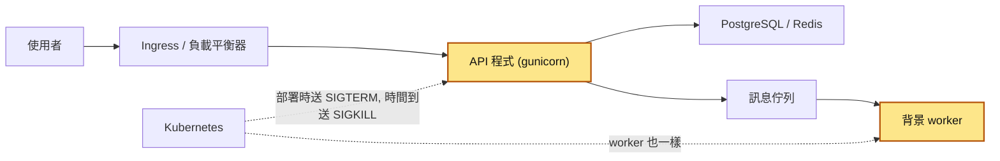
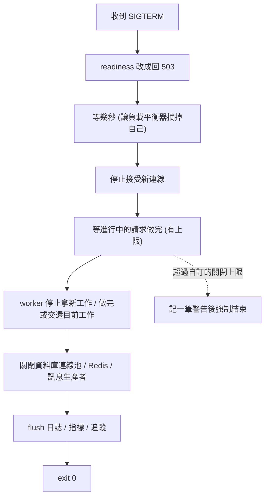
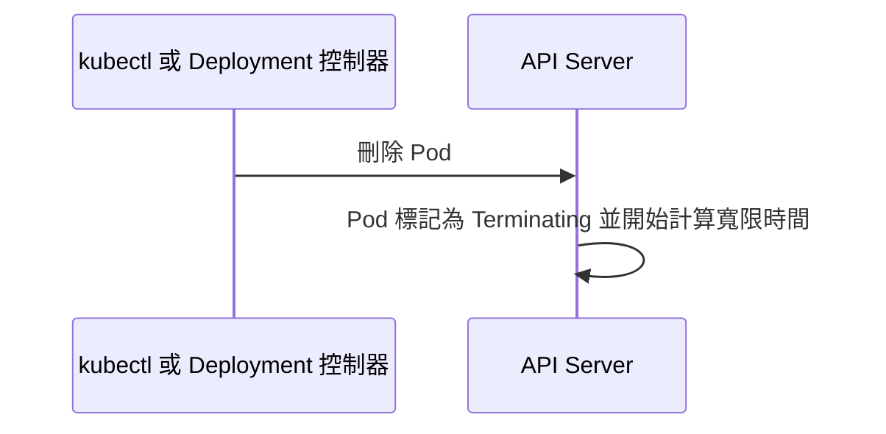
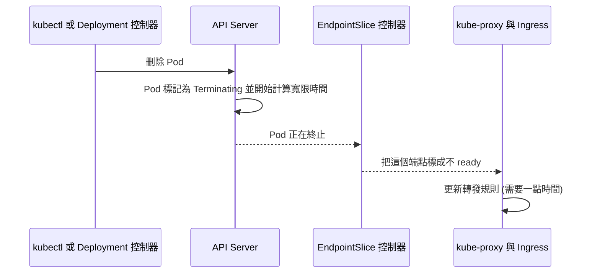
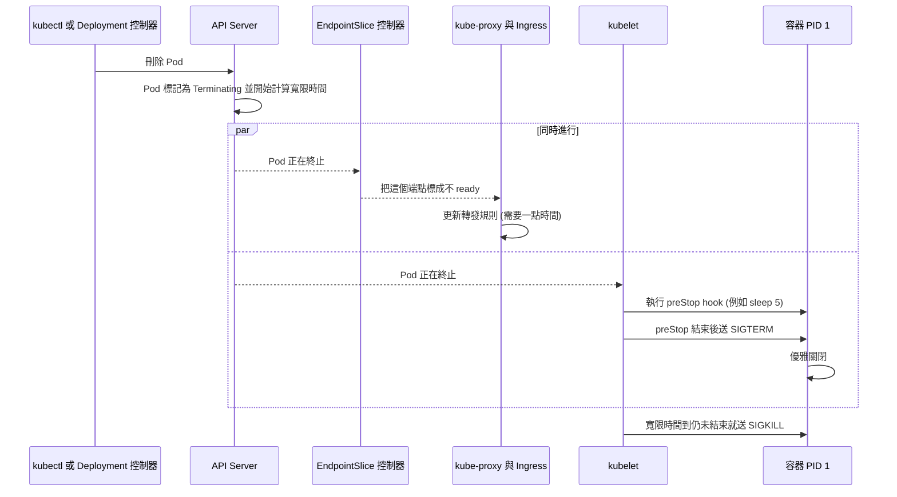

# 48｜優雅關閉（Graceful Shutdown）

> 優雅關閉（graceful shutdown）是程式收到結束要求後，先停止接新工作，把手上的工作做完或交還，再關掉連線、送出日誌，最後自己結束，不等到被系統強制砍掉。

**難度**：★★☆　**閱讀時間**：約 20 分鐘　**前置知識**：[連線池](08-連線池.md)、[負載平衡](31-負載平衡.md)、[背景工作者](37-背景工作者.md)

## 為什麼要在意：一個具體的情境

這是一個假設的情境。你負責電商的訂單 API，用 gunicorn（Python 常用的 HTTP 伺服器）執行，跑在 Kubernetes 上，每天下午會部署兩三次。先認識幾個這段會用到的詞：

- **Pod**：Kubernetes 裡跑容器的單位。這個服務有好幾個 Pod 同時在接請求。
- **滾動更新**（rolling update）：部署新版時，Kubernetes 一次換掉幾個舊 Pod，直到全部換成新版。
- **Ingress**：叢集最前面那一層，把使用者的請求轉給某個 Pod。連不上後端，或連線中途斷掉時，它回給使用者 `502`。
- **`SIGTERM`、`SIGKILL`**：作業系統通知程式結束的兩種訊號（signal）。`SIGTERM` 是「請你結束」，程式可以先收尾；`SIGKILL` 是直接砍掉，程式什麼都來不及做。
- **PID 1**：容器裡第一個啟動的行程。Kubernetes 要關容器時，`SIGTERM` 只會送給它。

Kubernetes 刪掉一個舊 Pod 時，會先送 `SIGTERM` 給 PID 1，然後最多等 30 秒（這叫寬限時間）。時間到還沒結束，就送 `SIGKILL`。

這個服務的 Dockerfile 寫的是 `CMD ["./start.sh"]`，啟動腳本長這樣。

❌ 出事的寫法（`start.sh`）：

```sh
#!/bin/sh
set -e
python manage.py check                   # 啟動前的準備工作
gunicorn app:app -c gunicorn.conf.py     # 少了 exec：PID 1 是 sh，gunicorn 只是它的子行程
```

最後一行沒有 `exec`，所以容器裡的 PID 1 是執行腳本的 `/bin/sh`，gunicorn 只是它底下的子行程。下面是一次滾動更新裡，一個舊 Pod 從被刪到消失的過程：

| 時間 | Kubernetes | PID 1（`/bin/sh`） | gunicorn | 使用者 |
|---|---|---|---|---|
| 0 秒 | 開始刪舊 Pod，寬限時間 30 秒開始倒數；通知 Ingress 把這個 Pod 移出轉發清單，同時送 `SIGTERM` 給 PID 1 | 收到 `SIGTERM`。它沒有設處理器，又是 PID 1，訊號直接被忽略，也不會轉送給 gunicorn | 完全不知道要關，照常處理手上的請求 | 正常 |
| 約 1–2 秒 | Ingress 更新完清單，新請求改送到新 Pod | 什麼都沒做 | 還有請求進來就照做 | 正常 |
| 2–30 秒 | 等 PID 1 自己結束 | 等 gunicorn 結束 | 不會自己結束，就一直等著 | 正常，但這個舊 Pod 一直卡在關閉中 |
| 30 秒 | 寬限時間到，送 `SIGKILL` | 被砍 | 被砍，當下還在處理的請求直接斷線 | 那幾個請求拿到 `502` |

**使用者看到的**：每次更新時，少數人結帳按下去轉圈圈然後失敗，重按又成功。

**工程師看到的**：每次滾動更新，Ingress 的 `502` 就冒出一小段尖峰；每個舊 Pod 都要卡滿 30 秒才消失，gunicorn 的日誌裡找不到任何開始關閉的紀錄。平常完全正常，只有部署的那幾十秒出事，而且量不大，所以很容易被當成「網路抖一下」放著不管。

**根因**：`start.sh` 最後一行的 `gunicorn app:app -c gunicorn.conf.py` 少了 `exec`。`SIGTERM` 送給了 sh，sh 不處理也不轉送，gunicorn 一直到被 `SIGKILL` 都不知道要關。

**怎麼修**：最後一行改成 `exec gunicorn app:app -c gunicorn.conf.py`，讓 gunicorn 取代 sh 成為 PID 1，自己收到 `SIGTERM`、做完手上的請求再結束（「Docker 裡 PID 1 的坑」那一節）。修好訊號之後，同一個服務還會露出兩個問題，後面都會講：

- gunicorn 一收到 `SIGTERM` 就停止接新連線，但 Ingress 要過一兩秒才更新完清單，這段時間送來的請求被拒絕連線，又是一小段 `502`。解法是先等幾秒再停止接新連線（「Kubernetes 刪除 Pod 的流程」那一節）。
- 付款後「通知物流、寄信」是 Celery worker（從訊息佇列拿任務來做的背景程式）在做。worker 被 `SIGKILL` 時剛好做到一半：付款狀態改了，物流沒通知到，而任務一拿到就回報「處理完了」（ack），佇列不會重送，訂單就卡在「付款處理中」，每週總有幾筆要人工對帳。解法是做完才 ack，並讓任務能安全地重做（「常見地雷」第 6 點）。

最後的設定是：啟動腳本加 `exec`、`preStop`（Kubernetes 送 `SIGTERM` 之前先執行的一段指令）先睡 5 秒、gunicorn 的 `graceful_timeout` 設 25 秒、寬限時間 `terminationGracePeriodSeconds` 拉到 45 秒、worker 做完才 ack 且任務改成冪等（重做一次也不會出錯）。之後部署再也沒有 `502` 尖峰。

## 全貌：它在系統裡的位置

這張圖看的是一個請求經過的元件，以及部署時誰會被關掉：



優雅關閉發生在標色的兩個地方：要被關掉的 API 程式和背景 worker。它要往前跟 Ingress、負載平衡器配合，先讓它們不再送請求過來（見[負載平衡](31-負載平衡.md)、[健康檢查](49-健康檢查.md)）；往後要關好資料庫的[連線池](08-連線池.md)，worker 手上的工作要做完或交還給佇列（見[背景工作者](37-背景工作者.md)、[冪等性](25-冪等性.md)）。

## 生活比喻

想像一家餐廳要打烊。

好的打烊流程是：九點把門口的「營業中」牌子翻成「休息中」（程式把 readiness 健康檢查改成失敗，對外表示「別再送新請求給我」），但門不馬上鎖，因為可能有客人已經走到門口了（負載平衡器要過一下子才知道你不接客）；已經入座的客人讓他們吃完（處理進行中的請求），廚房做到一半的菜做完，還沒開始做的單子退回去（worker 交還工作）；最後關瓦斯、關冷氣、記帳（關連線池、flush 日誌），店長鎖門離開。

不好的打烊就是：九點整房東直接斷電。客人吃到一半被趕出去，做到一半的菜丟掉，帳也沒記。

**比喻失準的地方**：

1. 餐廳的「休息中」牌子掛上去，路人馬上就看得到；軟體裡的「摘掉」是分散式的，要經過 Kubernetes 裡好幾層轉發流量的元件（Ingress 就是其中一層，其他幾層後面會介紹），**每一層都慢一點**，所以你要主動多等幾秒，不能翻完牌子就鎖門。
2. 餐廳老闆可以說「再給我十分鐘」；Kubernetes 的寬限時間是事先設好的，**時間一到就斷電，不會等你**。

## 它是怎麼運作的

### 訊號：作業系統怎麼叫你結束

要優雅關閉，程式得先知道有人要它結束。Linux 用訊號（signal）通知行程。跟關閉有關的只要記這幾個：

| 訊號 | 編號 | 能不能攔截 | 意思 |
|---|---|---|---|
| `SIGTERM` | 15 | 可以 | 「請你結束」。`docker stop`、`kubectl delete pod`、systemd 預設都送這個 |
| `SIGINT` | 2 | 可以 | 你在終端機按 Ctrl+C。Python 預設會把它變成 `KeyboardInterrupt` |
| `SIGKILL` | 9 | **不行** | 核心直接把行程殺掉，你什麼都來不及做 |

行程如果因為訊號而結束，結束碼（exit code）是 128 加上訊號編號，所以你在 Kubernetes 或 Docker 看到 **143 代表被 `SIGTERM` 結束**（而且沒有自己處理），**137 代表被 `SIGKILL`**。看到 137 要先想：是不是寬限時間不夠被硬砍，或是被 OOM killer 砍了（`kubectl describe pod` 會寫 `OOMKilled`）。

優雅關閉要做的，就是**攔下 `SIGTERM`，在 `SIGKILL` 來之前把收尾做完。**

### 收到 SIGTERM 之後要做的事

攔下 `SIGTERM` 之後，程式依序做下面這些事：前半段讓新流量停下來、把進行中的請求做完，後半段收拾連線和日誌。



逐步說明：

1. **readiness 改成失敗**：健康檢查的 readiness 端點（例如 `/readyz`）開始回 503，告訴負載平衡器「別再送新流量給我」。注意 **liveness 不要跟著失敗**，不然會被當成壞掉而重啟。readiness 和 liveness 的差別請看 [健康檢查](49-健康檢查.md)。
2. **等幾秒**：給負載平衡器時間發現你不 ready 並更新清單。這幾秒內**照常服務**新進來的請求，不要拒絕。
3. **停止接受新連線**：關掉 listening socket（伺服器用來等新連線進來的那個入口，例如綁在 8000 port 上的那一個）。對 HTTP keep-alive 連線，伺服器應該在回應裡帶 `Connection: close`，讓用戶端下一個請求改去別台。gunicorn、uvicorn 這類成熟的伺服器會幫你處理。
4. **等進行中的請求做完**：要有上限。超過上限的請求只能放棄，所以這個上限要比你最慢的正常請求長一點。
5. **worker 處理目前的工作**：停止從佇列拿新工作；手上這一筆能在時間內做完就做完並 ack，做不完就交還（nack、放回佇列，或讓它的可見性逾時自然到期）。nack 是告訴佇列「這筆我沒做完，請交給別人」；可見性逾時是 SQS 這類佇列的機制：被拿走的訊息在時限內沒被刪掉，就會重新出現在佇列裡。被交還的工作會被別台再做一次，所以要[冪等](25-冪等性.md)。
6. **關閉連線池**：等請求都結束後，主動關閉資料庫連線，讓資料庫端乾淨地結束每個 session。行程結束時作業系統雖然也會關掉 socket，但沒有主動關的話，還開著交易的連線會在 PostgreSQL 日誌留下 `unexpected EOF on client connection with an open transaction`，那筆交易被直接回滾（閒置的連線在預設日誌層級下不會留紀錄，但同樣是被硬切斷）；如果是整台機器失聯，連線甚至會掛到 TCP keepalive 逾時才被清掉。用了 [連線池](08-連線池.md) 就呼叫它的 `close()`。
7. **flush 日誌和追蹤**：很多日誌、追蹤（tracing）、錯誤回報的 SDK 是先放記憶體緩衝區再批次送出。flush 就是叫它把緩衝區裡還沒送的資料馬上送出去；不 flush 就直接結束，**最後幾秒的日誌會不見**，而那剛好是你最需要看的。

### Kubernetes 刪除 Pod 的流程

在 Kubernetes 上，送 `SIGTERM` 的元件和決定流量往哪送的元件是分開的，兩邊各做各的。下面的圖會用到這幾個元件：

- **API Server**：Kubernetes 的總機。所有指令都先送到這裡，它記錄每個 Pod 現在的狀態。
- **kubelet**：每台機器上的管理員，負責實際啟動、停止這台機器上的容器。送 `SIGTERM` 的就是它。
- **EndpointSlice 控制器**：維護「某個 Service 現在有哪些 Pod 可以接流量」的清單（Service 是 Kubernetes 替一群 Pod 取的固定名字和入口）。
- **kube-proxy 與 Ingress**：照那份清單把請求轉給 Pod。kube-proxy 管叢集內部的轉發，Ingress 管從外面進來的流量。

你執行 `kubectl delete pod`（或 Deployment 控制器在滾動更新時刪掉舊 Pod）時，API Server 先把 Pod 標記為 Terminating，寬限時間從這一刻開始算：



這張多了流量那一側：EndpointSlice 控制器把這個端點標成不 ready，kube-proxy 和 Ingress 接著更新轉發規則，這要花一點時間。



最後加上容器那一側：kubelet 執行 preStop、送 `SIGTERM`，寬限時間到還沒結束就送 `SIGKILL`。這兩側是同時進行的，沒有誰等誰：



從第三張圖可以看出：

- **寬限時間**由 Pod 的 `terminationGracePeriodSeconds` 決定，預設 30 秒，**從刪除那一刻開始算，包含 preStop 的時間**。如果 preStop 跑到寬限時間結束還沒跑完，kubelet 只會再多給一次很短的延長（官方文件寫 2 秒），然後就 `SIGKILL`。
- `SIGTERM` 是送給**每個容器的 PID 1**。PID 1 收不收得到、會不會轉送給你的程式，是下一節 Docker 的問題。
- **端點移除和 `SIGTERM` 是平行的**。kubelet 不會等 kube-proxy、Ingress 都更新完才送訊號。如果你一收到 `SIGTERM` 就關 listening socket，負載平衡器在接下來這一兩秒內還會把請求送過來，用戶端就看到連線被拒絕或 502。
- 解法就是**先等一下**。兩種做法擇一：
  - 用 `preStop` 睡幾秒：kubelet 會先跑完 preStop 才送 `SIGTERM`，你的程式完全不用改。缺點是映像裡要有 `sleep` 指令（distroless 映像沒有）。較新的 Kubernetes 支援 `preStop` 直接寫 `sleep` 動作，不需要映像裡有指令（1.29 以 alpha 加入、1.30 起預設開啟、1.34 正式 GA；寫法是 `preStop: { sleep: { seconds: 5 } }`，請依你叢集的版本查官方文件）。
  - 在程式裡處理：收到 `SIGTERM` 後先讓 readiness 失敗、等 N 秒，期間照常服務，再開始關。
  - **不要兩邊都等**，不然只是白白吃掉寬限時間。

時間預算要算清楚：

```
preStop 等待 (例 5 秒) + 應用程式排空請求的上限 (例 20 秒) + 關連線與 flush (例 3 秒)
  < terminationGracePeriodSeconds (例 45 秒)
```

預設 30 秒如果不夠（例如有長請求、長任務），就調高；但也不要一口氣設到幾十分鐘，滾動更新會因此變得非常慢。

### Docker 裡 PID 1 的坑

前面的流程有個前提：`SIGTERM` 要真的送到你的程式。在 Docker 裡，這一步常常就斷了，而且平常看不出來。

**坑一：shell 形式讓 sh 變成 PID 1。** Dockerfile 的 `CMD` 和 `ENTRYPOINT` 有兩種寫法：

```dockerfile
# shell 形式：實際執行的是 /bin/sh -c "gunicorn app:app"
CMD gunicorn app:app

# exec 形式：直接執行 gunicorn，它就是 PID 1
CMD ["gunicorn", "app:app"]
```

shell 形式下，PID 1 可能是 `sh`，而 `sh` 收到 `SIGTERM` 不會轉送給子行程。有些 shell 遇到「只有一個指令」時會自動用 exec 取代自己，所以有時候剛好沒事，但這是 shell 實作的細節，**不要依賴它**，一律用 exec 形式。用啟動腳本的話，最後一行要寫 `exec`：

```sh
#!/bin/sh
set -e
python manage.py check   # 啟動前的準備工作
exec gunicorn app:app -c gunicorn.conf.py   # exec：讓 gunicorn 取代 sh 成為 PID 1
```

**坑二：PID 1 有特殊待遇。** Linux 核心對 PID 1 有個規則：**PID 1 沒有自己安裝處理器的訊號，核心不會套用預設動作**。一般行程收到 `SIGTERM` 預設會結束，但 PID 1 收到時，如果沒裝處理器，就是**直接忽略**。

Python 預設沒有幫 `SIGTERM` 裝處理器，所以 `python app.py` 當 PID 1 時，`docker stop` 送的 `SIGTERM` 會被無視，Docker 等 10 秒（`docker stop` 的預設）後送 `SIGKILL`。你會覺得「docker stop 怎麼每次都卡 10 秒」，原因就在這。

PID 1 還有另一個責任：**回收殭屍行程（zombie）**。如果你的程式會開子行程而且不負責 `wait()`，結束的子行程會一直掛在行程表上。

**解法**：

- 程式自己用 `signal.signal(signal.SIGTERM, ...)` 裝處理器，或用本身就會處理訊號的伺服器（gunicorn、uvicorn）。
- 在 PID 1 放一個小型 init，例如 [tini](https://github.com/krallin/tini) 或 dumb-init。它負責把訊號轉送給你的程式、回收殭屍。`docker run --init` 就是幫你塞一個 tini 進去；Kubernetes 沒有這個參數，要自己寫進映像：

```dockerfile
FROM python:3.12-slim
RUN apt-get update && apt-get install -y --no-install-recommends tini \
    && rm -rf /var/lib/apt/lists/*
WORKDIR /app
# requirements.txt 裡要有 gunicorn；python:3.12-slim 本身沒有裝
COPY requirements.txt .
RUN pip install --no-cache-dir -r requirements.txt
COPY . .
ENTRYPOINT ["/usr/bin/tini", "--"]
CMD ["gunicorn", "app:app", "-b", "0.0.0.0:8000", "--graceful-timeout", "25"]
```

### 不同程式對訊號的解讀不一樣

不是每個程式都把 `SIGTERM` 當成「優雅關閉」，用之前要查文件：

- **gunicorn**：`SIGTERM` 是優雅關閉，等 worker 做完目前的請求，最多等 `graceful_timeout`（預設 30 秒）；`SIGINT`、`SIGQUIT` 是快速關閉。
- **Nginx**：剛好相反，`SIGTERM` 是**快速關閉**，`SIGQUIT`（`nginx -s quit`）才是優雅關閉。官方 Docker 映像因此把 `STOPSIGNAL` 設成 `SIGQUIT`。
- **Celery worker**：`SIGTERM` 是 warm shutdown，等目前的任務做完才結束。

## 動手看看

### 實驗一：Python 當 PID 1 收不到 SIGTERM

只需要 Docker。下面用 bash 的 `time`，在 pwsh 可以改用 `Measure-Command { docker stop no-init }`。

```bash
# 1. Python 直接當 PID 1，沒有裝 SIGTERM 處理器
docker run -d --name no-init python:3.12-slim python -c "import time; time.sleep(600)"
time docker stop no-init      # 預期：大約 10 秒（等到逾時才 SIGKILL）
docker inspect no-init --format '{{.State.ExitCode}}'   # 預期：137
docker rm no-init

# 2. 加上 --init，tini 當 PID 1 並轉送訊號
docker run -d --name with-init --init python:3.12-slim python -c "import time; time.sleep(600)"
time docker stop with-init    # 預期：幾乎立刻結束
docker inspect with-init --format '{{.State.ExitCode}}' # 預期：143（被 SIGTERM 結束）
docker rm with-init
```

秒數會因環境略有出入；如果第一個案例量到的時間跟 10 秒差很多（例如只有 3 秒左右），代表你的 Docker 環境的預設停止逾時跟官方文件寫的 10 秒不同，可以改用 `docker stop -t 10 no-init` 明確指定再比較。

第二個案例裡 Python 不是 PID 1，`SIGTERM` 的預設動作就是結束，所以立刻停。結束碼 143 表示它是被 `SIGTERM` 直接結束的，什麼收尾都沒做，只是沒被拖到 `SIGKILL`。**停得快不等於優雅關閉**，真正的收尾要靠下一個實驗那種處理器。

### 實驗二：一個會優雅關閉的 HTTP 伺服器

只用標準函式庫，存成 `app.py`。程式的收尾順序對應前面那張流程圖：訊號處理器只設一個旗標（`stop`），主流程看到旗標後，先把 `/readyz` 改成回 503、等 `DRAIN_DELAY` 秒，再停止接新連線、等進行中的請求（最多 `SHUTDOWN_TIMEOUT` 秒），最後收尾並以 0 結束。`/slow` 是一個要 10 秒的請求，用來看「進行中的請求有沒有被做完」。

```python
# app.py：示範優雅關閉的最小 HTTP 伺服器（只用標準函式庫）
import logging
import os
import signal
import sys
import threading
import time
from http.server import BaseHTTPRequestHandler, ThreadingHTTPServer

logging.basicConfig(level=logging.INFO, format="%(asctime)s %(threadName)s %(message)s",
                    stream=sys.stdout)
log = logging.getLogger("app")

READY = threading.Event()
READY.set()
DRAIN_DELAY = float(os.getenv("DRAIN_DELAY", "5"))           # 等負載平衡器摘掉自己的秒數
SHUTDOWN_TIMEOUT = float(os.getenv("SHUTDOWN_TIMEOUT", "20"))  # 等進行中請求的上限


class Handler(BaseHTTPRequestHandler):
    def do_GET(self):
        if self.path == "/readyz":
            ok = READY.is_set()
            self._send(200 if ok else 503, b"ready" if ok else b"shutting down")
        elif self.path == "/livez":
            self._send(200, b"alive")                       # 關閉期間 liveness 照樣成功
        elif self.path == "/slow":
            time.sleep(10)                                  # 模擬一個要 10 秒的請求
            self._send(200, b"slow done\n")
        else:
            self._send(200, b"hello\n")

    def _send(self, code, body):
        self.send_response(code)
        self.send_header("Content-Type", "text/plain; charset=utf-8")
        self.send_header("Content-Length", str(len(body)))
        self.end_headers()
        self.wfile.write(body)

    def log_message(self, fmt, *args):
        log.info("%s", fmt % args)


class Server(ThreadingHTTPServer):
    # ThreadingHTTPServer 預設 daemon_threads=True，關閉時不會等請求執行緒
    # 改成 False，server_close() 才會等進行中的請求做完
    daemon_threads = False


def main():
    server = Server(("0.0.0.0", 8000), Handler)
    # serve_forever 放到別的執行緒：shutdown() 不能在跑 serve_forever 的同一個執行緒呼叫，否則會卡死
    http_thread = threading.Thread(target=server.serve_forever, name="http")
    http_thread.start()
    log.info("listening on :8000, pid=%s", os.getpid())

    stop = threading.Event()

    def on_signal(signum, frame):
        # 訊號處理器只做一件事：舉旗子。真正的收尾在主流程做
        log.info("收到 %s，開始優雅關閉", signal.Signals(signum).name)
        stop.set()

    signal.signal(signal.SIGTERM, on_signal)
    signal.signal(signal.SIGINT, on_signal)

    while not stop.wait(0.5):
        pass

    # 1. readiness 改成失敗，但這段時間照常服務
    READY.clear()
    log.info("readiness 改回 503，等 %.0f 秒讓流量移走", DRAIN_DELAY)
    time.sleep(DRAIN_DELAY)

    # 2. 停止 accept 新連線
    server.shutdown()
    http_thread.join()

    # 3. 關 listening socket 並等進行中的請求，有上限
    closer = threading.Thread(target=server.server_close, name="closer", daemon=True)
    closer.start()
    closer.join(SHUTDOWN_TIMEOUT)
    if closer.is_alive():
        log.warning("超過 %.0f 秒還有請求沒做完，強制結束", SHUTDOWN_TIMEOUT)
        logging.shutdown()
        os._exit(1)  # 還有非 daemon 的請求執行緒在跑，sys.exit 會被卡住，只能用 os._exit

    # 4. 關閉外部資源（真實專案：連線池 pool.close()、Redis client.close()、tracer flush）
    log.info("關閉資料庫連線池（此範例省略）")

    # 5. flush 日誌後離開
    log.info("bye")
    logging.shutdown()
    sys.exit(0)


if __name__ == "__main__":
    main()
```

用 Docker 跑（`docker run` 後面直接接指令就是 exec 形式，Python 是 PID 1，但這次它有裝處理器）：

```bash
docker run --rm --name graceful -p 8000:8000 -v "$PWD":/w -w /w python:3.12-slim python app.py
```

開另一個終端機：

```bash
curl -s localhost:8000/slow &          # 送一個要 10 秒的請求
sleep 1
docker stop -t 30 graceful &           # 送 SIGTERM，最多等 30 秒（預設 10 秒，跟 /slow 的 10 秒太接近）
sleep 1
curl -s -o /dev/null -w "%{http_code}\n" localhost:8000/readyz   # 預期：503
curl -s localhost:8000/                # 預期：hello（排空期間照常服務）
wait
```

預期伺服器日誌依序出現 `收到 SIGTERM`、`readiness 改回 503`，接著 `/slow` 那個請求正常回 `slow done`，最後是 `bye`；`curl /slow` 也拿到完整回應。容器大約在 `/slow` 做完後就自己結束，不會拖到 30 秒被 `SIGKILL`；`docker ps -a` 看不到它是因為加了 `--rm`，想看結束碼就拿掉 `--rm`，用 `docker inspect` 會看到 0。

再做兩個對照：

- 把 `-e SHUTDOWN_TIMEOUT=1` 加到 `docker run`，會看到「強制結束」的警告，`curl /slow` 收到連線中斷。
- 改成 `sh -c "python app.py; echo bye-from-sh"` 啟動（第二個指令讓 sh 不會 exec 掉自己），`docker stop` 會卡到逾時才結束（預設 10 秒；沿用上面的 `-t 30` 就是 30 秒），結束碼是 137，Python 的日誌**完全沒有** `收到 SIGTERM`，因為 sh 吃掉了訊號。這就是開頭情境裡 `start.sh` 少了 `exec` 的問題。

### 實務上的設定

Kubernetes Deployment 的片段。`readinessProbe`、`livenessProbe` 是 Kubernetes 定期去打的 readiness、liveness 端點，對應實驗二的 `/readyz` 和 `/livez`：

```yaml
spec:
  template:
    spec:
      terminationGracePeriodSeconds: 45     # 預設 30，包含 preStop 的時間
      containers:
        - name: api
          image: registry.example.com/order-api:1.2.3
          lifecycle:
            preStop:
              exec:
                command: ["sleep", "5"]     # 先等端點移除傳播出去，再送 SIGTERM
          readinessProbe:
            httpGet: { path: /readyz, port: 8000 }
            periodSeconds: 5
          livenessProbe:
            httpGet: { path: /livez, port: 8000 }
            periodSeconds: 10
```

有了 preStop 的 5 秒，程式裡的 `DRAIN_DELAY` 就設成 0，不要重複等。gunicorn 的 `--graceful-timeout 25` 加上 5 秒 preStop，還留 15 秒給關連線和 flush，在 45 秒以內。

用 FastAPI／uvicorn 的話，資源的開關放在 lifespan 裡（FastAPI 讓你寫「啟動時做什麼、關閉時做什麼」的地方，`yield` 之前是啟動，之後是關閉）。uvicorn 收到 `SIGTERM` 會停止接新連線、等進行中的請求，然後才跑到 `yield` 之後。注意 uvicorn 預設會**一直等**進行中的請求，沒有上限，要用 `--timeout-graceful-shutdown` 設一個比寬限時間短的秒數：

```python
# 片段：FastAPI + psycopg_pool 的資源生命週期
from contextlib import asynccontextmanager
from fastapi import FastAPI
from psycopg_pool import AsyncConnectionPool

DSN = "postgresql://app:secret@db:5432/app"

@asynccontextmanager
async def lifespan(app: FastAPI):
    pool = AsyncConnectionPool(DSN, open=False)
    await pool.open()
    app.state.pool = pool
    yield                      # 應用程式在這裡運作
    await pool.close()         # 關閉時：請求都結束後才關連線池

app = FastAPI(lifespan=lifespan)
```

背景 worker 要能優雅關閉，得做到兩件事：拿工作的呼叫要能被打斷，工作做完才確認（ack）。下面用 Redis 的可靠佇列做法示範（片段）：

```python
# 片段：可以優雅關閉的 Redis 佇列 worker
import signal
import threading
import redis

r = redis.Redis(host="localhost", port=6379, decode_responses=True)
stop = threading.Event()
signal.signal(signal.SIGTERM, lambda signum, frame: stop.set())

while not stop.is_set():
    # 設 1 秒逾時：沒工作時每秒醒來檢查一次 stop，不會永遠卡在阻塞呼叫裡
    # BLMOVE 把工作原子地移到 processing 清單，做到一半被殺掉也不會遺失
    job = r.blmove("jobs", "jobs:processing", timeout=1, src="RIGHT", dest="LEFT")
    if job is None:
        continue
    handle(job)                            # 業務邏輯，必須冪等（可能被重做）
    r.lrem("jobs:processing", 1, job)      # 做完才移除，相當於 ack

r.close()   # 迴圈外：收到 SIGTERM 且目前這筆做完之後才會到這裡
```

兩個補充：`BLMOVE` 需要 Redis 6.2 以上；被 `SIGKILL` 砍掉時，那筆工作會留在 `jobs:processing`，還需要另外有一支程式定期把卡太久的工作搬回 `jobs`，才算真正「交還」。

如果單筆工作可能比寬限時間還長，就要設計成能中途存檔（checkpoint）或主動把工作放回佇列，詳細做法看 [背景工作者](37-背景工作者.md) 和 [訊息佇列](35-訊息佇列.md)。

## 常見地雷

### 1. Dockerfile 用 shell 形式，或啟動腳本沒有 exec

❌ 錯誤做法：`CMD gunicorn app:app`，或啟動腳本最後一行寫 `gunicorn app:app`。

為什麼錯：PID 1 是 sh，`SIGTERM` 到不了你的程式，每次都是寬限時間結束後被 `SIGKILL`，進行中的請求全斷。

✅ 正確做法：`CMD ["gunicorn", "app:app"]`；啟動腳本最後寫 `exec gunicorn ...` 或 `exec "$@"`。上線前用 `docker exec <容器> ps -o pid,comm` 看 PID 1 是誰（映像裡要有 `ps`），或直接 `docker stop` 計時看看。

### 2. 以為 Python 當 PID 1 就會收到 SIGTERM 而結束

❌ 錯誤做法：`CMD ["python", "worker.py"]`，程式裡沒有處理 `SIGTERM`，想說「預設就會結束吧」。

為什麼錯：PID 1 沒裝處理器的訊號會被忽略，Python 預設不處理 `SIGTERM`，所以完全沒反應，最後被 `SIGKILL`。

✅ 正確做法：程式自己裝 `SIGTERM` 處理器並做收尾；或在映像裡用 tini 當 PID 1。兩個都做也可以，tini 還會順便回收殭屍行程。

### 3. 一收到 SIGTERM 就馬上關門

❌ 錯誤做法：`SIGTERM` 處理器裡直接關 listening socket，沒有任何等待。

為什麼錯：Kubernetes 移除端點和送 `SIGTERM` 是同時發生的，kube-proxy、Ingress 還沒更新完，請求照樣送過來，打到已經關掉的 port，用戶端看到 502 或連線被拒。

✅ 正確做法：`preStop` 先睡 5 秒左右，或程式收到訊號後先讓 readiness 失敗、照常服務幾秒再關。秒數要看你的 Ingress 或負載平衡器多快更新，可以在部署時觀察 502 決定。

### 4. 在訊號處理器裡做一大堆事

❌ 錯誤做法：在 `signal.signal` 的處理器裡直接呼叫 `server.shutdown()`、關資料庫連線、等請求結束。

❌ 錯誤示範：

```python
def on_sigterm(signum, frame):
    server.shutdown()      # serve_forever 跑在主執行緒時，這裡會永遠卡住
    pool.close()

signal.signal(signal.SIGTERM, on_sigterm)
server.serve_forever()     # 主執行緒在這裡；處理器也在主執行緒執行
```

為什麼錯：Python 的訊號處理器在主執行緒執行，會插在主執行緒正在做的事情中間。`shutdown()` 要等 `serve_forever()` 結束，而 `serve_forever()` 就是被插隊的那個，於是互等卡死。就算沒卡死，在任意時間點插進來關資源，也很容易讓正在用那個資源的程式碼出錯。

✅ 正確寫法：處理器只「舉旗子」（設 `threading.Event` 或 asyncio 的 Future），主流程看到旗子再依序收尾，就像實驗二那樣。用 gunicorn、uvicorn、Celery 這些現成框架時，交給它們處理訊號，你只要把收尾邏輯放在它們提供的關閉 hook（lifespan、`worker_exit` 等）。

### 5. 各層的逾時沒有對齊

❌ 錯誤做法：`terminationGracePeriodSeconds` 維持預設 30 秒，preStop 睡 10 秒，gunicorn `graceful_timeout` 也是預設 30 秒。

為什麼錯：preStop 吃掉 10 秒，剩 20 秒，gunicorn 還以為自己有 30 秒可以排空，結果第 30 秒被 `SIGKILL`，關連線池和 flush 日誌都沒做到。

✅ 正確做法：從外往內算預算。`preStop + 應用程式排空上限 + 收尾時間 < terminationGracePeriodSeconds`，留幾秒餘裕。改其中一個值時，在同一個 PR 裡檢查另外幾個。

### 6. worker 先 ack 再處理，或任務不冪等

❌ 錯誤做法：從佇列拿到任務就馬上 ack，再開始做；或是任務可能被重送，但重做一次會重複扣款、重複寄信。

為什麼錯：worker 被關掉時，先 ack 的任務做到一半就消失了，broker 不會重送；反過來，做完才 ack 的話，做到一半被殺的任務會被重送，不冪等就重複執行。

✅ 正確做法：做完才 ack（Celery 的 `acks_late`、SQS 做完才刪訊息、Redis 用 `BLMOVE` 加 processing 清單），同時讓任務冪等。參考 [冪等性](25-冪等性.md)。

### 7. 關閉期間讓 liveness 也失敗

❌ 錯誤做法：收到 `SIGTERM` 後，把 `/healthz` 一律改成回 503，readiness 和 liveness 共用這個端點。

為什麼錯：liveness 失敗代表「我壞了，請把我砍掉重來」。排空期間如果 liveness 剛好連續失敗到門檻，kubelet 可能提早把容器砍掉，排空流程就被打斷；就算沒被砍，也會在事件和監控裡留下誤導人的「容器不健康」告警。

✅ 正確做法：readiness 和 liveness 分成兩個端點。關閉時只有 readiness 失敗，liveness 維持成功，直到行程真的結束。

## 重點整理

- 正式環境的程式**一定會被關掉**：部署新版、自動減少 Pod 數量、機器維護都會關。程式可以在收到 `SIGTERM` 後好好收尾，也可能被 `SIGKILL` 硬砍，做到一半的請求和工作全部斷掉。每次部署都冒一波 `502`，八成就是這裡沒做好。
- 收到 `SIGTERM` 之後的順序：先把 readiness 改成失敗，等幾秒讓負載平衡器把你摘掉，再停止接新連線；接著等進行中的請求做完（有上限），讓 worker 停止拿新工作、把目前這一筆做完或交還；最後關掉連線池和 Redis 連線，flush 日誌和追蹤資料，**以 0 結束**。
- Kubernetes 刪除 Pod 時，「把 Pod 從轉發清單移除」和「執行 `preStop`、送 `SIGTERM`」是**同時開始、各跑各的**。所以要先等幾秒再停止接請求，`preStop` 或程式裡擇一等，不要兩邊都等。
- `terminationGracePeriodSeconds` 預設 **30 秒**，**`preStop` 花的時間也算在裡面**，時間到就 `SIGKILL`。`preStop` 等待 + 排空請求的上限 + 收尾時間，要比它短。
- Docker 裡最常見的坑是 `SIGTERM` 根本沒送到你的程式：PID 1 是 sh，或 PID 1 沒裝處理器。Dockerfile 用 exec 形式（`CMD ["gunicorn", ...]`）、啟動腳本最後用 `exec`，或用 tini／`docker run --init`；程式本身也要處理 `SIGTERM`，才會真的收尾。

## 新人必知清單

### 一定要會（基本功）

- [ ] 說得出 `SIGTERM`、`SIGINT`、`SIGKILL` 的差別，看到結束碼 143 和 137 知道代表什麼。
- [ ] 說得出收到 `SIGTERM` 之後的收尾順序：先讓 readiness 失敗、等幾秒，再停止接新連線、等進行中請求，接著讓 worker 做完或交還工作，最後關連線池、flush 日誌、結束。
- [ ] Dockerfile 一律用 exec 形式；啟動腳本最後一行用 `exec`；知道 tini／`--init` 是做什麼的。
- [ ] 知道 PID 1 沒裝處理器時會忽略 `SIGTERM`，Python 預設沒裝。
- [ ] 知道 Kubernetes 的 `terminationGracePeriodSeconds` 預設 30 秒、包含 preStop 的時間，時間到就 `SIGKILL`。
- [ ] 知道端點移除和 `SIGTERM` 同時發生，所以要先等幾秒再關門。
- [ ] 訊號處理器只舉旗子，收尾在主流程做。
- [ ] 會在本機用 `docker stop` 搭配計時和日誌，驗證自己的服務真的有優雅關閉。

### 知道有這回事就好

- 不同程式對訊號的解讀不同：gunicorn 的 `SIGTERM` 是優雅關閉，Nginx 的 `SIGTERM` 是快速關閉（優雅是 `SIGQUIT`）。換新元件時先查它的訊號說明。
- Dockerfile 可以用 `STOPSIGNAL` 改 `docker stop` 送的訊號；`docker stop` 預設等 10 秒，可以用 `-t` 調整，Compose 用 `stop_grace_period`。
- 新版 Kubernetes 的 `preStop` 支援直接寫 `sleep` 動作，不需要映像裡有 `sleep` 指令（依叢集版本而異）。Kubernetes 1.33 起也開始以 alpha 功能支援 `lifecycle.stopSignal`，可以在 Pod 規格裡改掉送給容器的停止訊號，作用類似 Dockerfile 的 `STOPSIGNAL`。
- HTTP keep-alive、HTTP/2、WebSocket、gRPC 這類長連線要額外處理：回 `Connection: close`、送 HTTP/2 的 GOAWAY、通知 WebSocket 用戶端重連。
- systemd 管理的服務也是類似流程：先送 `SIGTERM`，等 `TimeoutStopSec` 之後送 `SIGKILL`。
- 被 `SIGKILL` 不一定是寬限時間不夠，也可能是記憶體超過限制被 OOM killer 砍掉，`kubectl describe pod` 會看到 `OOMKilled`。

### 先不用管（等你遇到再學）

- Pod Disruption Budget（PDB）和節點排空（`kubectl drain`）的互動。
- Service Mesh（Istio、Linkerd）sidecar 和主容器的關閉順序問題，以及 Kubernetes 原生 sidecar 容器的生命週期。
- 需要跑幾十分鐘以上的長任務，怎麼做 checkpoint、分段續跑。
- 在 Go、Java（Spring Boot 的 `server.shutdown=graceful`）、Node.js 裡各自的寫法，概念都一樣。

## Code Review 時可以問的問題

1. Dockerfile 的 `CMD`／`ENTRYPOINT` 是 exec 形式嗎？如果有啟動腳本，最後一行有沒有 `exec`？PID 1 是誰，它會不會處理或轉送 `SIGTERM`？
2. `preStop` 等待 + 應用程式的排空上限 + 收尾時間，加起來有沒有小於 `terminationGracePeriodSeconds`？這次是不是只改了其中一個值？
3. 收到 `SIGTERM` 後，有沒有先讓 readiness 失敗並等幾秒，再關 listening socket？preStop 和程式裡是不是重複等了？
4. 新加的外部資源（連線池、Redis client、Kafka producer、追蹤 exporter）有沒有在關閉流程裡被關掉或 flush？
5. worker 拿任務的呼叫有沒有逾時，能不能在關閉時被打斷？任務是做完才 ack 嗎？被重送的話，重做一次安全嗎？
6. readiness 和 liveness 是分開的嗎？關閉期間 liveness 會不會也失敗？

## 情境演練

**1. 值班時，你在 Kubernetes 看到某個容器上次結束的結束碼是 137。你會怎麼判斷原因？要怎麼進一步確認？**

<details markdown="1"><summary>看答案</summary>

137 = 128 + 9，代表行程是被 `SIGKILL` 結束的。常見兩個原因：

- 寬限時間內沒有結束，kubelet 送了 `SIGKILL`。可能是程式根本沒收到 `SIGTERM`（PID 1 問題），或收尾時間超過 `terminationGracePeriodSeconds`。
- 記憶體用量超過 limit，被 OOM killer 砍掉。

用 `kubectl describe pod` 看 `Last State` 的 `Reason`：寫 `OOMKilled` 就是記憶體問題；如果是在刪除 Pod 時發生，就回頭檢查訊號處理和時間預算。

</details>

**2. 同事抱怨：用 `docker run python:3.12-slim python -c "import time; time.sleep(600)"` 起的容器，每次 `docker stop` 都要等 10 秒；他加上 `--init` 就變快了，於是說「問題解決了」。你會怎麼跟他解釋原因？他說得對嗎？**

<details markdown="1"><summary>看答案</summary>

沒加 `--init` 時，Python 是容器裡的 PID 1。Linux 核心對 PID 1 的規則是：沒有安裝處理器的訊號，不套用預設動作。Python 預設沒有處理 `SIGTERM`，所以 `SIGTERM` 被忽略，Docker 等到預設 10 秒逾時才送 `SIGKILL`。

加了 `--init` 後，PID 1 變成 tini，它把 `SIGTERM` 轉送給 Python。這時 Python 不是 PID 1，`SIGTERM` 的預設動作是結束，所以立刻停。問題只解決了一半：容器停得快，但 Python 沒有做任何收尾。要真正優雅關閉，程式還是要自己處理 `SIGTERM`。

</details>

**3. 你的服務已經會處理 `SIGTERM`，但每次滾動更新，Ingress 還是會冒出一兩秒的 502。資深同事建議在 `preStop` 裡 `sleep 5`。你會怎麼判斷這個建議有沒有道理？**

<details markdown="1"><summary>看答案</summary>

有道理。Kubernetes 刪除 Pod 時，「把 Pod 從 Service 端點移除」和「執行 preStop、送 `SIGTERM`」是平行進行的。端點移除要經過 EndpointSlice 控制器、kube-proxy、Ingress controller 好幾層，每層都有延遲。

如果程式一收到 `SIGTERM` 就停止接新連線，負載平衡器在接下來一兩秒內還不知道這個 Pod 要下線，會繼續把請求送過來，結果就是 502 或連線被拒。

`preStop` 睡 5 秒，等於讓 `SIGTERM` 晚 5 秒才到，這段時間程式照常服務，負載平衡器有時間把它摘掉。也可以改在程式裡做同樣的等待，但兩邊擇一，不要重複。

</details>

**4. 你的服務有一支匯出報表的 API，正常要跑 40 秒。Pod 用預設的寬限時間，gunicorn 的 `graceful_timeout` 也是預設，preStop 睡 5 秒。部署時，正在跑的匯出全部失敗。哪裡出問題？要怎麼改？**

<details markdown="1"><summary>看答案</summary>

時間預算不夠。預設 `terminationGracePeriodSeconds` 是 30 秒，而且包含 preStop 的 5 秒，所以 gunicorn 收到 `SIGTERM` 時只剩 25 秒；`graceful_timeout` 預設 30 秒也比 40 秒短。不管哪一層先到，40 秒的請求都做不完，最後被硬砍。

改法有兩個方向：

- 調大預算：`graceful_timeout` 設 45 秒以上、`terminationGracePeriodSeconds` 設 60 秒左右，讓 `5 + 45 + 收尾 < 60`。代價是每次滾動更新會變慢。
- 改設計（比較好）：40 秒的同步請求本身就很脆弱，改成非同步：API 只建立匯出任務並回傳任務編號，由背景 worker 處理，前端輪詢或等通知。worker 這邊做完才 ack、任務冪等，被中斷就重做。這樣 API 的請求都很短，寬限時間 30 秒就夠用。參考 [背景工作者](37-背景工作者.md)。

</details>

**5. 同事的關閉程式在 `SIGTERM` 處理器裡呼叫 `server.shutdown()`，`server.serve_forever()` 跑在主執行緒。結果 `docker stop` 每次都等到逾時。你會怎麼找出原因、怎麼改？**

<details markdown="1"><summary>看答案</summary>

Python 的訊號處理器在主執行緒執行，它會「插隊」在主執行緒當下正在跑的程式碼中間，也就是 `serve_forever()` 裡面。`shutdown()` 的實作是送出停止要求，然後**等** `serve_forever()` 的迴圈結束；但 `serve_forever()` 正被處理器插隊，要等處理器返回才能繼續跑。兩邊互等，就卡死了，最後被 `SIGKILL`。

正確做法是讓訊號處理器只設一個旗子（例如 `threading.Event`），把 `serve_forever()` 放到別的執行緒，主執行緒等旗子，再依序呼叫 `shutdown()`、`server_close()`、關連線池。這也是一般原則：訊號處理器裡只做最少的事。

</details>

## 相關主題

- [健康檢查](49-健康檢查.md)：readiness 和 liveness 的差別，優雅關閉的第一步就是讓 readiness 失敗。
- [負載平衡](31-負載平衡.md)：負載平衡器怎麼判斷要不要把流量送給某台，決定了你關閉前要等多久。
- [反向代理](34-反向代理.md)：Nginx、Ingress 在後端關閉時的行為，以及 502 從哪裡來。
- [連線池](08-連線池.md)：關閉流程中要主動關掉的資源，以及沒關好時資料庫那邊會看到什麼。
- [背景工作者](37-背景工作者.md)：worker 怎麼停止拿新工作、做完或交還目前的工作。
- [冪等性](25-冪等性.md)：被中斷的工作會被重做，所以它必須能安全地做第二次。

## 延伸閱讀

- Kubernetes 官方文件：Pod Lifecycle 的 Termination of Pods 一節 — https://kubernetes.io/docs/concepts/workloads/pods/pod-lifecycle/#pod-termination
- Kubernetes 官方文件：Container Lifecycle Hooks（preStop 的行為與時間限制）— https://kubernetes.io/docs/concepts/containers/container-lifecycle-hooks/
- Docker 官方文件：Dockerfile reference（CMD、ENTRYPOINT 的 shell 形式與 exec 形式、STOPSIGNAL）— https://docs.docker.com/reference/dockerfile/
- tini 專案說明（為什麼容器需要一個小 init）— https://github.com/krallin/tini
