# 50｜分散式追蹤（Distributed Tracing）

> 分散式追蹤（distributed tracing）是替每個進來的請求發一個編號，請求經過的每個服務都用同一個編號記下「我做了什麼、花了多久、是誰呼叫我的」，事後就能用這個編號把所有紀錄拼成一張時間圖。

**難度**：★★☆　**閱讀時間**：約 25 分鐘　**前置知識**：[N+1 查詢](09-N+1%20查詢.md)、[訊息佇列](35-訊息佇列.md)

## 核心問題與理念

**它要解決的問題**：結帳要經過好幾個服務，每個服務各寫各的日誌。結帳突然要等將近 4 秒，最外層服務的日誌只說「等折扣服務等了 3.5 秒」，折扣服務的日誌卻每一行都只花 50 毫秒；沒有任何東西能把兩邊的紀錄對起來，值班工程師找了 2 個小時，還是找不到慢在哪裡（下面的情境會完整走一遍）。

**核心理念**：讓編號跟著請求從一個服務傳到下一個，散在各處的紀錄才拼得回同一張時間圖。

**想通的那一步**：

- **卡住的地方**：直覺的做法是每個服務把日誌寫得更詳細，再靠時間戳記去對。它卡在同一秒內可能有幾千個請求，光看時間對不出哪一行屬於哪個請求，也看不出誰呼叫了誰。
- **火花**：服務之間不用互相傳紀錄，只要在呼叫下一個服務時，把「請求編號」和「我這一段的編號」放進 HTTP 標頭（請求附帶的 `名稱: 值` 欄位）帶過去。每個服務各自把紀錄送到同一個地方，事後照編號和「誰叫誰」拼回一棵樹，多加一個服務也只要記得往下傳那一小段標頭。

## 閱讀前推薦具備知識

| 知識 | 要會到什麼程度 | 這篇哪裡會用到 | 不熟的話先看 |
|---|---|---|---|
| HTTP 請求的標頭（header） | **必備**：知道一個 HTTP 請求除了網址，還帶著好幾行 `名稱: 值` 的標頭，收到請求的一方可以用名稱把值讀出來 | 〈context propagation〉的 `traceparent` 標頭，「動手看看」第 7 步用 `curl -H` 自己帶標頭 | [MDN：HTTP 標頭](https://developer.mozilla.org/en-US/docs/Web/HTTP/Reference/Headers) |
| Python 函式、`with` 區塊與 Flask 路由 | **必備**：看得懂 `@app.get("/reserve/<sku>")` 底下的函式會在有人打這個網址時執行，`sku` 就是網址裡那一段；看得懂 `with ... as span:` 底下縮排的那幾行是包在區塊裡的 | 〈自動埋點與手動埋點〉的 `with tracer.start_as_current_span`，「動手看看」的 `inventory.py`、`order.py` | [Python 官方教學（中文）](https://docs.python.org/zh-tw/3/tutorial/index.html) |
| [N+1 查詢](09-N+1%20查詢.md) | **加分**：能說出「一件一件查、查 30 次」為什麼比「一次查 30 件」慢 | 情境的根因，以及〈trace、span、parent span〉說「一排依序排開的小 span 幾乎就是 N+1」 | 本系列第 09 篇 |
| [訊息佇列](35-訊息佇列.md) | **加分**：知道送出端把訊息放進佇列後就離開，消費端之後才拿出來處理，兩邊不在同一個 HTTP 請求裡 | 〈跨訊息佇列傳遞 context〉和常見地雷 2 | 本系列第 35 篇 |
| Docker 的 `docker run` | **加分**：會照著指令起一個容器，用完再用 `docker rm -f` 刪掉 | 「動手看看」第 1 步起 Jaeger 和 Redis | [Docker 入門](https://docs.docker.com/get-started/) |

**快速自我檢查**：「動手看看」的 `inventory.py` 裡有下面這段。用 `curl -H "traceparent: 00-0af7651916cd43dd8448eb211c80319c-b7ad6b7169203331-01" http://localhost:5002/reserve/A1` 打它，`sku` 會是什麼？終端機會印出什麼？

```python
@app.get("/reserve/<sku>")
def reserve(sku: str):
    print("收到的 traceparent:", request.headers.get("traceparent"))
```

<details markdown="1"><summary>看答案</summary>

`sku` 是 `"A1"`，也就是網址 `/reserve/` 後面那一段；終端機印出 `收到的 traceparent: 00-0af7651916cd43dd8448eb211c80319c-b7ad6b7169203331-01`。`-H` 替請求加上一個叫 `traceparent` 的標頭，它跟著請求送到伺服器，但不在網址裡，伺服器用 `request.headers.get("traceparent")` 照名稱把值讀出來。這篇講的 trace 跨服務串接，就是靠每個服務這樣讀出標頭、再帶給下一個服務。答不出 `sku` 的話，先看 Python 官方教學的函式那幾章；不知道標頭是什麼，先看 MDN 的 HTTP 標頭，再回來讀〈context propagation〉。

</details>

## 為什麼要在意：一個具體的情境

以下是假設情境。你負責一個電商的結帳流程，拆成 5 個服務：`checkout-api` 呼叫 `coupon-service` 算折扣，`coupon-service` 再呼叫 `pricing-service` 查每件商品的價格；`checkout-api` 另外還會呼叫 `inventory-service` 和 `payment-service`。每個服務各寫各的日誌，存在同一套日誌系統裡。

上週 `coupon-service` 改版，算折扣時改成對購物車的每件商品，各呼叫一次 `pricing-service` 查價格，一次等一次。每次呼叫設 `timeout=2`，2 秒沒回應就逾時，逾時就重試，最多試 2 次。這張圖看的是 30 件商品的購物車，在 `coupon-service` 裡變成什麼樣的呼叫。圖的下半部會先用到兩個〈全貌〉才正式介紹的詞：每一段呼叫的紀錄叫 span，同一個請求的所有 span 共用的編號叫 trace_id。

<figure class="draw-fig">
<iframe class="draw-fig__frame" src="../figures/50-trace-stitch-waterfall.html" title="按播放或拖時間軸：上面兩個服務的日誌各看都正常，下面用同一個 trace_id 拼成的瀑布圖，才看出 30 次查價一個接一個排開、第 16 件卡滿 2 秒逾時再重試。" loading="lazy" style="height: 960px;"></iframe>
<figcaption>按播放或拖時間軸：上面兩個服務的日誌各看都正常，下面用同一個 trace_id 拼成的瀑布圖，才看出 30 次查價一個接一個排開、第 16 件卡滿 2 秒逾時再重試。</figcaption>
</figure>

一位使用者的購物車有 30 件商品，按下結帳後依序發生：

| 時間 | checkout-api | coupon-service | pricing-service |
|---|---|---|---|
| 0 ms | 收到 `POST /checkout`，呼叫 coupon-service，開始等 | | |
| 0–750 ms | 等待中 | 查第 1 到第 15 件的價格，一次一件 | 每次約 50 ms 回應 |
| 750–2800 ms | 等待中 | 查第 16 件：等滿 2 秒沒回應，`timeout=2` 逾時，重試一次 | 第一次卡住沒回；重試那次 50 ms 回應 |
| 2800–3500 ms | 等待中 | 查第 17 到第 30 件，一次一件 | 每次約 50 ms 回應 |
| 3500 ms | 收到折扣，日誌寫下「呼叫 coupon-service 花了 3.5 秒」 | 回傳折扣 | |
| 3500–約 3800 ms | 呼叫 inventory、payment、寫訂單（平常就要約 300 ms），回應使用者 | | |

**使用者看到的**：按下結帳後轉圈將近 4 秒才跳出成功，沒有任何錯誤訊息。客服開始接到「結帳很慢」的回報。

**工程師看到的**：監控上 `checkout-api` 的 p99 延遲（把所有請求依耗時排序，排在第 99% 的那一筆花多久，可以想成「最慢的那 1% 請求有多慢」）從 300 ms 變成 4 秒，錯誤率幾乎是 0。`checkout-api` 的日誌只寫著「呼叫 coupon-service 花了 3.5 秒」。`coupon-service` 的負責人看自己的日誌，一行一行都是「呼叫 pricing-service 花了 50 ms」，他說「我這邊很正常啊」。

值班工程師花了 2 個小時懷疑網路、懷疑負載平衡器、懷疑機器 CPU。他們一直找不到，是因為日誌裡沒有任何東西能把「`checkout-api` 那一筆慢的請求」對應到「`coupon-service` 裡是哪 30 行」，每個服務只看得到自己那一段，而且每一段單獨看都不慢。

後來有人在測試環境裝上 OpenTelemetry 和 Jaeger（一套產生追蹤資料、一套儲存和查詢，後面會介紹），重現一次結帳。打開瀑布圖（把一個請求經過的每一段呼叫，依時間由左到右排開的圖），`coupon-service` 底下是 30 條依序排開的 `pricing-service` 呼叫，其中一條特別長。

**根因**：`coupon-service` 裡的 `prices = [get_price(...) for item in cart["items"]]` 這一行讓商品有幾件就打幾次 HTTP，而且一次等一次。每一次呼叫單獨看都很快，問題出在「次數」，也就是 HTTP 版的 [N+1 查詢](09-N+1%20查詢.md)；查單件價格的 `get_price` 遇到逾時會[重試](26-重試機制.md)，再多加 2 秒。

**怎麼修**：改成呼叫 pricing-service 的批次 API，一次查完 30 件，10 分鐘就寫完了。花掉的 2 個小時，全部花在「找出是哪裡」。瀑布圖怎麼讀、這種「一排依序排開的呼叫」長什麼樣，在〈trace、span、parent span〉那節會講，〈動手看看〉也會自己重現一次。

這就是分散式追蹤要解決的事：**在多個服務之間，回答「這一個請求的時間花到哪裡去了」**。

## 全貌：它在系統裡的位置

先講兩個詞：每個服務把「我這一段做了什麼、從幾點到幾點」記成一筆紀錄，叫 **span**；同一個請求的所有 span 共用一個編號，叫 **trace_id**。這張圖看的是一個請求經過哪些服務，trace_id 怎麼跟著走，span 最後送到哪裡：

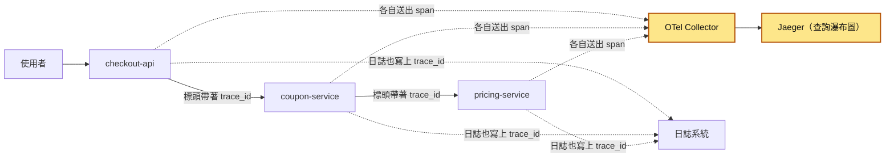

分散式追蹤發生在兩個地方：服務之間的實線上，每次呼叫下游都要把 trace_id 放在請求標頭裡帶過去；黃色的兩格負責把各服務送來的 span 收齊、拼成瀑布圖。OTel Collector 是 OpenTelemetry（簡稱 OTel）裡專門收 span 的程式，在〈OpenTelemetry 的分工〉那節會介紹。trace_id 在服務之間斷掉最常發生在 [訊息佇列](35-訊息佇列.md) 這類非 HTTP 的地方；瀑布圖最常幫你抓到的問題是 [N+1 查詢](09-N+1%20查詢.md) 和失控的 [重試機制](26-重試機制.md)。

## 生活比喻

想像你寄一個國際包裹。包裹上貼了一張**追蹤單號**，從你家附近的超商、集貨中心、海關、對方國家的物流中心，到最後的送貨員，每一站收到包裹時都會掃一下條碼，記下「幾點收到、幾點送出、交給誰」。

包裹卡住時，你不用打電話問每一站，只要上網輸入單號，就能看到「在海關停了 3 天」。

對應到系統：

- **追蹤單號** ＝ `trace_id`，整趟旅程不變。
- **每一站的掃描紀錄** ＝ span，記錄開始時間、結束時間、在哪個服務。
- **單號貼在包裹上跟著走** ＝ context propagation，編號放在 HTTP 標頭或訊息標頭裡傳給下一站。
- **物流網站的查詢頁面** ＝ Jaeger / Tempo 這類後端的 UI。

**比喻失準的地方**：

1. 包裹是一條直線，從 A 到 B 到 C。真實請求是**一棵樹**：一個 API 可能同時呼叫 3 個服務，每個服務又各自查資料庫、查快取。所以 trace 畫出來是有分支、有並行的瀑布圖。
2. 物流每個包裹都會掃描；系統流量大的時候，我們通常**只保留一部分 trace**（取樣），不然儲存成本會爆掉。這是物流比喻沒有的取捨。
3. 包裹的單號是印在紙上的，不會掉；系統裡的編號要**每個服務都主動往下傳**，只要一個人忘了，後面的站就拿不到單號。

## 它是怎麼運作的

### 先分清楚：日誌、指標、追蹤

可觀測性（observability）常被說成有三根支柱（three pillars）：

| | 回答什麼問題 | 例子 | 缺點 |
|---|---|---|---|
| 指標（metrics） | 「整體狀況好不好？」 | QPS（每秒請求數）、錯誤率、p99 延遲 | 只有數字，看不到單一請求 |
| 日誌（logs） | 「這個服務在這個時間點發生了什麼？」 | `payment failed: card declined` | 一筆一筆分散在各服務，難以跨服務串接 |
| 追蹤（traces） | 「這一個請求經過了哪裡、時間花在哪？」 | 瀑布圖 | 通常有取樣，不是每筆都有；內容不像日誌那麼詳細 |

實際查問題通常照這個順序：**指標告訴你出事了，追蹤告訴你出在哪個服務的哪一段，日誌告訴你那一段的細節**。這張圖看的是查問題時，從哪一種資料一路走到下一種：

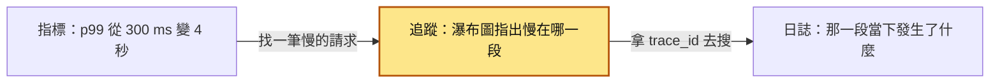

三者要搭配著用。

「有了日誌為什麼還要追蹤？」答案就是開頭的情境：日誌是每個服務各寫各的，它不知道自己是誰呼叫的、也不知道自己在整個請求中佔多少時間。你當然可以自己在日誌裡塞一個 request ID 往下傳，但那等於手工做一套簡陋的追蹤，而且少了時間軸和父子關係。

### trace、span、parent span

要看出時間花在哪一段，追蹤把每一段工作記成一個 span。一個 span 至少有這些欄位：

- `trace_id`：16 位元組（32 個十六進位字元），整個 trace 共用。
- `span_id`：8 位元組（16 個十六進位字元），每個 span 自己的編號。
- `parent_span_id`：父 span 的編號。最上層的 span 沒有父親，叫 **root span**。
- 名稱、開始時間、結束時間、狀態（成功或錯誤）。
- **attributes（屬性）**：key-value，例如 `http.request.method=GET`、`db.system=postgresql`。
- **events（事件）**：span 期間發生的時間點，例如記錄一個例外。
- **span kind**：`SERVER`（收到請求）、`CLIENT`（發出請求）、`PRODUCER`（送出訊息）、`CONSUMER`（處理訊息）、`INTERNAL`（內部運算）。

畫瀑布圖只用到前 4 項；attributes、events、span kind 是附加資訊，查問題時拿來篩選和看細節。

這張圖看的是開頭結帳請求的 span 怎麼靠 `parent_span_id` 串成一棵樹，每個箭頭都是「父 span 指向子 span」：

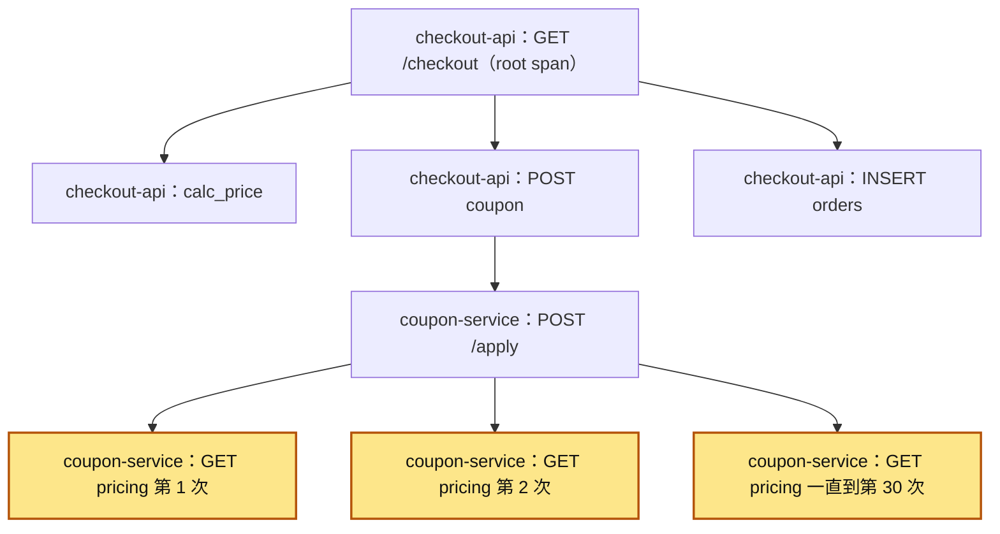

樹只看得出誰是誰的父親，看不出時間。把同一個 `trace_id` 的 span 依照父子關係和時間排好，就是瀑布圖。下面每一列是一個 span：左邊是哪個服務、做什麼，縮排越深代表是上一層的子 span；方括號的位置是從幾點開始，長度是花了多久：

```
trace_id = 4bf92f3577b34da6a3ce929d0e0e4736
時間軸 →  0ms       500ms      1000ms     1500ms
checkout-api   GET /checkout     [==================================]  (root, SERVER)
checkout-api     calc_price       [===]                                  (INTERNAL)
checkout-api     POST coupon            [=========================]      (CLIENT)
coupon-service     POST /apply           [========================]      (SERVER)
coupon-service       GET pricing          [==]                           (CLIENT)
coupon-service       GET pricing              [==]                       (CLIENT)
coupon-service       GET pricing                  [==] ...（一個接一個） (CLIENT)
checkout-api     INSERT orders                                  [=]     (CLIENT, PostgreSQL)
```

看到「一排長得一樣、依序排開的小 span」，幾乎就是 N+1；看到「一個 span 很長，裡面卻沒有子 span」，代表時間花在沒有埋點的地方（例如 CPU 運算、鎖等待、或某個沒被自動埋點的函式庫）。

### context propagation：trace 是怎麼跨服務串起來的

每個服務只能看到自己的記憶體。要讓下游知道「你是某個 trace 的一部分、你的父 span 是誰」，上游必須在呼叫時把資訊**放進請求裡帶過去**。HTTP 的標準做法是 W3C Trace Context 規範定義的 `traceparent` 標頭：

```
traceparent: 00-4bf92f3577b34da6a3ce929d0e0e4736-00f067aa0ba902b7-01
             ^^ ^^^^^^^^^^^^^^^^^^^^^^^^^^^^^^^^ ^^^^^^^^^^^^^^^^ ^^
             |  trace-id (32 hex)                parent-id (16)   trace-flags
             version
```

- `version`：2 個十六進位字元，目前是 `00`。
- `trace-id`：32 個小寫十六進位字元，不能全為 0。
- `parent-id`：16 個小寫十六進位字元，是**呼叫方那個 span 的 span_id**（也就是下游 span 的父親），不能全為 0。
- `trace-flags`：2 個十六進位字元，目前最常用的是最低位元 `sampled`，`01` 代表上游決定要記錄這個 trace，`00` 代表不記錄。判斷有沒有取樣只看這個最低位元。

trace-flags 實際上常看到 `03`，原因是 W3C Trace Context Level 2 另外定義了第二個位元 `random`（`02`），表示 trace-id 是隨機產生的；新版 OTel Python SDK 自己產生 trace-id 時會一起設上，所以是 `03`（sampled + random）。

另外還有 `tracestate` 標頭，讓各家廠商放自己的額外資訊，一般不用動它。OpenTelemetry 也支援 `baggage` 標頭，用來沿路傳一些商業資料（例如租戶 ID），但要小心它會被送到每個下游，不要放敏感資料。

你可能也會在舊系統看到 Zipkin 的 B3 格式（`X-B3-TraceId` 等標頭）。新系統一律用 W3C 格式，OTel 的預設傳遞器（propagator）就是 `tracecontext` 加 `baggage`。

使用者送出結帳請求時，依序發生這些事。先看只有 2 個服務的部分：`checkout-api` 收到沒有 `traceparent` 的請求，自己產生新的 trace_id；呼叫 `coupon-service` 時把 `traceparent` 放進標頭，`coupon-service` 讀出來，用同一個 trace_id 建立子 span。

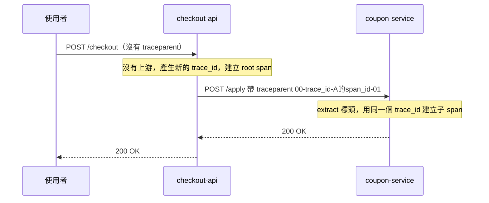

這張圖再多畫 2 件事：`coupon-service` 查 PostgreSQL 的 span 也掛在同一個 trace 底下；每個服務各自在背景把 span 批次送到 Collector（負責收集 span 的獨立程式，後面會介紹）。

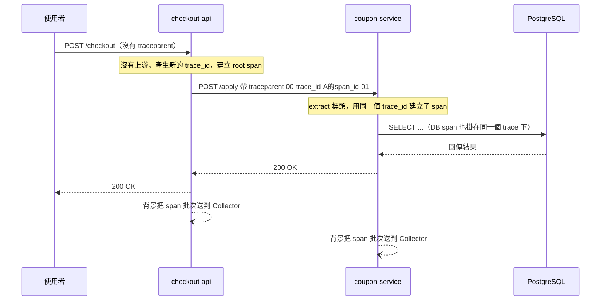

**每個服務都是各自把 span 送出去的**，它們之間不會互相傳 span，只傳那一小段 `traceparent`。後端收到同一個 `trace_id` 的 span 後，再依 `parent_span_id` 拼回一棵樹。所以只要中間有一個服務沒有把標頭傳下去，下游就會產生一個全新的 `trace_id`。這張圖看的是 `coupon-service` 忘了往下傳 `traceparent` 時，後端拼出來的結果：

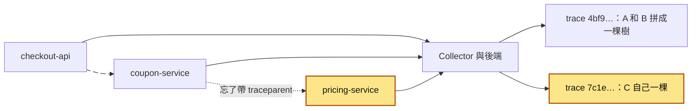

你在 UI 上看到的就是兩個斷開的 trace。

### OpenTelemetry 的分工：API、SDK、Collector、後端

span 從產生到能在 UI 上查到，要經過產生、取樣、傳送、儲存、查詢幾個步驟。OpenTelemetry 把這些步驟拆給不同元件，所以換後端不用改程式碼。先看服務裡面：自動埋點套件呼叫 OTel API，API 把資料交給 SDK。

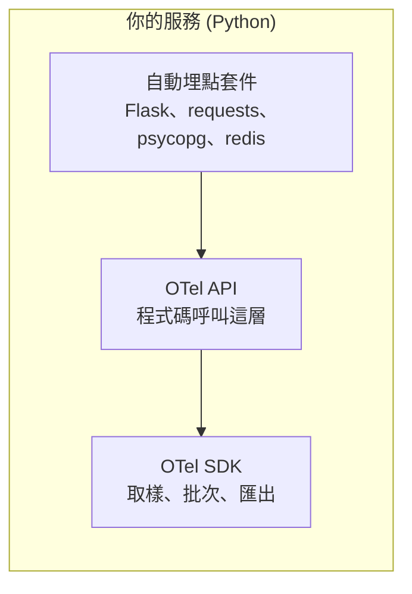

再加上服務外面：SDK 用 OTLP（OpenTelemetry 自己的傳輸協定）把 span 送到 Collector，Collector 再轉送到後端（儲存和查詢 trace 的系統，例如 Jaeger）。

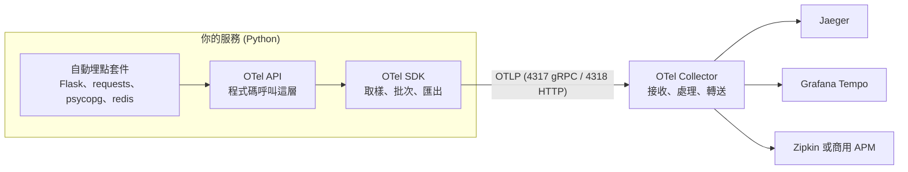

- **API**：你在程式碼裡呼叫的介面（`tracer.start_as_current_span(...)`）。只裝 API 不裝 SDK 時，所有呼叫都什麼事也不做（no-op），不會出錯、成本也幾乎是零，所以函式庫可以放心依賴 API。
- **SDK**：實際做事的部分：產生 ID、做取樣決策、把 span 暫存起來批次送出。通常在服務啟動時設定一次。
- **OTLP**：OpenTelemetry 自己的傳輸協定，慣例埠號 4317（gRPC）、4318（HTTP）。
- **Collector**：一個獨立部署的程式，負責接收各服務送來的資料，做過濾、加標籤、取樣，再轉送到後端。小規模可以讓服務直接送後端，但正式環境通常會放一層 Collector，好處是換後端、調取樣都不用重新部署應用程式。
- **後端**：儲存和查詢 trace 的系統。Jaeger（CNCF 專案，自架常見）、Grafana Tempo（把 trace 存在物件儲存裡、成本低，用 trace_id 或 TraceQL 查詢，常和 Grafana、Loki 搭配）、Zipkin（老牌、簡單）。商用的 Datadog、Honeycomb、New Relic 等也都能吃 OTLP。

### 自動埋點與手動埋點

- **自動埋點**：裝上對應框架的套件（例如 `opentelemetry-instrumentation-flask`、`-requests`、`-psycopg2`、`-redis`），它會自動幫每個進來的 HTTP 請求、每次對外呼叫、每條 SQL 建 span，並且自動做 `traceparent` 的讀取（extract）和寫入（inject）。Python 還有 `opentelemetry-instrument` 指令可以不改程式碼就套用。這一步該先做，花的工夫最少，接起來的 span 最多。
- **手動埋點**：自動埋點只看得到框架層。你想知道「計算折扣」「產生 PDF」這種商業邏輯花多久，或想在 span 上加 `order.id` 這種屬性，就要自己寫。做法是用 `with tracer.start_as_current_span("calc_discount") as span:` 包住那段邏輯，開出來的子 span 會自動掛在目前的 span 底下；需要屬性就在區塊裡呼叫 `span.set_attribute(...)`。從 `with` 區塊拋出的例外，預設會被記錄到 span 並把狀態設為 ERROR。同樣寫法的完整程式在『動手看看』的〈上游 `order.py`〉，那裡的 span 叫 `calc_price`。

這張圖看的是同一個請求裡，哪些 span 由自動埋點產生、哪些要手動補：

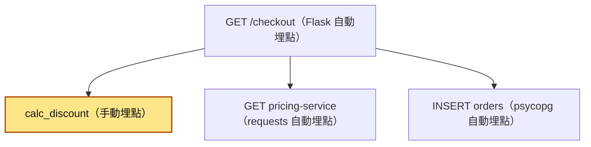

黃色那格是框架看不到的商業邏輯，只能自己埋。

### 取樣：head sampling 與 tail sampling

每個請求都留 trace，資料量和儲存成本都會很高，所以要**取樣（sampling）**。這張圖看的是兩種取樣在什麼時間點做決定：

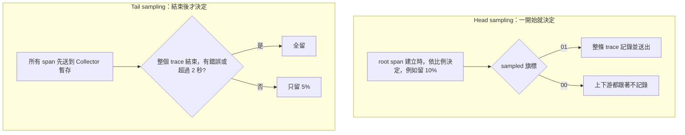

- **Head sampling（前端取樣）**：在 trace 一開始（root span 建立時）就決定要不要留，例如「留 10%」。決定結果寫在 `traceparent` 的 `sampled` 旗標裡往下傳，下游跟著照做。
  - 優點：簡單、便宜，不留的 trace 根本不會被送出。
  - 缺點：決定的時候還不知道這個請求會不會出錯或變慢，所以**那 1% 出錯的請求，很可能剛好沒被留下來**。
- **Tail sampling（尾端取樣）**：先把所有 span 送到 Collector，等整個 trace 結束後再決定要不要留，例如「有錯誤的全留、超過 2 秒的全留、其他留 5%」。
  - 優點：留下來的都是你真正想看的。
  - 缺點：Collector 要暫存所有 span 一段時間，耗記憶體；而且**同一個 trace 的所有 span 必須送到同一台 Collector**，叢集化時要在前面加一層依 `trace_id` 分流的負載平衡（OTel Collector 的 `loadbalancing` exporter 就是做這件事）。`tail_sampling` processor 在 OTel Collector 的 contrib 發行版裡，核心版沒有。

OTel SDK 的預設取樣器是 `parentbased_always_on`：有上游就跟著上游的決定，沒有上游就全收。正式環境常見的設定是 `parentbased_traceidratio`（root 依比例，下游跟隨）。「parent based」確保同一個 trace 裡所有服務的決定一致，不會出現「上游留了、下游沒留」的殘缺 trace。

### 把 trace_id 放進日誌

追蹤 UI 看到某個 span 很慢或出錯，下一步一定是去看那個服務當下的日誌。所以每一行日誌都要帶 `trace_id`（最好也帶 `span_id`），而且格式要和追蹤後端顯示的一致（32 個小寫十六進位字元）。很多組合（例如 Grafana 的 Tempo 加 Loki）可以直接從 span 點一下就跳到對應的日誌。這張圖看的是 trace_id 怎麼從目前的 span 進到每一行日誌，再讓兩邊互相找得到：

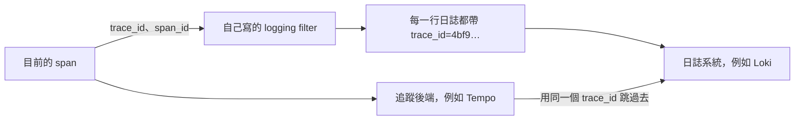

做法是寫一個 `logging.Filter`，每一筆日誌經過時：

1. 用 `trace.get_current_span().get_span_context()` 拿到目前 span 的 context。
2. 把 `format(ctx.trace_id, "032x")` 和 `format(ctx.span_id, "016x")` 塞進日誌紀錄的 `trace_id`、`span_id` 欄位；目前沒有有效的 span（`ctx.is_valid` 為假）時填 `-`。
3. 把 filter 掛到 handler 上，formatter 寫成 `%(asctime)s %(levelname)s trace_id=%(trace_id)s span_id=%(span_id)s %(message)s`，再把 handler 加到 root logger。

Python 也有現成的 `opentelemetry-instrumentation-logging` 套件做同樣的事（欄位名稱是 `otelTraceID`、`otelSpanID`），用哪個都可以，團隊內統一用同一種就好。注意新版的這個套件預設**不會**把這些欄位塞進日誌紀錄，要寫 `LoggingInstrumentor().instrument(inject_trace_context=True)`（或 `set_logging_format=True`、環境變數 `OTEL_PYTHON_LOG_CORRELATION=true`）才會加上，不然 formatter 裡用到 `%(otelTraceID)s` 會出錯。

### 跨訊息佇列傳遞 context

> 第一次讀可以先跳過這一節，等你要讓訊息佇列或背景工作的 trace 接起來時再回來看。

HTTP 有自動埋點幫你處理標頭，但[訊息佇列](35-訊息佇列.md)常常要你自己動手。原理一樣：**送出訊息時把 context `inject` 進訊息的標頭（或訊息本體的一個欄位），消費端收到後 `extract` 出來，再以它為父親建立 span。**

這張圖看的是 `traceparent` 怎麼搭著訊息穿過佇列：

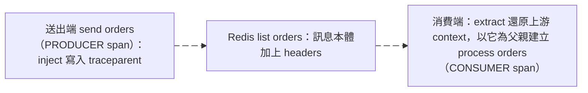

用 Redis list 當佇列時，關鍵只有這幾行：

```python
headers = {}
inject(headers)  # 送出端，在 send orders 的 PRODUCER span 裡：把 traceparent（以及 tracestate、baggage）寫進 dict
r.lpush("orders", json.dumps({"headers": headers, "body": {"order_id": order_id}}))
...
parent_ctx = extract(msg["headers"])  # 消費端：還原上游的 context
with tracer.start_as_current_span("process orders", context=parent_ctx, kind=SpanKind.CONSUMER) as span: ...
```

用上游 context 當父親，consumer 的 span 就會接在同一個 trace 底下。

Kafka、RabbitMQ 都有訊息標頭可以放；Celery 等框架也有對應的自動埋點套件。訊息在佇列裡躺了 10 分鐘才被處理也沒關係，trace 上會清楚看到那段等待時間，這對查[背壓](47-背壓.md)很有用。如果消費端一次批次處理很多筆訊息，每筆來自不同 trace，就不適合硬選一個當父親，改用 **span link** 把它們連起來（知道有這回事就好）。

## 動手看看

這一節用 2 個小服務重現一個完整的 trace：`order-api`（埠 5001）呼叫 `inventory-api`（埠 5002），後者再存取 Redis。所有 span 送到本機的 Jaeger。

**1. 起 Jaeger 和 Redis**（pwsh 或任何 shell 都可以）：

```shell
# Jaeger v2：16686 是 UI，4317 / 4318 是 OTLP（gRPC / HTTP）
docker run -d --name jaeger -p 16686:16686 -p 4317:4317 -p 4318:4318 cr.jaegertracing.io/jaegertracing/jaeger:2.22.0
docker run -d --name redis -p 6379:6379 redis:7
```

> 這是撰寫時 Jaeger 官方 Getting Started 使用的映像（Docker Hub 上也有同名的 `jaegertracing/jaeger`）。版本會隨時間更新；舊的 v1 映像是 `jaegertracing/all-in-one`，新專案不要再用。起不來的話請查 Jaeger 官方文件的 Getting Started。

**2. 共用的追蹤設定 `otel_setup.py`**：

```python
from opentelemetry import trace
from opentelemetry.sdk.resources import Resource
from opentelemetry.sdk.trace import TracerProvider
from opentelemetry.sdk.trace.export import BatchSpanProcessor
from opentelemetry.exporter.otlp.proto.http.trace_exporter import OTLPSpanExporter

def setup_tracing(service_name: str) -> None:
    # service.name 決定這個服務在 Jaeger 上叫什麼，一定要設
    provider = TracerProvider(resource=Resource.create({"service.name": service_name}))
    # BatchSpanProcessor：在背景執行緒批次送出，不會拖慢請求
    provider.add_span_processor(
        BatchSpanProcessor(OTLPSpanExporter(endpoint="http://localhost:4318/v1/traces"))
    )
    trace.set_tracer_provider(provider)
```

**3. 下游 `inventory.py`**：

```python
import time
import redis
from flask import Flask, request
from opentelemetry.instrumentation.flask import FlaskInstrumentor
from opentelemetry.instrumentation.redis import RedisInstrumentor
from otel_setup import setup_tracing

setup_tracing("inventory-api")
RedisInstrumentor().instrument()          # 每個 Redis 指令自動變成 span

app = Flask(__name__)
FlaskInstrumentor().instrument_app(app)   # 每個進來的請求自動變成 SERVER span，並讀取 traceparent
r = redis.Redis(host="localhost", port=6379)

@app.get("/reserve/<sku>")
def reserve(sku: str):
    print("收到的 traceparent:", request.headers.get("traceparent"))
    r.decr(f"stock:{sku}")
    time.sleep(0.2)  # 故意放慢，讓瀑布圖看得出來
    return {"ok": True}

if __name__ == "__main__":
    app.run(port=5002)
```

**4. 上游 `order.py`**：

```python
import logging
import requests
from flask import Flask
from opentelemetry import trace
from opentelemetry.instrumentation.flask import FlaskInstrumentor
from opentelemetry.instrumentation.requests import RequestsInstrumentor
from otel_setup import setup_tracing

setup_tracing("order-api")
RequestsInstrumentor().instrument()   # 對外呼叫自動變成 CLIENT span，並自動寫入 traceparent

app = Flask(__name__)
FlaskInstrumentor().instrument_app(app)
tracer = trace.get_tracer("order-api")
log = logging.getLogger("order")
logging.basicConfig(level=logging.INFO)

@app.get("/checkout")
def checkout():
    with tracer.start_as_current_span("calc_price") as span:   # 手動埋點
        span.set_attribute("cart.item_count", 3)
    for sku in ["A1", "B2", "C3"]:   # 故意依序呼叫三次，模擬 N+1
        # 用 127.0.0.1 而不是 localhost：Flask 只聽 IPv4，Windows 上 localhost 會先試 ::1，每次多卡約 2 秒
        requests.get(f"http://127.0.0.1:5002/reserve/{sku}", timeout=2)
    trace_id = format(trace.get_current_span().get_span_context().trace_id, "032x")
    log.info("checkout done trace_id=%s", trace_id)
    return {"trace_id": trace_id}

if __name__ == "__main__":
    app.run(port=5001)
```

**5. 跑起來**（開 2 個終端機，把檔案放在同一個資料夾）：

```shell
uv run --with flask,redis,requests,opentelemetry-sdk,opentelemetry-exporter-otlp-proto-http,opentelemetry-instrumentation-flask,opentelemetry-instrumentation-requests,opentelemetry-instrumentation-redis python inventory.py
uv run --with flask,redis,requests,opentelemetry-sdk,opentelemetry-exporter-otlp-proto-http,opentelemetry-instrumentation-flask,opentelemetry-instrumentation-requests,opentelemetry-instrumentation-redis python order.py
```

**6. 打一個請求**（pwsh 裡請用 `curl.exe`，避免叫到 PowerShell 的別名）：

```shell
curl http://localhost:5001/checkout
```

**預期會看到：**

- `inventory.py` 的終端機印出 3 次 `收到的 traceparent: 00-<同一個 32 字元>-<每次不同的 16 字元>-03`（新版 SDK 是 `03`：sampled 加上 random 旗標；舊版 SDK 是 `01`）。trace_id 都一樣，parent-id 每次不同，因為每次呼叫都是 `order-api` 那邊不同的 CLIENT span。
- 打開 http://localhost:16686 ，Service 選 `order-api`，按 Find Traces。點進去會看到一棵樹：最上層是 `GET /checkout`（root），它底下依序有 `calc_price` 和 3 個依序排開的對外 `GET`（這 4 個是兄弟關係）；每個對外 `GET` 底下接著 `inventory-api` 的 `GET /reserve/<sku>`，再底下是 Redis 的 `DECRBY`（redis-py 的 `decr()` 實際送出的指令是 `DECRBY`）。span 的確切名稱依套件版本略有不同。3 段 200ms 一個接一個，一眼就看出「依序呼叫」的問題。

**7. 自己指定 traceparent，驗證傳遞**：

```shell
curl -H "traceparent: 00-0af7651916cd43dd8448eb211c80319c-b7ad6b7169203331-01" http://localhost:5001/checkout
```

回傳的 `trace_id` 會是 `0af7651916cd43dd8448eb211c80319c`，代表 `order-api` 接受了上游的 context。在 Jaeger 上方的搜尋框貼上這個 trace_id 就能直接找到。把最後的 `01` 改成 `00`，並換一個新的 trace-id（例如把開頭的 `0` 改成 `1`，不然 Jaeger 上會看到剛才那次留下的同一個 trace）再打一次，回應一樣會帶回你指定的 trace_id，但 Jaeger 上**找不到**它，因為上游說「不取樣」，下游預設的 parent-based 取樣器就跟著不記錄。

玩完記得清掉容器：`docker rm -f jaeger redis`。

## 常見地雷

### 1. 自己用執行緒池丟工作，trace 就斷了

❌ **錯誤示範**

```python
from concurrent.futures import ThreadPoolExecutor
pool = ThreadPoolExecutor(max_workers=4)

def checkout():
    pool.submit(send_email, order_id)   # send_email 裡開的 span 會變成一個全新的 trace
```

**為什麼錯**：OTel Python 用 `contextvars`（Python 標準函式庫裡，讓每個執行緒或 async task 各自保存一份變數的機制）保存「目前的 span」。`ThreadPoolExecutor.submit` 不會把呼叫端的 contextvars 帶進工作執行緒，所以那邊看到的是空的 context。（`asyncio` 建立 task 時會複製 context，相對沒這個問題。）

✅ **正確寫法**

```python
import contextvars

def checkout():
    ctx = contextvars.copy_context()           # 複製目前的 context（含目前的 span）
    pool.submit(ctx.run, send_email, order_id)  # 在工作執行緒裡用這份 context 執行
```

或是裝 `opentelemetry-instrumentation-threading` 讓它自動處理。

### 2. 訊息佇列、排程、背景工作沒傳 context

❌ **錯誤做法**：HTTP 都有自動埋點了，就以為整條鏈都會串起來。結果 trace 在 `send orders` 之後就停了，[背景工作者](37-背景工作者.md)那邊是一堆沒有父親的孤兒 trace。

**為什麼錯**：自動埋點只處理它認得的協定。你自己用 Redis list、資料表當佇列，或用 [信箱模式](44-信箱模式.md) 先寫進資料庫再轉送，沒有人會幫你帶 `traceparent`。

✅ **正確做法**：送出時 `inject` 到訊息標頭或欄位，消費時 `extract` 當父親（見上面的範例）。用信箱模式時，`traceparent` 要跟著訊息一起存進 outbox 資料表。

### 3. 在 span 名稱放高基數的值

❌ **錯誤做法**：`tracer.start_as_current_span(f"GET /users/{user_id}/orders")`

**為什麼錯**：span 名稱是拿來分組、統計的。每個使用者一個名稱，後端會產生幾百萬種「操作」，查詢和彙總都失去意義，有些後端還會因此變慢或收費暴增。

✅ **正確做法**：名稱用路由樣板（`GET /users/{id}/orders`），具體的值放進 attribute：`span.set_attribute("user.id", user_id)`。

### 4. 把敏感資料塞進 span

❌ **錯誤做法**：把整個 request body、`Authorization` 標頭、信用卡號、完整 SQL 參數寫進 attributes 或 baggage。

**為什麼錯**：trace 資料常常存在權限比正式資料庫寬鬆的地方，而且會保留一段時間；baggage 更會被傳給每一個下游服務，包括第三方。

✅ **正確做法**：只記錄查問題需要的識別碼（訂單 ID、租戶 ID），PII 和憑證一律不記。可以在 Collector 加一層過濾或遮罩的處理器做第二道防線。

### 5. 只有 1% head sampling，就以為「出事時一定查得到」

❌ **錯誤做法**：流量大所以設 `traceidratio` 0.01，然後客訴「訂單 #123 結帳失敗」時才發現那一筆根本沒被取樣。

**為什麼錯**：head sampling 在請求開始時就決定，跟這筆請求會不會出錯無關。錯誤率 0.1% 的問題，搭配 1% 取樣，平均要 1000 次失敗你才看得到 10 筆。

✅ **正確做法**：日誌一定要帶 trace_id（日誌不受 trace 取樣影響，至少能從日誌查）；重要流程考慮在 Collector 做 tail sampling，「有錯誤或很慢的全留」；低流量服務直接全收。

### 6. 程式結束或 fork 時沒處理好 SDK，span 默默消失

> 第一次讀可以先跳過這一節，等你要在批次腳本或 Gunicorn 上接追蹤時再回來看。

這一節會用到兩個詞。fork 是作業系統把一個行程複製成兩個；Gunicorn 這類 pre-fork 伺服器會先啟動一個 master 行程，再用 fork 複製出好幾個 worker 行程來處理請求。

❌ **錯誤做法**：批次腳本或 worker 用 `os._exit()` 離開、或被訊號直接砍掉，卻沒有先 flush；或在 Gunicorn 的 master 行程（pre-fork 之前）就初始化 `BatchSpanProcessor`。

**為什麼錯**：`BatchSpanProcessor` 會把 span 先放在記憶體、由背景執行緒定期送出。Python 正常結束時，SDK 預設會透過 `atexit`（Python 在程式正常結束時執行清理函式的機制）自動 shutdown 並送出最後一批；但行程被 `os._exit()`、`SIGKILL`，或沒有處理的 `SIGTERM` 結束時，`atexit` 不會執行，最後一批就沒送出去。fork 的問題則是：fork 只會複製呼叫 fork 的那條執行緒，背景執行緒和它持有的鎖狀態會以「半套」的樣子留在子行程裡。新版 SDK 雖然會在子行程重建匯出用的執行緒，但 OTel Python 官方文件仍明確說 `BatchSpanProcessor` 不是 fork-safe（子行程可能繼承父行程持有的鎖而死鎖），gRPC exporter 這類元件也不適合跨 fork 共用，所以最穩的做法還是讓每個 worker 自己初始化。

✅ **正確做法**：短命程式結束前呼叫 `trace.get_tracer_provider().shutdown()`（它會 flush），長駐服務在[優雅關閉](48-優雅關閉.md)流程裡做同樣的事。Gunicorn 這類 pre-fork 伺服器，在 `post_fork` hook 裡才初始化追蹤：

```python
# gunicorn.conf.py
def post_fork(server, worker):
    from otel_setup import setup_tracing
    setup_tracing("order-api")   # 每個 worker 行程各自初始化，各有自己的背景執行緒和連線
```

### 7. OTel 套件版本東拼西湊

❌ **錯誤做法**：`opentelemetry-sdk` 升到新版，`opentelemetry-instrumentation-*` 還停在半年前的版本。

**為什麼錯**：Python 的 instrumentation 套件（版本號像 `0.xxb0`）是和 API/SDK（`1.xx`）成對發佈的，版本不對常常會出現 import 錯誤；更糟的情況是不報錯，span 卻沒產生。

✅ **正確做法**：把整組 OTel 套件一起釘版本、一起升級；可以用 `opentelemetry-bootstrap` 列出目前環境該裝哪些對應的 instrumentation。

## 重點整理

- 一個 **trace** 是一個請求從進入系統到回應的完整紀錄，由很多個 **span**（一段有開始、有結束的工作，例如一次 HTTP 呼叫、一條 SQL）組成。span 用 `parent_span_id` 串成一棵樹，畫成瀑布圖就看得出「誰呼叫了誰、每段花多久」，像開頭情境那排依序排開的 30 次呼叫。
- trace 能不能跨服務串起來，全靠 **context propagation（上下文傳遞）**：呼叫下游時把 W3C 的 `traceparent` 標頭帶過去。中間只要一個服務沒傳，下游就會開一個新的 trace_id，trace 從那裡斷成兩截；訊息佇列、執行緒池這些自動埋點管不到的地方，要自己 `inject` / `extract` 或複製 context。
- 用 **OpenTelemetry（OTel）** 產生和送出 span，Jaeger、Grafana Tempo、Zipkin 這類後端負責儲存和查詢，中間通常放一層 Collector。換後端不用改程式碼。
- 先用**自動埋點**把 HTTP、資料庫、Redis 的 span 一次接起來，再對重要的商業邏輯補**手動埋點**；span 名稱用固定樣板，具體的值和 ID 放 attribute，敏感資料都不記。
- 一定要把 **`trace_id` 寫進每一行日誌**。追蹤告訴你慢在哪個服務的哪一段，日誌告訴你那一段發生了什麼；而且 head sampling 可能沒留下出錯的那筆 trace，日誌不受取樣影響，至少還查得到。

## 新人必知清單

### 一定要會（基本功）

- [ ] 說得出 trace、span、parent span、root span 的關係，看得懂瀑布圖。
- [ ] 知道 `traceparent` 的 4 段格式（version、trace-id、parent-id、trace-flags），並看得出「trace 斷掉」通常是哪個服務沒傳。
- [ ] 會用 OTel 自動埋點把 HTTP 伺服器、HTTP client、資料庫、Redis 接起來，並正確設定 `service.name`。
- [ ] 會用 `tracer.start_as_current_span` 幫重要的商業邏輯加手動 span 和 attribute。
- [ ] 日誌裡一定有 `trace_id`，而且知道怎麼從日誌跳到 trace、從 trace 找回日誌。
- [ ] 在訊息佇列、背景工作、執行緒池這些「自動埋點管不到」的地方，會自己 `inject` / `extract` 或複製 context。
- [ ] 知道 span 名稱不能有高基數的值、attributes 不能放敏感資料。

### 知道有這回事就好

- head sampling 和 tail sampling 的差別，以及 parent-based 取樣器為什麼重要。
- OTel Collector 的角色（receiver、processor、exporter），以及為什麼正式環境通常會放一層。
- 各種後端的定位：Jaeger、Grafana Tempo、Zipkin、商用 APM。
- `tracestate`、`baggage` 標頭的用途。
- span link（批次消費、一對多觸發時用）。
- 從 trace 自動算出指標（例如 Collector 的 spanmetrics、Tempo 的 metrics generator），以及 exemplar：從指標圖上的一個點直接跳到對應的 trace。

### 先不用管（等你遇到再學）

- 自己寫 propagator 或 sampler。
- Collector 叢集的規模規劃，以及 tail sampling 前面那層依 trace_id 分流的設定細節。
- eBPF 類的零程式碼追蹤工具。
- 舊系統的 B3、Jaeger 原生標頭和 W3C 格式的互通轉換。
- 追蹤資料的長期儲存成本最佳化。

## Code Review 時可以問的問題

1. 這個新服務有設 `service.name` 嗎？名稱和其他服務的命名規則一致嗎？
2. 這裡新增了對外呼叫（HTTP、gRPC、佇列、第三方 SDK），它有被自動埋點涵蓋嗎？`traceparent` 會被帶過去嗎？
3. 這段程式碼把工作丟到執行緒池、佇列、排程或 outbox，context 有跟著傳過去嗎？
4. 新加的 span 名稱是固定的樣板嗎？會不會把 ID、email 這種值放進名稱？
5. span attributes 或日誌裡有沒有 token、密碼、個資這類不該出現的東西？
6. 這個行程結束時（或 Gunicorn fork 之後）SDK 有正確初始化和 `shutdown` 嗎？

## 情境演練

**1. 你在 Jaeger 上查一筆結帳請求，發現 `order-api` 的 span 和 `inventory-api` 的 span 分屬 2 個不同的 trace_id，各自是一棵樹。這代表什麼？你會先查哪裡？**

<details markdown="1"><summary>看答案</summary>

一個 trace 只有**一個** trace_id，整個請求經過的所有服務、所有 span 都共用它；span_id 則是每個 span 各自一個。trace_id 用來「找出同一個請求的所有紀錄」，span_id 加上 parent_span_id 用來「拼出誰是誰的父親」。同一個請求出現 2 個 trace_id，就代表兩個服務之間有一段 context 沒傳過去，trace 斷掉了。先查 `order-api` 呼叫 `inventory-api` 的那段：HTTP client 有沒有被自動埋點涵蓋、`traceparent` 有沒有真的帶到下游（可以像「動手看看」那樣在下游印出收到的標頭）。

</details>

**2. 下游服務的日誌印出收到的標頭是 `traceparent: 00-4bf92f3577b34da6a3ce929d0e0e4736-00f067aa0ba902b7-00`，但 Jaeger 上找不到這個 trace_id。同事懷疑 exporter 壞了，你會怎麼判斷？**

<details markdown="1"><summary>看答案</summary>

先看標頭最後一段。第一段 `00` 是版本，第二段是 trace-id，第三段 `00f067aa0ba902b7` 是 parent-id，也就是呼叫方那個 span 的 span_id，下游建立的 span 會把它當父親。最後的 `00` 是 trace-flags，`sampled` 位元為 0，表示上游決定**不取樣**這個 trace。下游如果用 parent-based 取樣器，就會跟著不記錄，這樣整條 trace 的決定才會一致。所以找不到這筆 trace 是取樣決定的結果，先別急著懷疑 exporter；要確認 exporter，就拿一筆 `sampled` 為 1 的請求來看它有沒有出現在 Jaeger。

</details>

**3. 主管問你：「我們已經有集中式日誌，每筆日誌也有時間戳記和服務名稱，還需要導入分散式追蹤嗎？」你會怎麼回答？**

<details markdown="1"><summary>看答案</summary>

日誌是每個服務各寫各的，它不知道「我是被誰呼叫的、我在這整個請求裡佔多少時間」。在高並行下，同一秒內可能有幾千筆請求，靠時間戳記把不同服務的日誌對起來幾乎不可能。追蹤提供的是**跨服務的因果關係和時間軸**：誰呼叫誰、哪些是並行哪些是依序、每段花多久。最好的做法是兩者並用，用 trace_id 把它們連在一起：追蹤找出是哪一段，日誌看那一段的細節。

</details>

**4. 你們的訂單流程是 `order-api` 收到請求後，把訊息丟進 RabbitMQ，`fulfillment-worker` 消費後呼叫物流商 API。Jaeger 上看 `order-api` 的 trace 在「送出訊息」之後就結束了，`fulfillment-worker` 的 span 全部是獨立的 trace，而且有些 trace 只看得到物流商呼叫、沒有上層。可能的原因有哪些？要怎麼修？**

<details markdown="1"><summary>看答案</summary>

最可能的原因是**送訊息時沒有把 context `inject` 進訊息標頭**，或 worker 收到訊息後**沒有 `extract`** 並用它當父親建立 span，所以 worker 每處理一筆就開一個新的 trace。「只看得到物流商呼叫、沒有上層」代表 worker 連自己的 CONSUMER span 都沒建，物流商那個 CLIENT span 就直接成了 root。

修法：

1. producer 端在 PRODUCER span 裡呼叫 `inject(headers)`，把結果放進 RabbitMQ 訊息的 headers（或改用 pika 對應的自動埋點套件）。
2. consumer 端從訊息 headers `extract` 出 context，用 `start_as_current_span(..., context=ctx, kind=SpanKind.CONSUMER)` 包住整個處理流程，物流商呼叫自然會變成它的子 span。
3. 如果 worker 內部還有用執行緒池，也要確認 context 有複製過去。

修好之後，trace 上還能看到訊息在佇列裡等了多久，順便可以觀察有沒有積壓。

</details>

**5. 你們把 head sampling 設成 5%，但 SRE 抱怨「出錯的請求幾乎都找不到 trace」。為什麼會這樣？有哪些改法，各自的代價是什麼？**

<details markdown="1"><summary>看答案</summary>

Head sampling 是在請求一開始、還不知道會不會出錯時就決定要不要留，所以出錯的請求被留下來的機率也只有 5%。錯誤本來就少，再乘上 5%，幾乎就找不到了。

改法：

- **改成 tail sampling**：讓所有 span 先送到 Collector，等 trace 結束後再依規則決定，例如「有錯誤或超過 2 秒的全留，其他留 5%」。代價是 Collector 要暫存所有 span、耗記憶體，而且同一個 trace 的 span 必須送到同一台 Collector，部署變複雜；應用程式送出的資料量也會回到 100%。
- **提高取樣率**：最簡單，但儲存和傳輸成本跟著線性增加。
- **確保日誌有 trace_id**：日誌不受 trace 取樣影響，至少能從錯誤日誌找到發生了什麼，這是不管用哪種取樣都該做的基本功。

</details>

## 相關主題

- [訊息佇列](35-訊息佇列.md)：跨佇列傳遞 trace context 是最常斷掉的地方，先懂佇列的運作才知道 context 要放在哪。
- [信箱模式](44-信箱模式.md)：訊息先寫進 outbox 再轉送時，`traceparent` 要跟著存進去，trace 才不會斷在資料庫這一段。
- [N+1 查詢](09-N+1%20查詢.md)：瀑布圖上「一排依序排開的小 span」就是 N+1 的典型長相，不管是 SQL 還是 HTTP。
- [重試機制](26-重試機制.md)：每次重試都會在 trace 上留下一個 CLIENT span，追蹤是確認重試有沒有失控的最好工具。
- [健康檢查](49-健康檢查.md)：同樣是可觀測性的一部分；健康檢查請求通常會被排除在追蹤之外，以免灌爆資料。
- [優雅關閉](48-優雅關閉.md)：關閉流程要記得 flush 還沒送出的 span，不然最後一批 trace 會消失。

## 延伸閱讀

- W3C Trace Context 規範：https://www.w3.org/TR/trace-context/
- OpenTelemetry 官方文件（概念、各語言 SDK、Collector）：https://opentelemetry.io/docs/
- OpenTelemetry Python 文件：https://opentelemetry.io/docs/languages/python/
- Jaeger 官方文件：https://www.jaegertracing.io/docs/
