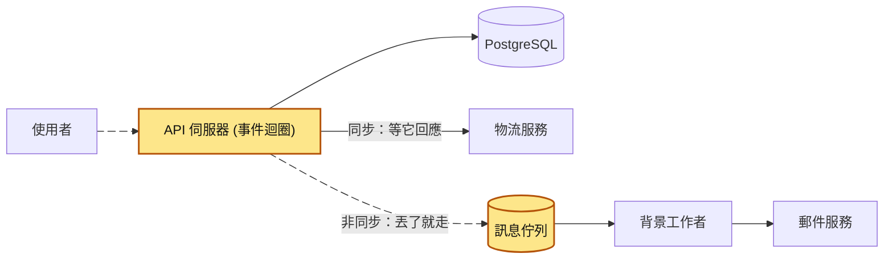
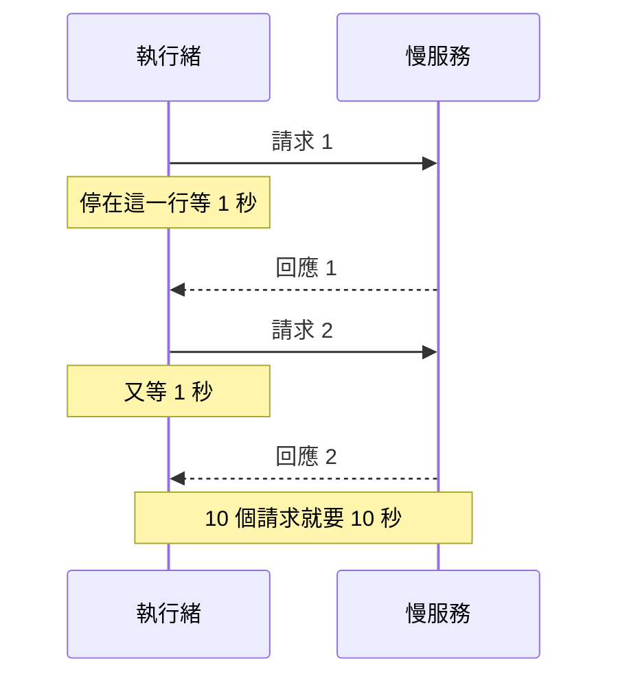
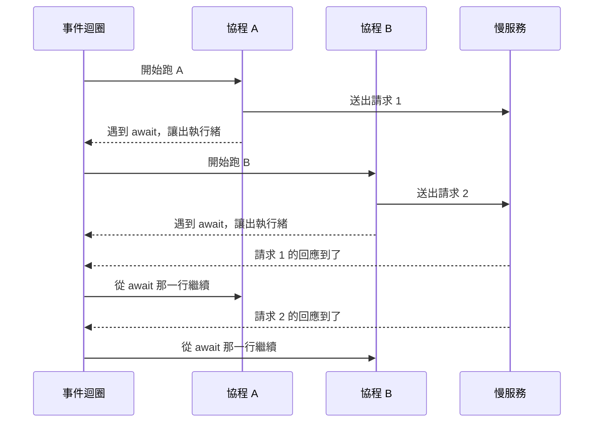
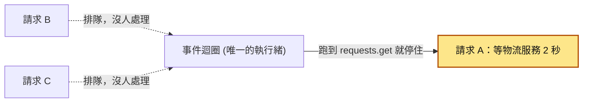
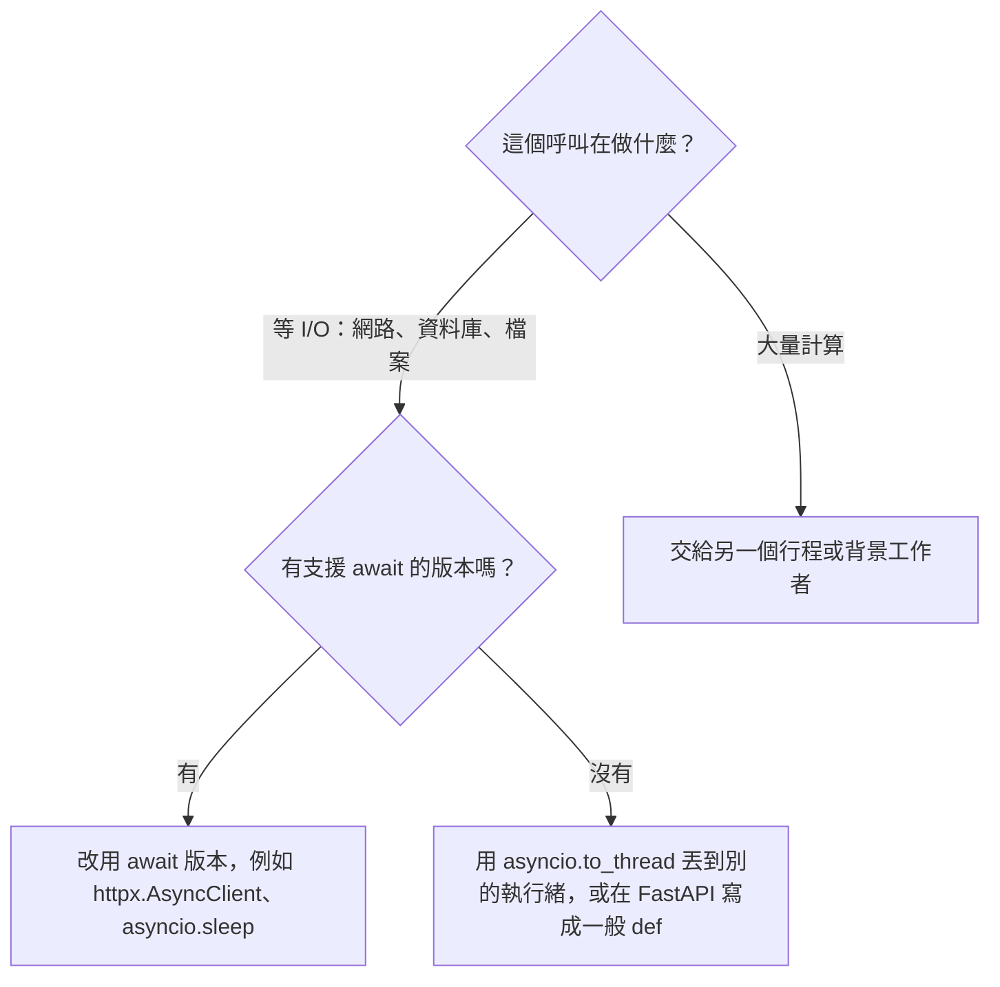
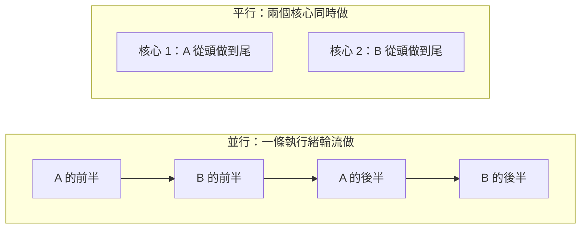
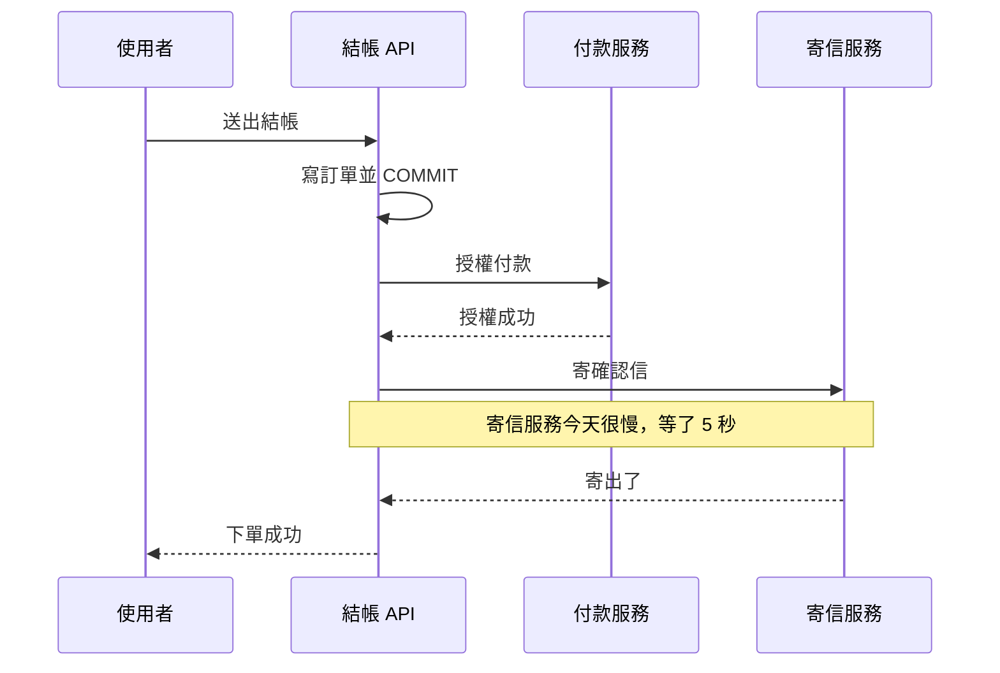
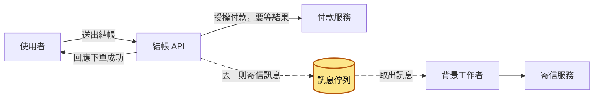
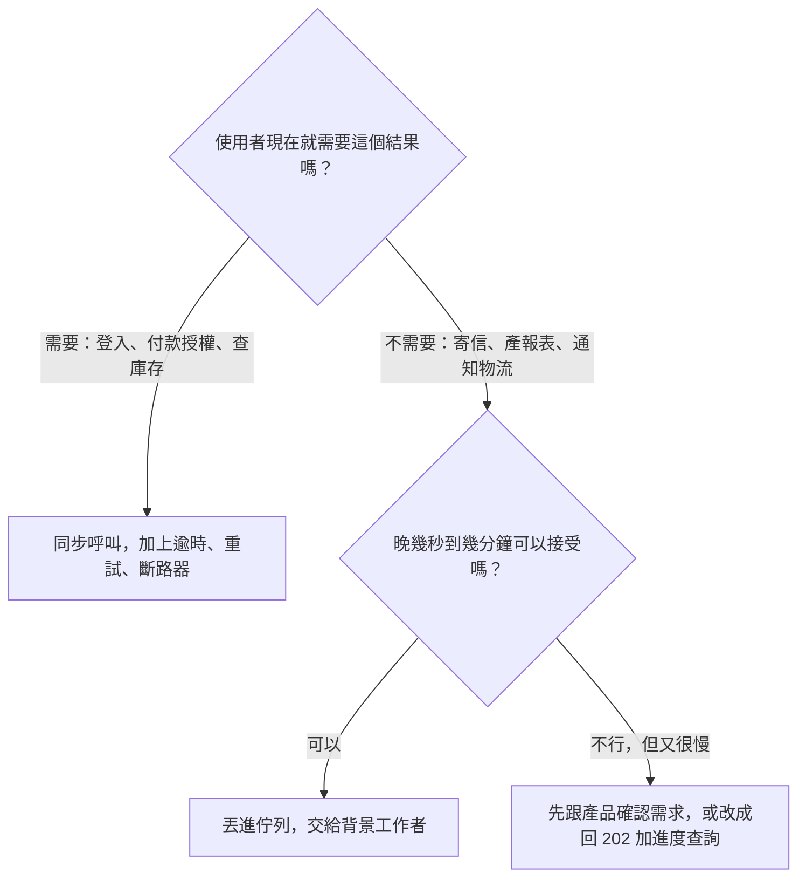
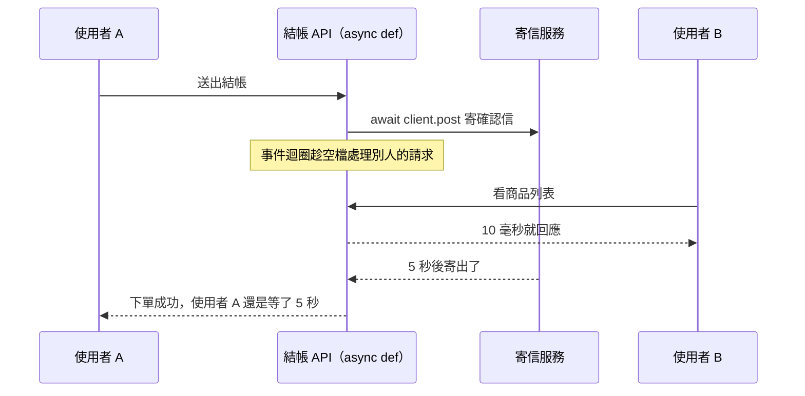

# 51｜同步與非同步（Synchronous vs Asynchronous）

> 同步（synchronous）是交代一件事之後停在原地，等它做完才往下走；非同步（asynchronous，也常聽到「異步」）是交代完先去做別的事，等結果好了再回來接手。後端會在兩個地方碰到這組詞：一支程式裡呼叫函式的方式，以及兩個服務之間溝通的方式。

**難度**：★★☆　**閱讀時間**：約 20 分鐘　**前置知識**：[競爭條件](01-競爭條件.md)、[訊息佇列](35-訊息佇列.md)

## 核心問題與理念

**它要解決的問題**：一個 Python 服務只用一條執行緒（程式裡一條往下執行的路線）輪流處理所有請求。運費 API 等外部物流服務回應的那 2 秒，一直佔著這條執行緒不放，連只要 10 毫秒的商品列表也跟著排了將近 4 秒（下面的情境會完整走一遍）。

**核心理念**：在等別人回應的時候，先把手讓出來，讓還能做的事繼續做。

**想通的那一步**：

- **卡住的地方**：直覺的做法是多開執行緒，一個請求配一條，誰要等多久都不會擋到別人。它卡在後端請求大部分時間都在等資料庫、等別的服務，CPU 幾乎閒著，卻要為每一個正在等的請求佔一條執行緒，同時在等的請求一多，執行緒就不夠用。
- **火花**：讓程式在「開始等」的那一行（Python 寫成 `await`）主動把執行緒交出去，由一個迴圈記住誰在等什麼，回應到了再叫它回來接著做。這樣等待的時間可以疊在一起：10 次各要等 1 秒的呼叫，一條執行緒大約 1 秒就全部做完。

## 閱讀前推薦具備知識

| 知識 | 要會到什麼程度 | 這篇哪裡會用到 | 不熟的話先看 |
|---|---|---|---|
| Python 的函式、`for` 迴圈、`with` | **必備**：看得懂 `for _ in range(10):` 會把底下那幾行依序跑 10 次，`with requests.Session() as s:` 底下縮排的那幾行都用同一個 `s` | 「動手看看」的 `compare.py`、`blocking.py`、`load.py` | [Python 官方教學（中文）](https://docs.python.org/zh-tw/3/tutorial/index.html) |
| 呼叫別的服務用的 HTTP 請求 | **必備**：知道 `requests.get(url, timeout=5)` 是送出一個 HTTP GET，等對方回應，或等滿 5 秒逾時，才拿到結果 | 情境的 `requests.get(LOGISTICS_URL, timeout=5)`，〈第一層：阻塞呼叫〉 | [MDN：HTTP 概觀](https://developer.mozilla.org/en-US/docs/Web/HTTP/Guides/Overview) |
| 執行緒（thread） | **加分**：知道一個行程裡可以有好幾條執行緒，各自從自己的位置往下跑 | 情境說事件迴圈只有一條執行緒，〈並行與平行〉的多執行緒與 GIL | [Python threading（中文）](https://docs.python.org/zh-tw/3/library/threading.html) |
| FastAPI 的路由函式 | **加分**：看得懂 `@app.get("/products")` 底下的函式負責處理打到這個網址的請求，回傳的 dict 會變成 JSON 回應 | 情境的 `/shipping-fee`，「動手看看」第 4 步的 `app.py` | [FastAPI 教學（繁中）](https://fastapi.tiangolo.com/zh-hant/tutorial/) |
| [競爭條件](01-競爭條件.md) | **加分**：能說出「先讀出點數、再寫回點數減 100」中間被別人插隊時，為什麼會少扣一次 | 〈並行與平行〉最後一段，情境演練第 4 題 | 本系列第 01 篇 |
| [訊息佇列](35-訊息佇列.md) | **加分**：知道把工作丟進佇列之後就能先回應，由另一個程式之後拿出來做，而且同一則訊息可能被送兩次 | 〈第二層：服務之間的同步與非同步〉、〈怎麼選：取捨〉的表、常見地雷 7 | 本系列第 35 篇 |

**快速自我檢查**：「動手看看」的慢服務每個請求都要 1 秒才回應。下面這段程式大約要跑幾秒？會印出什麼？

```python
import requests

for _ in range(3):
    resp = requests.get("http://127.0.0.1:21151/", timeout=5)
    print(resp.status_code)
```

<details markdown="1"><summary>看答案</summary>

大約 3 秒，印出 3 行 `200`。每次 `requests.get` 都要等慢服務回應，才會執行下一行的 `print`，迴圈再進下一輪，所以 3 次 1 秒排成一列。這篇開頭的事故，就是這種「等回應時停在這一行」的呼叫放進 `async def` 之後造成的。答不出「3 秒」的話，先看 Python 官方教學的 `for` 迴圈和 MDN 的 HTTP 概觀，再回來讀〈第一層：阻塞呼叫〉。

</details>

## 為什麼要在意：一個具體的情境

這是一個假設情境。假設你負責電商商品頁的後端，用 FastAPI（一套 Python 的 Web 框架，處理請求的函式可以寫成 `async def`）寫成，部署成 1 個 uvicorn 行程（uvicorn 是負責接收 HTTP 請求、交給 FastAPI 處理的伺服器程式）。這個服務有兩支 API：

- `GET /products`：商品列表，直接從記憶體回資料，10 毫秒就回來。
- `GET /shipping-fee`：運費試算，要呼叫外部的物流服務問價錢。物流服務平常 50 毫秒就回應。

寫運費試算的同事把函式寫成 `async def`，裡面用大家最熟的 `requests` 套件呼叫物流服務：

```python
@app.get("/shipping-fee")
async def shipping_fee():
    # ❌ 出事的寫法：async def 裡呼叫同步的 requests.get
    resp = requests.get(LOGISTICS_URL, timeout=5)
    return {"fee": resp.json()["fee"]}
```

要看懂接下來發生什麼，先知道一件事：FastAPI 會把所有 `async def` 的請求處理函式，交給同一條執行緒（thread，程式裡一條往下執行的路線）輪流執行。這條執行緒上跑著一個迴圈，負責決定「現在輪到哪個請求」，這個迴圈叫**事件迴圈**（event loop）。程式寫到 `await` 時，會把執行緒讓出來，事件迴圈就能先去處理別的請求。`requests.get` 沒有 `await`，它等物流服務回應的那段時間，一直佔著這條執行緒不放。

物流服務平常 50 毫秒就回應，這個寫法上線好幾個月都沒人發現。某天物流服務變慢，每次要 2 秒才回應。下面的圖和表是同一段經過：請求 A、B 要運費，請求 C 要商品列表，三個請求幾乎同時進來。

<figure class="draw-fig">
<iframe class="draw-fig__frame" src="../figures/51-event-loop-blocked.html" title="按播放或點 T1–T5，看 A 的 requests.get 怎麼佔住唯一一條執行緒，讓只要 10 毫秒的 C 排了 3.9 秒；切到「await httpx」對照等待時讓出執行緒的樣子。" loading="lazy" style="height: 640px;"></iframe>
<figcaption>按播放或點 T1–T5，看 A 的 requests.get 怎麼佔住唯一一條執行緒，讓只要 10 毫秒的 C 排了 3.9 秒；切到「await httpx」對照等待時讓出執行緒的樣子。</figcaption>
</figure>

| 時間 | 請求 A（運費） | 請求 B（運費） | 請求 C（商品列表） | 事件迴圈這條執行緒 |
|---|---|---|---|---|
| T1（0 秒） | 進來，呼叫 `requests.get`，開始等物流服務 | | | 卡在 A 的 `requests.get` |
| T2（0.1 秒） | 還在等 | 進來，排隊 | 進來，排隊 | 還卡在 A，沒空理 B 和 C |
| T3（2 秒） | 拿到運費，回應（等了 2 秒） | 輪到它，呼叫 `requests.get` | 繼續排隊 | 換卡在 B 的 `requests.get` |
| T4（4 秒） | | 拿到運費，回應（等了 3.9 秒） | 輪到它 | 處理 C，只花 10 毫秒 |
| T5（4.01 秒） | | | 回應（等了 3.9 秒） | 空下來了 |

請求 C 只需要 10 毫秒，卻排了將近 4 秒，因為事件迴圈只有一條執行緒，前面兩個請求各佔住它 2 秒。尖峰時每秒進來 20 個運費請求，這個行程每 2 秒才處理完 1 個，排隊的請求越堆越多。

- **使用者看到的**：商品頁一直轉圈。連完全不用算運費的商品列表也要等好幾秒，最後前端顯示逾時。
- **工程師看到的**：`/products` 的回應時間跟著 `/shipping-fee` 一起飆高，主機的 CPU 使用率卻幾乎是 0，因為執行緒一直在等網路回應，沒有在計算。打開 asyncio 的除錯模式，日誌會一直出現 `Executing <Task ...> took ... seconds` 這樣的行（「動手看看」第 3 步會實際看到）。如果平台用 HTTP 健康檢查判斷服務活著沒有，檢查請求也一樣在排隊，可能逾時被判定為掛掉而重啟（見 [健康檢查](49-健康檢查.md)）。

**根因**：`requests.get(LOGISTICS_URL, timeout=5)` 那一行。這是一個會停住執行緒的同步呼叫，放在 `async def` 裡，等物流服務的 2 秒就把唯一的事件迴圈整個卡住，所有請求一起等。

**怎麼修**：改用支援 `await` 的 `httpx.AsyncClient`，或把函式改寫成一般的 `def`，讓 FastAPI 把它丟到另外的執行緒去跑。原理在「它是怎麼運作的」的〈在 async 函式裡呼叫阻塞函式〉，寫法在「常見地雷」第 1 點，「動手看看」第 4 步可以親手重現這個情境。

## 全貌：它在系統裡的位置

這張圖看的是一個請求從使用者進到 API 伺服器之後，會往哪些地方去；黃色是「同步或非同步」要做選擇的兩個地方。



第一個地方在 API 伺服器裡面：程式等資料庫、等物流服務的時候，執行緒能不能先去處理別的請求，開頭的情境就出在這裡。第二個地方在 API 和其他服務之間：API 要等對方做完才回應使用者，還是把工作丟進 [訊息佇列](35-訊息佇列.md) 交給 [背景工作者](37-背景工作者.md)，先回應再說。往後的 [事件驅動架構](39-事件驅動架構.md) 是把第二種做法擴大成整個系統的溝通方式。

## 生活比喻

想像一家餐廳的外場服務生。

- **同步**：服務生幫 A 桌點完餐，把單子送進廚房，然後站在廚房門口等菜做好，端給 A 桌之後才去招呼 B 桌。B 桌的客人坐了 10 分鐘沒人理。
- **非同步**：服務生把 A 桌的單子送進廚房，馬上去 B 桌點餐、幫 C 桌倒水。廚房出菜時按鈴，服務生再回來把菜端給 A 桌。一個服務生就能照顧好幾桌。

這個服務生就是事件迴圈，「站在廚房門口等」就是開頭情境裡的 `requests.get`。

再加一個人進來，就能說明另一組常搞混的詞：一個服務生輪流照顧 5 桌，叫**並行**（concurrency）；請 5 個服務生，每人顧一桌、真的同時在做事，叫**平行**（parallelism）。

**比喻失準的地方**：

- 真的服務生會自己判斷「菜還要很久，我先去別桌」。程式只會在寫了 `await` 的地方讓出執行緒，沒寫就一直等下去。
- 服務生如果要親自切 20 分鐘的菜（大量計算），一樣沒空理別桌。非同步只能幫你省下「等」的時間，省不了「做」的時間。

## 它是怎麼運作的

「同步」和「非同步」在後端會出現在兩個層次，問的是兩個不同的問題。先看這張表，後面各小節再一層一層講：

| 層次 | 問的問題 | 同步的例子 | 非同步的例子 |
|---|---|---|---|
| 程式呼叫 | 等 I/O 的時候，這條執行緒能不能先去做別的事 | `requests.get` 等回應時，執行緒停在這一行 | `await client.get` 等回應時，事件迴圈去跑別的請求 |
| 服務之間 | 呼叫方要不要等對方做完，才回應使用者 | 結帳 API 用 HTTP 呼叫寄信服務，等它回 200 | 結帳 API 把「寄信」丟進佇列就回應，背景工作者之後再寄 |

表裡的 I/O（input/output）是指程式向外面要東西，再等它回來：查資料庫、呼叫別的服務、讀檔案都是。一個典型的後端請求，自己計算只花幾毫秒，大部分時間都在等 I/O。

### 第一層：阻塞呼叫，等的時候執行緒停住

你呼叫 `requests.get(url)` 時，程式把請求送出去，然後停在這一行，直到回應回來才往下一行走。這種「呼叫之後執行緒停住等結果」的呼叫，叫**阻塞呼叫**（blocking call）。一般 Python 程式裡的 `time.sleep`、`requests`、同步的資料庫連線、讀寫檔案，都是阻塞呼叫。

這張圖看的是一條執行緒用阻塞呼叫，依序打一個每次要 1 秒的慢服務：



執行緒等的這 10 秒，CPU 沒在做事。單純寫腳本時這沒什麼問題；放到要同時服務很多使用者的伺服器上，每個等待都在浪費一條執行緒。

### 事件迴圈：等的時候先去做別的

Python 的 `asyncio` 是標準函式庫裡的非同步工具，用 `async def` 定義的函式叫**協程**（coroutine）。呼叫協程不會馬上執行它，只會拿到一個協程物件；要用 `await` 等它，或交給事件迴圈排程，它才會跑。

協程跑到 `await`（例如 `await client.get(url)`）時，會把請求送出去，然後把執行緒讓回給事件迴圈。事件迴圈就去跑其他協程；等回應到了，再回到剛才 `await` 的那一行繼續往下。這張圖看的是兩個協程共用一條執行緒，各打一次慢服務：



用時間軸看，兩次 1 秒的等待疊在一起：

| 時間 | 協程 A | 協程 B | 事件迴圈在做什麼 |
|---|---|---|---|
| T1（0 秒） | 送出請求 1，`await` 等回應 | | 切去跑 B |
| T2（0 秒） | 等回應中 | 送出請求 2，`await` 等回應 | 兩個都在等，迴圈先閒著 |
| T3（1 秒） | 回應到了，繼續往下 | 等回應中 | 跑 A 剩下的部分 |
| T4（1 秒） | 完成 | 回應到了，繼續往下 | 跑 B 剩下的部分 |
| T5（1 秒） | | 完成 | 兩個都做完，總共約 1 秒 |

協程從 2 個變成 10 個，總時間還是約 1 秒。實際寫法長這樣，`asyncio.gather` 把 10 個請求一起交給事件迴圈：

```python
async def fetch_all():
    async with httpx.AsyncClient(timeout=5) as client:
        return await asyncio.gather(*(client.get(URL) for _ in range(10)))

results = asyncio.run(fetch_all())
```

- `asyncio.run(協程)`：建立一個事件迴圈，把協程跑完，最後關掉迴圈（Python 3.7 起提供）。同一條執行緒裡已經有事件迴圈在跑時不能呼叫它，所以在 FastAPI 的 `async def` 裡面不要再寫 `asyncio.run`，直接 `await` 就好。
- `asyncio.gather(...)`：同時跑好幾個協程，等全部完成，回傳的結果順序跟你傳進去的順序一樣。預設情況下，其中一個丟出例外，例外會馬上傳到 `await gather(...)` 的地方，其他協程**不會被取消**，會繼續跑完；傳 `return_exceptions=True` 則會把例外當成結果放進回傳的清單裡。
- `httpx.AsyncClient`：httpx 是一個 HTTP 套件，有同步和非同步兩種用法。`AsyncClient` 的方法都要 `await`；它預設 5 秒沒有網路活動就逾時。

完整程式在「動手看看」的〈第 2 步：同步和非同步各打 10 次慢服務〉。

### 在 async 函式裡呼叫阻塞函式：整個事件迴圈一起停

事件迴圈只有一條執行緒，所以它有一個前提：每個協程都要在等 I/O 的地方用 `await` 讓出來。只要有一個協程在 `async def` 裡呼叫阻塞函式，它等待的這段時間，事件迴圈上的所有協程都動不了。開頭情境就是這樣，這張圖看的是那一刻：



常見會卡住事件迴圈的呼叫：`time.sleep`、`requests`、同步的資料庫驅動（例如 psycopg 的一般連線、Django ORM 的同步寫法）、讀寫大檔案，以及大量計算（壓縮圖片、雜湊密碼、處理很大的 JSON）。

要讓它不卡住，看這個呼叫是在「等」還是在「算」，照這張圖挑做法：



- **改用 `await` 版本**：`time.sleep(1)` 換成 `await asyncio.sleep(1)`，`requests` 換成 `httpx.AsyncClient`，psycopg 有 `AsyncConnection`。
- **`await asyncio.to_thread(函式, 參數...)`**（Python 3.9 起）：把阻塞函式丟到另一條執行緒去跑，事件迴圈照常處理別的協程。這些執行緒來自 asyncio 預設的執行緒池，數量有上限。
- **FastAPI 寫成一般 `def`**：FastAPI 會把 `def` 的請求處理函式丟到外部的執行緒池執行，不佔事件迴圈。這個執行緒池預設最多 40 條執行緒（由 FastAPI 底層的 AnyIO 決定）。FastAPI 官方文件的建議是：用到不支援 `await` 的函式庫（例如很多資料庫套件）就寫 `def`，拿不準也寫 `def`。
- **大量計算**：Python（標準的 CPython）有 GIL（全域直譯器鎖），同一個行程裡同一時間只有一條執行緒能執行 Python 程式碼。Python 官方文件也寫明，因為 GIL，`asyncio.to_thread` 通常只能拿來處理等 I/O 的函式。大量計算要交給另一個行程，或丟給 [背景工作者](37-背景工作者.md)。

### 並行與平行

事件迴圈讓一條執行緒輪流處理很多請求，這叫並行；多個 CPU 核心同時各做一件事，叫平行。這張圖左右對照兩者：



- **asyncio 屬於並行**：所有協程都在同一條執行緒上輪流跑，任何一刻只有一個在執行，適合「大部分時間在等」的工作。
- **多執行緒**：因為 GIL，同一個行程的多條執行緒不會同時執行 Python 程式碼；但執行緒在等 I/O 時會放開 GIL，所以多執行緒一樣適合處理等 I/O 的工作。
- **多行程**：gunicorn、uvicorn 開好幾個 worker 行程，或部署好幾台機器，這些行程可以在不同核心上真的同時跑，屬於平行。

[競爭條件](01-競爭條件.md) 只需要並行就會發生，不需要平行。在 asyncio 裡，兩個 `await` 之間的程式不會被別的協程插隊，但每個 `await` 都是一個可以插隊的空隙。例如 `points = await get_points(uid)` 之後再 `await set_points(uid, points - 100)`，兩次 `await` 之間別的協程可能已經改過點數，這就是 01 篇講的 read-modify-write。部署成多個行程之後，`asyncio.Lock` 也只鎖得住自己這個行程，修法一樣要回到資料庫的原子更新。

### 第二層：服務之間的同步與非同步

換到服務之間，問題變成「呼叫方要不要等對方做完」。假設結帳 API 要做三件事：寫訂單並 COMMIT（提交交易，見 [資料庫交易](03-資料庫交易.md)）、請付款服務授權、寄確認信。這張圖是同步的做法，每一步都等對方回應才往下：



非同步的做法是：付款授權照樣同步等，因為使用者要知道扣款成功了沒；寄信改成丟一則訊息進訊息佇列就回應，由背景工作者從佇列拿出訊息再去寄。會動的兩條箭頭是寄信這件事走的路：



寫訂單花 0.05 秒、付款授權花 0.3 秒、寄信服務今天要 5 秒，丟訊息進佇列約 5 毫秒。兩種做法下，使用者各等了多久：

| 步驟 | 結帳 API 做的事 | 同步做法：使用者累計等了 | 非同步做法：使用者累計等了 |
|---|---|---|---|
| 1 | 寫訂單並 COMMIT | 0.05 秒 | 0.05 秒 |
| 2 | 請付款服務授權，等它回應 | 0.35 秒 | 0.35 秒 |
| 3 | 處理寄信 | 等寄信服務 5 秒，累計 5.35 秒 | 丟一則訊息進佇列，累計約 0.36 秒 |
| 4 | 回應「下單成功」 | 5.35 秒 | 約 0.36 秒 |
| 5 | 背景工作者取出訊息去寄信 | 不適用 | 使用者已經看到結果，信在約 5.4 秒時寄出 |

寄信服務越慢，同步做法的使用者就等越久；寄信服務整個掛掉，同步做法的結帳會直接失敗，非同步做法的訊息則先堆在佇列裡，等寄信服務恢復再補寄。

### 怎麼選：取捨

非同步省下了使用者的等待，代價是多出一個佇列要照顧，結果也要晚一點才看得到。這張圖是判斷的順序：



圖裡的 202 是 HTTP 狀態碼 `202 Accepted`，意思是「收到了，還在處理」，[背景工作者](37-背景工作者.md) 那篇有完整流程。各面向的取捨：

| 面向 | 同步呼叫（HTTP 等回應） | 非同步（丟進佇列，背景處理） |
|---|---|---|
| 延遲 | 使用者要等所有下游的時間加總 | 使用者只等必要的那幾步 |
| 耦合 | 下游慢，自己跟著慢；下游掛，自己跟著失敗 | 下游掛了訊息先堆著，恢復後再處理 |
| 失敗處理 | 錯誤當場就知道，可以直接告訴使用者；要設逾時，必要時 [重試](26-重試機制.md) 或加 [斷路器](29-斷路器.md) | 失敗發生在使用者看不到的地方，要有重試上限、[死信佇列](36-死信佇列.md) 和監控；訊息可能被送兩次，處理要做到 [冪等](25-冪等性.md) |
| 一致性 | 回應時事情已經做完 | 回應時還沒做完，這段時間資料不一致，見 [最終一致性](42-最終一致性.md) |
| 除錯 | 一條呼叫鏈從頭看到尾 | 要跨過佇列追同一件事，見 [分散式追蹤](50-分散式追蹤.md) |

另外兩個改成非同步之後一定會遇到的問題：「寫訂單」和「丟訊息」要一起成功，見 [信箱模式](44-信箱模式.md)；佇列消化不完時要讓上游慢下來，見 [背壓](47-背壓.md)。

### 兩個層次各管各的

程式層和服務層是兩個獨立的選擇。用了 `async def` 和 `httpx.AsyncClient` 呼叫寄信服務，服務層還是同步的：事件迴圈趁等待的空檔去服務別人，眼前這位使用者照樣要等寄信服務回應。這張圖看的就是這種情況：



反過來，用同步的 Flask 加 `requests` 寫的 API，只要把寄信丟進佇列，服務層就是非同步的。兩個層次組合起來有四種：

| | 服務層同步（等對方做完） | 服務層非同步（丟進佇列） |
|---|---|---|
| 程式層同步（`def`、`requests`） | 最常見的寫法，等待時佔住一條執行緒 | 程式寫法不變，寄信改成丟佇列 |
| 程式層非同步（`async def`、`await`） | 一條執行緒能同時服務很多人，但每個使用者還是等下游 | 兩邊都非同步，例如 async 的 API 把訊息送進佇列 |

程式層的非同步解決「一台伺服器能同時服務多少人」；服務層的非同步解決「使用者要等多久、下游壞掉會不會拖垮自己」。遇到「這裡要不要改成非同步」的討論，先確認大家講的是哪一層。

## 動手看看

這個實驗不需要 Docker，只要裝好 uv（Python 的套件與執行工具）。Windows、macOS、Linux 都能跑，指令裡的 `uv run --with 套件` 會臨時帶入套件，不污染環境。下面的時間數字依機器和網路狀況而異，看的是「差幾倍」。

### 第 1 步：做一個慢服務

把下面存成 `slow_server.py`。它每收到一個請求就故意等 1 秒才回應，用來模擬很慢的下游 API。

```python
# slow_server.py：一個每次回應都要等 1 秒的「慢服務」，用來模擬很慢的下游 API
import time
from http.server import BaseHTTPRequestHandler, ThreadingHTTPServer

PORT = 21151
DELAY = 1.0  # 每個請求故意等 1 秒才回應

class SlowHandler(BaseHTTPRequestHandler):
    def do_GET(self):
        time.sleep(DELAY)  # 假裝在查資料庫或呼叫別的服務
        body = b"ok\n"
        self.send_response(200)
        self.send_header("Content-Length", str(len(body)))
        self.end_headers()
        self.wfile.write(body)

    def log_message(self, *args):
        pass  # 不印每一筆存取紀錄，畫面比較乾淨

if __name__ == "__main__":
    # ThreadingHTTPServer：每個請求開一條執行緒處理，所以 10 個請求可以一起等
    server = ThreadingHTTPServer(("127.0.0.1", PORT), SlowHandler)
    print(f"慢服務啟動：http://127.0.0.1:{PORT}/ ，每個請求等 {DELAY} 秒")
    server.serve_forever()
```

開一個終端機跑起來，後面幾步都要它一直開著。它只用到標準函式庫，不用帶任何套件：

```shell
uv run python slow_server.py
```

### 第 2 步：同步和非同步各打 10 次慢服務

另開一個終端機，把下面存成 `compare.py`：

```python
# compare.py：同樣打 10 次慢服務，比較同步寫法和 asyncio 寫法各要多久
import asyncio
import time

import httpx
import requests

URL = "http://127.0.0.1:21151/"
N = 10

def sync_version():
    # 同步：一次只發一個請求，等它回來才發下一個
    with requests.Session() as s:
        for _ in range(N):
            s.get(URL, timeout=5)

async def async_version():
    # 非同步：10 個請求一起送出，在等待的時候事件迴圈去處理別的請求
    async with httpx.AsyncClient(timeout=5) as client:
        await asyncio.gather(*(client.get(URL) for _ in range(N)))

if __name__ == "__main__":
    t0 = time.perf_counter()
    sync_version()
    print(f"同步  requests       ：{time.perf_counter() - t0:.2f} 秒")

    t0 = time.perf_counter()
    asyncio.run(async_version())
    print(f"非同步 httpx + gather：{time.perf_counter() - t0:.2f} 秒")
```

```shell
uv run --with httpx --with requests python compare.py
```

**預期結果**（實測數字，你的機器會略有不同）：

```
同步  requests       ：10.16 秒
非同步 httpx + gather：1.29 秒
```

同步版一個等完才發下一個，10 秒；非同步版 10 個請求一起等，略多於 1 秒，多出來的是建立連線的時間。第一次跑非同步版可能慢一點（實測曾到 1.86 秒），再跑一次就穩定了。

### 第 3 步：async 函式裡誤用阻塞呼叫

把下面存成 `blocking.py`。它同時跑一個「心跳」協程，每 0.1 秒醒來一次，記下實際隔了多久才醒來。事件迴圈被卡住時，心跳就醒不來，間隔會變長。

```python
# blocking.py：在 async 函式裡呼叫同步的 requests，會卡住整個事件迴圈
import asyncio
import sys
import time

import httpx
import requests

URL = "http://127.0.0.1:21151/"
N = 10

async def heartbeat(gaps: list[float]) -> None:
    # 每 0.1 秒醒來一次，記下「實際隔了多久才醒來」；事件迴圈被卡住時，間隔就會變長
    last = time.perf_counter()
    while True:
        await asyncio.sleep(0.1)
        now = time.perf_counter()
        gaps.append(now - last)
        last = now

async def call_bad(client: httpx.AsyncClient) -> None:
    # ❌ 錯誤示範：async 函式裡用同步的 requests，等回應的 1 秒內事件迴圈什麼都不能做
    requests.get(URL, timeout=5)

async def call_good(client: httpx.AsyncClient) -> None:
    # ✅ 正確寫法：用支援 await 的 httpx.AsyncClient
    await client.get(URL)

async def call_thread(client: httpx.AsyncClient) -> None:
    # ✅ 一定要用同步函式庫時：asyncio.to_thread 把它丟到另一條執行緒去等
    await asyncio.to_thread(requests.get, URL, timeout=5)

async def main(mode: str) -> None:
    call = {"bad": call_bad, "good": call_good, "thread": call_thread}[mode]
    gaps: list[float] = []
    hb = asyncio.create_task(heartbeat(gaps))
    async with httpx.AsyncClient(timeout=5) as client:
        t0 = time.perf_counter()
        await asyncio.gather(*(call(client) for _ in range(N)))
        total = time.perf_counter() - t0
    await asyncio.sleep(0.2)  # 讓心跳有機會記下最後一次的間隔
    hb.cancel()
    print(f"{mode:6s}：10 個請求共 {total:.2f} 秒，心跳最久隔了 {max(gaps):.2f} 秒才醒來")

if __name__ == "__main__":
    asyncio.run(main(sys.argv[1]))
```

三種寫法各跑一次：

```shell
uv run --with httpx --with requests python blocking.py bad
uv run --with httpx --with requests python blocking.py good
uv run --with httpx --with requests python blocking.py thread
```

**預期結果**（實測）：

```
bad   ：10 個請求共 10.12 秒，心跳最久隔了 10.20 秒才醒來
good  ：10 個請求共 1.17 秒，心跳最久隔了 0.13 秒才醒來
thread：10 個請求共 1.02 秒，心跳最久隔了 0.13 秒才醒來
```

`bad` 雖然寫成 `async def`、也用了 `gather`，還是花了 10 秒，跟第 2 步的同步版一樣；心跳等了 10 秒才醒來一次，代表這 10 秒裡事件迴圈完全沒辦法做別的事。`good` 和 `thread` 的心跳都準時醒來。

接著開 asyncio 的除錯模式，再跑一次 `bad`。除錯模式會把執行超過 100 毫秒、沒有讓出執行緒的協程記下來：

```powershell
# PowerShell
$env:PYTHONASYNCIODEBUG = '1'
uv run --with httpx --with requests python blocking.py bad
Remove-Item Env:PYTHONASYNCIODEBUG
```

```bash
# macOS / Linux
PYTHONASYNCIODEBUG=1 uv run --with httpx --with requests python blocking.py bad
```

會看到一連串像這樣的行（中間的檔案路徑和細節很長，這裡用 `...` 省略）：

```
Executing <Task finished name='Task-3' coro=<call_bad() done, defined at ...\blocking.py:23> result=None created at ...> took 1.006 seconds
Executing <Task finished name='Task-4' coro=<call_bad() done, defined at ...\blocking.py:23> result=None created at ...> took 1.023 seconds
```

`coro=<call_bad() ...>` 指出是哪個協程，`took 1.006 seconds` 是它佔住事件迴圈多久。正式環境懷疑事件迴圈被卡住時，在測試環境開這個模式最快找到兇手。

### 第 4 步：重現開頭的情境

把下面存成 `app.py`，這是開頭情境的縮小版，另外加上兩種修法：

```python
# app.py：重現情境，async def 的 handler 裡用同步的 requests 呼叫慢服務
import time

import httpx
import requests
from fastapi import FastAPI

SLOW = "http://127.0.0.1:21151/"
app = FastAPI()

@app.get("/shipping-fee")
async def shipping_fee():
    # ❌ 錯誤示範：async def 裡呼叫同步的 requests.get，等回應時整個事件迴圈停住
    requests.get(SLOW, timeout=5)
    return {"fee": 60}

@app.get("/shipping-fee-fixed")
async def shipping_fee_fixed():
    # ✅ 正確寫法：改用 httpx.AsyncClient，等回應的時候事件迴圈可以去處理別的請求
    async with httpx.AsyncClient(timeout=5) as client:
        await client.get(SLOW)
    return {"fee": 60}

@app.get("/shipping-fee-def")
def shipping_fee_def():
    # ✅ 另一種修法：寫成一般的 def，FastAPI 會把它丟到執行緒池跑，不佔事件迴圈
    requests.get(SLOW, timeout=5)
    return {"fee": 60}

@app.get("/products")
async def products():
    # 完全不用等 I/O 的快 API
    return {"items": ["T-shirt", "Mug"]}
```

再存一個 `load.py`，模擬「5 個人同時查運費，0.1 秒後有人來看商品列表」：

```python
# load.py：同時送 5 個運費請求，0.1 秒後再送 1 個商品列表請求，看商品列表等了多久
import asyncio
import sys
import time

import httpx

BASE = "http://127.0.0.1:21152"

async def timed_get(client, path):
    t0 = time.perf_counter()
    await client.get(BASE + path)
    return time.perf_counter() - t0

async def main(fee_path):
    async with httpx.AsyncClient(timeout=30) as client:
        fees = [asyncio.create_task(timed_get(client, fee_path)) for _ in range(5)]
        await asyncio.sleep(0.1)  # 讓運費請求先進去
        products = await timed_get(client, "/products")
        fee_times = await asyncio.gather(*fees)
    print(f"{fee_path}：5 個請求最慢的等了 {max(fee_times):.2f} 秒")
    print(f"/products：等了 {products:.2f} 秒")

if __name__ == "__main__":
    asyncio.run(main(sys.argv[1]))
```

第三個終端機啟動服務（1 個 uvicorn 行程，跟情境一樣）：

```shell
uv run --with fastapi --with uvicorn --with httpx --with requests uvicorn app:app --port 21152 --log-level warning
```

第四個終端機依序打三個版本：

```shell
uv run --with httpx python load.py /shipping-fee
uv run --with httpx python load.py /shipping-fee-fixed
uv run --with httpx python load.py /shipping-fee-def
```

**預期結果**（實測）：

```
/shipping-fee：5 個請求最慢的等了 5.11 秒
/products：等了 5.10 秒
/shipping-fee-fixed：5 個請求最慢的等了 1.23 秒
/products：等了 0.09 秒
/shipping-fee-def：5 個請求最慢的等了 1.22 秒
/products：等了 0.07 秒
```

錯誤版的 5 個運費請求一個接一個處理，總共 5 秒；`/products` 本身只要幾毫秒，也跟著排了 5 秒，這就是開頭情境裡請求 C 的遭遇。兩種修法都讓 5 個運費請求一起等，`/products` 馬上回來。

`shipping_fee_fixed` 為了示範簡單，每個請求都新開一個 `AsyncClient`；正式程式通常整個服務共用一個 client，在啟動時建立、關閉時收掉，才能重複使用連線。

### 收拾

在跑 `slow_server.py` 和 uvicorn 的終端機各按一次 `Ctrl+C` 停掉。

## 常見地雷

### 1. 在 `async def` 裡呼叫阻塞函式

❌ 錯誤做法：

```python
# ❌ 錯誤示範：這三行都會卡住整個事件迴圈
async def handler():
    time.sleep(1)
    requests.get(url, timeout=5)
    conn.execute("SELECT ...")   # 同步的資料庫連線
```

為什麼錯：事件迴圈只有一條執行緒，這幾行等待的時候不會讓出執行緒，同一個行程裡所有請求都跟著停住。本機一次只打一個請求時完全看不出來，上線後下游一慢就整個服務卡住。

✅ 正確做法：換成 `await` 版本；沒有 `await` 版本的就用 `asyncio.to_thread`，或在 FastAPI 裡把函式寫成一般 `def`。

```python
# ✅ 正確寫法
async def handler():
    await asyncio.sleep(1)
    await client.get(url)                                   # httpx.AsyncClient
    await asyncio.to_thread(legacy_sdk.fetch, order_id)     # 只有同步版的 SDK
```

### 2. 呼叫協程卻忘了 `await`

❌ 錯誤做法：

```python
async def send_email():
    print("寄信")

async def main():
    send_email()   # ❌ 少了 await
```

為什麼錯：呼叫 `async def` 的函式只會建立一個協程物件，不會執行裡面的程式。信根本沒寄，程式也不會丟例外，只會在結束時印出一行警告：

```
RuntimeWarning: coroutine 'send_email' was never awaited
```

✅ 正確做法：寫 `await send_email()`。型別檢查工具也抓得到這種漏寫，例如 mypy 預設會對「呼叫了協程卻沒使用回傳值」報錯，可以放進 CI。

### 3. 每個都 `await` 了，還是一個一個等

❌ 錯誤做法：

```python
# ❌ 錯誤示範：寫了 await，但每次都等上一個回來才發下一個
for sku in skus:
    stock[sku] = await client.get(f"{STOCK_URL}/{sku}")
```

為什麼錯：`await` 會等這個呼叫完成才往下走，在迴圈裡逐一 `await`，20 個商品就是 20 次等待排成一列，總時間跟同步版一樣。改成 async 不會自動變快，要讓等待真的疊在一起才會快。

✅ 正確做法：先把要做的事全部交出去，再一起等：

```python
# ✅ 正確寫法：20 個請求一起送出，一起等
responses = await asyncio.gather(*(client.get(f"{STOCK_URL}/{sku}") for sku in skus))
```

### 4. 一次 `gather` 上萬個請求

❌ 錯誤做法：要同步 5 萬筆商品資料，直接 `await asyncio.gather(*(sync_one(p) for p in products))`。

為什麼錯：5 萬個請求同一瞬間打向下游，下游服務或資料庫的 [連線池](08-連線池.md) 會被塞爆，開始回錯誤或逾時；你這邊也同時握著 5 萬個連線和回應，記憶體跟著暴增。

✅ 正確做法：限制同時進行的數量，例如用 `asyncio.Semaphore(20)` 包住每個請求，同一時間最多 20 個在跑。下游處理不過來時讓上游慢下來的完整思路，見 [背壓](47-背壓.md)。

```python
# ✅ 正確寫法：同一時間最多 20 個請求
limit = asyncio.Semaphore(20)

async def sync_one_limited(p):
    async with limit:
        return await sync_one(p)

await asyncio.gather(*(sync_one_limited(p) for p in products))
```

### 5. 用 `asyncio.create_task` 把重要工作丟到背景就不管

❌ 錯誤做法：結帳 API 裡寫 `asyncio.create_task(send_receipt(order_id))`，然後直接回應使用者，以為這樣就是「非同步寄信」。

為什麼錯：這個工作只活在這個行程的記憶體裡。行程重啟、部署、當機，還沒做完的工作就沒了，也沒有重試。Python 官方文件另外提醒，事件迴圈對 task 只保留弱參考，沒有存下 `create_task` 的回傳值，task 可能做到一半就被回收。

✅ 正確做法：丟了也無所謂的小事，至少把 task 存在一個集合裡，做完再移除。不能漏的工作（寄收據、通知物流）要放進 [訊息佇列](35-訊息佇列.md)，交給 [背景工作者](37-背景工作者.md)，行程重啟之後工作還在，失敗了也會重試。

### 6. 同步呼叫別的服務沒設逾時

❌ 錯誤做法：`requests.get(LOGISTICS_URL)`，沒有帶 `timeout`。

為什麼錯：requests 官方文件寫明，沒有明確設定逾時，請求就不會逾時，可能卡上好幾分鐘甚至更久。同步呼叫的代價本來就是「對方多慢你就多慢」，沒設逾時等於把自己的上限交給對方決定。

✅ 正確做法：每個對外呼叫都設逾時，例如 `requests.get(url, timeout=(3, 5))`（連線 3 秒、讀取 5 秒）。httpx 預設 5 秒沒有網路活動就逾時，但最好還是依情況明確寫出來。逾時之後要不要再試，見 [重試機制](26-重試機制.md)；對方一直失敗時先停止呼叫，見 [斷路器](29-斷路器.md)。

### 7. 改成丟佇列，卻沒處理失敗和重複

❌ 錯誤做法：把寄信從同步呼叫改成丟進佇列，消費者收到就寄，失敗就印一行日誌。

為什麼錯：同步呼叫失敗時，錯誤會直接回到使用者面前；改成非同步之後，失敗發生在沒人看的地方。訊息也可能被送兩次（[訊息佇列](35-訊息佇列.md) 講過「至少一次」交付），沒防重複的話，客人會收到兩封信。

✅ 正確做法：消費者要冪等（見 [冪等性](25-冪等性.md)）、有重試上限，重試用完的送進 [死信佇列](36-死信佇列.md)，並監控佇列深度和失敗率。

## 重點整理

- **同步和非同步要先分清楚是哪一層。** 程式層問的是「等 I/O 時執行緒能不能去做別的事」；服務層問的是「要不要等對方做完才回應使用者」。用了 `async def` 不代表服務之間就是非同步。
- **事件迴圈靠每個協程在 `await` 的地方讓出執行緒。** 在 `async def` 裡呼叫 `time.sleep`、`requests`、同步的資料庫驅動，等待的這段時間整個行程的請求都會停住。改用 `await` 版本，或用 `asyncio.to_thread`、FastAPI 的一般 `def` 把阻塞呼叫移到別的執行緒。
- **非同步只省得了「等」的時間。** 多個等待要用 `asyncio.gather` 疊在一起才會變快，在迴圈裡逐一 `await` 跟同步一樣慢；大量計算要交給別的行程或背景工作者。
- **並行是一條執行緒輪流做，平行是多個核心同時做。** asyncio 是並行，競爭條件只要並行就會發生，每個 `await` 都是別人可以插隊的空隙。
- **服務層的非同步用延遲換來彈性。** 使用者不用等下游，下游壞了也不會拖垮自己；代價是要處理失敗、重複和資料暫時不一致。使用者現在就需要結果的事，例如付款授權，仍然用同步呼叫，並設好逾時。

## 新人必知清單

### 一定要會（基本功）

- [ ] 說得出程式層和服務層的同步與非同步各在問什麼，也能舉出「程式非同步、服務同步」的例子。
- [ ] 認得出 `async def` 裡的阻塞呼叫：`time.sleep`、`requests`、同步的資料庫連線、大量計算。
- [ ] 知道三種修法：換成 `await` 版本、`asyncio.to_thread`、在 FastAPI 寫成一般 `def`。
- [ ] 會用 `asyncio.run` 跑最外層的協程，用 `asyncio.gather` 讓多個等待同時進行，知道在迴圈裡逐一 `await` 不會變快。
- [ ] 知道呼叫協程沒 `await` 就不會執行，看到 `coroutine ... was never awaited` 知道是什麼意思。
- [ ] 每個對外的同步呼叫都設逾時；知道 `requests` 預設沒有逾時。
- [ ] 判斷一件事該同步還是丟佇列：使用者需不需要現在就拿到結果。

### 知道有這回事就好

- asyncio 的除錯模式（`PYTHONASYNCIODEBUG=1` 或 `asyncio.run(..., debug=True)`）會記下佔住事件迴圈超過 100 毫秒的協程。
- `asyncio.TaskGroup`（Python 3.11 起）是另一種同時跑多個協程的寫法，其中一個失敗時會取消其他的。
- `asyncio.Semaphore` 可以限制同時進行的數量，搭配 [背壓](47-背壓.md) 一起看。
- GIL 讓同一個行程的多條執行緒不會同時執行 Python 程式碼；大量計算要用多行程。
- 服務層改成非同步之後，會連帶遇到 [冪等性](25-冪等性.md)、[死信佇列](36-死信佇列.md)、[信箱模式](44-信箱模式.md)、[最終一致性](42-最終一致性.md)。
- 回 `202 Accepted` 加一個工作編號，讓前端之後查進度，是「使用者要結果但等不了那麼久」時的常見做法。

### 先不用管（等你遇到再學）

- 事件迴圈的內部實作（selector、Windows 的 Proactor）和 uvloop 這類替代實作。
- `asyncio.to_thread` 用的預設執行緒池有幾條執行緒（Python 3.13 起是 `min(32, (os.process_cpu_count() or 1) + 4)`，3.8 到 3.12 是 `min(32, os.cpu_count() + 4)`）。
- AnyIO、Trio 這類其他非同步框架，以及 FastAPI 執行緒池上限的調整方式。
- Python 不帶 GIL 的 free-threaded 版本。
- 回應式串流（Server-Sent Events、WebSocket）這類長連線的非同步寫法。

## Code Review 時可以問的問題

1. **這個 `async def` 裡有沒有阻塞呼叫？** `requests`、`time.sleep`、同步的資料庫驅動、公司內部只有同步版的 SDK，有沒有換成 `await` 版本或包進 `asyncio.to_thread`？
2. **這裡的多個 `await` 彼此有依賴嗎？** 沒有依賴的話，能不能用 `gather` 一起等？一起等的數量有沒有上限？
3. **每個協程都有被 `await` 或妥善保存嗎？** `create_task` 的回傳值有沒有存下來？那個工作重要到行程重啟也不能漏嗎？
4. **對外呼叫的逾時是多少？** 下游慢到逾時的時候，使用者會看到什麼？
5. **這件事使用者需要當下就知道結果嗎？** 不需要的話，為什麼要同步等？需要的話，為什麼要丟進佇列？
6. **兩個 `await` 之間有沒有「先讀再寫」？** 別的協程或別的行程在這個空隙改了同一筆資料，結果會對嗎？

## 情境演練

**1. 同事送來一個 PR：FastAPI 的 `async def` 函式裡，呼叫公司內部的會員 SDK 查會員等級，這個 SDK 只有同步版，平常 30 毫秒就回應。同事說「很快，沒關係」。你會讓它過嗎？**

<details markdown="1"><summary>看答案</summary>

不讓它過。30 毫秒是平常的速度，會員服務哪天變慢到 2 秒，這個呼叫就會像開頭情境一樣，把整個事件迴圈卡住 2 秒，同一個行程裡所有請求一起等，連不需要查會員的 API 也會變慢。問題的大小取決於下游最慢的時候，平常的速度看不出來。

修法有兩種：把呼叫改成 `await asyncio.to_thread(sdk.get_level, user_id)`；或者這個函式裡沒有其他需要 `await` 的東西，就直接把它寫成一般的 `def`，FastAPI 會把它丟到執行緒池跑。順便確認 SDK 呼叫有沒有設逾時。

</details>

**2. 結帳 API 寄確認信很慢，同事把寄信從 `requests.post` 改成 `await client.post`（`httpx.AsyncClient`），然後說：「寄信已經改成非同步了，使用者不用再等了。」你同意嗎？**

<details markdown="1"><summary>看答案</summary>

不同意。這次改的是程式層：等寄信服務回應的時候，事件迴圈可以去處理別人的請求，伺服器能同時服務的人變多了。但結帳 API 還是要等寄信服務回應才回「下單成功」，對眼前這位使用者來說，服務層仍然是同步的，寄信服務慢 5 秒，他就多等 5 秒；寄信服務掛掉，結帳也跟著失敗。

要讓使用者不用等，要改的是服務層：結帳 API 寫完訂單、把「寄信」丟進訊息佇列就回應，由背景工作者去寄。同時要處理寫訂單和丟訊息一起成功（信箱模式）、訊息重複（冪等）和寄送失敗（重試上限、死信佇列）。

</details>

**3. 商品頁要顯示 20 個商品的即時庫存，每個商品要呼叫一次庫存服務，每次約 100 毫秒。目前的寫法是在 `for` 迴圈裡逐一 `await client.get(...)`，整頁要 2 秒多。同事說「我們已經是 async 了，應該不會更快了」。你會怎麼改？要注意什麼？**

<details markdown="1"><summary>看答案</summary>

在迴圈裡逐一 `await`，每次都等上一個回來才發下一個，20 次 100 毫秒排成一列，就是 2 秒。這 20 個請求彼此沒有依賴，可以用 `asyncio.gather` 一起送出、一起等，整頁大約剩 100 多毫秒。

要注意兩件事：一是同時打出去的數量。20 個沒問題，但如果商品數量會變成幾百、幾千，要用 `asyncio.Semaphore` 限制同時進行的數量，免得把庫存服務打爆。二是例外處理。`gather` 預設遇到第一個例外就把例外丟出來，其他請求不會被取消；如果一個商品查失敗時，整頁仍要顯示其他商品，就用 `return_exceptions=True` 把結果和例外一起收回來，逐一判斷。長遠來看，也可以問庫存服務有沒有「一次查多個商品」的 API，一個請求就解決。

</details>

**4. 你的 FastAPI 服務只開 1 個 uvicorn 行程，扣點數的程式是 `points = await get_points(uid)`，判斷夠扣之後 `await set_points(uid, points - 100)`。同事說：「只有一個行程、一條執行緒，不可能同時跑兩個請求，不會有競爭條件。」對嗎？**

<details markdown="1"><summary>看答案</summary>

不對。事件迴圈雖然只有一條執行緒，但它是並行的：協程 A 在 `await get_points(uid)` 等資料庫時，事件迴圈會去跑協程 B，B 也讀到同樣的點數。兩個協程都判斷夠扣、都寫回「原本的點數減 100」，其中一次扣點就不見了，這就是 [競爭條件](01-競爭條件.md) 講的 read-modify-write。競爭條件只要有並行就會發生，不需要真的平行。

而且服務之後多開幾個行程、多部署幾台，`asyncio.Lock` 也擋不住其他行程。修法跟 01 篇一樣：讓資料庫一次做完判斷和修改，例如 `UPDATE users SET points = points - 100 WHERE id = %s AND points >= 100`，再看有沒有更新到列。

</details>

**5. 產品經理希望結帳更快，提議把「付款授權」也丟進佇列，先回「下單成功」，背景再去扣款。你會怎麼回應？**

<details markdown="1"><summary>看答案</summary>

付款授權的結果，使用者和後面的流程當下就需要：扣款失敗的話，訂單不該成立，使用者也要馬上知道去換一張卡。先回「下單成功」再背景扣款，扣款失敗時就得通知使用者「剛剛的訂單其實沒成立」，還要把已經扣掉的庫存、已經寄出的確認信一一收回，體驗和程式都更複雜。這類事情適合同步呼叫，再加上合理的逾時、只對暫時性錯誤 [重試](26-重試機制.md)，付款服務一直失敗時用 [斷路器](29-斷路器.md) 快速回錯誤。

真的想讓結帳更快，可以先找出結帳裡「使用者不用等」的步驟：寄確認信、通知物流、更新推薦、加會員點數，把這些丟進佇列。如果付款服務本身就要很久（例如要等銀行驗證），可以設計成回 `202` 加「付款處理中」的畫面，讓前端查進度。這會改變使用者看到的流程，要跟產品一起決定。

</details>

## 相關主題

- [競爭條件](01-競爭條件.md)：並行就會發生競爭條件，asyncio 的每個 `await` 都是可以插隊的空隙。
- [訊息佇列](35-訊息佇列.md)：服務層非同步最常用的工具，交付語意和 ack 時機都在那篇。
- [背景工作者](37-背景工作者.md)：從佇列拿工作出來做的那一方，以及回 `202` 的完整流程。
- [事件驅動架構](39-事件驅動架構.md)：把服務之間的非同步擴大成整個系統的溝通方式。
- [最終一致性](42-最終一致性.md)：非同步處理完成之前，資料會有一段時間不一致。
- [信箱模式](44-信箱模式.md)：讓「寫資料庫」和「丟訊息進佇列」一起成功。
- [背壓](47-背壓.md)：佇列或同時進行的請求太多時，讓上游慢下來。
- [重試機制](26-重試機制.md)、[冪等性](25-冪等性.md)：同步呼叫失敗要不要再試，以及非同步訊息被送兩次時怎麼不出事。
- [健康檢查](49-健康檢查.md)：事件迴圈卡住時，怎麼讓平台發現並重啟。

## 延伸閱讀

- Python 官方文件：Coroutines and Tasks（`gather`、`to_thread`、`TaskGroup`、`create_task`）— https://docs.python.org/3/library/asyncio-task.html
- Python 官方文件：Developing with asyncio（除錯模式、阻塞呼叫、沒被 await 的協程）— https://docs.python.org/3/library/asyncio-dev.html
- FastAPI 官方文件：Concurrency and async / await（`def` 和 `async def` 怎麼選）— https://fastapi.tiangolo.com/async/
- HTTPX 官方文件：Async Support — https://www.python-httpx.org/async/
- Requests 官方文件：Timeouts — https://requests.readthedocs.io/en/latest/user/advanced/#timeouts
