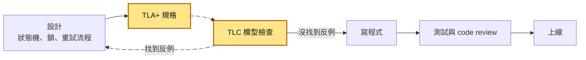
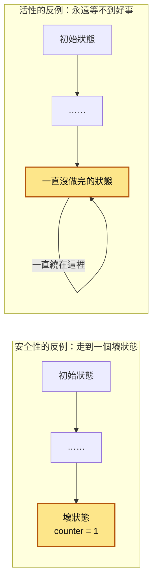
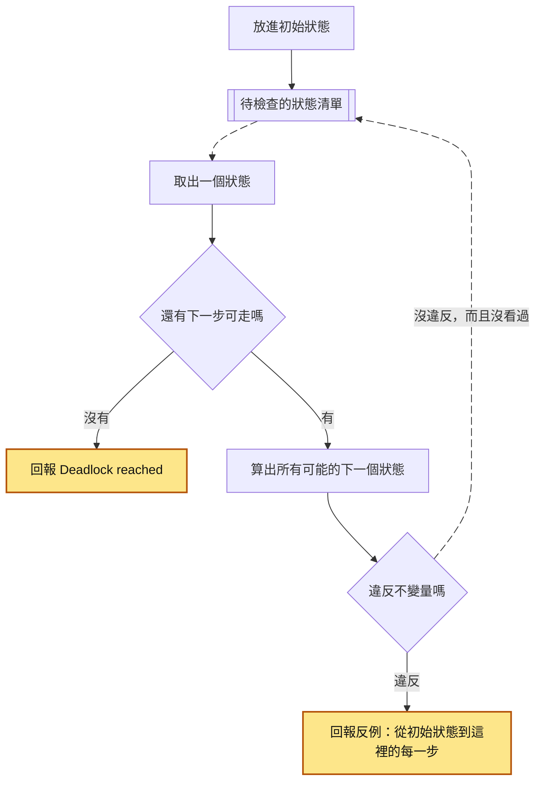
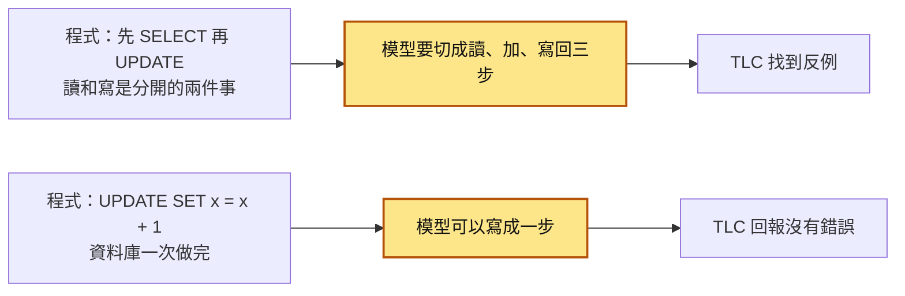
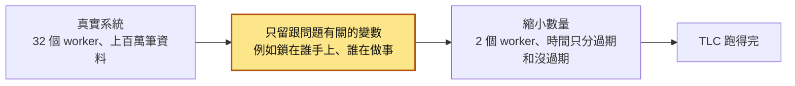
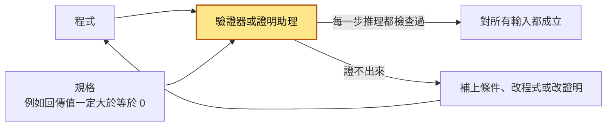
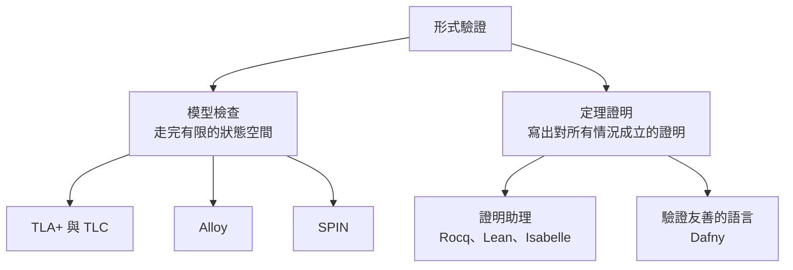

# 53｜形式驗證（Formal Verification）

> 形式驗證（formal verification）是先把系統的設計寫成精確的描述，再用工具檢查「所有可能的執行順序或輸入」，確認某個條件永遠成立；測試只能檢查你挑出來的那幾個例子。

**難度**：★★★　**閱讀時間**：約 25 分鐘　**前置知識**：[競爭條件](01-競爭條件.md)、[死鎖](02-死鎖.md)、[工作排程](38-工作排程.md)、[傳統測試方式](52-傳統測試方式.md)

---

## 核心問題與理念

**它要解決的問題**：兩台機器搶同一把 Redis 鎖（一個「誰拿到誰才能做」的標記）來決定誰寄每晚的報表，鎖設 60 秒自動過期。有一晚撈資料跑了 75 秒，鎖在中途過期，另一台趁空檔拿到鎖，財務收到兩份金額不一樣的報表；這種要好幾件事剛好交錯才會出現的順序，code review 時想不到，測試也從來沒跑到（下面的情境會完整走一遍）。

**核心理念**：把模型縮到夠小，小到電腦能把每一種先後順序全部走完。

**想通的那一步**：

- **卡住的地方**：直覺的做法是多跑幾次並行測試，或在 code review 時用腦袋把順序推一遍。它卡在順序的數量太多：兩個執行緒（程式裡同時往下跑的路線）各把計數器加 1，每次拆成讀、加、寫回三步，就有 20 種先後順序，測試每跑一次只會走到其中一種，而且通常是最常見的那種。
- **火花**：把設計縮成只剩幾個變數、幾個動作的小模型，讓工具從起點把每一條岔路都走過，同一個狀態（某一刻所有變數的值）只看一次。這一步讓「全部檢查一遍」變得做得到：20 種順序只要記 22 個狀態，報表的鎖過期問題在 9 個狀態內就找到。

---

## 閱讀前推薦具備知識

| 知識 | 要會到什麼程度 | 這篇哪裡會用到 | 不熟的話先看 |
|---|---|---|---|
| [競爭條件](01-競爭條件.md) | **必備**：能說出兩個執行緒各做一次 `counter++`（讀進暫存器、加 1、寫回）時，哪一種先後順序會讓 counter 只多 1 | 〈狀態、動作、狀態空間〉的狀態圖、TLC 的 7 步反例表、實驗一 | 本系列第 01 篇 |
| [死鎖](02-死鎖.md) | **加分**：能說出 P0 先拿 S 再拿 Q、P1 先拿 Q 再拿 S 時，兩個為什麼會互相等住 | 〈模型檢查〉的號誌表、實驗二、常見地雷 4 | 本系列第 02 篇 |
| [傳統測試方式](52-傳統測試方式.md) | **加分**：知道單元測試常用 mock 取代 Redis、資料庫，整合測試跑一次只會走到一種執行順序 | 情境裡「測試也全綠」那段，〈和傳統測試怎麼分工〉的表 | 本系列第 52 篇 |
| [工作排程](38-工作排程.md) | **加分**：知道 `r.set(key, value, nx=True, ex=60)` 是「沒人拿著才拿得到、60 秒後自動消失」的 Redis 鎖 | 情境的那段 Python 程式，實驗三的 `LeaseLock.tla` | 本系列第 38 篇〈實驗三〉 |
| TLA+ 與 TLC | **加分**：讀規格時看得懂 `counter' = reg[p]` 是「下一個狀態的 counter 等於 reg[p]」就夠 | 「動手看看」的 4 份規格和 TLC 的輸出 | 本篇〈先認得幾個 TLA+ 符號〉會順帶解釋 |
| Docker 的 `docker run` | **加分**：會照著指令用 `-v` 把目前的資料夾掛進容器，在容器裡跑一個指令 | 「動手看看」用 `eclipse-temurin` 映像跑 TLC | [Docker 入門](https://docs.docker.com/get-started/) |

**快速自我檢查**：`counter` 一開始是 0，兩個執行緒各做一次 `counter++`，每次都拆成「讀進暫存器、在暫存器加 1、寫回」三步。最後 `counter` 可能是哪些值？各舉一種先後順序。

<details markdown="1"><summary>看答案</summary>

可能是 2，也可能是 1。執行緒 1 三步都做完，執行緒 2 才開始讀，就得到 2。執行緒 1 讀到 0，執行緒 2 也讀到 0，兩個各自加 1 再寫回，都寫入 1，就得到 1。這篇講的就是怎麼讓工具把這種「中間被插隊」的順序全部找出來，這一題答得出來，後面的狀態圖和反例表就讀得懂。舉不出得到 1 的順序，先讀 [競爭條件](01-競爭條件.md) 的 `counter++` 例子。

</details>

---

## 為什麼要在意：一個具體的情境

這是一個假設的情境。你負責每晚寄「對帳報表」給財務的排程工作。為了不怕單台機器掛掉，同一支程式部署在兩台機器上，叫 worker-a 和 worker-b，兩台都每 30 秒跑一次檢查：今天的報表還沒寄，就搶一把 Redis 鎖，搶到的人撈資料、寄報表。鎖的寫法和 [工作排程](38-工作排程.md) 的〈實驗三〉一樣，用 `SET ... NX`（沒人拿著才拿得到）加上 60 秒自動過期，萬一拿鎖的機器當機，鎖也不會永遠卡住。

```python
# ❌ 出事的寫法：worker-a、worker-b 每 30 秒各跑一次
if not report_sent_today():
    if r.set("lock:nightly_report", WORKER_ID, nx=True, ex=60):  # 60 秒後自動過期
        rows = load_settlement_rows()     # 平常 20 秒，那晚跑了 75 秒
        send_report(rows)                 # 寄報表，並記下「今天寄過了」
        r.delete("lock:nightly_report")   # 不管鎖還是不是自己的，直接刪
```

這段程式過了 code review：有加鎖、有 `NX`、有過期時間，看起來每個該想的都想到了。測試也全綠：單元測試用假的 Redis，撈資料只要幾毫秒；整合測試只開一個 worker 跑一次。幾個月來每天都只寄一份。

有一晚資料庫特別慢，worker-a 撈資料花了 75 秒，比鎖的 60 秒還久。下表是那一晚的經過：

| 時間 | worker-a | worker-b | Redis 裡的鎖 | 財務收到幾份報表 |
|---|---|---|---|---|
| T1（02:00:00） | 今天還沒寄，`SET NX` 成功，開始撈資料 | | worker-a，02:01:00 過期 | 0 |
| T2（02:00:40） | 撈資料中 | 今天還沒寄，`SET NX` 失敗，這輪略過 | worker-a | 0 |
| T3（02:01:00） | 還在撈 | | 過期了，沒有人拿著 | 0 |
| T4（02:01:10） | 還在撈 | 今天還沒寄，`SET NX` 成功，開始撈資料 | worker-b，02:02:10 過期 | 0 |
| T5（02:01:15） | 撈完，寄出報表，記下今天寄過 | 撈資料中 | worker-b | 1 |
| T6（02:01:15） | `DEL` 把 worker-b 的鎖刪掉 | 撈資料中 | 沒有人拿著 | 1 |
| T7（02:01:35） | | 撈完，寄出報表 | 沒有人拿著 | 2 |

worker-b 在 T4 檢查時，worker-a 還沒寄出，所以「今天寄過了沒」的檢查也擋不住它。

- **使用者（財務）看到的**：02:01 收到兩封對帳報表，而且兩份的總金額不一樣，因為 worker-b 撈資料的時間比較晚，多算到幾筆交易。財務不知道該信哪一份。
- **工程師看到的**：兩台機器的日誌各有一行「取得鎖」，時間差 70 秒，沒有任何錯誤。重跑測試，還是全綠。

**根因**：`ex=60` 這個參數假設工作一定在 60 秒內做完，可是沒有任何東西保證這件事。工作一超時，鎖就自己消失，第二個人就進得來；`r.delete(...)` 那一行還會把別人的鎖刪掉，讓第三個人也進得來。

這種 bug 有三個特徵：要「剛好」兩件事交錯（工作變慢、鎖過期、另一台剛好來檢查）才會出現，code review 時腦中跑不完所有順序，測試又只跑過最常見的那一種順序。如果在寫程式之前，先用 TLA+（一種描述設計的語言）把「拿鎖、過期、做完、刪鎖」這四件事寫成規格，再交給它的檢查工具 TLC，TLC 會把所有先後順序都走一遍，不到一秒就回報一條路線：A 先拿到鎖，接著鎖過期，然後 B 也拿到鎖，這時兩個人同時在做。

下面這張圖把上表的 T1～T7 畫成時間軸，最後的「TLC」一步把 TLC 回報的路線（State 2、3、4 是它列出的第 2、3、4 個狀態）對到同一張時間軸上：

<figure class="draw-fig">
<iframe class="draw-fig__frame" src="../figures/53-lease-expiry-double-report.html" title="按播放或點 T1～T7，看 worker-a 撈資料的 75 秒怎麼超過鎖的 60 秒、worker-b 怎麼趁鎖過期進來，最後點 TLC 看它用 State 2、3、4 找出同一條路。" loading="lazy" style="height: 520px;"></iframe>
<figcaption>按播放或點 T1～T7，看 worker-a 撈資料的 75 秒怎麼超過鎖的 60 秒、worker-b 怎麼趁鎖過期進來，最後點 TLC 看它用 State 2、3、4 找出同一條路。</figcaption>
</figure>

**怎麼修**：設計上要讓「鎖過期之後，舊的持有者寫不進去」，常見做法是 fencing token（每次拿鎖都發一個遞增號碼，寫入時檢查號碼）；刪鎖前要先比對是不是自己的；寄報表本身也要做成[冪等](25-冪等性.md)，寄過就不會再寄。這些做法在 [工作排程](38-工作排程.md) 有講。本篇要講的是另一件事：怎麼在上線前就讓工具幫你找出這種順序。「動手看看」的〈實驗三〉會實際讓 TLC 找出上面這個反例。

---

## 全貌：它在系統裡的位置

形式驗證不在請求經過的路上，它在寫程式之前的設計階段。這張圖是一個功能從設計到上線的流程，黃色是形式驗證做的事。



TLC 找到反例，就回頭改設計；設計改到 TLC 找不到反例，才開始寫程式。寫完的程式照樣要過 [傳統測試方式](52-傳統測試方式.md) 講的單元測試、整合測試和 code review，因為 TLC 只檢查設計，看不到你寫出來的程式碼。形式驗證最常拿來抓的，正是系列前面講過的 [競爭條件](01-競爭條件.md) 和 [死鎖](02-死鎖.md)，以及 [工作排程](38-工作排程.md)、[分散式交易](43-分散式交易.md) 這類多台機器、多個步驟交錯的設計。

---

## 生活比喻

你要確認一棟大樓「從任何房間都逃得出去」。

- **測試**：找幾個人，從幾個房間出發實際走一遍。走得出去，只代表這幾條路沒問題。
- **模型檢查**：把平面圖畫出來，讓電腦從每個房間出發，把每個岔路口都走過一遍。只要有一條路走到死路，電腦就把那條路線印給你看。
- **定理證明**：建築師寫出一份證明：「這種格局的每一層都有兩座樓梯，每個房間都接到走廊，所以不管蓋幾層、隔幾間，都逃得出去。」證明成立，大樓再大也成立。

**比喻失準的地方**：

- 平面圖跟真的大樓可能不一樣。工人多砌了一道牆，平面圖上看不出來。模型檢查和定理證明檢查的都是你寫下來的那份描述，描述寫錯或跟程式不一致，檢查結果就沒有意義。
- 程式的「岔路」是執行順序的交錯，數量長得比房間快很多，多一個執行緒，要走的路就多十幾倍，電腦也會走不完。後面「狀態爆炸」會講數字。

---

## 它是怎麼運作的

並行程式的問題在於「交錯順序太多」。[競爭條件](01-競爭條件.md) 裡兩個執行緒各做一次 `counter++`，就有 20 種先後順序；測試每跑一次，只會走到其中一種，而且通常是最常見的那一種。形式驗證的做法是：先把設計寫成精確的規格，再用工具把所有可能性檢查一遍（模型檢查），或寫出對所有情況都成立的證明（定理證明）。下面先用 `counter++` 講清楚幾個基本詞，再看 TLC 怎麼工作。

### 狀態、動作、狀態空間

回想 01 篇引用的作業系統課本（俗稱恐龍書）例子：兩個執行緒各做一次 `counter++`，每次都拆成三步：讀進暫存器、在暫存器加 1、寫回記憶體。

- **狀態**（state）：某一刻所有變數的值。這個例子裡是 `counter`、兩個執行緒各自的暫存器，以及兩個執行緒各自走到第幾步。
- **動作**（action）：從一個狀態走到下一個狀態的一步，例如「執行緒 1 把 counter 讀進暫存器」。
- **行為**（behavior）：從初始狀態出發，一步一步走出來的一串狀態，也就是一種執行順序。
- **狀態空間**（state space）：從初始狀態出發，走得到的所有狀態。

這張圖是 `counter++` 狀態空間的開頭幾層：每個方框是一個狀態，每條箭頭是一個動作。

```mermaid
flowchart TD
    S0["初始<br/>counter = 0，兩個執行緒都準備讀"] -->|"執行緒 1 讀"| S1["執行緒 1 讀到 0"]
    S0 -->|"執行緒 2 讀"| S2["執行緒 2 讀到 0"]
    S1 -->|"執行緒 1 加 1"| S3["reg1 = 1"]
    S1 -->|"執行緒 2 讀"| S4["兩個都讀到 0"]
    S2 -->|"左右對稱"| MORE["……繼續往下分岔"]
    S3 --> MORE
    S4 --> MORE
    MORE --> OK["2 種順序：counter = 2"]
    MORE --> BAD["18 種順序：counter = 1"]
    classDef hot fill:#fde68a,stroke:#b45309,stroke-width:2px,color:#111
    class BAD hot
```



6 個步驟排出 20 種順序，只有「一個執行緒整個做完，另一個才開始」的 2 種會得到 2。不同順序常常會走到同一個狀態，所以 TLC 實際只要記 22 個不同的狀態，就能涵蓋全部 20 種順序。

### 性質：你要工具檢查什麼

光有狀態空間還不夠，你要告訴工具「什麼叫做對」。這種要求叫性質（property），分兩大類：

- **安全性**（safety）：壞事不會發生。最常見的寫法是**不變量**（invariant），也就是「在每一個狀態都必須成立的條件」。例如「兩個執行緒都做完時，counter 一定是 2」「同一時間最多一個 worker 拿著鎖在做事」，或 01 篇的「訂單數 + 剩餘庫存 = 初始庫存」。死鎖也算一種壞事：還沒做完，卻沒有任何一步走得動。
- **活性**（liveness）：好事終究會發生。例如「每個 worker 終究會做完」「每則訊息終究會被處理」。

工具找到違反的情況時，會給你一份**反例**（counterexample trace）：從初始狀態出發，一步一步走到出事的那條路。兩類性質的反例長得不一樣：



安全性的反例是有限長的一段路，走到壞狀態就結束；活性的反例是一條永遠沒有結果的路。檢查活性時，還要告訴工具「一直走得動的動作，終究會被執行」，這叫公平性（fairness）假設；沒有這個假設，「系統一直停著不動」也算合法的行為，活性幾乎都會被判失敗。新人先把安全性和不變量弄熟就好。

### 模型檢查：TLC 怎麼把每一條路走完

模型檢查（model checking）就是讓電腦把狀態空間整個走一遍，每走到一個狀態就檢查一次性質。TLA+ 是 Leslie Lamport 設計的規格語言，用來描述並行和分散式系統；TLC 是它的模型檢查工具。這張圖是 TLC 預設的做法，一層一層往外擴（廣度優先）：



TLC 會記住看過的狀態，同一個狀態不檢查第二次，所以 20 種順序只要記 22 個狀態。因為它一層一層往外走，回報的反例會是最短的那一條。

把 `counter++` 的規格交給 TLC，它回報不變量「兩個都做完時 counter = 2」被違反，並附上這份反例。按「逐步看」可以一列一列看 TLC 走的路：

| 步驟 | TLC 走的動作 | 執行緒 1 | 執行緒 2 | counter |
|---|---|---|---|---|
| 1 | 初始狀態 | 準備讀 | 準備讀 | 0 |
| 2 | 執行緒 1 讀 | 讀到 0，reg1 = 0 | 準備讀 | 0 |
| 3 | 執行緒 1 加 1 | reg1 = 1 | 準備讀 | 0 |
| 4 | 執行緒 2 讀 | 準備寫回 | 讀到 0，reg2 = 0 | 0 |
| 5 | 執行緒 1 寫回 | 寫入 counter = 1，做完 | 準備加 1 | 1 |
| 6 | 執行緒 2 加 1 | 做完 | reg2 = 1 | 1 |
| 7 | 執行緒 2 寫回 | 做完 | 寫入 counter = 1，做完 | 1 |

這就是 01 篇講的遺失更新：執行緒 2 在第 4 步讀到的 0 已經過時，第 7 步把執行緒 1 的結果蓋掉了。你沒有告訴 TLC 要找哪一種順序，是它自己從 20 種裡挑出來的。

[死鎖](02-死鎖.md) 篇的兩個號誌（semaphore，這裡當成一次只能被一個行程拿著的資源）S、Q 也一樣：P0 先拿 S 再拿 Q，P1 反過來。TLC 不需要你寫不變量，它預設就會檢查「有沒有走到一個還沒做完、卻沒有任何下一步的狀態」：

| 步驟 | TLC 走的動作 | P0 | P1 | S | Q |
|---|---|---|---|---|---|
| 1 | 初始狀態 | 準備 `wait(S)` | 準備 `wait(Q)` | 沒人拿 | 沒人拿 |
| 2 | P0 拿 S | 拿到 S，準備 `wait(Q)` | 準備 `wait(Q)` | P0 | 沒人拿 |
| 3 | P1 拿 Q | 準備 `wait(Q)` | 拿到 Q，準備 `wait(S)` | P0 | P1 |
| 4 | 找下一步 | Q 在 P1 手上，走不動 | S 在 P0 手上，走不動 | P0 | P1 |

到第 4 步，兩個行程都還沒做完，卻沒有任何一個動作能走，TLC 就回報 `Deadlock reached`，附上前 3 步。

### 每一步切多細，決定找得到什麼

TLC 只會在你寫下的「步」和「步」之間插入別人的動作。你把 `counter++` 寫成「讀、加、寫回」三步，TLC 就找得到遺失更新；你把它寫成一步做完，TLC 只會看到 4 個狀態，回報「沒有錯誤」。



兩種結果都對，前提是模型的切法跟真實程式一致。真實程式是 01 篇的 `SET stock = stock - 1`（資料庫保證一次做完），模型寫成一步沒問題；真實程式是 Python 先讀再寫，模型卻寫成一步，TLC 的「沒有錯誤」就是假的安心。建模時要問的問題是：「這兩件事之間，別人插得進來嗎？」插得進來，就要切成兩步。

### 模型檢查的極限：狀態爆炸

狀態空間會隨著參與者和數值範圍相乘變大，這叫狀態爆炸（state explosion）。下表是同一份 `counter++` 規格，只改執行緒數量，讓 TLC 把整個狀態空間走完的結果：

| 執行緒數量 | 不同的狀態數 |
|---|---|
| 2 | 22 |
| 3 | 175 |
| 4 | 1,916 |
| 5 | 26,789 |
| 6 | 452,118 |

每多一個執行緒，狀態數就乘上十幾倍。所以實務上的做法是用很小的模型：2～3 個 worker、2～3 筆資料、重試最多 2 次。很多設計錯誤在小模型裡就會出現，情境裡 TLC 找到的鎖過期反例，只用了 2 個 worker 和 4 個狀態。

這張圖是把真實系統縮成 TLC 跑得完的模型時，你會做的取捨：



模型小，代表 TLC 說「沒有錯誤」時，你只知道「這個大小以內」沒有錯誤。另一個限制是模型和程式之間的距離：TLC 檢查的是你寫的規格，程式寫得跟規格不一樣，它不會知道。這兩件事都要靠測試和 code review 補上。

### 定理證明：證明對所有輸入都成立

模型檢查要求狀態空間是有限的、夠小。定理證明（theorem proving）走另一條路：你寫出一份數學證明，說明某個性質對所有輸入、所有大小都成立，再由工具逐步檢查證明的每一步推理有沒有漏洞。代價是證明要人來寫，常常比程式本身還長。

這張圖是用定理證明工具檢查一個函式的流程：



常見的工具分兩種：

- **證明助理**（proof assistant）：讓你用一套數學語言寫定義和證明，工具檢查每一步。
  - **Rocq**：原本叫 Coq，已改名為 Rocq Prover（目前最新版是 2026 年 3 月的 9.2）。驗證過的 C 編譯器 CompCert 就是用它做的。
  - **Lean**：同時是程式語言和證明助理，社群維護一個很大的數學定理庫 Mathlib。
  - **Isabelle**：seL4 微核心（作業系統最核心的那一層）的正確性證明，大部分是用 Isabelle/HOL 做的。
- **驗證友善的程式語言**：**Dafny** 是一種一邊寫程式、一邊寫規格的語言。你在函式上寫「呼叫前必須成立什麼」（前置條件）和「回傳後保證什麼」（後置條件），內建的驗證器會在編譯時檢查程式是不是一定做得到；通過後可以編譯成 C#、Java、JavaScript、Go 或 Python。它檢查的是程式本身，所以位置在全貌圖的「寫程式」那一格。

### 工具地圖

這張圖是本篇提到的工具，各自屬於哪一類：



Alloy 是一套軟體建模的語言和分析器，用「東西之間的關係」描述軟體的結構；SPIN 是貝爾實驗室發展出來的工具，用 Promela 語言描述多個行程互相傳訊息的系統。後端工程師最常碰到的是 TLA+，因為分散式系統的設計問題多半是「多個參與者、多個步驟交錯」。

### 和傳統測試怎麼分工

| 方法 | 檢查的對象 | 涵蓋多少種情況 | 誰來付成本 |
|---|---|---|---|
| 單元測試、整合測試（見 [傳統測試方式](52-傳統測試方式.md)） | 實際的程式碼 | 你挑出來的那幾個例子 | 每個工程師，每次改程式都跑 |
| 並行壓力測試 | 實際的程式碼 | 跑的時候剛好遇到的交錯順序 | 寫測試的人，結果有機率性 |
| 模型檢查（TLC） | 設計的規格 | 小模型裡的所有交錯順序 | 寫規格的人，通常是設計關鍵流程時 |
| 定理證明（Rocq、Lean、Isabelle、Dafny） | 規格或程式 | 所有輸入、所有大小 | 寫證明的人，成本最高 |

測試用來確認「程式做了設計說的事」，模型檢查用來確認「設計本身在小模型裡沒有錯」。兩者檢查的東西不一樣，誰也取代不了誰：用了 TLA+ 的團隊照樣寫測試，寫了很多測試的團隊，也可能在設計層有測試抓不到的錯。

### 業界怎麼用：AWS 的經驗

Newcombe 等人在 2015 年的《Communications of the ACM》發表〈How Amazon Web Services Uses Formal Methods〉，描述 AWS 從 2011 年起用 TLA+ 檢查 S3、DynamoDB、EBS 等系統的設計。以下取自 Lamport 網站上這篇論文的預印本（內容可能和期刊版有些微差異）：

- DynamoDB 的複寫與容錯演算法，TLC 找到一個可能造成資料遺失的 bug，最短的反例有 35 步。這個 bug 先前通過了設計審查、code review 和測試，都沒有被發現。
- 文中提到，從新進工程師到資深工程師，都能在 2～3 週內從零學會 TLA+ 並得到有用的結果。
- 他們也坦白寫到，有個系統因為當時沒有檢查活性，就沒有找到一個活性的 bug。

---

## 動手看看

下面用 TLC 跑四份規格：01 篇的 `counter++`、02 篇的兩個號誌，以及情境裡的 Redis 鎖，各自讓 TLC 找出反例，再看修正版通過。

### 準備環境

TLC 是一個 Java 程式，需要 Java 11 以上。本機沒有 Java 的話，可以用官方的 `eclipse-temurin` Docker 映像。TLC 本身在 tlaplus 官方 GitHub 的 release 裡，檔名是 `tla2tools.jar`（本文用 v1.7.4）：

```powershell
mkdir nb53; cd nb53
# 從 tlaplus 官方 GitHub release 下載（約 2.2 MB）
Invoke-WebRequest https://github.com/tlaplus/tlaplus/releases/download/v1.7.4/tla2tools.jar -OutFile tla2tools.jar
```

之後每份規格都用同一個指令跑，只換檔名（`--rm`：跑完自動刪除容器）：

```powershell
docker run --rm --name nb53-tlc -v "${PWD}:/w" -w /w eclipse-temurin:21-jre `
  java -XX:+UseParallelGC -cp tla2tools.jar tlc2.TLC -config Counter.cfg Counter.tla
```

本機已經有 Java 11 以上的話，直接 `java -XX:+UseParallelGC -cp tla2tools.jar tlc2.TLC -config Counter.cfg Counter.tla` 也可以。檔案要存成 UTF-8，模組名稱要跟檔名一樣。

### 先認得幾個 TLA+ 符號

| 符號 | 意思 |
|---|---|
| `==` | 定義一個名字 |
| `/\`、`\/` | 而且、或者 |
| `x'` | `x` 在下一個狀態的值 |
| `[f EXCEPT ![p] = v]` | 把 `f` 裡 `p` 那一格改成 `v`，其他格不變 |
| `UNCHANGED x` | 這一步 `x` 不變 |
| `\A p \in S :`、`\E p \in S :` | 對 S 裡每一個 p、S 裡有某一個 p |
| `=>` | 如果……那麼…… |
| `\*` | 註解 |

每個動作的寫法都是「前面幾行是這一步能走的條件，後面幾行是走完之後變數變成什麼」。條件不成立，這一步就不能走。

### 實驗一：讓 TLC 找出 counter++ 的競爭條件

`Counter.tla`：

```
---- MODULE Counter ----
\* 兩個執行緒各做一次 counter++，拆成「讀、加、寫回」三步
EXTENDS Naturals
VARIABLES counter, reg, pc
vars == <<counter, reg, pc>>
Procs == {1, 2}

Init == /\ counter = 0
        /\ reg = [p \in Procs |-> 0]        \* 每個執行緒自己的暫存器
        /\ pc  = [p \in Procs |-> "read"]   \* 每個執行緒下一步要做什麼

Read(p)  == /\ pc[p] = "read"
            /\ reg' = [reg EXCEPT ![p] = counter]
            /\ pc'  = [pc EXCEPT ![p] = "inc"]
            /\ UNCHANGED counter
Inc(p)   == /\ pc[p] = "inc"
            /\ reg' = [reg EXCEPT ![p] = reg[p] + 1]
            /\ pc'  = [pc EXCEPT ![p] = "write"]
            /\ UNCHANGED counter
Write(p) == /\ pc[p] = "write"
            /\ counter' = reg[p]
            /\ pc'  = [pc EXCEPT ![p] = "done"]
            /\ UNCHANGED reg

\* 兩個都做完之後原地不動，免得 TLC 把「正常結束」當成死鎖
Finished == /\ \A p \in Procs : pc[p] = "done"
            /\ UNCHANGED vars
Next == (\E p \in Procs : Read(p) \/ Inc(p) \/ Write(p)) \/ Finished
Spec == Init /\ [][Next]_vars

\* 不變量：兩個都做完時，counter 一定要是 2
CounterIsTwo == (\A p \in Procs : pc[p] = "done") => counter = 2
====
```

`Next` 的意思是「每一步，任選一個執行緒走它的下一個動作」，TLC 會把每一種選法都試過。`Spec` 是「從 `Init` 出發，之後每一步都照 `Next` 走」。

`Counter.cfg` 告訴 TLC 要檢查哪個規格、哪個不變量：

```
SPECIFICATION Spec
INVARIANT CounterIsTwo
```

執行後的關鍵幾行（中間省略的狀態就是「它是怎麼運作的」那張 7 步的表）：

```
Error: Invariant CounterIsTwo is violated.
Error: The behavior up to this point is:
State 1: <Initial predicate>
/\ counter = 0
/\ reg = <<0, 0>>
/\ pc = <<"read", "read">>
...
State 4: <Read line 12, col 13 to line 15, col 32 of module Counter>
/\ counter = 0
/\ reg = <<1, 0>>
/\ pc = <<"write", "inc">>
...
State 7: <Write line 20, col 13 to line 23, col 28 of module Counter>
/\ counter = 1
/\ reg = <<1, 1>>
/\ pc = <<"done", "done">>

27 states generated, 21 distinct states found, 3 states left on queue.
Finished in 00s at (2026-10-24 03:49:43)
```

每個 `State` 是一個完整的狀態，`<Read ...>` 是走到這個狀態用的動作。`reg = <<1, 0>>` 是「執行緒 1 的暫存器是 1、執行緒 2 的是 0」。State 4 是關鍵：執行緒 1 已經算好 1、還沒寫回，執行緒 2 就讀到了舊的 0。TLC 一找到違反就停下來，所以只看了 21 個狀態（執行時間依機器而異）。

**修正版**：把 `counter++` 改成一步做完，像資料庫的 `SET x = x + 1`。`CounterAtomic.tla`：

```
---- MODULE CounterAtomic ----
\* 對照組：把 counter++ 當成一步做完（像資料庫的 SET x = x + 1）
EXTENDS Naturals
VARIABLES counter, pc
vars == <<counter, pc>>
Procs == {1, 2}

Init == /\ counter = 0
        /\ pc = [p \in Procs |-> "incr"]

Incr(p) == /\ pc[p] = "incr"
           /\ counter' = counter + 1
           /\ pc' = [pc EXCEPT ![p] = "done"]

Finished == /\ \A p \in Procs : pc[p] = "done"
            /\ UNCHANGED vars
Next == (\E p \in Procs : Incr(p)) \/ Finished
Spec == Init /\ [][Next]_vars

CounterIsTwo == (\A p \in Procs : pc[p] = "done") => counter = 2
====
```

`CounterAtomic.cfg` 的內容跟 `Counter.cfg` 一樣。執行結果：

```
Model checking completed. No error has been found.
6 states generated, 4 distinct states found, 0 states left on queue.
```

「No error has been found」代表 4 個狀態全部走過，沒有一個違反不變量。

### 實驗二：讓 TLC 找出兩個號誌的死鎖

`Semaphores.tla`：

```
---- MODULE Semaphores ----
\* 恐龍書的例子：P0 先拿 S 再拿 Q，P1 先拿 Q 再拿 S
VARIABLES sem, pc
vars == <<sem, pc>>
Procs  == {"P0", "P1"}
First  == [P0 |-> "S", P1 |-> "Q"]   \* 各自先拿哪一個
Second == [P0 |-> "Q", P1 |-> "S"]   \* 各自再拿哪一個

Init == /\ sem = [r \in {"S", "Q"} |-> 1]   \* 1 = 沒人拿，0 = 有人拿著
        /\ pc  = [p \in Procs |-> "wait1"]

\* wait(r)：sem[r] = 1 才走得下去；不是 1 就沒有這一步可走，等於排隊
Wait(p, r, from, to)   == /\ pc[p] = from
                          /\ sem[r] = 1
                          /\ sem' = [sem EXCEPT ![r] = 0]
                          /\ pc'  = [pc EXCEPT ![p] = to]
\* signal(r)：把資源放回去
Signal(p, r, from, to) == /\ pc[p] = from
                          /\ sem' = [sem EXCEPT ![r] = 1]
                          /\ pc'  = [pc EXCEPT ![p] = to]

Step(p) == \/ Wait(p, First[p], "wait1", "wait2")
           \/ Wait(p, Second[p], "wait2", "signal1")
           \/ Signal(p, First[p], "signal1", "signal2")
           \/ Signal(p, Second[p], "signal2", "done")

Finished == /\ \A p \in Procs : pc[p] = "done"
            /\ UNCHANGED vars
Next == (\E p \in Procs : Step(p)) \/ Finished
Spec == Init /\ [][Next]_vars
====
```

`Semaphores.cfg` 只有一行，因為死鎖 TLC 預設就會檢查：

```
SPECIFICATION Spec
```

執行結果：

```
Error: Deadlock reached.
Error: The behavior up to this point is:
State 1: <Initial predicate>
/\ sem = [S |-> 1, Q |-> 1]
/\ pc = [P0 |-> "wait1", P1 |-> "wait1"]

State 2: <Wait line 13, col 27 to line 16, col 57 of module Semaphores>
/\ sem = [S |-> 0, Q |-> 1]
/\ pc = [P0 |-> "wait2", P1 |-> "wait1"]

State 3: <Wait line 13, col 27 to line 16, col 57 of module Semaphores>
/\ sem = [S |-> 0, Q |-> 0]
/\ pc = [P0 |-> "wait2", P1 |-> "wait2"]

8 states generated, 7 distinct states found, 2 states left on queue.
```

State 3：S 和 Q 都被拿走（都是 0），兩個行程都停在 `wait2`，等的是對方手上的那一個。

**修正版**：照 02 篇的「固定加鎖順序」，兩個行程都先 S 後 Q。把 `Semaphores.tla` 複製成 `SemaphoresOrdered.tla`，改這三行（`Semaphores.cfg` 也複製成 `SemaphoresOrdered.cfg`）：

```
---- MODULE SemaphoresOrdered ----
First  == [P0 |-> "S", P1 |-> "S"]
Second == [P0 |-> "Q", P1 |-> "Q"]
```

執行結果：

```
Model checking completed. No error has been found.
22 states generated, 18 distinct states found, 0 states left on queue.
```

### 實驗三：讓 TLC 找出情境裡的鎖過期問題

`LeaseLock.tla` 把情境裡的程式縮成四個動作：拿鎖、鎖過期、做完並刪鎖、全部做完。「撈資料要幾秒」這件事不寫進模型，改成「鎖在任何時刻都可能過期」，這樣 TLC 就會把「工作比鎖還慢」的情況一起考慮進去。

```
---- MODULE LeaseLock ----
\* 情境裡的 Redis 鎖：SET NX 拿鎖、60 秒自動過期、做完直接 DEL
VARIABLES lock, pc
vars == <<lock, pc>>
Workers == {"A", "B"}

Init == /\ lock = "none"
        /\ pc = [w \in Workers |-> "idle"]

Acquire(w) == /\ pc[w] = "idle"
              /\ lock = "none"                  \* SET NX：沒人拿著才拿得到
              /\ lock' = w
              /\ pc' = [pc EXCEPT ![w] = "working"]
\* 過期：TLC 不知道工作要跑幾秒，所以「鎖在任何時刻過期」都要考慮
Expire     == /\ lock /= "none"
              /\ lock' = "none"
              /\ UNCHANGED pc
Finish(w)  == /\ pc[w] = "working"
              /\ lock' = "none"                 \* 直接 DEL，不管鎖還是不是自己的
              /\ pc' = [pc EXCEPT ![w] = "done"]

Finished == /\ \A w \in Workers : pc[w] = "done"
            /\ UNCHANGED vars
Next == Expire \/ Finished \/ \E w \in Workers : Acquire(w) \/ Finish(w)
Spec == Init /\ [][Next]_vars

\* 不變量：同一時間最多一個 worker 在做
OnlyOneWorking == \A x, y \in Workers :
                    (pc[x] = "working" /\ pc[y] = "working") => x = y
====
```

`LeaseLock.cfg`：

```
SPECIFICATION Spec
INVARIANT OnlyOneWorking
```

執行結果：

```
Error: Invariant OnlyOneWorking is violated.
Error: The behavior up to this point is:
State 1: <Initial predicate>
/\ lock = "none"
/\ pc = [A |-> "idle", B |-> "idle"]

State 2: <Acquire line 10, col 15 to line 13, col 51 of module LeaseLock>
/\ lock = "A"
/\ pc = [A |-> "working", B |-> "idle"]

State 3: <Expire line 15, col 15 to line 17, col 29 of module LeaseLock>
/\ lock = "none"
/\ pc = [A |-> "working", B |-> "idle"]

State 4: <Acquire line 10, col 15 to line 13, col 51 of module LeaseLock>
/\ lock = "B"
/\ pc = [A |-> "working", B |-> "working"]

9 states generated, 8 distinct states found, 3 states left on queue.
Finished in 00s at (2026-10-24 03:49:50)
```

State 2、3、4 就是情境表格的 T1、T3、T4：A 拿到鎖、鎖過期、B 拿到鎖，兩個人同時在做。情境裡要等「資料庫剛好那晚很慢」才會遇到的順序，TLC 在 9 個狀態內就找到了。

> 小實驗：在 `Counter.tla` 開頭加一行 `CONSTANT N`，把 `Procs == {1, 2}` 改成 `Procs == 1..N`，cfg 拿掉 `INVARIANT` 那行、加上 `CONSTANT N = 3`，就能看到「它是怎麼運作的」那張狀態爆炸的表。N 從 2 加到 6，狀態數從 22 變成 452,118，在我的機器上 N = 6 要跑 5 秒左右（依機器而異）。

### 收拾

```powershell
# 指令有 --rm，容器跑完就自動刪除；確認沒有留下東西
docker ps -a --filter name=nb53-
```

---

## 常見地雷

### 地雷 1：每一步切得太粗，TLC 什麼都找不到

- ❌ **錯誤做法**：程式是「先 `SELECT` 讀出來、在 Python 裡算、再 `UPDATE` 寫回去」，規格裡卻把它寫成一個動作 `counter' = counter + 1`。
- **為什麼錯**：TLC 只會在你寫下的動作之間插入別人的動作。一步做完的動作，中間沒有空隙，TLC 永遠找不到競爭條件，就像實驗一的修正版回報「No error has been found」。
- ✅ **正確做法**：對照真實程式，問「這兩件事之間，別人插得進來嗎？」插得進來就切成兩個動作。只有資料庫或 Redis 保證一次做完的操作（`SET x = x + 1`、`INCR`），才寫成一步。

### 地雷 2：TLC 通過了，就以為程式沒有 bug

- ❌ **錯誤做法**：規格通過模型檢查，就省掉測試和 code review。
- **為什麼錯**：TLC 只檢查規格，看不到程式碼。程式寫得跟規格不一樣、規格漏寫了某個動作（例如忘了鎖會過期）、模型只開 2 個 worker，TLC 都不會知道。
- ✅ **正確做法**：TLC 用來檢查設計，程式照樣要有單元測試、整合測試和並行測試（見 [傳統測試方式](52-傳統測試方式.md)）。規格和程式要一起 review，確認每個動作都對得上程式裡的一段。

### 地雷 3：沒把「會出錯的事」寫進模型

- ❌ **錯誤做法**：模型裡只寫正常流程：拿鎖、做事、放鎖。
- **為什麼錯**：情境裡的 bug 來自「鎖過期」這件事。模型裡沒有 `Expire` 這個動作，TLC 就不會考慮它，只會回報「沒有錯誤」。
- ✅ **正確做法**：把會在任何時刻發生的事都寫成動作：鎖過期、訊息遺失或重送、worker 當機重啟、網路逾時。分散式系統的 bug 多半藏在這些「意外」和正常流程交錯的地方。

### 地雷 4：用 `-deadlock` 關掉檢查，把真的死鎖也藏起來

- ❌ **錯誤做法**：TLC 回報 `Deadlock reached`，看一下發現是「兩個都做完了」的正常結束，就加上 `-deadlock` 參數（或在 cfg 寫 `CHECK_DEADLOCK FALSE`）把死鎖檢查整個關掉。
- **為什麼錯**：正常結束的狀態確實沒有下一步可走，TLC 分不出來它是做完了還是卡住了。可是整個關掉之後，真正的死鎖也不會回報了。
- ✅ **正確做法**：像本篇的規格一樣，加一個「全部做完時原地不動」的 `Finished` 動作，讓正常結束有下一步可走，死鎖檢查保持開著。

### 地雷 5：不變量寫得太弱，永遠成立

- ❌ **錯誤做法**：想檢查「counter 最後是 2」，卻寫成 `counter <= 2`；或寫成 `pc[1] = "done" => counter >= 1`。
- **為什麼錯**：這些條件在錯誤的設計裡也成立，TLC 會回報「沒有錯誤」。不變量寫錯，模型檢查就變成一份很有說服力的假報告。
- ✅ **正確做法**：先故意弄壞設計（例如把修正版改回錯誤版），確認 TLC 真的會抓到，再相信它的「No error has been found」。這跟寫測試時「先看它紅，再看它綠」是同一個道理。

### 地雷 6：一開始就把模型開很大

- ❌ **錯誤做法**：模型直接開 10 個 worker、每個重試 5 次，跑了一個小時還沒結束。
- **為什麼錯**：狀態空間是相乘變大的，`counter++` 從 2 個執行緒加到 6 個，狀態就從 22 個變成 45 萬個。
- ✅ **正確做法**：從 2 個參與者、最小的數值開始，跑得很快就能來回修改設計。小模型都通過了，再視需要把數字加大一點。

---

## 重點整理

- 測試只會走到你挑出來（或剛好遇到）的那幾種執行順序；形式驗證用工具檢查所有可能的順序或輸入，專門抓「要剛好交錯才會出事」的設計錯誤。
- 先把設計寫成「狀態」和「動作」，再寫出要檢查的性質：**不變量**（每個狀態都要成立的條件）屬於安全性，「好事終究會發生」屬於活性。
- 模型檢查（TLA+／TLC）把小模型的狀態空間整個走一遍，違反性質時給你一份**反例**，一步一步列出出事的順序；`counter++` 的遺失更新和兩個號誌的死鎖，TLC 都在一秒內找到。
- 模型的每一步要切得跟真實程式一樣細，會出錯的事（過期、重送、當機）也要寫成動作，否則 TLC 的「沒有錯誤」不能信。
- 定理證明（Rocq、Lean、Isabelle、Dafny）能證明對所有輸入都成立，代價是要人寫證明。不管用哪一種，形式驗證檢查的是設計或規格，程式照樣要測試。

---

## 新人必知清單

大多數後端工程師在工作中不會直接寫 TLA+。這篇真正要帶走的是觀念：看設計的時候，會用「狀態、動作、不變量、反例」去想。

### 一定要會（基本功）

- [ ] 能把一段並行流程（扣庫存、拿鎖、重試）拆成「誰在什麼時候做了哪一步」，畫成時間軸表格。
- [ ] 能用一句話寫出一個流程的不變量，例如「同一時間最多一個 worker 拿著鎖在做」「訂單數 + 剩餘庫存 = 初始庫存」。
- [ ] 知道測試只走過少數幾種交錯順序；並行測試全綠，不代表沒有競爭條件或死鎖。
- [ ] 看得懂反例：從第一步開始，每一列是誰做了什麼、變數變成多少，最後一列是哪個條件被違反。
- [ ] 分得出安全性（壞事不會發生）和活性（好事終究會發生）。
- [ ] 知道「兩件事之間別人插不插得進來」決定了一段程式是不是安全的，這也是建模時切步驟的依據。

### 知道有這回事就好

- TLA+ 是描述並行和分散式設計的語言，TLC 是它的模型檢查工具；官方也有 VS Code 擴充套件可以在編輯器裡跑。
- AWS 從 2011 年起用 TLA+ 檢查 S3、DynamoDB 等系統的設計，找到過測試和 code review 都沒抓到的 bug（Newcombe 等人，CACM 2015）。
- Alloy（擅長資料結構和關係）、SPIN（用 Promela 描述互傳訊息的行程）是另外兩個模型檢查工具。
- Rocq（原名 Coq）、Lean、Isabelle 是證明助理；Dafny 是一邊寫程式一邊寫規格、編譯時就驗證的語言。
- seL4 微核心和 CompCert C 編譯器，是用定理證明驗證過的知名專案。
- 檢查活性時需要公平性（fairness）假設，否則「一直停著不動」也算合法行為。

### 先不用管（等你遇到再學）

- 定理證明的寫法：證明助理裡的 tactic（一步步引導工具推理的指令）、歸納法證明怎麼組織。
- TLA+ 的證明系統 TLAPS、PlusCal（一種長得像程式、會翻譯成 TLA+ 的寫法）。
- 時序邏輯（temporal logic）的數學定義、公平性的各種強弱版本。
- 大型模型的效能調校：對稱性、多台機器分散跑 TLC。

---

## Code Review 時可以問的問題

1. **這個流程裡，哪幾件事之間別人插得進來？** 讀和寫之間、檢查和行動之間、拿鎖和做事之間，各有誰可能同時在做？
2. **這個設計永遠要成立的條件是什麼？** 有沒有寫在設計文件或測試的斷言裡？
3. **鎖、租約、逾時「到期」的那一刻，如果工作還沒做完，會發生什麼？** 舊的持有者還能不能寫入？
4. **這個測試涵蓋了哪幾種交錯順序？** 其他順序是怎麼確認沒問題的？
5. **這是多台機器、多個步驟、會重試的關鍵流程嗎？** 值不值得花一兩天先用 TLA+ 建一個小模型？
6. **如果有規格，程式和規格對得上嗎？** 規格裡一步做完的動作，程式裡真的是一次做完的嗎？

---

## 情境演練

**第 1 題**：同事寫了扣點數的並行測試，開 10 個執行緒跑了 1000 次都通過，就在 PR 上寫「已驗證沒有競爭條件」。你會怎麼回應？

<details markdown="1"><summary>看答案</summary>

1000 次全綠只代表「跑的時候遇到的那些交錯順序」沒問題。執行緒的排程有機率性，最常見的順序會一再出現，少見的順序可能一次都沒遇到；01 篇的小實驗也提到，空隙變小時錯誤版偶爾會跑出看起來正確的結果。

可以建議三件事：先看程式有沒有「讀出來、在程式裡算、再寫回去」的形狀，有的話改成原子更新；測試保留，但 PR 說明改成「並行測試通過」；如果這是多個服務、多個步驟的關鍵流程，可以考慮用 TLA+ 寫一個小模型，讓 TLC 把所有順序走一遍。

</details>

**第 2 題**：你把扣庫存流程寫成 TLA+ 規格，TLC 回報「No error has been found」。仔細一看，規格裡把「讀庫存、判斷、寫回」寫成同一個動作，而程式是先 `SELECT` 再 `UPDATE`。這個結果可以信嗎？

<details markdown="1"><summary>看答案</summary>

不能信。TLC 只會在動作和動作之間插入別人的動作，三件事寫成一個動作，中間就沒有空隙，競爭條件永遠不會出現在狀態空間裡。

程式是先 `SELECT` 再 `UPDATE`，兩條 SQL 之間別的請求插得進來，規格就要拆成至少兩個動作（讀、寫回）。拆完之後 TLC 應該會找到遺失更新的反例。如果程式改成 `UPDATE ... SET stock = stock - 1 WHERE stock > 0`，資料庫保證一次做完，規格才可以寫成一個動作。

</details>

**第 3 題**：你第一次跑 TLC，它回報 `Deadlock reached`，反例的最後一個狀態是兩個 worker 都是 `"done"`。同事建議加上 `-deadlock` 參數讓它閉嘴。你會怎麼做？

<details markdown="1"><summary>看答案</summary>

最後一個狀態是全部做完，代表這是正常結束，不是真的死鎖：TLC 只看到「沒有下一步可走」，分不出是做完還是卡住。

`-deadlock` 會把死鎖檢查整個關掉，之後設計真的出現死鎖（例如 02 篇那種加鎖順序相反），TLC 也不會回報。比較好的做法是加一個 `Finished` 動作：所有參與者都做完時，允許「原地不動」這一步，正常結束就有下一步可走，死鎖檢查保持開著。

</details>

**第 4 題**：團隊在設計訂單狀態機：使用者付款後金流會打 webhook 把訂單改成「已付款」，另外有一個排程工作會把 30 分鐘還沒付款的訂單改成「已取消」。主管問你：要檢查這個設計，不變量該寫什麼？模型裡要有哪些動作？

<details markdown="1"><summary>看答案</summary>

不變量可以寫「已付款的訂單不會被取消」，也就是不會有一張訂單同時（或先後）出現「金流確認扣款成功」和「狀態是已取消」。

動作至少要有：建立訂單、金流 webhook 到達並改成已付款、排程讀到「未付款且超過 30 分鐘」、排程把它改成已取消。排程的「讀」和「改」要拆成兩個動作，因為 webhook 可能剛好插在兩者之間。另外要把「webhook 重送」（同一個通知到兩次）寫成動作，見 [Webhook 重試](41-Webhook%20重試.md)。

用 2 張訂單、webhook 最多重送 1 次這種小模型就夠了。TLC 很可能會找到這樣的反例：排程先讀到未付款，接著 webhook 把訂單改成已付款，然後排程照原本讀到的結果把它改成已取消，修法是讓「改成已取消」帶上條件，例如 `UPDATE ... SET status = 'cancelled' WHERE id = ... AND status = 'pending'`。

</details>

**第 5 題**：PM 聽說你們用了 TLA+，問：「那以後是不是可以少寫一點測試？」你會怎麼說明？

<details markdown="1"><summary>看答案</summary>

不行。TLA+ 和測試檢查的東西不一樣。TLC 檢查的是設計：在一個縮小的模型裡，所有可能的先後順序都不會違反你寫的條件。測試檢查的是實際的程式碼：寫出來的程式真的照設計在做。

程式可能寫得跟設計不一樣（例如設計說比對 token 才刪鎖，程式卻直接 `DEL`），這只有測試和 code review 抓得到；反過來，設計本身有錯，測試很可能只走過最常見的順序而抓不到。所以兩者是一起用的：關鍵流程先用 TLA+ 確認設計，再照常寫測試。

</details>

---

## 相關主題

- [傳統測試方式](52-傳統測試方式.md)：單元測試、整合測試這些檢查「程式碼」的方法；本篇的形式驗證檢查「設計」，兩者一起用。
- [競爭條件](01-競爭條件.md)：實驗一的 `counter++` 和遺失更新，在那篇有完整的資料庫版本。
- [死鎖](02-死鎖.md)：實驗二的兩個號誌，以及固定加鎖順序這個修法。
- [工作排程](38-工作排程.md)：情境裡的 Redis 鎖、鎖過期和 fencing token。
- [冪等性](25-冪等性.md)：鎖擋不住所有重複時，讓「做兩次」也不出事的設計。
- [分散式交易](43-分散式交易.md)：多個服務、多個步驟交錯的流程，正是 TLA+ 最常用的地方。

---

## 延伸閱讀

- Leslie Lamport：The TLA+ Home Page（TLA+ 的官方首頁，有教學影片和書）
  https://lamport.azurewebsites.net/tla/tla.html
- tlaplus 官方 GitHub（`tla2tools.jar` 和 VS Code 擴充套件的下載處）
  https://github.com/tlaplus/tlaplus
- Hillel Wayne：Learn TLA+（免費的線上入門教學）
  https://learntla.com/
- Chris Newcombe 等人：How Amazon Web Services Uses Formal Methods，Communications of the ACM 58(4)，2015
  https://doi.org/10.1145/2699417
  預印本（Use of Formal Methods at Amazon Web Services）：https://lamport.azurewebsites.net/tla/formal-methods-amazon.pdf
- Alloy 官方網站：https://alloytools.org/
- SPIN 官方網站：https://spinroot.com/spin/whatispin.html
- Rocq Prover 官方網站：https://rocq-prover.org/
- Lean 官方網站：https://lean-lang.org/
- Dafny 官方網站：https://dafny.org/
- seL4：Verification（seL4 的證明涵蓋什麼、假設了什麼）：https://sel4.systems/Verification/
- CompCert 官方網站：https://compcert.org/
