# 54｜SOLID 原則（SOLID Principles）

> SOLID 是五個設計原則的縮寫：單一職責、開放封閉、里氏替換、介面隔離、依賴反轉。它們回答同一組問題：程式碼要怎麼切成幾塊、哪一塊該知道哪一塊，才不會改一個需求就弄壞另一個功能，也不用起一整套外部系統才能測試。

**難度**：★★☆　**閱讀時間**：約 25 分鐘　**前置知識**：[傳統測試方式](52-傳統測試方式.md)

## 核心問題與理念

**它要解決的問題**：一個電商的下單程式，查庫存、算運費、向金流商（替網站向信用卡收款的公司）扣款、寄信，全寫在同一個方法裡。行銷要改運費、財務要換金流商，兩個工程師改到同一個方法、共用同一個變數，兩人的修改合在一起後，每筆未滿 1000 元的訂單都少扣 60 元運費；這個方法要起資料庫和假的金流伺服器才能測，團隊只寫了一個剛好免運的案例，所以沒抓到（下面的情境會完整走一遍）。

**核心理念**：依「誰會來要求修改」把程式分開放，一群人的需求只改到一個地方。

**想通的那一步**：

- **卡住的地方**：直覺的做法是「一個類別只做一件事」，可是「一件事」要切多細沒有標準，常常切成一層包一層的小方法。下單方法會出事，是因為行銷改運費、財務換金流商這兩種修改撞在同一個變數上，照動作切得再細，也不保證把它們分開。
- **火花**：Robert C. Martin（整理出這五個原則的人）原本的說法是「一個類別只該有一個改變的理由」，後來他把「改變的理由」講成「會來要求修改的那群人」。運費歸行銷、金流歸財務，照人分開放，切在哪裡就有了可以檢查的答案，兩個部門的需求也不會再擠進同一個方法。

五個原則各自管其中一種痛：

| 原則 | 解決什麼 | 核心想法 |
|---|---|---|
| S 單一職責 | 行銷改運費、財務換金流商，改到同一個方法而互相弄壞 | 會被同一群人要求修改的程式放一起，不同群人的分開 |
| O 開放封閉 | 每多一個通知管道（簡訊、LINE），就要回頭改下單流程 | 新的種類寫成新的類別接上去，原本的流程不用動 |
| L 里氏替換 | 換了一家金流商的實作，卡片被拒時回報錯誤的方式不一樣，使用者只看到「系統錯誤」 | 每個實作都照 interface（介面：只規定有哪些方法、不寫內容）說好的行為做，換成哪一個都一樣 |
| I 介面隔離 | 下單流程只用扣款（`charge`），卻要跟著退款、對帳的方法一起改 | 依「誰在用」切 interface，每個使用端只看到自己要的方法 |
| D 依賴反轉 | 下單流程裡直接建立金流商 PayGo 的 SDK（金流商給的程式庫）物件（`new PayGoClient(...)`），換金流商要改流程，測試也換不掉 PayGo | 流程只認得自己定的 interface，由金流商那一側的類別來實作它 |

## 閱讀前推薦具備知識

| 知識 | 要會到什麼程度 | 這篇哪裡會用到 | 不熟的話先看 |
|---|---|---|---|
| Java 的 class 與 interface | **必備**：看得懂 `class PaymentGatewayAdapter implements PaymentPort`，能說出這個類別答應提供 `PaymentPort` 宣告的每個方法 | 〈依賴反轉原則〉和「動手看看」第 4、5 步，所有 port 都是 interface | [Java 官方學習路徑（dev.java）](https://dev.java/learn/) |
| Java 的 record 與 package | **必備**：看得懂 `record OrderLine(String sku, long unitPrice, int quantity)` 宣告了 3 個欄位，知道 `package com.example.order.domain;` 對應到哪個資料夾 | 〈五個原則放在一起〉的目錄樹，「動手看看」的每個檔案 | [Java 官方學習路徑（dev.java）](https://dev.java/learn/) |
| Java 的例外 | **必備**：看得懂 `try`／`catch` 接住了哪一種例外，沒接住的例外會往呼叫方丟 | 〈里氏替換原則〉的步驟表，`PaymentGatewayAdapter` 翻譯例外的那段 | [Java 官方學習路徑（dev.java）](https://dev.java/learn/) |
| JUnit 5 | **必備**：看得懂 `@Test` 標的方法是一個測試案例，`assertEquals(860, order.total())` 在兩個值不同時會讓測試失敗 | 情境裡的 `expected: <[860]> but was: <[800]>`，「動手看看」的所有測試 | [JUnit 5 使用手冊](https://docs.junit.org/current/user-guide/) |
| [傳統測試方式](52-傳統測試方式.md) | **加分**：能說出 fake 是「測試時用來取代外部系統的假實作」 | 「動手看看」第 2 步的假 PayGo 伺服器和第 5 步的 `FakePaymentPort` | 本系列第 52 篇 |
| Git 的分支與合併 | **加分**：知道兩個分支改到同一行時會出現合併衝突，要有人選一邊或手動合併 | 情境時間軸的 T4 | [Git 官方書（繁中）](https://git-scm.com/book/zh-tw/v2) 第 3 章 |

**快速自我檢查**：`FakePaymentPort` 寫成 `class FakePaymentPort implements PaymentPort`。那麼 `PaymentPort payment = new FakePaymentPort();` 這行能不能編譯？接著呼叫 `payment.charge("ORD-1", 860)`，執行的是哪個類別裡的程式？

<details markdown="1"><summary>看答案</summary>

能編譯，執行的是 `FakePaymentPort` 裡的 `charge()`。變數宣告成 interface `PaymentPort`，實際裝的物件是 `FakePaymentPort`，呼叫方法時跑的是實際物件的那一份。這篇的〈依賴反轉原則〉和「動手看看」都靠這一點，把正式的金流 adapter 換成測試用的 fake。答不出來也沒關係，先看 dev.java 講 interface 的部分，再回來讀。

</details>

## 為什麼要在意：一個具體的情境

下面是一個假設情境。假設你負責一個電商網站的下單 API，用 Java 寫。使用者按「下單」時，系統要做 7 件事：檢查庫存、算總金額（滿 1000 元免運，否則運費 60 元）、建立訂單、向金流商扣款、扣庫存、通知物流、寄確認信。

這 7 件事全部寫在同一個方法 `OrderController.createOrder()` 裡：查庫存的 SQL、算運費的 `if`、金流商 PayGo 的 SDK（Software Development Kit，金流商給的程式庫）呼叫、寄信，都混在一起。原本算運費的寫法是 `if (subtotal < 1000) subtotal += 60;`，也就是把運費直接加進 `subtotal` 這個變數，後面扣款用的就是 `subtotal`。

同一週來了兩個需求，由兩個工程師各自開分支處理：

- 工程師 A：行銷部要把運費顯示在確認信上，A 把運費拆成自己的變數 `shipping`，新增 `total = subtotal + shipping`。
- 工程師 B：公司要從 PayGo 換到另一家金流商 NewPay，NewPay 的金額單位是「分」，所以 B 把扣款改成 `subtotal * 100`。

兩個人改的是同一個方法。合併之後，這個方法變成這樣：

```java
// ❌ 出事的寫法：OrderController.createOrder() 合併後（節錄）
long shipping = subtotal >= 1000 ? 0 : 60;   // A：運費拆成自己的變數
long total = subtotal + shipping;            // A：訂單和確認信改用 total
...
// B：換成 NewPay，金額單位是「分」。解衝突時留下了這一行
String chargeId = newPay.charge(req.cardToken(), subtotal * 100);
```

下面這張圖可以一步一步播放，看一張 800 元的訂單（2 本書，每本 400 元）在每個時間點會被扣多少錢；圖下面的時間表是同一段過程的文字版：

<figure class="draw-fig">
<iframe class="draw-fig__frame" src="../figures/54-solid-merge-lost-shipping.html" title="按播放或拖時間軸，從 T1 走到 T7：注意 T4 扣款那一行一個字都沒改，但它讀的 subtotal 已經不含運費，實際扣款就比訂單少了 60 元。" loading="lazy" style="height: 640px;"></iframe>
<figcaption>按播放或拖時間軸，從 T1 走到 T7：注意 T4 扣款那一行一個字都沒改，但它讀的 subtotal 已經不含運費，實際扣款就比訂單少了 60 元。</figcaption>
</figure>

| 時間 | 工程師 A（改運費規則） | 工程師 B（換金流商） | main 分支上扣款那一行 | 800 元訂單實際扣多少 |
|---|---|---|---|---|
| T1 | 開分支，`subtotal` 不再含運費，扣款改用 `total` | | `payGo.charge(token, subtotal)` | 860 元（`subtotal` 含運費） |
| T2 | | 開分支，扣款改成 `newPay.charge(token, subtotal * 100)` | 同上 | 860 元 |
| T3 | | 合併進 main | `newPay.charge(token, subtotal * 100)` | 86000 分，也就是 860 元 |
| T4 | 合併時扣款那一行衝突，A 選了 B 的版本 | | 沒變，但 `subtotal` 已經不含運費 | 80000 分，也就是 800 元 |
| T5 | 跑測試：唯一的案例是 1200 元訂單，免運，通過 | | 同上 | 800 元 |
| T6 | 上線 | | 同上 | 訂單存 860 元，實際扣 800 元 |
| T7 | 財務對帳：每筆未滿 1000 元的訂單都少收 60 元 | | 同上 | |

T4 的衝突看起來很好解：A 那一行還在用舊的 PayGo，B 那一行是新的 NewPay，選新的很合理。可是 A 在同一個方法的上面改掉了 `subtotal` 的意思，B 寫那一行的時候，`subtotal` 還含運費。

使用者看到的是：確認信寫「總金額 860 元」，信用卡帳單只扣 800 元。大部分人不會發現，店家每筆小訂單少收 60 元。工程師在日誌裡什麼錯誤都看不到，因為程式沒有出錯；是財務對帳時發現訂單表的總額和 NewPay 的入帳對不起來。工程師補一個 800 元訂單的測試案例，才看到這一行：

```
expected: <[860]> but was: <[800]>
```

為什麼 T5 的測試沒抓到？`createOrder()` 的測試要先起資料庫、再起一台假的金流伺服器，寫一個案例很費工，團隊就只寫了一個 1200 元的案例。1200 元免運，`subtotal` 和 `total` 剛好一樣，怎麼改都會通過。

根因在 `newPay.charge(req.cardToken(), subtotal * 100)` 這一行和它上面的運費計算擠在同一個方法裡，共用同一個區域變數 `subtotal`。運費規則歸行銷管，金流歸財務管，兩種不同理由的修改撞在同一個地方。

修法是把「運費怎麼算」搬進訂單本身（`Order.shippingFee()`、`Order.total()`），扣款只從 `order.total()` 拿金額；金流商換成誰、金額要不要乘 100，都關在一個專門接金流商的類別裡。這樣一來，下單流程的測試只要一個假的扣款物件，不用起任何伺服器。後面「它是怎麼運作的」的〈單一職責原則〉和〈依賴反轉原則〉會講細節。

## 全貌：它在系統裡的位置

這張圖看的是一筆下單請求從使用者走到資料庫和金流商的路線，上色的是 SOLID 在管的地方：API 伺服器裡面的程式碼要怎麼切。

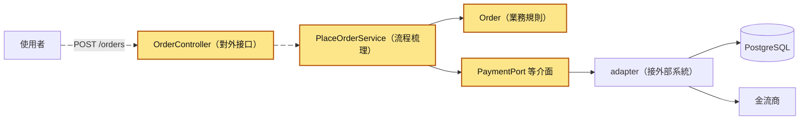

SOLID 管的是上色這幾塊之間的界線和依賴方向；資料庫怎麼調、金流商怎麼連，是系列其他篇的主題。這幾塊各自叫什麼、放在哪個資料夾，是這一章後面幾篇的主題：[依責任分層](58-依責任分層.md)講每一層放什麼，[Use Case](56-Use%20Case.md)講 `PlaceOrderService`，[六邊形架構](57-六邊形架構.md)講 port 和 adapter，[Facade](55-Facade.md)講怎麼把物流這種複雜的外部系統包成一個簡單介面。

## 生活比喻

想像一家小店，老闆一個人同時當收銀、會計、倉管，收銀機的線還直接焊在銀行的專線上。

- **單一職責**：會計要改帳本格式，結果老闆順手改到收銀的找零方式，客人被少找錢。把收銀、會計、倉管分給不同的人，各管各的。
- **開放封閉**：店裡要加收 LINE Pay，只要在櫃台多放一台機器，不用把原本的收銀機拆開重裝。
- **里氏替換**：任何一台放上櫃台的刷卡機，刷卡被拒時都要亮同一種「拒絕」燈號。有一台被拒時不亮燈、直接當機，店員就不知道該怎麼辦。
- **介面隔離**：店員只需要「刷卡」這個按鈕，就不該給他一台有退款、日結、改費率按鈕的機器，按錯了很麻煩。
- **依賴反轉**：收銀機只認牆上的標準插座，不管電從哪家電廠來。換電廠不用改收銀機，練習收銀時插一顆電池就能用。

這個比喻有幾個地方會失準：

1. 店裡換人做事，工作內容本身不會變；程式拆開以後，要多寫「誰呼叫誰」的接線程式，拆得越細，接線越多。
2. 現實的插座規格由政府訂好；程式裡的 interface（介面）要你自己設計，設計錯了，換插頭的成本一樣高。
3. 小店老闆一個人顧店常常最有效率；程式也一樣，很小的程式套滿這五個原則，反而更難讀。後面〈不適用的情境〉會講怎麼判斷。

## 它是怎麼運作的

### 目的

SOLID 的五個原則由 Robert C. Martin 整理，他在 2000 年的論文〈Design Principles and Design Patterns〉裡把它們放在一起討論；「SOLID」這個縮寫一般認為是 Michael Feathers 在 2004 年前後取的。五個原則各自來源不同（後面會講），共同的目的是讓程式在需求一直變的情況下還改得動：

- 一個需求改變，只動一個地方。
- 改了這裡，不會弄壞那裡。
- 不用起資料庫、金流伺服器，就能測業務規則和流程。

這張圖看的是重構後，三種不同的需求各自落在哪裡：

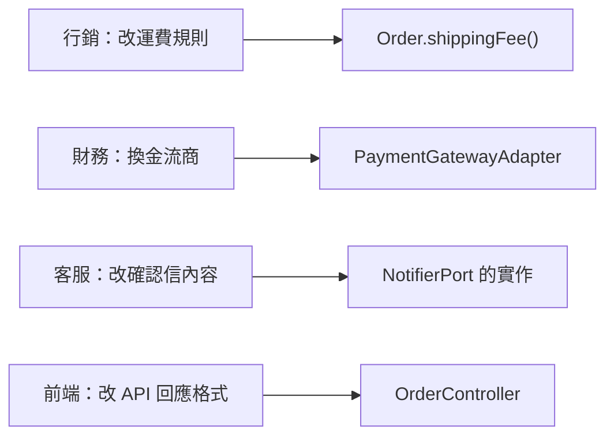

每一種需求只落在一個類別上，所以開頭情境裡 A 和 B 的修改不會再擠進同一個方法。

### 為什麼需要（原因）

開頭的 `createOrder()` 有 3 個問題，SOLID 的五個原則就是衝著這幾種問題來的：

1. **改 A 壞 B**：不同理由的修改擠在同一個方法裡，共用變數、共用流程，一個人改了變數的意思，另一個人的程式就錯了。
2. **換供應商要改業務流程**：`new PayGoClient(...)` 寫在下單流程中間，換金流商就要打開下單流程來改。
3. **測試要起整套外部系統**：沒辦法把 PayGo 換成假的，測試只能起一台假的金流伺服器、再起資料庫，於是測試寫得少，T5 那種漏洞就留下來。

這張圖看的是重構前，兩個不同的需求都打向同一個方法；會動的兩條箭頭就是 A 和 B 的修改：

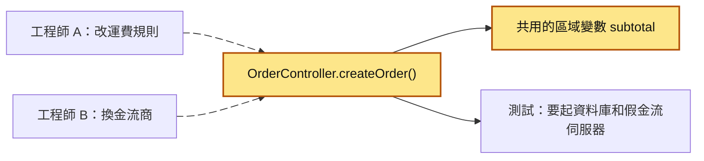

Martin 那篇 2000 年的論文談的就是軟體腐化（software rot）：程式越改越難改，改一處壞多處。

### 理念

五個原則背後有兩個想法。

第一個想法是**依「誰會要求修改」來切程式**。Martin 在 2014 年的文章〈The Single Responsibility Principle〉裡換了一個說法：會因為同樣理由一起改的東西放在一起，因為不同理由而改的東西分開。運費規則跟著行銷改，金流跟著財務和金流商改，它們就該分開。

第二個想法是**讓依賴指向比較穩定的東西**。「依賴」在這裡的意思是：A 的程式碼裡 `import` 了 B、用到了 B 的類別名稱，B 一改，A 可能就要跟著改。下單的規則（滿 1000 免運）很少變；金流商的 SDK、資料庫的 SQL、HTTP 的格式比較常換。所以讓常換的東西去依賴穩定的東西，反過來不行。

這張圖看的是重構後 `import` 的方向：每一條箭頭都從「常換的」指向「穩定的」。

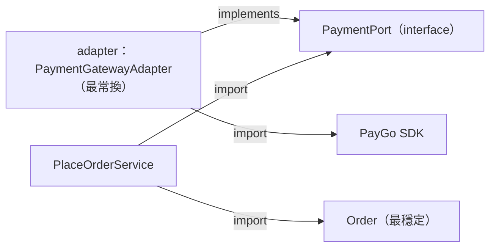

`Order` 不 import 任何東西，它最穩定；`PaymentPort` 是一個 interface（介面：只宣告有哪些方法、不寫方法內容的型別），放在流程那一側；adapter 夾在中間，一邊實作 `PaymentPort`，一邊呼叫 PayGo 的 SDK。

### 標準結構

先用一張表看五個原則各自防什麼，再一個一個看它們在下單範例裡違反和修正的樣子。

| 縮寫 | 原則 | 白話 | 要防的痛 |
|---|---|---|---|
| S | 單一職責原則（Single Responsibility Principle，SRP） | 一個模組只對一個角色負責 | 為 A 部門改的程式弄壞 B 部門的功能 |
| O | 開放封閉原則（Open–Closed Principle，OCP） | 加新功能時新增程式，不改舊程式 | 每加一種變化，都要回頭改已經上線的流程 |
| L | 里氏替換原則（Liskov Substitution Principle，LSP） | 換成任何一個實作，呼叫方都照樣正確 | 編譯過了，換一個實作卻在執行時才壞 |
| I | 介面隔離原則（Interface Segregation Principle，ISP） | 不逼使用端依賴它用不到的方法 | 胖介面一改，所有人都要跟著改 |
| D | 依賴反轉原則（Dependency Inversion Principle，DIP） | 高層流程和低層細節都依賴 interface | 換供應商要改業務流程，測試要起外部系統 |

#### S：單一職責原則（SRP）

Martin 最早的說法是「一個類別只應該有一個改變的理由」。因為「理由」這個詞常被誤會，他在 2014 年的文章裡說明理由指的是人，後來在《Clean Architecture》裡改寫成：一個模組只對一個角色（actor）負責。角色指的是會要求修改這段程式的一群人，例如行銷部、財務部、客服部。

**要防的痛**：開頭的情境就是。行銷要的修改和財務要的修改擠在同一個方法裡，一個改壞另一個。

**違反長什麼樣子**：`OrderController.createOrder()` 同時對 4 個角色負責。

**修正後長什麼樣子**：每個角色的需求搬到自己的地方。這張圖看的是同一批角色，重構前後各自要改哪裡：

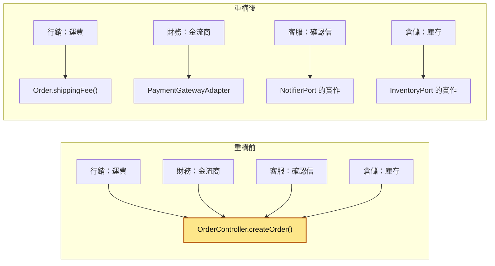

`OrderController` 剩下的工作是把 HTTP 請求轉成 `PlaceOrderCommand`、呼叫 `PlaceOrderService`、把結果轉成 HTTP 回應，它只對「API 長什麼樣子」這個角色負責。

**常見誤解 1：「一個類別只做一件事」**。Martin 在《Clean Architecture》裡說明，SRP 常被誤讀成「每個模組只做一件事」；「一個函式只做一件事」是另一條寫函式時的建議，跟 SRP 是兩回事。`PlaceOrderService.execute()` 依序做了 7 件事，它仍然符合 SRP，因為這 7 步的順序只會因為「下單流程本身改了」而改。

**常見誤解 2：拆過頭**。把「一個改變的理由」誤讀成「一個函式只能做一件小事」，結果一支由上往下讀得懂的方法，被切成一層包一層的小方法，每一層只把參數原封不動傳下去。這張圖看的是同一個「檢查庫存」，拆過頭和沒拆的呼叫深度：

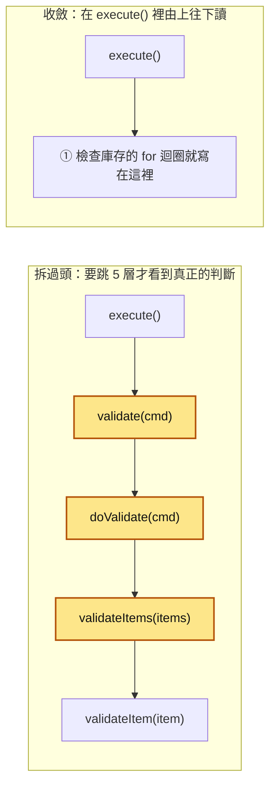

上色的 3 層什麼都沒藏，拿掉它們，`execute()` 也不會變複雜。讀的人要跳 5 個方法才看到 `available(sku) < quantity` 那一行；要在檢查時多帶一個參數，就要改 5 個方法的簽名。判斷方法是問：這一層有沒有替呼叫端藏起什麼複雜度？拿掉它，呼叫端會不會變難讀？兩題都答「不會」，這一層就是多的。怎麼辨認、怎麼收斂，[可見性與模組深度](59-可見性與模組深度.md)有一整節在講。

#### O：開放封閉原則（OCP）

這個原則出自 Bertrand Meyer 1988 年的《Object-Oriented Software Construction》：軟體元件應該對擴充開放、對修改封閉。Meyer 當時的做法是用繼承；後來 Martin 等人把它改成用 interface，也就是今天常見的說法：要支援新的變化，就新增一個實作，不去改原本的流程。

**要防的痛**：每加一種新變化，都要打開已經測好、上線的流程程式來改，改的時候可能碰壞原本的分支。

**違反長什麼樣子**：客服要求確認信之外也發簡訊，之後又要加 LINE。如果 `PlaceOrderService` 裡寫的是 `switch (channel)`，每加一個管道，就要改一次 `PlaceOrderService` 和它的測試。

**修正後長什麼樣子**：`PlaceOrderService` 只認得 `NotifierPort`。這張圖看的是加上 LINE 通知時，哪些類別動了：

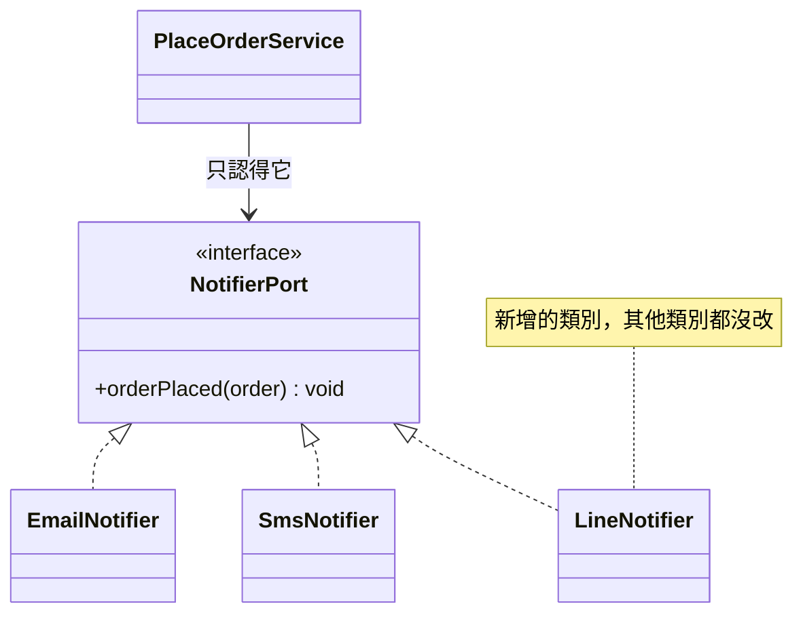

加 LINE 時新增 `LineNotifier`，再到組裝的地方（`Application.java` 的 `buildApp()`）把它接上去，`PlaceOrderService` 一行都不用改。`PlaceOrderService` 只收一個 `NotifierPort`，所以要同時發多個管道時，`buildApp()` 可以交給它一個「依序呼叫每個管道」的實作。

**常見誤解：「程式寫好就永遠不能改」**。修 bug、需求本身變了（例如下單流程多一步），照樣要改；加 LINE 時 `buildApp()` 也要改一行。OCP 要求的是把「會一直多出新種類的地方」做成可以加實作的形狀，讓流程本身不用動。另一個誤解是預先替每個可能的變化都留擴充點。只有 Email 一種通知時，先不用 `NotifierPort`；第二種管道真的出現，再抽出來也不遲。Martin Fowler 在〈Yagni〉這篇文章裡講過這筆帳：為「以後可能需要」先寫的程式，在用到之前每天都要有人讀、有人維護。

#### L：里氏替換原則（LSP）

這個原則出自 Barbara Liskov 1987 年的演講〈Data abstraction and hierarchy〉，她和 Jeannette Wing 在 1994 年的論文〈A behavioral notion of subtyping〉裡寫成正式定義。白話是：程式裡用到某個型別的地方，換成它的任何一個子型別或實作，程式都要照樣正確。實作不能對輸入要求得比 interface 更多（前置條件不能加強），也不能做到的比 interface 承諾的更少（後置條件不能減弱）。

**要防的痛**：Java 編譯器只檢查方法名稱和參數型別對不對得上，不檢查「被拒時要丟什麼例外」這種行為約定。所以換一個實作，編譯照樣過，執行時才壞。

**違反長什麼樣子**：`PaymentPort` 的約定寫在它的說明文件裡：成功回傳付款編號（`paymentId`），被拒時丟 `PaymentDeclinedException`。`OrderController` 依照這個約定，接到 `PaymentDeclinedException` 就回 `402`，告訴使用者「卡片被拒」。有人寫了 `NewPayPaymentAdapter implements PaymentPort`，被拒時卻讓 NewPay SDK 自己的 `NewPayException` 直接丟出去。

這張表看的是同一張被拒的卡，換了實作之後每一步發生什麼：

| 步驟 | PlaceOrderService | PaymentPort 的實作 | OrderController | 使用者看到 |
|---|---|---|---|---|
| 1 | 呼叫 `payment.charge(orderId, 860)` | | | |
| 2 | | PayGo 版：丟 `PaymentDeclinedException` | 接住，回 `402` | 「卡片被拒，請換一張卡」 |
| 3 | 換成 NewPay 版，再呼叫一次 | | | |
| 4 | | NewPay 版：丟 `NewPayException` | 沒接住 | |
| 5 | | | 回 `500` | 「系統錯誤」，不知道要換卡 |

**修正後長什麼樣子**：adapter 負責把 SDK 自己的例外翻成 `PaymentDeclinedException`。這張圖看的是修正後，一次被拒的扣款怎麼一路傳回去：

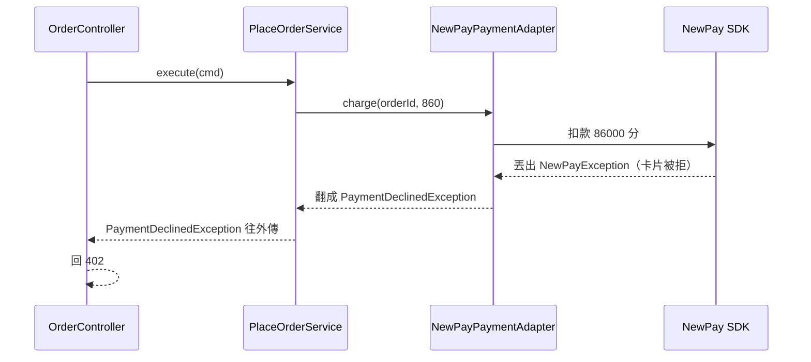

想確保每個實作都守約定，可以寫一組「契約測試」：同一組測試案例對每一個 `PaymentPort` 實作各跑一次，例如「被拒的卡一定丟 `PaymentDeclinedException`」。

**常見誤解：「有 `implements` 或 `extends` 就符合 LSP」**。編譯器只保證方法簽名一樣。教科書常用的例子是「正方形繼承長方形」：數學上正方形是一種長方形，但程式裡把寬設成 5、高設成 4，長方形的面積是 20，正方形為了保持四邊相等，面積就不是 20 了，用長方形的程式會算錯。

#### I：介面隔離原則（ISP）

Martin 在替 Xerox 當顧問時提出這個原則：不該逼使用端依賴它用不到的方法。

**要防的痛**：一個什麼都包的「胖介面」，每個使用端都只用其中一兩個方法，卻要跟著它的每一次修改重新編譯、重新改測試；寫 fake（測試用的假實作）時，還要把一堆用不到的方法都實作出來。

**違反長什麼樣子**：有人把金流商的所有功能做成一個 `PaymentGateway` interface，有 `charge`、`refund`、`listTransactions`、`dailySettlement` 4 個方法。`PlaceOrderService` 只用 `charge`，可是它的測試裡的 fake 要實作 4 個方法，其中 3 個只能寫 `throw new UnsupportedOperationException()`。

**修正後長什麼樣子**：依「誰在用」來切。這張圖看的是切開之後，每個使用端只認得自己要的那個 interface，背後仍然可以是同一個 adapter：

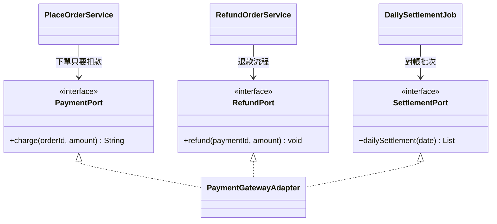

**常見誤解：「每個 interface 只能有一個方法」**。ISP 是依使用端切，一個使用端會一起用到的方法就放在一起。`OrderRepository` 有 `nextId` 和 `save` 兩個方法，`PlaceOrderService` 兩個都要用，就不用再拆。

#### D：依賴反轉原則（DIP）

Martin 在 1996 年的文章〈The Dependency Inversion Principle〉裡提出這個原則，分兩句：高層模組不該依賴低層模組，兩者都應該依賴抽象；抽象不該依賴細節，細節應該依賴抽象。「高層」在這裡指下單流程和業務規則，「低層」指 SQL、HTTP、金流 SDK 這些細節，「抽象」在 Java 裡通常就是 interface。

**要防的痛**：開頭情境的第 2、3 個問題。換金流商要打開下單流程來改；測試沒辦法把 PayGo 換掉，只能起一台假的金流伺服器。

**違反長什麼樣子**：`createOrder()` 裡直接寫 `new PayGoClient(...)`。下單流程的原始碼裡寫著 PayGo 的類別名稱，它依賴 PayGo。

**修正後長什麼樣子**：`PlaceOrderService` 只認得 `PaymentPort` 這個 interface，`PaymentPort` 放在流程這一側（`application/port/out/`）。`PaymentGatewayAdapter` 實作 `PaymentPort`，PayGo 的 SDK 只出現在它裡面。這張圖看的是兩種方向：會動的箭頭是程式執行時呼叫的路線，虛線是原始碼裡 `import` 的方向。

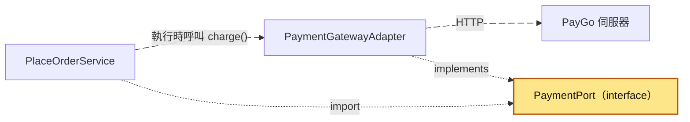

執行時，呼叫從流程走向 adapter 再走向 PayGo；原始碼裡，adapter 反過來依賴流程那一側的 `PaymentPort`。「反轉」指的就是這兩個方向相反。誰把 adapter 接到 `PlaceOrderService` 上？是組裝的地方 `Application.java` 的 `buildApp()`，它手動 `new` 出每個物件、一個一個傳進去：

```java
PaymentPort payment = new PaymentGatewayAdapter(new PayGoClient(paygoUrl));
PlaceOrderUseCase placeOrder =
        new PlaceOrderService(orders, inventory, payment, shipping, notifier);
```

Spring 的 DI 容器（Dependency Injection，依賴注入）做的就是這件事，只是改成由框架自動 `new`、自動傳進去。

換成 NewPay 時，新增一個 `NewPayPaymentAdapter`，「金額乘 100 變成分」寫在它裡面，`buildApp()` 換掉一行。`PlaceOrderService` 永遠用 `order.total()` 扣款，開頭情境那種「扣款金額跟訂單金額不一樣」就沒有地方可以發生。測試時，交給 `PlaceOrderService` 一個 `FakePaymentPort` 就好，完整程式在「動手看看」。

**常見誤解：DIP、依賴注入、用 Spring 是同一件事**。依賴注入是一種手法：物件需要的東西由外面傳進來，不在裡面自己 `new`。DIP 講的是方向：interface 由誰擁有、原始碼誰 `import` 誰。用 Spring 把 `PayGoClient` 直接注入 `PlaceOrderService`，有依賴注入，卻沒有依賴反轉，下單流程還是寫著 PayGo 的類別名稱。

#### 五個原則放在一起

重構後的目錄結構如下，這一章的其他幾篇都用這個結構：

```
src/main/java/com/example/order/
  domain/                       # 業務實現：不 import 任何框架、資料庫、HTTP
    Order.java                  # 計算總額與運費的規則（SRP）
    OrderLine.java
    OutOfStockException.java
    PaymentDeclinedException.java   # 所有金流 adapter 都要翻成這個（LSP）
  application/
    port/
      in/PlaceOrderUseCase.java     # 外界呼叫我的介面
      out/PaymentPort.java          # 只有下單需要的 charge（ISP）
      out/NotifierPort.java         # 加通知管道時新增實作（OCP）
      out/...                       # OrderRepository、InventoryPort、ShippingPort、ShipmentReceipt
    service/PlaceOrderService.java  # 只認得 port（DIP）
  adapter/
    in/web/OrderController.java     # 只負責 HTTP 轉譯（SRP）
    out/payment/PaymentGatewayAdapter.java   # PayGo SDK 只出現在這裡（DIP）
  Application.java              # buildApp()：把 adapter 接到 port 上
```

這張圖看的是下單流程裡最主要的幾個類別和它們的關係：

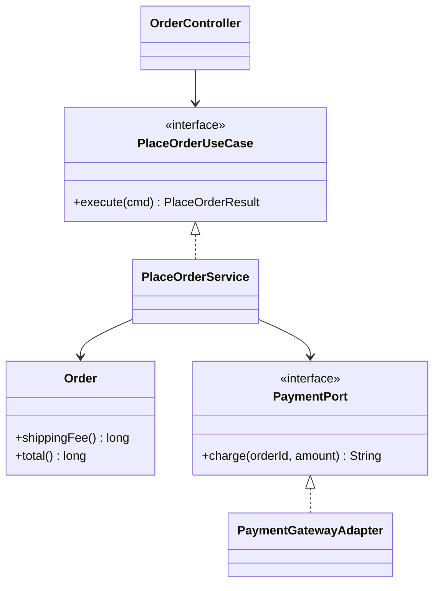

### 適用情境

SOLID 值得花力氣的時候，通常有下面幾種跡象：

- 程式會活很久、很多人一起改，同一個類別常常被不同部門的需求改到。
- 會換或會多接外部供應商：金流商、物流商、簡訊商。
- 業務規則和流程需要不起資料庫、不起外部伺服器就能測。
- 同一種變化已經出現第二次：第二家金流商、第二個通知管道。

這張圖看的是遇到一段程式時，怎麼判斷現在要不要拆：

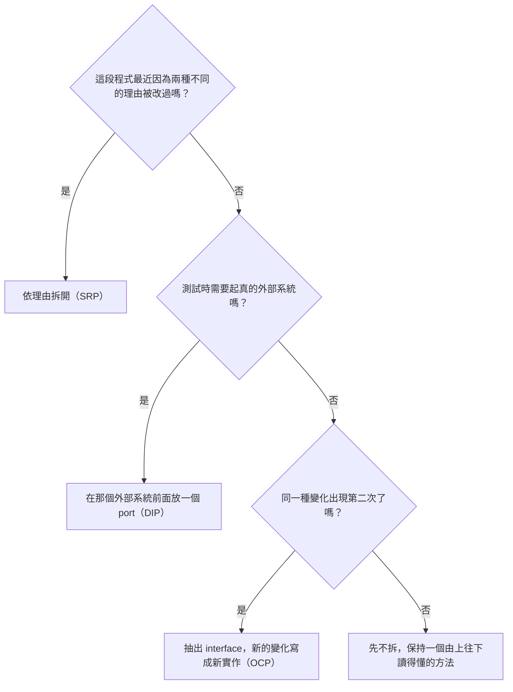

三個問題都在問「已經發生的事」，不問「以後可能會怎樣」。拆的時候要先有測試保護，測試的寫法在[傳統測試方式](52-傳統測試方式.md)。

### 不適用的情境

下面這些情況，套滿 SOLID 通常只會讓程式更難讀：

- 一次性的腳本、資料修補程式：跑完就丟，沒有第二次修改。
- 原型、概念驗證：需求還在試，今天切好的界線下週就不對了。
- 很小的工具或內部程式：一個人維護，只接一個外部系統。
- 只有一個實作、也看不到第二個實作的地方：例如只會用 Email 寄的內部通知。

用一個例子看「套滿」長什麼樣子。假設有人寫了一支一次性的程式，把昨天的訂單匯出成 CSV 檔，卻照著下單流程的結構拆。下面是新人想知道「CSV 的欄位是哪幾個」時，要依序打開的檔案：

| 步驟 | 打開的檔案 | 裡面做了什麼 |
|---|---|---|
| 1 | `ExportCommand.java` | `main` 方法，呼叫 `ExportUseCase` |
| 2 | `ExportUseCase.java` | 一個 interface，只有一個方法 |
| 3 | `ExportService.java` | 呼叫 `OrderReaderPort`，再呼叫 `CsvWriterPort` |
| 4 | `OrderReaderPort.java` | 一個 interface，只有一個實作 |
| 5 | `JdbcOrderReader.java` | 真正的 SQL 在這裡 |
| 6 | `CsvWriterImpl.java` | 真正的 CSV 欄位在這裡 |

這支程式只跑一次，不會換資料庫，也不會換檔案格式。6 個檔案裡有 4 個只是轉傳，同樣的事寫在一個 `main` 方法裡，由上往下讀就看完了。

判斷「現在值不值得拆」，可以用上一節那三個問題，再加一條：拆完之後，新人看懂一個流程要跳幾個檔案？跳的檔案變多了，卻沒有換到「改一處不壞另一處」或「不起外部系統就能測」，這次拆就不划算。

### 優點與缺點

| 原則 | 用對時的好處 | 用過頭時的代價 |
|---|---|---|
| SRP | 不同部門的需求不會改到同一個方法 | 切成一堆只轉傳的小方法，呼叫深度變長 |
| OCP | 加新的種類只要新增類別 | 替還沒出現的變化預留擴充點，多出沒人用的 interface |
| LSP | 換實作不用擔心呼叫方出錯 | 要寫清楚每個 interface 的行為約定，還要有契約測試 |
| ISP | fake 好寫，修改影響的範圍小 | 切得太碎，一個使用端要注入五六個 interface |
| DIP | 換供應商只改 adapter，測試不用起外部系統 | 多了 interface 和組裝的程式；只有一個實作時常常是白做 |

整體來說，SOLID 換到的是「改得動、測得到」，付出的是更多的類別、更多的檔案、更多的接線。程式越大、活得越久、改的人越多，這筆交易越划算；程式越小、越短命，越不划算。

## 動手看看

我們用純 JDK 加 JUnit 5，跑一次重構前和重構後的測試，比較兩邊為了測「扣款金額對不對」各要準備什麼。

### 1. 準備環境

需要 JDK 21 以上。用 Maven 的話，`pom.xml` 加上 JUnit 5 的依賴，並把編譯版本設成 21：

```xml
<properties>
  <maven.compiler.release>21</maven.compiler.release>
</properties>
<dependencies>
  <dependency>
    <groupId>org.junit.jupiter</groupId>
    <artifactId>junit-jupiter</artifactId>
    <version>5.13.4</version>
    <scope>test</scope>
  </dependency>
</dependencies>
```

程式照 Maven 的慣例放在 `src/main/java`、`src/test/java`，跑 `mvn test` 即可。本文的輸出是用 JUnit Console Launcher（從 Maven Central 下載的 `junit-platform-console-standalone-1.13.4.jar`，以下叫 `junit-console.jar`）跑的，Maven 的輸出格式不同。不用 Maven 時，在專案資料夾用 PowerShell 跑：

```powershell
$J = "junit-console.jar"   # 換成你放 jar 的路徑
javac --release 21 -d out -cp $J (Get-ChildItem -Recurse src -Filter *.java).FullName
java -jar $J execute --class-path out --scan-class-path --disable-banner --details=tree
```

### 2. 重構前：金流 client 寫死在 controller 裡

先開一個 `before` 資料夾。第一個檔案是假的金流 SDK，`charge()` 會真的發 HTTP 請求。第一個參數是商家自己的參考編號，這裡傳訂單編號，PayGo 對帳時用它找回是哪一筆訂單：

??? example "完整程式：PayGoClient.java"

    ```java
    // before/src/main/java/com/paygo/sdk/PayGoClient.java
    package com.paygo.sdk;

    import java.io.IOException;
    import java.net.URI;
    import java.net.http.HttpClient;
    import java.net.http.HttpRequest;
    import java.net.http.HttpResponse;
    import java.time.Duration;
    import java.util.regex.Matcher;
    import java.util.regex.Pattern;

    // 假裝是金流商 PayGo 給的 SDK：呼叫 charge() 會真的發 HTTP 請求
    public class PayGoClient {

        public static class CardDeclinedException extends Exception {
            public CardDeclinedException(String reason) {
                super(reason);
            }
        }

        private static final Pattern CHARGE_ID = Pattern.compile("\"charge_id\":\"([^\"]+)\"");

        private final HttpClient http = HttpClient.newBuilder()
                .connectTimeout(Duration.ofSeconds(3))
                .build();
        private final URI endpoint;

        public PayGoClient(String baseUrl) {
            this.endpoint = URI.create(baseUrl + "/charge");
        }

        // reference：商家自己的訂單編號，PayGo 用它對帳
        public String charge(String reference, long amount)
                throws CardDeclinedException, IOException, InterruptedException {
            String json = "{\"reference\":\"%s\",\"amount\":%d}".formatted(reference, amount);
            HttpRequest req = HttpRequest.newBuilder(endpoint)
                    .timeout(Duration.ofSeconds(5))
                    .header("Content-Type", "application/json")
                    .POST(HttpRequest.BodyPublishers.ofString(json))
                    .build();
            String body = http.send(req, HttpResponse.BodyHandlers.ofString()).body();
            // 範例簡化：不引入 JSON 函式庫，直接比對字串
            Matcher m = CHARGE_ID.matcher(body);
            if (!body.contains("\"status\":\"ok\"") || !m.find()) {
                throw new CardDeclinedException(body);
            }
            return m.group(1);
        }
    }
    ```

第二個檔案是重構前的 controller。`record`（Java 16 起的語法）是一行就能宣告的「只裝資料」的類別。

下面是 `createOrder()` 裡 ② 到 ④ 這一段：運費直接加進 `subtotal`，扣款也用 `subtotal`，金流 SDK 在方法中間 `new` 出來。第 3 步就是改這一段：

```java
// ② 算總額和運費：業務規則混在 controller 裡
long subtotal = 0;
for (LineRequest line : req.lines()) {
    subtotal += PRICES.get(line.sku()) * line.quantity();
}
if (subtotal < 1000) {
    subtotal += 60;
}

// ③ 建立訂單：真實版本是 INSERT INTO orders ... 再拿回訂單編號（這裡省略）
String orderId = "ORD-" + (++orderSeq);

// ④ 直接 new 金流 SDK：網址從系統屬性讀，沒設就打正式環境
PayGoClient paygo = new PayGoClient(
        System.getProperty("paygo.url", "https://api.paygo.example"));
String paymentId;
try {
    paymentId = paygo.charge(orderId, subtotal);
} catch (PayGoClient.CardDeclinedException e) {
    return new ApiResponse(402, "payment_declined");
} catch (Exception e) {
    return new ApiResponse(502, "payment_error");
}
```

??? example "完整程式：OrderController.java（重構前）"

    ```java
    // before/src/main/java/com/example/order/OrderController.java
    package com.example.order;

    import com.paygo.sdk.PayGoClient;

    import java.util.ArrayList;
    import java.util.HashMap;
    import java.util.List;
    import java.util.Map;

    // 重構前：下單的所有事情都寫在 controller 的一個方法裡
    public class OrderController {

        public record LineRequest(String sku, int quantity) {}

        public record CreateOrderRequest(String customerId, List<LineRequest> lines) {}

        public record ApiResponse(int status, String body) {}

        // 真實專案這裡是 JDBC 查 products 表、INSERT orders 表。
        // 動手看看用 static Map 代替，不然測試還得多起一個資料庫。
        static final Map<String, Long> PRICES = new HashMap<>();
        static final Map<String, Integer> STOCK = new HashMap<>();
        static final List<String> SENT_MAILS = new ArrayList<>(); // 代替真的寄信
        static int orderSeq = 0; // 代替資料庫產生的訂單編號

        public ApiResponse createOrder(CreateOrderRequest req) {
            // ① 檢查庫存
            for (LineRequest line : req.lines()) {
                if (STOCK.getOrDefault(line.sku(), 0) < line.quantity()) {
                    return new ApiResponse(409, "out_of_stock");
                }
            }

            // ② 算總額和運費：業務規則混在 controller 裡
            long subtotal = 0;
            for (LineRequest line : req.lines()) {
                subtotal += PRICES.get(line.sku()) * line.quantity();
            }
            if (subtotal < 1000) {
                subtotal += 60;
            }

            // ③ 建立訂單：真實版本是 INSERT INTO orders ... 再拿回訂單編號（這裡省略）
            String orderId = "ORD-" + (++orderSeq);

            // ④ 直接 new 金流 SDK：網址從系統屬性讀，沒設就打正式環境
            PayGoClient paygo = new PayGoClient(
                    System.getProperty("paygo.url", "https://api.paygo.example"));
            String paymentId;
            try {
                paymentId = paygo.charge(orderId, subtotal);
            } catch (PayGoClient.CardDeclinedException e) {
                return new ApiResponse(402, "payment_declined");
            } catch (Exception e) {
                return new ApiResponse(502, "payment_error");
            }

            // ⑤ 扣庫存
            for (LineRequest line : req.lines()) {
                STOCK.merge(line.sku(), -line.quantity(), Integer::sum);
            }

            // ⑥ 通知物流：省略，寫法跟金流一樣是直接 new 一個 SDK
            // ⑦ 寄確認信
            SENT_MAILS.add(req.customerId() + " 總金額 " + subtotal + " 元");
            return new ApiResponse(201, "{\"order_id\":\"" + orderId + "\",\"payment_id\":\"" + paymentId
                    + "\",\"total\":" + subtotal + "}");
        }
    }
    ```

測試沒辦法把 `new PayGoClient(...)` 換掉，只好在本機起一台假的 PayGo 伺服器（JDK 內建的 `com.sun.net.httpserver.HttpServer`），再用系統屬性把網址指過去；要測「被拒」，還得多一個 `static` 開關叫假伺服器回被拒。

測試裡最費工的是這一段：起一台假的 PayGo 伺服器、記下它收到的金額、再把系統屬性指過去：

```java
fakePayGo = HttpServer.create(new InetSocketAddress("127.0.0.1", 0), 0); // 0：讓作業系統挑空的連接埠
fakePayGo.createContext("/charge", exchange -> {
    String body = new String(exchange.getRequestBody().readAllBytes(), UTF_8);
    Matcher m = AMOUNT.matcher(body);
    m.find();
    charges.add(Long.parseLong(m.group(1)));
    String resp = declineAll
            ? "{\"status\":\"declined\"}"
            : "{\"status\":\"ok\",\"charge_id\":\"ch_1\"}";
    byte[] bytes = resp.getBytes(UTF_8);
    exchange.sendResponseHeaders(200, bytes.length);
    try (OutputStream os = exchange.getResponseBody()) {
        os.write(bytes);
    }
});
fakePayGo.start();
System.setProperty("paygo.url", "http://127.0.0.1:" + fakePayGo.getAddress().getPort());
```

??? example "完整程式：OrderControllerTest.java（重構前）"

    ```java
    // before/src/test/java/com/example/order/OrderControllerTest.java
    package com.example.order;

    import static java.nio.charset.StandardCharsets.UTF_8;
    import static org.junit.jupiter.api.Assertions.assertEquals;

    import com.example.order.OrderController.CreateOrderRequest;
    import com.example.order.OrderController.LineRequest;
    import com.sun.net.httpserver.HttpServer;
    import java.io.IOException;
    import java.io.OutputStream;
    import java.net.InetSocketAddress;
    import java.util.List;
    import java.util.concurrent.CopyOnWriteArrayList;
    import java.util.regex.Matcher;
    import java.util.regex.Pattern;
    import org.junit.jupiter.api.AfterAll;
    import org.junit.jupiter.api.BeforeAll;
    import org.junit.jupiter.api.BeforeEach;
    import org.junit.jupiter.api.Test;

    // 測重構前的 controller：PayGoClient 是在方法裡 new 出來的，換不掉，
    // 只好在本機起一台假的 PayGo 伺服器，再用系統屬性把網址指過去
    class OrderControllerTest {

        static HttpServer fakePayGo;
        static final List<Long> charges = new CopyOnWriteArrayList<>();
        static final Pattern AMOUNT = Pattern.compile("\"amount\":(\\d+)");
        static volatile boolean declineAll; // true：假 PayGo 一律回「被拒」

        @BeforeAll
        static void startFakePayGo() throws IOException {
            fakePayGo = HttpServer.create(new InetSocketAddress("127.0.0.1", 0), 0); // 0：讓作業系統挑空的連接埠
            fakePayGo.createContext("/charge", exchange -> {
                String body = new String(exchange.getRequestBody().readAllBytes(), UTF_8);
                Matcher m = AMOUNT.matcher(body);
                m.find();
                charges.add(Long.parseLong(m.group(1)));
                String resp = declineAll
                        ? "{\"status\":\"declined\"}"
                        : "{\"status\":\"ok\",\"charge_id\":\"ch_1\"}";
                byte[] bytes = resp.getBytes(UTF_8);
                exchange.sendResponseHeaders(200, bytes.length);
                try (OutputStream os = exchange.getResponseBody()) {
                    os.write(bytes);
                }
            });
            fakePayGo.start();
            System.setProperty("paygo.url", "http://127.0.0.1:" + fakePayGo.getAddress().getPort());
        }

        @AfterAll
        static void stopFakePayGo() {
            fakePayGo.stop(0);
            System.clearProperty("paygo.url");
        }

        @BeforeEach
        void resetStaticState() { // static 狀態會在測試之間互相影響，每次都要重設
            charges.clear();
            declineAll = false;
            OrderController.PRICES.clear();
            OrderController.PRICES.put("BOOK", 400L);
            OrderController.STOCK.clear();
            OrderController.STOCK.put("BOOK", 10);
            OrderController.SENT_MAILS.clear();
        }

        @Test
        void chargesTotalIncludingShipping() {
            var resp = new OrderController().createOrder(
                    new CreateOrderRequest("c-1", List.of(new LineRequest("BOOK", 2))));
            assertEquals(201, resp.status());
            assertEquals(List.of(860L), charges); // 800 + 運費 60
            assertEquals(1, OrderController.SENT_MAILS.size());
        }

        @Test
        void declinedPaymentKeepsStock() {
            declineAll = true;
            var resp = new OrderController().createOrder(
                    new CreateOrderRequest("c-1", List.of(new LineRequest("BOOK", 2))));
            assertEquals(402, resp.status());
            assertEquals(10, OrderController.STOCK.get("BOOK"));
            assertEquals(0, OrderController.SENT_MAILS.size());
        }
    }
    ```

在 `before` 資料夾跑第 1 步的兩行指令，預期輸出（執行時間依機器而異，這裡省略）：

```
╷
├─ JUnit Platform Suite ✔
├─ JUnit Jupiter ✔
│  └─ OrderControllerTest ✔
│     ├─ chargesTotalIncludingShipping() ✔
│     └─ declinedPaymentKeepsStock() ✔
└─ JUnit Vintage ✔
```

`JUnit Platform Suite`、`JUnit Vintage` 是 Console Launcher 內建的另外兩個測試引擎，這裡沒有用到，可以不管。

### 3. 重現開頭的情境

把 `OrderController.java` 的 ② 改成工程師 A 的寫法，扣款那一行不動：

```java
        long shipping = subtotal >= 1000 ? 0 : 60;
        long total = subtotal + shipping;
```

也就是刪掉 `if (subtotal < 1000) { subtotal += 60; }`，換成上面兩行。重新編譯、執行，`chargesTotalIncludingShipping()` 會失敗：

```
│     ├─ chargesTotalIncludingShipping() ✘ expected: <[860]> but was: <[800]>
│     └─ declinedPaymentKeepsStock() ✔
```

這就是開頭情境 T4 之後的狀態。試完把 ② 改回原樣。

### 4. 重構後：PlaceOrderService 只認得 PaymentPort

另開一個 `after` 資料夾，把 `PayGoClient.java` 照原路徑複製過去。先寫業務實現層（domain，`domain/` 資料夾，只放運費這類業務規則）：

```java
// after/src/main/java/com/example/order/domain/OrderLine.java
package com.example.order.domain;

public record OrderLine(String sku, long unitPrice, int quantity) {

    public long amount() {
        return unitPrice * quantity;
    }
}
```

`Order` 的重點是這三個方法，運費規則只寫在這裡：

```java
public long subtotal() {
    return lines.stream().mapToLong(OrderLine::amount).sum();
}

public long shippingFee() {
    return subtotal() >= FREE_SHIPPING_THRESHOLD ? 0 : SHIPPING_FEE;
}

public long total() {
    return subtotal() + shippingFee();
}
```

??? example "完整程式：Order.java"

    ```java
    // after/src/main/java/com/example/order/domain/Order.java
    package com.example.order.domain;

    import java.util.List;

    // 業務規則：不 import 任何框架、資料庫、HTTP
    public class Order {

        public enum Status { PENDING, PAID }

        static final long FREE_SHIPPING_THRESHOLD = 1000; // 滿 1000 元免運
        static final long SHIPPING_FEE = 60;

        private final String id;
        private final String customerId;
        private final List<OrderLine> lines;
        private Status status = Status.PENDING;
        private String paymentId;

        public Order(String id, String customerId, List<OrderLine> lines) {
            this.id = id;
            this.customerId = customerId;
            this.lines = List.copyOf(lines);
        }

        public long subtotal() {
            return lines.stream().mapToLong(OrderLine::amount).sum();
        }

        public long shippingFee() {
            return subtotal() >= FREE_SHIPPING_THRESHOLD ? 0 : SHIPPING_FEE;
        }

        public long total() {
            return subtotal() + shippingFee();
        }

        public void markPaid(String paymentId) {
            this.status = Status.PAID;
            this.paymentId = paymentId;
        }

        public String id() { return id; }
        public String customerId() { return customerId; }
        public List<OrderLine> lines() { return lines; }
        public Status status() { return status; }
        public String paymentId() { return paymentId; }
    }
    ```

```java
// after/src/main/java/com/example/order/domain/OutOfStockException.java
package com.example.order.domain;

public class OutOfStockException extends RuntimeException {

    private final String sku;

    public OutOfStockException(String sku) {
        super("庫存不足：" + sku);
        this.sku = sku;
    }

    public String sku() {
        return sku;
    }
}
```

```java
// after/src/main/java/com/example/order/domain/PaymentDeclinedException.java
package com.example.order.domain;

// 扣款被拒。不管接的是哪一家金流商，adapter 都要轉成這個例外
public class PaymentDeclinedException extends RuntimeException {

    public PaymentDeclinedException(String reason) {
        super("扣款被拒：" + reason);
    }

    public PaymentDeclinedException(String reason, Throwable cause) {
        super("扣款被拒：" + reason, cause);
    }
}
```

再寫 Port In（外界呼叫我的介面），3 個檔案都在 `application/port/in/`：

```java
// after/src/main/java/com/example/order/application/port/in/PlaceOrderCommand.java
package com.example.order.application.port.in;

import java.util.List;

public record PlaceOrderCommand(String customerId, List<Item> items) {

    public record Item(String sku, int quantity) {}
}
```

```java
// after/src/main/java/com/example/order/application/port/in/PlaceOrderResult.java
package com.example.order.application.port.in;

public record PlaceOrderResult(String orderId, long total) {}
```

```java
// after/src/main/java/com/example/order/application/port/in/PlaceOrderUseCase.java
package com.example.order.application.port.in;

// Port In：外界「呼叫我」的介面
public interface PlaceOrderUseCase {

    PlaceOrderResult execute(PlaceOrderCommand cmd);
}
```

Port Out（我呼叫外界的介面）都在 `application/port/out/`：5 個 port，加上 `ShippingPort` 回傳的 `ShipmentReceipt`。這次的主角是 `PaymentPort`，注意它只收訂單編號和金額，卡片之類的付款工具資訊不出現在 port 上：

```java
// after/src/main/java/com/example/order/application/port/out/PaymentPort.java
package com.example.order.application.port.out;

// Port Out：流程梳理層需要「扣款」這件事，但不在乎是哪一家金流商
public interface PaymentPort {

    /** 替訂單 orderId 扣款 amount 元。成功回傳付款編號（paymentId）；被拒時丟 PaymentDeclinedException。 */
    String charge(String orderId, long amount);
}
```

```java
// after/src/main/java/com/example/order/application/port/out/OrderRepository.java
package com.example.order.application.port.out;

import com.example.order.domain.Order;

public interface OrderRepository {

    String nextId(); // 先拿到訂單編號：扣款、出貨都要用它

    void save(Order order); // 新增或更新都用 save
}
```

```java
// after/src/main/java/com/example/order/application/port/out/InventoryPort.java
package com.example.order.application.port.out;

public interface InventoryPort {

    int available(String sku);

    long priceOf(String sku); // 範例簡化：庫存服務順便回單價

    void deduct(String sku, int quantity); // 庫存不夠時丟 OutOfStockException
}
```

```java
// after/src/main/java/com/example/order/application/port/out/ShippingPort.java
package com.example.order.application.port.out;

import com.example.order.domain.Order;

public interface ShippingPort {

    ShipmentReceipt ship(Order order); // 回傳託運單號和標籤網址
}
```

```java
// after/src/main/java/com/example/order/application/port/out/ShipmentReceipt.java
package com.example.order.application.port.out;

// 出貨收據：託運單號、標籤網址
public record ShipmentReceipt(String consignmentNo, String labelUrl) {}
```

```java
// after/src/main/java/com/example/order/application/port/out/NotifierPort.java
package com.example.order.application.port.out;

import com.example.order.domain.Order;

public interface NotifierPort {

    void orderPlaced(Order order);
}
```

接著是流程梳理層（application，負責按順序呼叫各個 port）的 `PlaceOrderService`。

重點是 `execute()`：它只呼叫 port 的方法，扣款的金額從 `order.total()` 來，扣款時帶的是訂單編號：

```java
public PlaceOrderResult execute(PlaceOrderCommand cmd) {
    // ① 檢查庫存
    List<OrderLine> lines = new ArrayList<>();
    for (PlaceOrderCommand.Item item : cmd.items()) {
        if (inventory.available(item.sku()) < item.quantity()) {
            throw new OutOfStockException(item.sku());
        }
        lines.add(new OrderLine(item.sku(), inventory.priceOf(item.sku()), item.quantity()));
    }

    // ② 金額和運費的規則在 Order 裡，這裡不算
    Order order = new Order(orders.nextId(), cmd.customerId(), lines);

    // ③ 建立訂單
    orders.save(order);

    // ④ 扣款：被拒時 PaymentDeclinedException 直接往外丟，後面的步驟都不會做
    String paymentId = payment.charge(order.id(), order.total());
    order.markPaid(paymentId);
    orders.save(order);

    // ⑤ 扣庫存
    for (OrderLine line : lines) {
        inventory.deduct(line.sku(), line.quantity());
    }

    // ⑥ 通知物流 ⑦ 寄確認信
    shipping.ship(order);
    notifier.orderPlaced(order);
    return new PlaceOrderResult(order.id(), order.total());
}
```

??? example "完整程式：PlaceOrderService.java"

    ```java
    // after/src/main/java/com/example/order/application/service/PlaceOrderService.java
    package com.example.order.application.service;

    import com.example.order.application.port.in.PlaceOrderCommand;
    import com.example.order.application.port.in.PlaceOrderResult;
    import com.example.order.application.port.in.PlaceOrderUseCase;
    import com.example.order.application.port.out.InventoryPort;
    import com.example.order.application.port.out.NotifierPort;
    import com.example.order.application.port.out.OrderRepository;
    import com.example.order.application.port.out.PaymentPort;
    import com.example.order.application.port.out.ShippingPort;
    import com.example.order.domain.Order;
    import com.example.order.domain.OrderLine;
    import com.example.order.domain.OutOfStockException;
    import java.util.ArrayList;
    import java.util.List;

    // 流程梳理：按順序呼叫各個 port，不知道 HTTP、不知道 SQL、不知道哪一家金流商
    public class PlaceOrderService implements PlaceOrderUseCase {

        private final OrderRepository orders;
        private final InventoryPort inventory;
        private final PaymentPort payment;
        private final ShippingPort shipping;
        private final NotifierPort notifier;

        public PlaceOrderService(OrderRepository orders, InventoryPort inventory, PaymentPort payment,
                                 ShippingPort shipping, NotifierPort notifier) {
            this.orders = orders;
            this.inventory = inventory;
            this.payment = payment;
            this.shipping = shipping;
            this.notifier = notifier;
        }

        @Override
        public PlaceOrderResult execute(PlaceOrderCommand cmd) {
            // ① 檢查庫存
            List<OrderLine> lines = new ArrayList<>();
            for (PlaceOrderCommand.Item item : cmd.items()) {
                if (inventory.available(item.sku()) < item.quantity()) {
                    throw new OutOfStockException(item.sku());
                }
                lines.add(new OrderLine(item.sku(), inventory.priceOf(item.sku()), item.quantity()));
            }

            // ② 金額和運費的規則在 Order 裡，這裡不算
            Order order = new Order(orders.nextId(), cmd.customerId(), lines);

            // ③ 建立訂單
            orders.save(order);

            // ④ 扣款：被拒時 PaymentDeclinedException 直接往外丟，後面的步驟都不會做
            String paymentId = payment.charge(order.id(), order.total());
            order.markPaid(paymentId);
            orders.save(order);

            // ⑤ 扣庫存
            for (OrderLine line : lines) {
                inventory.deduct(line.sku(), line.quantity());
            }

            // ⑥ 通知物流 ⑦ 寄確認信
            shipping.ship(order);
            notifier.orderPlaced(order);
            return new PlaceOrderResult(order.id(), order.total());
        }
    }
    ```

這個範例沒有處理交易邊界：扣款成功後如果扣庫存失敗，要不要退款、訂單要停在什麼狀態，是 [Use Case](56-Use%20Case.md) 那篇的主題。

最後是接 PayGo 的 adapter，PayGo 的 SDK 只出現在這個檔案裡：

```java
// after/src/main/java/com/example/order/adapter/out/payment/PaymentGatewayAdapter.java
package com.example.order.adapter.out.payment;

import com.example.order.application.port.out.PaymentPort;
import com.example.order.domain.PaymentDeclinedException;
import com.paygo.sdk.PayGoClient;
import java.io.IOException;
import java.io.UncheckedIOException;

// 把 PayGo 的 SDK 轉成 PaymentPort。換金流商時，換掉的是這個類別
public class PaymentGatewayAdapter implements PaymentPort {

    private final PayGoClient client;

    public PaymentGatewayAdapter(PayGoClient client) {
        this.client = client;
    }

    @Override
    public String charge(String orderId, long amount) {
        try {
            return client.charge(orderId, amount); // 用訂單編號當 PayGo 的參考編號
        } catch (PayGoClient.CardDeclinedException e) {
            // 把 PayGo 自己的例外翻成業務例外，呼叫方才不用認識 PayGo
            throw new PaymentDeclinedException(e.getMessage(), e);
        } catch (IOException e) {
            throw new UncheckedIOException(e); // 連線問題，交給上層決定要不要重試
        } catch (InterruptedException e) {
            Thread.currentThread().interrupt();
            throw new IllegalStateException(e);
        }
    }
}
```

### 5. 重構後的測試：一個 FakePaymentPort 取代整台假伺服器

業務規則的測試，不需要任何假物件：

```java
// after/src/test/java/com/example/order/domain/OrderTest.java
package com.example.order.domain;

import static org.junit.jupiter.api.Assertions.assertEquals;

import java.util.List;
import org.junit.jupiter.api.Test;

// 測業務規則，不需要任何假物件
class OrderTest {

    @Test
    void under1000PaysShipping() {
        Order order = new Order("ORD-1", "c-1", List.of(new OrderLine("BOOK", 400, 2)));
        assertEquals(60, order.shippingFee());
        assertEquals(860, order.total());
    }

    @Test
    void from1000ShipsFree() {
        Order order = new Order("ORD-1", "c-1", List.of(new OrderLine("BOOK", 400, 3)));
        assertEquals(0, order.shippingFee());
        assertEquals(1200, order.total());
    }
}
```

流程的測試，金流只要一個 `FakePaymentPort`。

取代整台假伺服器的，就是這個十幾行的類別：

```java
static class FakePaymentPort implements PaymentPort {
    final List<Long> charges = new ArrayList<>();
    boolean decline = false;

    @Override
    public String charge(String orderId, long amount) {
        if (decline) {
            throw new PaymentDeclinedException("insufficient_funds");
        }
        charges.add(amount);
        return "pay_" + charges.size();
    }
}
```

??? example "完整程式：PlaceOrderServiceTest.java"

    ```java
    // after/src/test/java/com/example/order/application/PlaceOrderServiceTest.java
    package com.example.order.application;

    import static org.junit.jupiter.api.Assertions.assertEquals;
    import static org.junit.jupiter.api.Assertions.assertThrows;

    import com.example.order.application.port.in.PlaceOrderCommand;
    import com.example.order.application.port.in.PlaceOrderResult;
    import com.example.order.application.port.out.InventoryPort;
    import com.example.order.application.port.out.OrderRepository;
    import com.example.order.application.port.out.PaymentPort;
    import com.example.order.application.port.out.ShipmentReceipt;
    import com.example.order.application.service.PlaceOrderService;
    import com.example.order.domain.Order;
    import com.example.order.domain.OutOfStockException;
    import com.example.order.domain.PaymentDeclinedException;
    import java.util.ArrayList;
    import java.util.HashMap;
    import java.util.List;
    import java.util.Map;
    import org.junit.jupiter.api.BeforeEach;
    import org.junit.jupiter.api.Test;

    // 用記憶體裡的 fake port 測流程：不用起伺服器，也不用改系統屬性
    class PlaceOrderServiceTest {

        /** 取代整台假 PayGo 伺服器：記下扣了多少，decline 設成 true 就丟 PaymentDeclinedException */
        static class FakePaymentPort implements PaymentPort {
            final List<Long> charges = new ArrayList<>();
            boolean decline = false;

            @Override
            public String charge(String orderId, long amount) {
                if (decline) {
                    throw new PaymentDeclinedException("insufficient_funds");
                }
                charges.add(amount);
                return "pay_" + charges.size();
            }
        }

        static class InMemoryOrderRepository implements OrderRepository {
            final Map<String, Order> rows = new HashMap<>();
            int seq = 0;

            @Override
            public String nextId() {
                return "ORD-" + (++seq);
            }

            @Override
            public void save(Order order) {
                rows.put(order.id(), order);
            }
        }

        static class FakeInventory implements InventoryPort {
            final Map<String, Integer> stock = new HashMap<>(Map.of("BOOK", 10));

            @Override
            public int available(String sku) {
                return stock.getOrDefault(sku, 0);
            }

            @Override
            public long priceOf(String sku) {
                return 400;
            }

            @Override
            public void deduct(String sku, int quantity) {
                stock.merge(sku, -quantity, Integer::sum);
            }
        }

        FakePaymentPort payment;
        FakeInventory inventory;
        List<String> shipped;
        List<String> mails;
        PlaceOrderService service;

        @BeforeEach
        void setUp() {
            payment = new FakePaymentPort();
            inventory = new FakeInventory();
            shipped = new ArrayList<>();
            mails = new ArrayList<>();
            // ShippingPort、NotifierPort 只有一個方法，用 lambda 就能當 fake
            service = new PlaceOrderService(new InMemoryOrderRepository(), inventory, payment,
                    order -> { shipped.add(order.id()); return new ShipmentReceipt("C-1", "https://labels.example/C-1.pdf"); },
                    order -> mails.add(order.customerId()));
        }

        PlaceOrderResult place(int quantity) {
            return service.execute(new PlaceOrderCommand("c-1",
                    List.of(new PlaceOrderCommand.Item("BOOK", quantity))));
        }

        @Test
        void chargesTotalIncludingShipping() {
            PlaceOrderResult result = place(2);
            assertEquals(List.of(860L), payment.charges); // 800 + 運費 60
            assertEquals(860, result.total());
            assertEquals(List.of("c-1"), mails);
        }

        @Test
        void declinedPaymentKeepsStock() {
            payment.decline = true;
            assertThrows(PaymentDeclinedException.class, () -> place(2));
            assertEquals(10, inventory.stock.get("BOOK"));
            assertEquals(List.of(), shipped);
        }

        @Test
        void outOfStockChargesNothing() {
            assertThrows(OutOfStockException.class, () -> place(11));
            assertEquals(List.of(), payment.charges);
        }
    }
    ```

在 `after` 資料夾跑同樣的兩行指令，預期輸出：

```
╷
├─ JUnit Platform Suite ✔
├─ JUnit Jupiter ✔
│  ├─ OrderTest ✔
│  │  ├─ under1000PaysShipping() ✔
│  │  └─ from1000ShipsFree() ✔
│  └─ PlaceOrderServiceTest ✔
│     ├─ chargesTotalIncludingShipping() ✔
│     ├─ declinedPaymentKeepsStock() ✔
│     └─ outOfStockChargesNothing() ✔
└─ JUnit Vintage ✔
```

### 6. 兩邊比一比

| 為了測「扣款金額對不對」 | 重構前 | 重構後 |
|---|---|---|
| 金流那一端要準備什麼 | 起一台 HTTP 伺服器、挑連接埠、設系統屬性 | 一個 `FakePaymentPort` 物件 |
| 測試之間會不會互相影響 | 會，`static` 的 Map 每次都要重設 | 不會，每個測試 `new` 自己的 fake |
| 真實專案還要準備什麼 | 一個資料庫，因為 SQL 寫在 controller 裡 | 不用，`OrderRepository` 也是 fake |
| 換成 NewPay 要改哪裡 | `createOrder()` 的中間 | 新增一個 adapter，`buildApp()` 換一行 |
| 運費規則怎麼測 | 只能透過整個 `createOrder()` 間接測 | `OrderTest` 直接測 `Order.total()` |

重構後的測試檔比較長，因為每個 port 都要一個 fake。這些 fake 都是幾行的普通 Java 類別，不碰網路、不碰檔案。`PaymentGatewayAdapter` 本身要不要測、怎麼測（例如對著假伺服器測一次它的例外翻譯），是整合測試的範圍，見[傳統測試方式](52-傳統測試方式.md)。

## 常見地雷

### 地雷 1：只有一個實作，也先開 interface

- ❌ 錯誤做法：每個類別都配一個 interface，例如 `OrderExporter` 配 `OrderExporterImpl`，而且永遠只有這一個實作。
- 為什麼錯：多了一個檔案，讀的人每次都要多跳一層；IDE 按「跳到定義」只會跳到 interface，看不到真正的程式。它沒有換到任何東西：沒有第二個實作，測試也不需要替換它。
- ✅ 正確做法：只在「要替換」的地方開 interface：外部系統的邊界（金流、物流、資料庫），或測試真的需要換成 fake 的地方。其他地方先用一般類別，第二個實作出現時再抽。

### 地雷 2：為了 SRP 拆出一串只轉傳的方法

- ❌ 錯誤做法：`execute()` 呼叫 `validate()`，`validate()` 呼叫 `doValidate()`，`doValidate()` 再呼叫 `validateItems()`，每一層都只把參數原封不動傳下去。
- 為什麼錯：SRP 看的是「誰會要求修改」，跟方法有幾行無關。拆過頭時，要看懂一個流程得跳好幾層；多加一個參數要改好幾個方法的簽名。
- ✅ 正確做法：拆出來的方法要有一個說得出口的概念名稱，而且替呼叫端藏起了複雜度。只轉傳的那幾層內聯回去，用段落註解加空行分段。詳細的判斷方法見[可見性與模組深度](59-可見性與模組深度.md)。

### 地雷 3：SDK 的型別和例外漏進流程裡

- ❌ 錯誤做法：`PlaceOrderService` 裡寫 `catch (PayGoClient.CardDeclinedException e)`，或 `PaymentPort.charge()` 直接回傳 PayGo SDK 的 `ChargeResponse` 物件。
- 為什麼錯：流程梳理層的程式又出現了 PayGo 的類別名稱，換金流商時還是要改 `PlaceOrderService`，DIP 等於沒做。換成 NewPay 時，舊的 `catch` 接不到新的例外，也會變成 LSP 的問題。
- ✅ 正確做法：adapter 負責翻譯，把 SDK 的例外翻成 `PaymentDeclinedException`，回傳值翻成 `String paymentId` 這種流程看得懂的型別。

### 地雷 4：interface 放在 adapter 那一側

- ❌ 錯誤做法：把 `PaymentPort` 放在 `adapter/out/payment/` 套件裡，讓 `PlaceOrderService` 去 `import` adapter 套件裡的 interface。
- 為什麼錯：原始碼的依賴方向還是「流程依賴 adapter 那一側」，沒有反轉。之後 adapter 那一側改套件結構、改 interface，流程就要跟著改。
- ✅ 正確做法：interface 由使用它的一方擁有，放在 `application/port/out/`；它的方法照流程需要的樣子設計，不照 SDK 的樣子設計。

### 地雷 5：胖介面，fake 裡一堆 UnsupportedOperationException

- ❌ 錯誤做法：`PaymentGateway` 有 `charge`、`refund`、`listTransactions`、`dailySettlement`，下單流程的測試 fake 要實作 4 個方法，其中 3 個寫 `throw new UnsupportedOperationException()`。
- 為什麼錯：下單流程依賴了它用不到的 3 個方法，退款或對帳的介面一改，下單流程的測試也要跟著改。fake 裡的空方法，也讓人看不出這個流程到底用到了哪些功能。
- ✅ 正確做法：依使用端切成 `PaymentPort`、`RefundPort`、`SettlementPort`，同一個 adapter 可以同時實作三個。

### 地雷 6：以為用了 Spring 就是依賴反轉

- ❌ 錯誤做法：在 `PlaceOrderService` 的建構子上直接注入 `PayGoClient`，覺得「反正是框架注入的，沒有自己 `new`」。
- 為什麼錯：依賴注入解決的是「誰來 `new`」，依賴反轉解決的是「原始碼依賴誰」。`PlaceOrderService` 的原始碼還是寫著 `PayGoClient`，換金流商照樣要改它，測試照樣要想辦法替換 PayGo 的類別。
- ✅ 正確做法：`PlaceOrderService` 依賴 `PaymentPort`，由 `buildApp()` 或 DI 容器把 `PaymentGatewayAdapter` 接上去。

### 地雷 7：金額換算散在各處

- ❌ 錯誤做法：NewPay 的金額單位是「分」，於是在呼叫端寫 `subtotal * 100`；確認信、對帳報表又各自算一次總額。
- 為什麼錯：同一個「這張訂單要付多少錢」被算了好幾次，任何一處的變數意思改了，金額就對不起來，開頭情境就是這樣。
- ✅ 正確做法：總額只從 `Order.total()` 來；「元換成分」是 NewPay 的細節，寫在 NewPay 的 adapter 裡。

## 重點整理

- **SOLID 的五個原則都在管「改得動、測得到」。** 它們決定程式碼怎麼切、誰依賴誰，讓一個需求改變只動一個地方。
- **SRP 依「誰會要求修改」來切，不依行數切。** 運費歸 `Order`，金流歸 adapter，HTTP 歸 controller；一支由上往下讀得懂的方法不用為了 SRP 拆成一串只轉傳的小方法。
- **OCP 和 ISP 讓變化有固定的落點。** 新的通知管道就新增一個實作；interface 依使用端切，下單流程只看得到 `charge`。
- **LSP 和 DIP 讓換供應商不會改到流程。** 每個 adapter 都要守 interface 的行為約定（被拒就丟 `PaymentDeclinedException`）；`PlaceOrderService` 只認得 `PaymentPort`，測試時換一個 `FakePaymentPort` 就好。
- **用過頭一樣會讓程式難讀。** 腳本、原型、只有一個實作的地方先不拆；拆之前問：最近真的因為兩種理由被改過嗎？測試真的被外部系統卡住嗎？第二個實作真的出現了嗎？

## 新人必知清單

### 一定要會（基本功）

- [ ] 看到一個類別，說得出有哪些角色（部門、外部系統）會要求修改它。
- [ ] 把業務規則（例如運費）從 controller 搬進 domain 的類別，並寫一個不需要任何假物件的單元測試。
- [ ] 在外部系統前面放一個 port：interface 放在 `application/port/out/`，SDK 只出現在 adapter 裡。
- [ ] adapter 會把 SDK 的例外和型別翻成業務自己的例外和型別。
- [ ] 用 fake 實作 port 來測流程，不起伺服器、不改系統屬性、不用 `static` 狀態。
- [ ] 分得出依賴注入（誰來 `new`）和依賴反轉（原始碼依賴誰）。
- [ ] 遇到只轉傳的方法和只有一個實作的 interface，會問「它藏起了什麼」。

### 知道有這回事就好

- **契約測試**：同一組測試對每個 `PaymentPort` 實作各跑一次，確認它們都守同樣的行為約定。
- **組裝處（composition root）**：`Application.java` 的 `buildApp()` 是唯一知道「哪個 port 接哪個 adapter」的地方，見[六邊形架構](57-六邊形架構.md)。
- **Facade**：物流這種要呼叫 3 個子系統的外部服務，可以先包成一個簡單的 `ShippingPort`，見 [Facade](55-Facade.md)。
- **YAGNI**：「You Aren't Gonna Need It」，還沒需要的功能先不做，見延伸閱讀的 Fowler 文章。
- **重試與斷路器**：金流 adapter 遇到連線問題時要不要重試、要不要先停止呼叫，見[重試機制](26-重試機制.md)與[斷路器](29-斷路器.md)。

### 先不用管（等你遇到再學）

- Clean Architecture 的同心圓、各層的完整規則。
- 用 ArchUnit 之類的工具自動檢查「domain 不能 import adapter」。
- Java 模組系統（`module-info.java`）的 `exports`，第 59 篇會簡單介紹。
- Meyer 的原始 OCP（用繼承）和後來用 interface 的版本，兩者細節上的差別。

## Code Review 時可以問的問題

1. **這次修改是因為哪個角色的需求？** 同一個類別裡，還有別的角色的程式碼嗎？會不會被這次修改波及？
2. **這段業務規則（金額、運費、狀態判斷）為什麼寫在 controller 或 adapter 裡？** 能不能搬到 domain，直接寫單元測試？
3. **流程梳理層有沒有 import 任何 SDK、JDBC、HTTP 的類別？** 有的話，換供應商時是不是要改流程？
4. **這個 adapter 被拒、逾時、連線失敗時各丟什麼例外？** 跟 interface 的約定一致嗎？
5. **這個 interface 有幾個實作？測試需要替換它嗎？** 兩個答案都是「一個」「不需要」的話，它是不是多的？
6. **這幾層方法裡，哪一層藏起了複雜度？** 只轉傳參數的那幾層，能不能內聯回去？

## 情境演練

**Q1. 行銷部要「VIP 會員一律免運」。同事的 PR 在 `OrderController` 裡加了一行 `if (req.isVip()) shipping = 0;`。你會建議他怎麼改？**

<details markdown="1"><summary>看答案</summary>

建議把這條規則放進 `Order.shippingFee()`，controller 不碰運費。

- 運費規則是行銷部的需求，屬於業務實現層。寫在 controller 裡，之後換成 App 或批次匯入訂單時，這條規則就不會生效，因為它們不走這個 controller。
- 放進 `Order` 之後，可以直接寫 `OrderTest`：VIP 未滿 1000 元也是 0 元運費，不用起任何東西。
- 「這位客人是不是 VIP」要從哪裡來，可以由 `PlaceOrderCommand` 帶進來，或由流程向某個 port 查，再交給 `Order`。controller 只負責把 HTTP 請求轉成 command。

</details>

**Q2. 你寫了一支一次性的 Java 程式，把舊系統的 3 萬筆會員資料搬進新資料庫，跑完就刪。Review 時有人要求你照下單流程拆成 use case、port、adapter。你會怎麼回？**

<details markdown="1"><summary>看答案</summary>

可以說明這支程式不適合套這套結構，並提出替代的做法。

- 這支程式只跑一次，不會換資料庫，也不會有第二個實作，拆出來的 interface 和 adapter 都只會轉傳。
- 一次性程式最重要的是讀的人一眼看懂它做了什麼，方便在執行前檢查。一個由上往下寫的 `main` 方法，用段落註解分成「讀舊資料」「轉換」「寫新資料」，比 6 個檔案好檢查。
- 真正值得花力氣的是：先在測試環境跑一次、比對筆數、可以重跑不重複寫入（見[冪等性](25-冪等性.md)）。

如果對方擔心的是「轉換規則很複雜」，可以把轉換那一段抽成一個純函式，單獨寫測試，這樣就夠了。

</details>

**Q3. 同事寫了 `NewPayPaymentAdapter implements PaymentPort`，卡片被拒時回傳 `null`，沒有丟例外。編譯和現有的測試都過了。上線後會發生什麼事？**

<details markdown="1"><summary>看答案</summary>

`PlaceOrderService` 依照 `PaymentPort` 的約定，認為 `charge()` 只要有回傳就代表扣款成功。拿到 `null` 之後，它會繼續做下去：把訂單標成已付款（`paymentId` 是 `null`）、扣庫存、通知物流、寄確認信。結果是卡片被拒的訂單照樣出貨。

這是違反里氏替換原則：換成 NewPay 的實作，呼叫方原本的假設就不成立了，編譯器卻檢查不出來，因為方法簽名完全一樣。

修法是在 adapter 裡把「被拒」翻成 `PaymentDeclinedException`。再加一組契約測試，對 PayGo 和 NewPay 兩個 adapter 都跑「被拒的卡一定丟 `PaymentDeclinedException`」，以後再接第三家，也用同一組測試檢查。

</details>

**Q4. 同事把 `PlaceOrderService.execute()` 拆成這樣，說是為了符合單一職責。你會怎麼建議？**

```java
public PlaceOrderResult execute(PlaceOrderCommand cmd) {
    return doExecute(cmd);
}
private PlaceOrderResult doExecute(PlaceOrderCommand cmd) {
    List<OrderLine> lines = prepareLines(cmd);
    return processOrder(cmd, lines);
}
private List<OrderLine> prepareLines(PlaceOrderCommand cmd) {
    return buildLines(cmd.items());
}
```

<details markdown="1"><summary>看答案</summary>

建議把 `doExecute`、`prepareLines` 這種只轉傳的方法內聯回去。

- `execute` → `doExecute` 和 `prepareLines` → `buildLines` 這兩層什麼都沒藏，只是把參數換個名字傳下去。拿掉它們，呼叫端一點都不會變複雜。
- 讀的人要跳 4 個方法才看到真正檢查庫存的那幾行；之後要多帶一個參數，要改好幾個方法的簽名。
- SRP 管的是「誰會要求修改」。這 7 個步驟的順序只會因為下單流程本身改了才改，放在同一個 `execute()` 裡，用 ①～⑦ 的段落註解分段，就符合 SRP。

如果其中一段真的很複雜（例如庫存檢查要處理預購、組合商品），可以抽成一個有名字、替呼叫端藏起複雜度的方法或類別。判斷方法見[可見性與模組深度](59-可見性與模組深度.md)。

</details>

**Q5. 你要替 `PlaceOrderService` 寫測試，發現它依賴的 `PaymentGateway` interface 有 6 個方法，fake 裡有 5 個只能寫 `throw new UnsupportedOperationException()`。這代表什麼？你會怎麼處理？**

<details markdown="1"><summary>看答案</summary>

這代表 interface 太胖，違反介面隔離原則：下單流程被迫依賴 5 個它用不到的方法。

處理方式：

- 依使用端切出只有 `charge` 的 `PaymentPort` 給 `PlaceOrderService` 用。退款流程、對帳批次各自依賴自己需要的 interface。
- 原本的 adapter 不用拆，它可以同時 `implements` 這幾個 interface。
- 切完之後，下單流程的 fake 只要實作一個方法；退款相關的 interface 怎麼改，都不會影響下單流程的測試。

不要反過來切成「每個方法一個 interface」。同一個使用端會一起用到的方法，例如 `OrderRepository` 的 `nextId` 和 `save`，放在一起比較好懂。

</details>

## 相關主題

- [傳統測試方式](52-傳統測試方式.md)：重構前那種「要起資料庫和假伺服器」的測試，以及 adapter 的整合測試要怎麼寫。
- [Facade](55-Facade.md)：把物流這種要呼叫好幾個子系統的外部服務，包成一個簡單的 `ShippingPort`。
- [Use Case](56-Use%20Case.md)：`PlaceOrderService` 這一層負責什麼，交易邊界放在哪裡。
- [六邊形架構](57-六邊形架構.md)：把 DIP 套到整個系統，Port In、Port Out、adapter 的方向。
- [依責任分層](58-依責任分層.md)：對外接口、流程梳理、業務實現、基礎設施各放什麼。
- [可見性與模組深度](59-可見性與模組深度.md)：怎麼辨認「拆過頭」、什麼叫深模組，以及 `public`／`private` 什麼時候用。

## 延伸閱讀

- Robert C. Martin〈The Single Responsibility Principle〉（2014，說明「改變的理由」指的是人）：https://blog.cleancoder.com/uncle-bob/2014/05/08/SingleReponsibilityPrinciple.html
- Robert C. Martin〈The Open Closed Principle〉（2014，追溯到 Meyer 1988 年的定義）：https://blog.cleancoder.com/uncle-bob/2014/05/12/TheOpenClosedPrinciple.html
- Wikipedia：SOLID（五個原則的出處與縮寫的由來）：https://en.wikipedia.org/wiki/SOLID
- Wikipedia：Liskov substitution principle（Liskov 1987 年演講、Liskov 與 Wing 1994 年論文，以及前置條件、後置條件的規則）：https://en.wikipedia.org/wiki/Liskov_substitution_principle
- Martin Fowler〈Yagni〉（為「以後可能需要」先寫程式的成本）：https://martinfowler.com/bliki/Yagni.html
- JUnit 5 User Guide（含 Console Launcher 的用法）：https://docs.junit.org/current/user-guide/
