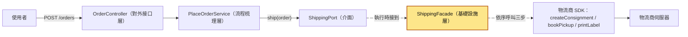
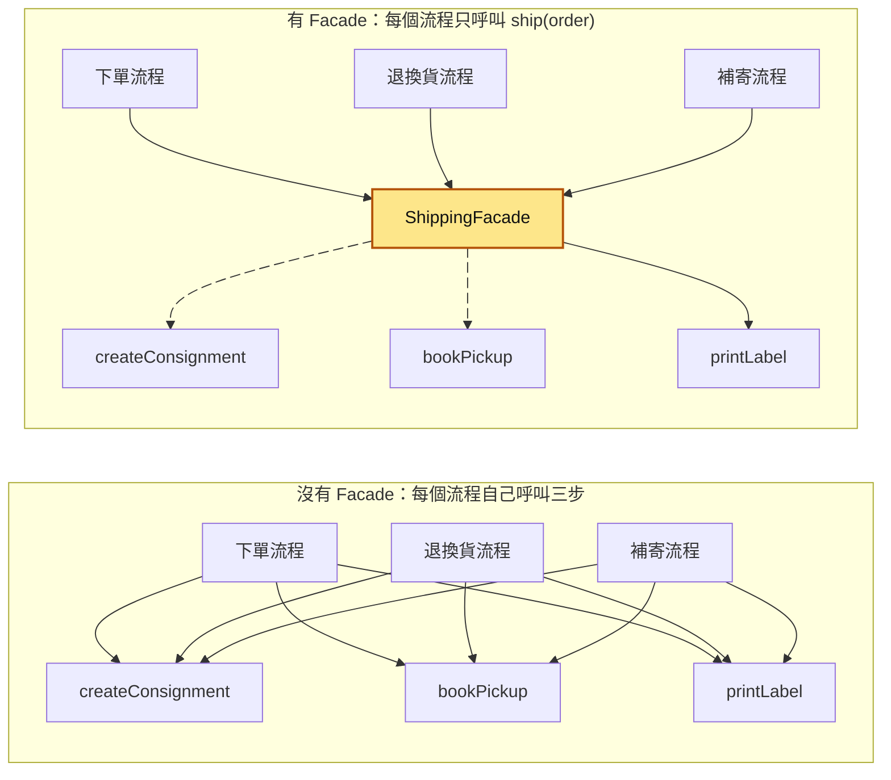
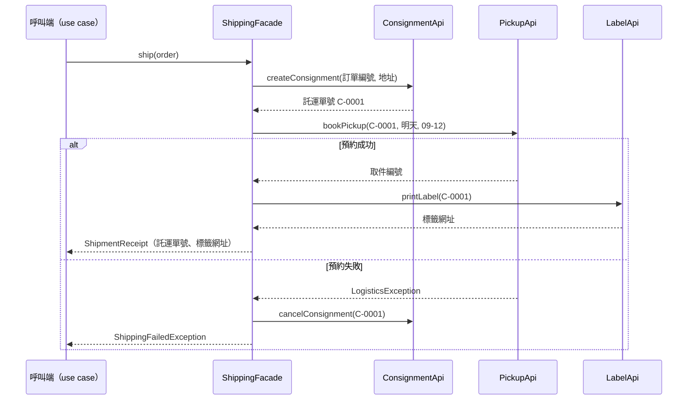
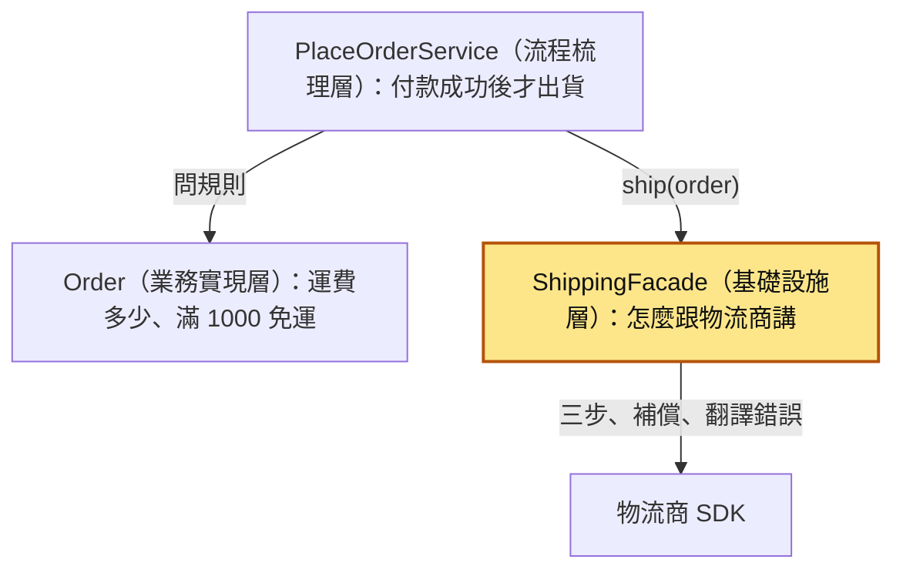
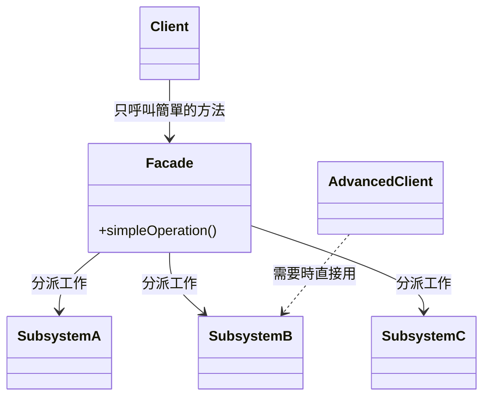
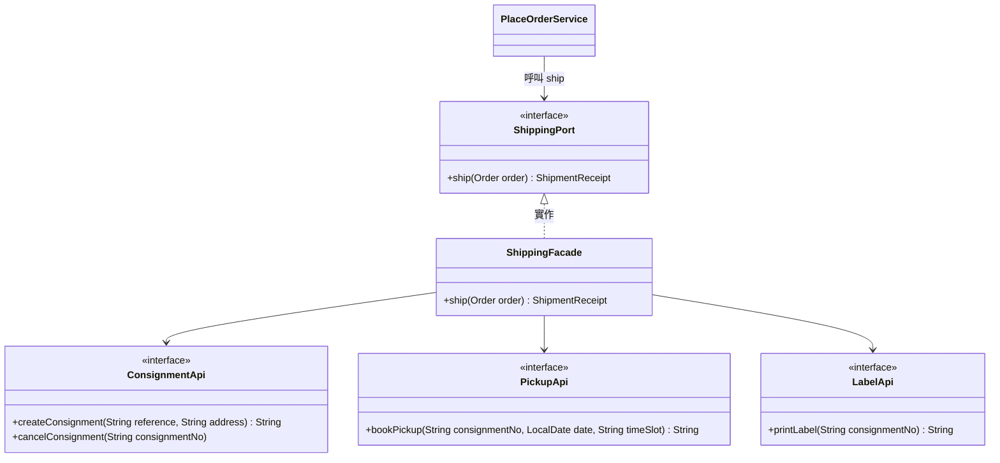
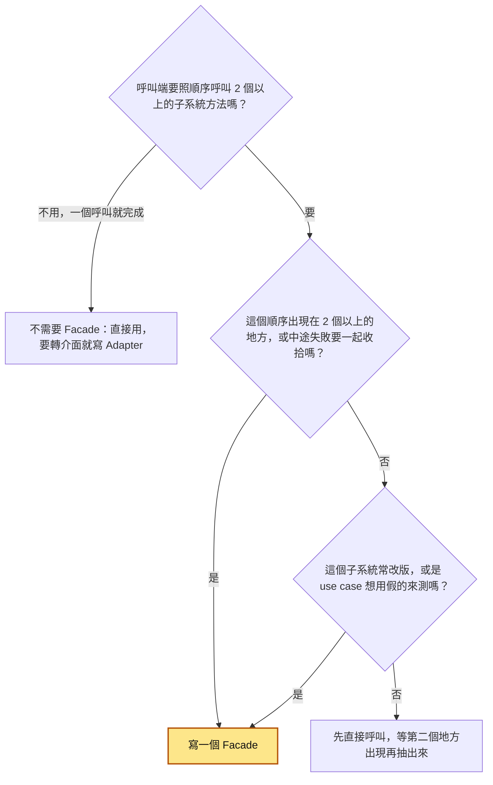
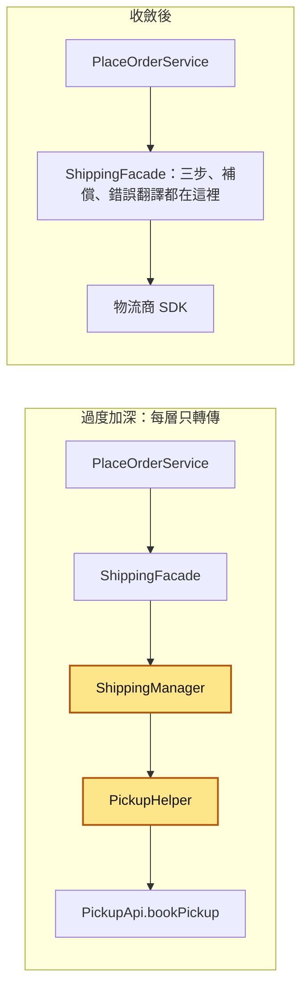

# 55｜外觀模式（Facade）

> 外觀模式（Facade）是在一組複雜的子系統（例如物流商 SDK 裡要照順序呼叫的好幾支 API）前面放一個類別，對外只提供一個簡單的方法。呼叫端只要說「幫這張訂單出貨」，不用知道背後要先呼叫哪一支、再呼叫哪一支、中途失敗要怎麼收拾。

**難度**：★★☆　**閱讀時間**：約 20 分鐘　**前置知識**：[SOLID](54-SOLID.md)、[Use Case](56-Use%20Case.md)

## 核心問題與理念

**它要解決的問題**：出貨要照順序呼叫物流商 SDK（物流商提供、讓你的程式呼叫它服務的程式庫）的 3 支 API：建立託運單、預約司機來取件、列印標籤。下單、退換貨、補寄 3 個流程各自寫了一份；物流商把取件時段的格式從 `"AM"` 改成 `"09-12"`，補寄那份漏改，預約一直被拒，前一步建好的託運單也沒人取消，客服重按 3 次，就留下 3 張不會有司機來取的託運單（下面的情境會完整走一遍）。

**核心理念**：怎麼跟物流商打交道，只讓一個類別知道；物流商一改，只改這一個地方。

**想通的那一步**：

- **卡住的地方**：直覺的做法是每個要出貨的地方照著物流商的文件，自己把 3 步呼叫一遍。這樣每個呼叫端都得記住順序、時段格式，還有第 2 步失敗時要取消第 1 步建好的託運單；物流商一改版，就要找出所有呼叫端一起改，補寄那份就是這樣漏掉的。
- **火花**：換成從呼叫端的角度問：它要的只有「出貨」這一件事。照這件事開一個 `ship(order)`，順序、格式、失敗後的收拾都變成這個類別裡面的事，物流商改版就從搜尋整個專案，變成改這個類別裡的一個常數。

## 閱讀前推薦具備知識

| 知識 | 要會到什麼程度 | 這篇哪裡會用到 | 不熟的話先看 |
|---|---|---|---|
| Java 的 class／interface／record／package | **必備**：看得懂 `class ShippingFacade implements ShippingPort` 代表什麼，知道 `record ShipmentReceipt(String consignmentNo, String labelUrl)` 會自動有 `consignmentNo()` 這種方法，知道 `package` 對應到資料夾 | 情境裡出事的片段、「標準結構」的類別圖、「動手看看」的所有程式 | [Java 官方學習路徑（dev.java）](https://dev.java/learn/) |
| Java 的例外處理（`try`／`catch`／`throw`） | **必備**：看得懂 `catch` 接住一個例外之後，再 `throw new` 另一個例外並把原本的例外當成原因傳進去 | `ShippingFacade` 每一步失敗時的處理，以及「為什麼需要」那張序列圖 | [Java 官方學習路徑（dev.java）](https://dev.java/learn/) |
| JUnit 5 基本寫法 | **必備**：看得懂 `@Test`、`assertEquals`、`assertThrows` 各在檢查什麼 | 「動手看看」的 3 個測試檔 | [JUnit 5 使用手冊](https://docs.junit.org/current/user-guide/) |
| [SOLID](54-SOLID.md) | **加分**：能說出單一職責原則的「一個類別只有一個改變的理由」 | 「理念」一節說明運費規則為什麼不放進 Facade | 本系列第 54 篇 |
| [Use Case](56-Use%20Case.md) | **加分**：知道 use case 負責「按什麼順序做哪些事」，透過 port 呼叫外界 | 全貌圖裡的 `PlaceOrderService`、「動手看看」的 `ResendShipmentService` | 本系列第 56 篇 |

**快速自我檢查**：下面這段程式裡，`bookPickup` 丟出 `LogisticsException` 時，`cancelConsignment` 會不會執行？呼叫這段程式的人收到的是哪一個例外？

```java
try {
    pickups.bookPickup(no, date, "09-12");
} catch (LogisticsException e) {
    consignments.cancelConsignment(no);
    throw new ShippingFailedException("預約取件失敗", e);
}
```

<details markdown="1"><summary>看答案</summary>

會執行。`bookPickup` 一丟例外，程式就跳進 `catch`，先呼叫 `cancelConsignment(no)`，再丟出新的 `ShippingFailedException`。呼叫端收到的是 `ShippingFailedException`，原本的 `LogisticsException` 被當成原因包在裡面，用 `getCause()` 拿得到。

答不出來也沒關係，先看上表「Java 的例外處理」那一列，這篇的 `ShippingFacade` 整個建立在這個寫法上。

</details>

## 為什麼要在意：一個具體的情境

下面是一個假設情境。假設你負責這一章共用的電商下單系統，用 Java 寫。訂單要出貨時，得呼叫物流商 SDK（物流商提供、讓你的程式呼叫它服務的套件）的 3 支 API，而且順序不能亂：

1. `createConsignment`：建立託運單，拿到託運單號，例如 `C-0001`。
2. `bookPickup`：用託運單號預約司機來倉庫取件，要指定日期和時段。
3. `printLabel`：列印要貼在箱子上的標籤，拿到標籤 PDF 的網址。

系統裡有 3 個地方要出貨，每個地方都自己照順序寫了這 3 步：

- 下單流程：付款成功後出貨。
- 退換貨流程：客人退回瑕疵品，系統寄出新的一件。
- 補寄流程：包裹寄丟了，客服在客服後台按「補寄」。

補寄流程裡的寫法長這樣，另外兩處幾乎一樣：

```java
// ❌ 出事的寫法：補寄流程自己照順序呼叫物流 SDK 的三步（下單、退換貨流程裡也各有一份）
public String resend(Order order) {
    String no = consignments.createConsignment(order.id(), order.shippingAddress());
    pickups.bookPickup(no, LocalDate.now(clock).plusDays(1), "AM");   // 下單、退換貨已改成 "09-12"，這裡漏改
    return labels.printLabel(no);
}
```

某天物流商公告 v2 規格：`bookPickup` 的時段參數從 `"AM"`、`"PM"` 改成 `"09-12"`、`"14-18"`，舊的值會被拒絕。時段是一個字串，型別沒變，所以就算漏改，編譯器也不會報錯。下面這張圖可以一步一步播放，左邊是接下來實際發生的事，右邊是改用 Facade 之後的對照（Facade 是什麼，後面會講）；圖下面的時間表把左邊那一路一格一格列出來：

<figure class="draw-fig">
<iframe class="draw-fig__frame" src="../figures/55-facade-orphan-consignments.html" title="按播放或點 T1～T7，左右對照同一次物流商改版：沒有 Facade 時補寄流程漏改時段，客服按 3 次就在物流商後台留下 3 張沒人取件的託運單；有 ShippingFacade 時只改一個常數，預約取件失敗也會取消託運單，留下 0 張。" loading="lazy" style="height: 720px;"></iframe>
<figcaption>按播放或點 T1～T7，左右對照同一次物流商改版：沒有 Facade 時補寄流程漏改時段，客服按 3 次就在物流商後台留下 3 張沒人取件的託運單；有 ShippingFacade 時只改一個常數，預約取件失敗也會取消託運單，留下 0 張。</figcaption>
</figure>

| 時間 | 發生的事 | 下單流程 | 退換貨流程 | 補寄流程 |
|---|---|---|---|---|
| T1 | 物流商公告 v2：時段改成 `"09-12"`、`"14-18"` | 傳 `"AM"` | 傳 `"AM"` | 傳 `"AM"` |
| T2 | 工程師在訂單服務裡搜尋 `bookPickup(`，找到 2 處並改好 | 改成 `"09-12"` | 改成 `"09-12"` | 寫在客服後台模組裡，沒搜到，還是 `"AM"` |
| T3 | 編譯、測試都通過，上線 | 正常出貨 | 正常出貨 | 還沒有人用到 |
| T4 | 客服替訂單 A-1001 按「補寄」 | | | `createConsignment` 成功，拿到託運單 C-0001 |
| T5 | 物流商拒絕預約 | | | `bookPickup(C-0001, 明天, "AM")` 丟出 `INVALID_TIME_SLOT`，`printLabel` 沒執行 |
| T6 | 客服看到「補寄失敗」，又按了 2 次 | | | 又建立 C-0002、C-0003，同樣卡在預約取件 |
| T7 | 結果 | | | 3 張託運單沒有司機會來取，A-1001 的包裹一直沒寄出 |

客人等了好幾天沒收到補寄的包裹，打電話來問。客服在後台看到的是「補寄失敗」的錯誤畫面。工程師在日誌裡看到這一行：

```
com.example.logistics.LogisticsException: INVALID_TIME_SLOT
```

物流商的後台則多了 3 張只建立、沒有預約取件的託運單。

根因在 `pickups.bookPickup(no, ..., "AM")` 那一行：「怎麼跟物流商講話」這件事（3 步的順序、時段的格式）被複製在 3 個地方，物流商一改，3 個地方都要改，漏一處就出事。另外，第 1 步成功、第 2 步失敗時，沒有任何一處負責把託運單取消，所以重按幾次就留下幾張沒人取的託運單。

修法是把 3 步包進一個 `ShippingFacade`，對外只給一個 `ship(order)`，3 個流程都改成呼叫它。之後物流商再改時段格式，只要改 `ShippingFacade` 裡的一個常數；中途失敗要取消託運單，也只要在這裡寫一次。這個類別怎麼設計，在後面的「它是怎麼運作的」；可以跑的完整程式和測試在「動手看看」。

## 全貌：它在系統裡的位置

這張圖看的是一筆下單請求從使用者走到物流商的路線；會動的兩條箭頭是「出貨」這個動作走的路。



上色的 `ShippingFacade` 是這篇的主角，它住在基礎設施層（infrastructure，負責「怎麼跟外界溝通」的那一層）的 `adapter/out/shipping` 裡。`PlaceOrderService` 只認得 `ShippingPort` 這個介面，一個 use case 怎麼組織流程在 [Use Case](56-Use%20Case.md)；`ShippingPort` 這種「我呼叫外界」的介面為什麼要由內層來定，在[六邊形架構](57-六邊形架構.md)；每一層各放什麼，在[依責任分層](58-依責任分層.md)。

## 生活比喻

想像你要寄一箱東西給朋友。

- **沒有 Facade**：你自己上物流公司網站填託運單、再打客服電話約司機來取件、再自己找印表機把標籤印出來貼上。下次換一家物流公司，或物流公司改了預約方式，這幾步你都要重新學。
- **有 Facade**：你把箱子拿到便利商店櫃台，說「幫我寄這個」。店員替你建單、約好貨運來收、印好單子貼上，你只拿到一張收據。物流公司改了流程，要重新學的是店員，你不用。

這個比喻有幾個地方會失準：

1. **店員會臨機應變**，印表機壞了可以手寫單子。程式不會，第 2 步失敗時要不要取消託運單、要不要往外丟錯誤，都得事先寫好。
2. **運費要不要打折，店員不會替你決定**。店員報的是物流公司的價目；你們網站「滿 1000 免運」是你們自己的業務規則，這條規則不該交給 Facade 決定。

比喻裡也有一點跟 Facade 完全一樣：你還是可以自己打給物流公司，便利商店不會攔你。Facade 提供一個方便的入口，但不禁止你直接用背後的子系統。

## 它是怎麼運作的

情境裡的問題有兩個：同一套「怎麼跟物流商講話」的知識被複製在好幾個地方，以及多步驟中途失敗時沒人收拾。Facade 用一個類別把這兩件事收在一起。下面照目的、原因、理念、結構、什麼時候用、什麼時候別用、優缺點的順序講。

### 目的

外觀模式出自 Erich Gamma、Richard Helm、Ralph Johnson、John Vlissides 4 位作者 1994 年出版的《Design Patterns: Elements of Reusable Object-Oriented Software》（Addison-Wesley）。這 4 位常被合稱 GoF（Gang of Four），這本書收了 23 個設計模式，Facade 屬於其中的「結構型」模式。書裡給它的目的，意思是：替子系統裡的一組介面提供一個統一、比較高階的介面，讓子系統比較好用。

這張圖看的是同樣 3 個流程，在沒有和有 Facade 時各要認得幾支 API；會動的箭頭是 Facade 替大家呼叫子系統的路。



左邊是 9 條依賴線，物流商一改，3 個流程都要動。右邊每個流程只依賴 1 個方法，物流商一改，只動 `ShippingFacade`。

### 為什麼需要（原因）

沒有 Facade 時會遇到 4 個問題：

- **知識散落**：3 步的順序、時段的格式、物流商的錯誤碼，寫在每個呼叫端。物流商改版，要找出所有呼叫端一起改，情境裡就是漏了一處。
- **失敗處理各寫各的**：第 1 步成功、第 2 步失敗時，要把託運單取消。這段收拾的程式要在每個呼叫端各寫一次，很容易有一處忘了寫。這種「用一個反向動作抵銷已經做過的步驟」的做法叫補償，[分散式交易](43-分散式交易.md)有詳細講。
- **測試很麻煩**：要測下單的 use case，就得把 3 支 API 都換成假的，還要讓它們照順序回應。有了 Facade，use case 只依賴一個 `ShippingPort`，測試只要一個假的 `ShippingPort`。
- **換供應商很痛**：要換一家物流商，3 個流程都要改。有了 Facade，只要換掉 `ShippingFacade` 這一個類別。

這張圖看的是你呼叫 `ship(order)` 時，`ShippingFacade` 依序做什麼，以及第 2 步失敗時它怎麼收拾：



呼叫端只看到 2 種結果：拿到 `ShipmentReceipt`（出貨收據），或收到 `ShippingFailedException`（出貨失敗）。物流商的 `LogisticsException` 不會漏到呼叫端，呼叫端也就不用 import 物流商 SDK 的任何類別。

### 理念

Facade 的理念有 2 條。

第 1 條是**簡化入口，但不封死**。GoF 書裡提到，Facade 不阻止應用程式在需要時直接使用子系統的類別。Facade 照顧的是「大多數人最常用的那條路」；少數進階需求（例如只想重印一張標籤）可以繞過它，直接用子系統。

第 2 條是 **Facade 藏起「怎麼做」，不決定「要不要做」**。它知道要按什麼順序呼叫物流商、時段要怎麼寫、錯誤碼代表什麼；它不知道這張訂單該不該出貨、運費是多少。這張圖看的是出貨這件事裡，每一層各自負責的決定：



用「負責什麼」來判斷，`ShippingFacade` 屬於基礎設施層（`adapter/out/shipping`）。它的責任是「怎麼跟物流商溝通」；這件事會變，是因為物流商改版，跟你們的業務規則改不改無關。「滿 1000 免運」會變，是因為行銷改了活動，所以它放在業務實現層（domain）的 `Order.shippingFee()`。這 2 件事改變的理由不同，就不放在同一個類別裡，這也是 [SOLID](54-SOLID.md) 裡單一職責原則講的事。

### 標準結構

這張圖看的是 GoF 書裡 Facade 的標準結構：呼叫端只認得 Facade，Facade 再把工作分給子系統裡的類別。



結構裡的角色：

- **Facade**：知道一個請求該交給子系統裡的哪些類別，把呼叫端的請求轉給它們。
- **子系統類別**（Subsystem A、B、C）：真正做事的類別。它們不知道 Facade 存在，也不持有 Facade 的參考，所以子系統可以單獨拿去用。
- **Client**：只跟 Facade 打交道。
- **AdvancedClient**：需要 Facade 沒提供的功能時，直接用子系統。這條虛線就是前面說的「不封死」。

套到本系列的下單系統，這張圖看的是 `ShippingFacade` 和周圍類別的關係：



`ShippingFacade` 同時扮演 2 個角色。從 GoF 的角度看，它是物流子系統的 Facade；從[六邊形架構](57-六邊形架構.md)的角度看，它是 `ShippingPort` 的實作。

GoF 的「不封死」放到分層的系統裡要加一個限制：繞過 Facade 直接用 `LabelApi` 的程式，也要待在基礎設施層，例如同一個 `adapter/out/shipping` 套件裡一支重印標籤的工具。流程梳理層和業務實現層還是只透過 `ShippingPort`，不 import 物流商 SDK。

Facade、Adapter、Port 這 3 個詞在同一個系統裡常一起出現，新人很容易混在一起。下面這張表比較它們的差別：

| | Facade（外觀） | Adapter（轉接器） | Port（埠） |
|---|---|---|---|
| 解決什麼問題 | 子系統太複雜、步驟太多 | 現有的介面跟呼叫端要的對不上 | use case 需要外界提供什麼能力 |
| 包住的東西 | 通常是一組類別 | 通常是一個類別 | 不包任何東西，它本身就是介面 |
| 對外的介面誰定 | Facade 自己定一個新的、比較簡單的 | 呼叫端早就定好的介面 | 流程梳理層（application）定 |
| 出處 | GoF 1994 | GoF 1994 | 六邊形架構（Alistair Cockburn） |
| 本系列的例子 | `ShippingFacade` | `PaymentGatewayAdapter`（把金流 SDK 轉成 `PaymentPort`） | `ShippingPort`、`PaymentPort` |

Adapter 是「轉介面」：金流 SDK 有一個 `charge` 方法，參數和錯誤型別都是金流商自己的，`PaymentGatewayAdapter` 把它轉成 `PaymentPort` 要的樣子，呼叫次數沒有變少。Facade 是「簡化介面」：3 步變 1 步，順帶把錯誤也翻譯掉。在六邊形架構的用語裡，所有實作 outbound port 的類別都叫 adapter，所以 `ShippingFacade` 在那個語境下也是一個 outbound adapter；它的內部結構用的是 Facade 這個模式。

### 適用情境

這張圖看的是遇到一個子系統或第三方 SDK 時，怎麼判斷要不要替它寫一個 Facade：



常見的適用情境：

- 第三方 SDK 要好幾步才能完成一件事：物流（建單、約取件、印標籤）、金流的 3D 驗證流程、雲端儲存的分段上傳。
- 公司內部一個老舊、介面很雜的子系統，新程式只需要其中一小部分功能。
- 想讓 use case 只依賴一個簡單的介面，測試時換成假的。

### 不適用的情境

下面這幾種情況，Facade 會從「簡化」變成「多一層」：

- **只包一個呼叫**：`LabelFacade.print(no)` 裡面只有一行 `labelApi.printLabel(no)`，參數原封不動往下傳。讀的人多跳一個檔案，什麼複雜度都沒有被藏起來。要判斷的話，問自己把這一層拿掉之後呼叫端會不會變複雜；不會，這層就是多的。如果你需要它，是因為要把 SDK 的型別或錯誤轉成 port 的樣子，那它做的是 Adapter 的工作，要真的有東西被轉換才值得存在。
- **子系統本身就很簡單**：SDK 只有一個 `send(message)`，再包一層沒有任何好處。
- **業務規則想找地方放**：「滿 1000 免運」「VIP 訂單下午取件」是業務規則，放進 Facade 會讓它同時因為物流商改版和行銷改活動而被修改。這種規則放業務實現層。

還有一種濫用比較隱蔽：Facade 底下又疊好幾層只轉傳的類別。有人覺得 `ShippingFacade.ship()` 有點長，就把它拆成 `ShippingManager`、`PickupHelper`，每一層只把參數往下傳。這張圖比較 2 種寫法看懂預約取件要跳幾層：



上色的 2 層只轉傳參數，拿掉之後 `ShippingFacade` 由上往下讀，3 步、補償、錯誤翻譯一次看完。一支 40、50 行、由上往下讀得懂的方法，常常比拆成好幾個只轉傳的小類別好維護。怎麼辨認這種「深度被拉得太長」，在[可見性與模組深度](59-可見性與模組深度.md)有完整的症狀清單。

### 優點與缺點

| | 內容 |
|---|---|
| 優點 | 呼叫端只依賴一個簡單的方法，物流商改版只改 Facade 一處 |
| 優點 | 多步驟的順序和中途失敗的補償，只寫一次 |
| 優點 | 子系統的錯誤在這裡翻譯成 port 自己的例外，SDK 的型別不會漏進 use case |
| 優點 | use case 的測試只要一個假的 `ShippingPort` |
| 缺點 | 什麼都往裡塞時，會長成跟整個系統都有關的「上帝物件」（god object） |
| 缺點 | 只包一個呼叫、或底下又疊只轉傳的層時，讀的人要多跳檔案，什麼都沒換到 |
| 缺點 | 把錯誤吞掉（例如 catch 之後只記日誌、回傳 `null`），呼叫端以為出貨成功 |
| 缺點 | 把子系統的重要選項寫死（例如時段固定 `"09-12"`），之後有需求要改時，得改 Facade 的介面 |

缺點裡的前 2 項容易混在一起。上帝物件是「一個 Facade 管太多不相干的事」，多餘的一層是「一個 Facade 什麼事都沒管」。前者要拆成幾個各自專注的 Facade，後者要直接拿掉。

## 動手看看

我們用純 JDK 加 JUnit 5 做 3 件事：

1. 重現開頭的情境：重構前的補寄流程漏改時段，留下一張沒人取件的託運單。
2. 寫出 `ShippingFacade`，驗證 3 步的順序，以及預約取件失敗時會取消託運單。
3. 示範 use case 的測試只要一個假的 `ShippingPort`。

物流商 SDK 用 interface 模擬，測試裡再寫一個假的物流子系統，把每次被呼叫的方法和參數記下來。真實的 SDK 多半是具體類別、會真的打 HTTP，那時要測 Facade，通常會改用物流商提供的測試環境，或用 mock 伺服器。

### 1. 目錄結構

```
src/main/java/com/example/
  logistics/                       # 模擬的物流商 SDK（第三方的程式，不是我們寫的）
    ConsignmentApi.java
    PickupApi.java
    LabelApi.java
    LogisticsException.java
  order/
    domain/
      Order.java
      OrderLine.java
    application/
      port/out/
        ShippingPort.java
        ShipmentReceipt.java
        ShippingFailedException.java
        OrderRepository.java
      service/
        ResendShipmentService.java # 補寄的 use case
    adapter/out/shipping/
      ShippingFacade.java
    legacy/
      LegacyResendFlow.java        # 重構前的補寄流程，就是開頭情境裡那一份
src/test/java/com/example/
  logistics/
    FakeLogistics.java             # 假的物流子系統，記錄呼叫順序
  order/
    legacy/LegacyResendFlowTest.java
    adapter/out/shipping/ShippingFacadeTest.java
    application/ResendShipmentServiceTest.java
```

`ResendShipmentService` 是這一篇為了接上開頭的補寄情境而加的 use case。為了聚焦在 Facade，這裡省略了它的 inbound port 介面，完整的寫法見 [Use Case](56-Use%20Case.md) 和[六邊形架構](57-六邊形架構.md)。

### 2. 模擬的物流商 SDK

```java
// src/main/java/com/example/logistics/ConsignmentApi.java
package com.example.logistics;

// 物流商 SDK（模擬）：託運單
public interface ConsignmentApi {
    /** 建立託運單，回傳託運單號 */
    String createConsignment(String reference, String address);

    /** 取消託運單 */
    void cancelConsignment(String consignmentNo);
}
```

```java
// src/main/java/com/example/logistics/PickupApi.java
package com.example.logistics;

import java.time.LocalDate;

// 物流商 SDK（模擬）：預約取件
public interface PickupApi {
    /** timeSlot：v2 起只收 "09-12" 或 "14-18"，舊的 "AM"、"PM" 會被拒絕 */
    String bookPickup(String consignmentNo, LocalDate date, String timeSlot);
}
```

```java
// src/main/java/com/example/logistics/LabelApi.java
package com.example.logistics;

// 物流商 SDK（模擬）：列印標籤
public interface LabelApi {
    /** 回傳標籤 PDF 的網址 */
    String printLabel(String consignmentNo);
}
```

```java
// src/main/java/com/example/logistics/LogisticsException.java
package com.example.logistics;

// 物流商 SDK（模擬）丟出的錯誤，code 是物流商定義的錯誤碼
public class LogisticsException extends RuntimeException {
    private final String code;

    public LogisticsException(String code) {
        super(code);
        this.code = code;
    }

    public String code() {
        return code;
    }
}
```

### 3. domain 和 port

```java
// src/main/java/com/example/order/domain/OrderLine.java
package com.example.order.domain;

public record OrderLine(String sku, long unitPrice, int quantity) {
    public long amount() {
        return unitPrice * quantity;
    }
}
```

```java
// src/main/java/com/example/order/domain/Order.java
package com.example.order.domain;

import java.util.List;

public final class Order {
    private final String id;
    private final String customerId;
    private final List<OrderLine> lines;
    private final String shippingAddress;   // 這一篇的延伸欄位：建託運單要地址

    public Order(String id, String customerId, List<OrderLine> lines, String shippingAddress) {
        this.id = id;
        this.customerId = customerId;
        this.lines = List.copyOf(lines);
        this.shippingAddress = shippingAddress;
    }

    public String id() { return id; }
    public String customerId() { return customerId; }
    public List<OrderLine> lines() { return lines; }
    public String shippingAddress() { return shippingAddress; }

    public long subtotal() {
        return lines.stream().mapToLong(OrderLine::amount).sum();
    }

    // 業務規則：滿 1000 免運，否則運費 60。這條規則放在 domain，不放進 ShippingFacade
    public long shippingFee() {
        return subtotal() >= 1000 ? 0 : 60;
    }

    public long total() {
        return subtotal() + shippingFee();
    }
}
```

```java
// src/main/java/com/example/order/application/port/out/ShippingPort.java
package com.example.order.application.port.out;

import com.example.order.domain.Order;

// Port Out：use case 只認得這個介面，不知道背後是哪家物流商、要呼叫幾步
public interface ShippingPort {
    /** 安排出貨；失敗時丟 ShippingFailedException */
    ShipmentReceipt ship(Order order);
}
```

```java
// src/main/java/com/example/order/application/port/out/ShipmentReceipt.java
package com.example.order.application.port.out;

public record ShipmentReceipt(String consignmentNo, String labelUrl) {}
```

```java
// src/main/java/com/example/order/application/port/out/ShippingFailedException.java
package com.example.order.application.port.out;

// 出貨失敗。use case 只需要認得這個例外，不用 import 物流商 SDK 的 LogisticsException
public class ShippingFailedException extends RuntimeException {
    public ShippingFailedException(String message, Throwable cause) {
        super(message, cause);
    }
}
```

```java
// src/main/java/com/example/order/application/port/out/OrderRepository.java
package com.example.order.application.port.out;

import com.example.order.domain.Order;

import java.util.Optional;

public interface OrderRepository {
    void save(Order order);

    Optional<Order> findById(String id);
}
```

### 4. 重構前：補寄流程自己呼叫三步

```java
// src/main/java/com/example/order/legacy/LegacyResendFlow.java
package com.example.order.legacy;

import com.example.logistics.ConsignmentApi;
import com.example.logistics.LabelApi;
import com.example.logistics.PickupApi;
import com.example.order.domain.Order;

import java.time.Clock;
import java.time.LocalDate;

// ❌ 重構前：補寄流程自己照順序呼叫物流 SDK 的三步（下單、退換貨流程裡也各有一份）
public class LegacyResendFlow {
    private final ConsignmentApi consignments;
    private final PickupApi pickups;
    private final LabelApi labels;
    private final Clock clock;

    public LegacyResendFlow(ConsignmentApi consignments, PickupApi pickups, LabelApi labels, Clock clock) {
        this.consignments = consignments;
        this.pickups = pickups;
        this.labels = labels;
        this.clock = clock;
    }

    public String resend(Order order) {
        String no = consignments.createConsignment(order.id(), order.shippingAddress());
        pickups.bookPickup(no, LocalDate.now(clock).plusDays(1), "AM");   // 下單、退換貨已改成 "09-12"，這裡漏改
        return labels.printLabel(no);
    }
}
```

### 5. 重構後：`ShippingFacade`

重點在 `ship()`：3 步照順序呼叫，每一步的 `LogisticsException` 都翻成 `ShippingFailedException`，第 2 步失敗時先取消託運單（節錄）：

```java
@Override
public ShipmentReceipt ship(Order order) {
    // 第 1 步：建立託運單
    String consignmentNo;
    try {
        consignmentNo = consignments.createConsignment(order.id(), order.shippingAddress());
    } catch (LogisticsException e) {
        throw new ShippingFailedException("建立託運單失敗：" + e.code(), e);
    }

    // 第 2 步：預約明天取件。失敗就取消託運單，不留下沒人來取的託運單
    try {
        pickups.bookPickup(consignmentNo, LocalDate.now(clock).plusDays(1), DEFAULT_TIME_SLOT);
    } catch (LogisticsException e) {
        consignments.cancelConsignment(consignmentNo);
        throw new ShippingFailedException("預約取件失敗：" + e.code() + "，已取消託運單 " + consignmentNo, e);
    }

    // 第 3 步：列印標籤。取件已經約好，標籤可以重印，所以這裡不取消託運單
    try {
        String labelUrl = labels.printLabel(consignmentNo);
        return new ShipmentReceipt(consignmentNo, labelUrl);
    } catch (LogisticsException e) {
        throw new ShippingFailedException("列印標籤失敗：" + e.code() + "，託運單 " + consignmentNo + " 需要重印標籤", e);
    }
}
```

時段格式 `DEFAULT_TIME_SLOT = "09-12"` 是類別裡的常數，只寫在這一處。完整的檔案（含 import、建構子）：

??? example "完整程式：ShippingFacade.java"

    ```java
    // src/main/java/com/example/order/adapter/out/shipping/ShippingFacade.java
    package com.example.order.adapter.out.shipping;

    import com.example.logistics.ConsignmentApi;
    import com.example.logistics.LabelApi;
    import com.example.logistics.LogisticsException;
    import com.example.logistics.PickupApi;
    import com.example.order.application.port.out.ShipmentReceipt;
    import com.example.order.application.port.out.ShippingFailedException;
    import com.example.order.application.port.out.ShippingPort;
    import com.example.order.domain.Order;

    import java.time.Clock;
    import java.time.LocalDate;

    // Facade：把物流子系統的三步包成一個 ship(order)，同時是 ShippingPort 的實作
    public class ShippingFacade implements ShippingPort {
        static final String DEFAULT_TIME_SLOT = "09-12";   // 物流商 v2 的時段格式，只寫在這裡

        private final ConsignmentApi consignments;
        private final PickupApi pickups;
        private final LabelApi labels;
        private final Clock clock;

        public ShippingFacade(ConsignmentApi consignments, PickupApi pickups, LabelApi labels, Clock clock) {
            this.consignments = consignments;
            this.pickups = pickups;
            this.labels = labels;
            this.clock = clock;
        }

        @Override
        public ShipmentReceipt ship(Order order) {
            // 第 1 步：建立託運單
            String consignmentNo;
            try {
                consignmentNo = consignments.createConsignment(order.id(), order.shippingAddress());
            } catch (LogisticsException e) {
                throw new ShippingFailedException("建立託運單失敗：" + e.code(), e);
            }

            // 第 2 步：預約明天取件。失敗就取消託運單，不留下沒人來取的託運單
            try {
                pickups.bookPickup(consignmentNo, LocalDate.now(clock).plusDays(1), DEFAULT_TIME_SLOT);
            } catch (LogisticsException e) {
                consignments.cancelConsignment(consignmentNo);
                throw new ShippingFailedException("預約取件失敗：" + e.code() + "，已取消託運單 " + consignmentNo, e);
            }

            // 第 3 步：列印標籤。取件已經約好，標籤可以重印，所以這裡不取消託運單
            try {
                String labelUrl = labels.printLabel(consignmentNo);
                return new ShipmentReceipt(consignmentNo, labelUrl);
            } catch (LogisticsException e) {
                throw new ShippingFailedException("列印標籤失敗：" + e.code() + "，託運單 " + consignmentNo + " 需要重印標籤", e);
            }
        }
    }
    ```

`Clock` 是 Java 內建的「時鐘」物件。把它從建構子傳進來，測試時就能換成固定在某一天的時鐘，「明天」才會是一個可以寫進斷言的日期。

### 6. 補寄的 use case

```java
// src/main/java/com/example/order/application/service/ResendShipmentService.java
package com.example.order.application.service;

import com.example.order.application.port.out.OrderRepository;
import com.example.order.application.port.out.ShipmentReceipt;
import com.example.order.application.port.out.ShippingPort;
import com.example.order.domain.Order;

// 補寄的 use case：找出訂單，交給 ShippingPort 出貨。它不知道物流商有幾個步驟
public class ResendShipmentService {
    private final OrderRepository orders;
    private final ShippingPort shipping;

    public ResendShipmentService(OrderRepository orders, ShippingPort shipping) {
        this.orders = orders;
        this.shipping = shipping;
    }

    public ShipmentReceipt resend(String orderId) {
        Order order = orders.findById(orderId)
                .orElseThrow(() -> new IllegalArgumentException("找不到訂單：" + orderId));
        return shipping.ship(order);
    }
}
```

### 7. 假的物流子系統

??? example "完整程式：FakeLogistics.java"

    ```java
    // src/test/java/com/example/logistics/FakeLogistics.java
    package com.example.logistics;

    import java.time.LocalDate;
    import java.util.ArrayList;
    import java.util.LinkedHashSet;
    import java.util.List;
    import java.util.Set;

    // 假的物流子系統（v2 規格）：記錄被呼叫的順序，並模擬物流商的檢查
    public class FakeLogistics implements ConsignmentApi, PickupApi, LabelApi {
        public final List<String> calls = new ArrayList<>();
        public final Set<String> openConsignments = new LinkedHashSet<>();   // 建立了、還沒取消的託運單
        public final Set<String> bookedPickups = new LinkedHashSet<>();
        public boolean pickupOutage = false;   // 設成 true：模擬取件系統故障
        private int seq = 0;

        @Override
        public String createConsignment(String reference, String address) {
            String no = "C-%04d".formatted(++seq);
            calls.add("createConsignment " + reference);
            openConsignments.add(no);
            return no;
        }

        @Override
        public void cancelConsignment(String consignmentNo) {
            calls.add("cancelConsignment " + consignmentNo);
            openConsignments.remove(consignmentNo);
        }

        @Override
        public String bookPickup(String consignmentNo, LocalDate date, String timeSlot) {
            calls.add("bookPickup " + consignmentNo + " " + date + " " + timeSlot);
            if (pickupOutage) {
                throw new LogisticsException("PICKUP_UNAVAILABLE");
            }
            if (!timeSlot.equals("09-12") && !timeSlot.equals("14-18")) {
                throw new LogisticsException("INVALID_TIME_SLOT");
            }
            bookedPickups.add(consignmentNo);
            return "P-" + consignmentNo;
        }

        @Override
        public String printLabel(String consignmentNo) {
            calls.add("printLabel " + consignmentNo);
            return "https://labels.example.com/" + consignmentNo + ".pdf";
        }

        /** 建立了、沒取消、也沒約到取件的託運單：不會有司機來取 */
        public Set<String> orphanConsignments() {
            Set<String> orphans = new LinkedHashSet<>(openConsignments);
            orphans.removeAll(bookedPickups);
            return orphans;
        }
    }
    ```

### 8. 測試

重現開頭的情境：

```java
// src/test/java/com/example/order/legacy/LegacyResendFlowTest.java
package com.example.order.legacy;

import com.example.logistics.FakeLogistics;
import com.example.logistics.LogisticsException;
import com.example.order.domain.Order;
import com.example.order.domain.OrderLine;
import org.junit.jupiter.api.DisplayName;
import org.junit.jupiter.api.Test;

import java.time.Clock;
import java.time.Instant;
import java.time.ZoneId;
import java.util.List;
import java.util.Set;

import static org.junit.jupiter.api.Assertions.assertEquals;
import static org.junit.jupiter.api.Assertions.assertThrows;

class LegacyResendFlowTest {
    private final Clock clock = Clock.fixed(Instant.parse("2026-03-01T02:00:00Z"), ZoneId.of("Asia/Taipei"));
    private final Order order = new Order("A-1001", "c-42", List.of(new OrderLine("BOOK-1", 450, 1)), "台北市信義區…");

    @Test
    @DisplayName("重構前：補寄流程漏改時段，留下一張沒人取件的託運單")
    void legacyResendLeavesOrphanConsignment() {
        FakeLogistics logistics = new FakeLogistics();
        LegacyResendFlow flow = new LegacyResendFlow(logistics, logistics, logistics, clock);

        LogisticsException e = assertThrows(LogisticsException.class, () -> flow.resend(order));

        assertEquals("INVALID_TIME_SLOT", e.code());
        assertEquals(List.of(
                "createConsignment A-1001",
                "bookPickup C-0001 2026-03-02 AM"), logistics.calls);
        assertEquals(Set.of("C-0001"), logistics.orphanConsignments());
    }
}
```

驗證 `ShippingFacade` 的順序和失敗處理：

??? example "完整程式：ShippingFacadeTest.java"

    ```java
    // src/test/java/com/example/order/adapter/out/shipping/ShippingFacadeTest.java
    package com.example.order.adapter.out.shipping;

    import com.example.logistics.FakeLogistics;
    import com.example.order.application.port.out.ShipmentReceipt;
    import com.example.order.application.port.out.ShippingFailedException;
    import com.example.order.domain.Order;
    import com.example.order.domain.OrderLine;
    import org.junit.jupiter.api.DisplayName;
    import org.junit.jupiter.api.Test;

    import java.time.Clock;
    import java.time.Instant;
    import java.time.ZoneId;
    import java.util.List;

    import static org.junit.jupiter.api.Assertions.assertEquals;
    import static org.junit.jupiter.api.Assertions.assertThrows;
    import static org.junit.jupiter.api.Assertions.assertTrue;

    class ShippingFacadeTest {
        private final Clock clock = Clock.fixed(Instant.parse("2026-03-01T02:00:00Z"), ZoneId.of("Asia/Taipei"));
        private final Order order = new Order("A-1001", "c-42", List.of(new OrderLine("BOOK-1", 450, 1)), "台北市信義區…");
        private final FakeLogistics logistics = new FakeLogistics();
        private final ShippingFacade facade = new ShippingFacade(logistics, logistics, logistics, clock);

        @Test
        @DisplayName("ship() 依序呼叫建立託運單、預約取件、列印標籤")
        void shipCallsThreeStepsInOrder() {
            ShipmentReceipt receipt = facade.ship(order);

            assertEquals(List.of(
                    "createConsignment A-1001",
                    "bookPickup C-0001 2026-03-02 09-12",
                    "printLabel C-0001"), logistics.calls);
            assertEquals("C-0001", receipt.consignmentNo());
            assertEquals("https://labels.example.com/C-0001.pdf", receipt.labelUrl());
        }

        @Test
        @DisplayName("預約取件失敗時，取消託運單、不印標籤，丟出 ShippingFailedException")
        void bookPickupFailureCancelsConsignment() {
            logistics.pickupOutage = true;

            ShippingFailedException e = assertThrows(ShippingFailedException.class, () -> facade.ship(order));

            assertEquals("預約取件失敗：PICKUP_UNAVAILABLE，已取消託運單 C-0001", e.getMessage());
            assertEquals(List.of(
                    "createConsignment A-1001",
                    "bookPickup C-0001 2026-03-02 09-12",
                    "cancelConsignment C-0001"), logistics.calls);
            assertTrue(logistics.orphanConsignments().isEmpty());
        }
    }
    ```

use case 的測試只要一個假的 `ShippingPort`，跟物流商有幾步無關（節錄）：

```java
// 只要一個假的 ShippingPort，不用知道物流商有幾個步驟
static class FakeShippingPort implements ShippingPort {
    final List<String> shippedOrderIds = new ArrayList<>();

    @Override
    public ShipmentReceipt ship(Order order) {
        shippedOrderIds.add(order.id());
        return new ShipmentReceipt("FAKE-1", "https://fake/label.pdf");
    }
}
```

??? example "完整程式：ResendShipmentServiceTest.java"

    ```java
    // src/test/java/com/example/order/application/ResendShipmentServiceTest.java
    package com.example.order.application;

    import com.example.order.application.port.out.OrderRepository;
    import com.example.order.application.port.out.ShipmentReceipt;
    import com.example.order.application.port.out.ShippingPort;
    import com.example.order.application.service.ResendShipmentService;
    import com.example.order.domain.Order;
    import com.example.order.domain.OrderLine;
    import org.junit.jupiter.api.DisplayName;
    import org.junit.jupiter.api.Test;

    import java.util.ArrayList;
    import java.util.HashMap;
    import java.util.List;
    import java.util.Map;
    import java.util.Optional;

    import static org.junit.jupiter.api.Assertions.assertEquals;
    import static org.junit.jupiter.api.Assertions.assertThrows;
    import static org.junit.jupiter.api.Assertions.assertTrue;

    class ResendShipmentServiceTest {

        // 只要一個假的 ShippingPort，不用知道物流商有幾個步驟
        static class FakeShippingPort implements ShippingPort {
            final List<String> shippedOrderIds = new ArrayList<>();

            @Override
            public ShipmentReceipt ship(Order order) {
                shippedOrderIds.add(order.id());
                return new ShipmentReceipt("FAKE-1", "https://fake/label.pdf");
            }
        }

        static class InMemoryOrderRepository implements OrderRepository {
            private final Map<String, Order> store = new HashMap<>();

            @Override
            public void save(Order order) { store.put(order.id(), order); }

            @Override
            public Optional<Order> findById(String id) { return Optional.ofNullable(store.get(id)); }
        }

        private final FakeShippingPort shipping = new FakeShippingPort();
        private final InMemoryOrderRepository orders = new InMemoryOrderRepository();
        private final ResendShipmentService service = new ResendShipmentService(orders, shipping);

        @Test
        @DisplayName("補寄：找到訂單就交給 ShippingPort 出貨")
        void resendShipsTheOrder() {
            orders.save(new Order("A-1001", "c-42", List.of(new OrderLine("BOOK-1", 450, 1)), "台北市信義區…"));

            ShipmentReceipt receipt = service.resend("A-1001");

            assertEquals(List.of("A-1001"), shipping.shippedOrderIds);
            assertEquals("FAKE-1", receipt.consignmentNo());
        }

        @Test
        @DisplayName("補寄：訂單不存在就不出貨")
        void resendUnknownOrderDoesNotShip() {
            assertThrows(IllegalArgumentException.class, () -> service.resend("NOPE"));
            assertTrue(shipping.shippedOrderIds.isEmpty());
        }
    }
    ```

### 9. 跑起來看

用 Maven 的話，在 `pom.xml` 加上 JUnit 5 的依賴，然後跑 `mvn test`：

```xml
<dependency>
    <groupId>org.junit.jupiter</groupId>
    <artifactId>junit-jupiter</artifactId>
    <version>5.13.4</version>
    <scope>test</scope>
</dependency>
```

本文的輸出是用 JUnit Console Launcher（JUnit 官方的獨立執行器，一個 jar 檔就能跑測試）跑的，Maven 的輸出格式不同。指令如下（PowerShell，`junit-console.jar` 換成你下載的 `junit-platform-console-standalone` jar 路徑）：

```powershell
javac --release 21 -d out -cp junit-console.jar (Get-ChildItem -Recurse src -Filter *.java).FullName
java -jar junit-console.jar execute --class-path out --scan-class-path --disable-banner --details=tree
```

**預期輸出**（執行時間依機器而異，這裡省略；`JUnit Platform Suite`、`JUnit Vintage` 是獨立執行器內建的另外兩個測試引擎，這個專案沒用到）：

```
╷
├─ JUnit Platform Suite ✔
├─ JUnit Jupiter ✔
│  ├─ ResendShipmentServiceTest ✔
│  │  ├─ 補寄：訂單不存在就不出貨 ✔
│  │  └─ 補寄：找到訂單就交給 ShippingPort 出貨 ✔
│  ├─ ShippingFacadeTest ✔
│  │  ├─ ship() 依序呼叫建立託運單、預約取件、列印標籤 ✔
│  │  └─ 預約取件失敗時，取消託運單、不印標籤，丟出 ShippingFailedException ✔
│  └─ LegacyResendFlowTest ✔
│     └─ 重構前：補寄流程漏改時段，留下一張沒人取件的託運單 ✔
└─ JUnit Vintage ✔
...
[         5 tests successful      ]
[         0 tests failed          ]
```

看 `LegacyResendFlowTest`：重構前的寫法跑完，`orphanConsignments()` 裡留下 `C-0001`，這就是開頭情境 T5 的狀態。看 `ShippingFacadeTest` 的第二個測試：同樣是預約取件失敗，`ShippingFacade` 呼叫了 `cancelConsignment`，沒有留下沒人取的託運單。

### 10. 試試看：物流商又改版了

假設物流商改回去，時段又要用 `"AM"`。有了 Facade，你只要改一行：

```java
static final String DEFAULT_TIME_SLOT = "AM";
```

改完重跑，假的物流子系統照 v2 規格拒絕 `"AM"`，`ShippingFacadeTest` 會失敗，第一個測試的訊息是：

```
│     ├─ ship() 依序呼叫建立託運單、預約取件、列印標籤 ✘ 預約取件失敗：INVALID_TIME_SLOT，已取消託運單 C-0001
```

錯誤被翻成 `ShippingFailedException`，訊息裡有物流商的錯誤碼，託運單也已經取消。要改的地方只有一處，測試也只要看 `ShippingFacadeTest`。試完記得改回 `"09-12"`。

## 常見地雷

### 地雷 1：Facade 長成什麼都往裡塞的上帝物件

- ❌ 錯誤做法：`ShippingFacade` 慢慢多了 `calculateShippingFee()`、`refund()`、`sendTrackingEmail()`、`syncToErp()`，因為「反正都跟出貨有關」。
- 為什麼錯：這個類別變成跟物流、金流、郵件、ERP 都有關係，任何一邊改版都要改它，改一處就要重跑所有測試。原本用來減少依賴的 Facade，自己變成依賴最多的地方。
- ✅ 正確做法：一個 Facade 只包一個子系統要做的一件事。寄信是 `NotifierPort` 的事，退款是 `PaymentPort` 的事，Facade 變大了就拆成幾個各自專注的 Facade。

### 地雷 2：把業務規則放進 Facade

- ❌ 錯誤做法：在 `ShippingFacade.ship()` 裡寫 `if (order.subtotal() >= 1000) fee = 0; else fee = 60;`，或寫「VIP 訂單約下午取件」。
- 為什麼錯：Facade 屬於基礎設施層，它改變的理由是物流商改版。運費和 VIP 規則改變的理由是行銷和產品決策。放在一起，兩邊的改動會互相牽連，測運費規則也得把物流商的假物件準備好。
- ✅ 正確做法：運費放在 `Order.shippingFee()`；「哪些訂單約下午」由 domain 或 use case 決定，再用參數告訴 Facade。Facade 只負責把決定好的事照物流商的規格送出去。

### 地雷 3：把錯誤吞掉

- ❌ 錯誤做法：`catch (LogisticsException e) { log.warn("ship failed", e); return null; }`
- 為什麼錯：呼叫端拿到 `null`，可能當成出貨成功繼續往下走，訂單狀態變成「已出貨」，包裹卻沒有寄。錯誤只留在日誌裡，沒人會去看。
- ✅ 正確做法：翻譯成 port 自己的例外（`ShippingFailedException`）往外丟，訊息裡帶物流商的錯誤碼和託運單號。要不要重試、要不要轉人工，交給 use case 決定。

### 地雷 4：把子系統的重要選項藏到改不了

- ❌ 錯誤做法：`ShippingFacade` 把取件時段固定成 `"09-12"`，介面上也沒有任何方式指定時段。之後冷藏商品要求下午取件，只能再複製一份 `ColdShippingFacade`，或直接在 use case 裡呼叫 SDK。
- 為什麼錯：Facade 簡化了常見的情況，卻讓少數合理的需求沒有路可走。大家開始繞過它，散落的問題又回來了。
- ✅ 正確做法：最常用的保留預設值，真的有需求的選項用有業務意義的參數開放，例如 `ship(Order order, PickupSlot slot)`，`PickupSlot` 是你們自己定義的型別，由 Facade 翻成物流商的字串。只有基礎設施層的進階工具才直接用子系統。

### 地雷 5：只包一個呼叫的 Facade

- ❌ 錯誤做法：`TrackingFacade.query(no)` 裡只有一行 `return trackingApi.query(no);`，參數和回傳型別都跟 SDK 一模一樣。
- 為什麼錯：它沒有藏起任何複雜度，讀的人多跳一個檔案，改一個參數要改兩個簽名。
- ✅ 正確做法：拿掉它，直接呼叫。如果是因為 use case 需要一個 port，那要讓這個類別真的轉換點東西（把 SDK 的型別和錯誤轉成 port 的），它做的是 Adapter 的工作。

### 地雷 6：Facade 的介面漏出子系統的型別

- ❌ 錯誤做法：`ShippingPort.ship()` 回傳物流商 SDK 的 `ConsignmentResponse`，或宣告會丟 `LogisticsException`。
- 為什麼錯：use case 為了處理回傳值和例外，還是得 import 物流商 SDK。物流商一改回傳格式，use case 也要跟著改，換物流商時 use case 也逃不掉。
- ✅ 正確做法：port 的參數、回傳值、例外都用自己定義的型別，例如 `ShipmentReceipt`、`ShippingFailedException`，由 Facade 負責翻譯。

## 重點整理

- **Facade 把一組要照順序呼叫的子系統 API，包成一個簡單的方法。** 本系列的 `ShippingFacade` 把 `createConsignment`、`bookPickup`、`printLabel` 3 步包成 `ship(order)`，物流商改版只改它一處。
- **多步驟中途失敗的收拾，在 Facade 裡寫一次。** 預約取件失敗就取消託運單，錯誤翻譯成 `ShippingFailedException` 往外丟，不吞掉，也不讓 SDK 的型別漏到 use case。
- **`ShippingFacade` 同時是 `ShippingPort` 的實作，屬於基礎設施層。** 它負責「怎麼跟物流商溝通」；運費、要不要出貨這類業務規則放在 domain，什麼時候出貨由 use case 決定。
- **Facade 簡化入口，但不封死子系統。** 進階需求可以直接用子系統，但在分層的系統裡，那段程式也要待在基礎設施層。
- **Facade 也會被濫用。** 什麼都往裡塞會變成上帝物件；只包一個呼叫、或底下疊只轉傳的層，就是多餘的一層，拿掉它呼叫端沒有變複雜，就該拿掉。

## 新人必知清單

### 一定要會（基本功）

- [ ] 看到同一串第三方 API 呼叫出現在 2 個以上的地方，會想到把它收進一個 Facade。
- [ ] 寫 Facade 時，想清楚每一步失敗要怎麼處理：要不要補償已經做過的步驟、錯誤要翻成什麼例外。
- [ ] Facade 的對外介面只用自己定義的型別，不回傳、不丟出第三方 SDK 的型別。
- [ ] 分得出業務規則和「怎麼跟外界溝通」，運費這類規則不放進 Facade。
- [ ] 會用假的子系統記錄呼叫順序，測 Facade 的順序和失敗處理；會用一個假的 port 測 use case。
- [ ] 說得出 Facade 和 Adapter 的差別：Facade 簡化一組類別，Adapter 把一個介面轉成呼叫端要的樣子。

### 知道有這回事就好

- **分層的 Facade**：一個大系統可以每一層各有一個 Facade，層和層之間只透過 Facade 溝通。
- **補償和 Saga**：好幾步跨系統的動作中途失敗時怎麼收拾，見[分散式交易](43-分散式交易.md)。
- **冪等**：建立託運單逾時、不知道成功沒有時，重送會不會建出第二張，見[冪等性](25-冪等性.md)。
- **重試和斷路器**：物流商暫時掛掉時要不要重試、什麼時候停止打它，見[重試機制](26-重試機制.md)和[斷路器](29-斷路器.md)。
- **依賴注入容器**：Spring 這類框架會替你把 `ShippingFacade` 接到 `ShippingPort` 上，做的事跟手動 `new` 組裝一樣。

### 先不用管（等你遇到再學）

- GoF 書裡列為跟 Facade 相關的其他模式（例如 Abstract Factory、Mediator）。
- API Gateway、Backend for Frontend 這類服務層級的「外觀」，概念相近，但處理的是網路請求和多個服務。

## Code Review 時可以問的問題

1. **這串第三方 API 呼叫還出現在其他地方嗎？** 有的話，要不要收進同一個 Facade？
2. **中間某一步失敗時會怎樣？** 前面已經成功的步驟要不要取消？錯誤有沒有往外丟，還是被吞掉了？
3. **這個 Facade 的參數、回傳值、例外，有沒有第三方 SDK 的型別？** use case 需不需要 import SDK？
4. **這段邏輯是業務規則，還是「怎麼跟外界溝通」？** 業務規則有沒有混進 Facade？
5. **把這一層拿掉，呼叫端會變複雜嗎？** 不會的話，這一層是不是多的？
6. **這個 Facade 最近因為幾種不同的理由被修改過？** 理由越來越多，是不是該拆了？

## 情境演練

**Q1. `ShippingFacade` 的第 3 步 `printLabel` 失敗了，同事說：「照第 2 步的做法，把託運單取消掉比較乾淨。」你會怎麼回？**

<details markdown="1"><summary>看答案</summary>

要先看取消的代價和不取消的代價。

- 走到第 3 步時，託運單建好了，取件也約好了，司機明天會來。標籤只是一份 PDF，可以重印。
- 如果取消託運單，就得連取件預約一起取消，之後還要從頭再跑一次 3 步，對物流商多打好幾支 API，也可能約不到同一天的取件。
- 不取消的話，只要把「這張託運單要重印標籤」交代清楚。本文的寫法是丟出 `ShippingFailedException`，訊息裡帶託運單號，讓 use case 決定要重試列印、還是轉給倉庫人員處理。

所以第 2 步失敗要補償，第 3 步失敗不用。每一步失敗要怎麼處理，要看「已經做了什麼、能不能單獨重做」，不能一律照同一招。這也是把 3 步收進 Facade 的好處：這個判斷只要想一次、寫一次。

</details>

**Q2. Code review 時你看到同事新增了這個類別，理由是「以後換郵件服務比較方便」。你會怎麼建議？**

```java
public class MailFacade {
    private final MailClient client;

    public MailFacade(MailClient client) { this.client = client; }

    public void send(String to, String subject, String body) {
        client.send(to, subject, body);
    }
}
```

<details markdown="1"><summary>看答案</summary>

用「拿掉它，呼叫端會變複雜嗎？」來判斷。這個類別只有一行，參數原封不動傳下去，它沒有藏起任何步驟，也沒有翻譯錯誤，拿掉之後呼叫端完全不會變複雜，所以它是多餘的一層。

「以後換郵件服務」這個理由也撐不住它：`send` 的參數就是 `MailClient` 的參數，換一家郵件服務時，新服務的參數不一樣，這個類別一樣要改。

如果 use case 真的需要一個不依賴郵件 SDK 的介面，正確的位置是 `NotifierPort`：由 application 層定一個有業務意義的方法（例如 `orderPlaced(Order order)`），再寫一個 adapter 把它轉成 `MailClient` 的呼叫，順便把郵件 SDK 的例外翻成自己的例外。這時 adapter 有真的在轉換東西，才值得存在。

</details>

**Q3. 產品經理說：冷藏商品要約下午取件，其他商品維持上午。你會怎麼改？**

<details markdown="1"><summary>看答案</summary>

先分清楚 2 件事：

- 「冷藏商品要下午取件」是業務規則，屬於 domain 或 use case。
- 「下午要寫成 `"14-18"`」是物流商的規格，屬於 `ShippingFacade`。

所以不要在 `ShippingFacade` 裡寫 `if (商品是冷藏) slot = "14-18"`。比較好的改法：

1. 在 port 那邊定義自己的型別，例如 `enum PickupSlot { MORNING, AFTERNOON }`。
2. `ShippingPort` 改成 `ShipmentReceipt ship(Order order, PickupSlot slot)`，或保留原本的 `ship(order)` 當成上午的預設，再加一個帶 `slot` 的方法。
3. 由 domain 判斷這張訂單要哪個時段，例如在 `Order` 加一個方法，use case 把結果傳給 `ship`。
4. `ShippingFacade` 把 `PickupSlot.AFTERNOON` 翻成 `"14-18"`。

這樣物流商下次改時段格式，只改 `ShippingFacade`；行銷下次改「哪些商品要下午」，只改 domain。

</details>

**Q4. 呼叫 `createConsignment` 時逾時了，你不知道物流商那邊到底有沒有建好託運單。`ShippingFacade` 該怎麼辦？**

<details markdown="1"><summary>看答案</summary>

逾時代表「結果不明」，不能當成失敗直接重送，否則物流商那邊可能建出 2 張託運單，2 台車來取同一箱貨。

可以這樣想：

- 先看物流商的文件有沒有提供防重複的方法，例如建立時帶一個固定的識別碼（idempotency key），同一個識別碼只會建一張；或提供「用訂單編號查託運單」的 API，逾時後先查再決定要不要重建。原理見[冪等性](25-冪等性.md)。
- 物流商什麼都不支援的話，至少不要自動重試，把訂單標成「出貨狀態不明」，交給人工確認。
- 這些判斷都寫在 `ShippingFacade` 裡。use case 只會收到 `ShippingFailedException`，或拿到正常的 `ShipmentReceipt`，不用知道物流商有沒有支援識別碼。

要不要重試、間隔多久，見[重試機制](26-重試機制.md)；物流商整個掛掉、一直逾時時，要考慮[斷路器](29-斷路器.md)，先停止打它。

</details>

## 相關主題

- [SOLID](54-SOLID.md)：Facade 和業務規則分開放，就是單一職責原則講的「一個改變的理由」。
- [Use Case](56-Use%20Case.md)：呼叫 `ShippingPort` 的那一層，負責決定什麼時候出貨、交易邊界在哪。
- [六邊形架構](57-六邊形架構.md)：`ShippingPort` 為什麼由內層定義，`ShippingFacade` 為什麼也算一個 outbound adapter。
- [依責任分層](58-依責任分層.md)：怎麼判斷一段程式該放基礎設施層還是業務實現層。
- [可見性與模組深度](59-可見性與模組深度.md)：只轉傳的一層、淺模組、「深度被拉得太長」的完整症狀清單。
- [分散式交易](43-分散式交易.md)：多步驟中途失敗時的補償做法。
- [冪等性](25-冪等性.md)、[重試機制](26-重試機制.md)、[斷路器](29-斷路器.md)：呼叫物流商這類外部服務時，逾時和故障要怎麼處理。

## 延伸閱讀

- Erich Gamma、Richard Helm、Ralph Johnson、John Vlissides，《Design Patterns: Elements of Reusable Object-Oriented Software》，Addison-Wesley，1994。書的基本資料可以看 Wikipedia：https://en.wikipedia.org/wiki/Design_Patterns
- Wikipedia：Facade pattern（含 Facade 和 Adapter 的比較）：https://en.wikipedia.org/wiki/Facade_pattern
- Refactoring.Guru：Facade（有圖解，也談到 Facade 變成上帝物件的風險）：https://refactoring.guru/design-patterns/facade
- JUnit 5 使用手冊（5.13.4）：https://docs.junit.org/5.13.4/user-guide/
