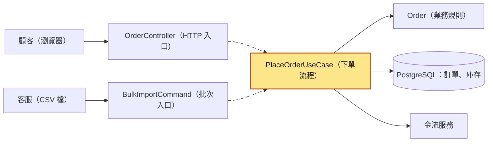
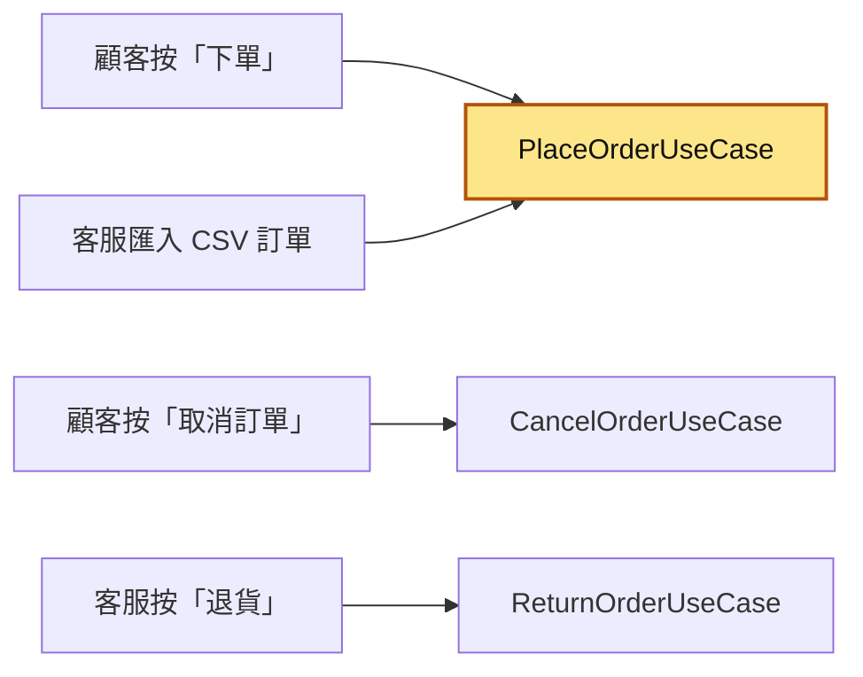
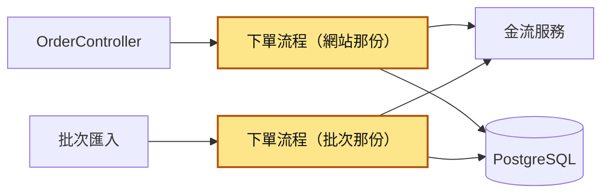
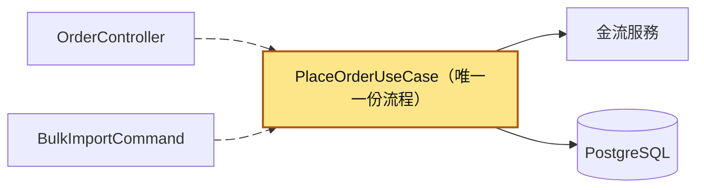
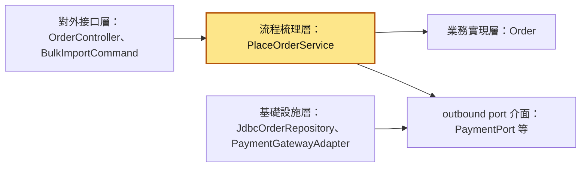
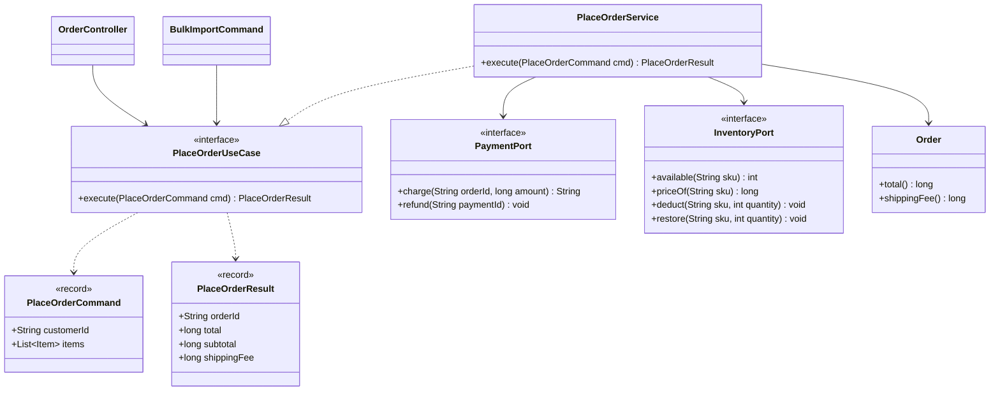
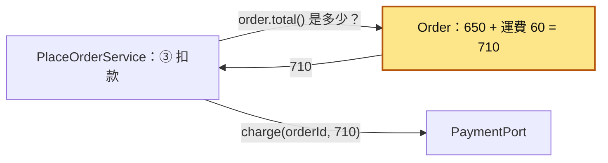
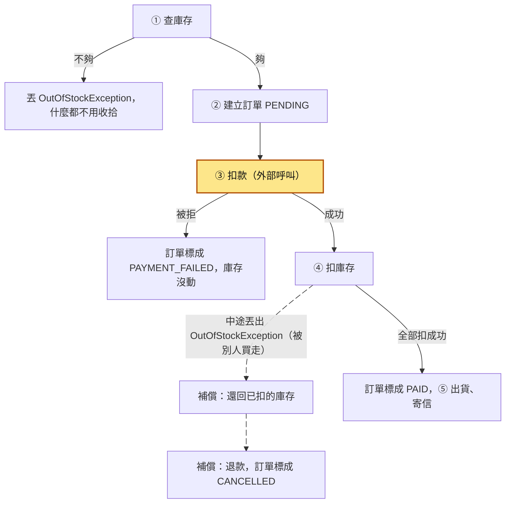
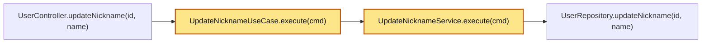

# 56｜使用案例層（Use Case）

> 使用案例（use case）是把「使用者的一個動作」寫成一個獨立的類別，例如「下單」就是 `PlaceOrderUseCase`。它負責安排這個動作的流程：先做什麼、再做什麼、哪幾步要一起成功、某一步失敗時要怎麼收拾。它不認得 HTTP，也不寫 SQL。

**難度**：★★☆　**閱讀時間**：約 25 分鐘　**前置知識**：[資料庫交易](03-資料庫交易.md)、[SOLID](54-SOLID.md)

## 核心問題與理念

**它要解決的問題**：同一個「下單」有兩個入口：顧客在網站上按下單，以及客服用批次匯入（一次把整份 CSV 檔裡的訂單匯進系統）。兩個入口各寫了一份下單流程，批次那份先扣款、沒先查庫存，最後 1 本書被兩個人買走，收了 2 次錢、開了 2 張出貨單；網站那份修得再好，也管不到批次那份（下面的情境會完整走一遍）。

**核心理念**：不管從哪個入口進來，同一個動作都走同一份步驟。

**想通的那一步**：

- **卡住的地方**：直覺的做法是把流程直接寫在入口裡，接 HTTP 請求的程式收到請求就從頭做到尾。只有一個入口時這樣沒問題；第二個入口出現時，最快的做法是複製一份、改掉輸入格式，兩份從此各改各的，批次那份順序錯了也沒人發現。
- **火花**：把「入口」和「動作」分開看：入口有好幾個，各自只差在輸入長什麼樣（HTTP 請求、CSV 的一行），動作只有一個。讓每個入口都把輸入翻成同一個 `PlaceOrderCommand`（把下單需要的資料打包成的物件），交給同一個類別執行，流程就只剩一份，順序和失敗處理只要寫對一次。

## 閱讀前推薦具備知識

| 知識 | 要會到什麼程度 | 這篇哪裡會用到 | 不熟的話先看 |
|---|---|---|---|
| Java 的 class／interface／record／package | **必備**：看得懂 `class PlaceOrderService implements PlaceOrderUseCase` 是在實作介面，`record PlaceOrderCommand(String customerId, List<Item> items)` 會自動產生哪些欄位和方法，`package com.example.order.application.port.in` 對應到哪個資料夾 | 「它是怎麼運作的」的〈標準結構〉，以及「動手看看」的每一個檔案 | [Java 官方學習路徑（dev.java）](https://dev.java/learn/) |
| Java 的例外 | **必備**：看得懂 `throw new OutOfStockException(sku)` 丟出例外，以及 `try { … } catch (PaymentDeclinedException e) { … }` 接住特定的例外 | 〈交易邊界與外部呼叫〉的失敗分支，`OrderController` 把例外翻成 HTTP 狀態碼 | [Java 官方學習路徑（dev.java）](https://dev.java/learn/) |
| JUnit 5 的基本寫法 | **必備**：看得懂 `@Test`、`@BeforeEach`、`assertEquals(預期, 實際)`、`assertThrows(例外類別, () -> …)` 各在檢查什麼 | 「動手看看」的〈測試〉和〈跑起來看〉 | [JUnit 5 使用手冊](https://docs.junit.org/current/user-guide/) |
| [資料庫交易](03-資料庫交易.md) | **加分**：知道 `COMMIT` 讓幾個寫入一起生效、`ROLLBACK` 讓它們一起作廢 | 〈交易邊界與外部呼叫〉說明扣款為什麼不能 rollback | 本系列第 03 篇 |
| HTTP 狀態碼 | **加分**：知道 `201`、`402`、`409` 大概代表什麼 | `OrderController` 把結果和例外翻成 HTTP 回應 | [MDN：HTTP 狀態碼](https://developer.mozilla.org/en-US/docs/Web/HTTP/Reference/Status) |
| [SOLID](54-SOLID.md) | **加分**：能說出「依賴介面，不依賴具體實作」在換掉實作時的好處 | 〈理念〉講依賴方向、use case 只依賴 port 介面 | 本系列第 54 篇 |

**快速自我檢查**：下面這兩行測試，各在檢查什麼？

```java
assertThrows(OutOfStockException.class, () -> service.execute(cmd));
assertTrue(payment.charges.isEmpty());
```

<details markdown="1"><summary>看答案</summary>

第一行檢查「執行 `service.execute(cmd)` 時，一定會丟出 `OutOfStockException`」，沒丟或丟了別的例外，測試就失敗。`() -> …` 是 lambda，把「要執行的那段程式」包起來交給 `assertThrows` 去跑。第二行檢查執行完之後，`payment.charges` 這個清單是空的，也就是沒有任何一筆扣款。

看不懂 `() ->` 或 `assertThrows`，先看 JUnit 5 使用手冊的 Writing Tests 和 dev.java 的 lambda 介紹，再回來讀「動手看看」會順很多。

</details>

## 為什麼要在意：一個具體的情境

下面是一個假設情境。假設你負責一個賣書的電商後端，用 Java 寫成。顧客可以從兩個地方下單：

- **網站**：顧客按「下單」，前端呼叫 `POST /orders`，由 `OrderController` 處理。
- **後台批次匯入**：企業客戶一次訂幾十筆，客服把訂單整理成 CSV 檔，用一支批次程式匯入。

兩個入口做的是同一件事：下單。可是它們是不同時間、不同同事寫的，各自有一份下單流程。網站那份順序是對的：先查庫存，夠了才扣款，再扣庫存、出貨。批次匯入那份是很久以前從舊程式複製過來改的，長這樣：

```java
// ❌ 出事的寫法：批次匯入自己又寫了一份下單流程
long subtotal = qty * unitPrice;
long total = subtotal + (subtotal >= 1000 ? 0 : 60);         // 運費規則又抄了一份
String orderId = orders.nextId();
String paymentId = payment.charge(orderId, total);           // ❌ 先扣款，沒先查庫存
try {
    inventory.deduct(sku, qty);
} catch (OutOfStockException e) {
    // ❌ 庫存不夠的例外被吞掉，什麼都沒做
}
...
shipping.ship(order);
out.printf("匯入成功：%s，扣款 %d%n", order.id(), total);
```

`inventory.deduct(sku, qty)` 只在庫存夠的時候才扣，庫存不夠就不扣，改丟出 `OutOfStockException`。這份流程把這個例外 `catch` 起來，什麼都沒做。完整程式在「動手看看」的〈重構前：兩份流程〉。

某天書 `BOOK-1` 只剩最後 1 本，單價 300 元，未滿 1000 元要加運費 60 元，一筆是 360 元。顧客 alice 在網站下單，客服剛好也在匯入企業客戶 bob 的訂單。下面這張圖可以一步一步播放（圖上的「重構後」分頁是修好之後的對照，後面會講）；圖下面的時間表是重構前這一路的文字版：

<figure class="draw-fig">
<iframe class="draw-fig__frame" src="../figures/56-two-flows-last-book.html" title="按播放看 alice 和 bob 先後下單：重構前批次那份流程沒查庫存就扣款，最後 1 本書收了 2 次錢；再切到「重構後」，看同一份 PlaceOrderUseCase 怎麼在查庫存就擋下 bob。也可以拖時間軸或按上一步、下一步。" loading="lazy" style="height: 540px;"></iframe>
<figcaption>按播放看 alice 和 bob 先後下單：重構前批次那份流程沒查庫存就扣款，最後 1 本書收了 2 次錢；再切到「重構後」，看同一份 PlaceOrderUseCase 怎麼在查庫存就擋下 bob。也可以拖時間軸或按上一步、下一步。</figcaption>
</figure>

| 時間 | 網站（alice） | 批次匯入（bob） | BOOK-1 庫存 | 金流扣款紀錄 | 出貨單 |
|---|---|---|---|---|---|
| T1 | 查庫存：剩 1 本，夠 | | 1 | 無 | 無 |
| T2 | 扣款 360 元成功 | | 1 | alice 360 | 無 |
| T3 | 扣庫存，1 變 0 | | 0 | alice 360 | 無 |
| T4 | 訂單 ORD-1 通知出貨 | | 0 | alice 360 | ORD-1 |
| T5 | | 沒查庫存，直接扣款 360 元成功 | 0 | alice 360、bob 360 | ORD-1 |
| T6 | | 扣庫存：剩 0 本，`deduct` 丟出 `OutOfStockException`，被 `catch` 吞掉 | 0 | alice 360、bob 360 | ORD-1 |
| T7 | | 訂單 ORD-2 通知出貨，印出「匯入成功」 | 0 | alice 360、bob 360 | ORD-1、ORD-2 |

1 本書收了 2 次錢、開了 2 張出貨單。

- **使用者看到的**：bob 的公司被扣了 360 元，也收到訂單成立的通知。過幾天倉庫找不到書，客服只好打電話道歉、手動退款。
- **工程師看到的**：批次匯入的日誌只有一行 `匯入成功：ORD-2，扣款 360`，沒有任何錯誤。庫存是 0，沒有變成負數，所以庫存監控也沒有叫。要等對帳時拿「扣款筆數」和「實際出貨的書」一比，才發現對不起來。

**根因**：直接的原因是批次那份流程的 `payment.charge(...)` 排在任何庫存檢查之前，而且 `inventory.deduct(sku, qty)` 丟出的庫存不足例外被吞掉。更根本的原因是「下單流程」在系統裡有兩份。網站那份修好過、測過，批次那份沒人記得要一起改。同樣的事也可能反過來發生：哪天有人在網站那份加了「扣庫存」，忘了批次那份，就變成批次匯入永遠不扣庫存，網站一直以為還有貨。

**怎麼修**：把「下單」的流程收進一個地方，也就是這篇的主角 `PlaceOrderUseCase`。網站和批次匯入都只負責把各自的輸入（HTTP 請求、CSV 的一行）翻成同一個 `PlaceOrderCommand`，交給同一個 use case 執行。流程只有一份，順序和失敗處理就只要寫對一次。後面「它是怎麼運作的」會講它長什麼樣，「動手看看」會用測試證明兩個入口共用之後，最後一本書只賣得出一次。

## 全貌：它在系統裡的位置

這張圖看的是兩個入口的請求怎麼匯進同一個 use case，再由它去呼叫業務規則和外部系統。會動的兩條箭頭是兩個入口共用的那條路。



黃色的 use case 夾在中間：左邊是負責翻譯輸入的入口，右邊是業務規則和外部系統。入口和外部系統怎麼接上 use case，是 [六邊形架構](57-六邊形架構.md) 的主題；整個系統要切成哪幾層、每層放什麼，在 [依責任分層](58-依責任分層.md)；外部系統很複雜時怎麼包成一個簡單介面，在 [Facade](55-Facade.md)。

## 生活比喻

想像一家小餐廳，客人可以三種方式點餐：到櫃台點、打電話點、用外送 App 點。不管從哪裡進來，廚房都照牆上同一張「出餐流程卡」做：確認食材夠 → 收錢 → 做菜 → 出餐。

- 櫃台、電話、外送 App 就是「入口」。它們只負責把客人的話寫成一張標準點餐單，不決定流程。
- 牆上的流程卡就是 use case。它只寫順序和出事時怎麼辦，例如「收了錢才發現食材不夠，就退錢」。
- 菜單上的價格、「滿 1000 免運」、每道菜的做法，是另一份東西，對應到業務規則（domain）。流程卡只寫「照菜單算錢」，不在卡上重寫價格。

如果每個入口各貼一張自己的流程卡，哪天電話那張被改成「先收錢再看食材」，就會出現收了錢卻做不出菜的客人，跟開頭的情境一樣。

這個比喻有兩個地方會失準：

1. **廚師會隨機應變，程式不會。** 流程卡沒寫到的狀況，人會自己想辦法；程式只會照寫好的步驟跑，所以每一種失敗都要事先寫清楚怎麼收拾。
2. **餐廳退錢很簡單，系統裡的退款是另一筆交易。** 退款可能失敗、可能要等，也不會讓「曾經扣過款」這件事消失。後面〈交易邊界與外部呼叫〉會講。

## 它是怎麼運作的

先講 use case 要解決的問題：同一個使用者動作有好幾個入口，而這個動作本身有好幾個步驟、會呼叫外部系統、中途可能失敗。這些「順序」和「失敗處理」放在哪裡，決定了它會不會像開頭那樣被寫成兩份。下面依序講它的目的、原因、理念、結構，再講什麼時候該用、什麼時候不該用。

### 目的

一個使用者動作對應一個 use case。這張圖看的是電商裡幾個常見的使用者動作，各自對應到哪個 use case：



「顧客按下單」和「客服匯入訂單」是不同的入口，做的卻是同一個動作，所以接到同一個 `PlaceOrderUseCase`。

use case 負責三件事，本文把這三件事統稱為「流程梳理」：

1. **順序**：按什麼順序呼叫哪些外部系統。下單是「查庫存 → 建立訂單 → 扣款 → 扣庫存 → 出貨 → 寄信」。
2. **交易邊界**：哪幾步要一起成功、一起失敗（用資料庫交易包起來），哪幾步做不到這點。
3. **失敗時怎麼收拾**：哪一步失敗時，要把前面哪些步驟做的事撤回來。

它刻意不知道兩件事：請求是從 HTTP 還是 CSV 來的，以及資料是用 SQL 還是別的方式存的。這兩件事分別交給入口和基礎設施去處理。

### 為什麼需要（原因）

沒有 use case 時，流程會寫在入口裡，例如寫在 `OrderController` 的方法裡。只有一個入口時這樣沒問題，問題出在第二個入口出現的時候。這張圖看的是重構前：每個入口各有一份流程，各自直接呼叫金流和資料庫。



這張是重構後：兩個入口都只做翻譯，流程只剩一份。



收進一份之後，有三個實際的好處：

- **流程改一次就好。** 要在下單時多加一步「檢查顧客是不是黑名單」，只改 `PlaceOrderService` 一個地方，網站和批次同時生效。
- **測試不用起伺服器和資料庫。** use case 只依賴介面，測試時換成記憶體裡的假實作（fake），就能測「扣款失敗時有沒有扣庫存」這種流程問題。「動手看看」會實際跑。
- **新入口很便宜。** 之後要加「訊息佇列的消費者也能下單」，只要寫一個把訊息翻成 `PlaceOrderCommand` 的入口，流程一行都不用重寫。

### 理念

use case 這個詞來自 Ivar Jacobson。他在 1987 年的 OOPSLA 研討會發表文章，介紹在 Ericsson 用 use case 描述系統需求的做法：從使用者想完成的一件事出發，寫下系統要怎麼回應。

把 use case 當成程式裡的一層，是 Robert C. Martin（常被稱為 Uncle Bob）推廣的。他在 2012 年的文章〈The Clean Architecture〉把系統畫成一圈圈的同心圓，Use Cases 是其中一圈，放的是「這個應用程式特有的業務規則」，負責指揮內圈的實體（entity，對應到本章的 domain）完成一個 use case 的目標。這篇文章列出的參考來源裡，就有 Jacobson 的 BCE 架構。Martin 在 Clean Coders 的教學影片裡，以 use case 作為切分系統的主軸，並用 Jacobson 的三種類別 Entities、Interactors、Boundaries 來說明；其中的 interactor 就是實作一個 use case 的類別，所以你在別的專案也可能看到 `PlaceOrderInteractor` 這種名字，跟本章的 `PlaceOrderService` 是同一個角色。他在 2017 年出版的《Clean Architecture》一書，也有專門講 Entities 和 Use Cases 的章節。

整理成本章的用語，理念有兩條：

1. **用「使用者要做的事」來切程式。** 看 `application/service/` 資料夾裡的檔名，就能知道這個系統能做哪些事：`PlaceOrderService`、`CancelOrderService`。
2. **依賴只往內指。** 本章把系統分成四層：對外接口層（入口，例如 controller）、流程梳理層（use case）、業務實現層（domain）、基礎設施層（接資料庫和外部服務的程式）。這張圖看的是各層之間誰認得誰，箭頭的意思是「認得、會 import」：



use case 認得 domain 和 port 介面，但不認得任何入口，也不認得 JDBC 或金流 SDK。port 是 use case 自己定義的介面，意思是「我需要有人幫我做這件事」，例如 `PaymentPort` 說「我需要能扣款」，至於用哪家金流，由基礎設施層實作這個介面。port 和 adapter 的方向，在 [六邊形架構](57-六邊形架構.md) 有完整的說明。

### 標準結構

一個 use case 由五個部分組成：

| 部分 | 本章的名字 | 是什麼 |
|---|---|---|
| Command（輸入） | `PlaceOrderCommand` | 一個 `record`，放執行這個動作需要的資料：顧客、要買哪些東西 |
| Result（輸出） | `PlaceOrderResult` | 一個 `record`，放成功後要回給呼叫端的資料：訂單編號、金額 |
| UseCase 介面 | `PlaceOrderUseCase` | 只有一個方法 `PlaceOrderResult execute(PlaceOrderCommand cmd)`，入口只認得它 |
| Service 實作 | `PlaceOrderService` | 實作上面的介面，裡面就是流程 |
| 依賴的 outbound ports | `OrderRepository`、`InventoryPort`、`PaymentPort`、`ShippingPort`、`NotifierPort` | 流程要呼叫的外部能力，全部是 `interface` |

失敗用 domain 定義的例外表示，例如 `OutOfStockException`、`PaymentDeclinedException`。入口接到例外，再自己決定要翻成 HTTP 409 還是 CSV 報表上的一行「失敗」。

這張類別圖看的是這五個部分怎麼連起來。空心三角形的虛線是「實作這個介面」，實線箭頭是「依賴、會呼叫」：



圖裡省略了 `OrderRepository`、`ShippingPort`、`NotifierPort`，它們跟 `PaymentPort` 一樣是 `PlaceOrderService` 依賴的介面。檔案放在本章共用目錄的這幾個位置（只列跟這篇有關的）：

```
src/main/java/com/example/order/
  domain/Order.java                          # 業務規則：金額、運費、狀態怎麼變
  application/
    port/in/PlaceOrderUseCase.java           # 介面
    port/in/PlaceOrderCommand.java           # 輸入
    port/in/PlaceOrderResult.java            # 輸出
    port/out/PaymentPort.java ...            # 流程要用到的外部能力
    service/PlaceOrderService.java           # 流程本身
  adapter/in/web/OrderController.java        # HTTP 入口
  adapter/in/cli/BulkImportCommand.java          # 批次入口（本篇另外加的）
```

`PlaceOrderService.execute()` 裡的流程分成五步：① 查庫存 → ② 建立訂單 → ③ 扣款 → ④ 扣庫存 → ⑤ 出貨、寄信。完整程式在「動手看看」的〈流程梳理：PlaceOrderService〉。

#### 哪些事放 use case、哪些事放 domain

新人最常卡的是這條界線。判斷方法是問一句：這段邏輯換一個入口、換一家金流，還會一樣嗎？會一樣的「規則本身」放 domain；講「先後順序、要呼叫誰、失敗怎麼收拾」的放 use case。

- 「滿 1000 免運」是規則本身，放在 domain 的 `Order.shippingFee()`。use case 只呼叫 `order.total()` 拿金額，不知道運費怎麼算。
- 「先檢查庫存，夠了才扣款」是順序，放在 use case。`Order` 不知道世界上有金流服務。

這張圖看的是 `PlaceOrderService` 跟 `Order` 之間的分工：use case 問 domain「多少錢」，再拿這個數字去叫金流扣款。例子是一張商品 650 元的訂單，未滿 1000 元要加運費 60 元（下一節的表格會用同一張訂單）。



下面幾段邏輯，各自該放哪裡？

**判斷一：** 「訂單已經付款成功，就不能再被標成付款失敗。」

<details markdown="1"><summary>看答案</summary>

放 domain。這是訂單狀態本身的規則，不管從哪個入口、哪個流程呼叫都要成立。本文的 `Order.markPaymentFailed()` 會先檢查目前狀態是不是 `PENDING`（等待付款），不是就丟 `IllegalStateException`。

</details>

**判斷二：** 「扣庫存失敗時，要先把剛才已經扣掉的庫存還回去，再退款。」

<details markdown="1"><summary>看答案</summary>

放 use case。這是「哪一步失敗要撤回哪些步驟、按什麼順序撤」的流程問題，牽涉到庫存和金流兩個外部系統，`Order` 不應該知道它們。

</details>

**判斷三：** 「同一張訂單裡，同一本書最多只能買 10 本。」

<details markdown="1"><summary>看答案</summary>

放 domain，例如在建立 `Order` 時檢查。這是「一張合法的訂單長什麼樣」的規則。如果寫在 use case 裡，之後有人寫了另一個會建立訂單的 use case（例如「複製上一張訂單」），就可能忘了檢查。

</details>

**判斷四：** 「庫存不足時，HTTP 要回 409。」

<details markdown="1"><summary>看答案</summary>

兩邊都不放，放對外接口層的 `OrderController`。use case 只丟出 `OutOfStockException`，至於 409 還是 CSV 報表上的「失敗，庫存不足」，是每個入口自己的翻譯工作。use case 裡出現 HTTP 狀態碼，就表示它認得 HTTP 了。

</details>

#### 交易邊界與外部呼叫

> 第一次讀可以先跳過這一節，等你要寫的 use case 會呼叫金流、物流這類外部服務時再回來看。

資料庫交易（見 [資料庫交易](03-資料庫交易.md)）能讓好幾個寫入一起成功或一起作廢（rollback）。但扣款是打到外部金流服務的呼叫，它不在你的資料庫交易裡。金流那邊一旦扣款成功，你這邊的資料庫就算 rollback，錢也不會自己回到顧客帳上，只能另外送一個「退款」請求把它補回來。這種「用另一個動作抵銷前一個動作」叫補償（compensation）。

所以 use case 排順序時，有兩個原則：

1. **收不回來的步驟往後放。** 先做只讀、不改任何東西的檢查（查庫存），失敗了直接結束，什麼都不用收拾。這就是 `PlaceOrderService` 把「① 查庫存」放在「③ 扣款」前面的原因。
2. **每個收不回來的步驟之後，都要寫好失敗時的補償，而且倒著做。** 後做的先撤，跟疊盤子一樣，最上面那個先拿下來。

這張圖看的是 `execute()` 在每一步失敗時往哪裡走。會動的箭頭是「扣款之後才失敗」的補償路線：



「① 查過庫存，④ 卻扣不到」會發生，因為 ① 到 ④ 之間有別的請求在買同一樣東西（見 [競爭條件](01-競爭條件.md)）。下表一步一步看這條補償路線。顧客買 2 本 `BOOK-1`（單價 300）和 1 支 `PEN-9`（單價 50），商品 650 元，未滿 1000 加運費 60，共 710 元：

| 步驟 | PlaceOrderService 做了什麼 | BOOK-1 庫存 | PEN-9 庫存 | 金流 | 訂單狀態 |
|---|---|---|---|---|---|
| 1 | 查庫存：BOOK-1 要 2 有 5，PEN-9 要 1 有 1，都夠 | 5 | 1 | 無 | 還沒建立 |
| 2 | 建立 ORD-1，金額 710 | 5 | 1 | 無 | PENDING |
| 3 | 扣款 710 元成功，拿到 PAY-1 | 5 | 1 | 已扣 710 | PENDING |
| 4 | 扣 BOOK-1 2 本成功 | 3 | 1 | 已扣 710 | PENDING |
| 5 | 這時另一位顧客買走最後一支筆，扣 PEN-9 丟出 `OutOfStockException` | 3 | 0 | 已扣 710 | PENDING |
| 6 | 補償：還回 BOOK-1 2 本 | 5 | 0 | 已扣 710 | PENDING |
| 7 | 補償：退款 PAY-1 | 5 | 0 | 已退款 | PENDING |
| 8 | 訂單標成取消，丟 `OutOfStockException` | 5 | 0 | 已退款 | CANCELLED |

交易邊界畫在哪裡，要看庫存和訂單放在哪：

- **庫存和訂單在同一個資料庫**：④ 的所有扣庫存，加上「訂單標成 PAID」，可以包成同一個本地交易。扣到一半失敗就整個 rollback，第 6 步的「還回庫存」由資料庫幫你做，use case 只要補償扣款（退款）。
- **庫存是另一個服務**：就像本文的 `InventoryPort`，扣庫存也是外部呼叫，只能像上表那樣自己補償。

不管哪一種，扣款都不要放進資料庫交易裡面。整個 `execute()` 包成一個資料庫交易的話，等金流回應的那幾秒，交易一直開著、鎖一直握著；更糟的是扣款已經成功、後面寫資料庫時失敗 rollback，資料庫裡什麼都沒留下，錢卻扣了。

補償本身也可能失敗：退款請求逾時、金流服務剛好掛掉。這時要把「待退款」記下來，之後重試，重試時帶同一個冪等鍵（idempotency key）避免退兩次，見 [冪等性](25-冪等性.md) 和 [重試機制](26-重試機制.md)。跨好幾個服務、每一步都要補償的長流程，有個專門的名字叫 Saga，細節在 [分散式交易](43-分散式交易.md)。⑤ 的出貨和寄信失敗時，錢和庫存都已經處理好了，通常不退款，改成稍後重試；做法是把「要出貨」寫進資料庫，交給背景程式送出，見 [信箱模式](44-信箱模式.md) 和 [背景工作者](37-背景工作者.md)。

### 適用情境

- **同一個動作有兩個以上的入口**：網站、App、後台、批次匯入、訊息佇列的消費者。開頭的情境就是這種。
- **流程有好幾步、會呼叫外部系統、中途會失敗**：下單、退貨、轉帳、開通帳號。順序和補償值得被集中寫在一個地方、被單獨測試。
- **想在不起資料庫、不連金流的情況下測流程**：use case 只依賴介面，換成 fake 就能測「扣款被拒時有沒有出貨」。
- **系統會活很久、會換人維護**：看 `service/` 資料夾的檔名就知道系統能做什麼，新人比較容易找到入口。

### 不適用的情境

**簡單的新增、查詢、修改、刪除（CRUD）。** 例如「修改暱稱」：讀進新暱稱、存回資料庫，沒有順序問題、沒有外部呼叫、沒有補償。這時硬套 use case，常會長成這樣一串，每一層都只是把參數原封不動傳下去：



黃色那兩層裡面只有一行 `userRepository.updateNickname(cmd.id(), cmd.name())`。新人要看懂「改暱稱」，得打開 Controller、介面、Command、Service、Repository 五個檔案；暱稱要多一個欄位，五個地方的簽名都要改。判斷的方法是問：把這一層拿掉，呼叫端會變複雜嗎？不會，就表示這層什麼都沒藏起來，是多的。這種情況讓 Controller 直接呼叫 repository，或放進一個管「使用者資料」的小 service 就好。等哪天暱稱要檢查髒話、要通知其他系統，有了真正的流程，再抽成 use case 也不遲。這種「為了套模式、把層數拉長」的問題，在 [可見性與模組深度](59-可見性與模組深度.md) 有完整的症狀清單和修法。

**單純的查詢畫面。** 「訂單列表」只是把資料撈出來給畫面看，沒有流程。很多團隊讓讀取走另一條比較短的路，不經過 use case，這個想法延伸下去就是 [CQRS](45-CQRS.md)。

**一次性的腳本、還在驗證想法的原型。** 程式可能下週就丟掉，先寫在一起，等它活下來、出現第二個入口再整理。

### 優點與缺點

| | 內容 |
|---|---|
| 優點 | 流程只有一份，每個入口的行為一致 |
| 優點 | 流程可以用 fake 測，不用起資料庫和金流沙盒 |
| 優點 | 順序、交易邊界、補償集中在一個方法裡，code review 時看得到全貌 |
| 優點 | 加新入口只要寫翻譯，不用重寫流程 |
| 缺點 | 檔案變多：一個動作至少多出介面、Command、Result、Service 四個檔案 |
| 缺點 | 用在沒有流程的地方，就變成只轉呼叫 repository 的多餘一層 |
| 缺點 | use case 之間互相呼叫，流程和交易會糾纏在一起 |
| 缺點 | use case 容易變肥，把業務規則吸進來，domain 只剩欄位 |

後面兩個缺點最常見，分開說：

**use case 互相呼叫。** 例如 `PlaceOrderService` 為了在下單時套用優惠券，注入了 `ApplyCouponUseCase` 來呼叫，而 `ApplyCouponService` 裡又會查訂單、寫資料庫。結果是看 `PlaceOrderService` 看不出完整流程，兩邊各自開交易時，誰失敗要撤誰也說不清楚。每個 use case 都是「一個使用者動作的完整流程」，它應該直接呼叫 domain 和 port。兩個 use case 有共用的部分時，通常代表那是一條業務規則，該搬進 domain（例如 `Coupon.discountFor(order)`），兩邊各自呼叫它。

**use case 變肥，domain 變貧血。** 如果 `PlaceOrderService` 裡出現 `subtotal >= 1000 ? 0 : 60`，運費規則就漏進了流程裡。下一個需要算運費的地方（例如「試算運費」的 API）只好再抄一份，開頭情境裡批次匯入那行 `// 運費規則又抄了一份` 就是這樣來的。domain 的 `Order` 只剩欄位和 getter、沒有任何規則，這種狀況叫貧血模型（anemic domain model）。檢查方法是看 use case 裡有沒有 `if` 在判斷業務數值，有的話，問自己它是不是「規則本身」，是就搬進 domain。

## 動手看看

我們用純 Java 21 加 JUnit 5，不用 Spring、不用資料庫，做三件事：先重現開頭「兩份流程」的超賣；再用 `PlaceOrderService` 加上記憶體裡的 fake port，測正常下單、庫存不足、扣款失敗、扣款後才發現沒庫存四種情況；最後讓 HTTP 入口和批次入口共用同一個 use case。

### 1. 專案結構和 JUnit 依賴

用 Maven 的話，結構照本章的共用目錄（下面只列這次會寫的檔案）：

```
src/main/java/com/example/order/
  domain/Order.java, OrderLine.java, OutOfStockException.java, PaymentDeclinedException.java
  application/port/in/PlaceOrderUseCase.java, PlaceOrderCommand.java, PlaceOrderResult.java
  application/port/out/OrderRepository.java, InventoryPort.java, PaymentPort.java, ShippingPort.java, ShipmentReceipt.java, NotifierPort.java
  application/service/PlaceOrderService.java
  adapter/in/web/OrderController.java
  adapter/in/cli/BulkImportCommand.java
  legacy/LegacyBulkImportJob.java            # 重構前的批次匯入，用來重現問題
src/test/java/com/example/order/
  domain/OrderTest.java
  application/FakePorts.java
  application/PlaceOrderServiceTest.java
  adapter/in/EntryPointsTest.java
  legacy/LegacyBulkImportJobTest.java
```

`pom.xml` 裡跟這次有關的部分：

```xml
<properties>
  <maven.compiler.release>21</maven.compiler.release>
  <project.build.sourceEncoding>UTF-8</project.build.sourceEncoding>
</properties>

<dependencies>
  <dependency>
    <groupId>org.junit.jupiter</groupId>
    <artifactId>junit-jupiter</artifactId>
    <version>5.13.4</version>
    <scope>test</scope>
  </dependency>
</dependencies>

<build>
  <plugins>
    <plugin>
      <groupId>org.apache.maven.plugins</groupId>
      <artifactId>maven-surefire-plugin</artifactId>
      <version>3.5.4</version>
    </plugin>
  </plugins>
</build>
```

### 2. 業務實現：domain

`Order` 只管規則：金額怎麼算、狀態可以怎麼變。它不 import 任何資料庫、HTTP 或 port。

```java
package com.example.order.domain;

public record OrderLine(String sku, long unitPrice, int quantity) {
    public OrderLine {
        if (quantity <= 0) throw new IllegalArgumentException("數量要大於 0：" + sku);
    }

    public long amount() {
        return unitPrice * quantity;
    }
}
```

??? example "完整程式：Order.java"

    ```java
    package com.example.order.domain;

    import java.util.List;

    public final class Order {
        public enum Status { PENDING, PAID, PAYMENT_FAILED, CANCELLED }

        static final long FREE_SHIPPING_THRESHOLD = 1000;
        static final long SHIPPING_FEE = 60;

        private final String id;
        private final String customerId;
        private final List<OrderLine> lines;
        private Status status = Status.PENDING;
        private String paymentId;

        public Order(String id, String customerId, List<OrderLine> lines) {
            if (lines.isEmpty()) throw new IllegalArgumentException("訂單至少要有一個品項");
            this.id = id;
            this.customerId = customerId;
            this.lines = List.copyOf(lines);
        }

        // ---- 業務規則：金額怎麼算 ----
        public long subtotal() {
            return lines.stream().mapToLong(OrderLine::amount).sum();
        }

        public long shippingFee() {
            return subtotal() >= FREE_SHIPPING_THRESHOLD ? 0 : SHIPPING_FEE;   // 滿 1000 免運
        }

        public long total() {
            return subtotal() + shippingFee();
        }

        // ---- 業務規則：狀態怎麼變 ----
        public void markPaid(String paymentId) {
            requireStatus(Status.PENDING);
            this.paymentId = paymentId;
            this.status = Status.PAID;
        }

        public void markPaymentFailed() {
            requireStatus(Status.PENDING);
            this.status = Status.PAYMENT_FAILED;
        }

        public void cancel() {
            if (status == Status.CANCELLED) return;
            this.status = Status.CANCELLED;
        }

        private void requireStatus(Status expected) {
            if (status != expected) {
                throw new IllegalStateException("訂單 " + id + " 目前是 " + status + "，不能這樣改");
            }
        }

        public String id() { return id; }
        public String customerId() { return customerId; }
        public List<OrderLine> lines() { return lines; }
        public Status status() { return status; }
        public String paymentId() { return paymentId; }
    }
    ```

```java
package com.example.order.domain;

public class OutOfStockException extends RuntimeException {
    private final String sku;

    public OutOfStockException(String sku) {
        super("庫存不足：" + sku);
        this.sku = sku;
    }

    public String sku() { return sku; }
}
```

```java
package com.example.order.domain;

public class PaymentDeclinedException extends RuntimeException {
    public PaymentDeclinedException(String reason) {
        super("扣款被拒：" + reason);
    }
}
```

### 3. inbound port：use case 的介面、Command、Result

```java
package com.example.order.application.port.in;

/** 「下單」這個使用者動作。HTTP、CLI、訊息佇列都從這裡進來。 */
public interface PlaceOrderUseCase {
    PlaceOrderResult execute(PlaceOrderCommand cmd);
}
```

```java
package com.example.order.application.port.in;

import java.util.List;

/** 下單需要的輸入。只放資料，不認得 HTTP 也不認得 CSV。 */
public record PlaceOrderCommand(String customerId, List<Item> items) {

    // 不帶單價：單價由流程向 InventoryPort.priceOf 查，不能相信呼叫端傳來的價格
    public record Item(String sku, int quantity) {}

    public PlaceOrderCommand {
        if (customerId == null || customerId.isBlank()) throw new IllegalArgumentException("缺少 customerId");
        if (items == null || items.isEmpty()) throw new IllegalArgumentException("至少要買一樣東西");
        items = List.copyOf(items);
    }
}
```

```java
package com.example.order.application.port.in;

/** 下單成功時回給呼叫端的結果。 */
public record PlaceOrderResult(String orderId, long total, long subtotal, long shippingFee) {}
```

### 4. outbound ports：流程要用到的外部能力

五個介面，加上 `ShippingPort` 回傳的 `ShipmentReceipt`，每個放在自己的檔案裡。下面省略每個檔案開頭的 `package com.example.order.application.port.out;` 和 `import`（需要 `Order` 的要 `import com.example.order.domain.Order;`，`OrderRepository` 還要 `import java.util.Optional;`）。`restore` 和 `refund` 是這篇為了示範補償另外加的方法，其他篇的同名 port 沒有它們：

```java
// application/port/out/OrderRepository.java
public interface OrderRepository {
    String nextId();
    void save(Order order);
    Optional<Order> findById(String id);
}

// application/port/out/InventoryPort.java
public interface InventoryPort {
    int available(String sku);

    long priceOf(String sku);   // 簡化：庫存服務順便回單價

    /** 庫存不夠時丟 OutOfStockException。真實實作是一條 UPDATE ... WHERE qty >= ?，更新 0 列就丟。 */
    void deduct(String sku, int quantity);

    /** 補償用：把扣掉的庫存加回去。 */
    void restore(String sku, int quantity);
}

// application/port/out/PaymentPort.java
public interface PaymentPort {
    /** 扣款成功回傳付款編號（paymentId）；被拒時丟 PaymentDeclinedException。 */
    String charge(String orderId, long amount);

    /** 補償用：退款。 */
    void refund(String paymentId);
}

// application/port/out/ShippingPort.java
public interface ShippingPort {
    /** 通知物流出貨，回傳託運單號和標籤網址。 */
    ShipmentReceipt ship(Order order);
}

// application/port/out/ShipmentReceipt.java
public record ShipmentReceipt(String consignmentNo, String labelUrl) {}

// application/port/out/NotifierPort.java
public interface NotifierPort {
    void orderPlaced(Order order);
}
```

### 5. 流程梳理：PlaceOrderService

整個流程就在 `execute()` 這一個方法裡，由上往下讀就知道下單會發生什麼事。最值得細看的是 ④：扣款已經成功之後，才發現庫存被別人買走，`deduct` 丟出 `OutOfStockException`，這時要倒著補償：

```java
// ④ 扣庫存：①到這裡之間，庫存可能被別人買走，這時 deduct 會丟 OutOfStockException
List<OrderLine> deducted = new ArrayList<>();
try {
    for (OrderLine line : order.lines()) {
        inventory.deduct(line.sku(), line.quantity());
        deducted.add(line);
    }
} catch (OutOfStockException e) {
    // 補償要倒著做：先還回已經扣掉的庫存，再退款，最後把訂單標成取消
    for (OrderLine done : deducted) {
        inventory.restore(done.sku(), done.quantity());
    }
    payment.refund(paymentId);
    order.cancel();
    orders.save(order);
    throw e;
}
order.markPaid(paymentId);
orders.save(order);
```

完整的類別（含建構子和 ①～③、⑤）點開看：

??? example "完整程式：PlaceOrderService.java"

    ```java
    package com.example.order.application.service;

    import com.example.order.application.port.in.PlaceOrderCommand;
    import com.example.order.application.port.in.PlaceOrderResult;
    import com.example.order.application.port.in.PlaceOrderUseCase;
    import com.example.order.application.port.out.InventoryPort;
    import com.example.order.application.port.out.NotifierPort;
    import com.example.order.application.port.out.OrderRepository;
    import com.example.order.application.port.out.PaymentPort;
    import com.example.order.application.port.out.ShippingPort;
    import com.example.order.domain.Order;
    import com.example.order.domain.OrderLine;
    import com.example.order.domain.OutOfStockException;
    import com.example.order.domain.PaymentDeclinedException;

    import java.util.ArrayList;
    import java.util.List;

    public class PlaceOrderService implements PlaceOrderUseCase {
        private final OrderRepository orders;
        private final InventoryPort inventory;
        private final PaymentPort payment;
        private final ShippingPort shipping;
        private final NotifierPort notifier;

        public PlaceOrderService(OrderRepository orders, InventoryPort inventory, PaymentPort payment,
                                 ShippingPort shipping, NotifierPort notifier) {
            this.orders = orders;
            this.inventory = inventory;
            this.payment = payment;
            this.shipping = shipping;
            this.notifier = notifier;
        }

        @Override
        public PlaceOrderResult execute(PlaceOrderCommand cmd) {
            // ① 先檢查庫存：這時還沒碰任何收不回來的東西，不夠就直接結束
            for (PlaceOrderCommand.Item item : cmd.items()) {
                if (inventory.available(item.sku()) < item.quantity()) {
                    throw new OutOfStockException(item.sku());
                }
            }

            // ② 建立訂單：單價向庫存服務查，金額和運費怎麼算交給 domain 的 Order
            List<OrderLine> lines = cmd.items().stream()
                    .map(i -> new OrderLine(i.sku(), inventory.priceOf(i.sku()), i.quantity()))
                    .toList();
            Order order = new Order(orders.nextId(), cmd.customerId(), lines);
            orders.save(order);

            // ③ 扣款：外部呼叫，成功了就沒辦法 rollback，之後出錯只能退款
            String paymentId;
            try {
                paymentId = payment.charge(order.id(), order.total());
            } catch (PaymentDeclinedException e) {
                order.markPaymentFailed();
                orders.save(order);
                throw e;                       // 庫存沒動、沒出貨，什麼都不用補償
            }

            // ④ 扣庫存：①到這裡之間，庫存可能被別人買走，這時 deduct 會丟 OutOfStockException
            List<OrderLine> deducted = new ArrayList<>();
            try {
                for (OrderLine line : order.lines()) {
                    inventory.deduct(line.sku(), line.quantity());
                    deducted.add(line);
                }
            } catch (OutOfStockException e) {
                // 補償要倒著做：先還回已經扣掉的庫存，再退款，最後把訂單標成取消
                for (OrderLine done : deducted) {
                    inventory.restore(done.sku(), done.quantity());
                }
                payment.refund(paymentId);
                order.cancel();
                orders.save(order);
                throw e;
            }
            order.markPaid(paymentId);
            orders.save(order);

            // ⑤ 出貨、寄確認信
            shipping.ship(order);
            notifier.orderPlaced(order);

            return new PlaceOrderResult(order.id(), order.total(), order.subtotal(), order.shippingFee());
        }
    }
    ```

### 6. 兩個入口：OrderController 和 BulkImportCommand

兩個入口都只做翻譯：把自己的輸入翻成 `PlaceOrderCommand`，把結果或例外翻成自己的輸出。`OrderController` 把請求裡的每一行商品翻成 `PlaceOrderCommand.Item`，`OutOfStockException` 翻成 409、`PaymentDeclinedException` 翻成 402；`BulkImportCommand` 把 CSV 一行的 `customerId,sku:數量;sku:數量` 翻成同一個 `PlaceOrderCommand`，例外翻成報表上的一行「失敗」。兩邊都沒有單價：單價由 use case 向 `InventoryPort.priceOf` 查。

??? example "完整程式：OrderController.java"

    ```java
    package com.example.order.adapter.in.web;

    import com.example.order.application.port.in.PlaceOrderCommand;
    import com.example.order.application.port.in.PlaceOrderResult;
    import com.example.order.application.port.in.PlaceOrderUseCase;
    import com.example.order.domain.OutOfStockException;
    import com.example.order.domain.PaymentDeclinedException;

    import java.util.List;

    /** 對外接口：把 HTTP 請求翻成 Command，把結果或錯誤翻成 HTTP 回應。不做任何業務決定。 */
    public class OrderController {

        // 真實專案裡，JSON 轉成這個 record 是框架（例如 Spring 的 @RequestBody）做的
        public record CreateOrderRequest(String customerId, List<LineDto> lines) {
            public record LineDto(String sku, int qty) {}
        }

        public record HttpResponse(int status, String body) {}

        private final PlaceOrderUseCase placeOrder;

        public OrderController(PlaceOrderUseCase placeOrder) {
            this.placeOrder = placeOrder;
        }

        public HttpResponse createOrder(CreateOrderRequest req) {
            PlaceOrderCommand cmd = new PlaceOrderCommand(
                    req.customerId(),
                    req.lines().stream()
                            .map(l -> new PlaceOrderCommand.Item(l.sku(), l.qty()))
                            .toList());
            try {
                PlaceOrderResult r = placeOrder.execute(cmd);
                return new HttpResponse(201, "{\"orderId\":\"%s\",\"total\":%d}".formatted(r.orderId(), r.total()));
            } catch (OutOfStockException e) {
                return new HttpResponse(409, "{\"error\":\"out_of_stock\",\"sku\":\"%s\"}".formatted(e.sku()));
            } catch (PaymentDeclinedException e) {
                return new HttpResponse(402, "{\"error\":\"payment_declined\"}");
            }
        }
    }
    ```

??? example "完整程式：BulkImportCommand.java"

    ```java
    package com.example.order.adapter.in.cli;

    import com.example.order.application.port.in.PlaceOrderCommand;
    import com.example.order.application.port.in.PlaceOrderResult;
    import com.example.order.application.port.in.PlaceOrderUseCase;
    import com.example.order.domain.OutOfStockException;
    import com.example.order.domain.PaymentDeclinedException;

    import java.io.PrintStream;
    import java.util.Arrays;
    import java.util.List;

    /**
     * 後台批次匯入：一行一張訂單，格式是 customerId,sku:數量;sku:數量
     * 也是對外接口，只是輸入從 HTTP 換成 CSV。下單流程一樣交給 PlaceOrderUseCase。
     */
    public class BulkImportCommand {
        private final PlaceOrderUseCase placeOrder;

        public BulkImportCommand(PlaceOrderUseCase placeOrder) {
            this.placeOrder = placeOrder;
        }

        /** 回傳成功的筆數。 */
        public int run(List<String> csvLines, PrintStream out) {
            int succeeded = 0;
            for (int i = 0; i < csvLines.size(); i++) {
                int lineNo = i + 1;
                String[] cols = csvLines.get(i).split(",");
                List<PlaceOrderCommand.Item> items = Arrays.stream(cols[1].split(";"))
                        .map(s -> s.split(":"))
                        .map(p -> new PlaceOrderCommand.Item(p[0], Integer.parseInt(p[1])))
                        .toList();
                try {
                    PlaceOrderResult r = placeOrder.execute(new PlaceOrderCommand(cols[0], items));
                    out.printf("第 %d 行：成功，%s，金額 %d%n", lineNo, r.orderId(), r.total());
                    succeeded++;
                } catch (OutOfStockException e) {
                    out.printf("第 %d 行：失敗，庫存不足 %s%n", lineNo, e.sku());
                } catch (PaymentDeclinedException e) {
                    out.printf("第 %d 行：失敗，扣款被拒%n", lineNo);
                }
            }
            return succeeded;
        }
    }
    ```

真正上線時，CLI 的 `main` 只要讀進 CSV 檔、從組裝處 `Application.buildApp()` 拿到接好真實 adapter 的 `PlaceOrderUseCase`，再呼叫 `run()`。組裝怎麼寫在 [六邊形架構](57-六邊形架構.md)。

### 7. 重構前：兩份流程

這是開頭情境裡批次匯入的那份流程，用來重現問題。它用的是同一組 port，所以不用資料庫也能跑。

??? example "完整程式：LegacyBulkImportJob.java"

    ```java
    package com.example.order.legacy;

    import com.example.order.application.port.out.InventoryPort;
    import com.example.order.application.port.out.OrderRepository;
    import com.example.order.application.port.out.PaymentPort;
    import com.example.order.application.port.out.ShippingPort;
    import com.example.order.domain.Order;
    import com.example.order.domain.OrderLine;
    import com.example.order.domain.OutOfStockException;

    import java.io.PrintStream;
    import java.util.List;

    /** 重構前的批次匯入：沒有用 PlaceOrderUseCase，自己又寫了一份下單流程。一行一張訂單：customerId,sku:數量 */
    public class LegacyBulkImportJob {
        private final OrderRepository orders;
        private final InventoryPort inventory;
        private final PaymentPort payment;
        private final ShippingPort shipping;

        public LegacyBulkImportJob(OrderRepository orders, InventoryPort inventory,
                                   PaymentPort payment, ShippingPort shipping) {
            this.orders = orders;
            this.inventory = inventory;
            this.payment = payment;
            this.shipping = shipping;
        }

        public void run(List<String> csvLines, PrintStream out) {
            for (String csv : csvLines) {
                String[] cols = csv.split(",");
                String[] p = cols[1].split(":");
                String customerId = cols[0], sku = p[0];
                int qty = Integer.parseInt(p[1]);
                long unitPrice = inventory.priceOf(sku);

                long subtotal = qty * unitPrice;
                long total = subtotal + (subtotal >= 1000 ? 0 : 60);         // 運費規則又抄了一份
                String orderId = orders.nextId();
                String paymentId = payment.charge(orderId, total);           // ❌ 先扣款，沒先查庫存
                try {
                    inventory.deduct(sku, qty);
                } catch (OutOfStockException e) {
                    // ❌ 庫存不夠的例外被吞掉，什麼都沒做
                }
                Order order = new Order(orderId, customerId, List.of(new OrderLine(sku, unitPrice, qty)));
                order.markPaid(paymentId);
                orders.save(order);
                shipping.ship(order);
                out.printf("匯入成功：%s，扣款 %d%n", order.id(), total);
            }
        }
    }
    ```

### 8. 記憶體裡的 fake port

測試用的假實作。它們實作同樣的介面，資料放在 `Map` 和 `List` 裡，另外多開幾個開關讓測試製造失敗：`declinedOrderIds` 讓某張訂單扣款被拒，`soldOutBeforeDeduct` 模擬「查完庫存之後、扣庫存之前被別人買走」。

??? example "完整程式：FakePorts.java"

    ```java
    package com.example.order.application;

    import com.example.order.application.port.out.InventoryPort;
    import com.example.order.application.port.out.NotifierPort;
    import com.example.order.application.port.out.OrderRepository;
    import com.example.order.application.port.out.PaymentPort;
    import com.example.order.application.port.out.ShipmentReceipt;
    import com.example.order.application.port.out.ShippingPort;
    import com.example.order.domain.Order;
    import com.example.order.domain.OutOfStockException;
    import com.example.order.domain.PaymentDeclinedException;

    import java.util.ArrayList;
    import java.util.HashMap;
    import java.util.HashSet;
    import java.util.List;
    import java.util.Map;
    import java.util.Optional;
    import java.util.Set;

    /** 記憶體裡的假 port：不用資料庫、不用金流沙盒，測試就能跑。 */
    public final class FakePorts {
        private FakePorts() {}

        public static class FakeOrderRepository implements OrderRepository {
            private final Map<String, Order> rows = new HashMap<>();
            private int seq = 0;

            @Override public String nextId() { return "ORD-" + (++seq); }
            @Override public void save(Order order) { rows.put(order.id(), order); }
            @Override public Optional<Order> findById(String id) { return Optional.ofNullable(rows.get(id)); }
        }

        public static class FakeInventory implements InventoryPort {
            public final Map<String, Integer> stock = new HashMap<>();
            public final Map<String, Long> prices = new HashMap<>();
            /** 模擬「檢查完之後、扣庫存之前，被別人買走了」的 SKU。 */
            public final Set<String> soldOutBeforeDeduct = new HashSet<>();

            public FakeInventory with(String sku, int qty, long price) {
                stock.put(sku, qty);
                prices.put(sku, price);
                return this;
            }

            @Override public int available(String sku) { return stock.getOrDefault(sku, 0); }

            @Override public long priceOf(String sku) { return prices.get(sku); }

            @Override public void deduct(String sku, int quantity) {
                if (soldOutBeforeDeduct.contains(sku)) stock.put(sku, 0);
                int now = available(sku);
                if (now < quantity) throw new OutOfStockException(sku);
                stock.put(sku, now - quantity);
            }

            @Override public void restore(String sku, int quantity) { stock.merge(sku, quantity, Integer::sum); }
        }

        public static class FakePayment implements PaymentPort {
            public record Charge(String paymentId, String orderId, long amount) {}
            public final List<Charge> charges = new ArrayList<>();
            public final List<String> refunds = new ArrayList<>();
            public final Set<String> declinedOrderIds = new HashSet<>();

            @Override public String charge(String orderId, long amount) {
                if (declinedOrderIds.contains(orderId)) throw new PaymentDeclinedException("卡片額度不足");
                String id = "PAY-" + (charges.size() + 1);
                charges.add(new Charge(id, orderId, amount));
                return id;
            }

            @Override public void refund(String paymentId) { refunds.add(paymentId); }
        }

        public static class FakeShipping implements ShippingPort {
            public final List<String> shippedOrderIds = new ArrayList<>();

            @Override public ShipmentReceipt ship(Order order) {
                shippedOrderIds.add(order.id());
                return new ShipmentReceipt("SHIP-" + order.id(), "https://fake/label/" + order.id() + ".pdf");
            }
        }

        public static class FakeNotifier implements NotifierPort {
            public final List<String> notifiedOrderIds = new ArrayList<>();

            @Override public void orderPlaced(Order order) { notifiedOrderIds.add(order.id()); }
        }
    }
    ```

### 9. 測試

`OrderTest` 測業務規則，連 fake 都不需要：

```java
package com.example.order.domain;

import org.junit.jupiter.api.DisplayName;
import org.junit.jupiter.api.Test;

import java.util.List;

import static org.junit.jupiter.api.Assertions.assertEquals;

class OrderTest {

    @Test
    @DisplayName("未滿 1000 元要收運費 60")
    void chargesShippingUnder1000() {
        Order order = new Order("ORD-1", "c1", List.of(new OrderLine("BOOK-1", 333, 3)));   // 999 元
        assertEquals(60, order.shippingFee());
        assertEquals(1059, order.total());
    }

    @Test
    @DisplayName("滿 1000 元免運")
    void freeShippingFrom1000() {
        Order order = new Order("ORD-1", "c1", List.of(new OrderLine("BOOK-1", 500, 2)));   // 1000 元
        assertEquals(0, order.shippingFee());
        assertEquals(1000, order.total());
    }
}
```

`PlaceOrderServiceTest` 測流程：每個測試都看「有沒有扣款、庫存剩多少、有沒有出貨、訂單是什麼狀態」。最後一個測試就是〈交易邊界與外部呼叫〉那張 8 步表格：

```java
@Test
@DisplayName("扣款後才發現庫存被買走：還回已扣的庫存、退款、取消訂單")
void compensatesWhenStockGoneAfterCharge() {
    inventory.soldOutBeforeDeduct.add("PEN-9");

    assertThrows(OutOfStockException.class, () -> service.execute(order("c1",
            new PlaceOrderCommand.Item("BOOK-1", 2),
            new PlaceOrderCommand.Item("PEN-9", 1))));

    assertEquals(5, inventory.available("BOOK-1"));          // 先扣的 2 本還回去了
    assertEquals(List.of("PAY-1"), payment.refunds);          // 扣的 710 元退掉了
    assertTrue(shipping.shippedOrderIds.isEmpty());
    assertEquals(Order.Status.CANCELLED, orders.findById("ORD-1").orElseThrow().status());
}
```

四個測試的完整檔案點開看：

??? example "完整程式：PlaceOrderServiceTest.java"

    ```java
    package com.example.order.application;

    import com.example.order.application.FakePorts.FakeInventory;
    import com.example.order.application.FakePorts.FakeNotifier;
    import com.example.order.application.FakePorts.FakeOrderRepository;
    import com.example.order.application.FakePorts.FakePayment;
    import com.example.order.application.FakePorts.FakeShipping;
    import com.example.order.application.port.in.PlaceOrderCommand;
    import com.example.order.application.port.in.PlaceOrderResult;
    import com.example.order.application.service.PlaceOrderService;
    import com.example.order.domain.Order;
    import com.example.order.domain.OutOfStockException;
    import com.example.order.domain.PaymentDeclinedException;
    import org.junit.jupiter.api.BeforeEach;
    import org.junit.jupiter.api.DisplayName;
    import org.junit.jupiter.api.Test;

    import java.util.List;

    import static org.junit.jupiter.api.Assertions.assertEquals;
    import static org.junit.jupiter.api.Assertions.assertThrows;
    import static org.junit.jupiter.api.Assertions.assertTrue;

    class PlaceOrderServiceTest {
        FakeOrderRepository orders;
        FakeInventory inventory;
        FakePayment payment;
        FakeShipping shipping;
        FakeNotifier notifier;
        PlaceOrderService service;

        @BeforeEach
        void setUp() {
            orders = new FakeOrderRepository();
            inventory = new FakeInventory().with("BOOK-1", 5, 300).with("PEN-9", 1, 50);
            payment = new FakePayment();
            shipping = new FakeShipping();
            notifier = new FakeNotifier();
            service = new PlaceOrderService(orders, inventory, payment, shipping, notifier);
        }

        static PlaceOrderCommand order(String customerId, PlaceOrderCommand.Item... items) {
            return new PlaceOrderCommand(customerId, List.of(items));
        }

        @Test
        @DisplayName("正常下單：扣款金額含運費、扣庫存、出貨、寄信")
        void placesOrder() {
            PlaceOrderResult r = service.execute(order("c1",
                    new PlaceOrderCommand.Item("BOOK-1", 2),
                    new PlaceOrderCommand.Item("PEN-9", 1)));

            assertEquals(650, r.subtotal());
            assertEquals(60, r.shippingFee());
            assertEquals(710, r.total());
            assertEquals(710, payment.charges.get(0).amount());
            assertEquals(3, inventory.available("BOOK-1"));
            assertEquals(0, inventory.available("PEN-9"));
            assertEquals(List.of(r.orderId()), shipping.shippedOrderIds);
            assertEquals(List.of(r.orderId()), notifier.notifiedOrderIds);
            assertEquals(Order.Status.PAID, orders.findById(r.orderId()).orElseThrow().status());
        }

        @Test
        @DisplayName("庫存不足：不扣款、不建立訂單")
        void outOfStockDoesNotCharge() {
            assertThrows(OutOfStockException.class, () -> service.execute(order("c1",
                    new PlaceOrderCommand.Item("PEN-9", 2))));

            assertTrue(payment.charges.isEmpty());
            assertTrue(orders.findById("ORD-1").isEmpty());
            assertEquals(1, inventory.available("PEN-9"));
        }

        @Test
        @DisplayName("扣款被拒：不扣庫存、不出貨，訂單標成 PAYMENT_FAILED")
        void declinedPaymentTouchesNothing() {
            payment.declinedOrderIds.add("ORD-1");

            assertThrows(PaymentDeclinedException.class, () -> service.execute(order("c2",
                    new PlaceOrderCommand.Item("BOOK-1", 1))));

            assertEquals(5, inventory.available("BOOK-1"));
            assertTrue(shipping.shippedOrderIds.isEmpty());
            assertTrue(notifier.notifiedOrderIds.isEmpty());
            assertEquals(Order.Status.PAYMENT_FAILED, orders.findById("ORD-1").orElseThrow().status());
        }

        @Test
        @DisplayName("扣款後才發現庫存被買走：還回已扣的庫存、退款、取消訂單")
        void compensatesWhenStockGoneAfterCharge() {
            inventory.soldOutBeforeDeduct.add("PEN-9");

            assertThrows(OutOfStockException.class, () -> service.execute(order("c1",
                    new PlaceOrderCommand.Item("BOOK-1", 2),
                    new PlaceOrderCommand.Item("PEN-9", 1))));

            assertEquals(5, inventory.available("BOOK-1"));          // 先扣的 2 本還回去了
            assertEquals(List.of("PAY-1"), payment.refunds);          // 扣的 710 元退掉了
            assertTrue(shipping.shippedOrderIds.isEmpty());
            assertEquals(Order.Status.CANCELLED, orders.findById("ORD-1").orElseThrow().status());
        }
    }
    ```

`EntryPointsTest` 讓 HTTP 入口和批次入口拿到**同一個** `PlaceOrderService`。`BOOK-1` 只有 1 本：alice 從網站買走之後，bob 從批次匯入再買，就會被擋下來，而且不會被扣款。批次檔裡還有第 2 行：carol 要買 1 支 `PEN-9`，這個測試把 `PEN-9` 的庫存設成 0，所以她也會被擋下來。

??? example "完整程式：EntryPointsTest.java"

    ```java
    package com.example.order.adapter.in;

    import com.example.order.adapter.in.cli.BulkImportCommand;
    import com.example.order.adapter.in.web.OrderController;
    import com.example.order.adapter.in.web.OrderController.CreateOrderRequest;
    import com.example.order.adapter.in.web.OrderController.CreateOrderRequest.LineDto;
    import com.example.order.adapter.in.web.OrderController.HttpResponse;
    import com.example.order.application.FakePorts.FakeInventory;
    import com.example.order.application.FakePorts.FakeNotifier;
    import com.example.order.application.FakePorts.FakeOrderRepository;
    import com.example.order.application.FakePorts.FakePayment;
    import com.example.order.application.FakePorts.FakeShipping;
    import com.example.order.application.port.in.PlaceOrderUseCase;
    import com.example.order.application.service.PlaceOrderService;
    import org.junit.jupiter.api.DisplayName;
    import org.junit.jupiter.api.Test;

    import java.io.ByteArrayOutputStream;
    import java.io.PrintStream;
    import java.nio.charset.StandardCharsets;
    import java.util.List;

    import static org.junit.jupiter.api.Assertions.assertEquals;

    class EntryPointsTest {

        @Test
        @DisplayName("HTTP 和批次匯入共用同一個 use case：最後一本書只賣得出一次")
        void bothEntriesShareOneUseCase() {
            FakeInventory inventory = new FakeInventory().with("BOOK-1", 1, 300).with("PEN-9", 0, 50);
            FakePayment payment = new FakePayment();
            PlaceOrderUseCase placeOrder = new PlaceOrderService(
                    new FakeOrderRepository(), inventory, payment, new FakeShipping(), new FakeNotifier());

            // 入口一：網站的 HTTP API
            OrderController controller = new OrderController(placeOrder);
            HttpResponse res = controller.createOrder(
                    new CreateOrderRequest("alice", List.of(new LineDto("BOOK-1", 1))));
            System.out.println("HTTP：" + res.status() + " " + res.body());

            // 入口二：後台批次匯入
            ByteArrayOutputStream buf = new ByteArrayOutputStream();
            int ok = new BulkImportCommand(placeOrder).run(
                    List.of("bob,BOOK-1:1", "carol,PEN-9:1"),
                    new PrintStream(buf, true, StandardCharsets.UTF_8));
            System.out.print(buf.toString(StandardCharsets.UTF_8));

            assertEquals(201, res.status());
            assertEquals(0, ok);
            assertEquals(1, payment.charges.size());       // 只有 alice 被扣款
            assertEquals(0, inventory.available("BOOK-1"));
        }
    }
    ```

`LegacyBulkImportJobTest` 用同樣的條件跑重構前的批次匯入，證明開頭的情境真的會發生。這個測試「通過」，代表 bug 被重現了：

??? example "完整程式：LegacyBulkImportJobTest.java"

    ```java
    package com.example.order.legacy;

    import com.example.order.adapter.in.web.OrderController;
    import com.example.order.adapter.in.web.OrderController.CreateOrderRequest;
    import com.example.order.adapter.in.web.OrderController.CreateOrderRequest.LineDto;
    import com.example.order.application.FakePorts.FakeInventory;
    import com.example.order.application.FakePorts.FakeNotifier;
    import com.example.order.application.FakePorts.FakeOrderRepository;
    import com.example.order.application.FakePorts.FakePayment;
    import com.example.order.application.FakePorts.FakeShipping;
    import com.example.order.application.service.PlaceOrderService;
    import org.junit.jupiter.api.DisplayName;
    import org.junit.jupiter.api.Test;

    import java.io.ByteArrayOutputStream;
    import java.io.PrintStream;
    import java.nio.charset.StandardCharsets;
    import java.util.List;

    import static org.junit.jupiter.api.Assertions.assertEquals;

    class LegacyBulkImportJobTest {

        @Test
        @DisplayName("重構前：兩個入口各寫一份流程，最後一本書被賣了兩次")
        void twoCopiesOfTheFlowOversell() {
            FakeOrderRepository orders = new FakeOrderRepository();
            FakeInventory inventory = new FakeInventory().with("BOOK-1", 1, 300);
            FakePayment payment = new FakePayment();
            FakeShipping shipping = new FakeShipping();

            // 網站：走 PlaceOrderService，先查庫存再扣款
            new OrderController(new PlaceOrderService(orders, inventory, payment, shipping, new FakeNotifier()))
                    .createOrder(new CreateOrderRequest("alice", List.of(new LineDto("BOOK-1", 1))));

            // 後台批次匯入：自己那一份流程
            ByteArrayOutputStream buf = new ByteArrayOutputStream();
            new LegacyBulkImportJob(orders, inventory, payment, shipping)
                    .run(List.of("bob,BOOK-1:1"), new PrintStream(buf, true, StandardCharsets.UTF_8));
            System.out.print(buf.toString(StandardCharsets.UTF_8));
            System.out.println("扣款：" + payment.charges);
            System.out.println("出貨：" + shipping.shippedOrderIds + "，BOOK-1 庫存：" + inventory.available("BOOK-1"));

            assertEquals(2, payment.charges.size());             // alice 和 bob 都被扣了 360
            assertEquals(2, shipping.shippedOrderIds.size());    // 兩張都叫物流出貨
            assertEquals(0, inventory.available("BOOK-1"));      // 書只有 1 本
        }
    }
    ```

### 10. 跑起來看

有 Maven 的話，在專案根目錄執行 `mvn test` 就好。

本文的輸出是用 JUnit Console Launcher 跑的（Maven 的輸出格式不同）。沒有 Maven 時可以這樣跑：從 Maven Central 下載 `org.junit.platform:junit-platform-console-standalone`（本文用 1.13.4，對應 JUnit 5.13.4），改名成 `junit-console.jar` 放在專案根目錄，然後在 PowerShell 執行：

```powershell
javac --release 21 -encoding UTF-8 -d out -cp junit-console.jar (Get-ChildItem -Recurse src -Filter *.java).FullName
java "-Dstdout.encoding=UTF-8" -jar junit-console.jar execute --class-path out --scan-class-path --disable-banner --details=tree
```

`-encoding UTF-8` 讓 `javac` 用 UTF-8 讀原始碼，`-Dstdout.encoding=UTF-8` 讓中文輸出不變成亂碼，兩個在 Windows 上都要加。實跑的輸出（最後的毫秒數依機器而異）：

```
HTTP：201 {"orderId":"ORD-1","total":360}
第 1 行：失敗，庫存不足 BOOK-1
第 2 行：失敗，庫存不足 PEN-9
匯入成功：ORD-2，扣款 360
扣款：[Charge[paymentId=PAY-1, orderId=ORD-1, amount=360], Charge[paymentId=PAY-2, orderId=ORD-2, amount=360]]
出貨：[ORD-1, ORD-2]，BOOK-1 庫存：0
╷
├─ JUnit Platform Suite ✔
├─ JUnit Jupiter ✔
│  ├─ EntryPointsTest ✔
│  │  └─ HTTP 和批次匯入共用同一個 use case：最後一本書只賣得出一次 ✔
│  ├─ LegacyBulkImportJobTest ✔
│  │  └─ 重構前：兩個入口各寫一份流程，最後一本書被賣了兩次 ✔
│  ├─ OrderTest ✔
│  │  ├─ 滿 1000 元免運 ✔
│  │  └─ 未滿 1000 元要收運費 60 ✔
│  └─ PlaceOrderServiceTest ✔
│     ├─ 扣款後才發現庫存被買走：還回已扣的庫存、退款、取消訂單 ✔
│     ├─ 庫存不足：不扣款、不建立訂單 ✔
│     ├─ 正常下單：扣款金額含運費、扣庫存、出貨、寄信 ✔
│     └─ 扣款被拒：不扣庫存、不出貨，訂單標成 PAYMENT_FAILED ✔
└─ JUnit Vintage ✔

Test run finished after 80 ms
[         7 containers found      ]
[         0 containers skipped    ]
[         7 containers started    ]
[         0 containers aborted    ]
[         7 containers successful ]
[         0 containers failed     ]
[         8 tests found           ]
[         0 tests skipped         ]
[         8 tests started         ]
[         0 tests aborted         ]
[         8 tests successful      ]
[         0 tests failed          ]
```

最上面 6 行是測試裡 `System.out` 印的東西：前 3 行是共用 use case 的版本，bob 和 carol 都被擋下來；後 3 行是重構前的版本，alice 的 ORD-1 和 bob 的 ORD-2 各被扣了 360 元、開了 2 張出貨單，書卻只有 1 本。

試試看：

- 把 `PlaceOrderService` 裡「① 查庫存」那個 `for` 迴圈整段刪掉再跑。會有 2 個測試失敗：「庫存不足：不扣款、不建立訂單」，以及 `EntryPointsTest`（`expected: <1> but was: <3>`，bob 和 carol 也被扣款了，雖然後來被退款）。流程的順序被測試守住了。
- 把 `Order.shippingFee()` 的 `>=` 改成 `>`。只有 `OrderTest` 的「滿 1000 元免運」會失敗（`expected: <0> but was: <60>`），`PlaceOrderServiceTest` 全部照樣通過。規則和流程分開放，壞掉時也分得開。

## 常見地雷

### 地雷 1：流程寫在 Controller 裡，use case 被繞過

- ❌ 錯誤做法：`OrderController.createOrder()` 裡直接呼叫 `inventory.available(...)`、`payment.charge(...)`、`orderRepository.save(...)`，另外又有一個 `PlaceOrderService`，但只有部分入口用它。
- 為什麼錯：流程又變回好幾份，就是開頭的情境。哪天改了 `PlaceOrderService`，沒走它的入口行為就不一樣。
- ✅ 正確做法：Controller 只做翻譯：HTTP 轉 `PlaceOrderCommand`、呼叫 `placeOrder.execute(cmd)`、例外轉狀態碼。Controller 裡出現 port 或 repository 的呼叫，就是警訊。

### 地雷 2：業務規則寫進 use case，domain 只剩欄位

- ❌ 錯誤做法：`PlaceOrderService` 裡寫 `long fee = subtotal >= 1000 ? 0 : 60;`，`Order` 只有 getter 和 setter。
- 為什麼錯：另一個需要運費的地方（試算 API、批次匯入、報表）只能再抄一份。規則有好幾份，改的時候一定會漏。
- ✅ 正確做法：規則放進 `Order.shippingFee()`，use case 只呼叫 `order.total()`。use case 裡有 `if` 在判斷業務數值時，問一句「這是順序，還是規則本身？」

### 地雷 3：use case 呼叫另一個 use case

- ❌ 錯誤做法：`PlaceOrderService` 注入 `ApplyCouponUseCase`、`GrantPointsUseCase`，在 `execute()` 裡一個接一個呼叫。
- 為什麼錯：每個 use case 都以為自己是一個完整的流程，各自開交易、各自處理失敗。串起來之後，「點數發了、訂單卻失敗」時誰要撤回誰說不清楚，看一個 use case 也看不出完整流程。
- ✅ 正確做法：共用的規則搬進 domain（例如 `Coupon.discountFor(order)`），由 `PlaceOrderService` 直接呼叫。「下單後發點數」這種下單成功之後才發生的事，改成發出一個事件，由另一個流程處理，見 [事件驅動架構](39-事件驅動架構.md) 和 [信箱模式](44-信箱模式.md)。

### 地雷 4：整個 `execute()` 包在一個資料庫交易裡，扣款也在裡面

- ❌ 錯誤做法：在 `execute()` 上加 Spring 的 `@Transactional`，裡面依序寫資料庫、呼叫金流、再寫資料庫。
- 為什麼錯：等金流回應的那段時間，交易一直開著、鎖一直握著。扣款成功之後，後面寫資料庫失敗 rollback，資料庫裡沒有任何紀錄，錢卻已經扣了。
- ✅ 正確做法：資料庫交易只包本地的寫入，外部呼叫放在交易外面，失敗用補償處理（〈交易邊界與外部呼叫〉）。外部呼叫要能安全重試，就帶冪等鍵，見 [冪等性](25-冪等性.md)。

### 地雷 5：use case 收 HTTP 物件，或回傳 HTTP 狀態碼

- ❌ 錯誤做法：`execute(HttpServletRequest req)`，或回傳 `ResponseEntity`、在 use case 裡寫 `return 409`。
- 為什麼錯：use case 認得 HTTP 之後，批次匯入、訊息佇列的消費者就沒辦法用它，只好再寫一份流程。測試也要先造一個假的 HTTP 請求。
- ✅ 正確做法：輸入用 `PlaceOrderCommand`，輸出用 `PlaceOrderResult`，失敗丟 domain 的例外。HTTP 的翻譯全部留在 `OrderController`。

### 地雷 6：每個 repository 方法都配一個 use case

- ❌ 錯誤做法：`GetUserUseCase`、`UpdateNicknameUseCase`、`DeleteAddressUseCase`，每個 `execute()` 裡都只有一行轉呼叫 repository。
- 為什麼錯：多出來的介面、Command、Service 什麼複雜度都沒藏起來，只讓讀程式的人多跳好幾個檔案，改一個欄位要改好幾個簽名。
- ✅ 正確做法：沒有順序、沒有外部呼叫、沒有補償的簡單 CRUD，不用硬套 use case。等真的出現流程再抽。判斷方法見 [可見性與模組深度](59-可見性與模組深度.md)。

### 地雷 7：補償寫了，但沒想過補償也會失敗

- ❌ 錯誤做法：`payment.refund(paymentId);` 呼叫一次，失敗就讓例外往外丟，沒有任何紀錄。
- 為什麼錯：退款逾時或金流剛好掛掉時，顧客的錢就這樣被扣著，沒人知道要再退一次。
- ✅ 正確做法：把「待退款」寫進資料庫，交給背景程式重試，重試時帶同一個冪等鍵避免退兩次；重試用完要有人收到告警。補償的寫法見 [分散式交易](43-分散式交易.md)。

## 重點整理

- **一個使用者動作就是一個 use case。** 不管請求從 HTTP、CSV 還是訊息佇列來，同一個動作都交給同一個 `PlaceOrderUseCase`，流程只有一份。
- **use case 管流程，domain 管規則，入口管翻譯。** 「先查庫存再扣款」是流程；「滿 1000 免運」是規則，放在 `Order.shippingFee()`；「庫存不足回 409」是翻譯，放在 `OrderController`。
- **標準結構是五個部分。** Command 和 Result 兩個 `record`、一個 UseCase 介面、一個 Service 實作，加上它依賴的 outbound port 介面。
- **收不回來的步驟往後放，失敗時倒著補償。** 扣款這類外部呼叫無法 rollback，只能退款；資料庫交易只包本地的寫入，不要把外部呼叫包進去。
- **沒有流程的地方不要硬套。** 簡單 CRUD 套上 use case，只會多出一層只轉呼叫 repository 的程式；use case 之間也不要互相呼叫。

## 新人必知清單

### 一定要會（基本功）

- [ ] 看到一個需求，能說出它對應哪個使用者動作、該叫什麼 use case。
- [ ] 寫出 Command、Result、UseCase 介面、Service 實作，並讓入口只依賴 UseCase 介面。
- [ ] 分辨一段邏輯是流程（放 use case）、規則（放 domain），還是翻譯（放入口）。
- [ ] 排流程順序時，把只讀的檢查放前面、收不回來的外部呼叫往後放。
- [ ] 每個外部呼叫之後，寫出它後面的步驟失敗時要怎麼補償，並用 fake 寫測試證明。
- [ ] 入口接到 domain 例外時，翻成自己的輸出（HTTP 狀態碼、報表上的一行）。

### 知道有這回事就好

- **Saga**：跨好幾個服務、每一步都有補償的長流程，見 [分散式交易](43-分散式交易.md)。
- **信箱模式**：把「要出貨、要寄信」跟訂單寫在同一個交易裡，再由背景程式送出，見 [信箱模式](44-信箱模式.md)。
- **讀寫分開**：查詢畫面不經過 use case、走另一條比較短的路，見 [CQRS](45-CQRS.md)。
- **組裝處**：在 `Application.buildApp()` 把真實的 adapter 接到 port 上；Spring 的 DI 容器做的就是這件事，見 [六邊形架構](57-六邊形架構.md)。

### 先不用管（等你遇到再學）

- 用 command bus、mediator 這類框架自動把 Command 派給對應的 use case。
- 長時間、跨好幾天的流程編排引擎（例如 Temporal）。
- 依 use case 拆服務、拆部署單位。

## Code Review 時可以問的問題

1. **這個動作還有沒有別的入口？** 它們都走同一個 use case 嗎？有沒有哪個入口自己寫了一份流程？
2. **use case 裡的這個 `if` 是流程還是規則？** 如果是「規則本身」，是不是該搬進 domain？
3. **這一步失敗時，前面做過的哪些事要撤回？** 外部呼叫之後的每個失敗點，補償寫了嗎？補償自己失敗時怎麼辦？
4. **資料庫交易包到哪裡？** 外部呼叫有沒有被包進交易裡？
5. **use case 有沒有認得 HTTP 或 SQL？** 參數、回傳值、例外裡有沒有框架或資料庫的型別？
6. **這個 use case 有沒有藏起任何東西？** 如果 `execute()` 只有一行轉呼叫 repository，這一層需要存在嗎？

## 情境演練

**Q1. 業務要新增「客服電話下單」：客服在後台表單填好顧客和商品，按送出。同事打算複製 `OrderController.createOrder()` 的內容，改一改放進新的 `AdminOrderController`。你會怎麼建議？**

<details markdown="1"><summary>看答案</summary>

`AdminOrderController` 只要負責把後台表單翻成 `PlaceOrderCommand`，呼叫同一個 `PlaceOrderUseCase`，再把結果或例外翻成後台要的畫面。不要複製流程。

理由是開頭的情境：流程只要出現第二份，總有一天兩份會不一樣。新入口真正不同的地方只有「輸入長怎樣」「誰可以用」（例如只有客服帳號能呼叫）「錯誤怎麼顯示」，這些都是入口的工作，放在 `AdminOrderController` 裡剛好。

如果電話下單真的有不同的流程（例如客服下單不用線上扣款、改成貨到付款），那就是另一個使用者動作，寫成另一個 use case。在共用的流程裡加一堆 `if (fromAdmin)`，會讓兩種流程混在同一個方法裡，誰都看不清楚。

</details>

**Q2. 產品經理說：「VIP 會員滿 500 元就免運，一般會員還是滿 1000。」你要改哪些地方？**

<details markdown="1"><summary>看答案</summary>

規則本身改在 domain：`Order.shippingFee()` 要知道顧客等級，例如在建立 `Order` 時多傳一個會員等級，`shippingFee()` 依等級選門檻 500 或 1000。

use case 只多一件流程上的事：在建立訂單之前，透過一個 outbound port（例如新的 `CustomerPort`）查出顧客等級，交給 `Order`。`PlaceOrderService` 裡不應該出現 `500`、`1000` 這些數字。

入口完全不用改，網站和批次匯入同時生效。測試也分得開：`OrderTest` 測兩種等級的門檻，`PlaceOrderServiceTest` 只測「有把等級查出來交給訂單」。

</details>

**Q3. 金流服務偶爾會逾時：`payment.charge(...)` 等了 10 秒沒回應，丟出逾時例外。同事想把逾時當成扣款被拒處理，直接把訂單標成 `PAYMENT_FAILED`。這樣會出什麼問題？**

<details markdown="1"><summary>看答案</summary>

逾時代表「不知道結果」，金流那邊可能已經扣款成功，只是回應沒傳回來。當成被拒的話，顧客的錢扣了，訂單卻顯示付款失敗，顧客可能再下一次單，又被扣一次。

比較安全的做法：

- 訂單維持在「付款結果未知」的狀態，不要直接標成失敗，也不要直接出貨。
- 之後向金流查詢這筆交易的狀態，或用同一個冪等鍵重試扣款。金流支援冪等鍵的話，重試不會扣兩次，見 [冪等性](25-冪等性.md)、[重試機制](26-重試機制.md)。
- 查到扣款成功就繼續 ④ 扣庫存；查到沒扣到就標成失敗。

[分散式交易](43-分散式交易.md) 的地雷「把逾時當成失敗」講的就是這件事。這些判斷都屬於流程，寫在 use case 裡，入口不用知道。

</details>

**Q4. Code review 時，你看到同事為了「修改暱稱」新增了 `UpdateNicknameUseCase`、`UpdateNicknameCommand`、`UpdateNicknameResult`、`UpdateNicknameService` 四個檔案。`UpdateNicknameService.execute()` 裡只有一行 `userRepository.updateNickname(cmd.userId(), cmd.nickname())`。你會怎麼回？**

<details markdown="1"><summary>看答案</summary>

可以建議先不要這一層。判斷方法是問：把 use case 拿掉，呼叫端會變複雜嗎？這裡不會，Controller 直接呼叫 repository 也只是一行。這一層沒有順序、沒有外部呼叫、沒有補償，什麼都沒藏起來，只讓讀的人多跳 4 個檔案，暱稱多一個欄位時還要改 4 個簽名。

什麼時候值得抽出來：暱稱要先過髒話檢查、改完要通知其他系統、同一個動作出現第二個入口。到那時候有了真正的流程，再抽成 use case。

如果團隊規定「所有寫入都要經過 application 層」，也可以放進一個管使用者資料的 `UserProfileService`，幾個簡單操作放在一起，不必一個操作一組四個檔案。更多症狀和修法見 [可見性與模組深度](59-可見性與模組深度.md)。

</details>

**Q5. 下單成功後要發會員點數。同事在 `PlaceOrderService` 注入了 `GrantPointsUseCase`，在 ⑤ 寄信之後呼叫 `grantPoints.execute(...)`。`GrantPointsService` 會寫點數資料表，也會呼叫另一個會員系統。你覺得有什麼風險？**

<details markdown="1"><summary>看答案</summary>

這是 use case 呼叫 use case，有幾個風險：

1. **失敗時說不清楚誰撤誰。** 發點數失敗時，`PlaceOrderService` 要不要退款、取消訂單？訂單已經出貨了，通常不該取消，可是程式現在會讓例外往外丟，呼叫端會以為整個下單失敗。
2. **流程看不完整。** 看 `PlaceOrderService` 不知道 `GrantPointsService` 裡面還呼叫了哪些外部系統。
3. **交易邊界糾纏。** 兩個 use case 各自管自己的交易，串在一起後，哪些寫入是一起成功的就很難推。

比較好的做法：發點數是「下單成功之後才發生的另一件事」，讓 `PlaceOrderService` 在訂單成立時記下一筆「訂單已成立」的事件（例如寫進 outbox 表），由另一個流程去發點數，失敗就重試，不影響訂單本身。見 [信箱模式](44-信箱模式.md)、[事件驅動架構](39-事件驅動架構.md)。

</details>

## 相關主題

- [SOLID](54-SOLID.md)：use case 只依賴 port 介面，是依賴反轉原則的直接應用。
- [Facade](55-Facade.md)：`ShippingPort` 背後的物流子系統怎麼包成一個簡單介面。
- [六邊形架構](57-六邊形架構.md)：inbound port、outbound port、adapter 的方向，以及在 `Application.buildApp()` 怎麼把它們接起來。
- [依責任分層](58-依責任分層.md)：對外接口、流程梳理、業務實現、基礎設施四層各放什麼。
- [可見性與模組深度](59-可見性與模組深度.md)：怎麼辨認「只轉呼叫的多餘一層」，以及什麼時候該收回來。
- [資料庫交易](03-資料庫交易.md)：use case 決定交易邊界時用到的基礎。
- [分散式交易](43-分散式交易.md)：Saga 和補償，外部呼叫失敗時怎麼收拾。
- [信箱模式](44-信箱模式.md)：出貨、寄信、發點數這類「成功後才做的事」怎麼可靠地送出。
- [冪等性](25-冪等性.md)：扣款、退款重試時怎麼避免做兩次。

## 延伸閱讀

- Robert C. Martin，〈The Clean Architecture〉（2012），Use Cases 那一圈的原始說明：https://blog.cleancoder.com/uncle-bob/2012/08/13/the-clean-architecture.html
- Robert C. Martin，《Clean Architecture: A Craftsman's Guide to Software Structure and Design》（Pearson，2017），第 20 章〈Business Rules〉講 Entities、Use Cases 和 Request／Response Models：https://www.pearson.com/store/en-ca/p/clean-architecture-a-craftsman-s-guide-to-software-structure-and-design/P200000009528/9780134494166
- Clean Coders，Clean Code Episode 7（Uncle Bob 講 Jacobson 的 Entities、Interactors、Boundaries）：https://cleancoders.com/episode/clean-code-episode-7
- Wikipedia：Use case（含 Jacobson 1987 年在 OOPSLA 發表的歷史）：https://en.wikipedia.org/wiki/Use_case
- Alistair Cockburn，〈The Hexagonal (Ports & Adapters) Architecture〉：https://alistair.cockburn.us/hexagonal-architecture/
- JUnit User Guide：https://docs.junit.org/current/user-guide/
