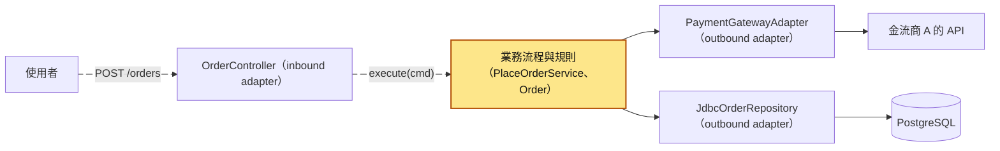
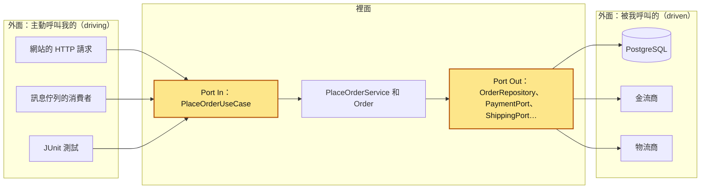
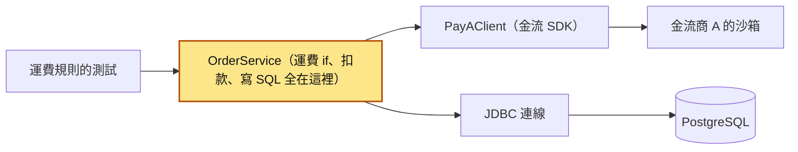
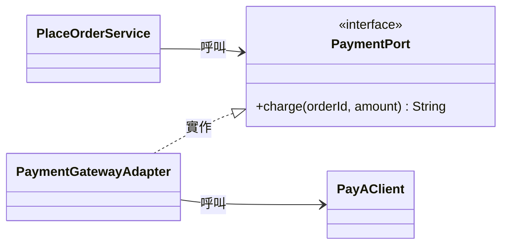
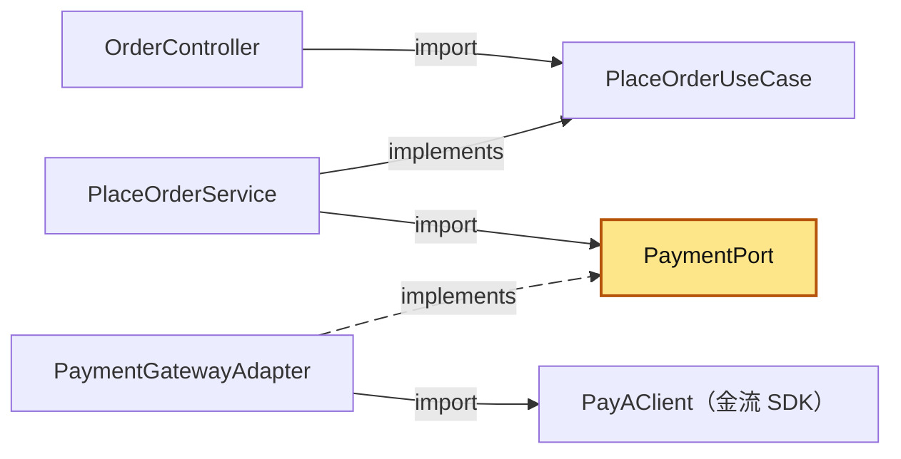
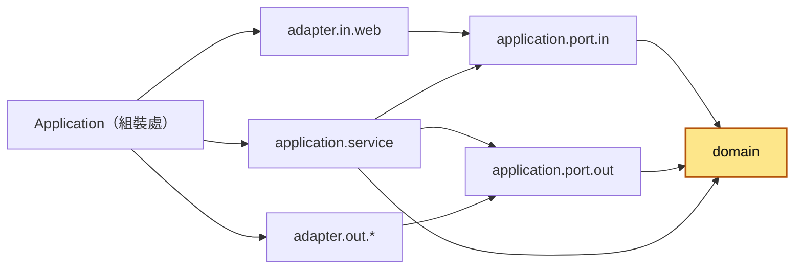
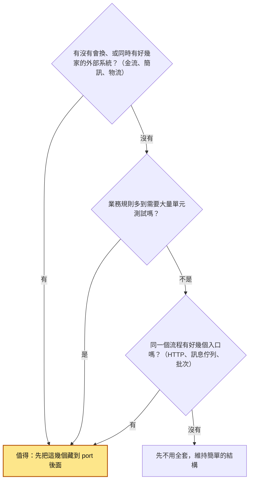
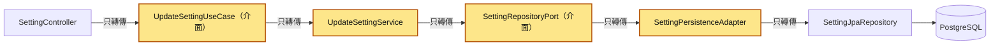
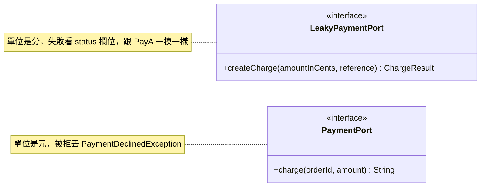
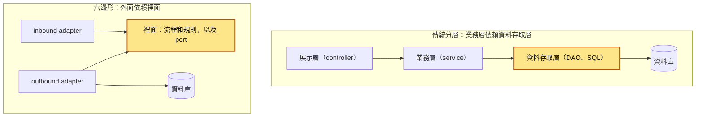

# 57｜六邊形架構：Port In 與 Port Out（Hexagonal Architecture / Ports and Adapters）

> 六邊形架構（hexagonal architecture，也叫 ports and adapters）把程式分成「裡面」和「外面」：裡面是業務規則和流程，外面是 HTTP、資料庫、金流商這些會換掉的東西。裡面用 Java 的 `interface` 寫下「我需要什麼」，這個介面叫 port；外面寫一個類別去實作它，這個類別叫 adapter。兩邊只透過 port 往來。

**難度**：★★☆　**閱讀時間**：約 25 分鐘　**前置知識**：[SOLID](54-SOLID.md)、[Use Case](56-Use%20Case.md)

## 核心問題與理念

**它要解決的問題**：下單流程裡直接呼叫金流商的 SDK（金流商提供的程式庫），也直接寫 SQL。換一家金流商，流程裡的扣款和錯誤處理就要重寫：新廠商改用丟例外的方式回報「卡片被拒」，改寫時漏了這條路，訂單一直卡在「待付款」（`PENDING`）；流程又離不開資料庫和金流商的測試環境，連「滿 1000 免運」這種規則都沒辦法單獨測。（下面的情境會完整走一遍）

**核心理念**：由業務流程決定介面長什麼樣，外面的系統來遷就它。

**想通的那一步**：

- **卡住的地方**：直覺的做法是在金流 SDK 前面包一層 interface 就好。可是照 SDK 抄出來的介面，會沿用那家 SDK 自己的規定（例如金額單位是「分」、失敗要看回傳結果裡的 `status` 欄位），換一家金流商時，流程裡處理這些的程式照樣要重寫。
- **火花**：讓介面由業務流程那一側來寫，用流程自己的說法：金額用元，被拒就丟 `PaymentDeclinedException`。程式執行時是流程去呼叫金流商，原始碼卻反過來，是金流商的轉接器去配合流程定的介面，所以換金流商只是換一個轉接器。

## 閱讀前推薦具備知識

| 知識 | 要會到什麼程度 | 這篇哪裡會用到 | 不熟的話先看 |
|---|---|---|---|
| Java 的 class、`interface`、`implements` | **必備**：看得懂 `class PaymentGatewayAdapter implements PaymentPort`，能說出這個類別要提供 `PaymentPort` 規定的哪些方法 | 「理念」的類別圖、呼叫方向和依賴方向那兩張圖 | [Java 官方學習路徑（dev.java）](https://dev.java/learn/) |
| Java 的 package 和 `import` | **必備**：看到檔案開頭的 `import com.example.order.application.port.out.PaymentPort;`，能說出這個檔案用到了哪個套件的哪個類別 | 「標準結構」的套件表、「動手看看」第 7 步和第 9 步的依賴方向檢查 | [Java 官方學習路徑（dev.java）](https://dev.java/learn/) |
| Java 的 `record` 和 checked exception | **加分**：看得懂 `record OrderLine(String sku, long unitPrice, int quantity)`；知道 checked exception 要 `catch` 或宣告 `throws` | 情境裡的 `PayBException`、「動手看看」第 1、2 步 | [Java 官方學習路徑（dev.java）](https://dev.java/learn/)；本篇情境會順帶解釋 checked exception |
| JUnit 5 的基本寫法 | **必備**：看得懂一個 `@Test` 方法裡的 `assertEquals(60, order.shippingFee())` 在檢查什麼 | 「動手看看」第 7 步的 4 個測試類別 | [JUnit 5 使用手冊](https://docs.junit.org/current/user-guide/) |
| [SOLID](54-SOLID.md) 的依賴反轉原則 | **加分**：能說出「高層的流程和低層的細節都依賴同一個介面」是什麼意思 | 「理念」最後一段 | 本系列第 54 篇 |
| [Use Case](56-Use%20Case.md) | **加分**：知道「一個使用者動作對應一個 use case」，例如「下單」就是 `PlaceOrderUseCase` | 「全貌」圖黃色那塊、Port In 的說明 | 本系列第 56 篇 |

**快速自我檢查**：下面是 `PlaceOrderService.java` 的開頭，以及另一個檔案裡的一行宣告。`PlaceOrderService.java` import 了哪個類別？程式執行到 `payment.charge(...)` 時，有可能跑到 `PaymentGatewayAdapter` 裡的程式嗎？

```java
package com.example.order.application.service;
import com.example.order.application.port.out.PaymentPort;
public class PlaceOrderService { private final PaymentPort payment; /* 建構子傳進來 */ }

// 另一個檔案：public class PaymentGatewayAdapter implements PaymentPort { ... }
```

<details markdown="1"><summary>看答案</summary>

`PlaceOrderService.java` 只 import 了 `PaymentPort` 這個介面，沒有 import `PaymentGatewayAdapter`。可是只要建構子傳進來的物件是一個 `PaymentGatewayAdapter`，`payment.charge(...)` 實際執行的就是它的 `charge()`，這是 Java 介面加多型的基本行為。

兩題都答得出來，這篇的機制就讀得懂。答不出 import 那一題，先補「Java 的 package 和 `import`」；答不出第二題，先補「class、`interface`、`implements`」。

</details>

## 為什麼要在意：一個具體的情境

這是一個假設情境。假設你負責電商的下單服務，用 Java 寫成。下單流程寫在 `OrderService.placeOrder()` 這支方法裡，依序做 7 件事：檢查庫存、算總額和運費（滿 1000 免運，否則運費 60）、建立訂單、向金流商扣款、扣庫存、通知物流出貨、寄確認信。

這支方法直接 new 金流商 A 的 SDK（`PayAClient`，SDK 是金流商提供、讓你用 Java 呼叫它的函式庫），也直接開 JDBC（Java 連資料庫的標準 API）連線寫 SQL。金流商 A 的 SDK 金額單位是「分」，扣款失敗時，回傳結果裡的 `status` 欄位會是 `"failed"`，所以原本的程式要自己檢查 `status`，失敗就把訂單改成 `PAYMENT_FAILED`。

後來公司決定改用金流商 B。B 的 SDK 金額單位是「元」，扣款失敗時丟出 `PayBException`，這是 Java 的 checked exception（呼叫端一定要 `catch` 或宣告 `throws`，不然編譯不過）。負責的工程師把扣款那段改成這樣：

```java
// ❌ 出事的寫法：OrderService.placeOrder() 裡，換成金流商 B 之後的扣款段落
insertOrder(conn, order);                                    // 直接寫 SQL，訂單狀態是 PENDING
try { payB.pay(order.id(), order.total()); }                 // 直接呼叫金流商 B 的 SDK
catch (PayBException e) { throw new RuntimeException(e); }   // 為了編譯得過，先包起來往上丟
updateStatus(conn, order.id(), "PAID");
```

下表一格一格看，從第一版上線到出事，程式和測試各發生了什麼：

| 時間 | 發生的事 | 要動到的程式 | 測試的狀況 |
|---|---|---|---|
| T1 | 第一版上線，`OrderService` 直接 new `PayAClient`、自己開 JDBC 連線 | | 想替運費規則寫單元測試，可是一 new `OrderService` 就要連資料庫，只好寫整合測試 |
| T2 | 為了跑整合測試，CI（每次推程式碼就自動跑測試的流程）每次先起一個 PostgreSQL 容器，再連金流商 A 的測試環境（沙箱） | | 沙箱偶爾逾時，CI 變紅燈，按重跑又變綠 |
| T3 | 公司決定改用金流商 B | `OrderService` 裡扣款的呼叫、金額單位、失敗的判斷全部重寫 | 同一個檔案裡另一位同事正在改運費規則，合併時衝突 |
| T4 | 改成上面那段程式，上線 | | B 的沙箱裡測試用的卡都扣款成功，沒有任何測試走過「扣款被拒」 |
| T5 | 有一位使用者的卡被發卡銀行拒絕，B 的 SDK 丟出 `PayBException` | | |
| T6 | 例外被包成 `RuntimeException` 一路往上丟，`updateStatus(..., "PAID")` 沒執行，也沒有人把訂單改成 `PAYMENT_FAILED` | | |
| T7 | API 回 `500`，資料庫裡這張訂單停在 `PENDING` | | |

- **使用者看到的**：按下單之後出現「系統錯誤」的頁面，看不出是卡片的問題。有人換一張卡再下一次，資料庫裡就又多一張停在 `PENDING` 的訂單。
- **工程師看到的**：API 的日誌裡出現這一行，資料庫裡 `status = 'PENDING'` 的訂單越積越多，客服開始收到「到底有沒有下單成功」的詢問。

```
java.lang.RuntimeException: com.example.vendor.payb.PayBException: card_declined
```

**根因**：直接看是 `throw new RuntimeException(e);` 那一行，扣款被拒變成了系統錯誤。往下一層看，是業務流程直接認得金流 SDK 的錯誤長什麼樣子：A 用 `status` 欄位、B 用例外。換一家金流商，業務流程裡的錯誤處理就要跟著重寫，漏一條路就出事；業務流程又離不開 SDK 和資料庫，「被拒」這條路從來沒有單元測試擋著。

**怎麼修**：由業務流程這一側定義一個 `PaymentPort` 介面，規定「扣款被拒時丟 `PaymentDeclinedException`」，金額單位用元。每家金流商各寫一個 adapter，負責把自己 SDK 的單位和錯誤翻成這個介面的樣子。換金流商時只新增一個 adapter，下單流程一行不改；測試時接一個假的 `PaymentPort`，被拒的路幾毫秒就能測完。結構和依賴方向在「它是怎麼運作的」，「動手看看」會實際換一次金流商。

## 全貌：它在系統裡的位置

這張圖看的是一筆下單請求從使用者進來，一路走到資料庫和金流商；會動的兩條箭頭是請求進到業務流程的路。



黃色那塊是六邊形的「裡面」，左右兩側的 adapter 是「外面」；port 就畫在黃色那塊的邊界上，這篇講的是邊界怎麼畫、箭頭往哪裡指。黃色裡面的流程怎麼寫在 [Use Case](56-Use%20Case.md)，右邊把物流這種複雜子系統包成一個介面的寫法在 [Facade](55-Facade.md)，每一層該放什麼程式在 [依責任分層](58-依責任分層.md)。

## 生活比喻

想像一台筆電。筆電側邊有幾個孔，筆電廠商只保證孔的形狀和規格。會議室的投影機只有 HDMI，你就買一個「USB-C 轉 HDMI」的轉接頭；換到只有 VGA 的舊會議室，就換一個「USB-C 轉 VGA」的轉接頭。筆電本身一點都不用改。

- **孔就是 port，轉接頭就是 adapter**，投影機、外接鍵盤就是外面的系統（資料庫、金流商、使用者的瀏覽器）。
- **孔有兩種方向。** 接鍵盤的孔是外面的人透過它操作筆電，對應 Port In（外界呼叫我）；接投影機的孔是筆電透過它把畫面送出去，對應 Port Out（我呼叫外界）。
- **在家裡沒有投影機**，接一台小螢幕也能確認簡報放不放得出來。這台小螢幕就是測試用的假 adapter。

**比喻失準的地方**：

1. 現實的 USB-C 規格是業界組織訂的，筆電和投影機廠商都照著做。程式裡的 port 是你自己的程式照「我需要什麼」來訂，例如 `charge(orderId, amount)`、金額單位是元；金流商的 SDK 長什麼樣子它不管，要遷就的是 adapter。這一點就是後面說的「依賴反轉」。
2. 轉接頭只轉接頭的形狀。程式的 adapter 還要翻譯內容：金額從元換成分，把 SDK 的錯誤換成業務上的錯誤。

## 它是怎麼運作的

開頭的情境出在「業務流程直接認得外面的東西」。六邊形架構用一條規則處理它：外面的東西要接進來，一律透過裡面定好的介面，而且原始碼的依賴只能從外面指向裡面。下面依序講它要達成什麼、為什麼需要、怎麼想、檔案怎麼放，以及什麼時候不該用。

### 目的

六邊形架構是 Alistair Cockburn 提出的，他在 2005 年的文章〈Hexagonal Architecture〉裡寫下它的目的，大意是：讓應用程式不管被使用者、其他程式、自動化測試還是批次腳本驅動，都一樣能運作；而且在沒有真正的資料庫和外部設備時，也能開發和測試。

這張圖看的是下單服務的裡面和外面：左邊是主動來呼叫它的，右邊是被它呼叫的，黃色的兩塊就是 port。



JUnit 測試跟網站的 HTTP 請求站在同一個位置：對裡面來說，它們都只是「呼叫 `PlaceOrderUseCase` 的人」。這張圖裡出現的名詞，這篇統一這樣叫：

| 名詞 | 意思 | 下單範例裡的例子 |
|---|---|---|
| Port In（inbound port） | 外界呼叫我的介面，一個使用者動作一個 | `PlaceOrderUseCase`，方法是 `execute(PlaceOrderCommand cmd)` |
| Port Out（outbound port） | 我呼叫外界的介面，一種外部需求一個 | `OrderRepository`、`InventoryPort`、`PaymentPort`、`ShippingPort`、`NotifierPort` |
| inbound adapter | 把外界的請求轉成對 Port In 的呼叫 | `OrderController`（HTTP），也可以是 CLI 指令、訊息佇列的消費者 |
| outbound adapter | 實作 Port Out，實際去跟外界溝通 | `JdbcOrderRepository`、`PaymentGatewayAdapter`、`ShippingFacade` |
| 組裝處（composition root） | 決定每個 port 要接哪一個 adapter 的地方 | `Application.buildApp()` |

Cockburn 原文把左邊叫 primary／driving（主動驅動應用程式的一方），右邊叫 secondary／driven（被應用程式驅動的一方）。Port In、Port Out 是同一件事換個講法。至於「六邊形」，他說形狀不重要，六這個數字也沒有意義；畫成六邊形，是為了在四周留空間畫 port 和 adapter，不要被上下堆疊的分層圖限制住。

### 為什麼需要（原因）

開頭情境的 `OrderService`，結構畫出來是這樣。這張圖看的是它直接依賴了哪些東西，以及測試想測它時要先準備什麼：



測試只想問「買 900 元要不要收運費」，卻得先讓資料庫和金流沙箱都活著。這個結構帶來 3 個具體的麻煩：

1. **換外部系統要改業務程式。** 金流商的 SDK 換了，`OrderService` 就要改；改的時候很容易碰到同一個檔案裡的運費規則和庫存檢查。
2. **測試又慢又不穩。** 單元測試寫不出來，只能寫整合測試；整合測試要起資料庫、連沙箱，一次跑很久，沙箱一不穩 CI 就亂紅。
3. **錯誤的路測不到。** 「卡片被拒」「物流 API 逾時」這些情況，在真的沙箱裡很難故意製造出來，所以最容易出事的那幾條路反而沒人測。

### 理念

六邊形架構的想法可以拆成 4 句：

1. **分成裡面和外面。** 裡面是 domain（業務規則，例如 `Order.shippingFee()`）和 application（流程，例如 `PlaceOrderService`）；外面是所有 adapter。
2. **port 由裡面定義，用裡面的話來寫。** `PaymentPort` 的方法是 `charge(String orderId, long amount)`，金額單位是元，被拒時丟 `PaymentDeclinedException`。這些全是下單流程需要的說法，跟哪家金流商無關。
3. **原始碼的依賴只能指向裡面。** 外面的檔案可以 `import` 裡面的東西，裡面的檔案不准 `import` 外面的東西。
4. **由組裝處決定接哪一個 adapter。** 裡面只拿到「某個 `PaymentPort`」，到底是金流商 A、金流商 B 還是測試用的假物件，由 `Application.buildApp()` 決定。

這張類別圖看的是扣款這一條線上 4 個類別的關係：



新人最容易搞混的是第 3 句。程式跑起來時，呼叫是從裡面往外走的：`PlaceOrderService` 呼叫扣款，最後打到金流商。可是原始碼的 `import`，在 outbound 這一側方向剛好相反。下面兩張圖對照著看。

第一張是**呼叫方向**，看的是程式跑起來時，一次扣款的呼叫怎麼走；停在第 4 步，就是呼叫穿過 port 走到 adapter 的那一段：

<figure class="draw-fig">
<iframe class="draw-fig__frame" src="../figures/57-call-vs-import-direction.html" title="按播放或點 1、3、4、5 一步步看同一次扣款：上方實線是程式跑起來時的呼叫，一路往外走；下方虛線是那個檔案 import／implements 了誰。停在第 4 步看呼叫往外走到 adapter，implements 卻指回裡面的 PaymentPort；按「全部」看所有虛線都指向裡面。" loading="lazy" style="height: 560px;"></iframe>
<figcaption>按播放或點 1、3、4、5 一步步看同一次扣款：上方實線是程式跑起來時的呼叫，一路往外走；下方虛線是那個檔案 import／implements 了誰。停在第 4 步看呼叫往外走到 adapter，implements 卻指回裡面的 PaymentPort；按「全部」看所有虛線都指向裡面。</figcaption>
</figure>

第二張是**原始碼依賴方向**，看的是每個檔案的 `import` 和 `implements` 指向誰；會動的箭頭是 adapter 指回 port 的那一條，它跟上一張的呼叫方向相反：



`PlaceOrderService` 的檔案裡從頭到尾沒有出現 `PaymentGatewayAdapter` 這個字，它只認得 `PaymentPort`；反倒是 adapter 去 `implements` 裡面定好的介面。把同一次扣款逐步走一遍，最後一欄是「正在執行的那個檔案 import 了什麼」：

| 步驟 | 正在執行的程式 | 它呼叫了什麼 | 這個檔案 import 的是 |
|---|---|---|---|
| 1 | `OrderController.createOrder()` | `placeOrder.execute(cmd)` | `PlaceOrderUseCase`（Port In） |
| 2 | `PlaceOrderService.execute()` | `inventory.available("A001")` | `InventoryPort`（Port Out） |
| 3 | `PlaceOrderService.execute()` | `payment.charge("ORD-0001", 1020)` | `PaymentPort`（Port Out） |
| 4 | `PaymentGatewayAdapter.charge()` | `client.createCharge(102000, "ORD-0001")` | `PaymentPort` 和 `PayAClient` |
| 5 | `PayAClient.createCharge()` | 回傳 `status = "succeeded"` | 第三方 SDK，不認得我們的任何類別 |
| 6 | `PlaceOrderService.execute()` | `shipping.ship(order)` | `ShippingPort`（Port Out） |

第 3 步呼叫的是介面，第 4 步實際跑的是 adapter，中間的銜接靠 Java 的多型（變數宣告成介面型別，實際執行的是塞進去的那個物件的方法）：`payment` 這個欄位在 `buildApp()` 裡被塞進了一個 `PaymentGatewayAdapter`。

「高層的流程不依賴低層的細節，兩者都依賴裡面定義的介面」，這就是 SOLID 裡的依賴反轉原則（Dependency Inversion Principle），原則本身在 [SOLID](54-SOLID.md)。六邊形架構把這個原則套到整個應用程式的邊界上。組裝處手動 new 好每個 adapter、再塞給 `PlaceOrderService` 的建構子，這件事叫依賴注入（dependency injection）；用 Spring 的話，Spring 的 DI 容器做的就是這件事。

### 標準結構

照這個系列共用的下單範例，重構後的目錄長這樣：

```text
src/main/java/com/example/order/
  domain/                       # 業務實現：不 import 任何框架、資料庫、HTTP
    Order.java                  # Order、計算總額與運費的規則
    OrderLine.java              # record
    OutOfStockException.java    # 業務錯誤
    PaymentDeclinedException.java
  application/                  # 流程梳理
    port/
      in/                       # Port In：外界「呼叫我」的介面
        PlaceOrderUseCase.java  # interface；PlaceOrderCommand、PlaceOrderResult 是 record
        PlaceOrderCommand.java
        PlaceOrderResult.java
      out/                      # Port Out：我「呼叫外界」的介面
        OrderRepository.java
        InventoryPort.java
        PaymentPort.java
        ShippingPort.java
        ShipmentReceipt.java    # record：出貨收據（託運單號、標籤網址），ShippingPort 的回傳型別
        NotifierPort.java
    service/
      PlaceOrderService.java    # 實作 PlaceOrderUseCase，依序呼叫各 outbound port
  adapter/
    in/
      web/OrderController.java          # 對外接口：解析 HTTP、呼叫 use case、轉成 HTTP 回應
    out/
      persistence/JdbcOrderRepository.java   # 用 PostgreSQL（JDBC）實作 OrderRepository
      payment/PaymentGatewayAdapter.java     # 把金流 SDK 轉成 PaymentPort
      shipping/ShippingFacade.java           # Facade：把物流子系統包成一個 ShippingPort
  Application.java              # 組裝（composition root）：在這裡把 adapter 接到 port 上
src/test/java/com/example/order/
  domain/OrderTest.java                    # 測業務規則，不需要任何假物件
  application/PlaceOrderServiceTest.java   # 用記憶體裡的 fake port 測流程
```

每個資料夾的責任，以及它可以 `import` 誰：

| 套件 | 這一層叫什麼 | 責任 | 可以 import |
|---|---|---|---|
| `domain` | 業務實現層 | 規則本身：運費怎麼算、庫存不足算不算錯 | 只有 JDK 的基本類別 |
| `application.port.in` | Port In | 宣告外界可以叫我做哪些事、要給什麼資料 | `domain` |
| `application.port.out` | Port Out | 宣告我需要外界幫我做哪些事 | `domain` |
| `application.service` | 流程梳理層（use case） | 按順序呼叫 port、決定失敗時怎麼收拾 | `domain`、`port.in`、`port.out` |
| `adapter.in.*` | 對外接口層（interface／delivery） | 把 HTTP、CLI、訊息轉成 `PlaceOrderCommand`，把結果轉回去，不做業務決定 | `port.in`、`domain` |
| `adapter.out.*` | 基礎設施層（infrastructure） | 實作 Port Out：寫 SQL、呼叫金流 SDK、呼叫物流 API | `port.out`、`domain`、第三方函式庫 |
| `Application` | 組裝處 | new 出所有 adapter，接到 port 上 | 全部 |

Java 的 `in`、`out` 不是保留字，套件可以直接叫 `port.in`、`port.out`，這也是 Java 圈常見的寫法。也有人照 Cockburn 的用語叫 `driving`、`driven`，意思一樣。

這張圖看的是套件之間准許的 `import` 方向，所有箭頭都指向 `domain` 那一側：



圖上沒有任何一條箭頭從 `application` 或 `domain` 指向 `adapter`。這條規則可以寫成自動測試，「動手看看」第 7 步會做一個。

### 適用情境

這張圖看的是遇到一個服務時，怎麼判斷值不值得用六邊形架構：



具體來說，這些情況特別適合：

- **外部系統會換，或同時接好幾家。** 金流、簡訊、物流最常見。每家一個 adapter，換的時候業務程式不動。
- **業務規則複雜，需要大量測試。** 規則和流程跟資料庫分開之後，單元測試只要 new 幾個假物件，幾毫秒就跑完，「被拒」「逾時」「庫存不足」這些路都能故意製造出來。
- **同一個流程有好幾個入口。** 網站下單走 HTTP，合作夥伴的訂單從[訊息佇列](35-訊息佇列.md)進來，每晚還有批次補單。三個 inbound adapter 共用同一個 `PlaceOrderUseCase`，規則只寫一份。
- **系統會活很多年。** 框架、資料庫、雲端服務在幾年內都可能換掉，業務規則通常活得比它們久。

### 不適用的情境

六邊形架構的成本是「多出來的介面和檔案」。這些成本只有在 port 背後真的會有第二個 adapter、或真的需要用假物件測試時才划得來。這些情況通常划不來：

- **以 CRUD 為主的服務。** CRUD 是新增、讀取、修改、刪除（create、read、update、delete），例如內部後台管理 10 張設定表，每支 API 就是把表單存進資料庫、再讀出來，中間幾乎沒有規則。
- **原型和一次性的腳本。** 寫完就丟，或者還在驗證點子能不能用。
- **每個 port 永遠只有一個 adapter。** 只接一個 PostgreSQL、永遠不會換，測試也直接對測試資料庫跑就夠快。

在這種服務硬套全套結構，會出現一種很常見的毛病：為了「以後可能會換」，每個動作都多出 Port In、service、Port Out、adapter 四層，每一層都只是把參數原封不動傳給下一層。這張圖看的是一個後台「修改一筆設定」的請求，要經過幾層才碰到資料庫：



黃色的 4 個檔案都沒有藏起任何複雜度。讀的人要跳 6 個檔案才知道「原來就是存一筆資料」；設定多一個欄位，6 個地方的簽名都要改。判斷的方法是問：拿掉這一層，呼叫端會變複雜嗎？測試會變難寫嗎？兩個答案都是「不會」，這一層就是多的。這種「深度被拉得太長」的症狀和收斂的方法，[可見性與模組深度](59-可見性與模組深度.md) 有完整的說明。

### 優點與缺點

| 優點 | 缺點 |
|---|---|
| 換金流商、換資料庫時，業務程式不用改，只新增或替換 adapter | 檔案和介面變多，一個功能至少多出 port 和 adapter 兩個檔案 |
| 業務規則和流程可以用假物件做單元測試，快又穩定 | 看程式時要多跳一層：從 `PlaceOrderService` 點進 `payment.charge()` 只會看到介面，要另外找實作 |
| 同一個流程可以接很多個入口（HTTP、訊息佇列、批次、測試） | port 設計得不好時，抽象會「漏」：介面長得跟某家 SDK 或 ORM 一模一樣，換的時候還是要改裡面 |
| 依賴方向可以用測試自動檢查，結構不容易慢慢爛掉 | 小專案、CRUD 服務套全套，會多出一堆只轉傳的層 |

表格裡的「抽象會漏」（leaky abstraction，洩漏的抽象）最容易在寫 Port Out 時發生。這張圖上下對照兩種 `PaymentPort`：上面那個直接照抄金流商 A 的 SDK，下面那個用下單流程自己的話：



上面那個介面雖然是 `interface`，裡面的 `ChargeResult`、「單位是分」、「失敗看 `status`」全是金流商 A 的規定。改用金流商 B 時，`PlaceOrderService` 裡處理 `ChargeResult` 的程式還是要重寫，等於沒有隔開。Repository 也一樣：Port Out 的方法如果收一段 SQL 的 `WHERE` 字串、或回傳 ORM 的物件，資料庫的細節就漏進裡面了。

### 跟分層架構、Onion、Clean Architecture 的關係

這幾種架構常被放在一起講，這張圖看的是傳統分層架構和六邊形架構的依賴方向差在哪裡：



| 名稱 | 提出者 | 跟六邊形架構的關係 |
|---|---|---|
| 分層架構（layered architecture） | 由來已久，沒有單一提出者 | 上層呼叫下層，原始碼也依賴下層，業務層會 `import` 資料存取層。六邊形把資料存取改成「裡面定介面、外面實作」，方向翻過來 |
| Onion Architecture（洋蔥架構） | Jeffrey Palermo，2008 年的系列文章 | 把 domain model 放在正中央，所有依賴都指向中心；repository 的介面放在核心，實作放在外圈。跟六邊形的規則幾乎一樣，差在畫法是一圈一圈的同心圓 |
| Clean Architecture | Robert C. Martin，2012 年的文章〈The Clean Architecture〉 | 文章開頭列出六邊形架構、Onion 等幾種相近的架構，再整理成 Entities、Use Cases、Interface Adapters、Frameworks and Drivers 四圈，並叫這條規則 Dependency Rule：原始碼的依賴只能往內指 |

三者的共同點是同一條規則：業務規則放中間，依賴方向指向中間。這個系列的命名（`domain`、`application`、`port.in`、`port.out`、`adapter`）混用了它們的詞，套件名稱以前面的目錄結構為準。

### 怎麼漸進採用

已經寫成開頭情境那樣的程式，不用一次全部重構。先挑「最痛的那個外部呼叫」藏到 port 後面，其他地方先不動：

| 步驟 | 做什麼 | 下單範例裡 | 還沒動的部分 |
|---|---|---|---|
| 1 | 找出業務流程裡直接呼叫外部的地方 | `OrderService` 裡的 `payA.createCharge(...)` | 全部 |
| 2 | 在 `application.port.out` 定義一個介面，用業務的話描述需求 | `PaymentPort.charge(orderId, amount)` | JDBC、物流、寄信 |
| 3 | 把原本呼叫 SDK 的程式搬進一個 adapter | `PaymentGatewayAdapter` | JDBC、物流、寄信 |
| 4 | `OrderService` 改成從建構子拿到 `PaymentPort`，只改扣款那幾行 | 運費規則、SQL 一行不動 | JDBC、物流、寄信 |
| 5 | 在組裝處接上 adapter，寫一個用假 `PaymentPort` 的單元測試 | 「被拒」的路第一次有單元測試 | JDBC、物流、寄信 |
| 6 | 下一個最痛的外部呼叫再照做一次 | 例如把 SQL 搬進 `JdbcOrderRepository` | 物流、寄信 |

每一步都能單獨上線。做到哪一步就停在哪一步也沒關係，剩下的外部呼叫如果從來沒換過、測試也不痛，就讓它留著。

## 動手看看

我們用純 JDK 21 和 JUnit 5 做出下單服務，讓同一個 `PlaceOrderService` 接上兩組 adapter：記憶體版和寫檔版的 repository，再加上金流商 A、B 兩個金流 adapter，在 `buildApp()` 切換；最後寫一個測試檢查依賴方向。不需要資料庫，也不需要 Docker。

寫檔版的 `FileOrderRepository` 用 `java.nio.file` 把訂單寫成 CSV 檔，站在正式環境 `JdbcOrderRepository` 的位置上；金流商和物流商的 SDK 用 `com.example.vendor` 底下幾個假類別代替，當作是外面下載來的第三方函式庫。

完整的檔案配置（跟前面的標準結構一樣，多了寫檔版和記憶體版的 adapter、假的 SDK，以及兩個測試）：

```text
src/main/java/com/example/
  order/
    domain/            Order、OrderLine、OutOfStockException、PaymentDeclinedException
    application/
      port/in/         PlaceOrderUseCase、PlaceOrderCommand、PlaceOrderResult
      port/out/        OrderRepository、InventoryPort、PaymentPort、ShippingPort（含 ShipmentReceipt）、NotifierPort
      service/         PlaceOrderService
    adapter/
      in/web/          OrderController、HttpResponse
      out/persistence/ InMemoryOrderRepository、FileOrderRepository
      out/inventory/   InMemoryInventory
      out/payment/     PaymentGatewayAdapter（金流商 A）、PayBGatewayAdapter（金流商 B）
      out/shipping/    ShippingFacade
      out/notification/ InMemoryNotifier、FileNotifier
    Application.java
  vendor/              假的第三方 SDK：paya、payb、logistics
src/test/java/com/example/order/
  domain/OrderTest.java
  application/PlaceOrderServiceTest.java
  AdapterSwapTest.java
  architecture/DependencyRuleTest.java
```

### 第 1 步：domain，只有規則

`Order` 裡只有規則，沒有任何 `import java.sql`、金流 SDK 或 HTTP。

??? example "完整程式：Order.java"

    ```java
    package com.example.order.domain;

    import java.util.List;

    // 業務實現層：只有規則，不 import 任何資料庫、HTTP、金流 SDK
    public class Order {
        public enum Status { PENDING, PAID, PAYMENT_FAILED }

        static final long FREE_SHIPPING_THRESHOLD = 1000;
        static final long SHIPPING_FEE = 60;

        private final String id;
        private final String customerId;
        private final List<OrderLine> lines;
        private final String shippingAddress;
        private Status status;
        private String paymentId;

        public Order(String id, String customerId, List<OrderLine> lines, String shippingAddress) {
            this(id, customerId, lines, shippingAddress, Status.PENDING, null);
        }

        // 給 repository 從儲存處讀回來時用
        public Order(String id, String customerId, List<OrderLine> lines, String shippingAddress,
                     Status status, String paymentId) {
            if (lines.isEmpty()) throw new IllegalArgumentException("訂單至少要有一個商品");
            this.id = id;
            this.customerId = customerId;
            this.lines = List.copyOf(lines);
            this.shippingAddress = shippingAddress;
            this.status = status;
            this.paymentId = paymentId;
        }

        public long subtotal() {
            return lines.stream().mapToLong(OrderLine::amount).sum();
        }

        // 滿 1000 免運，否則運費 60
        public long shippingFee() {
            return subtotal() >= FREE_SHIPPING_THRESHOLD ? 0 : SHIPPING_FEE;
        }

        public long total() {
            return subtotal() + shippingFee();
        }

        public void markPaid(String paymentId) {
            this.status = Status.PAID;
            this.paymentId = paymentId;
        }

        public void markPaymentFailed() {
            this.status = Status.PAYMENT_FAILED;
        }

        public String id() { return id; }
        public String customerId() { return customerId; }
        public List<OrderLine> lines() { return lines; }
        public String shippingAddress() { return shippingAddress; }
        public Status status() { return status; }
        public String paymentId() { return paymentId; }
    }
    ```

```java
package com.example.order.domain;

// 訂單上的一行：哪個商品、單價多少、買幾個
public record OrderLine(String sku, long unitPrice, int quantity) {
    public OrderLine {
        if (quantity <= 0) throw new IllegalArgumentException("數量要大於 0：" + sku);
    }

    public long amount() {
        return unitPrice * quantity;
    }
}
```

```java
package com.example.order.domain;

public class OutOfStockException extends RuntimeException {
    private final String sku;

    public OutOfStockException(String sku) {
        super("庫存不足：" + sku);
        this.sku = sku;
    }

    public String sku() {
        return sku;
    }
}
```

```java
package com.example.order.domain;

public class PaymentDeclinedException extends RuntimeException {
    public PaymentDeclinedException(String reason) {
        super("扣款被拒：" + reason);
    }
}
```

### 第 2 步：Port In 和 Port Out

全部是 `interface` 和 `record`（Java 16 起用來寫「只裝資料、建好就不能改」的類別的簡寫），由 application 這一側定義。

```java
package com.example.order.application.port.in;

// Port In：外界「呼叫我」的入口。HTTP、CLI、MQ consumer 都只認得這個介面
public interface PlaceOrderUseCase {
    PlaceOrderResult execute(PlaceOrderCommand cmd);
}
```

```java
package com.example.order.application.port.in;

import java.util.List;

// 下單需要的資料，已經從 HTTP 格式轉成一般的 Java 物件。shippingAddress 是給物流建託運單用的
public record PlaceOrderCommand(String customerId, List<Item> items, String shippingAddress) {
    public record Item(String sku, int quantity) {}
}
```

```java
package com.example.order.application.port.in;

public record PlaceOrderResult(String orderId, long total, String consignmentNo) {}
```

```java
package com.example.order.application.port.out;

import com.example.order.domain.Order;
import java.util.Optional;

// Port Out：介面由 application 定義，實作放在 adapter
public interface OrderRepository {
    String nextId();
    void save(Order order);
    Optional<Order> findById(String id);
}
```

```java
package com.example.order.application.port.out;

public interface InventoryPort {
    int available(String sku);
    long priceOf(String sku);                // 簡化：庫存服務順便回單價
    void deduct(String sku, int quantity);   // 庫存不夠時丟 OutOfStockException
}
```

```java
package com.example.order.application.port.out;

// 扣款成功回傳付款編號；被拒時丟 PaymentDeclinedException（domain 的例外，跟哪家金流商無關）
public interface PaymentPort {
    String charge(String orderId, long amount);
}
```

```java
package com.example.order.application.port.out;

import com.example.order.domain.Order;

// 通知物流出貨，回傳出貨收據（託運單號、標籤網址）
public interface ShippingPort {
    ShipmentReceipt ship(Order order);
}
```

```java
package com.example.order.application.port.out;

// 出貨收據：型別由 port 這一側定義，物流 SDK 的型別不會漏進流程裡
public record ShipmentReceipt(String consignmentNo, String labelUrl) {}
```

```java
package com.example.order.application.port.out;

import com.example.order.domain.Order;

// 寄確認信。收件地址由 adapter 依 customerId 查，流程不用知道
public interface NotifierPort {
    void orderPlaced(Order order);
}
```

### 第 3 步：PlaceOrderService，只認得 port

這支類別 import 的全是 `domain` 和 `application.port`。後面換 adapter 的時候，這個檔案一行都不會改。

```java
package com.example.order.application.service;

import com.example.order.application.port.in.PlaceOrderCommand;
import com.example.order.application.port.in.PlaceOrderResult;
import com.example.order.application.port.in.PlaceOrderUseCase;
import com.example.order.application.port.out.InventoryPort;
import com.example.order.application.port.out.NotifierPort;
import com.example.order.application.port.out.OrderRepository;
import com.example.order.application.port.out.PaymentPort;
import com.example.order.application.port.out.ShipmentReceipt;
import com.example.order.application.port.out.ShippingPort;
import com.example.order.domain.Order;
import com.example.order.domain.OrderLine;
import com.example.order.domain.OutOfStockException;
import com.example.order.domain.PaymentDeclinedException;
import java.util.List;

// 流程梳理層：只認得 port 介面，不知道背後是記憶體、檔案、PostgreSQL 還是哪家金流
public class PlaceOrderService implements PlaceOrderUseCase {
    private final OrderRepository orders;
    private final InventoryPort inventory;
    private final PaymentPort payment;
    private final ShippingPort shipping;
    private final NotifierPort notifier;

    public PlaceOrderService(OrderRepository orders, InventoryPort inventory, PaymentPort payment,
                             ShippingPort shipping, NotifierPort notifier) {
        this.orders = orders;
        this.inventory = inventory;
        this.payment = payment;
        this.shipping = shipping;
        this.notifier = notifier;
    }

    @Override
    public PlaceOrderResult execute(PlaceOrderCommand cmd) {
        // 1. 檢查庫存
        for (PlaceOrderCommand.Item item : cmd.items()) {
            if (inventory.available(item.sku()) < item.quantity()) {
                throw new OutOfStockException(item.sku());
            }
        }

        // 2、3. 算金額（規則在 Order 裡）、建立訂單
        List<OrderLine> lines = cmd.items().stream()
                .map(i -> new OrderLine(i.sku(), inventory.priceOf(i.sku()), i.quantity()))
                .toList();
        Order order = new Order(orders.nextId(), cmd.customerId(), lines, cmd.shippingAddress());
        orders.save(order);

        // 4. 扣款
        try {
            order.markPaid(payment.charge(order.id(), order.total()));
        } catch (PaymentDeclinedException e) {
            order.markPaymentFailed();
            orders.save(order);
            throw e;
        }
        orders.save(order);

        // 5、6、7. 扣庫存、通知物流、寄確認信
        for (OrderLine line : order.lines()) {
            inventory.deduct(line.sku(), line.quantity());
        }
        ShipmentReceipt receipt = shipping.ship(order);
        notifier.orderPlaced(order);

        return new PlaceOrderResult(order.id(), order.total(), receipt.consignmentNo());
    }
}
```

### 第 4 步：假的第三方 SDK

這三個類別放在 `com.example.vendor`，扮演從外面下載來的 jar。注意兩家金流商的介面完全不一樣：A 的金額是分、失敗看 `status`；B 的金額是元、失敗丟 checked exception。

```java
package com.example.vendor.paya;

// 假裝是金流商 A 的 SDK（第三方 jar）：金額單位是「分」，失敗時回傳 status = "failed"
public class PayAClient {
    public record ChargeResult(String id, String status, String failureCode) {}

    private int seq = 0;

    public ChargeResult createCharge(long amountInCents, String reference) {
        seq++;
        if (amountInCents > 3_000_000) {          // 超過 30000 元就拒絕，用來示範被拒
            return new ChargeResult("pa_" + seq, "failed", "insufficient_funds");
        }
        return new ChargeResult("pa_" + seq, "succeeded", null);
    }
}
```

```java
package com.example.vendor.payb;

// 假裝是金流商 B 的 SDK：金額單位是「元」，失敗時丟 PayBException
public class PayBClient {
    public record Receipt(String receiptNo) {}

    private int seq = 0;

    public Receipt pay(String orderRef, long amountTwd) throws PayBException {
        seq++;
        if (amountTwd > 30_000) {
            throw new PayBException("card_declined");
        }
        return new Receipt("PB-" + seq);
    }
}
```

```java
package com.example.vendor.payb;

public class PayBException extends Exception {
    public PayBException(String code) {
        super(code);
    }
}
```

```java
package com.example.vendor.logistics;

// 假裝是物流商的 SDK：出一次貨要呼叫三個 API
public class LogisticsClient {
    private int seq = 0;

    public String createConsignment(String reference, String address) {
        seq++;
        return "CN-" + seq;
    }

    public void bookPickup(String consignmentNo) {
        // 真的 SDK 會預約司機來收件
    }

    public String printLabel(String consignmentNo) {
        return "https://labels.example.com/" + consignmentNo + ".pdf";
    }
}
```

### 第 5 步：outbound adapter

兩個金流 adapter 各自把自己 SDK 的單位和錯誤，翻成 `PaymentPort` 規定的樣子：

```java
package com.example.order.adapter.out.payment;

import com.example.order.application.port.out.PaymentPort;
import com.example.order.domain.PaymentDeclinedException;
import com.example.vendor.paya.PayAClient;

// 金流商 A 的 adapter：把 PaymentPort 的「元」換成 SDK 的「分」，把 status = "failed" 換成 domain 的例外
public class PaymentGatewayAdapter implements PaymentPort {
    private final PayAClient client;

    public PaymentGatewayAdapter(PayAClient client) {
        this.client = client;
    }

    @Override
    public String charge(String orderId, long amount) {
        PayAClient.ChargeResult result = client.createCharge(amount * 100, orderId);
        if (!"succeeded".equals(result.status())) {
            throw new PaymentDeclinedException(result.failureCode());
        }
        return result.id();
    }
}
```

```java
package com.example.order.adapter.out.payment;

import com.example.order.application.port.out.PaymentPort;
import com.example.order.domain.PaymentDeclinedException;
import com.example.vendor.payb.PayBClient;
import com.example.vendor.payb.PayBException;

// 金流商 B 的 adapter：換金流商時只新增這一個檔案，PlaceOrderService 一行不改
public class PayBGatewayAdapter implements PaymentPort {
    private final PayBClient client;

    public PayBGatewayAdapter(PayBClient client) {
        this.client = client;
    }

    @Override
    public String charge(String orderId, long amount) {
        try {
            return client.pay(orderId, amount).receiptNo();
        } catch (PayBException e) {
            throw new PaymentDeclinedException(e.getMessage());
        }
    }
}
```

物流用 Facade 把三個 SDK 呼叫包成一個 `ship()`，回傳 port 這一側定義的 `ShipmentReceipt`，物流 SDK 的型別不會漏進流程裡（Facade 的細節在 [Facade](55-Facade.md)）：

```java
package com.example.order.adapter.out.shipping;

import com.example.order.application.port.out.ShipmentReceipt;
import com.example.order.application.port.out.ShippingPort;
import com.example.order.domain.Order;
import com.example.vendor.logistics.LogisticsClient;

// Facade：把物流 SDK 的三個呼叫包成 ShippingPort 的一個 ship()
public class ShippingFacade implements ShippingPort {
    private final LogisticsClient client;

    public ShippingFacade(LogisticsClient client) {
        this.client = client;
    }

    @Override
    public ShipmentReceipt ship(Order order) {
        String consignmentNo = client.createConsignment(order.id(), order.shippingAddress());
        client.bookPickup(consignmentNo);
        String labelUrl = client.printLabel(consignmentNo);
        return new ShipmentReceipt(consignmentNo, labelUrl);
    }
}
```

兩組 repository：記憶體版和寫檔版，都實作同一個 `OrderRepository`。

```java
package com.example.order.adapter.out.persistence;

import com.example.order.application.port.out.OrderRepository;
import com.example.order.domain.Order;
import java.util.LinkedHashMap;
import java.util.Map;
import java.util.Optional;

// 記憶體版：程式一結束資料就沒了，適合本機試跑和測試
public class InMemoryOrderRepository implements OrderRepository {
    private final Map<String, Order> rows = new LinkedHashMap<>();

    @Override
    public String nextId() {
        return "ORD-%04d".formatted(rows.size() + 1);
    }

    @Override
    public void save(Order order) {
        rows.put(order.id(), order);
    }

    @Override
    public Optional<Order> findById(String id) {
        return Optional.ofNullable(rows.get(id));
    }
}
```

??? example "完整程式：FileOrderRepository.java"

    ```java
    package com.example.order.adapter.out.persistence;

    import com.example.order.application.port.out.OrderRepository;
    import com.example.order.domain.Order;
    import com.example.order.domain.OrderLine;
    import java.io.IOException;
    import java.io.UncheckedIOException;
    import java.nio.file.Files;
    import java.nio.file.Path;
    import java.util.ArrayList;
    import java.util.LinkedHashMap;
    import java.util.List;
    import java.util.Map;
    import java.util.Optional;

    // 寫檔版：每張訂單是 orders.csv 的一行。正式環境這個位置放的是 JdbcOrderRepository
    public class FileOrderRepository implements OrderRepository {
        private final Path file;

        public FileOrderRepository(Path dataDir) {
            this.file = dataDir.resolve("orders.csv");
        }

        @Override
        public String nextId() {
            return "ORD-%04d".formatted(readAll().size() + 1);
        }

        @Override
        public void save(Order order) {
            Map<String, Order> all = readAll();
            all.put(order.id(), order);
            List<String> out = new ArrayList<>();
            for (Order o : all.values()) {
                out.add(toLine(o));
            }
            try {
                Files.write(file, out);
            } catch (IOException e) {
                throw new UncheckedIOException(e);
            }
        }

        @Override
        public Optional<Order> findById(String id) {
            return Optional.ofNullable(readAll().get(id));
        }

        // 一行的格式：id,customerId,地址,status,paymentId,sku:單價:數量|sku:單價:數量
        private static String toLine(Order o) {
            List<String> parts = new ArrayList<>();
            for (OrderLine l : o.lines()) {
                parts.add(l.sku() + ":" + l.unitPrice() + ":" + l.quantity());
            }
            return String.join(",", o.id(), o.customerId(), o.shippingAddress(), o.status().name(),
                    String.valueOf(o.paymentId()), String.join("|", parts));
        }

        private static Order fromLine(String line) {
            String[] f = line.split(",");
            List<OrderLine> lines = new ArrayList<>();
            for (String p : f[5].split("\\|")) {
                String[] x = p.split(":");
                lines.add(new OrderLine(x[0], Long.parseLong(x[1]), Integer.parseInt(x[2])));
            }
            String paymentId = f[4].equals("null") ? null : f[4];
            return new Order(f[0], f[1], lines, f[2], Order.Status.valueOf(f[3]), paymentId);
        }

        private Map<String, Order> readAll() {
            Map<String, Order> all = new LinkedHashMap<>();
            if (!Files.exists(file)) return all;
            try {
                for (String line : Files.readAllLines(file)) {
                    if (!line.isBlank()) {
                        Order o = fromLine(line);
                        all.put(o.id(), o);
                    }
                }
            } catch (IOException e) {
                throw new UncheckedIOException(e);
            }
            return all;
        }
    }
    ```

庫存和寄信的 adapter：

```java
package com.example.order.adapter.out.inventory;

import com.example.order.application.port.out.InventoryPort;
import com.example.order.domain.OutOfStockException;
import java.util.HashMap;
import java.util.Map;

public class InMemoryInventory implements InventoryPort {
    private final Map<String, Integer> stock = new HashMap<>();
    private final Map<String, Long> prices = new HashMap<>();

    public InMemoryInventory add(String sku, long price, int quantity) {
        prices.put(sku, price);
        stock.put(sku, quantity);
        return this;
    }

    @Override
    public int available(String sku) {
        return stock.getOrDefault(sku, 0);
    }

    @Override
    public long priceOf(String sku) {
        return prices.get(sku);
    }

    @Override
    public void deduct(String sku, int quantity) {
        if (available(sku) < quantity) throw new OutOfStockException(sku);
        stock.merge(sku, -quantity, Integer::sum);
    }
}
```

```java
package com.example.order.adapter.out.notification;

import com.example.order.application.port.out.NotifierPort;
import com.example.order.domain.Order;
import java.util.ArrayList;
import java.util.List;

public class InMemoryNotifier implements NotifierPort {
    public final List<String> sent = new ArrayList<>();

    @Override
    public void orderPlaced(Order order) {
        sent.add(order.customerId() + " " + order.id() + " " + order.total());
    }
}
```

```java
package com.example.order.adapter.out.notification;

import com.example.order.application.port.out.NotifierPort;
import com.example.order.domain.Order;
import java.io.IOException;
import java.io.UncheckedIOException;
import java.nio.file.Files;
import java.nio.file.Path;
import java.nio.file.StandardOpenOption;
import java.util.List;

// 寫檔版：把「要寄的信」寫進 outbox.txt。正式環境這個位置放的是呼叫郵件服務的 adapter，
// 它會依 customerId 查出收件地址再寄
public class FileNotifier implements NotifierPort {
    private final Path file;

    public FileNotifier(Path dataDir) {
        this.file = dataDir.resolve("outbox.txt");
    }

    @Override
    public void orderPlaced(Order order) {
        String line = "to=" + order.customerId() + " order=" + order.id() + " total=" + order.total();
        try {
            Files.write(file, List.of(line), StandardOpenOption.CREATE, StandardOpenOption.APPEND);
        } catch (IOException e) {
            throw new UncheckedIOException(e);
        }
    }
}
```

### 第 6 步：inbound adapter 和組裝處

`OrderController` 不用任何 Web 框架，只示範「轉譯」這件事：把請求本文轉成 `PlaceOrderCommand`，把業務錯誤轉成 HTTP 狀態碼。

```java
package com.example.order.adapter.in.web;

public record HttpResponse(int status, String body) {}
```

??? example "完整程式：OrderController.java"

    ```java
    package com.example.order.adapter.in.web;

    import com.example.order.application.port.in.PlaceOrderCommand;
    import com.example.order.application.port.in.PlaceOrderResult;
    import com.example.order.application.port.in.PlaceOrderUseCase;
    import com.example.order.domain.OutOfStockException;
    import com.example.order.domain.PaymentDeclinedException;
    import java.util.ArrayList;
    import java.util.HashMap;
    import java.util.List;
    import java.util.Map;

    // Inbound adapter：把 HTTP 請求轉成 PlaceOrderCommand，把結果和例外轉成 HTTP 狀態碼，不做業務決定。
    // 為了不引入框架，請求本文用最簡單的格式：customerId=...&address=...&items=A001:2,B002:1
    public class OrderController {
        private final PlaceOrderUseCase placeOrder;

        public OrderController(PlaceOrderUseCase placeOrder) {
            this.placeOrder = placeOrder;
        }

        public HttpResponse createOrder(String body) {
            try {
                PlaceOrderResult r = placeOrder.execute(parse(body));
                return new HttpResponse(201, "{\"orderId\":\"%s\",\"total\":%d,\"consignmentNo\":\"%s\"}"
                        .formatted(r.orderId(), r.total(), r.consignmentNo()));
            } catch (OutOfStockException e) {
                return new HttpResponse(409, "{\"error\":\"" + e.getMessage() + "\"}");
            } catch (PaymentDeclinedException e) {
                return new HttpResponse(402, "{\"error\":\"" + e.getMessage() + "\"}");
            } catch (IllegalArgumentException e) {
                return new HttpResponse(400, "{\"error\":\"" + e.getMessage() + "\"}");
            }
        }

        private static PlaceOrderCommand parse(String body) {
            Map<String, String> form = new HashMap<>();
            for (String pair : body.split("&")) {
                String[] kv = pair.split("=", 2);
                if (kv.length == 2) form.put(kv[0], kv[1]);
            }
            String customerId = form.get("customerId");
            String items = form.get("items");
            if (customerId == null || items == null) {
                throw new IllegalArgumentException("缺少 customerId 或 items");
            }
            List<PlaceOrderCommand.Item> list = new ArrayList<>();
            for (String item : items.split(",")) {
                String[] x = item.split(":");
                list.add(new PlaceOrderCommand.Item(x[0], Integer.parseInt(x[1])));
            }
            return new PlaceOrderCommand(customerId, list, form.getOrDefault("address", ""));
        }
    }
    ```

`buildApp()` 是整個程式裡唯一一個同時 import port 和 adapter 的地方。要用哪一組 adapter，只在這裡的 `switch` 決定：

```java
// Application.buildApp() 的關鍵幾行（節錄）
PaymentPort payment = switch (config.vendor()) {
    case PAY_A -> new PaymentGatewayAdapter(new PayAClient());
    case PAY_B -> new PayBGatewayAdapter(new PayBClient());
};
// ...
PlaceOrderUseCase useCase = new PlaceOrderService(
        orders, inventory, payment, new ShippingFacade(new LogisticsClient()), notifier);
```

`orders`、`notifier` 也用同樣的 `switch`，依設定裡的儲存方式（`Storage`，記憶體或檔案）決定接記憶體版還是寫檔版，完整的檔案（含 `main`）在這裡：

??? example "完整程式：Application.java"

    ```java
    package com.example.order;

    import com.example.order.adapter.in.web.OrderController;
    import com.example.order.adapter.out.inventory.InMemoryInventory;
    import com.example.order.adapter.out.notification.FileNotifier;
    import com.example.order.adapter.out.notification.InMemoryNotifier;
    import com.example.order.adapter.out.payment.PayBGatewayAdapter;
    import com.example.order.adapter.out.payment.PaymentGatewayAdapter;
    import com.example.order.adapter.out.persistence.FileOrderRepository;
    import com.example.order.adapter.out.persistence.InMemoryOrderRepository;
    import com.example.order.adapter.out.shipping.ShippingFacade;
    import com.example.order.application.port.in.PlaceOrderUseCase;
    import com.example.order.application.port.out.NotifierPort;
    import com.example.order.application.port.out.OrderRepository;
    import com.example.order.application.port.out.PaymentPort;
    import com.example.order.application.service.PlaceOrderService;
    import com.example.vendor.logistics.LogisticsClient;
    import com.example.vendor.paya.PayAClient;
    import com.example.vendor.payb.PayBClient;
    import java.nio.file.Files;
    import java.nio.file.Path;

    // 組裝處（composition root）：整個程式裡唯一同時認得 port 和 adapter 的地方
    public class Application {
        public enum Storage { MEMORY, FILE }
        public enum PaymentVendor { PAY_A, PAY_B }

        public record Config(Storage storage, PaymentVendor vendor, Path dataDir) {}

        public record App(OrderController controller, PlaceOrderUseCase useCase, OrderRepository orders) {}

        public static App buildApp(Config config) {
            OrderRepository orders = switch (config.storage()) {
                case MEMORY -> new InMemoryOrderRepository();
                case FILE -> new FileOrderRepository(config.dataDir());
            };
            NotifierPort notifier = switch (config.storage()) {
                case MEMORY -> new InMemoryNotifier();
                case FILE -> new FileNotifier(config.dataDir());
            };
            PaymentPort payment = switch (config.vendor()) {
                case PAY_A -> new PaymentGatewayAdapter(new PayAClient());
                case PAY_B -> new PayBGatewayAdapter(new PayBClient());
            };
            InMemoryInventory inventory = new InMemoryInventory()
                    .add("A001", 450, 10)
                    .add("B002", 120, 5)
                    .add("C003", 32000, 3);

            PlaceOrderUseCase useCase = new PlaceOrderService(
                    orders, inventory, payment, new ShippingFacade(new LogisticsClient()), notifier);
            return new App(new OrderController(useCase), useCase, orders);
        }

        public static void main(String[] args) throws Exception {
            Path dir = Files.createTempDirectory("nb57-");
            String body = "customerId=c-42&address=Taipei&items=A001:2,B002:1";

            App memory = buildApp(new Config(Storage.MEMORY, PaymentVendor.PAY_A, null));
            System.out.println("MEMORY + PAY_A -> " + memory.controller().createOrder(body));

            App file = buildApp(new Config(Storage.FILE, PaymentVendor.PAY_B, dir));
            System.out.println("FILE   + PAY_B -> " + file.controller().createOrder(body));
            System.out.println("orders.csv     -> " + Files.readAllLines(dir.resolve("orders.csv")));
            System.out.println("outbox.txt     -> " + Files.readAllLines(dir.resolve("outbox.txt")));
        }
    }
    ```

### 第 7 步：測試

業務規則的測試，new 一個 `Order` 就能測：

```java
package com.example.order.domain;

import static org.junit.jupiter.api.Assertions.assertEquals;

import java.util.List;
import org.junit.jupiter.api.Test;

// 測業務規則：不需要任何假物件，new 一個 Order 就能測
class OrderTest {
    @Test
    void 未滿1000要加運費60() {
        Order order = new Order("ORD-1", "c-42", List.of(new OrderLine("B002", 120, 1)), "Taipei");
        assertEquals(60, order.shippingFee());
        assertEquals(180, order.total());
    }

    @Test
    void 剛好1000就免運() {
        Order order = new Order("ORD-1", "c-42", List.of(
                new OrderLine("A001", 450, 2), new OrderLine("X", 100, 1)), "Taipei");
        assertEquals(0, order.shippingFee());
        assertEquals(1000, order.total());
    }
}
```

流程的測試，每個 port 接一個寫在測試裡的假物件，順便記下呼叫順序：

??? example "完整程式：PlaceOrderServiceTest.java"

    ```java
    package com.example.order.application;

    import static org.junit.jupiter.api.Assertions.assertEquals;
    import static org.junit.jupiter.api.Assertions.assertThrows;

    import com.example.order.application.port.in.PlaceOrderCommand;
    import com.example.order.application.port.in.PlaceOrderResult;
    import com.example.order.application.port.out.InventoryPort;
    import com.example.order.application.port.out.NotifierPort;
    import com.example.order.application.port.out.OrderRepository;
    import com.example.order.application.port.out.PaymentPort;
    import com.example.order.application.port.out.ShipmentReceipt;
    import com.example.order.application.port.out.ShippingPort;
    import com.example.order.application.service.PlaceOrderService;
    import com.example.order.domain.Order;
    import com.example.order.domain.OutOfStockException;
    import com.example.order.domain.PaymentDeclinedException;
    import java.util.ArrayList;
    import java.util.HashMap;
    import java.util.List;
    import java.util.Map;
    import java.util.Optional;
    import org.junit.jupiter.api.Test;

    // 用記憶體裡的 fake port 測流程：不起資料庫、不連金流、不連物流
    class PlaceOrderServiceTest {
        final List<String> calls = new ArrayList<>();   // 記下 port 被呼叫的順序
        final Map<String, Order> saved = new HashMap<>();
        boolean declineNextCharge = false;

        OrderRepository orders = new OrderRepository() {
            public String nextId() { return "ORD-0001"; }
            public void save(Order o) { saved.put(o.id(), o); }
            public Optional<Order> findById(String id) { return Optional.ofNullable(saved.get(id)); }
        };
        InventoryPort inventory = new InventoryPort() {
            public int available(String sku) { return sku.equals("A001") ? 10 : 0; }
            public long priceOf(String sku) { return 450; }
            public void deduct(String sku, int qty) { calls.add("deduct " + sku + " x" + qty); }
        };
        PaymentPort payment = (orderId, amount) -> {
            calls.add("charge " + amount);
            if (declineNextCharge) throw new PaymentDeclinedException("test");
            return "PAY-1";
        };
        ShippingPort shipping = order -> {
            calls.add("ship " + order.id());
            return new ShipmentReceipt("CN-1", "https://labels.example.com/CN-1.pdf");
        };
        NotifierPort notifier = order -> calls.add("notify " + order.customerId());

        PlaceOrderService service = new PlaceOrderService(orders, inventory, payment, shipping, notifier);

        PlaceOrderCommand cmd(String sku, int qty) {
            return new PlaceOrderCommand("c-42", List.of(new PlaceOrderCommand.Item(sku, qty)), "Taipei");
        }

        @Test
        void 成功時依序扣款_扣庫存_出貨_寄信() {
            PlaceOrderResult result = service.execute(cmd("A001", 2));
            assertEquals(new PlaceOrderResult("ORD-0001", 960, "CN-1"), result);
            assertEquals(List.of("charge 960", "deduct A001 x2", "ship ORD-0001", "notify c-42"), calls);
            assertEquals(Order.Status.PAID, saved.get("ORD-0001").status());
        }

        @Test
        void 庫存不足時不扣款() {
            assertThrows(OutOfStockException.class, () -> service.execute(cmd("B002", 1)));
            assertEquals(List.of(), calls);
        }

        @Test
        void 扣款被拒時不扣庫存也不出貨() {
            declineNextCharge = true;
            assertThrows(PaymentDeclinedException.class, () -> service.execute(cmd("A001", 2)));
            assertEquals(List.of("charge 960"), calls);
            assertEquals(Order.Status.PAYMENT_FAILED, saved.get("ORD-0001").status());
        }
    }
    ```

證明「use case 一行不改就能換 adapter」：同一個測試，在 `buildApp()` 換上 4 種組合各跑一次：

??? example "完整程式：AdapterSwapTest.java"

    ```java
    package com.example.order;

    import static org.junit.jupiter.api.Assertions.assertEquals;
    import static org.junit.jupiter.api.Assertions.assertInstanceOf;
    import static org.junit.jupiter.api.Assertions.assertTrue;

    import com.example.order.Application.App;
    import com.example.order.Application.Config;
    import com.example.order.Application.PaymentVendor;
    import com.example.order.Application.Storage;
    import com.example.order.adapter.in.web.HttpResponse;
    import com.example.order.adapter.out.persistence.FileOrderRepository;
    import com.example.order.application.service.PlaceOrderService;
    import com.example.order.domain.Order;
    import java.nio.file.Path;
    import org.junit.jupiter.api.io.TempDir;
    import org.junit.jupiter.params.ParameterizedTest;
    import org.junit.jupiter.params.provider.CsvSource;

    // 同一個 PlaceOrderService，在 buildApp() 換上 4 種 adapter 組合，行為都一樣
    class AdapterSwapTest {
        @TempDir
        Path dataDir;

        @ParameterizedTest(name = "{0} + {1}")
        @CsvSource({"MEMORY, PAY_A", "MEMORY, PAY_B", "FILE, PAY_A", "FILE, PAY_B"})
        void 換_adapter_不用改_use_case(Storage storage, PaymentVendor vendor) {
            App app = Application.buildApp(new Config(storage, vendor, dataDir));
            assertInstanceOf(PlaceOrderService.class, app.useCase());

            HttpResponse ok = app.controller().createOrder("customerId=c-42&address=Taipei&items=A001:2,B002:1");
            assertEquals(201, ok.status());
            assertEquals("{\"orderId\":\"ORD-0001\",\"total\":1020,\"consignmentNo\":\"CN-1\"}", ok.body());

            // 兩家金流商回報「被拒」的方式不同，經過 adapter 翻譯後都變成 402
            HttpResponse declined = app.controller().createOrder("customerId=c-42&address=Taipei&items=C003:1");
            assertEquals(402, declined.status());
            assertEquals(Order.Status.PAYMENT_FAILED, app.orders().findById("ORD-0002").orElseThrow().status());
        }

        @ParameterizedTest(name = "{0}")
        @CsvSource({"PAY_A", "PAY_B"})
        void 寫檔版重開之後還讀得到訂單(PaymentVendor vendor) {
            Application.buildApp(new Config(Storage.FILE, vendor, dataDir))
                    .controller().createOrder("customerId=c-42&address=Taipei&items=A001:1");
            // 模擬程式重開：new 一個新的 repository，只靠檔案讀回來
            Order reloaded = new FileOrderRepository(dataDir).findById("ORD-0001").orElseThrow();
            assertEquals(Order.Status.PAID, reloaded.status());
            assertTrue(reloaded.paymentId() != null);
        }
    }
    ```

依賴方向檢查：直接讀 `domain` 和 `application` 底下的 `.java` 原始碼，找有沒有 `import` 外面的東西。實務上可以改用 ArchUnit 這類專門檢查套件依賴的函式庫，把規則寫得更完整；這裡為了不多裝套件，用最陽春的字串比對。

??? example "完整程式：DependencyRuleTest.java"

    ```java
    package com.example.order.architecture;

    import static org.junit.jupiter.api.Assertions.assertEquals;

    import java.io.IOException;
    import java.nio.file.Files;
    import java.nio.file.Path;
    import java.util.ArrayList;
    import java.util.List;
    import java.util.stream.Stream;
    import org.junit.jupiter.api.Test;

    // 依賴方向檢查：掃 domain 和 application 的原始碼，內層不准 import 外層
    class DependencyRuleTest {
        static final Path ROOT = Path.of("src/main/java/com/example/order");

        @Test
        void domain_不認得_application_和_adapter() throws IOException {
            assertEquals(List.of(), violations(ROOT.resolve("domain"),
                    "com.example.order.application", "com.example.order.adapter", "com.example.vendor",
                    "java.sql", "java.nio.file", "java.net"));
        }

        @Test
        void application_不認得_adapter() throws IOException {
            assertEquals(List.of(), violations(ROOT.resolve("application"),
                    "com.example.order.adapter", "com.example.vendor",
                    "java.sql", "java.nio.file", "java.net"));
        }

        // 回傳「檔名: 那一行 import」的清單，空清單代表沒有違規
        static List<String> violations(Path dir, String... forbidden) throws IOException {
            List<String> found = new ArrayList<>();
            try (Stream<Path> files = Files.walk(dir)) {
                for (Path file : files.filter(p -> p.toString().endsWith(".java")).toList()) {
                    for (String line : Files.readAllLines(file)) {
                        String s = line.strip();
                        for (String prefix : forbidden) {
                            if (s.startsWith("import " + prefix) || s.startsWith("import static " + prefix)) {
                                found.add(file.getFileName() + ": " + s);
                            }
                        }
                    }
                }
            }
            return found;
        }
    }
    ```

### 第 8 步：跑起來

用 Maven 的話，`pom.xml` 最少需要這些，然後執行 `mvn test`：

```xml
<project xmlns="http://maven.apache.org/POM/4.0.0">
  <modelVersion>4.0.0</modelVersion>
  <groupId>com.example</groupId>
  <artifactId>order-service</artifactId>
  <version>0.1.0</version>
  <properties>
    <maven.compiler.release>21</maven.compiler.release>
    <project.build.sourceEncoding>UTF-8</project.build.sourceEncoding>
  </properties>
  <dependencies>
    <dependency>
      <groupId>org.junit.jupiter</groupId>
      <artifactId>junit-jupiter</artifactId>
      <version>5.13.4</version>
      <scope>test</scope>
    </dependency>
  </dependencies>
  <build>
    <plugins>
      <plugin>
        <groupId>org.apache.maven.plugins</groupId>
        <artifactId>maven-surefire-plugin</artifactId>
        <version>3.5.3</version>
      </plugin>
    </plugins>
  </build>
</project>
```

沒有 Maven 也能跑。從 Maven Central 下載 `junit-platform-console-standalone-1.13.4.jar`（JUnit 的獨立執行器），存成專案根目錄的 `junit-console.jar`，在專案根目錄執行（PowerShell）：

```powershell
# Windows 的終端機要先切成 UTF-8，中文的測試名稱才不會變亂碼
[Console]::OutputEncoding = [Text.Encoding]::UTF8
javac --release 21 -d out -cp junit-console.jar (Get-ChildItem -Recurse src -Filter *.java).FullName
java "-Dstdout.encoding=UTF-8" -jar junit-console.jar execute --class-path out --scan-class-path --disable-banner --details=tree
```

macOS、Linux 把編譯那行換成 `javac --release 21 -d out -cp junit-console.jar $(find src -name "*.java")`，執行那行一樣。

**預期輸出**（本文的輸出是用 JUnit Console Launcher 跑的，Maven 的輸出格式不同；類別出現的順序和執行時間依機器而異）：

```
╷
├─ JUnit Platform Suite ✔
├─ JUnit Jupiter ✔
│  ├─ AdapterSwapTest ✔
│  │  ├─ 寫檔版重開之後還讀得到訂單(PaymentVendor) ✔
│  │  │  ├─ PAY_A ✔
│  │  │  └─ PAY_B ✔
│  │  └─ 換_adapter_不用改_use_case(Storage, PaymentVendor) ✔
│  │     ├─ MEMORY + PAY_A ✔
│  │     ├─ MEMORY + PAY_B ✔
│  │     ├─ FILE + PAY_A ✔
│  │     └─ FILE + PAY_B ✔
│  ├─ OrderTest ✔
│  │  ├─ 未滿1000要加運費60() ✔
│  │  └─ 剛好1000就免運() ✔
│  ├─ DependencyRuleTest ✔
│  │  ├─ domain_不認得_application_和_adapter() ✔
│  │  └─ application_不認得_adapter() ✔
│  └─ PlaceOrderServiceTest ✔
│     ├─ 扣款被拒時不扣庫存也不出貨() ✔
│     ├─ 成功時依序扣款_扣庫存_出貨_寄信() ✔
│     └─ 庫存不足時不扣款() ✔
└─ JUnit Vintage ✔

Test run finished after 175 ms
[         9 containers found      ]
[         0 containers skipped    ]
[         9 containers started    ]
[         0 containers aborted    ]
[         9 containers successful ]
[         0 containers failed     ]
[        13 tests found           ]
[         0 tests skipped         ]
[        13 tests started         ]
[         0 tests aborted         ]
[        13 tests successful      ]
[         0 tests failed          ]
```

`換_adapter_不用改_use_case` 底下的 4 個組合，用的是同一個 `PlaceOrderService` 類別（測試裡的 `assertInstanceOf` 確認過），請求和回應也一模一樣，連「扣款被拒回 402」這條路都一樣：金流商 A 回傳 `status = "failed"`、金流商 B 丟 `PayBException`，經過各自的 adapter 翻譯，到了 `PlaceOrderService` 都是 `PaymentDeclinedException`。

再跑一次 `main`，看寫檔版真的寫出了檔案：

```powershell
java "-Dstdout.encoding=UTF-8" -cp out com.example.order.Application
```

```
MEMORY + PAY_A -> HttpResponse[status=201, body={"orderId":"ORD-0001","total":1020,"consignmentNo":"CN-1"}]
FILE   + PAY_B -> HttpResponse[status=201, body={"orderId":"ORD-0001","total":1020,"consignmentNo":"CN-1"}]
orders.csv     -> [ORD-0001,c-42,Taipei,PAID,PB-1,A001:450:2|B002:120:1]
outbox.txt     -> [to=c-42 order=ORD-0001 total=1020]
```

`PB-1` 是金流商 B 的收據號碼，證明 `FILE + PAY_B` 這一組真的走了 B 的 adapter。

### 第 9 步：故意違反依賴方向

在 `PlaceOrderService.java` 的 import 區加一行，讓流程直接認得金流商 A 的 adapter：

```java
import com.example.order.adapter.out.payment.PaymentGatewayAdapter;
```

重新編譯，只跑依賴方向的測試：

```powershell
javac --release 21 -d out -cp junit-console.jar (Get-ChildItem -Recurse src -Filter *.java).FullName
java "-Dstdout.encoding=UTF-8" -jar junit-console.jar execute --class-path out --select-class com.example.order.architecture.DependencyRuleTest --disable-banner --details=tree
```

**預期輸出**（節錄，堆疊的部分省略）：

```
╷
├─ JUnit Platform Suite ✔
├─ JUnit Jupiter ✔
│  └─ DependencyRuleTest ✔
│     ├─ domain_不認得_application_和_adapter() ✔
│     └─ application_不認得_adapter() ✘ expected: <[]> but was: <[PlaceOrderService.java: import com.example.order.adapter.out.payment.PaymentGatewayAdapter;]>
└─ JUnit Vintage ✔

Failures (1):
  JUnit Jupiter:DependencyRuleTest:application_不認得_adapter()
    MethodSource [className = 'com.example.order.architecture.DependencyRuleTest', methodName = 'application_不認得_adapter', methodParameterTypes = '']
    => org.opentest4j.AssertionFailedError: expected: <[]> but was: <[PlaceOrderService.java: import com.example.order.adapter.out.payment.PaymentGatewayAdapter;]>
```

測試直接指出是哪個檔案、哪一行 import。把這個測試放進 CI，有人在 code review 漏看時也擋得下來。試完記得把那行 import 刪掉。

## 常見地雷

### 地雷 1：Port 照抄 SDK 或 ORM 的形狀

- ❌ 錯誤做法：`PaymentPort` 的方法直接寫成 `ChargeResult createCharge(long amountInCents, String reference)`，跟金流商 A 的 SDK 一模一樣；或者 `OrderRepository` 提供 `List<Order> findByWhere(String sqlWhere)`。
- 為什麼錯：介面雖然隔了一層，可是單位、錯誤的表示方式、SQL 語法全是外面的規定，換金流商或換資料庫時，裡面還是要改。這就是洩漏的抽象。
- ✅ 正確做法：用業務流程的話寫 port：`String charge(String orderId, long amount)`，金額單位跟 `Order.total()` 一致，被拒時丟 domain 的 `PaymentDeclinedException`。Repository 提供業務上需要的查法，例如 `findById`、`findPendingOlderThan(Duration)`。

### 地雷 2：讓 SDK 的例外穿過 port

- ❌ 錯誤做法：adapter 裡沒有 `catch`，讓 `PayBException` 或 `SQLException` 直接往上丟，或者像開頭情境一樣包成 `RuntimeException`。
- 為什麼錯：裡面的程式要嘛得認得 `PayBException`（依賴方向破掉），要嘛完全不知道這是「卡片被拒」，只能當成系統錯誤回 500，訂單也沒人收拾。
- ✅ 正確做法：adapter 負責翻譯錯誤，業務上有意義的錯誤換成 domain 的例外（`PaymentDeclinedException`）；真正的系統錯誤（網路斷線、逾時）可以換成另一個明確的例外，讓流程決定要不要重試（見[重試機制](26-重試機制.md)）。

### 地雷 3：在 use case 裡自己 new adapter

- ❌ 錯誤做法：

```java
public class PlaceOrderService implements PlaceOrderUseCase {
    // 「反正現在只有這一家」，直接 new
    private final PaymentPort payment = new PaymentGatewayAdapter(new PayAClient());
}
```

- 為什麼錯：欄位型別雖然是 `PaymentPort`，`PlaceOrderService` 還是 import 了 adapter 和 SDK，依賴方向破掉；測試也沒辦法換成假物件。
- ✅ 正確做法：從建構子接收 `PaymentPort`，在 `Application.buildApp()` 才 new adapter。用 Spring 的話，交給 DI 容器注入。

### 地雷 4：在 adapter 裡做業務決定

- ❌ 錯誤做法：在 `OrderController` 裡算運費，或在 `PaymentGatewayAdapter` 裡判斷「VIP 會員不用扣運費」。
- 為什麼錯：規則散到外面去了。新增一個訊息佇列的入口時，運費規則要再寫一次；換金流商時，VIP 的規則跟著舊 adapter 一起消失。
- ✅ 正確做法：adapter 只做轉譯（格式、單位、錯誤）；規則放 `domain`（例如 `Order.shippingFee()`），流程放 `application.service`。

### 地雷 5：domain 物件掛滿框架的註解

- ❌ 錯誤做法：在 `Order` 上加 JPA 的 `@Entity`、`@Table`，或 JSON 函式庫的註解，讓同一個類別同時當資料庫的列和 API 的回應。
- 為什麼錯：`domain` 開始 `import jakarta.persistence.*` 這類框架套件，資料庫的欄位改名、API 的格式調整，都會改到業務規則所在的檔案。
- ✅ 正確做法：資料庫用的類別（例如 `OrderEntity`）放在 `adapter.out.persistence`，由 adapter 負責跟 `Order` 互轉；API 的格式由 inbound adapter 自己組。小專案覺得互轉太麻煩時，就是該想想「這裡是不是根本不需要六邊形」的時候。

### 地雷 6：每個 port 只有一個 adapter，又只轉傳

- ❌ 錯誤做法：CRUD 後台的每張表都做一套 `XxxUseCase` 介面、`XxxService`、`XxxRepositoryPort`、`XxxPersistenceAdapter`，每一層都只是把參數傳下去。
- 為什麼錯：多出來的層沒有藏起任何複雜度，讀程式要多跳好幾個檔案，加一個欄位要改一串簽名。
- ✅ 正確做法：只把真的會換、或真的需要假物件測試的外部呼叫藏到 port 後面；其他維持簡單的 controller 加 repository。判斷方法見[可見性與模組深度](59-可見性與模組深度.md)。

### 地雷 7：假物件永遠成功，跟真的 adapter 行為不一樣

- ❌ 錯誤做法：測試用的假 `PaymentPort` 永遠回傳成功，真的 adapter 卻會丟 `PaymentDeclinedException`；或者假的 repository 的 `nextId()` 規則跟真的不一樣。
- 為什麼錯：測試全綠，上線才發現流程沒處理被拒的情況，又回到開頭的情境。
- ✅ 正確做法：假物件要能模擬失敗（像 `PlaceOrderServiceTest` 的 `declineNextCharge`）；同一組行為測試，對記憶體版和真的 adapter 各跑一次（像 `AdapterSwapTest` 用 `@ParameterizedTest` 跑 4 種組合）。

## 重點整理

- **六邊形架構把程式分成裡面和外面。** 裡面是 `domain` 和 `application`，外面是所有 adapter；兩邊只透過 port（Java 的 `interface`）往來。
- **Port In 是外界呼叫我的入口，Port Out 是我需要外界做的事。** `PlaceOrderUseCase` 讓 HTTP、訊息佇列、測試都用同一個方法下單；`PaymentPort`、`OrderRepository` 讓流程不必認得金流商和資料庫。
- **原始碼的依賴只能指向裡面。** 呼叫是從 `PlaceOrderService` 往外走到 adapter，`import` 卻是 adapter 指回 `PaymentPort`。Port 由裡面定義、外面實作，這就是依賴反轉。
- **port 要用業務的話來寫。** 照抄 SDK 或 ORM 的介面會讓抽象漏掉，換的時候裡面還是要改；SDK 的例外要在 adapter 裡翻譯掉。
- **由組裝處決定接哪個 adapter。** `buildApp()` 一換，同一個 `PlaceOrderService` 就能接記憶體版、寫檔版、金流商 A 或 B，測試也是這樣接上假物件的。
- **成本是多出來的介面和檔案。** CRUD 為主、每個 port 只有一個 adapter 也不會換的服務，不必套全套；先把最痛的外部呼叫藏到 port 後面就好。

## 新人必知清單

### 一定要會（基本功）

- [ ] 分得出 Port In（`PlaceOrderUseCase`）和 Port Out（`PaymentPort`、`OrderRepository`），以及 inbound adapter（`OrderController`）和 outbound adapter（`PaymentGatewayAdapter`）。
- [ ] 說得出「呼叫方向」和「`import` 方向」在 outbound 那一側為什麼相反。
- [ ] 看到 `application` 或 `domain` 裡出現 `import ...adapter...`、`import java.sql.*`、金流 SDK，知道依賴方向破掉了。
- [ ] 寫 port 時用業務的話：金額單位、錯誤型別都跟 domain 一致，不照抄 SDK。
- [ ] adapter 裡把 SDK 的例外翻成 domain 的例外，不讓 `SQLException`、`PayBException` 往裡面丟。
- [ ] 會在組裝處（`buildApp()` 或 Spring 的設定）換 adapter，會用假物件替流程寫單元測試，包含失敗的路。

### 知道有這回事就好

- **Cockburn 的原始用語**：primary／driving（主動呼叫應用程式的一方）、secondary／driven（被應用程式呼叫的一方），對應這篇的 inbound、outbound。
- **Onion Architecture 和 Clean Architecture**：跟六邊形是同一條「依賴指向中心」的規則，畫法和層的名字不同。
- **ArchUnit**：用 JUnit 測試檢查套件依賴的函式庫，比這篇的字串比對完整。
- **Java 模組（JPMS）的 `exports`**：可以讓 adapter 的套件根本不對外公開，見[可見性與模組深度](59-可見性與模組深度.md)。
- **交易邊界放在哪裡**：一個 use case 通常就是一個交易，見[Use Case](56-Use%20Case.md) 和[資料庫交易](03-資料庫交易.md)。

### 先不用管（等你遇到再學）

- 一個服務裡有好幾個業務領域時，怎麼切成多個「六邊形」（Domain-Driven Design 的 bounded context）。
- 同一個 port 要同時接好幾個 adapter（例如金流依國家切換）時的路由寫法。
- 跟 [CQRS](45-CQRS.md)、[事件驅動架構](39-事件驅動架構.md) 合用時，事件的 port 怎麼設計。

## Code Review 時可以問的問題

1. **`domain` 和 `application` 有沒有 import 任何 adapter、框架、資料庫或第三方 SDK？** 有沒有依賴方向的自動檢查？
2. **這個 port 是用業務的話寫的嗎？** 金額單位、錯誤型別、回傳型別，換一家廠商還能用嗎？
3. **adapter 有沒有把外面的例外翻譯掉？** 「卡片被拒」會變成業務錯誤，還是變成 500？
4. **adapter 或 controller 裡有沒有業務規則？** 算錢、判斷資格這種邏輯，是不是該搬回 `domain`？
5. **這個新加的 port 背後會有第二個 adapter 嗎？** 不會的話，它有沒有讓測試變好寫？兩個都沒有，這一層可能是多的。
6. **測試用的假物件能模擬失敗嗎？** 同一組行為測試，有沒有對真的 adapter 也跑一次？

## 情境演練

**Q1. 同事在 code review 裡說：「我們只會用 PostgreSQL，不會換，所以我在 `PlaceOrderService` 裡直接 new 了 `JdbcOrderRepository`，少寫一個介面。」程式長這樣，你會怎麼回？**

```java
public class PlaceOrderService implements PlaceOrderUseCase {
    private final JdbcOrderRepository orders = new JdbcOrderRepository(DataSources.main());
    // ...
}
```

<details markdown="1"><summary>看答案</summary>

先看這個服務的狀況再決定，理由可以這樣講：

- 「不會換資料庫」可能是真的，但 `OrderRepository` 這個 port 的價值不只在換資料庫。`PlaceOrderService` 有扣款、庫存不足、被拒等好幾條路要測，直接 new `JdbcOrderRepository` 之後，每個流程測試都要連資料庫，又回到開頭情境的 T1、T2。
- 依賴方向也破了：`application.service` 開始 import `adapter.out.persistence`，`DependencyRuleTest` 會擋下來。
- 建議保留 `OrderRepository` 介面，從建構子傳進來，在 `buildApp()` new `JdbcOrderRepository`。

反過來，如果這是一個沒什麼規則的 CRUD 後台，連 `PlaceOrderService` 這一層都只是轉傳，那就該拿出來討論整套結構是不是太重。

</details>

**Q2. 公司要接一家新的簡訊商寄「出貨通知」。對方的 SDK 是 `SmsClient.send(String phone, String text)`，失敗時丟 `SmsQuotaExceededException`。你會改哪些檔案？哪些檔案不會動？**

<details markdown="1"><summary>看答案</summary>

會動的：

- 如果 `NotifierPort` 已經涵蓋「通知訂單成立」，就新增一個 `adapter/out/notification/SmsNotifier.java` 實作它，在裡面組簡訊文字、呼叫 `SmsClient.send()`，把 `SmsQuotaExceededException` 翻成裡面定義的例外，或依需求記錄後不往上丟（寄不出簡訊通常不該讓整筆下單失敗）。
- `Application.buildApp()`：把 `NotifierPort` 改接 `SmsNotifier`，或同時接 email 和簡訊。

不會動的：`domain` 全部、`PlaceOrderService`、`PlaceOrderUseCase`、`OrderController`。

如果 `NotifierPort` 原本的方法收的是 email 地址，就要先回頭想：port 是不是用業務的話寫的？比較好的寫法是本篇的 `orderPlaced(Order order)`，要寄 email 還是簡訊、寄到哪裡，由 adapter 依 `customerId` 決定。

</details>

**Q3. 你接手一個內部後台：管理 12 張設定表，每支 API 都是把表單存進 PostgreSQL 再讀出來，幾乎沒有規則，團隊 2 個人。前一位工程師照六邊形架構寫，每張表都有 `XxxUseCase`、`XxxService`、`XxxRepositoryPort`、`XxxPersistenceAdapter`。主管問你要不要繼續照這個方式寫新功能？**

<details markdown="1"><summary>看答案</summary>

新功能不必照這個方式寫，舊的也可以慢慢收斂。

判斷的依據：這些 port 背後只有一個 adapter，也看不到換掉的理由；每一層都只轉傳參數，沒有藏起任何規則；流程裡沒有值得用假物件測的分支，直接對測試資料庫跑整合測試就夠快。多出來的層只帶來成本：一個欄位要改 4 到 6 個檔案。

可以這樣做：新功能用 controller 加 repository 的簡單結構；哪天真的出現要接外部系統、或規則變複雜的功能，再只替那一塊加 port。理由和收斂方法可以參考[可見性與模組深度](59-可見性與模組深度.md)。

</details>

**Q4. 合作夥伴要透過訊息佇列送訂單進來，訊息格式是 JSON。同事打算複製一份 `PlaceOrderService`，改成 `PlaceOrderFromQueueService`。你會建議怎麼做？**

<details markdown="1"><summary>看答案</summary>

不要複製流程。這正是 Port In 的用途：新增一個 inbound adapter，例如 `adapter/in/messaging/PartnerOrderConsumer.java`，它負責：

1. 從佇列收訊息、解析 JSON。
2. 轉成 `PlaceOrderCommand`，呼叫同一個 `PlaceOrderUseCase.execute()`。
3. 把 `OutOfStockException`、`PaymentDeclinedException` 轉成這個入口該有的反應，例如回覆失敗訊息，或送進[死信佇列](36-死信佇列.md)。

這樣運費規則、扣款流程只有一份，改規則時兩個入口一起生效。訊息可能重送，所以消費者要處理重複的訊息，見[冪等性](25-冪等性.md)。

</details>

**Q5. 有人在 `PaymentGatewayAdapter` 裡加了一段：「金額超過 20000 元時，先打電話確認的訂單才扣款，其他直接拒絕」。這段放在這裡有什麼問題？該放哪裡？**

<details markdown="1"><summary>看答案</summary>

這是業務規則，放在 adapter 會出 2 個問題：

- 換成 `PayBGatewayAdapter` 時，這條規則會跟著舊 adapter 一起消失，沒有人會記得要搬過去。
- 規則跟金流 SDK 的呼叫綁在一起，想測它就得經過 adapter，而 adapter 的測試通常要碰 SDK。

規則本身（「多少錢以上要人工確認」）放 `domain`，例如 `Order` 上一個 `requiresManualReview()`；流程上的處理（需要確認時先不扣款、把訂單標成待確認）放 `PlaceOrderService`。adapter 只負責把扣款請求翻成 SDK 的格式。

</details>

## 相關主題

- [SOLID](54-SOLID.md)：依賴反轉原則是六邊形架構的根據，那篇講原則本身。
- [Facade](55-Facade.md)：`ShippingFacade` 是一個用 Facade 寫成的 outbound adapter。
- [Use Case](56-Use%20Case.md)：Port In 背後那個 `PlaceOrderService` 該怎麼寫、交易邊界放哪裡。
- [依責任分層](58-依責任分層.md)：對外接口、流程梳理、業務實現、基礎設施，每一層放什麼。
- [可見性與模組深度](59-可見性與模組深度.md)：怎麼判斷一層是不是多的，以及怎麼用 package-private 把 adapter 的細節藏起來。
- [背景工作者](37-背景工作者.md)、[訊息佇列](35-訊息佇列.md)：訊息佇列的消費者也是一種 inbound adapter。
- [重試機制](26-重試機制.md)、[斷路器](29-斷路器.md)：呼叫外部服務的重試和保護，通常寫在 outbound adapter 這一側。

## 延伸閱讀

- Alistair Cockburn，〈Hexagonal Architecture〉（2005，六邊形架構的原始文章，含目的、driving／driven 的說明）：https://alistair.cockburn.us/hexagonal-architecture/
- Jeffrey Palermo，〈The Onion Architecture: part 1〉（2008）：https://jeffreypalermo.com/2008/07/the-onion-architecture-part-1/
- Robert C. Martin，〈The Clean Architecture〉（2012，Dependency Rule 的出處）：https://blog.cleancoder.com/uncle-bob/2012/08/13/the-clean-architecture.html
- JUnit 5 User Guide 5.13.4（參數化測試、`@TempDir`、Console Launcher）：https://docs.junit.org/5.13.4/user-guide/
- ArchUnit（用單元測試檢查套件依賴的 Java 函式庫）：https://www.archunit.org/
