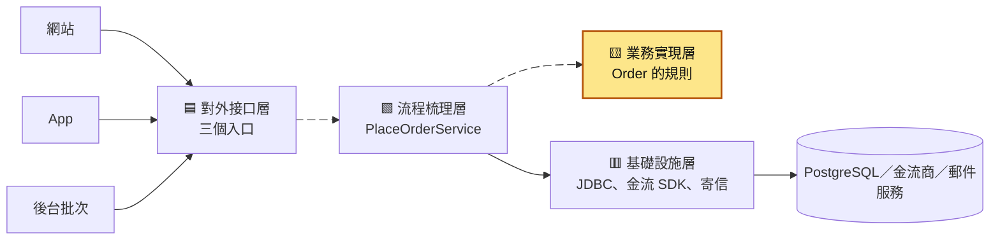
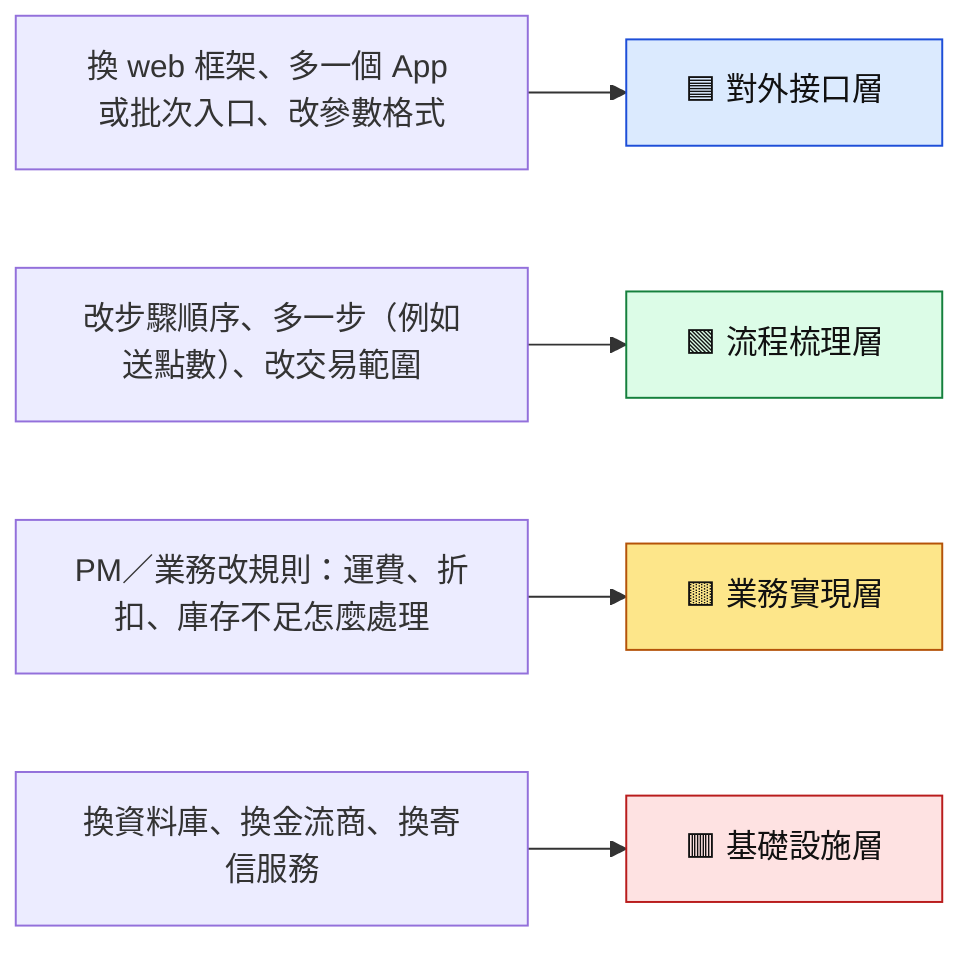
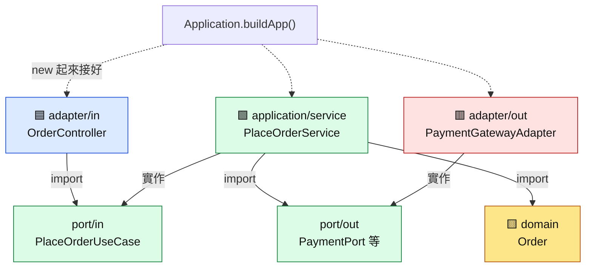
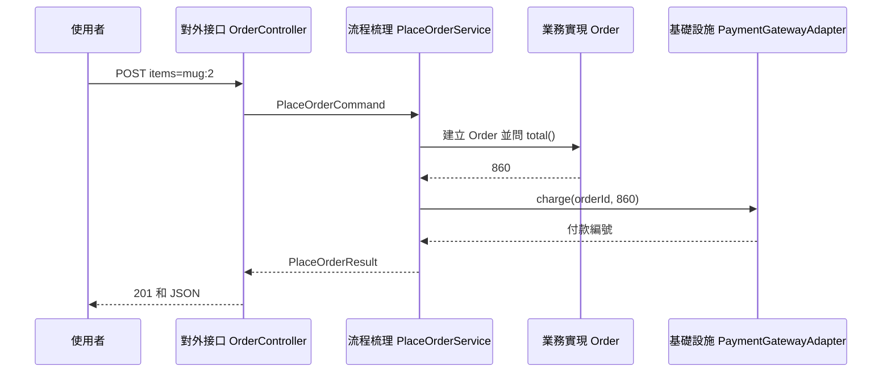
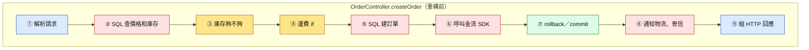
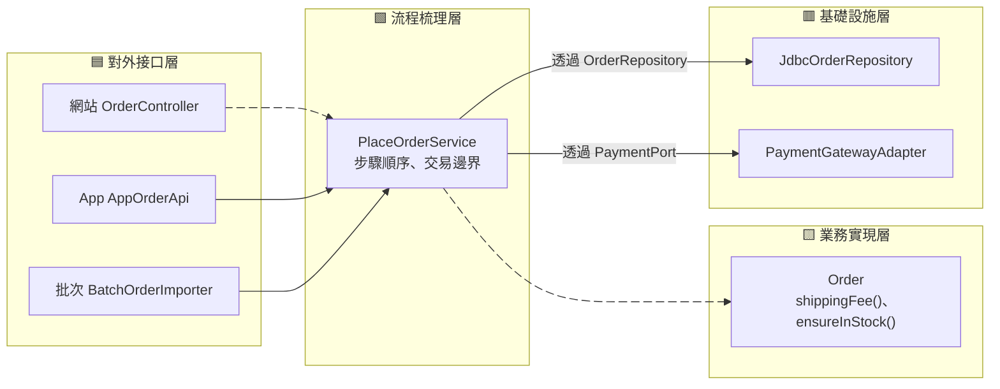
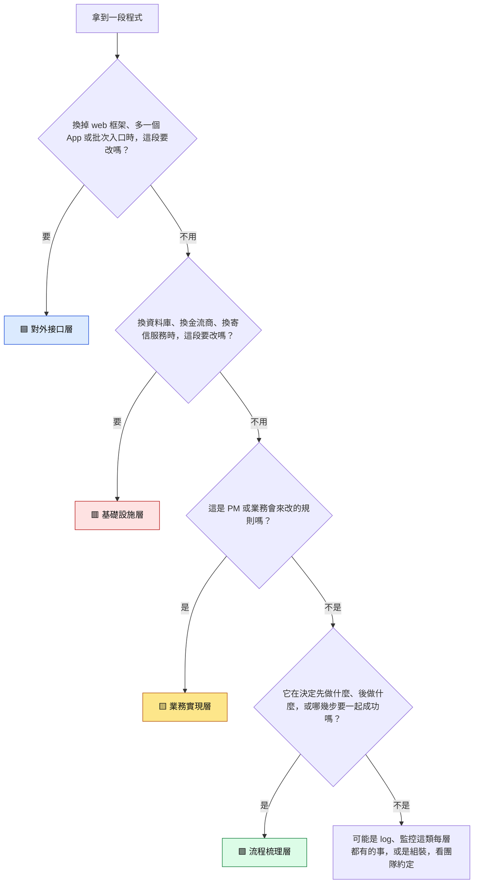
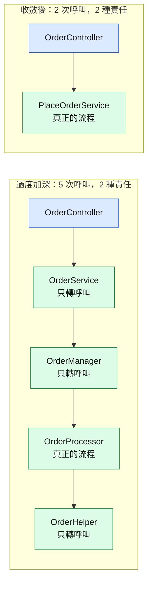
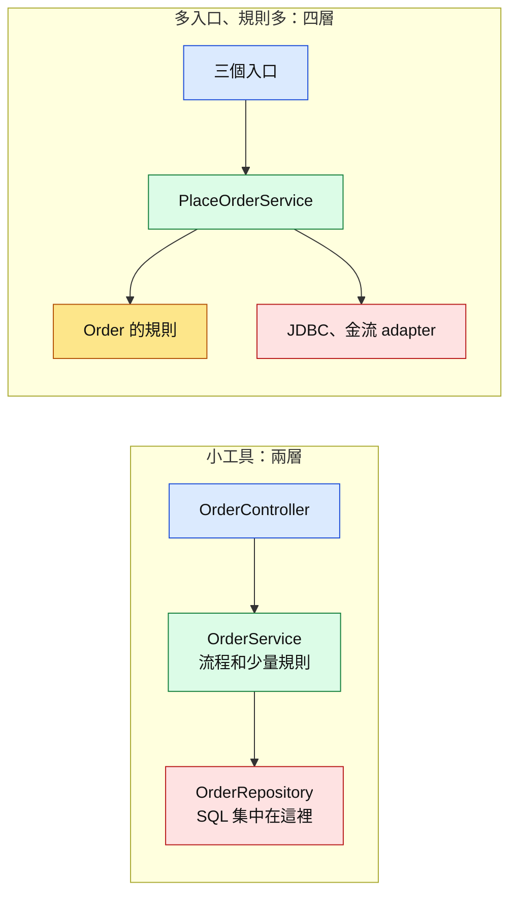

# 58｜依責任分層：每段程式該放哪一層（Layering by Responsibility）

> 依責任分層（layering by responsibility）是把一個功能的程式，照「這段負責什麼事」放進不同的層：對外接口層把外界送來的請求翻成程式內部的資料，流程梳理層決定步驟的先後，業務實現層放規則本身，基礎設施層負責跟資料庫和第三方服務溝通。判斷一段程式該放哪一層，就問「什麼樣的變動會逼它改」。

**難度**：★★☆　**閱讀時間**：約 30 分鐘　**前置知識**：[資料庫交易](03-資料庫交易.md)、[傳統測試方式](52-傳統測試方式.md)、[SOLID](54-SOLID.md)

## 核心問題與理念

**它要解決的問題**：運費規則在網站、App、後台批次三個入口裡各寫一份，行銷改成「VIP 免運」時只改到兩份，客服代下的單照樣多收 60 元；要測這條規則，還得先假裝一個資料庫，再把金流商提供的程式庫（SDK）換成假的。（下面的情境會完整走一遍）

**核心理念**：看這段程式會被哪一種變動逼著改，就把它放進專管那種變動的那一層。

**想通的那一步**：

- **卡住的地方**：直覺的做法是照功能切，一個入口一支方法從頭做到尾，要共用的東西再抽成 helper（共用的小方法）。可是網站、App、批次三支都要算運費，規則就各複製一份，行銷改 VIP 免運時只改到兩份，改哪裡、漏哪裡全靠記憶和搜尋。
- **火花**：把問題換成「這段會被誰改」。運費規則只有行銷會改，就整條搬到一個地方；入口格式只跟那個入口有關，就留在入口。這一步讓 VIP 免運從改三處變成改一處。

## 閱讀前推薦具備知識

| 知識 | 要會到什麼程度 | 這篇哪裡會用到 | 不熟的話先看 |
|---|---|---|---|
| Java 的 class／interface／record／package | **必備**：看得懂 `class FakePorts implements PaymentPort` 是在實作一個介面，也看得懂 `record OrderLine(String sku, long unitPrice, int quantity)` 宣告了哪三個欄位 | 「四層各自負責什麼」的依賴圖和目錄樹、「動手看看」的所有程式 | [Java 官方學習路徑（dev.java）](https://dev.java/learn/) |
| JUnit 5 基本寫法 | **必備**：看得懂 `@Test` 方法裡的 `assertEquals(預期值, 實際值)` 在檢查什麼，知道輸出裡的 ✔、✘ 代表通過和失敗 | 「動手看看」第 3 步和第 6 步，用測試證明要改幾處 | [JUnit 5 使用手冊](https://docs.junit.org/current/user-guide/) |
| HTTP 狀態碼 | **加分**：說得出 201、400、409 大概代表什麼 | 「一個請求穿過四層」和練習 Q3，業務錯誤翻成狀態碼 | [MDN：HTTP 狀態碼](https://developer.mozilla.org/en-US/docs/Web/HTTP/Reference/Status) |
| [資料庫交易](03-資料庫交易.md) | **加分**：知道 `COMMIT`／`ROLLBACK` 讓幾條 SQL 一起成功或一起作廢 | 上色表的第 ⑦ 段、練習 Q11、地雷 7 的交易邊界 | 本系列第 03 篇 |
| [傳統測試方式](52-傳統測試方式.md) | **加分**：知道 fake 是用記憶體代替資料庫或外部服務的測試替身 | 「動手看看」第 5 步的 `FakePorts` | 本系列第 52 篇 |
| [SOLID](54-SOLID.md) | **加分**：聽過單一職責原則「一個模組只該有一種改變的理由」 | 「先找這段會因為什麼而改」 | 本系列第 54 篇 |

**快速自我檢查**：`record OrderLine(String sku, long unitPrice, int quantity)` 裡有一個方法 `long amount() { return unitPrice * quantity; }`。測試寫 `assertEquals(60, new OrderLine("mug", 400, 2).amount());`，跑起來是 ✔ 還是 ✘？

<details markdown="1"><summary>看答案</summary>

✘。`new OrderLine("mug", 400, 2)` 依序把三個值填進 `sku`、`unitPrice`、`quantity`，`amount()` 算出 400 × 2 = 800。`assertEquals` 的第一個參數是預期值 60，第二個是實際值 800，兩個不相等，JUnit 會報 `expected: <60> but was: <800>`。

答不出來也沒關係：看不懂 `record` 先看 dev.java 的 records 那一章，看不懂 `assertEquals` 先看 JUnit 5 使用手冊的「Writing Tests」。

</details>

## 為什麼要在意：一個具體的情境

下面是一個假設情境。你負責一個電商的下單功能，用 Java 寫，有三個地方可以下單：

- **網站**：`OrderController.createOrder(...)`，收網站送來的 HTTP 請求。
- **App**：`AppOrderApi.createOrder(...)`，當初從網站那支複製過來，改成 App 的參數格式。
- **後台批次**：`BatchOrderImporter.importRows(...)`，客服幫客人代下單時填一份 CSV，每天晚上匯入。

三支程式各自從頭做到尾：自己寫 SQL 查價格和庫存、自己算運費、自己呼叫金流商的 SDK（金流商提供的程式庫）扣款、自己寄確認信。運費規則是「滿 1000 免運，否則 60」，三支各寫了一份：

```java
// ❌ 出事的寫法：同一條規則，三個入口各寫一份
// OrderController.java（網站）
long shippingFee = subtotal >= 1000 ? 0 : 60;
// AppOrderApi.java（App）
if (subtotal >= 1000) { fee = 0; } else { fee = 60; }
// BatchOrderImporter.java（後台批次）
long freight = 60;
if (amount >= 1000) { freight = 0; }
```

行銷部門提出新規則：「VIP 會員一律免運，下週一上線。」下面的互動圖和圖下的表走的是同一條時間軸，一格一格看這條規則怎麼被漏掉；表裡每一欄是那個入口在那個時間點用的運費規則：

<figure class="draw-fig">
<iframe class="draw-fig__frame" src="../figures/58-vip-rule-three-copies.html" title="按播放或拖時間軸，一格一格看同一條運費規則的三份抄本怎麼只改到兩份、T5 那張 VIP 單為什麼被扣 860 元；最後一格是重構後規則只剩一份、改一處三個入口一起生效。" loading="lazy" style="height: 580px;"></iframe>
<figcaption>按播放或拖時間軸，一格一格看同一條運費規則的三份抄本怎麼只改到兩份、T5 那張 VIP 單為什麼被扣 860 元；最後一格是重構後規則只剩一份、改一處三個入口一起生效。</figcaption>
</figure>

| 時間 | 發生什麼事 | 網站 | App | 後台批次 |
|---|---|---|---|---|
| T1 | 行銷提需求：VIP 一律免運 | 滿 1000 免運 | 滿 1000 免運 | 滿 1000 免運 |
| T2 | 工程師全專案搜尋 `shippingFee`，只找到網站那支，加上 VIP 判斷 | VIP 免運 | 滿 1000 免運 | 滿 1000 免運 |
| T3 | QA 用 App 測 VIP 買 800 元，還是收 60，回報後補改 App | VIP 免運 | VIP 免運 | 滿 1000 免運 |
| T4 | 週一上線。批次那支變數叫 `freight`，沒被搜到，也沒有測試 | VIP 免運 | VIP 免運 | 滿 1000 免運 |
| T5 | VIP 會員請客服代下一張 800 元的單，晚上批次匯入 | | | 運費 60，扣款 860 元 |
| T6 | 會員收到 860 元的扣款通知，打給客服 | | | |
| T7 | 工程師查資料庫，找到漏改的那一份 | | | 補上 VIP 判斷 |

- **使用者看到的**：自己在網站、App 下單都免運；請客服代下一張 800 元的單，卻被扣了 860 元。
- **工程師看到的**：日誌裡沒有任何錯誤，三個入口都正常回應。用 `SELECT source, count(*) FROM orders WHERE member_level = 'vip' AND shipping_fee > 0 GROUP BY source` 查上線後的 VIP 訂單，只有 `batch` 那一列有資料。

批次那支沒有測試，是因為要測它得先假裝一個資料庫，再把金流 SDK、物流、寄信全部換成假的，大家嫌麻煩。換金流商時也是同一個問題：三支程式都自己判斷金流 SDK 回傳的 `"00"` 代表成功，換一家就要改三處，而且改的地方就夾在算錢的程式中間。

**根因**：「運費怎麼算」是業務規則，卻寫在三個負責接收請求的入口裡，`long shippingFee = subtotal >= 1000 ? 0 : 60;` 這一行有三份。

**怎麼修**：把運費規則搬進 `Order.shippingFee()`，只留一份；三個入口只負責把各自的格式翻成同一個「下單指令」，交給同一個 `PlaceOrderService` 處理。怎麼判斷每段程式該搬去哪裡，在「它是怎麼運作的」；改完之後新規則只要改一處，在「動手看看」會用 JUnit 實際跑給你看。

## 全貌：它在系統裡的位置

這張圖看的是重構後，一筆下單請求在一個服務裡經過的四層；會動的兩條箭頭是三個入口共用的那條路，最後都走到同一份規則。



這篇講的是一個服務「裡面」怎麼切，上色的業務實現層是三個入口共用的規則所在。流程梳理層的細節在 [Use Case](56-Use%20Case.md)，入口和外部服務怎麼接上來在 [六邊形架構](57-六邊形架構.md)，把物流這類複雜子系統包起來在 [Facade](55-Facade.md)；切完之後每一層對外露出多少、會不會切太深，在 [可見性與模組深度](59-可見性與模組深度.md)。

## 生活比喻

想像一家餐廳，有內用、外送平台、電話訂位三個點餐管道。

- **服務生（對外接口層）**：把客人說的話寫成標準點單，再把廚房做好的菜端出去。外送平台的訂單格式不一樣，就由另一個人負責翻成同樣的點單。服務生不決定菜怎麼做、價錢怎麼算。
- **出餐領班（流程梳理層）**：拿到點單，決定先做哪道、哪幾道要一起上、結帳在什麼時候。他不自己炒菜，也不管食材從哪家叫。
- **食譜和價目規則（業務實現層）**：「滿 1000 送甜點」「VIP 免服務費」寫在這裡。老闆改規則，只改這一本，三個點餐管道同時生效。
- **廚房設備和叫貨（基礎設施層）**：瓦斯爐、冷凍庫、跟供應商叫貨的電話。換一家供應商，食譜不用改。

開頭的情境，等於三個點餐管道各自抄了一份價目表貼在櫃台，老闆改規則時只換掉兩份。

**比喻失準的地方**：真實的服務生看到奇怪的點單會自己判斷，程式裡的對外接口層不該自己判斷，它的工作就是照格式翻譯。另外，餐廳裡誰聽誰的可以臨時調整；程式裡的層有固定的方向，業務實現層完全不知道外面有哪些層，這點在下一節的依賴圖會看到。

## 它是怎麼運作的

### 先找「這段會因為什麼而改」

開頭的問題出在：一支 `createOrder` 方法裡，有好幾種「會讓它改」的原因混在一起。換 web 框架要改它，換金流商要改它，行銷改運費也要改它。每次改都可能碰壞旁邊不相干的部分，同一條規則也被複製到別的入口。

依責任分層的做法，是先列出「什麼樣的變動會來」，再讓每一種變動只落在一層。這張圖左邊是常見的變動來源，右邊是它應該只影響的那一層：



這跟 [SOLID](54-SOLID.md) 的單一職責原則是同一個想法：一個模組只該有一種改變的理由。這篇把它用在「層」的尺度上。全篇用同一組顏色：🟦 對外接口層、🟩 流程梳理層、🟨 業務實現層、🟥 基礎設施層。

### 四層各自負責什麼

這張表是整篇的核心，判斷時可以回來對照。「可以 import 誰」那一欄決定了依賴方向：外層可以知道內層，內層不知道外層。

| 層 | 負責什麼 | 不該做什麼 | 輸入長什麼樣 | 輸出長什麼樣 | 在目錄樹的哪裡 | 可以 import 誰 |
|---|---|---|---|---|---|---|
| 🟦 對外接口層（adapter/in，interface／delivery） | 轉譯：把 HTTP、App、CSV 的格式翻成 `PlaceOrderCommand`；把結果和業務錯誤翻成狀態碼或報表 | 算錢、判斷規則、寫 SQL、決定步驟順序 | `HttpRequest`、CSV 的一列 | `HttpResponse`、報表文字 | `adapter/in/web/OrderController.java` | port.in；domain 的業務例外（用來翻成狀態碼） |
| 🟩 流程梳理層（application／use case） | 決定按什麼順序做哪些事、哪幾步要包在同一個交易裡 | 知道 HTTP 狀態碼、寫 SQL、自己算運費 | `PlaceOrderCommand` | `PlaceOrderResult`，或往上丟業務例外 | `application/service/PlaceOrderService.java`、`application/port/` | domain、port.in、port.out |
| 🟨 業務實現層（domain） | 規則本身：運費怎麼算、庫存不足算不算錯 | import 任何框架、資料庫、HTTP；呼叫外部服務 | 單純的值：單價、數量、會員等級 | 算好的結果（`shippingFee()`、`total()`），或業務例外 | `domain/Order.java`、`domain/OrderLine.java` | 只用 JDK 的基本類別，例如 `java.util` |
| 🟥 基礎設施層（adapter/out，infrastructure） | 怎麼跟外界溝通：SQL、呼叫金流 SDK、寄信 | 做業務決定，例如「金額超過 5 萬要人工審核」 | port 方法的參數（`Order`、金額） | port 規定的回傳值（訂單編號、付款編號），或 port 規定的業務例外（扣款被拒） | `adapter/out/persistence/`、`adapter/out/payment/` | port.out、domain、JDBC 和外部 SDK |
| 組裝處（composition root） | 把各層 `new` 出來接在一起 | 放任何邏輯 | 設定值 | 組好的入口 | `Application.java` 的 `buildApp()` | 全部 |

表裡的 port 是一個 Java `interface`，代表「這一層需要外界提供什麼能力」。`port.in` 是外界呼叫我們的介面（例如 `PlaceOrderUseCase`），`port.out` 是我們呼叫外界的介面（例如 `PaymentPort`）。為什麼要多這一層介面，在 [六邊形架構](57-六邊形架構.md) 會講；這篇只要記得：流程梳理層透過 `PaymentPort` 扣款，不知道背後是哪家金流商。

這張圖看的是誰 import 誰。實線箭頭是「程式裡寫了 import」，虛線是組裝處把它們 `new` 起來接好：



`domain` 沒有任何往外的箭頭：它不知道外面有 HTTP、有資料庫，所以測它只要 `new` 一個 `Order` 就好。

重構後的目錄長這樣（套件根是 `com.example.order`）。第十二章的幾篇都用這棵樹；這篇多了 App 和後台批次兩個入口，放在 `adapter/in/` 底下：

```text
src/main/java/com/example/order/
  domain/                         🟨 業務實現：不 import 任何框架、資料庫、HTTP
    Order.java                    規則：shippingFee()、total()、ensureInStock()
    OrderLine.java
    OutOfStockException.java
    PaymentDeclinedException.java
  application/                    🟩 流程梳理
    port/in/                      外界「呼叫我」的介面
      PlaceOrderUseCase.java
      PlaceOrderCommand.java
      PlaceOrderResult.java
    port/out/                     我「呼叫外界」的介面
      OrderRepository.java  InventoryPort.java  PaymentPort.java
      ShippingPort.java     ShipmentReceipt.java  NotifierPort.java
    service/
      PlaceOrderService.java      依序呼叫各個 port
  adapter/
    in/                           🟦 對外接口
      web/OrderController.java
      app/AppOrderApi.java        （這篇多的入口）
      batch/BatchOrderImporter.java（這篇多的入口）
    out/                          🟥 基礎設施
      persistence/JdbcOrderRepository.java
      payment/PaymentGatewayAdapter.java
      shipping/ShippingFacade.java（見 Facade 篇）
  Application.java                組裝處：buildApp()
```

### 一個請求穿過四層：每過一層，資料換一次形狀

你在網站按下「下單」時，請求依序經過這幾層。這張圖看的是每一層收到什麼、交出什麼：



每個箭頭上的資料都是「下一層聽得懂的形狀」：`OrderController` 交給流程梳理層的是 `PlaceOrderCommand`，`HttpRequest` 到這裡就停了；金流 SDK 的 `"00"` 在 `PaymentGatewayAdapter` 裡就被翻成付款編號（不是 `"00"` 就翻成 `PaymentDeclinedException`），流程梳理層看不到。

出錯時也是各層只管自己那一段。下表是使用者想買 20 個馬克杯、但庫存只有 10 個時，每一步在哪一層、手上拿著什麼：

| 步驟 | 在哪一層 | 發生什麼事 | 手上的資料 |
|---|---|---|---|
| 1 | 🟦 對外接口 | 收到 `items=mug:20`，翻成指令 | `PlaceOrderCommand`，品項是 mug × 20 |
| 2 | 🟩 流程梳理 | 透過 `InventoryPort` 問價格和庫存 | 單價 400、庫存 10 |
| 3 | 🟨 業務實現 | `Order.ensureInStock()` 比較 10 和 20 | 丟出 `OutOfStockException` |
| 4 | 🟩 流程梳理 | 不接住，讓例外往上走；訂單還沒建立，也還沒扣款 | 例外 |
| 5 | 🟦 對外接口 | 接住 `OutOfStockException`，翻成 HTTP 409 | `HttpResponse(409, 庫存不足)` |

同一個例外走到 App 入口，會被翻成 `code: 1002`；走到批次入口，會變成報表上的「第 N 列：庫存不足」。「庫存不足算錯」只在 domain 決定一次，「錯了要怎麼告訴外界」由各個入口自己翻。

### 把 `OrderController.createOrder` 逐段上色

回到開頭重構前的網站入口，完整程式在「動手看看」的〈重構前的三個入口〉，每段都用顏色方塊標好了。下表把它從上到下切成幾段，標出每段屬於哪一層、拆完搬去哪裡：

| 段 | 那幾行在做什麼 | 屬於哪一層 | 拆完搬去哪裡 |
|---|---|---|---|
| ① | 讀 `X-User-Id` header、解析 `items=mug:2`、空的就回 400 | 🟦 對外接口 | `adapter/in/web/OrderController` |
| ② | `Db.queryRow("SELECT price, stock FROM products ...")` | 🟥 基礎設施 | `InventoryPort` 的實作 |
| ③ | `if (row[1] < qty)`：庫存不夠就不能下單 | 🟨 業務實現 | `Order.ensureInStock()` |
| ④ | `subtotal >= 1000 ? 0 : 60` | 🟨 業務實現 | `Order.shippingFee()` |
| ⑤ | `Db.insert("INSERT INTO orders ...")` | 🟥 基礎設施 | `JdbcOrderRepository` |
| ⑥ | `payClient.charge(...)`，再判斷 `"00"` | 🟥 基礎設施 | `PaymentGatewayAdapter` |
| ⑦ | 扣款失敗就 `Db.rollback()`，最後 `Db.commit()` | 🟩 流程梳理 | `PlaceOrderService`（交易邊界） |
| ⑧ | `logistics.ship(...)`、`mailer.send(...)` | 🟥 基礎設施 | `ShippingPort`、`NotifierPort` 的實作 |
| ⑨ | `new HttpResponse(201, ...)`，還有 409、402 | 🟦 對外接口 | `OrderController` |
| 整支 | ①～⑨ 由上往下的順序本身 | 🟩 流程梳理 | `PlaceOrderService.execute()` |

最容易漏看的是第 ③ 段：同一個 `if` 裡，判斷「庫存夠不夠」是 🟨，決定「不夠就回 409」是 🟦。一行裡有兩種顏色，就是兩個責任黏在一起。

這張圖是重構前的樣子：所有顏色擠在同一支方法裡，由上往下排。



這張是拆完的樣子：同一種顏色收進同一層，三個入口都走到同一個 `PlaceOrderService`，再走到同一份規則。會動的箭頭是 VIP 新規則生效的路線。



拆完以後，行銷再改運費只動 `Order.shippingFee()`；換金流商只動 `PaymentGatewayAdapter`；多一個入口（例如 LINE 官方帳號下單）只要新增一個翻譯 `PlaceOrderCommand` 的類別。

### 判斷方法：照著問的四個問題

遇到一段新的程式，不確定放哪裡時，照這張圖從上往下問。前兩題問的是「跟哪種技術綁在一起」，最容易回答，所以放前面；後兩題才問規則和流程。



問的時候有三個小技巧：

- **先看 import。** 一段程式用到 `com.example.web.HttpRequest`，前兩題八成答「要」；用到 `java.sql` 或金流 SDK 的類別，第二題八成答「要」。import 會洩漏這段跟哪種技術綁在一起。
- **規則用「紙筆測試」。** 把電腦拿走，業務人員用紙筆也算得出來、也會來跟你討論要不要改的，就是規則。「滿 1000 免運」通過紙筆測試；「`resultCode` 是 `"00"` 代表成功」不會有業務人員關心，那是金流商的格式。
- **兩題都答「要」，就是兩個責任黏在一起。** 例如「查今天下了幾單，超過 3 單就回 429」：查詢要看資料庫（🟥），「超過 3 單不行」是規則（🟨），回 429 是翻譯（🟦）。先把它拆成三段，每段再各問一次。

### 層數跟著責任走：一個責任一層

分層的目的是讓「一種變動只落在一層」。所以層數由責任決定：有幾種會分開變動的責任，就需要幾層。同一個責任被切成好幾層，每一層只是把參數原封不動傳下去，讀的人要多跳好幾個檔案，改一個欄位要改好幾個方法簽名，可讀性和可維護性反而下降。這種情況叫「過度加深」。

這張圖上面一排是過度加深的版本，下面一排是收斂後的版本。顏色相同代表它們負責的是同一件事：



判斷一層是不是多的，問一句：**拿掉它，呼叫它的那一層會變複雜嗎？** 不會，這層就是多的，把它內聯（inline，把被呼叫的內容搬回呼叫端）回去。怎麼辨認這類「只轉傳」的層、怎麼收回來，在 [可見性與模組深度](59-可見性與模組深度.md) 有完整的症狀清單和修法。

**判斷題**：同事的下單流程是 `OrderController.createOrder()` 呼叫 `OrderService.placeOrder()`，再呼叫 `OrderManager.place()`，再呼叫 `OrderProcessor.process()`。前兩個長這樣，`OrderProcessor.process()` 裡才是檢查庫存、扣款、扣庫存、寄信的步驟：

```java
public PlaceOrderResult placeOrder(PlaceOrderCommand cmd) {   // OrderService
    return manager.place(cmd);
}
public PlaceOrderResult place(PlaceOrderCommand cmd) {        // OrderManager
    return processor.process(cmd);
}
```

這條呼叫鏈裡有幾種責任？應該留幾層？

<details markdown="1"><summary>看答案</summary>

兩種責任：`OrderController` 負責轉譯（🟦），`OrderProcessor.process()` 裡的步驟順序是流程梳理（🟩）。`OrderService` 和 `OrderManager` 沒有自己的責任，只是把同一個 `cmd` 往下傳，三個類別都在搶「流程梳理」這一個責任。

用「拿掉它，呼叫端會變複雜嗎」檢查：拿掉 `OrderService`、`OrderManager`，讓 `OrderController` 直接呼叫有真正流程的那個類別，`OrderController` 一行也不會變多。所以這兩層是多的，把流程收進一個類別（例如本篇的 `PlaceOrderService`），留兩層就好。

以後真的出現新的責任（例如多個 use case 共用的訂單規則越來越多），那時候再拆，拆出來的也該是有自己名字、有自己規則的東西，例如 `Order.shippingFee()`。

</details>

### 依當前狀況調整

四層是「四種責任都存在」時的完整樣子，專案一開始不一定要切滿。下表是常見的狀況和調整方式：

| 狀況 | 怎麼分 | 理由 |
|---|---|---|
| 內部小工具，1～2 人維護，規則幾乎沒有（例如資料的新增修改刪除後台） | 兩層就好：controller 加一個 service（流程和少量規則寫在一起），SQL 集中在 repository 類別 | 沒有規則可抽，硬切四層只會多出只轉傳的層 |
| 規則多、常改（運費、促銷、會員等級） | 先把 domain 抽出來，其他層可以晚點整理 | 規則最常改，也最需要不起資料庫就能測 |
| 同一個動作有好幾個入口（網站、App、批次、[訊息佇列](35-訊息佇列.md)的 consumer） | 一定要有流程梳理層，入口只剩轉譯 | 開頭的情境就是少了這一層 |
| 外部服務要換，或要兩家並存（兩家金流商） | 基礎設施層要有 port 和 adapter | 換廠商只換 adapter，見 [六邊形架構](57-六邊形架構.md) |
| 團隊人多，不同人同時改不同部分 | 層的邊界畫清楚，各改各的目錄 | 減少改到同一個檔案的衝突 |

這張圖看的是同一個下單功能，在小工具和多入口的服務裡各自切成幾層：



小工具那邊仍然把 SQL 集中在 repository，因為「換資料庫或改 schema」這個責任在小專案裡也存在，成本又很低。

**該往下拆一層的訊號**：

- 同一條規則出現在兩個入口（開頭的情境）。
- 測一條規則必須先起資料庫、或先換掉金流 SDK。
- 改畫面上的欄位名稱，卻動到了算錢的檔案。
- 換第三方 SDK 時，改動跨到計算邏輯中間。
- controller 裡出現業務數字，例如 `1000`、`60`、`3 單`。
- 一支方法中間有 `commit()`，前後都是規則判斷。

**拆過頭的訊號**：

- 某一層的方法只有一行，把參數原封不動傳給下一層。
- 加一個欄位，要改 5 個方法簽名和 3 個長得一樣的資料類別。
- 看懂一個流程要跳 5 個以上的檔案。
- 為了「以後可能會換」加了 interface，但只有一個實作，測試也沒用到替身。
- 類別名字只是同義詞，例如 `OrderService`、`OrderManager`、`OrderHandler` 並排。

### 練習：這段放哪一層

每題先自己用上面的四個問題判斷，再打開答案。有幾題業界做法不只一種，答案會寫出取捨。

**Q1. 下單請求的格式檢查**，用 Bean Validation（Java 的標準驗證註解）寫在請求類別上：

```java
public record PlaceOrderRequest(
        @NotBlank @Email String email,
        @NotEmpty List<@Valid ItemRequest> items) {}
```

<details markdown="1"><summary>看答案</summary>

🟦 對外接口層。這些註解檢查的是「這包資料能不能翻成 `PlaceOrderCommand`」：email 有沒有填、像不像 email、品項是不是空的。換一個入口（例如批次 CSV），格式檢查的寫法就跟著換，符合第一題的「要改」。

對照組：如果規則是「只接受公司網域的信箱」，那是業務決定的，屬於 🟨。

有些團隊把 Bean Validation 註解直接放在 `PlaceOrderCommand` 上，少寫一個請求類別。代價是 application 層要 import `jakarta.validation`，跟一個框架綁在一起。這是團隊約定，選了就全專案一致。

</details>

**Q2. 同一個人一天最多下 3 單：**

```java
int todayCount = orders.countPlacedOn(cmd.customerId(), today);
if (todayCount >= 3) {
    throw new DailyOrderLimitException();
}
```

<details markdown="1"><summary>看答案</summary>

這段是三個責任黏在一起，要拆：

- 🟥 基礎設施：`countPlacedOn` 背後的 SQL，放在 `JdbcOrderRepository`，透過 `OrderRepository` 這個 port 呼叫。
- 🟨 業務實現：「3 單以上就不行」是規則，數字 3 是行銷或風控會來改的。放在 domain，例如 `Order.ensureUnderDailyLimit(todayCount)`。
- 🟩 流程梳理：「先查今天幾單，再問規則」這個順序，放在 `PlaceOrderService`。

跟 Q1 對照：Q1 檢查資料「長得對不對」，這題檢查「業務上允不允許」。前者不用查資料庫就能判斷，後者要知道系統裡現在的狀態。

</details>

**Q3. 把業務例外翻成 HTTP 狀態碼：**

```java
} catch (OutOfStockException e) {
    return new HttpResponse(409, Map.of("error", "庫存不足"));
}
```

<details markdown="1"><summary>看答案</summary>

🟦 對外接口層。409 是 HTTP 的說法，domain 只說「庫存不足」，不知道外面是 HTTP、App 還是批次。同一個 `OutOfStockException`，App 入口翻成 `code: 1002`，批次入口翻成報表上的一行字。

常見的錯誤是在 domain 丟 `new HttpException(409)`，這樣批次匯入也會拿到一個 HTTP 狀態碼，很奇怪。

</details>

**Q4. 稅金四捨五入到元**（假設稅率 5%）：

```java
long tax = BigDecimal.valueOf(subtotal)
        .multiply(new BigDecimal("0.05"))
        .setScale(0, RoundingMode.HALF_UP)
        .longValueExact();
```

<details markdown="1"><summary>看答案</summary>

🟨 業務實現層。要四捨五入、無條件捨去，還是銀行家捨入（`RoundingMode.HALF_EVEN`，剛好 .5 時捨入到偶數），會直接影響收多少錢，由財務或業務決定。例如 2.5 用 `HALF_UP` 是 3，用 `HALF_EVEN` 是 2。這種規則散在各層，就會出現網站和報表差 1 元的對帳問題。

對照組：把 1050 顯示成 `NT$1,050` 是 🟦，那是給人看的格式，App 可能要另一種格式。

</details>

**Q5. 訂單列表的分頁參數：**

```java
int page = Integer.parseInt(req.param("page"));
int size = Math.min(Integer.parseInt(req.param("size")), 100);
// 後面某處：SELECT ... ORDER BY id LIMIT ? OFFSET ?
```

<details markdown="1"><summary>看答案</summary>

拆成兩半：

- 🟦 對外接口：從參數讀 `page`、`size`，轉成數字、套上限 100。上限 100 是保護系統的技術限制，避免有人一次撈十萬筆。
- 🟥 基礎設施：把頁碼換算成 `LIMIT`、`OFFSET` 的 SQL。換成用游標分頁（cursor pagination），只改這裡。

流程梳理層只看到一個 `PageRequest(page, size)` 這類的值。

有爭議的地方：上限 100 要放在 🟦 還是 🟩，團隊做法不一。放 🟦 最直覺；如果批次和 App 也要共用同一個上限，就放 🟩 統一處理。如果規則是「一般會員只能看最近 50 筆訂單」，那是產品決定，屬於 🟨。

</details>

**Q6. 日期時區轉換：**

```java
Instant placedAt = OffsetDateTime.parse(req.param("placedAt")).toInstant();
LocalDate businessDay = placedAt.atZone(ZoneId.of("Asia/Taipei")).toLocalDate();
```

<details markdown="1"><summary>看答案</summary>

兩行屬於不同層：

- 第一行是 🟦：把前端送來的字串（例如 `2026-10-24T23:30:00+08:00`）翻成程式內部統一用的 `Instant`（一個不帶時區的時間點）。邊界進來時就轉好，內部不再處理字串。
- 第二行要看用途。如果它在回答「台灣時間 23:59 前下單算當天出貨」，「哪一天算當天」是業務規則，屬於 🟨，而且時區 `Asia/Taipei` 是規則的一部分，要寫在 domain 看得到的地方。
- 存進資料庫時用什麼欄位型別、要不要轉 UTC，是 🟥 的事。

有爭議的地方：時區要寫死在 domain，還是放設定檔由組裝處傳進來，看團隊約定。只賣台灣的話寫在 domain 最清楚；要做多國市場時，通常改成從設定傳入。

</details>

**Q7. 呼叫金流 API 逾時就重試 3 次：**

```java
for (int attempt = 1; attempt <= 3; attempt++) {
    try { return client.charge(orderId, amount); }
    catch (GatewayTimeoutException e) { sleep(backoff(attempt)); }
}
```

<details markdown="1"><summary>看答案</summary>

🟥 基礎設施層，放在 `PaymentGatewayAdapter` 裡。「網路逾時要不要重打、隔多久重打」是怎麼跟外界可靠溝通的問題，換一家金流商，重試策略可能也跟著換。重試扣款一定要帶冪等鍵，否則遇到「回應逾時、金流商那邊卻已經扣款成功」時，會扣兩次，見 [冪等性](25-冪等性.md)；重試的間隔見 [重試機制](26-重試機制.md) 和 [指數退避](27-指數退避.md)。

對照組：「重試 3 次都失敗，訂單要取消、庫存要不要退回」是 🟩 流程梳理的事，由 `PlaceOrderService` 決定。

有爭議的地方：資料庫交易因為衝突失敗、整個 use case 重跑一次，這種重試有人放在 🟩，有人放在更外面包一層。看團隊約定，但不要兩邊都做，否則一次失敗會變成 3 × 3 = 9 次重試。

</details>

**Q8. 記 log：**

```java
log.log(System.Logger.Level.INFO, "order placed id={0} total={1}", orderId, total);
```

<details markdown="1"><summary>看答案</summary>

log 是每一層都可能做的事，四個問題問不出單一答案，原則是「每一層只記自己知道的事」：

- 🟦 記請求本身：哪個路徑、回了什麼狀態碼、花了多久。
- 🟩 記業務事件：「訂單 42 成立，總金額 860」。上面這行就適合放這裡。
- 🟥 記對外呼叫：金流 API 花了多久、回了什麼錯誤碼。
- 🟨 通常不記 log，用回傳值和例外表達結果，讓它保持不依賴任何東西。

有爭議的地方：有些團隊允許 domain 記 log，覺得追問題比較方便。代價是 domain 多一個依賴，測試時也會印出一堆訊息。看團隊約定。跨服務追一個請求要用 trace id，見 [分散式追蹤](50-分散式追蹤.md)。

</details>

**Q9. 權限檢查：只有訂單本人或客服可以取消訂單。**

```java
if (!order.customerId().equals(actor.id()) && !actor.isSupport()) {
    throw new ForbiddenException();
}
```

<details markdown="1"><summary>看答案</summary>

要拆成兩件事：

- 「你是誰」：從 token 或 session 解析出 `actor`，是 🟦。換登入方式只改這裡。
- 「誰可以對這張訂單做什麼」：本人或客服才能取消，是業務規則。

第二件放哪裡，業界有兩種做法，看團隊約定：

- 放 🟩，寫在 `CancelOrderService` 開頭。優點是一眼就看到這個動作要什麼權限。
- 放 🟨，寫成 `order.ensureCancellableBy(actor)`。優點是好幾個 use case 共用同一條規則時只寫一份。

只有一種做法是錯的：只寫在網站的 controller 裡。這樣 App 和批次入口就會繞過權限檢查，跟開頭情境漏改運費是同一個問題。

</details>

**Q10. 組裝確認信的內容：**

```java
String body = """
        %s 您好，訂單 %s 已成立，總金額 %d 元。
        """.formatted(name, orderId, total);
mailer.send(email, "訂單成立", body);
```

<details markdown="1"><summary>看答案</summary>

🟥 基礎設施層，放在 `NotifierPort` 的實作裡（例如 `EmailNotifier`）。信件的版型、主旨、寄信服務的呼叫方式，都是「怎麼跟外界溝通」。之後改用簡訊或 LINE 通知，只換這個實作。

其他層各管一部分：「訂單成立後要通知客人」這個步驟是 🟩，`PlaceOrderService` 只呼叫 `notifier.orderPlaced(order)`，收件人的信箱由這個實作依 `customerId` 去查；信裡的總金額由 🟨 的 `Order.total()` 算好，信件這一層不自己重算。

有爭議的地方：文案常常由行銷改，很多團隊把版型抽成範本檔，讓不懂 Java 的人也能改。範本檔還是屬於基礎設施這一側。

</details>

**Q11. 交易要從哪裡開始、在哪裡提交？**

```java
orders.save(order);
payment.charge(order.id(), order.total());   // 被拒時丟 PaymentDeclinedException，後面都不做
for (OrderLine line : lines) {
    inventory.deduct(line.sku(), line.quantity());
}
```

<details markdown="1"><summary>看答案</summary>

🟩 流程梳理層決定。「建立訂單、扣款、扣庫存要一起成功或一起失敗」是流程的決定，所以交易的開始和提交由 `PlaceOrderService` 這一層控制（交易是什麼見 [資料庫交易](03-資料庫交易.md)，常見寫法見 [Use Case](56-Use%20Case.md)）。

`JdbcOrderRepository` 只負責執行 SQL，不在每個方法裡各自 `commit()`。各自提交的話，訂單已經寫進去、扣款才失敗，就會留下一張沒付錢的訂單。

</details>

## 動手看看

我們用 Java 重現開頭的情境：同一條新規則「VIP 一律免運」，在重構前要改三處，漏一處測試就會抓到；重構後只改 `Order.shippingFee()` 一處，三個入口的測試一起通過。全程不用資料庫，也不用 Docker。

### 0. 準備：JDK 和 JUnit

需要 JDK 21 以上。用 Maven 的話，`pom.xml` 加上 JUnit 5 的依賴，程式照 `src/main/java`、`src/test/java` 放，跑 `mvn test` 就好：

```xml
<properties>
  <maven.compiler.release>21</maven.compiler.release>
</properties>
<dependencies>
  <dependency>
    <groupId>org.junit.jupiter</groupId>
    <artifactId>junit-jupiter</artifactId>
    <version>5.13.4</version>
    <scope>test</scope>
  </dependency>
</dependencies>
```

本文的輸出是用 JUnit Console Launcher（一個 jar 檔就能跑 JUnit 的工具，`junit-platform-console-standalone-1.13.4.jar`，從 Maven Central 下載）跑的，Maven 的輸出格式不同。不用 Maven 時，在專案資料夾裡這樣編譯和執行（PowerShell）：

```powershell
javac --release 21 -d out -cp junit-platform-console-standalone-1.13.4.jar (Get-ChildItem -Recurse src -Filter *.java).FullName
java -jar junit-platform-console-standalone-1.13.4.jar execute --class-path out --scan-class-path --disable-banner --details=tree
```

macOS／Linux 把第一行的檔案清單換成 `$(find src -name '*.java')`。Windows 終端機中文變亂碼時，第二行的 `java` 後面加 `-Dstdout.encoding=UTF-8`。

我們會建兩個資料夾 `before/` 和 `after/`，兩邊都要放下面這四個檔案：一個假裝的 web 框架，和一個假裝的金流 SDK。

??? example "共用檔案：`web/HttpRequest.java`、`web/HttpResponse.java`、`paysdk/ChargeResponse.java`、`paysdk/PayClient.java`（點開看）"

    ```java
    // src/main/java/com/example/web/HttpRequest.java
    package com.example.web;

    import java.util.Map;

    /** 假裝是 web 框架給你的請求物件：headers 和表單參數都已經解析好了 */
    public record HttpRequest(Map<String, String> headers, Map<String, String> params) {
        public String header(String name) { return headers.get(name); }
        public String param(String name) { return params.get(name); }
    }
    ```

    ```java
    // src/main/java/com/example/web/HttpResponse.java
    package com.example.web;

    import java.util.Map;

    /** 假裝是 web 框架的回應物件：框架會把 json 轉成 JSON 字串送出去 */
    public record HttpResponse(int status, Map<String, Object> json) {}
    ```

    ```java
    // src/main/java/com/example/paysdk/ChargeResponse.java
    package com.example.paysdk;

    /** 金流商 SDK 的回應格式：resultCode 是 "00" 才算成功，transactionId 是金流商給的交易編號 */
    public record ChargeResponse(String resultCode, String message, String transactionId) {}
    ```

    ```java
    // src/main/java/com/example/paysdk/PayClient.java
    package com.example.paysdk;

    /** 假裝是金流商提供的 SDK。真的 SDK 會連到金流商的伺服器扣款 */
    public class PayClient {
        private final String merchantId;

        public PayClient(String merchantId) { this.merchantId = merchantId; }

        /** reference 是商家自己的訂單編號，金流商用它對帳 */
        public ChargeResponse charge(String reference, long amount) {
            throw new IllegalStateException("這裡會真的連到金流商，測試時不能呼叫");
        }
    }
    ```

### 1. 重構前的三個入口（`before/`）

舊程式用一個 `Db` 工具類別直接丟 SQL。真實的舊程式裡它是 JDBC 的薄包裝，這裡為了不起 PostgreSQL，讓測試可以把它換成假的。`Mailer`、`Logistics` 是寄信和物流的用戶端，一呼叫就報錯，代表「測試時不能真的呼叫」。

??? example "`legacy/Db.java`、`legacy/Mailer.java`、`legacy/Logistics.java`（點開看）"

    ```java
    // src/main/java/com/example/legacy/Db.java
    package com.example.legacy;

    /** 舊程式的資料庫工具。真實版本是 JDBC 的薄包裝：每個方法把 SQL 直接丟給 PostgreSQL */
    public final class Db {
        public interface Backend {
            long[] queryRow(String sql, Object... args);   // 回傳第一列的數字欄位
            long insert(String sql, Object... args);       // 回傳新產生的 id
            void execute(String sql, Object... args);
            void commit();
            void rollback();
        }

        /** 正式環境換成連 PostgreSQL 的實作；這裡的預設版本一呼叫就報錯 */
        static Backend backend = new Backend() {
            public long[] queryRow(String sql, Object... args) { throw noDb(); }
            public long insert(String sql, Object... args) { throw noDb(); }
            public void execute(String sql, Object... args) { throw noDb(); }
            public void commit() { throw noDb(); }
            public void rollback() { throw noDb(); }
        };

        private static IllegalStateException noDb() {
            return new IllegalStateException("要連到真的 PostgreSQL");
        }

        static long[] queryRow(String sql, Object... args) { return backend.queryRow(sql, args); }
        static long insert(String sql, Object... args) { return backend.insert(sql, args); }
        static void execute(String sql, Object... args) { backend.execute(sql, args); }
        static void commit() { backend.commit(); }
        static void rollback() { backend.rollback(); }
    }
    ```

    ```java
    // src/main/java/com/example/legacy/Mailer.java
    package com.example.legacy;

    /** 寄信服務的用戶端。真的版本會連 SMTP 伺服器 */
    public class Mailer {
        public void send(String to, String subject, String body) {
            throw new IllegalStateException("這裡會真的寄信，測試時不能呼叫");
        }
    }
    ```

    ```java
    // src/main/java/com/example/legacy/Logistics.java
    package com.example.legacy;

    /** 物流系統的用戶端。真的版本會呼叫物流商的 API */
    public class Logistics {
        public void ship(long orderId) {
            throw new IllegalStateException("這裡會真的叫物流來取件，測試時不能呼叫");
        }
    }
    ```

網站的入口，每段用顏色方塊標出屬於哪一層，對照「它是怎麼運作的」裡的上色表：

??? example "完整程式：legacy/OrderController.java（每段都標了顏色）"

    ```java
    // src/main/java/com/example/legacy/OrderController.java
    package com.example.legacy;

    import com.example.paysdk.ChargeResponse;
    import com.example.paysdk.PayClient;
    import com.example.web.HttpRequest;
    import com.example.web.HttpResponse;
    import java.util.Map;

    /** 網站的下單 API（重構前）。這支方法由上往下的步驟順序本身，就是 🟩 流程梳理 */
    public class OrderController {
        static PayClient payClient = new PayClient("shop-001");
        static Mailer mailer = new Mailer();
        static Logistics logistics = new Logistics();

        public HttpResponse createOrder(HttpRequest req) {
            // 🟦 對外接口：從 HTTP 請求拿資料，items 長得像 "mug:2,plate:1"
            String customerId = req.header("X-User-Id");
            String memberLevel = req.header("X-Member-Level");
            String rawItems = req.param("items");
            if (rawItems == null || rawItems.isBlank()) {
                return new HttpResponse(400, Map.of("error", "items 不能是空的"));
            }
            String[] items = rawItems.split(",");

            long subtotal = 0;
            for (String item : items) {
                String productId = item.split(":")[0];
                int qty = Integer.parseInt(item.split(":")[1]);
                // 🟥 基礎設施：直接寫 SQL 查價格和庫存
                long[] row = Db.queryRow("SELECT price, stock FROM products WHERE id = ?", productId);
                // 🟨 業務實現：庫存不夠就不能下單
                if (row[1] < qty) {
                    return new HttpResponse(409, Map.of("error", "庫存不足"));
                }
                subtotal += row[0] * qty;
            }

            // 🟨 業務實現：運費規則
            long shippingFee = subtotal >= 1000 ? 0 : 60;
            long total = subtotal + shippingFee;

            // 🟥 基礎設施：建立訂單
            long orderId = Db.insert(
                    "INSERT INTO orders (customer_id, member_level, subtotal, shipping_fee, total, source)"
                            + " VALUES (?, ?, ?, ?, ?, 'web')",
                    customerId, memberLevel, subtotal, shippingFee, total);

            // 🟥 基礎設施：直接呼叫金流 SDK，還要自己看懂它的回應格式
            ChargeResponse resp = payClient.charge(String.valueOf(orderId), total);
            if (!"00".equals(resp.resultCode())) {
                Db.rollback();   // 🟩 流程梳理：扣款失敗，整筆作廢
                return new HttpResponse(402, Map.of("error", "扣款失敗"));
            }

            // 🟥 基礎設施：扣庫存
            for (String item : items) {
                Db.execute("UPDATE products SET stock = stock - ? WHERE id = ?",
                        Integer.parseInt(item.split(":")[1]), item.split(":")[0]);
            }
            Db.commit();   // 🟩 流程梳理：到這裡才算數

            // 🟥 基礎設施：通知物流、寄確認信
            logistics.ship(orderId);
            mailer.send(req.header("X-User-Email"), "訂單成立", "訂單 " + orderId + "，總金額 " + total + " 元");

            // 🟦 對外接口：轉成 HTTP 回應
            return new HttpResponse(201, Map.of("orderId", orderId, "total", total, "shippingFee", shippingFee));
        }
    }
    ```

App 和後台批次的入口是從上面複製改的，結構幾乎一樣，差在參數格式、回應格式和變數名字：

??? example "`legacy/AppOrderApi.java`、`legacy/BatchOrderImporter.java`（點開看）"

    ```java
    // src/main/java/com/example/legacy/AppOrderApi.java
    package com.example.legacy;

    import com.example.paysdk.ChargeResponse;
    import com.example.paysdk.PayClient;
    import com.example.web.HttpRequest;
    import com.example.web.HttpResponse;
    import java.util.Map;

    /** App 專用的下單 API（重構前）。當初從 OrderController 複製過來，改成 App 的參數格式 */
    public class AppOrderApi {
        static PayClient payClient = new PayClient("shop-001");
        static Mailer mailer = new Mailer();
        static Logistics logistics = new Logistics();

        public HttpResponse createOrder(HttpRequest req) {
            // App 送來的購物車長得像 "mug*2;plate*1"，回應一律 200，成功與否看 code
            String cart = req.param("cart");
            if (cart == null || cart.isBlank()) {
                return new HttpResponse(200, Map.of("code", 1001, "msg", "購物車是空的"));
            }
            String[] entries = cart.split(";");

            long subtotal = 0;
            for (String entry : entries) {
                String sku = entry.split("\\*")[0];
                int count = Integer.parseInt(entry.split("\\*")[1]);
                long[] row = Db.queryRow("SELECT price, stock FROM products WHERE id = ?", sku);
                if (row[1] < count) {
                    return new HttpResponse(200, Map.of("code", 1002, "msg", "庫存不足"));
                }
                subtotal += row[0] * count;
            }

            long fee;
            if (subtotal >= 1000) {
                fee = 0;
            } else {
                fee = 60;
            }
            long total = subtotal + fee;

            long orderId = Db.insert(
                    "INSERT INTO orders (customer_id, member_level, subtotal, shipping_fee, total, source)"
                            + " VALUES (?, ?, ?, ?, ?, 'app')",
                    req.header("X-User-Id"), req.header("X-Member-Level"), subtotal, fee, total);

            ChargeResponse resp = payClient.charge(String.valueOf(orderId), total);
            if (!"00".equals(resp.resultCode())) {
                Db.rollback();
                return new HttpResponse(200, Map.of("code", 1003, "msg", "扣款失敗"));
            }
            for (String entry : entries) {
                Db.execute("UPDATE products SET stock = stock - ? WHERE id = ?",
                        Integer.parseInt(entry.split("\\*")[1]), entry.split("\\*")[0]);
            }
            Db.commit();

            logistics.ship(orderId);
            mailer.send(req.header("X-User-Email"), "訂單成立", "訂單 " + orderId + "，總金額 " + total + " 元");

            return new HttpResponse(200, Map.of("code", 0,
                    "data", Map.of("orderId", orderId, "total", total, "fee", fee)));
        }
    }
    ```

    ```java
    // src/main/java/com/example/legacy/BatchOrderImporter.java
    package com.example.legacy;

    import com.example.paysdk.ChargeResponse;
    import com.example.paysdk.PayClient;
    import java.util.ArrayList;
    import java.util.List;
    import java.util.Map;

    /** 後台批次（重構前）：客服代客下單的 CSV，每天晚上匯入。一列是一張訂單、一種商品 */
    public class BatchOrderImporter {
        static PayClient payClient = new PayClient("shop-001");
        static Mailer mailer = new Mailer();
        static Logistics logistics = new Logistics();

        public List<String> importRows(List<Map<String, String>> rows) {
            List<String> report = new ArrayList<>();
            for (int i = 0; i < rows.size(); i++) {
                Map<String, String> row = rows.get(i);
                int qty = Integer.parseInt(row.get("qty"));
                long[] p = Db.queryRow("SELECT price, stock FROM products WHERE id = ?", row.get("productId"));
                if (p[1] < qty) {
                    report.add("第 " + (i + 1) + " 列：庫存不足");
                    continue;
                }
                long amount = p[0] * qty;
                long freight = 60;
                if (amount >= 1000) {
                    freight = 0;
                }
                long orderId = Db.insert(
                        "INSERT INTO orders (customer_id, member_level, subtotal, shipping_fee, total, source)"
                                + " VALUES (?, ?, ?, ?, ?, 'batch')",
                        row.get("customerId"), row.get("memberLevel"), amount, freight, amount + freight);
                ChargeResponse resp = payClient.charge(String.valueOf(orderId), amount + freight);
                if (!"00".equals(resp.resultCode())) {
                    Db.rollback();
                    report.add("第 " + (i + 1) + " 列：扣款失敗");
                    continue;
                }
                Db.execute("UPDATE products SET stock = stock - ? WHERE id = ?", qty, row.get("productId"));
                Db.commit();
                logistics.ship(orderId);
                mailer.send(row.get("email"), "訂單成立", "訂單 " + orderId + "，總金額 " + (amount + freight) + " 元");
                report.add("第 " + (i + 1) + " 列：訂單 " + orderId + "，總金額 " + (amount + freight) + "，運費 " + freight);
            }
            return report;
        }
    }
    ```

### 2. 重構前的測試：光是準備就要換掉一堆東西

注意 `setUp()`：要測一條運費規則，得先假裝資料庫怎麼回答 SQL，再把金流、物流、寄信換成假的，而且三個入口各換一次。

```java
@BeforeEach
void setUp() {
    // 重構前要測運費，得先假裝資料庫……
    Db.backend = new FakeDb();
    // ……再把金流、物流、寄信全部換成假的，而且三個入口各換一次
    PayClient alwaysOk = new PayClient("test") {
        @Override public ChargeResponse charge(String reference, long amount) {
            return new ChargeResponse("00", "OK", "tx-" + reference);
        }
    };
    // …… noMail、noShip 也是這樣用匿名類別做出來的
    OrderController.payClient = alwaysOk;
    OrderController.mailer = noMail;
    OrderController.logistics = noShip;
    // …… AppOrderApi、BatchOrderImporter 再各設一次
}
```

`FakeDb` 和四個測試方法在完整程式裡：

??? example "完整程式：legacy/LegacyShippingTest.java"

    ```java
    // src/test/java/com/example/legacy/LegacyShippingTest.java
    package com.example.legacy;

    import static org.junit.jupiter.api.Assertions.assertEquals;

    import com.example.paysdk.ChargeResponse;
    import com.example.paysdk.PayClient;
    import com.example.web.HttpRequest;
    import com.example.web.HttpResponse;
    import java.util.List;
    import java.util.Map;
    import org.junit.jupiter.api.BeforeEach;
    import org.junit.jupiter.api.DisplayName;
    import org.junit.jupiter.api.Test;

    class LegacyShippingTest {

        /** 假資料庫：要先知道 handler 會丟哪幾條 SQL，才知道怎麼回答 */
        static class FakeDb implements Db.Backend {
            long nextId = 1;
            public long[] queryRow(String sql, Object... args) {
                if (sql.startsWith("SELECT price, stock FROM products")) {
                    return new long[] {400, 10};   // 每個商品 400 元、庫存 10
                }
                throw new AssertionError("沒想到會有這條 SQL：" + sql);
            }
            public long insert(String sql, Object... args) { return nextId++; }
            public void execute(String sql, Object... args) {}
            public void commit() {}
            public void rollback() {}
        }

        @BeforeEach
        void setUp() {
            // 重構前要測運費，得先假裝資料庫……
            Db.backend = new FakeDb();
            // ……再把金流、物流、寄信全部換成假的，而且三個入口各換一次
            PayClient alwaysOk = new PayClient("test") {
                @Override public ChargeResponse charge(String reference, long amount) {
                    return new ChargeResponse("00", "OK", "tx-" + reference);
                }
            };
            Mailer noMail = new Mailer() {
                @Override public void send(String to, String subject, String body) {}
            };
            Logistics noShip = new Logistics() {
                @Override public void ship(long orderId) {}
            };
            OrderController.payClient = alwaysOk;
            OrderController.mailer = noMail;
            OrderController.logistics = noShip;
            AppOrderApi.payClient = alwaysOk;
            AppOrderApi.mailer = noMail;
            AppOrderApi.logistics = noShip;
            BatchOrderImporter.payClient = alwaysOk;
            BatchOrderImporter.mailer = noMail;
            BatchOrderImporter.logistics = noShip;
        }

        static HttpRequest request(String memberLevel, Map<String, String> params) {
            return new HttpRequest(
                    Map.of("X-User-Id", "c1", "X-Member-Level", memberLevel, "X-User-Email", "c1@example.com"),
                    params);
        }

        @Test
        @DisplayName("網站：一般會員買 800 元，運費 60")
        void webNormalMemberPaysShipping() {
            HttpResponse res = new OrderController()
                    .createOrder(request("normal", Map.of("items", "mug:2")));
            assertEquals(60L, res.json().get("shippingFee"));
        }

        @Test
        @DisplayName("網站：VIP 買 800 元，運費 0")
        void webVipFreeShipping() {
            HttpResponse res = new OrderController()
                    .createOrder(request("vip", Map.of("items", "mug:2")));
            assertEquals(0L, res.json().get("shippingFee"));
        }

        @Test
        @DisplayName("App：VIP 買 800 元，運費 0")
        void appVipFreeShipping() {
            HttpResponse res = new AppOrderApi()
                    .createOrder(request("vip", Map.of("cart", "mug*2")));
            Map<?, ?> data = (Map<?, ?>) res.json().get("data");
            assertEquals(0L, data.get("fee"));
        }

        @Test
        @DisplayName("後台批次：VIP 買 800 元，運費 0")
        void batchVipFreeShipping() {
            List<String> report = new BatchOrderImporter().importRows(List.of(Map.of(
                    "customerId", "c1", "memberLevel", "vip", "email", "c1@example.com",
                    "productId", "mug", "qty", "2")));
            assertEquals("第 1 列：訂單 1，總金額 800，運費 0", report.get(0));
        }
    }
    ```

### 3. 在重構前加上 VIP 免運：要改三處

先不改程式，直接跑。新規則還沒寫，三個 VIP 測試都失敗（輸出是節錄）：

```text
├─ JUnit Jupiter ✔
│  └─ LegacyShippingTest ✔
│     ├─ App：VIP 買 800 元，運費 0 ✘ expected: <0> but was: <60>
│     ├─ 後台批次：VIP 買 800 元，運費 0 ✘ expected: <第 1 列：訂單 1，總金額 800，運費 0> but was: <第 1 列：訂單 1，總金額 860，運費 60>
│     ├─ 網站：VIP 買 800 元，運費 0 ✘ expected: <0> but was: <60>
│     └─ 網站：一般會員買 800 元，運費 60 ✔
...
[         1 tests successful      ]
[         3 tests failed          ]
```

照開頭情境的 T2、T3，只改網站和 App 兩處：

```diff
 // OrderController.java
-        long shippingFee = subtotal >= 1000 ? 0 : 60;
+        long shippingFee = "vip".equals(memberLevel) || subtotal >= 1000 ? 0 : 60;
 // AppOrderApi.java
-        if (subtotal >= 1000) {
+        if ("vip".equals(req.header("X-Member-Level")) || subtotal >= 1000) {
```

重新編譯再跑，漏掉的批次被抓出來了：

```text
│  └─ LegacyShippingTest ✔
│     ├─ App：VIP 買 800 元，運費 0 ✔
│     ├─ 後台批次：VIP 買 800 元，運費 0 ✘ expected: <第 1 列：訂單 1，總金額 800，運費 0> but was: <第 1 列：訂單 1，總金額 860，運費 60>
│     ├─ 網站：VIP 買 800 元，運費 0 ✔
│     └─ 網站：一般會員買 800 元，運費 60 ✔
...
[         3 tests successful      ]
[         1 tests failed          ]
```

再補上第三處，才全部通過：

```diff
 // BatchOrderImporter.java
-            if (amount >= 1000) {
+            if ("vip".equals(row.get("memberLevel")) || amount >= 1000) {
```

```text
│  └─ LegacyShippingTest ✔
│     ├─ App：VIP 買 800 元，運費 0 ✔
│     ├─ 後台批次：VIP 買 800 元，運費 0 ✔
│     ├─ 網站：VIP 買 800 元，運費 0 ✔
│     └─ 網站：一般會員買 800 元，運費 60 ✔
...
[         4 tests successful      ]
[         0 tests failed          ]
```

這次有測試抓到。開頭情境裡的批次沒有測試，同樣的漏改就直接上線了。

### 4. 重構後的程式（`after/`）

先看 🟨 業務實現層：`Order` 只 import `java.util.List`，規則全在這裡。下面是加 VIP 規則**之前**的版本，運費規則就是這幾行：

```java
/** 規則：滿 1000 免運，否則運費 60 */
public long shippingFee() {
    if (subtotal() >= FREE_SHIPPING_THRESHOLD) {
        return 0;
    }
    return SHIPPING_FEE;
}

public long total() {
    return subtotal() + shippingFee();
}
```

欄位、建構子和庫存規則 `ensureInStock()` 在完整程式裡：

??? example "完整程式：domain/Order.java"

    ```java
    // src/main/java/com/example/order/domain/Order.java
    package com.example.order.domain;

    import java.util.List;

    /** 訂單和它的規則。這個檔案不 import 任何框架、資料庫、HTTP */
    public class Order {
        static final long FREE_SHIPPING_THRESHOLD = 1000;
        static final long SHIPPING_FEE = 60;

        private final String id;
        private final String customerId;
        private final List<OrderLine> lines;
        private final String memberLevel;

        public Order(String id, String customerId, List<OrderLine> lines, String memberLevel) {
            this.id = id;
            this.customerId = customerId;
            this.lines = List.copyOf(lines);
            this.memberLevel = memberLevel;
        }

        /** 規則：庫存不夠就不能下單，這算業務錯誤 */
        public static void ensureInStock(OrderLine line, int available) {
            if (available < line.quantity()) {
                throw new OutOfStockException(line.sku());
            }
        }

        public long subtotal() {
            return lines.stream().mapToLong(OrderLine::amount).sum();
        }

        /** 規則：滿 1000 免運，否則運費 60 */
        public long shippingFee() {
            if (subtotal() >= FREE_SHIPPING_THRESHOLD) {
                return 0;
            }
            return SHIPPING_FEE;
        }

        public long total() {
            return subtotal() + shippingFee();
        }

        public String id() { return id; }
        public String customerId() { return customerId; }
        public List<OrderLine> lines() { return lines; }
        public String memberLevel() { return memberLevel; }
    }
    ```

??? example "domain 的其他檔案：`OrderLine.java`、`OutOfStockException.java`、`PaymentDeclinedException.java`（點開看）"

    ```java
    // src/main/java/com/example/order/domain/OrderLine.java
    package com.example.order.domain;

    /** 訂單裡的一個品項 */
    public record OrderLine(String sku, long unitPrice, int quantity) {
        public OrderLine {
            if (quantity <= 0) {
                throw new IllegalArgumentException("數量要大於 0");
            }
        }

        public long amount() {
            return unitPrice * quantity;
        }
    }
    ```

    ```java
    // src/main/java/com/example/order/domain/OutOfStockException.java
    package com.example.order.domain;

    public class OutOfStockException extends RuntimeException {
        private final String sku;

        public OutOfStockException(String sku) {
            super("庫存不足：" + sku);
            this.sku = sku;
        }

        public String sku() { return sku; }
    }
    ```

    ```java
    // src/main/java/com/example/order/domain/PaymentDeclinedException.java
    package com.example.order.domain;

    public class PaymentDeclinedException extends RuntimeException {
        public PaymentDeclinedException(String reason) {
            super("扣款被拒：" + reason);
        }
    }
    ```

🟩 流程梳理層：port 是幾個很短的 interface 和 record，`PlaceOrderService` 照它程式註解裡標的 ①～⑦ 依序呼叫它們。

??? example "`application/port/in/` 和 `application/port/out/` 的 9 個檔案（點開看）"

    ```java
    // src/main/java/com/example/order/application/port/in/PlaceOrderUseCase.java
    package com.example.order.application.port.in;

    /** Port In：外界要下單，就呼叫這個介面 */
    public interface PlaceOrderUseCase {
        PlaceOrderResult execute(PlaceOrderCommand cmd);
    }
    ```

    ```java
    // src/main/java/com/example/order/application/port/in/PlaceOrderCommand.java
    package com.example.order.application.port.in;

    import java.util.List;

    /** 「我要下單」需要的資料。不管請求從網站、App 還是批次來，都先翻成這個形狀 */
    public record PlaceOrderCommand(String customerId, List<Item> items, String memberLevel) {

        public record Item(String sku, int quantity) {}
    }
    ```

    ```java
    // src/main/java/com/example/order/application/port/in/PlaceOrderResult.java
    package com.example.order.application.port.in;

    public record PlaceOrderResult(String orderId, long total, long shippingFee) {}
    ```

    ```java
    // src/main/java/com/example/order/application/port/out/OrderRepository.java
    package com.example.order.application.port.out;

    import com.example.order.domain.Order;

    public interface OrderRepository {
        String nextId();          // 先拿到訂單編號：扣款、出貨都要用它
        void save(Order order);
    }
    ```

    ```java
    // src/main/java/com/example/order/application/port/out/InventoryPort.java
    package com.example.order.application.port.out;

    public interface InventoryPort {
        int available(String sku);
        long priceOf(String sku);
        void deduct(String sku, int quantity);
    }
    ```

    ```java
    // src/main/java/com/example/order/application/port/out/PaymentPort.java
    package com.example.order.application.port.out;

    public interface PaymentPort {
        /** 扣款成功回傳付款編號；被拒時丟 PaymentDeclinedException */
        String charge(String orderId, long amount);
    }
    ```

    ```java
    // src/main/java/com/example/order/application/port/out/ShippingPort.java
    package com.example.order.application.port.out;

    import com.example.order.domain.Order;

    public interface ShippingPort {
        ShipmentReceipt ship(Order order);
    }
    ```

    ```java
    // src/main/java/com/example/order/application/port/out/ShipmentReceipt.java
    package com.example.order.application.port.out;

    /** 出貨收據：託運單號、標籤網址 */
    public record ShipmentReceipt(String consignmentNo, String labelUrl) {}
    ```

    ```java
    // src/main/java/com/example/order/application/port/out/NotifierPort.java
    package com.example.order.application.port.out;

    import com.example.order.domain.Order;

    public interface NotifierPort {
        void orderPlaced(Order order);   // 收件信箱由實作依 customerId 去查
    }
    ```

`PlaceOrderService.execute()` 是整個流程，每一步只呼叫 port 或問 `Order`：

```java
@Override
public PlaceOrderResult execute(PlaceOrderCommand cmd) {
    // ① 檢查每個商品庫存夠不夠（規則在 domain）
    List<OrderLine> lines = new ArrayList<>();
    for (PlaceOrderCommand.Item item : cmd.items()) {
        OrderLine line = new OrderLine(item.sku(), inventory.priceOf(item.sku()), item.quantity());
        Order.ensureInStock(line, inventory.available(item.sku()));
        lines.add(line);
    }

    // ② 算總金額和運費（規則在 domain）
    Order order = new Order(orders.nextId(), cmd.customerId(), lines, cmd.memberLevel());

    // ③～⑤ 建立訂單、扣款、扣庫存。真實專案這三步包在同一個交易裡，扣款失敗就整筆回滾
    orders.save(order);
    payment.charge(order.id(), order.total());   // 被拒時丟 PaymentDeclinedException，後面都不做
    for (OrderLine line : lines) {
        inventory.deduct(line.sku(), line.quantity());
    }

    // ⑥ 通知物流 ⑦ 寄確認信
    shipping.ship(order);
    notifier.orderPlaced(order);

    return new PlaceOrderResult(order.id(), order.total(), order.shippingFee());
```

欄位和建構子在完整程式裡：

??? example "完整程式：application/service/PlaceOrderService.java"

    ```java
    // src/main/java/com/example/order/application/service/PlaceOrderService.java
    package com.example.order.application.service;

    import com.example.order.application.port.in.PlaceOrderCommand;
    import com.example.order.application.port.in.PlaceOrderResult;
    import com.example.order.application.port.in.PlaceOrderUseCase;
    import com.example.order.application.port.out.InventoryPort;
    import com.example.order.application.port.out.NotifierPort;
    import com.example.order.application.port.out.OrderRepository;
    import com.example.order.application.port.out.PaymentPort;
    import com.example.order.application.port.out.ShippingPort;
    import com.example.order.domain.Order;
    import com.example.order.domain.OrderLine;
    import java.util.ArrayList;
    import java.util.List;

    /** 流程梳理：下單要按什麼順序做哪些事。不知道 HTTP，也不知道 SQL */
    public class PlaceOrderService implements PlaceOrderUseCase {
        private final OrderRepository orders;
        private final InventoryPort inventory;
        private final PaymentPort payment;
        private final ShippingPort shipping;
        private final NotifierPort notifier;

        public PlaceOrderService(OrderRepository orders, InventoryPort inventory, PaymentPort payment,
                                 ShippingPort shipping, NotifierPort notifier) {
            this.orders = orders;
            this.inventory = inventory;
            this.payment = payment;
            this.shipping = shipping;
            this.notifier = notifier;
        }

        @Override
        public PlaceOrderResult execute(PlaceOrderCommand cmd) {
            // ① 檢查每個商品庫存夠不夠（規則在 domain）
            List<OrderLine> lines = new ArrayList<>();
            for (PlaceOrderCommand.Item item : cmd.items()) {
                OrderLine line = new OrderLine(item.sku(), inventory.priceOf(item.sku()), item.quantity());
                Order.ensureInStock(line, inventory.available(item.sku()));
                lines.add(line);
            }

            // ② 算總金額和運費（規則在 domain）
            Order order = new Order(orders.nextId(), cmd.customerId(), lines, cmd.memberLevel());

            // ③～⑤ 建立訂單、扣款、扣庫存。真實專案這三步包在同一個交易裡，扣款失敗就整筆回滾
            orders.save(order);
            payment.charge(order.id(), order.total());   // 被拒時丟 PaymentDeclinedException，後面都不做
            for (OrderLine line : lines) {
                inventory.deduct(line.sku(), line.quantity());
            }

            // ⑥ 通知物流 ⑦ 寄確認信
            shipping.ship(order);
            notifier.orderPlaced(order);

            return new PlaceOrderResult(order.id(), order.total(), order.shippingFee());
        }
    }
    ```

🟦 對外接口層：網站的入口只剩翻譯。拿它跟重構前的 `OrderController` 比，SQL、金流、運費都不見了：

```java
public HttpResponse createOrder(HttpRequest req) {
    PlaceOrderCommand cmd;
    try {
        cmd = new PlaceOrderCommand(req.header("X-User-Id"), parseItems(req.param("items")),
                req.header("X-Member-Level"));
    } catch (RuntimeException e) {   // 缺欄位、數字格式不對
        return new HttpResponse(400, Map.of("error", "請求格式錯誤"));
    }

    try {
        PlaceOrderResult r = placeOrder.execute(cmd);
        return new HttpResponse(201, Map.of("orderId", r.orderId(), "total", r.total(),
                "shippingFee", r.shippingFee()));
    } catch (OutOfStockException e) {
        return new HttpResponse(409, Map.of("error", "庫存不足"));
    } catch (PaymentDeclinedException e) {
        return new HttpResponse(402, Map.of("error", "扣款失敗"));
    }
}
```

解析 `items` 的 `parseItems()` 在完整程式裡：

??? example "完整程式：adapter/in/web/OrderController.java"

    ```java
    // src/main/java/com/example/order/adapter/in/web/OrderController.java
    package com.example.order.adapter.in.web;

    import com.example.order.application.port.in.PlaceOrderCommand;
    import com.example.order.application.port.in.PlaceOrderResult;
    import com.example.order.application.port.in.PlaceOrderUseCase;
    import com.example.order.domain.OutOfStockException;
    import com.example.order.domain.PaymentDeclinedException;
    import com.example.web.HttpRequest;
    import com.example.web.HttpResponse;
    import java.util.Arrays;
    import java.util.List;
    import java.util.Map;

    /** 對外接口：把 HTTP 請求翻成 PlaceOrderCommand，再把結果或錯誤翻成 HTTP 回應。不做任何決定 */
    public class OrderController {
        private final PlaceOrderUseCase placeOrder;

        public OrderController(PlaceOrderUseCase placeOrder) {
            this.placeOrder = placeOrder;
        }

        public HttpResponse createOrder(HttpRequest req) {
            PlaceOrderCommand cmd;
            try {
                cmd = new PlaceOrderCommand(req.header("X-User-Id"), parseItems(req.param("items")),
                        req.header("X-Member-Level"));
            } catch (RuntimeException e) {   // 缺欄位、數字格式不對
                return new HttpResponse(400, Map.of("error", "請求格式錯誤"));
            }

            try {
                PlaceOrderResult r = placeOrder.execute(cmd);
                return new HttpResponse(201, Map.of("orderId", r.orderId(), "total", r.total(),
                        "shippingFee", r.shippingFee()));
            } catch (OutOfStockException e) {
                return new HttpResponse(409, Map.of("error", "庫存不足"));
            } catch (PaymentDeclinedException e) {
                return new HttpResponse(402, Map.of("error", "扣款失敗"));
            }
        }

        /** "mug:2,plate:1" → 兩個 Item */
        private static List<PlaceOrderCommand.Item> parseItems(String raw) {
            if (raw == null || raw.isBlank()) {
                throw new IllegalArgumentException("items 是空的");
            }
            return Arrays.stream(raw.split(","))
                    .map(s -> s.split(":"))
                    .map(p -> new PlaceOrderCommand.Item(p[0], Integer.parseInt(p[1])))
                    .toList();
        }
    }
    ```

??? example "另外兩個入口：`adapter/in/app/AppOrderApi.java`、`adapter/in/batch/BatchOrderImporter.java`（點開看）"

    ```java
    // src/main/java/com/example/order/adapter/in/app/AppOrderApi.java
    package com.example.order.adapter.in.app;

    import com.example.order.application.port.in.PlaceOrderCommand;
    import com.example.order.application.port.in.PlaceOrderResult;
    import com.example.order.application.port.in.PlaceOrderUseCase;
    import com.example.order.domain.OutOfStockException;
    import com.example.order.domain.PaymentDeclinedException;
    import com.example.web.HttpRequest;
    import com.example.web.HttpResponse;
    import java.util.Arrays;
    import java.util.Map;

    /** 對外接口（App 版）：參數格式、回應格式跟網站不同，呼叫的是同一個 use case */
    public class AppOrderApi {
        private final PlaceOrderUseCase placeOrder;

        public AppOrderApi(PlaceOrderUseCase placeOrder) {
            this.placeOrder = placeOrder;
        }

        public HttpResponse createOrder(HttpRequest req) {
            String cart = req.param("cart");   // 例如 "mug*2;plate*1"
            if (cart == null || cart.isBlank()) {
                return new HttpResponse(200, Map.of("code", 1001, "msg", "購物車是空的"));
            }
            var items = Arrays.stream(cart.split(";"))
                    .map(s -> s.split("\\*"))
                    .map(p -> new PlaceOrderCommand.Item(p[0], Integer.parseInt(p[1])))
                    .toList();
            var cmd = new PlaceOrderCommand(req.header("X-User-Id"), items, req.header("X-Member-Level"));

            try {
                PlaceOrderResult r = placeOrder.execute(cmd);
                return new HttpResponse(200, Map.of("code", 0,
                        "data", Map.of("orderId", r.orderId(), "total", r.total(), "fee", r.shippingFee())));
            } catch (OutOfStockException e) {
                return new HttpResponse(200, Map.of("code", 1002, "msg", "庫存不足"));
            } catch (PaymentDeclinedException e) {
                return new HttpResponse(200, Map.of("code", 1003, "msg", "扣款失敗"));
            }
        }
    }
    ```

    ```java
    // src/main/java/com/example/order/adapter/in/batch/BatchOrderImporter.java
    package com.example.order.adapter.in.batch;

    import com.example.order.application.port.in.PlaceOrderCommand;
    import com.example.order.application.port.in.PlaceOrderResult;
    import com.example.order.application.port.in.PlaceOrderUseCase;
    import com.example.order.domain.OutOfStockException;
    import com.example.order.domain.PaymentDeclinedException;
    import java.util.ArrayList;
    import java.util.List;
    import java.util.Map;

    /** 對外接口（後台批次版）：把 CSV 的每一列翻成 PlaceOrderCommand，結果寫成報表 */
    public class BatchOrderImporter {
        private final PlaceOrderUseCase placeOrder;

        public BatchOrderImporter(PlaceOrderUseCase placeOrder) {
            this.placeOrder = placeOrder;
        }

        public List<String> importRows(List<Map<String, String>> rows) {
            List<String> report = new ArrayList<>();
            for (int i = 0; i < rows.size(); i++) {
                Map<String, String> row = rows.get(i);
                var cmd = new PlaceOrderCommand(row.get("customerId"),
                        List.of(new PlaceOrderCommand.Item(row.get("productId"), Integer.parseInt(row.get("qty")))),
                        row.get("memberLevel"));
                String prefix = "第 " + (i + 1) + " 列：";
                try {
                    PlaceOrderResult r = placeOrder.execute(cmd);
                    report.add(prefix + "訂單 " + r.orderId() + "，總金額 " + r.total() + "，運費 " + r.shippingFee());
                } catch (OutOfStockException e) {
                    report.add(prefix + "庫存不足");
                } catch (PaymentDeclinedException e) {
                    report.add(prefix + "扣款失敗");
                }
            }
            return report;
        }
    }
    ```

🟥 基礎設施層：SQL 和金流 SDK 只出現在這裡。測試不會用到這兩個類別（測試用的是下一步的 fake），但它們要能編譯，正式環境由組裝處接上。`PaymentGatewayAdapter` 把訂單編號當成商家端的參考編號交給 SDK，再把 `"00"` 以外的回應碼翻成 `PaymentDeclinedException`；卡片這類付款工具的資訊，在本章的簡化範例裡不經過 port。

??? example "`adapter/out/payment/PaymentGatewayAdapter.java`、`adapter/out/persistence/JdbcOrderRepository.java`（點開看）"

    ```java
    // src/main/java/com/example/order/adapter/out/payment/PaymentGatewayAdapter.java
    package com.example.order.adapter.out.payment;

    import com.example.order.application.port.out.PaymentPort;
    import com.example.order.domain.PaymentDeclinedException;
    import com.example.paysdk.ChargeResponse;
    import com.example.paysdk.PayClient;

    /** 基礎設施：把金流 SDK 的呼叫方式和回應格式，翻成 PaymentPort。換金流商只換這個檔案 */
    public class PaymentGatewayAdapter implements PaymentPort {
        private final PayClient client;

        public PaymentGatewayAdapter(PayClient client) {
            this.client = client;
        }

        @Override
        public String charge(String orderId, long amount) {
            ChargeResponse resp = client.charge(orderId, amount);   // 訂單編號當參考編號，金流商用它對帳
            if (!"00".equals(resp.resultCode())) {
                throw new PaymentDeclinedException(resp.message());
            }
            return resp.transactionId();
        }
    }
    ```

    ```java
    // src/main/java/com/example/order/adapter/out/persistence/JdbcOrderRepository.java
    package com.example.order.adapter.out.persistence;

    import com.example.order.application.port.out.OrderRepository;
    import com.example.order.domain.Order;
    import java.sql.Connection;
    import java.sql.PreparedStatement;
    import java.sql.ResultSet;
    import java.sql.SQLException;
    import java.sql.Statement;
    import javax.sql.DataSource;

    /** 基礎設施：用 JDBC 把 Order 存進 PostgreSQL。SQL 只出現在這一層 */
    public class JdbcOrderRepository implements OrderRepository {
        private final DataSource dataSource;

        public JdbcOrderRepository(DataSource dataSource) {
            this.dataSource = dataSource;
        }

        @Override
        public String nextId() {
            try (Connection conn = dataSource.getConnection();
                 Statement st = conn.createStatement();
                 ResultSet rs = st.executeQuery("SELECT nextval('orders_id_seq')")) {
                rs.next();
                return String.valueOf(rs.getLong(1));
            } catch (SQLException e) {
                throw new IllegalStateException("取得訂單編號失敗", e);
            }
        }

        @Override
        public void save(Order order) {
            String sql = "INSERT INTO orders (id, customer_id, member_level, subtotal, shipping_fee, total)"
                    + " VALUES (?, ?, ?, ?, ?, ?)";
            try (Connection conn = dataSource.getConnection();
                 PreparedStatement ps = conn.prepareStatement(sql)) {
                ps.setLong(1, Long.parseLong(order.id()));
                ps.setString(2, order.customerId());
                ps.setString(3, order.memberLevel());
                ps.setLong(4, order.subtotal());
                ps.setLong(5, order.shippingFee());
                ps.setLong(6, order.total());
                ps.executeUpdate();
            } catch (SQLException e) {
                throw new IllegalStateException("寫入訂單失敗", e);
            }
        }
    }
    ```

組裝處：`buildApp()` 收五個 outbound port，把三個入口接到同一個 `PlaceOrderService` 上。

```java
// src/main/java/com/example/order/Application.java
package com.example.order;

import com.example.order.adapter.in.app.AppOrderApi;
import com.example.order.adapter.in.batch.BatchOrderImporter;
import com.example.order.adapter.in.web.OrderController;
import com.example.order.application.port.out.InventoryPort;
import com.example.order.application.port.out.NotifierPort;
import com.example.order.application.port.out.OrderRepository;
import com.example.order.application.port.out.PaymentPort;
import com.example.order.application.port.out.ShippingPort;
import com.example.order.application.service.PlaceOrderService;

/**
 * 組裝處（composition root）：把 adapter 接到 port 上。
 * 正式環境傳進來的是 JdbcOrderRepository、PaymentGatewayAdapter 這些真的實作；
 * 測試傳進來的是記憶體裡的 fake。Spring 的 DI 容器做的就是這件事。
 */
public final class Application {
    public record App(OrderController web, AppOrderApi app, BatchOrderImporter batch) {}

    public static App buildApp(OrderRepository orders, InventoryPort inventory, PaymentPort payment,
                               ShippingPort shipping, NotifierPort notifier) {
        var placeOrder = new PlaceOrderService(orders, inventory, payment, shipping, notifier);
        return new App(new OrderController(placeOrder), new AppOrderApi(placeOrder),
                new BatchOrderImporter(placeOrder));
    }
}
```

### 5. 重構後的測試：各層各測各的

一個類別實作全部五個 outbound port，用記憶體裡的 `Map` 和 `List` 代替資料庫和外部服務（這種假物件叫 fake，見 [傳統測試方式](52-傳統測試方式.md) 的「測試替身」）。每個 port 方法都只有一兩行：

```java
@Override public String nextId() { return String.valueOf(++seq); }
@Override public void save(Order order) { savedOrders.add(order); }
@Override public int available(String sku) { return stock.get(sku); }
@Override public long priceOf(String sku) { return prices.get(sku); }
@Override public void deduct(String sku, int quantity) { stock.merge(sku, -quantity, Integer::sum); }
@Override public String charge(String orderId, long amount) {
    if (!paymentApproved) throw new PaymentDeclinedException("測試設定成拒絕");
    return "pay-" + orderId;
}
@Override public ShipmentReceipt ship(Order order) {
    shipped.add(order.id());
    return new ShipmentReceipt("C-" + order.id(), "https://fake/label.pdf");
}
@Override public void orderPlaced(Order order) { notified.add(order.customerId()); }
```

欄位和 `withProduct()` 在完整程式裡：

??? example "完整程式：FakePorts.java"

    ```java
    // src/test/java/com/example/order/FakePorts.java
    package com.example.order;

    import com.example.order.application.port.out.InventoryPort;
    import com.example.order.application.port.out.NotifierPort;
    import com.example.order.application.port.out.OrderRepository;
    import com.example.order.application.port.out.PaymentPort;
    import com.example.order.application.port.out.ShipmentReceipt;
    import com.example.order.application.port.out.ShippingPort;
    import com.example.order.domain.Order;
    import com.example.order.domain.PaymentDeclinedException;
    import java.util.ArrayList;
    import java.util.HashMap;
    import java.util.List;
    import java.util.Map;

    /** 測試用：五個 outbound port 一次用記憶體實作，不用資料庫、不用假金流伺服器 */
    public class FakePorts implements OrderRepository, InventoryPort, PaymentPort, ShippingPort, NotifierPort {
        public final Map<String, Long> prices = new HashMap<>();
        public final Map<String, Integer> stock = new HashMap<>();
        public final List<Order> savedOrders = new ArrayList<>();
        public final List<String> shipped = new ArrayList<>();
        public final List<String> notified = new ArrayList<>();
        public boolean paymentApproved = true;
        private int seq = 0;

        public FakePorts withProduct(String sku, long price, int quantity) {
            prices.put(sku, price);
            stock.put(sku, quantity);
            return this;
        }

        @Override public String nextId() { return String.valueOf(++seq); }
        @Override public void save(Order order) { savedOrders.add(order); }
        @Override public int available(String sku) { return stock.get(sku); }
        @Override public long priceOf(String sku) { return prices.get(sku); }
        @Override public void deduct(String sku, int quantity) { stock.merge(sku, -quantity, Integer::sum); }
        @Override public String charge(String orderId, long amount) {
            if (!paymentApproved) throw new PaymentDeclinedException("測試設定成拒絕");
            return "pay-" + orderId;
        }
        @Override public ShipmentReceipt ship(Order order) {
            shipped.add(order.id());
            return new ShipmentReceipt("C-" + order.id(), "https://fake/label.pdf");
        }
        @Override public void orderPlaced(Order order) { notified.add(order.customerId()); }
    }
    ```

業務規則的測試只有 `new` 和 `assertEquals`，最後一個是新規則的測試：

```java
// src/test/java/com/example/order/domain/OrderTest.java
package com.example.order.domain;

import static org.junit.jupiter.api.Assertions.assertEquals;

import java.util.List;
import org.junit.jupiter.api.DisplayName;
import org.junit.jupiter.api.Test;

/** 業務規則的測試：只有 new 和 assert，不需要任何假物件 */
class OrderTest {

    static Order order(String memberLevel, long unitPrice, int quantity) {
        return new Order("1", "c1", List.of(new OrderLine("mug", unitPrice, quantity)), memberLevel);
    }

    @Test
    @DisplayName("一般會員滿 1000 免運")
    void freeShippingAtThreshold() {
        assertEquals(0, order("normal", 500, 2).shippingFee());
    }

    @Test
    @DisplayName("一般會員未滿 1000，運費 60")
    void feeBelowThreshold() {
        Order o = order("normal", 400, 2);
        assertEquals(60, o.shippingFee());
        assertEquals(860, o.total());
    }

    @Test
    @DisplayName("VIP 未滿 1000 也免運")
    void vipAlwaysFreeShipping() {
        assertEquals(0, order("vip", 400, 2).shippingFee());
    }
}
```

??? example "流程的測試：`application/PlaceOrderServiceTest.java`（點開看）"

    ```java
    // src/test/java/com/example/order/application/PlaceOrderServiceTest.java
    package com.example.order.application;

    import static org.junit.jupiter.api.Assertions.assertEquals;
    import static org.junit.jupiter.api.Assertions.assertThrows;
    import static org.junit.jupiter.api.Assertions.assertTrue;

    import com.example.order.FakePorts;
    import com.example.order.application.port.in.PlaceOrderCommand;
    import com.example.order.application.service.PlaceOrderService;
    import com.example.order.domain.OutOfStockException;
    import com.example.order.domain.PaymentDeclinedException;
    import java.util.List;
    import org.junit.jupiter.api.DisplayName;
    import org.junit.jupiter.api.Test;

    /** 流程的測試：用記憶體裡的 fake port，看步驟有沒有照順序做 */
    class PlaceOrderServiceTest {

        static PlaceOrderCommand buy(String sku, int quantity) {
            return new PlaceOrderCommand("c1", List.of(new PlaceOrderCommand.Item(sku, quantity)), "normal");
        }

        static PlaceOrderService service(FakePorts f) {
            return new PlaceOrderService(f, f, f, f, f);
        }

        @Test
        @DisplayName("下單成功：扣庫存、通知物流、寄信")
        void happyPath() {
            FakePorts f = new FakePorts().withProduct("mug", 400, 10);
            service(f).execute(buy("mug", 2));
            assertEquals(8, f.stock.get("mug"));
            assertEquals(List.of("1"), f.shipped);
            assertEquals(List.of("c1"), f.notified);
        }

        @Test
        @DisplayName("庫存不夠：丟出 OutOfStockException，什麼都不做")
        void outOfStock() {
            FakePorts f = new FakePorts().withProduct("mug", 400, 1);
            assertThrows(OutOfStockException.class, () -> service(f).execute(buy("mug", 2)));
            assertTrue(f.savedOrders.isEmpty());
        }

        @Test
        @DisplayName("扣款被拒：不扣庫存、不出貨")
        void paymentDeclined() {
            FakePorts f = new FakePorts().withProduct("mug", 400, 10);
            f.paymentApproved = false;
            assertThrows(PaymentDeclinedException.class, () -> service(f).execute(buy("mug", 2)));
            assertEquals(10, f.stock.get("mug"));
            assertTrue(f.shipped.isEmpty());
        }
    }
    ```

三個入口的測試跟重構前的那份幾乎一樣，差在 `setUp()`：一行 `buildApp()` 就把整個系統組好，不用假裝 SQL，也不用一個一個換掉 SDK：

```java
@BeforeEach
void setUp() {
    FakePorts f = new FakePorts().withProduct("mug", 400, 10);
    app = Application.buildApp(f, f, f, f, f);
}
```

四個測試方法在完整程式裡：

??? example "完整程式：adapter/in/EntrancesTest.java"

    ```java
    // src/test/java/com/example/order/adapter/in/EntrancesTest.java
    package com.example.order.adapter.in;

    import static org.junit.jupiter.api.Assertions.assertEquals;

    import com.example.order.Application;
    import com.example.order.FakePorts;
    import com.example.web.HttpRequest;
    import com.example.web.HttpResponse;
    import java.util.List;
    import java.util.Map;
    import org.junit.jupiter.api.BeforeEach;
    import org.junit.jupiter.api.DisplayName;
    import org.junit.jupiter.api.Test;

    /** 三個入口的測試：用 buildApp() 組出整個系統，outbound 全換成 fake */
    class EntrancesTest {
        Application.App app;

        @BeforeEach
        void setUp() {
            FakePorts f = new FakePorts().withProduct("mug", 400, 10);
            app = Application.buildApp(f, f, f, f, f);
        }

        static HttpRequest request(String memberLevel, Map<String, String> params) {
            return new HttpRequest(
                    Map.of("X-User-Id", "c1", "X-Member-Level", memberLevel, "X-User-Email", "c1@example.com"),
                    params);
        }

        @Test
        @DisplayName("網站：一般會員買 800 元，運費 60")
        void webNormalMemberPaysShipping() {
            HttpResponse res = app.web().createOrder(request("normal", Map.of("items", "mug:2")));
            assertEquals(60L, res.json().get("shippingFee"));
        }

        @Test
        @DisplayName("網站：VIP 買 800 元，運費 0")
        void webVipFreeShipping() {
            HttpResponse res = app.web().createOrder(request("vip", Map.of("items", "mug:2")));
            assertEquals(0L, res.json().get("shippingFee"));
        }

        @Test
        @DisplayName("App：VIP 買 800 元，運費 0")
        void appVipFreeShipping() {
            HttpResponse res = app.app().createOrder(request("vip", Map.of("cart", "mug*2")));
            Map<?, ?> data = (Map<?, ?>) res.json().get("data");
            assertEquals(0L, data.get("fee"));
        }

        @Test
        @DisplayName("後台批次：VIP 買 800 元，運費 0")
        void batchVipFreeShipping() {
            List<String> report = app.batch().importRows(List.of(Map.of(
                    "customerId", "c1", "memberLevel", "vip", "email", "c1@example.com",
                    "productId", "mug", "qty", "2")));
            assertEquals("第 1 列：訂單 1，總金額 800，運費 0", report.get(0));
        }
    }
    ```

### 6. 在重構後加上 VIP 免運：只改一處

先不改程式，直接跑。domain 的 VIP 測試和三個入口的 VIP 測試，一共 4 個失敗（輸出是節錄）：

```text
├─ JUnit Jupiter ✔
│  ├─ OrderTest ✔
│  │  ├─ VIP 未滿 1000 也免運 ✘ expected: <0> but was: <60>
│  │  ├─ 一般會員滿 1000 免運 ✔
│  │  └─ 一般會員未滿 1000，運費 60 ✔
│  ├─ PlaceOrderServiceTest ✔
│  │  ├─ 下單成功：扣庫存、通知物流、寄信 ✔
│  │  ├─ 庫存不夠：丟出 OutOfStockException，什麼都不做 ✔
│  │  └─ 扣款被拒：不扣庫存、不出貨 ✔
│  └─ EntrancesTest ✔
│     ├─ App：VIP 買 800 元，運費 0 ✘ expected: <0> but was: <60>
│     ├─ 後台批次：VIP 買 800 元，運費 0 ✘ expected: <第 1 列：訂單 1，總金額 800，運費 0> but was: <第 1 列：訂單 1，總金額 860，運費 60>
│     ├─ 網站：VIP 買 800 元，運費 0 ✘ expected: <0> but was: <60>
│     └─ 網站：一般會員買 800 元，運費 60 ✔
...
[         6 tests successful      ]
[         4 tests failed          ]
```

只改 `Order.java` 的 `shippingFee()`：

```diff
-    /** 規則：滿 1000 免運，否則運費 60 */
+    /** 規則：VIP 一律免運；其他人滿 1000 免運，否則運費 60 */
     public long shippingFee() {
-        if (subtotal() >= FREE_SHIPPING_THRESHOLD) {
+        if ("vip".equals(memberLevel) || subtotal() >= FREE_SHIPPING_THRESHOLD) {
```

重新編譯再跑，10 個測試全部通過，三個入口一行都沒改：

```text
╷
├─ JUnit Platform Suite ✔
├─ JUnit Jupiter ✔
│  ├─ OrderTest ✔
│  │  ├─ VIP 未滿 1000 也免運 ✔
│  │  ├─ 一般會員滿 1000 免運 ✔
│  │  └─ 一般會員未滿 1000，運費 60 ✔
│  ├─ PlaceOrderServiceTest ✔
│  │  ├─ 下單成功：扣庫存、通知物流、寄信 ✔
│  │  ├─ 庫存不夠：丟出 OutOfStockException，什麼都不做 ✔
│  │  └─ 扣款被拒：不扣庫存、不出貨 ✔
│  └─ EntrancesTest ✔
│     ├─ App：VIP 買 800 元，運費 0 ✔
│     ├─ 後台批次：VIP 買 800 元，運費 0 ✔
│     ├─ 網站：VIP 買 800 元，運費 0 ✔
│     └─ 網站：一般會員買 800 元，運費 60 ✔
└─ JUnit Vintage ✔

Test run finished after 61 ms
...
[        10 tests successful      ]
[         0 tests failed          ]
```

`Test run finished after` 後面的毫秒數依機器而異；測試在樹裡的排列順序是 JUnit 決定的，跟程式裡寫的順序不一定相同。

兩邊對照：

| | 重構前 | 重構後 |
|---|---|---|
| 加 VIP 免運要改幾個檔案 | 3 個（`OrderController`、`AppOrderApi`、`BatchOrderImporter`） | 1 個（`Order`） |
| 漏改會怎樣 | 漏掉的那個入口照舊收運費，要有那個入口的測試才抓得到 | 沒有「漏改」的機會，規則只有一份 |
| 測規則要準備什麼 | 假資料庫、假金流、假物流、假寄信，三個入口各換一次 | `new Order(...)` 就能測 |

試試看：把 `FREE_SHIPPING_THRESHOLD` 改成 1200，猜猜哪些測試會失敗，再跑一次對答案。

## 常見地雷

### 地雷 1：在 controller 裡寫業務的 if

- ❌ 錯誤做法：`OrderController` 裡寫 `long shippingFee = subtotal >= 1000 ? 0 : 60;`，或判斷折扣、會員等級。
- 為什麼錯：多一個入口就得複製一份，改規則時要找齊每一份，漏一份就像開頭情境那樣收錯錢。測這條規則也得從 HTTP 請求開始組。
- ✅ 正確做法：規則放進 domain（`Order.shippingFee()`），controller 只把請求翻成 `PlaceOrderCommand`、把結果翻成回應。看到 controller 裡出現業務數字（`1000`、`60`），就是該搬的訊號。

### 地雷 2：domain import 框架或資料庫的東西

- ❌ 錯誤做法：`Order.java` 裡 `import java.sql.Connection;` 自己查庫存，或在 domain 裡丟 HTTP 框架的例外（例如帶著 409 狀態碼的例外類別）。
- 為什麼錯：domain 變得一定要有資料庫或 web 框架才能跑，測規則又回到要起資料庫的老路；批次入口也會拿到一個 HTTP 狀態碼。
- ✅ 正確做法：domain 只用 JDK 的基本類別，需要外部資料時由流程梳理層透過 port 查好、當參數傳進來；錯誤用業務例外（`OutOfStockException`）表達，由對外接口層翻成狀態碼。

### 地雷 3：流程梳理層知道 HTTP 或 SQL

- ❌ 錯誤做法：`PlaceOrderService.execute()` 回傳 `new HttpResponse(409, ...)`，或直接寫 `"SELECT stock FROM products ..."`。
- 為什麼錯：use case 被綁在 HTTP 上，批次和 App 入口都用不了；SQL 寫在流程裡，換資料庫或改 schema 時，流程的檔案也要改。
- ✅ 正確做法：use case 收 `PlaceOrderCommand`、回 `PlaceOrderResult` 或丟業務例外；資料存取透過 `OrderRepository`、`InventoryPort` 這類 port。

### 地雷 4：基礎設施層偷偷做業務決定

- ❌ 錯誤做法：`PaymentGatewayAdapter.charge()` 裡寫「金額超過 50000 就丟 `PaymentDeclinedException`，等人工審核」。
- 為什麼錯：這是風控規則，業務人員會來改。藏在 adapter 裡，換金流商時新的 adapter 會忘了這條規則，讀 domain 的人也不知道有這條限制。
- ✅ 正確做法：adapter 只負責翻譯（呼叫 SDK、把 `"00"` 翻成付款編號、把其他回應碼翻成 `PaymentDeclinedException`、處理逾時和重試）。「超過 5 萬要人工審核」寫在 domain，由流程梳理層依規則決定要不要呼叫扣款。

### 地雷 5：同一個責任切成好幾層

- ❌ 錯誤做法：`OrderController → OrderService → OrderManager → OrderProcessor`，中間兩層只有一行 `return next.method(cmd);`。
- 為什麼錯：層數變多，責任沒變多。讀一個流程要跳 4 個檔案，加一個欄位要改 4 個簽名，分層原本要解決的「好讀、好改」反而變差。
- ✅ 正確做法：用「拿掉它，呼叫端會變複雜嗎」檢查每一層，不會就內聯回去。一個責任一層，詳細的症狀和修法見 [可見性與模組深度](59-可見性與模組深度.md)。

### 地雷 6：每一層都複製一份長得一樣的資料類別

- ❌ 錯誤做法：`OrderRequest`、`OrderDto`、`OrderVo`、`OrderModel`、`OrderEntity` 五個類別欄位完全相同，每過一層就逐欄複製一次。
- 為什麼錯：加一個欄位要改五個類別和四段複製程式，漏一段資料就在半路消失，而且編譯器不會提醒你。
- ✅ 正確做法：只在「形狀真的不同」的邊界換類別。本篇只有三種：入口收到的原始格式、`PlaceOrderCommand`／`PlaceOrderResult`、domain 的 `Order`。形狀一樣就共用，不要為了「每層都要有自己的類別」而複製。

### 地雷 7：交易邊界放錯層

- ❌ 錯誤做法：`JdbcOrderRepository.save()` 裡自己開連線、自己 `commit()`，`InventoryPort` 的實作也各自 `commit()`。
- 為什麼錯：訂單已經提交了，接著扣款失敗，就留下一張沒付錢的訂單；扣庫存失敗也一樣。哪幾步要一起成功，是流程的決定，repository 不知道自己被放在什麼流程裡。
- ✅ 正確做法：交易的開始和提交由流程梳理層決定，repository 只執行 SQL。交易的原理見 [資料庫交易](03-資料庫交易.md)，use case 裡怎麼包交易見 [Use Case](56-Use%20Case.md)。

## 重點整理

- **一段程式放哪一層，看「什麼樣的變動會逼它改」。** 換入口或格式改 🟦 對外接口層，改步驟或交易範圍改 🟩 流程梳理層，業務改規則改 🟨 業務實現層，換資料庫或外部服務改 🟥 基礎設施層。
- **對外接口層只翻譯，不做決定。** 它把請求翻成 `PlaceOrderCommand`，把結果和業務例外翻成狀態碼；好幾個入口共用同一個 use case，同一條規則就只有一份。
- **業務實現層不 import 任何框架、資料庫、HTTP。** 所以測規則只要 `new Order(...)`，不用起資料庫、不用換掉 SDK。
- **判斷不出來時，照四個問題問。** 一段程式有兩題都答「要」，就是兩個責任黏在一起，先拆開再各自問。
- **層數跟著責任走。** 一個責任一層；同一個責任被切成好幾層、每層只轉傳，就是過度加深，要收回來。專案小、規則少時，兩層也可以。

## 新人必知清單

### 一定要會（基本功）

- [ ] 說得出四層各自負責什麼、不該做什麼，以及各自在目錄樹的哪裡。
- [ ] 拿到一段程式，會用四個問題判斷它屬於哪一層；一段裡有兩種責任時會拆開。
- [ ] 分得出格式檢查（email 長得像不像 email）和業務檢查（一天能不能再下單）。
- [ ] 業務錯誤用例外表達，在對外接口層翻成 HTTP 狀態碼；domain 不知道 409 是什麼。
- [ ] 知道 domain 不能 import 框架和資料庫，會用 import 清單快速檢查。
- [ ] 會用記憶體裡的 fake 實作 port，不起資料庫就測流程。
- [ ] 看到同一條規則出現在兩個入口時，知道要把它搬進 domain。

### 知道有這回事就好

- **port 和 adapter 的方向**：為什麼 domain 和流程梳理層定義 interface、由外層實作，見 [六邊形架構](57-六邊形架構.md)。
- **use case 的交易怎麼包**：unit of work 這類做法，見 [Use Case](56-Use%20Case.md)。
- **把複雜的外部子系統包成一個介面**：見 [Facade](55-Facade.md)。
- **Spring 的 DI 容器**：做的事就是本篇 `buildApp()` 手動 `new` 起來接好的那一段。
- **橫切關注點**：log、追蹤、權限這類每一層都會碰到的事，常用 filter、interceptor 集中處理。

### 先不用管（等你遇到再學）

- 用 ArchUnit 這類工具寫測試，自動檢查「domain 不能 import adapter」這種依賴規則。
- 用 Java 的模組系統（`module-info.java`）把層之間的依賴鎖死，見 [可見性與模組深度](59-可見性與模組深度.md)。
- 領域驅動設計（DDD）裡 aggregate、domain event 這些更細的 domain 切法。

## Code Review 時可以問的問題

1. **這段裡有沒有業務數字或業務 if？** 它在 controller、adapter 裡的話，換一個入口或換一家廠商時，這條規則會不會被漏掉？
2. **domain 的 import 清單裡有沒有框架、`java.sql`、HTTP 的東西？**
3. **同一條規則在專案裡有幾份？** 用規則裡的數字（例如 `1000`）全專案搜尋一次。
4. **這個錯誤在哪一層變成 HTTP 狀態碼？** 批次或 App 入口遇到同一個錯誤時，會拿到什麼？
5. **交易在哪一層開始、在哪一層提交？** 中途失敗時，前面已經寫進去的資料會怎樣？
6. **新加的這一層藏起了什麼？** 拿掉它，呼叫端會變複雜嗎？

## 情境演練

**Q1. 新需求：「下單成功後，每消費 100 元送 1 點紅利，點數存在另一個點數系統。」你會在哪幾個地方加程式？**

<details markdown="1"><summary>看答案</summary>

照四層各加一小塊：

- 🟨 業務實現：「每 100 元送 1 點」是規則，例如加 `Order.rewardPoints()`，回傳 `total() / 100`。行銷之後改成每 50 元 1 點，只改這裡。
- 🟩 流程梳理：`PlaceOrderService.execute()` 在扣款成功後多一步，呼叫新的 `RewardPort.grant(customerId, points)`。要放在扣款之後、寄信之前，還是丟到背景做，是流程的決定（丟背景的做法見 [背景工作者](37-背景工作者.md)）。
- 🟥 基礎設施：新增 `RewardPort` 的實作，負責呼叫點數系統的 API、處理逾時和重試。
- 🟦 對外接口：三個入口都不用改，因為它們只呼叫 `PlaceOrderUseCase`。如果回應要多顯示「這次獲得幾點」，才在 `PlaceOrderResult` 加欄位、讓入口多翻一個欄位。

測試方面，`OrderTest` 加規則的測試，`PlaceOrderServiceTest` 用 fake 的 `RewardPort` 確認有被呼叫，都不用起點數系統。

</details>

**Q2. 你和另一位同事要寫一個內部用的「商品資料維護後台」：新增、修改、刪除商品，沒有什麼規則。同事說要照下單服務的四層加 port 來做。你會怎麼建議？**

<details markdown="1"><summary>看答案</summary>

建議先用兩層：controller 加一個 service，SQL 集中在 repository 類別。

理由是看「會有哪些變動」：這個後台沒有業務規則會被 PM 改，只有一個入口，也不會換資料庫。照四層加五個 port 來寫，大部分的層只會把參數原封不動往下傳，兩個人維護反而要多跳很多檔案。

SQL 仍然集中在 repository，因為改 schema 這個變動在小專案也會發生，集中起來的成本很低。

之後出現訊號再拆：例如開始有「上架前要檢查價格不能低於成本」這種規則、規則要在兩個地方共用，或測規則開始需要起資料庫，就把規則抽成 domain。

</details>

**Q3. 你接手一個專案，發現 `test_vip_free_shipping` 這類測試在 CI 上很慢，因為每個測試都要先起一個 PostgreSQL 容器、塞假資料，再呼叫 HTTP API。你會先從哪裡下手？**

<details markdown="1"><summary>看答案</summary>

「測一條運費規則要起資料庫」是該往下拆一層的訊號，代表規則跟 SQL、HTTP 黏在一起。

先找出規則在哪：多半在 controller 或 service 裡，夾在 SQL 查詢中間。把「怎麼算運費」抽成 domain 裡不依賴任何東西的方法（例如 `Order.shippingFee()`），資料由外層查好當參數傳進來。然後把規則的測試改成直接 `new Order(...)`，幾毫秒就跑完。

起資料庫的測試不用全刪，留少數幾個確認 SQL 和 schema 對得上，屬於整合測試（見 [傳統測試方式](52-傳統測試方式.md)）。大部分的規則測試改成不起資料庫，CI 就會快很多。

</details>

**Q4. 公司決定把金流商從 A 換到 B。同事的 PR 改了 `PaymentGatewayAdapter.java`、`PlaceOrderService.java`、`Order.java` 三個檔案。你 review 時會注意什麼？**

<details markdown="1"><summary>看答案</summary>

換金流商是基礎設施層的變動，照分層的設計，理想上只動 `adapter/out/payment/` 底下和 `Application.java` 的組裝那一行。

所以要問：

- **為什麼動到 `Order.java`？** domain 不該知道是哪家金流商。如果是 B 家要求金額以「分」為單位，這個換算應該在 adapter 裡做，不要改 domain 的金額規則。
- **為什麼動到 `PlaceOrderService.java`？** 如果是 B 家的 SDK 會丟不同的例外，也該在 adapter 裡翻成 `PaymentPort` 規定的回傳值和 `PaymentDeclinedException`。如果真的是流程改變（例如 B 家要先「預授權」再「請款」，變成兩步），那改流程是合理的，但要在 PR 說明裡寫清楚，並讓 `PaymentPort` 的介面跟著反映這兩步。

改動跨出 adapter，代表 A 家的細節之前就漏進內層了。這次順便把它收回 adapter，下次換廠商就只改一處。

</details>

## 相關主題

- [SOLID](54-SOLID.md)：單一職責原則，「一個改變的理由」就是本篇分層的依據。
- [Facade](55-Facade.md)：基礎設施層裡，把物流這類複雜子系統包成一個簡單介面。
- [Use Case](56-Use%20Case.md)：流程梳理層的細節，包括交易邊界怎麼包。
- [六邊形架構](57-六邊形架構.md)：port 和 adapter 的方向，為什麼內層定義 interface、外層實作。
- [可見性與模組深度](59-可見性與模組深度.md)：分層之後每一層露出多少、怎麼辨認切太深。
- [傳統測試方式](52-傳統測試方式.md)：分層之後，各層的測試怎麼分工，fake 這類測試替身怎麼用。
- [資料庫交易](03-資料庫交易.md)：流程梳理層決定的「哪幾步要一起成功」，底下靠的就是交易。

## 延伸閱讀

- Martin Fowler：Presentation Domain Data Layering（把程式分成呈現、領域邏輯、資料存取三層的理由，以及分層不該變成按層分團隊）：https://martinfowler.com/bliki/PresentationDomainDataLayering.html
- Robert C. Martin：The Clean Architecture（依賴只能往內指的規則）：https://blog.cleancoder.com/uncle-bob/2012/08/13/the-clean-architecture.html
- Alistair Cockburn：Hexagonal Architecture（Ports and Adapters 的原始文章）：https://alistair.cockburn.us/hexagonal-architecture/
- Randy Stafford：Service Layer（收在 Martin Fowler《Patterns of Enterprise Application Architecture》的模式目錄，說明流程和交易集中在服務層的理由）：https://martinfowler.com/eaaCatalog/serviceLayer.html
