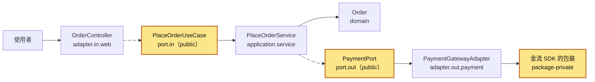
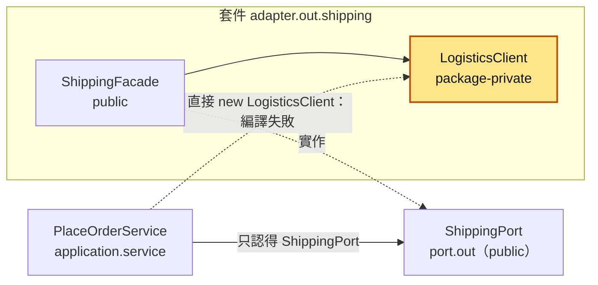
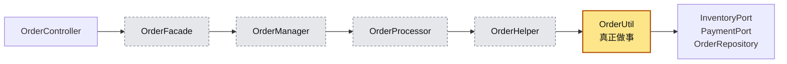
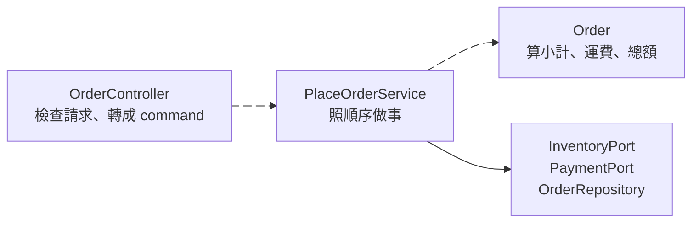
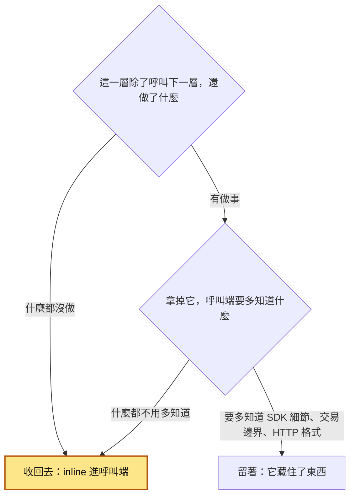
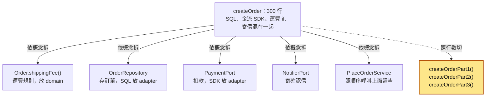
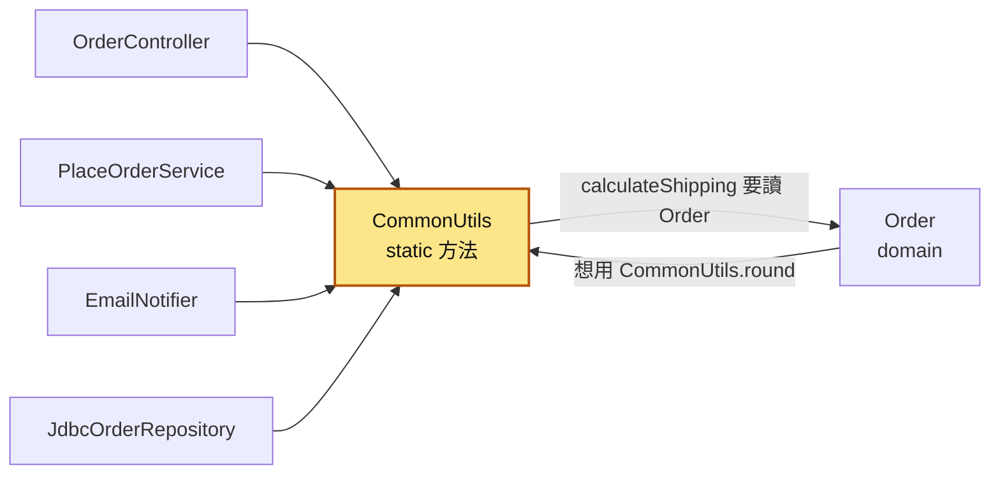
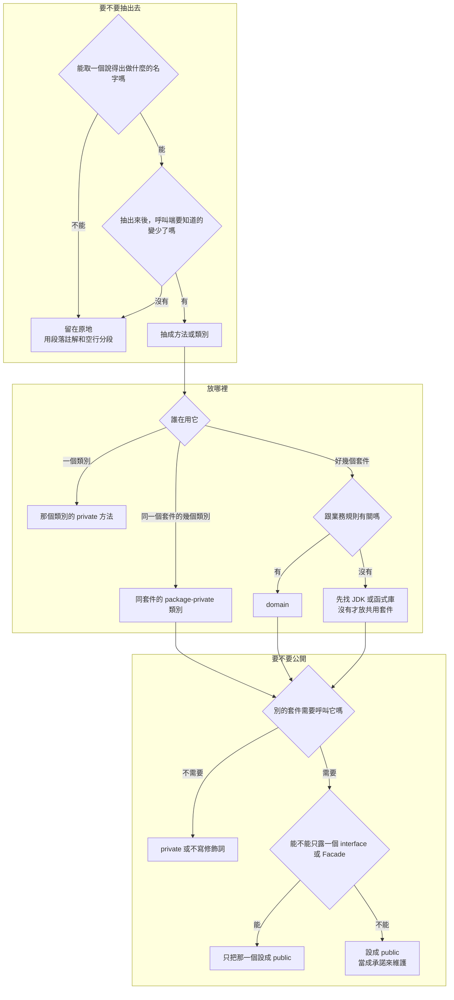

# 59｜可見性、模組深度與放置位置（Visibility, Module Depth, and Placement）

> 可見性（visibility）決定一個類別或方法能被哪些程式呼叫；模組深度（module depth）比較一個模組「呼叫的人要學的東西」和「它幫你做掉的事」；放置位置是一段程式該放進哪個套件。這裡的模組（module）泛指一個方法、一個類別或一個套件，只要它有「外面怎麼用」和「裡面怎麼做」兩面就算。三件事合起來回答同一個問題：別人要用或要改你的程式時，要知道多少、要跳幾層、要去哪裡找。

**難度**：★★☆　**閱讀時間**：約 25 分鐘　**前置知識**：[六邊形架構](57-六邊形架構.md)、[依責任分層](58-依責任分層.md)

## 核心問題與理念

**它要解決的問題**：一支下單方法被拆成 6 層類別，前 5 層都只把收到的參數原封不動交給下一層。加「優惠碼」時，這個值要改 5 個方法的參數才傳得到底，其中一層把客戶編號和優惠碼這兩個字串放反，照樣編譯過，結果客戶沒折到 100 元，訂單還記在一個不存在的客戶編號底下；想知道運費怎麼算，也得一路打開 6 個檔案。（下面的情境會完整走一遍）

**核心理念**：別人碰得到的越少越好；每多一層，都要替呼叫的人藏起一件事。

**想通的那一步**：

- **卡住的地方**：直覺的做法是方法越短、類別越小越乾淨，所以一支長方法被拆成 6 層、每層一行。可是每一層的參數都跟下一層一樣，讀的人多學了 5 個名字卻什麼都沒省下，加一個欄位還要改 5 個方法的參數。
- **火花**：把每一層看成一筆交換：呼叫的人要學會它的介面，換到的是它替你做掉、藏起來的事。John Ousterhout 在《A Philosophy of Software Design》裡用長方形來看：上緣是介面，面積是藏住的實作，上緣窄、面積大才划算。只轉傳的層介面跟下一層一樣寬、什麼都沒藏，收回去就好。

四個子概念各自對應一個痛點：

| 子概念 | 解決什麼 | 核心想法 |
|---|---|---|
| 可見性 | 包裝物流 SDK 的類別被別的層直接拿去建立物件，換物流商時到處要改 | 預設藏起來，別的套件（package，Java 裡同一個資料夾的一組類別）真的要用才開一個入口 |
| 模組深度 | 學一個類別怎麼用，花的力氣跟自己寫差不多 | 介面要短，背後替你做的事要多 |
| 過度加深 | 一個值要穿過好幾層才用得到，每一層都可能寫錯 | 一層什麼都沒藏，就把它收回呼叫它的地方 |
| 放置位置 | 運費規則藏在一個叫 `CommonUtils` 的雜物類別裡，找不到，也拆不開 | 放在用它的地方旁邊，業務規則放 domain（專放業務規則的那一層） |

## 閱讀前推薦具備知識

| 知識 | 要會到什麼程度 | 這篇哪裡會用到 | 不熟的話先看 |
|---|---|---|---|
| Java 的 class、interface、record | **必備**：看得懂一個類別 `implements` 一個 interface，以及 `record PlaceOrderCommand(String customerId, List<Item> items)` 會自動有建構子和 `customerId()` 方法 | 情境裡的 6 層類別、實驗二的 port 和 `PlaceOrderCommand` | [Java 官方學習路徑（dev.java）](https://dev.java/learn/) |
| Java 的 package 和 `import` | **必備**：能從 `package com.example.order.adapter.out.shipping;` 說出這個檔案放在哪個資料夾，知道用別的套件的類別要先 `import` | 〈可見性：Java 的四種存取範圍〉、實驗一的編譯錯誤 | [Java 官方學習路徑（dev.java）](https://dev.java/learn/) |
| JUnit 5 基本寫法 | **必備**：看得懂 `@Test` 和 `assertEquals(預期值, 實際值)` | 實驗一到實驗三的測試；`@ParameterizedTest` 本篇〈實驗二〉會順帶解釋 | [JUnit 5 使用手冊](https://docs.junit.org/current/user-guide/) |
| [依責任分層](58-依責任分層.md) | **加分**：說得出對外接口層、流程梳理層、業務實現層、基礎設施層各負責什麼 | 全貌圖、〈怎麼判斷一層該不該存在〉 | 本系列第 58 篇 |
| [六邊形架構](57-六邊形架構.md) | **加分**：知道 port 是 interface、adapter 是它的實作 | 物流套件只露出 `ShippingFacade`、實驗一之二只匯出 port 套件 | 本系列第 57 篇 |
| 命令列 | **加分**：會在終端機 `cd` 到資料夾、執行一行指令 | 「動手看看」的 `javac`、`java` 指令 | [PowerShell 入門（繁中）](https://learn.microsoft.com/zh-tw/powershell/scripting/learn/ps101/00-introduction) |

**快速自我檢查**：下面這段測試會通過嗎？`new PlaceOrderCommand(...)` 和 `cmd.customerId()` 是哪裡來的？

```java
var cmd = new PlaceOrderCommand("c-42", List.of());
assertEquals("c-42", cmd.customerId());
```

<details markdown="1"><summary>看答案</summary>

會通過。`PlaceOrderCommand` 是 record，Java 會依照它宣告的欄位自動產生建構子 `new PlaceOrderCommand(customerId, items)` 和讀取方法 `customerId()`、`items()`。`assertEquals` 的第一個參數是預期值、第二個是實際值，兩個都是 `"c-42"`，所以通過。答不出來也沒關係，先看 dev.java 裡 record 的那一課，再看 JUnit 手冊的第一個範例。

</details>

## 為什麼要在意：一個具體的情境

下面是一個假設情境。你接手這一章共用的電商下單服務：使用者按「下單」，系統要檢查庫存、算總額（滿 1000 免運，否則運費 60）、建立訂單、向金流扣款、扣庫存。之前有人請 AI 把原本一支很長的下單方法「重構得乾淨一點」，結果變成 6 層：

`OrderController → OrderFacade → OrderManager → OrderProcessor → OrderHelper → OrderUtil`

前 5 層每層只有一行，把收到的參數原封不動交給下一層；真正做事的只有最底下的 `OrderUtil.executeOrder`。

PM 要加「優惠碼」：結帳時輸入 `WELCOME100` 折 100 元。你要讓 `couponCode` 從 controller 一路傳到 `OrderUtil`，於是改了 5 個方法的參數。改到 `OrderProcessor` 時，`customerId` 和 `couponCode` 都是 `String`，呼叫下一層時位置寫反了：

```java
// ❌ 出事的寫法：OrderProcessor.java
public PlaceOrderResult processOrder(String customerId, List<Item> items, String couponCode) {
    return helper.doOrder(couponCode, items, customerId);   // 兩個 String 放反，照樣編譯過
}
```

客戶 `c-42` 買 2 個馬克杯，每個 450 元：小計 900，未滿 1000 加運費 60，原價 960，用了優惠碼應該付 860。下面的互動圖和圖下的表，看的都是這次呼叫一層一層往下走時，每一層手上拿到的值：

<figure class="draw-fig">
<iframe class="draw-fig__frame" src="../figures/59-coupon-swapped-six-layers.html" title="按播放或拖時間軸，看 c-42 和 WELCOME100 一層層原封不動往下傳，到第 4 層被放反後一路錯到扣款 960 元；切到「收斂版」對照只在 controller 建一次 PlaceOrderCommand 的寫法，底下是兩版實際量出來的深度和簽名數。" loading="lazy" style="height: 1040px;"></iframe>
<figcaption>按播放或拖時間軸，看 c-42 和 WELCOME100 一層層原封不動往下傳，到第 4 層被放反後一路錯到扣款 960 元；切到「收斂版」對照只在 controller 建一次 PlaceOrderCommand 的寫法，底下是兩版實際量出來的深度和簽名數。</figcaption>
</figure>

| 步驟 | 執行到哪一層 | 這層的 customerId | 這層的 couponCode | 這層做了什麼 |
|---|---|---|---|---|
| 1 | `OrderController.createOrder` | c-42 | WELCOME100 | 檢查購物車不是空的，往下傳 |
| 2 | `OrderFacade.placeOrder` | c-42 | WELCOME100 | 原封不動往下傳 |
| 3 | `OrderManager.handleOrder` | c-42 | WELCOME100 | 原封不動往下傳 |
| 4 | `OrderProcessor.processOrder` | c-42 | WELCOME100 | 呼叫下一層時把兩個值放反 |
| 5 | `OrderHelper.doOrder` | WELCOME100 | c-42 | 原封不動往下傳，順便帶上三個 port |
| 6 | `OrderUtil.executeOrder` | WELCOME100 | c-42 | 不認得優惠碼 c-42，不折扣；用 WELCOME100 當客戶建立訂單、扣款 960 元 |

- **使用者看到的**：輸入了優惠碼，卻被扣了 960 元；打開「我的訂單」，找不到這筆。
- **工程師看到的**：編譯過了，原本的測試也全綠（原本沒有測優惠碼）。查 `orders` 表，發現一批客戶編號是 `WELCOME100` 的訂單；沒用優惠碼的訂單更糟，客戶編號變成 `null`。

**根因**：`helper.doOrder(couponCode, items, customerId)` 這一行把參數放反。更深一層的原因是同樣兩個值要經手 5 層才到得了用它的地方，這 5 層什麼都沒做，每一層都是一個可能寫錯的地方；讀的人想確認值有沒有傳對，也得打開 6 個檔案。

**怎麼修**：把只轉傳的層收回去，變成 `OrderController → PlaceOrderService → Order` 三站，`couponCode` 放進 `PlaceOrderCommand` 這個 record 裡，只在 controller 建立一次。怎麼認出「多的層」、怎麼收，在後面〈過度加深：深度被拉得太長〉；兩個版本的呼叫深度和「加一個欄位要改幾個簽名」，在「動手看看」的實驗二、實驗三實際量給你看。

## 全貌：它在系統裡的位置

這張圖是一筆下單請求在程式裡經過的類別，每個方框下面一行是它所在的套件。會動的兩條箭頭是請求進來的主要路線。



每一條箭頭都跨過一個套件的邊界。上色的是這篇要你做決定的地方：哪些東西 `public` 給別的套件用（兩個 port），哪些藏在套件裡（SDK 的包裝）；從使用者到真正做事的類別要走幾條箭頭，就是呼叫深度。層要怎麼切見 [依責任分層](58-依責任分層.md)，port 的方向見 [六邊形架構](57-六邊形架構.md)，把子系統包成一個入口見 [Facade](55-Facade.md)，一個使用者動作一個類別見 [Use Case](56-Use%20Case.md)。

## 生活比喻

想像一家咖啡店。

- **深模組**：你在吧台說「中杯拿鐵」，磨豆、萃取、打奶泡都不用管。菜單很短，背後的工作很多。
- **淺模組**：店裡放一台咖啡機讓你自己按，要設定水溫、研磨粗細、萃取秒數、奶泡溫度。按鈕多到跟自己泡差不多，這台機器沒幫你省多少事。
- **過度加深**：你的點單先交給帶位員，帶位員交給領班，領班交給外場經理，經理交給傳菜員，傳菜員交給廚房助手，助手才交給咖啡師。每個人都只是把紙條轉手。你想改成燕麥奶，得一路跟每個人講一次，只要有一個人抄錯，你就拿到別人的咖啡。
- **可見性**：廚房門上鎖，只有員工有鑰匙。客人只能透過吧台點餐，碰不到咖啡機。
- **放置位置**：店裡有一個雜物抽屜，誰都把不知道放哪的東西丟進去。要找一卷收銀紙，得把整個抽屜翻一遍。

**比喻失準的地方**：咖啡店多一個人轉手只是慢一點；程式裡多一層，除了讀的人要多開一個檔案，改需求時每一層的參數都要跟著改。另外，Java 的「門鎖」是編譯器檢查的，程式寫了不該呼叫的東西，根本編譯不過，比喻表達不出這一點。

## 它是怎麼運作的

這一節依序講四件事：可見性（誰能呼叫）、模組深度（值不值得多一層）、過度加深（層太多時怎麼認、怎麼收）、放置位置（放哪個套件）。最後一小節把它們接成一張遇到新情況時可以照著走的決策圖。

### 可見性：Java 的四種存取範圍

一個類別寫出來，只要別人呼叫得到，就會有人呼叫；有人呼叫，你要改它就得先找出所有呼叫的地方。可見性用來縮小「呼叫得到的範圍」，範圍越小，你改內部時要顧慮的地方越少。

Java 用修飾詞（modifier）寫在類別、方法、欄位前面，決定誰看得到。套件（package）是放在同一個資料夾、宣告了同一個 `package` 的一組類別。下表照 Oracle 官方 Java 教學的整理：

| 修飾詞 | 同一個類別 | 同一個套件 | 別的套件的子類別 | 任何地方 |
|---|---|---|---|---|
| `public` | 可以 | 可以 | 可以 | 可以 |
| `protected` | 可以 | 可以 | 可以 | 不行 |
| 不寫（package-private） | 可以 | 可以 | 不行 | 不行 |
| `private` | 可以 | 不行 | 不行 | 不行 |

不寫修飾詞的那一種，Java 規格書叫 package access，業界口語常叫 package-private，本篇都用 package-private。最外層的類別只能是 `public` 或 package-private，不能寫 `private`。

這張圖是物流 adapter 的套件 `adapter.out.shipping`：套件裡只有 `ShippingFacade` 是 `public`，包裝物流 SDK 的 `LogisticsClient` 沒寫修飾詞，套件外面的程式碰不到它。



標著「編譯失敗」的那條虛線，就是「動手看看」實驗一會實際編譯一次的錯誤。下面是每一種修飾詞的使用時機。

**預設最小，有需要才放寬。** 欄位和方法先寫 `private`，類別先不寫修飾詞；等到別的套件真的要呼叫，才改成 `public`。Oracle 的 Java 教學也這樣建議：用說得通的最嚴格的存取等級，沒有好理由就用 `private`。要注意，很多 IDE 的「新增類別」範本預設就寫 `public class`，順手留著，整個專案就全是 `public`。

**`public` 等於承諾。** 一個方法設成 `public`，任何套件都能呼叫它。之後要改名字、改參數、改行為，就要先找出所有呼叫者。在同一個 repo 裡 IDE 還找得到；做成 jar 給別的團隊用，你連誰在用都不知道，只能先加新的、讓呼叫者慢慢搬、最後才刪舊的，跟 [零停機遷移](16-零停機遷移.md) 改資料表欄位是同一個做法。所以一個套件對外露出的 `public` 越少越好，最好只有一個入口。

**package-private 是藏住實作最好用的工具。** adapter 裡的 SDK 包裝、把資料庫欄位轉成 `Order` 的 mapper、只在套件內用的小類別，都適合不寫修飾詞。上圖的物流套件裡，外面只看得到 `ShippingFacade`；就算 `LogisticsClient` 有一天換成另一家物流商的 SDK，套件外面的程式一行都不用改，因為它們本來就碰不到。

**`protected` 很少需要。** `protected` 開放給「別的套件裡的子類別」，而且同一個套件也看得到，範圍比 package-private 還寬。開放給繼承，等於承諾子類別可以依賴這個成員的行為；之後你改父類別的內部，就可能弄壞你不知道的子類別。一般的業務程式多半用組合（把需要的物件從建構子傳進來）而不是繼承，就用不到 `protected`。會用到的通常是專門寫給別人繼承的框架基底類別，這時候要把「子類別可以覆寫什麼、會在什麼時候被呼叫」寫清楚。

**測試不需要你把東西改成 `public`。** 測試程式放在 `src/test/java` 底下、跟被測類別同一個套件路徑，就能直接測 package-private 的類別和方法。JUnit 5 的測試類別和測試方法本身也不用寫 `public`，官方文件只要求它們不能是 `private`。取捨是這樣的：

- 先透過公開的行為測（例如測 `ShippingFacade.ship()` 回傳的託運單號），內部怎麼改，測試都不用動。
- 套件內某個類別的邏輯很多（例如一個有十幾種情況的 mapper），從外面測要準備太多東西，就在同一個套件裡直接測它。
- `private` 方法不要想辦法直接測。它複雜到需要自己的測試時，通常代表它該抽成一個 package-private 的類別。

#### 模組系統：只匯出 port 套件

> 第一次讀可以先跳過這一小節，等你要把程式做成給別的團隊用的 jar 時再回來看。

`public` 只管到類別這一層：一個 jar 裡所有 `public` 類別，誰拿到 jar 都能用。Java 9 加入的模組系統（Java Platform Module System，JPMS）多了一層：在 `module-info.java` 裡用 `exports` 列出的套件，別的模組才看得到其中的 `public` 類別。

```java
module com.example.order {
    exports com.example.order.application.port.in;
    exports com.example.order.application.port.out;
    exports com.example.order.domain;   // port 的簽名用到 Order，所以 domain 也要匯出
    // adapter 套件不匯出：裡面的類別就算是 public，別的模組也碰不到
}
```

別的模組如果 `import` 了沒匯出套件裡的類別，編譯時會出現 `package ... is not visible` 的錯誤，「動手看看」實驗一之二會實際跑一次。專案裡沒有 `module-info.java`、整個程式放在 classpath 上跑的時候，這一層不存在，只剩上面四種修飾詞。

其他語言的對照，一句帶過就好：Python 沒有編譯器擋，只靠 `_` 開頭的命名慣例和 `__all__` 表示「這不是公開介面」；C# 沒有 package-private，最接近的是 `internal`（同一個組件，也就是同一個編譯出來的 `.dll` 裡看得到）。

### 模組深度：深模組與淺模組

每多一個類別或方法，讀程式的人就要多認識一個名字、一組參數。這個成本值不值得，要看它幫你藏起多少東西。

John Ousterhout 在《A Philosophy of Software Design》第 4 章〈Modules Should Be Deep〉用一個長方形來看模組：上緣是介面（interface），也就是呼叫的人必須知道的東西，包括方法名、參數、會丟的例外、要照什麼順序呼叫；長方形的面積是實作，也就是它幫你做掉的事。

- **深模組（deep module）**：介面小，背後做的事多。呼叫的人學一點點，就省下很多工夫。
- **淺模組（shallow module）**：介面相對於它做的事來說太複雜。學它的介面花的力氣，跟自己把那幾行寫出來差不多。

這張圖把兩種模組畫成長方形：橘色的上緣越寬，代表呼叫的人要學的越多；長方形越大，代表它藏住的實作越多。

<figure class="depth-fig">
<svg viewBox="0 0 660 300" role="img" aria-label="深模組是窄而高的長方形，上緣窄、面積大；淺模組是寬而扁的長方形，上緣寬、面積小" style="width:100%;max-width:660px;height:auto;display:block;margin:0 auto;font-family:inherit">
<rect x="70" y="50" width="150" height="190" fill="#60a5fa" fill-opacity="0.18" stroke="currentColor" stroke-width="1.5"/>
<rect x="70" y="50" width="150" height="10" fill="#f59e0b"/>
<text x="145" y="38" text-anchor="middle" fill="currentColor" font-size="16" font-weight="bold">深模組</text>
<text x="145" y="140" text-anchor="middle" fill="currentColor" font-size="13">藏住的實作很多</text>
<text x="145" y="162" text-anchor="middle" fill="currentColor" font-size="12">建立託運單、預約取件、</text>
<text x="145" y="180" text-anchor="middle" fill="currentColor" font-size="12">列印標籤、處理物流商錯誤</text>
<text x="145" y="265" text-anchor="middle" fill="currentColor" font-size="12">介面窄：ship(order)</text>
<rect x="320" y="50" width="290" height="55" fill="#60a5fa" fill-opacity="0.18" stroke="currentColor" stroke-width="1.5"/>
<rect x="320" y="50" width="290" height="10" fill="#f59e0b"/>
<text x="465" y="38" text-anchor="middle" fill="currentColor" font-size="16" font-weight="bold">淺模組</text>
<text x="465" y="88" text-anchor="middle" fill="currentColor" font-size="13">實作只有一行：呼叫下一層</text>
<text x="465" y="135" text-anchor="middle" fill="currentColor" font-size="12">介面寬：參數跟下一層一模一樣，</text>
<text x="465" y="153" text-anchor="middle" fill="currentColor" font-size="12">讀的人還是得往下看才知道做了什麼</text>
<text x="465" y="171" text-anchor="middle" fill="currentColor" font-size="12">例：OrderFacade.placeOrder(customerId, items)</text>
</svg>
<figcaption>上緣寬度是呼叫的人要學的東西，面積是它幫你做掉的事。</figcaption>
</figure>

JDK 裡的 `Files.readString(path)` 是深模組的例子：一行呼叫，背後開檔、讀取、解碼、關檔都幫你做了。下單範例裡的 `ShippingFacade.ship(order)` 也是，一個方法藏住物流的三個子系統呼叫（見 [Facade](55-Facade.md)）。情境裡的 `OrderFacade.placeOrder` 是淺模組：它的參數跟它呼叫的 `handleOrder` 一模一樣，什麼都沒藏。

Ousterhout 在他 Stanford 課程 CS190 的講義裡也把同一個判斷寫成一句：類別的介面簡單，比實作簡單更重要。換句話說，一個類別裡面長一點沒關係，只要外面用起來簡單；反過來，每個類別都很短、很簡單，但要用的人得認識十個類別，整個系統反而比較難懂。

### 過度加深：深度被拉得太長

把一支太長的方法拆開本來是好事，拆過頭也很常見。AI 產生的程式、照著設計模式書一層一層套的程式，特別容易出現這種形狀：一支方法只是長了點，就被拆成 Controller、Facade、Manager、Processor、Helper、Util，每層只把參數交給下一層。

這張圖是情境裡的過度加深版：灰色虛線框的 4 層只轉傳，`OrderController` 也只多檢查購物車是不是空的，上色的那一層才真正做事。



收斂後只剩三站：對外接口層的 `OrderController` 負責檢查請求、轉成 command，流程梳理層的 `PlaceOrderService` 照順序做事，運費規則在 `Order` 裡。



兩個版本的行為完全一樣，「動手看看」實驗二用同一組 JUnit 測試證明這件事，並用 `StackWalker` 印出從入口走到扣款要經過幾層：收斂版 2 層，過度加深版 6 層。

讀的人付出的代價，用「想知道運費怎麼算」走一次就看得出來。下表是你在過度加深版裡，從 controller 一路追到運費規則：

| 步驟 | 你打開的檔案 | 看到什麼 | 知道運費怎麼算了嗎 |
|---|---|---|---|
| 1 | `OrderController.java` | 檢查購物車，呼叫 `facade.placeOrder` | 還不知道 |
| 2 | `OrderFacade.java` | 一行：呼叫 `manager.handleOrder` | 還不知道 |
| 3 | `OrderManager.java` | 一行：呼叫 `processor.processOrder` | 還不知道 |
| 4 | `OrderProcessor.java` | 一行：呼叫 `helper.doOrder` | 還不知道 |
| 5 | `OrderHelper.java` | 一行：呼叫 `OrderUtil.executeOrder`，多傳三個 port | 還不知道 |
| 6 | `OrderUtil.java` | 檢查庫存、`new Order(...)`、存訂單、扣款 | 只知道總額來自 `Order` |
| 7 | `Order.java` | `shippingFee()`：滿 1000 免運，否則 60 | 知道了 |

收斂版只要開 `OrderController.java`、`PlaceOrderService.java`、`Order.java` 三個檔案。

Ousterhout 在書裡替這類問題取了幾個名字，認得這些名字，code review 時比較好溝通：

- **pass-through method**（第 7 章〈Different Layer, Different Abstraction〉）：方法只是把呼叫轉給另一個方法，簽名跟被呼叫的那個差不多，自己沒有增加任何功能。書裡把它看成「兩個類別的責任沒分清楚」的訊號。
- **pass-through variable**（同一章）：一個值只有最底層用得到，卻得沿著每一層的參數傳下去。情境裡的 `couponCode` 和 `OrderHelper` 往下傳的三個 port 都是。
- **classitis**（第 4 章）：把「類別要小」推到極端，每個類別只多做一點點事，結果是一大堆淺類別，每個都要認識，整個系統反而更複雜。

#### 症狀：code review 時怎麼認出來

看到下面這些，就停下來用下一小節的方法問一次：

- 方法本體只有一行 `return next.xxx(同樣的參數)`，這是 pass-through 方法。
- 一個 helper 只有一個呼叫者，而且只有一兩行。
- 名字只是把上一層換個說法：`placeOrder → handleOrder → processOrder → doOrder → executeOrder`；類別名字只剩 Manager、Processor、Helper、Util，說不出它負責什麼。
- 介面跟實作一樣複雜：這一層的參數清單和下一層一模一樣。
- 為了「以後可能會換」加了一個 `interface`，但只有一個實作，測試裡也沒有拿它換成假的。
- 同一個值出現在 3 層以上的方法簽名裡，只有最底層真的用到它。
- 自己量一次：從入口走到真正做事的那一行，跳了幾層、開了幾個檔案。數字比你預期的大，就逐層檢查。

#### 怎麼判斷一層該不該存在

問兩個問題：這一層藏起了什麼？拿掉它，呼叫它的那一層會變複雜嗎？



有些層很薄，但它藏住了東西，應該留著：

- 對外接口層把 HTTP 的 JSON 轉成 `PlaceOrderCommand`，把例外轉成 HTTP 狀態碼。拿掉它，流程梳理層就得認識 HTTP。
- `PlaceOrderService` 決定交易從哪裡開始、到哪裡結束（見 [資料庫交易](03-資料庫交易.md)），呼叫雖然短，交易邊界只有它知道。
- `ShippingFacade` 一個方法藏住三個子系統呼叫和它們的順序。
- outbound port 的 `interface` 讓測試可以換成記憶體裡的假物件，也讓內層不用 import 資料庫和 SDK（見 [六邊形架構](57-六邊形架構.md)）。

這些都是 [依責任分層](58-依責任分層.md) 裡一個責任一層的那一層。同一個責任被切成好幾層，才是過度加深。

拆方法時，每拆出一塊，都要是一個叫得出名字的概念。檢查方式是幫它取名字：能取一個說得出「做什麼」的名字（`shippingFee`、`reserveStock`），而且呼叫的人不用看實作就能用，這次拆就值得；名字只剩 `helper`、`process`、`handle`、`doStep2`，或要用 and 連起兩件事（`validateAndSave`），多半是照行數切的。

一支 40 行、由上往下讀得懂的方法，常常比 6 個 5 行的方法好維護：40 行一個畫面就看完，6 個小方法要跳 6 次，還得在腦中記住每一層傳了什麼。Ousterhout 在第 9 章〈Better Together or Better Apart?〉也提醒，方法長本身很少是拆開的好理由；介面簡單、讀起來順的長方法，可以留著。

#### 修法：把多的層收回來

- **把 pass-through 層 inline 回去。** 把那一層的方法本體搬進呼叫它的地方，再刪掉那一層。Martin Fowler 的重構目錄把這兩個動作叫 Inline Function（舊名 Inline Method）和 Remove Middle Man，IntelliJ IDEA、Eclipse 都有 Inline 這個自動重構。
- **只用一次的 helper 收回呼叫端。**
- **用段落註解加空行代替過早抽方法。** 例如 `PlaceOrderService.execute()` 裡用 `// ① 檢查庫存`、`// ② 算金額`、`// ④ 扣款` 把一支 20 幾行的方法分段，讀的人照順序往下讀就好（完整程式在「動手看看」的實驗二）。
- **真的要拆，拆成深模組。** 運費規則抽成 `Order.shippingFee()`，物流三步包成 `ShippingFacade.ship()`：介面一個方法，背後藏住整件事。
- **一個值要穿過好幾層時，用一個 command 物件一次帶齊。** `PlaceOrderCommand` 是 record，加欄位只改它一個地方。要先把層收掉再做這一步；層還在的話，command 物件只是把 5 個參數變成 1 個，讀的人還是要跳 6 個檔案。

收層的時候，先有測試再動手，一次收一層。下表是把情境裡的 6 層收成 2 層的順序：

| 步驟 | 做什麼 | 測試 |
|---|---|---|
| 1 | 寫一組只看行為的測試：總額、扣款金額、庫存不足時不扣款 | 全綠，這是收層前的基準 |
| 2 | 把 `OrderFacade`、`OrderManager`、`OrderProcessor` 一層一層 inline 掉，controller 直接呼叫 `OrderHelper` | 每收一層跑一次，仍然全綠 |
| 3 | 把 `OrderUtil.executeOrder` 的內容搬進 `OrderHelper`，改名成 `PlaceOrderService`，讓它實作 `PlaceOrderUseCase` | 全綠 |
| 4 | 參數改成 `PlaceOrderCommand`，刪掉沒人用的類別 | 全綠，呼叫深度從 6 變成 2 |

#### 反方向：300 行的方法也不好

收層不代表把所有東西塞回一支方法。這一章的起點是一支什麼都做的 `OrderController.createOrder`：裡面直接寫 JDBC SQL、直接呼叫金流 SDK、算運費的 `if`、寄信，全部混在一起。結果是改運費規則要動 controller、換金流商要改到業務邏輯、測試只能起資料庫和假金流伺服器。

這張圖是同一支 300 行的方法，用兩種方式拆：左邊依概念拆，每塊都有名字、有歸屬的層；右邊照行數切，切出來的東西說不出負責什麼。



左邊拆完，改運費只動 `Order`，換金流商只動 adapter，測流程可以用假的 port。右邊拆完，三個方法還是一起改、一起壞，只是多了兩次跳轉。300 行的方法和 6 層只轉傳的類別，出的是同一種問題：讀的人找不到「這件事在哪裡做」。

### 放置位置：util 的陷阱

寫了一個方法，不知道該放哪，最順手的做法是丟進 `OrderUtils` 或 `CommonUtils`，寫成 `static` 方法，誰要用就 `import`。這種類別很快會變成雜物抽屜：`formatMoney`、`calculateShipping`、`parseDate`、`isVip`、`buildEmailHtml` 全擠在一起，名字說不出它負責什麼。

雜物抽屜的麻煩在依賴。這張圖是 `CommonUtils` 被各層 import 的樣子，以及它和 `Order` 之間的循環：



- **誰都依賴它。** 改 `CommonUtils` 裡任何一個方法，都可能影響全部的層；它也不屬於任何一層，分層的依賴方向在這裡斷掉。
- **循環依賴。** `CommonUtils.calculateShipping` 要讀 `Order`，`Order` 又想用 `CommonUtils.round`，兩個套件互相 import。同一個專案裡 Java 編譯器不會擋，可是從此兩邊拆不開；domain 也不再是「不 import 任何外層東西」的那一層。等你想把它們拆成兩個 Maven 模組時，Maven 不接受模組之間互相依賴，就得先解開這個循環。
- **業務規則被藏在不像業務的地方。** 新人要找運費規則，會先去 `Order` 找，不會想到 `CommonUtils`。

判斷放哪裡，問兩個問題：這個方法屬於哪個概念？誰在用它？

- **只有一個類別用**：寫成那個類別的 `private` 方法。
- **同一個套件裡幾個類別用**：放進同一個套件的 package-private 類別，用它負責的概念命名（例如物流套件裡的 `LogisticsClient`），不要叫 Helper。這叫就近放置：程式放在用它的地方旁邊。
- **好幾個套件用、跟業務規則有關**（金額、運費、折扣）：放 domain，例如 `Order.shippingFee()`、`Order.discount()`。
- **好幾個套件用、跟業務無關**（字串、日期時間）：先找 JDK 或專案已經在用的函式庫（`String.isBlank()`、`java.time`）；真的沒有，才放進共用的套件，並用概念命名。

用下單範例的目錄樹看兩個方法該放哪裡：

```
src/main/java/com/example/order/
  domain/
    Order.java               # calculateShipping 是業務規則 → Order.shippingFee()
  adapter/
    out/
      notification/
        EmailNotifier.java   # public，實作 NotifierPort
        MoneyText.java       # package-private：formatMoney 只有寄信用，放在寄信旁邊
      shipping/
        ShippingFacade.java  # public
        LogisticsClient.java # package-private
```

`formatMoney`（把 1060 印成 `NT$1,060`）一開始只有寄確認信用，就放在 `notification` 套件裡、不寫修飾詞。哪天 HTTP 回應也要用同樣的格式，它就變成「兩個 adapter 都用、跟業務規則無關」，這時再搬到共用的地方。先放近，第二、三個使用者出現時再搬，比一開始就猜它「以後大家都會用」準確。

### 依當下狀況反應：決策流程

遇到新的情況時，可以照這張圖走。三個區塊分別回答「要不要抽出去」「放哪裡」「要不要公開」，通常照這個順序問。



同一套判斷，在不同規模和團隊下可以調鬆或調緊：

| 情況 | 可以放寬的 | 不能放寬的 |
|---|---|---|
| 一個人寫、用完就丟的腳本或原型 | 一個檔案寫到底，不分層、不分套件 | 至少讓入口方法讀得懂 |
| 一個團隊維護的服務 | 不用 `module-info.java`，靠 package-private 就夠 | 層照責任切；adapter 的細節不要 `public` |
| 做成 jar 給別的團隊用 | 無 | `public` 越少越好，用 `exports` 只匯出 port；改公開方法要先標 `@Deprecated`、給替代方案，再找時間刪 |
| 功能還在快速變動 | 重複的程式先留著，等看清楚哪些是真的共同點 | 業務規則還是放 domain |
| 已經穩定、很多人一起改 | 無 | 把常一起改的放在一起，抽出深模組 |

「重複的程式先留著」有一條常被引用的經驗法則，叫三次法則（Rule of Three）。它一般歸於 Don Roberts，由 Martin Fowler 在《Refactoring》（1999）裡寫出來而傳開：第一次做某件事，直接做；第二次做類似的事，會覺得重複，但還是先照抄；第三次才重構，把共同的部分抽出來。理由是只有兩個例子時，你分不出哪些地方是真的相同、哪些只是剛好長得像，太早抽出來的共用方法，常常要一直加參數去遷就第三個不太一樣的呼叫者。這是經驗法則，不是硬規定：業務規則（例如運費）從第一次寫就該放進 domain，不用等到第三次。

## 動手看看

三個實驗放在同一個資料夾，用 JDK 21 以上和 JUnit 5 跑：

- 實驗一：package-private 在編譯期就擋下越界呼叫；實驗一之二：模組系統的 `exports`。
- 實驗二：同一個下單功能的「過度加深版」和「收斂版」，用 JUnit 證明行為一樣，用 `StackWalker` 印出呼叫深度。
- 實驗三：兩個版本都加上「優惠碼」，數一數各改了幾個簽名。

### 準備環境

本文是用 JDK 25 加上 `--release 21`（照 Java 21 的語法和 API 編譯）跑的。測試用 JUnit 5 的獨立執行器 JUnit Console Launcher，一個 jar 就能跑，不用裝 Maven：

- 下載 `junit-platform-console-standalone-1.13.4.jar`：https://repo1.maven.org/maven2/org/junit/platform/junit-platform-console-standalone/1.13.4/junit-platform-console-standalone-1.13.4.jar
- 下面的指令是 PowerShell。用 bash 的話，把 `(Get-ChildItem -Recurse src -Filter *.java).FullName` 換成 `$(find src -name '*.java')`。

在 Maven 專案裡照做的話，把程式放進 `src/main/java`、測試放進 `src/test/java`，加上這個依賴，然後跑 `mvn test`。本文的輸出是用 JUnit Console Launcher 跑的，Maven 的輸出格式不同。

```xml
<dependency>
    <groupId>org.junit.jupiter</groupId>
    <artifactId>junit-jupiter</artifactId>
    <version>5.13.4</version>
    <scope>test</scope>
</dependency>
```

### 實驗一：package-private 在編譯期就擋下來

檔案排法（`bad` 資料夾放一支故意越界的類別，平常不會跟著編譯）：

```
exp1/
  src/main/java/com/example/order/
    domain/Order.java、domain/OrderLine.java          # 跟實驗二一樣，從下面複製過來
    application/port/out/ShippingPort.java
    application/port/out/ShipmentReceipt.java
    adapter/out/shipping/ShippingFacade.java
    adapter/out/shipping/LogisticsClient.java
  src/test/java/com/example/order/
    adapter/out/shipping/LogisticsClientTest.java
  bad/com/example/order/application/service/ShipNow.java
```

`ShippingPort.ship` 收一張 `Order`、回傳 `ShipmentReceipt`，跟本章其他篇的 `ShippingPort` 同一個簽名；`Order`、`OrderLine` 直接用實驗二的版本，這個實驗只用到 `order.id()`。

```java
// ShippingPort.java
package com.example.order.application.port.out;

import com.example.order.domain.Order;

// Port Out：流程梳理層只認得這個介面，不知道物流商是誰
public interface ShippingPort {
    ShipmentReceipt ship(Order order);
}
```

```java
// ShipmentReceipt.java
package com.example.order.application.port.out;

// 出貨收據：託運單號、標籤網址。型別由 port 這邊定義，不用物流商 SDK 的類別
public record ShipmentReceipt(String consignmentNo, String labelUrl) { }
```

```java
// ShippingFacade.java
package com.example.order.adapter.out.shipping;

import com.example.order.application.port.out.ShipmentReceipt;
import com.example.order.application.port.out.ShippingPort;
import com.example.order.domain.Order;

// 這個套件裡唯一的 public 類別：外面只看得到它
public final class ShippingFacade implements ShippingPort {
    private final LogisticsClient client = new LogisticsClient();

    @Override
    public ShipmentReceipt ship(Order order) {
        String consignmentNo = client.createConsignment(order.id());
        client.bookPickup(consignmentNo);
        String labelUrl = client.printLabel(consignmentNo);
        return new ShipmentReceipt(consignmentNo, labelUrl);
    }
}
```

```java
// LogisticsClient.java
package com.example.order.adapter.out.shipping;

// 沒寫修飾詞 = package-private：只有 adapter.out.shipping 這個套件裡的類別看得到
// （假裝這是物流商 SDK 的包裝，真實世界這裡會打 HTTP）
final class LogisticsClient {
    String createConsignment(String orderId) {
        return "TW-" + orderId;
    }

    void bookPickup(String consignmentNo) { }

    String printLabel(String consignmentNo) {
        return "https://labels.example.com/" + consignmentNo + ".pdf";
    }
}
```

```java
// bad/.../ShipNow.java
package com.example.order.application.service;

// ❌ 想繞過 ShippingFacade，直接用物流 SDK 的包裝
import com.example.order.adapter.out.shipping.LogisticsClient;

class ShipNow {
    String run() {
        return new LogisticsClient().createConsignment("42");
    }
}
```

```java
// LogisticsClientTest.java
package com.example.order.adapter.out.shipping;   // 跟被測類別同一個套件

import static org.junit.jupiter.api.Assertions.assertEquals;

import com.example.order.domain.Order;
import java.util.List;
import org.junit.jupiter.api.Test;

class LogisticsClientTest {

    @Test
    void 同套件的測試可以直接測_package_private_類別() {
        assertEquals("TW-42", new LogisticsClient().createConsignment("42"));
    }

    @Test
    void 從外面只能透過_ShippingFacade() {
        var order = new Order("42", "c-42", List.of());
        assertEquals("TW-42", new ShippingFacade().ship(order).consignmentNo());
    }
}
```

先把 `bad` 一起編譯，看編譯器怎麼擋：

```powershell
cd exp1
javac --release 21 -d out-bad (Get-ChildItem -Recurse src\main, bad -Filter *.java).FullName
```

**實際輸出**（檔案路徑前面那段依你的資料夾而不同，這裡用 `...` 省略）：

```
...\bad\com\example\order\application\service\ShipNow.java:4: error: LogisticsClient is not public in com.example.order.adapter.out.shipping; cannot be accessed from outside package
import com.example.order.adapter.out.shipping.LogisticsClient;
                                             ^
...\bad\com\example\order\application\service\ShipNow.java:8: error: LogisticsClient is not public in com.example.order.adapter.out.shipping; cannot be accessed from outside package
        return new LogisticsClient().createConsignment("42");
                   ^
2 errors
```

`application.service` 套件想用 `LogisticsClient`，`import` 那一行和 `new` 那一行都被擋下來。再編譯正常的程式和測試，跑 JUnit：

```powershell
$J = "C:\path\to\junit-platform-console-standalone-1.13.4.jar"   # 換成你下載的位置
javac --release 21 -d out -cp $J (Get-ChildItem -Recurse src -Filter *.java).FullName
java -jar $J execute --class-path out --scan-class-path --disable-banner --details=tree
```

**實際輸出**（執行時間依機器而異；`JUnit Platform Suite`、`JUnit Vintage` 是獨立執行器內建的另外兩種測試引擎，這裡沒有用到）：

```
╷
├─ JUnit Platform Suite ✔
├─ JUnit Jupiter ✔
│  └─ LogisticsClientTest ✔
│     ├─ 同套件的測試可以直接測_package_private_類別() ✔
│     └─ 從外面只能透過_ShippingFacade() ✔
└─ JUnit Vintage ✔

Test run finished after 48 ms
...
[         2 tests successful      ]
[         0 tests failed          ]
```

`LogisticsClientTest` 放在 `src/test/java` 底下、套件跟 `LogisticsClient` 一樣，所以測得到它；測試類別和方法也都沒寫 `public`。

### 實驗一之二：模組系統只匯出 port

把同樣的物流程式放進一個模組 `com.example.order`，只匯出 port 套件；另一個模組 `com.example.report` 想直接用 `ShippingFacade`。檔案排法（模組系統規定每個模組一個資料夾，資料夾名就是模組名）：

```
exp1b/src/
  com.example.order/
    module-info.java
    com/example/order/domain/Order.java、OrderLine.java                # 同實驗一
    com/example/order/application/port/out/ShippingPort.java          # 同實驗一
    com/example/order/application/port/out/ShipmentReceipt.java       # 同實驗一
    com/example/order/adapter/out/shipping/ShippingFacade.java        # 同實驗一
    com/example/order/adapter/out/shipping/LogisticsClient.java       # 同實驗一
  com.example.report/
    module-info.java
    com/example/report/DailyReport.java
```

```java
// com.example.order/module-info.java
module com.example.order {
    // 只匯出 port 套件，以及 port 的簽名用到的 domain；adapter 套件就算有 public 類別，別的模組也碰不到
    exports com.example.order.application.port.out;
    exports com.example.order.domain;
}
```

`ShippingPort.ship(Order order)` 的參數是 domain 的 `Order`，別的模組要呼叫這個 port 就得看得到 `Order`，所以 domain 套件也要匯出；要藏的是 adapter。

```java
// com.example.report/module-info.java
module com.example.report {
    requires com.example.order;
}
```

```java
// DailyReport.java
package com.example.report;

// ✅ port 套件有匯出，可以用
import com.example.order.application.port.out.ShippingPort;
// ❌ adapter 套件沒有匯出，就算 ShippingFacade 是 public 也碰不到
import com.example.order.adapter.out.shipping.ShippingFacade;

class DailyReport {
    ShippingPort port;
    ShippingFacade facade;
}
```

```powershell
cd exp1b
javac --release 21 -d out --module-source-path src -m com.example.order,com.example.report
```

**實際輸出**：

```
src\com.example.report\com\example\report\DailyReport.java:6: error: package com.example.order.adapter.out.shipping is not visible
import com.example.order.adapter.out.shipping.ShippingFacade;
                                    ^
  (package com.example.order.adapter.out.shipping is declared in module com.example.order, which does not export it)
1 error
```

`ShippingPort` 那一行沒有錯誤：有匯出的套件照常可以用。`ShippingFacade` 明明是 `public`，因為它的套件沒有匯出，別的模組照樣碰不到。

### 實驗二：過度加深版與收斂版

這個實驗用下單範例的一小段：檢查庫存、算總額、存訂單、扣款、扣庫存（物流和寄信省略）。兩個版本共用 domain、port 和請求物件，差別只在中間有幾層。檔案排法：

```
v1/
  src/main/java/com/example/order/
    domain/                   OrderLine.java、Order.java、OutOfStockException.java
    application/port/in/      PlaceOrderUseCase.java、PlaceOrderCommand.java、PlaceOrderResult.java
    application/port/out/     InventoryPort.java、PaymentPort.java、OrderRepository.java
    application/service/      PlaceOrderService.java              ← 收斂版
    adapter/in/web/           CreateOrderRequest.java、OrderController.java   ← 收斂版的入口
    overdeep/                 OrderController.java、OrderFacade.java、OrderManager.java、
                              OrderProcessor.java、OrderHelper.java、OrderUtil.java  ← 過度加深版
  src/test/java/com/example/order/
    fake/                     FakeInventory.java、FakePayment.java、FakeOrderRepository.java
    Apps.java                 兩個版本各自組裝起來
    SameBehaviorTest.java     同一組情境，兩版各跑一次
    CallDepthTest.java        斷言呼叫深度
    DepthDemo.java            印出呼叫鏈
```

**domain**：

```java
// OrderLine.java
package com.example.order.domain;

public record OrderLine(String sku, long unitPrice, int quantity) {
    public long amount() {
        return unitPrice * quantity;
    }
}
```

```java
// OutOfStockException.java
package com.example.order.domain;

public class OutOfStockException extends RuntimeException {
    public OutOfStockException(String sku) {
        super("庫存不足：" + sku);
    }
}
```

??? example "完整程式：domain/Order.java"

    ```java
    // Order.java
    package com.example.order.domain;

    import java.util.List;

    public final class Order {
        private static final long FREE_SHIPPING_THRESHOLD = 1000;
        private static final long SHIPPING_FEE = 60;

        private final String id;
        private final String customerId;
        private final List<OrderLine> lines;

        public Order(String id, String customerId, List<OrderLine> lines) {
            this.id = id;
            this.customerId = customerId;
            this.lines = List.copyOf(lines);
        }

        public String id() {
            return id;
        }

        public String customerId() {
            return customerId;
        }

        public List<OrderLine> lines() {
            return lines;
        }

        public long subtotal() {
            return lines.stream().mapToLong(OrderLine::amount).sum();
        }

        // 滿 1000 免運，否則 60
        public long shippingFee() {
            return subtotal() >= FREE_SHIPPING_THRESHOLD ? 0 : SHIPPING_FEE;
        }

        public long total() {
            return subtotal() + shippingFee();
        }
    }
    ```

**port 和請求物件**（每個檔案一個型別，這裡合在一起列）：簽名跟本章其他篇一樣，`PlaceOrderCommand.Item` 只帶商品和數量，單價由 `InventoryPort.priceOf` 查；這個實驗沒有出貨和寄信，所以只有三個 outbound port。

??? example "完整程式：port/in、port/out 和 CreateOrderRequest 的 7 個檔案"

    ```java
    // application/port/in/PlaceOrderCommand.java
    package com.example.order.application.port.in;

    import java.util.List;

    public record PlaceOrderCommand(String customerId, List<Item> items) {
        public record Item(String sku, int quantity) { }   // 不帶單價：單價由 InventoryPort.priceOf 查
    }

    // application/port/in/PlaceOrderResult.java
    package com.example.order.application.port.in;

    public record PlaceOrderResult(String orderId, long total) { }

    // application/port/in/PlaceOrderUseCase.java
    package com.example.order.application.port.in;

    public interface PlaceOrderUseCase {
        PlaceOrderResult execute(PlaceOrderCommand cmd);
    }

    // application/port/out/InventoryPort.java
    package com.example.order.application.port.out;

    public interface InventoryPort {
        int available(String sku);

        long priceOf(String sku);   // 簡化：庫存服務順便回單價

        void deduct(String sku, int quantity);
    }

    // application/port/out/PaymentPort.java
    package com.example.order.application.port.out;

    public interface PaymentPort {
        String charge(String orderId, long amount);   // 回傳付款編號
    }

    // application/port/out/OrderRepository.java
    package com.example.order.application.port.out;

    import com.example.order.domain.Order;

    public interface OrderRepository {
        String nextId();

        void save(Order order);
    }

    // adapter/in/web/CreateOrderRequest.java
    package com.example.order.adapter.in.web;

    import com.example.order.application.port.in.PlaceOrderCommand.Item;
    import java.util.List;

    // 代表「已經從 HTTP JSON 解析出來」的請求內容（本範例省略 JSON 解析）
    public record CreateOrderRequest(String customerId, List<Item> items) { }
    ```

**收斂版**：controller 檢查請求、轉成 command；`PlaceOrderService` 用段落註解分段，由上往下讀完整個流程。

```java
// adapter/in/web/OrderController.java
package com.example.order.adapter.in.web;

import com.example.order.application.port.in.PlaceOrderCommand;
import com.example.order.application.port.in.PlaceOrderResult;
import com.example.order.application.port.in.PlaceOrderUseCase;

// 收斂版的對外接口：檢查請求、轉成 command、交給 use case
public class OrderController {
    private final PlaceOrderUseCase placeOrder;

    public OrderController(PlaceOrderUseCase placeOrder) {
        this.placeOrder = placeOrder;
    }

    public PlaceOrderResult createOrder(CreateOrderRequest req) {
        if (req.items().isEmpty()) {
            throw new IllegalArgumentException("購物車是空的");   // 真實世界轉成 HTTP 400
        }
        return placeOrder.execute(new PlaceOrderCommand(req.customerId(), req.items()));
    }
}
```

```java
// application/service/PlaceOrderService.java
package com.example.order.application.service;

import com.example.order.application.port.in.PlaceOrderCommand;
import com.example.order.application.port.in.PlaceOrderCommand.Item;
import com.example.order.application.port.in.PlaceOrderResult;
import com.example.order.application.port.in.PlaceOrderUseCase;
import com.example.order.application.port.out.InventoryPort;
import com.example.order.application.port.out.OrderRepository;
import com.example.order.application.port.out.PaymentPort;
import com.example.order.domain.Order;
import com.example.order.domain.OrderLine;
import com.example.order.domain.OutOfStockException;
import java.util.List;

// 收斂版：一個 use case 一個類別，流程由上往下讀得完
public class PlaceOrderService implements PlaceOrderUseCase {
    private final InventoryPort inventory;
    private final PaymentPort payment;
    private final OrderRepository orders;

    public PlaceOrderService(InventoryPort inventory, PaymentPort payment, OrderRepository orders) {
        this.inventory = inventory;
        this.payment = payment;
        this.orders = orders;
    }

    @Override
    public PlaceOrderResult execute(PlaceOrderCommand cmd) {
        // ① 檢查庫存
        for (Item item : cmd.items()) {
            if (inventory.available(item.sku()) < item.quantity()) {
                throw new OutOfStockException(item.sku());
            }
        }

        // ② 算金額（規則在 Order 裡），③ 建立訂單
        List<OrderLine> lines = cmd.items().stream()
                .map(i -> new OrderLine(i.sku(), inventory.priceOf(i.sku()), i.quantity()))
                .toList();
        Order order = new Order(orders.nextId(), cmd.customerId(), lines);
        orders.save(order);

        // ④ 扣款，⑤ 扣庫存
        payment.charge(order.id(), order.total());
        for (OrderLine line : order.lines()) {
            inventory.deduct(line.sku(), line.quantity());
        }
        return new PlaceOrderResult(order.id(), order.total());
    }
}
```

**過度加深版**：放在 `overdeep` 套件，6 個類別，前 5 個只轉傳。

```java
// overdeep/OrderController.java
package com.example.order.overdeep;

import com.example.order.adapter.in.web.CreateOrderRequest;
import com.example.order.application.port.in.PlaceOrderResult;

// 過度加深版：第 1 層
public class OrderController {
    private final OrderFacade facade;

    public OrderController(OrderFacade facade) {
        this.facade = facade;
    }

    public PlaceOrderResult createOrder(CreateOrderRequest req) {
        if (req.items().isEmpty()) {
            throw new IllegalArgumentException("購物車是空的");
        }
        return facade.placeOrder(req.customerId(), req.items());
    }
}
```

```java
// overdeep/OrderFacade.java
package com.example.order.overdeep;

import com.example.order.application.port.in.PlaceOrderCommand.Item;
import com.example.order.application.port.in.PlaceOrderResult;
import java.util.List;

// 第 2 層：只轉傳
public class OrderFacade {
    private final OrderManager manager;

    public OrderFacade(OrderManager manager) {
        this.manager = manager;
    }

    public PlaceOrderResult placeOrder(String customerId, List<Item> items) {
        return manager.handleOrder(customerId, items);
    }
}
```

```java
// overdeep/OrderManager.java
package com.example.order.overdeep;

import com.example.order.application.port.in.PlaceOrderCommand.Item;
import com.example.order.application.port.in.PlaceOrderResult;
import java.util.List;

// 第 3 層：只轉傳
public class OrderManager {
    private final OrderProcessor processor;

    public OrderManager(OrderProcessor processor) {
        this.processor = processor;
    }

    public PlaceOrderResult handleOrder(String customerId, List<Item> items) {
        return processor.processOrder(customerId, items);
    }
}
```

```java
// overdeep/OrderProcessor.java
package com.example.order.overdeep;

import com.example.order.application.port.in.PlaceOrderCommand.Item;
import com.example.order.application.port.in.PlaceOrderResult;
import java.util.List;

// 第 4 層：只轉傳
public class OrderProcessor {
    private final OrderHelper helper;

    public OrderProcessor(OrderHelper helper) {
        this.helper = helper;
    }

    public PlaceOrderResult processOrder(String customerId, List<Item> items) {
        return helper.doOrder(customerId, items);
    }
}
```

```java
// overdeep/OrderHelper.java
package com.example.order.overdeep;

import com.example.order.application.port.in.PlaceOrderCommand.Item;
import com.example.order.application.port.in.PlaceOrderResult;
import com.example.order.application.port.out.InventoryPort;
import com.example.order.application.port.out.OrderRepository;
import com.example.order.application.port.out.PaymentPort;
import java.util.List;

// 第 5 層：只轉傳，順便把三個 port 也往下傳
public class OrderHelper {
    private final InventoryPort inventory;
    private final PaymentPort payment;
    private final OrderRepository orders;

    public OrderHelper(InventoryPort inventory, PaymentPort payment, OrderRepository orders) {
        this.inventory = inventory;
        this.payment = payment;
        this.orders = orders;
    }

    public PlaceOrderResult doOrder(String customerId, List<Item> items) {
        return OrderUtil.executeOrder(customerId, items, inventory, payment, orders);
    }
}
```

```java
// overdeep/OrderUtil.java
package com.example.order.overdeep;

import com.example.order.application.port.in.PlaceOrderCommand.Item;
import com.example.order.application.port.in.PlaceOrderResult;
import com.example.order.application.port.out.InventoryPort;
import com.example.order.application.port.out.OrderRepository;
import com.example.order.application.port.out.PaymentPort;
import com.example.order.domain.Order;
import com.example.order.domain.OrderLine;
import com.example.order.domain.OutOfStockException;
import java.util.List;

// 第 6 層：真正做事的地方，藏在最底下
public final class OrderUtil {
    private OrderUtil() { }

    public static PlaceOrderResult executeOrder(String customerId, List<Item> items,
            InventoryPort inventory, PaymentPort payment, OrderRepository orders) {
        for (Item item : items) {
            if (inventory.available(item.sku()) < item.quantity()) {
                throw new OutOfStockException(item.sku());
            }
        }
        List<OrderLine> lines = items.stream()
                .map(i -> new OrderLine(i.sku(), inventory.priceOf(i.sku()), i.quantity()))
                .toList();
        Order order = new Order(orders.nextId(), customerId, lines);
        orders.save(order);
        payment.charge(order.id(), order.total());
        for (OrderLine line : order.lines()) {
            inventory.deduct(line.sku(), line.quantity());
        }
        return new PlaceOrderResult(order.id(), order.total());
    }
}
```

**測試用的假物件**：放在記憶體裡，不需要資料庫和金流。`FakeInventory.put(sku, 庫存, 單價)` 一次放好一個商品；`FakeOrderRepository` 記下每張存進來的訂單是哪位客戶的；`FakePayment` 每次被扣款時，用 JDK 9 加入的 `StackWalker` 往回看呼叫堆疊（目前還沒結束的方法呼叫，一層疊一層），記下是哪些正式程式的方法一路呼叫到這裡。

```java
// fake/FakeInventory.java
package com.example.order.fake;

import com.example.order.application.port.out.InventoryPort;
import java.util.HashMap;
import java.util.Map;

public class FakeInventory implements InventoryPort {
    public final Map<String, Integer> stock = new HashMap<>();
    private final Map<String, Long> prices = new HashMap<>();

    // 測試用：放一個商品，給庫存和單價
    public void put(String sku, int qty, long unitPrice) {
        stock.put(sku, qty);
        prices.put(sku, unitPrice);
    }

    @Override
    public int available(String sku) {
        return stock.getOrDefault(sku, 0);
    }

    @Override
    public long priceOf(String sku) {
        return prices.get(sku);
    }

    @Override
    public void deduct(String sku, int quantity) {
        stock.merge(sku, -quantity, Integer::sum);
    }
}
```

```java
// fake/FakeOrderRepository.java
package com.example.order.fake;

import com.example.order.application.port.out.OrderRepository;
import com.example.order.domain.Order;
import java.util.ArrayList;
import java.util.List;

public class FakeOrderRepository implements OrderRepository {
    public final List<String> savedFor = new ArrayList<>();   // 存了哪位客戶的訂單
    private int seq = 0;

    @Override
    public String nextId() {
        seq++;
        return "o-" + seq;
    }

    @Override
    public void save(Order order) {
        savedFor.add(order.customerId());
    }
}
```

??? example "完整程式：fake/FakePayment.java"

    ```java
    // fake/FakePayment.java
    package com.example.order.fake;

    import com.example.order.application.port.out.PaymentPort;
    import java.util.ArrayList;
    import java.util.List;

    public class FakePayment implements PaymentPort {
        public final List<String> charges = new ArrayList<>();
        public List<String> lastCallChain = List.of();

        @Override
        public String charge(String orderId, long amount) {
            charges.add(orderId + ":" + amount);
            lastCallChain = callChain();
            return "pay-" + charges.size();
        }

        // 用 StackWalker 往回看：從哪個入口一路呼叫到這裡
        // 只留正式程式的類別（排除測試類別和 fake 自己）
        private static List<String> callChain() {
            List<String> frames = StackWalker.getInstance().walk(s -> s
                    .filter(f -> f.getClassName().startsWith("com.example.order."))
                    .filter(f -> !f.getClassName().contains(".fake."))
                    .filter(f -> !f.getClassName().endsWith("Test")
                            && !f.getClassName().endsWith("DepthDemo"))
                    .map(f -> simpleName(f.getClassName()) + "." + f.getMethodName())
                    .toList());
            List<String> chain = new ArrayList<>(frames);
            java.util.Collections.reverse(chain);   // 堆疊是由內往外，倒過來變成由入口往內
            return chain;
        }

        private static String simpleName(String className) {
            return className.substring(className.lastIndexOf('.') + 1);
        }
    }
    ```

**組裝和測試**：`Apps` 把兩個版本各自接上同一套假物件；`SameBehaviorTest` 用 JUnit 的參數化測試（`@ParameterizedTest`，同一個測試方法換不同參數各跑一次），讓兩個版本跑同一組情境。

??? example "完整程式：Apps.java"

    ```java
    // Apps.java
    package com.example.order;

    import com.example.order.adapter.in.web.CreateOrderRequest;
    import com.example.order.application.port.in.PlaceOrderResult;
    import com.example.order.application.service.PlaceOrderService;
    import com.example.order.fake.FakeInventory;
    import com.example.order.fake.FakeOrderRepository;
    import com.example.order.fake.FakePayment;
    import com.example.order.overdeep.OrderFacade;
    import com.example.order.overdeep.OrderHelper;
    import com.example.order.overdeep.OrderManager;
    import com.example.order.overdeep.OrderProcessor;
    import java.util.function.Function;

    // 把兩個版本各自組裝起來，接上同一套 fake
    public record Apps(Function<CreateOrderRequest, PlaceOrderResult> createOrder,
                       FakeInventory inventory, FakePayment payment, FakeOrderRepository orders) {

        public static Apps flat() {
            var inv = new FakeInventory();
            var pay = new FakePayment();
            var repo = new FakeOrderRepository();
            var controller = new com.example.order.adapter.in.web.OrderController(
                    new PlaceOrderService(inv, pay, repo));
            return new Apps(controller::createOrder, inv, pay, repo);
        }

        public static Apps overdeep() {
            var inv = new FakeInventory();
            var pay = new FakePayment();
            var repo = new FakeOrderRepository();
            var controller = new com.example.order.overdeep.OrderController(
                    new OrderFacade(new OrderManager(new OrderProcessor(
                            new OrderHelper(inv, pay, repo)))));
            return new Apps(controller::createOrder, inv, pay, repo);
        }
    }
    ```

??? example "完整程式：SameBehaviorTest.java"

    ```java
    // SameBehaviorTest.java
    package com.example.order;

    import static org.junit.jupiter.api.Assertions.assertEquals;
    import static org.junit.jupiter.api.Assertions.assertThrows;
    import static org.junit.jupiter.api.Assertions.assertTrue;

    import com.example.order.adapter.in.web.CreateOrderRequest;
    import com.example.order.application.port.in.PlaceOrderCommand.Item;
    import com.example.order.domain.OutOfStockException;
    import java.util.List;
    import java.util.stream.Stream;
    import org.junit.jupiter.api.Named;
    import org.junit.jupiter.params.ParameterizedTest;
    import org.junit.jupiter.params.provider.MethodSource;

    // 同一組情境，兩個版本各跑一次：行為必須一模一樣
    class SameBehaviorTest {

        static Stream<Named<Apps>> versions() {
            return Stream.of(Named.of("收斂版", Apps.flat()), Named.of("過度加深版", Apps.overdeep()));
        }

        @ParameterizedTest(name = "{0}")
        @MethodSource("versions")
        void 未滿1000加運費60(Apps app) {
            app.inventory().put("mug", 10, 450);
            var result = app.createOrder().apply(
                    new CreateOrderRequest("c-42", List.of(new Item("mug", 2))));
            assertEquals(960, result.total());
            assertEquals(List.of("o-1:960"), app.payment().charges);
            assertEquals(List.of("c-42"), app.orders().savedFor);
            assertEquals(8, app.inventory().stock.get("mug"));
        }

        @ParameterizedTest(name = "{0}")
        @MethodSource("versions")
        void 滿1000免運(Apps app) {
            app.inventory().put("mug", 10, 600);
            var result = app.createOrder().apply(
                    new CreateOrderRequest("c-42", List.of(new Item("mug", 2))));
            assertEquals(1200, result.total());
        }

        @ParameterizedTest(name = "{0}")
        @MethodSource("versions")
        void 庫存不足不扣款也不建訂單(Apps app) {
            app.inventory().put("mug", 1, 450);
            assertThrows(OutOfStockException.class, () -> app.createOrder().apply(
                    new CreateOrderRequest("c-42", List.of(new Item("mug", 2)))));
            assertTrue(app.payment().charges.isEmpty());
            assertTrue(app.orders().savedFor.isEmpty());
        }
    }
    ```

```java
// CallDepthTest.java
package com.example.order;

import static org.junit.jupiter.api.Assertions.assertEquals;

import com.example.order.adapter.in.web.CreateOrderRequest;
import com.example.order.application.port.in.PlaceOrderCommand.Item;
import java.util.List;
import org.junit.jupiter.api.Test;

// 從 controller 走到「扣款」要經過幾層
class CallDepthTest {

    private static List<String> chainOf(Apps app) {
        app.inventory().put("mug", 10, 450);
        app.createOrder().apply(new CreateOrderRequest("c-42", List.of(new Item("mug", 2))));
        return app.payment().lastCallChain;
    }

    @Test
    void 收斂版_2層() {
        assertEquals(List.of("OrderController.createOrder", "PlaceOrderService.execute"),
                chainOf(Apps.flat()));
    }

    @Test
    void 過度加深版_6層() {
        assertEquals(List.of("OrderController.createOrder", "OrderFacade.placeOrder",
                "OrderManager.handleOrder", "OrderProcessor.processOrder",
                "OrderHelper.doOrder", "OrderUtil.executeOrder"),
                chainOf(Apps.overdeep()));
    }
}
```

```java
// DepthDemo.java
package com.example.order;

import com.example.order.adapter.in.web.CreateOrderRequest;
import com.example.order.application.port.in.PlaceOrderCommand.Item;
import java.util.List;

// 印出兩個版本從入口到扣款的呼叫鏈
public class DepthDemo {
    public static void main(String[] args) {
        print("收斂版", Apps.flat());
        print("過度加深版", Apps.overdeep());
    }

    private static void print(String name, Apps app) {
        app.inventory().put("mug", 10, 450);
        app.createOrder().apply(new CreateOrderRequest("c-42", List.of(new Item("mug", 2))));
        List<String> chain = app.payment().lastCallChain;
        System.out.println(name + "：呼叫深度 " + chain.size());
        System.out.println("  " + String.join(" → ", chain) + " → PaymentPort.charge");
    }
}
```

編譯、印出呼叫鏈：

```powershell
cd v1
javac --release 21 -d out -cp $J (Get-ChildItem -Recurse src -Filter *.java).FullName
java "-Dstdout.encoding=UTF-8" -cp out com.example.order.DepthDemo
```

（`-Dstdout.encoding=UTF-8` 讓 Windows 終端機正確顯示中文；PowerShell 裡這個參數要加引號。macOS、Linux 可以不加。中文還是亂碼的話，先在 PowerShell 執行 `[Console]::OutputEncoding = [Text.Encoding]::UTF8`。）

**實際輸出**：

```
收斂版：呼叫深度 2
  OrderController.createOrder → PlaceOrderService.execute → PaymentPort.charge
過度加深版：呼叫深度 6
  OrderController.createOrder → OrderFacade.placeOrder → OrderManager.handleOrder → OrderProcessor.processOrder → OrderHelper.doOrder → OrderUtil.executeOrder → PaymentPort.charge
```

再跑測試：

```powershell
java -jar $J execute --class-path out --scan-class-path --disable-banner --details=tree
```

**實際輸出**（執行時間依機器而異）：

```
╷
├─ JUnit Platform Suite ✔
├─ JUnit Jupiter ✔
│  ├─ SameBehaviorTest ✔
│  │  ├─ 庫存不足不扣款也不建訂單(Apps) ✔
│  │  │  ├─ 收斂版 ✔
│  │  │  └─ 過度加深版 ✔
│  │  ├─ 滿1000免運(Apps) ✔
│  │  │  ├─ 收斂版 ✔
│  │  │  └─ 過度加深版 ✔
│  │  └─ 未滿1000加運費60(Apps) ✔
│  │     ├─ 收斂版 ✔
│  │     └─ 過度加深版 ✔
│  └─ CallDepthTest ✔
│     ├─ 過度加深版_6層() ✔
│     └─ 收斂版_2層() ✔
└─ JUnit Vintage ✔

Test run finished after 107 ms
...
[         8 tests successful      ]
[         0 tests failed          ]
```

兩個版本對同一組情境給出一樣的總額、一樣的扣款紀錄、一樣的庫存變化；過度加深版多出來的 4 層，對結果沒有任何貢獻。

### 實驗三：加一個「優惠碼」欄位，各要改幾個簽名

把 `v1` 整個複製成 `v2`，加上優惠碼：`WELCOME100` 折 100 元，運費門檻看折扣前的小計。兩個版本都要改到的共用部分：

```diff
// adapter/in/web/CreateOrderRequest.java
-public record CreateOrderRequest(String customerId, List<Item> items) { }
+public record CreateOrderRequest(String customerId, List<Item> items, String couponCode) { }

// domain/Order.java
     private final List<OrderLine> lines;
+    private final String couponCode;

-    public Order(String id, String customerId, List<OrderLine> lines) {
+    public Order(String id, String customerId, List<OrderLine> lines, String couponCode) {
         this.id = id;
         this.customerId = customerId;
         this.lines = List.copyOf(lines);
+        this.couponCode = couponCode;
     }
 ...
+    // 優惠碼 WELCOME100 折 100 元（運費門檻看折扣前的小計）
+    public long discount() {
+        return "WELCOME100".equals(couponCode) ? 100 : 0;
+    }
+
     public long total() {
-        return subtotal() + shippingFee();
+        return subtotal() + shippingFee() - discount();
     }
```

收斂版另外要改的：

```diff
// application/port/in/PlaceOrderCommand.java
-public record PlaceOrderCommand(String customerId, List<Item> items) {
+public record PlaceOrderCommand(String customerId, List<Item> items, String couponCode) {

// adapter/in/web/OrderController.java
-        return placeOrder.execute(new PlaceOrderCommand(req.customerId(), req.items()));
+        return placeOrder.execute(new PlaceOrderCommand(req.customerId(), req.items(), req.couponCode()));

// application/service/PlaceOrderService.java
-        Order order = new Order(orders.nextId(), cmd.customerId(), lines);
+        Order order = new Order(orders.nextId(), cmd.customerId(), lines, cmd.couponCode());
```

過度加深版另外要改的：

```diff
// overdeep/OrderController.java
-        return facade.placeOrder(req.customerId(), req.items());
+        return facade.placeOrder(req.customerId(), req.items(), req.couponCode());

// overdeep/OrderFacade.java
-    public PlaceOrderResult placeOrder(String customerId, List<Item> items) {
-        return manager.handleOrder(customerId, items);
+    public PlaceOrderResult placeOrder(String customerId, List<Item> items, String couponCode) {
+        return manager.handleOrder(customerId, items, couponCode);

// overdeep/OrderManager.java
-    public PlaceOrderResult handleOrder(String customerId, List<Item> items) {
-        return processor.processOrder(customerId, items);
+    public PlaceOrderResult handleOrder(String customerId, List<Item> items, String couponCode) {
+        return processor.processOrder(customerId, items, couponCode);

// overdeep/OrderProcessor.java
-    public PlaceOrderResult processOrder(String customerId, List<Item> items) {
-        return helper.doOrder(customerId, items);
+    public PlaceOrderResult processOrder(String customerId, List<Item> items, String couponCode) {
+        return helper.doOrder(customerId, items, couponCode);

// overdeep/OrderHelper.java
-    public PlaceOrderResult doOrder(String customerId, List<Item> items) {
-        return OrderUtil.executeOrder(customerId, items, inventory, payment, orders);
+    public PlaceOrderResult doOrder(String customerId, List<Item> items, String couponCode) {
+        return OrderUtil.executeOrder(customerId, items, couponCode, inventory, payment, orders);

// overdeep/OrderUtil.java
-    public static PlaceOrderResult executeOrder(String customerId, List<Item> items,
+    public static PlaceOrderResult executeOrder(String customerId, List<Item> items, String couponCode,
 ...
-        Order order = new Order(orders.nextId(), customerId, lines);
+        Order order = new Order(orders.nextId(), customerId, lines, couponCode);
```

測試這邊，把每個 `new CreateOrderRequest("c-42", List.of(...))` 補上第三個參數 `null`（沒有優惠碼），並在 `SameBehaviorTest` 最後加一個測試：

```java
    @ParameterizedTest(name = "{0}")
    @MethodSource("versions")
    void 優惠碼折100(Apps app) {
        app.inventory().put("mug", 10, 450);
        var result = app.createOrder().apply(
                new CreateOrderRequest("c-42", List.of(new Item("mug", 2)), "WELCOME100"));
        assertEquals(860, result.total());
        assertEquals(List.of("o-1:860"), app.payment().charges);
    }
```

用 git 比較兩個資料夾（不需要是 git repo；Windows 上看到 `LF will be replaced by CRLF` 的警告，可以在 `git` 後面加 `-c core.autocrlf=false`）：

```powershell
cd ..
git diff --no-index --stat=100 v1/src/main v2/src/main
```

**實際輸出**：

```
 {v1 => v2}/src/main/java/com/example/order/adapter/in/web/CreateOrderRequest.java |  2 +-
 {v1 => v2}/src/main/java/com/example/order/adapter/in/web/OrderController.java    |  2 +-
 .../src/main/java/com/example/order/application/port/in/PlaceOrderCommand.java    |  2 +-
 .../src/main/java/com/example/order/application/service/PlaceOrderService.java    |  2 +-
 {v1 => v2}/src/main/java/com/example/order/domain/Order.java                      | 11 +++++++++--
 {v1 => v2}/src/main/java/com/example/order/overdeep/OrderController.java          |  2 +-
 {v1 => v2}/src/main/java/com/example/order/overdeep/OrderFacade.java              |  4 ++--
 {v1 => v2}/src/main/java/com/example/order/overdeep/OrderHelper.java              |  4 ++--
 {v1 => v2}/src/main/java/com/example/order/overdeep/OrderManager.java             |  4 ++--
 {v1 => v2}/src/main/java/com/example/order/overdeep/OrderProcessor.java           |  4 ++--
 {v1 => v2}/src/main/java/com/example/order/overdeep/OrderUtil.java                |  4 ++--
 11 files changed, 24 insertions(+), 17 deletions(-)
```

只看新增的那些宣告了 `String couponCode` 的行，就是簽名有變的地方：

```powershell
git diff --no-index v1/src/main v2/src/main | Select-String '^\+.*String couponCode'
```

**實際輸出**：

```
+public record CreateOrderRequest(String customerId, List<Item> items, String couponCode) { }
+public record PlaceOrderCommand(String customerId, List<Item> items, String couponCode) {
+    private final String couponCode;
+    public Order(String id, String customerId, List<OrderLine> lines, String couponCode) {
+    public PlaceOrderResult placeOrder(String customerId, List<Item> items, String couponCode) {
+    public PlaceOrderResult doOrder(String customerId, List<Item> items, String couponCode) {
+    public PlaceOrderResult handleOrder(String customerId, List<Item> items, String couponCode) {
+    public PlaceOrderResult processOrder(String customerId, List<Item> items, String couponCode) {
+    public static PlaceOrderResult executeOrder(String customerId, List<Item> items, String couponCode,
```

第 3 行是 `Order` 的欄位，不算簽名。把剩下的分到兩個版本：

| | 收斂版 | 過度加深版 |
|---|---|---|
| 改到的簽名（方法、建構子、record 欄位） | 3 個：`CreateOrderRequest`、`PlaceOrderCommand`、`Order` 建構子 | 7 個：`CreateOrderRequest`、`Order` 建構子，加上 `placeOrder`、`handleOrder`、`processOrder`、`doOrder`、`executeOrder` |
| 改到的檔案 | 5 個 | 8 個 |
| 公開的 use case 介面 `execute(cmd)` 有沒有變 | 沒有：其他呼叫者和測試替身都不用改 | 這個版本沒有 use case 介面，5 個 `public` 方法的簽名全變了 |
| 同時傳 `customerId` 和 `couponCode`、可能放反的呼叫 | 2 處：controller 建立 `PlaceOrderCommand`、`PlaceOrderService` 建立 `Order` | 6 處：controller 和中間 4 層各往下呼叫一次，加上 `OrderUtil` 建立 `Order` |

在 `v2` 編譯、跑測試，兩個版本都通過，總共 10 個測試：

```powershell
cd v2
javac --release 21 -d out -cp $J (Get-ChildItem -Recurse src -Filter *.java).FullName
java -jar $J execute --class-path out --scan-class-path --disable-banner --details=tree
```

**實際輸出**（節錄）：

```
│  ├─ SameBehaviorTest ✔
│  │  ├─ 優惠碼折100(Apps) ✔
│  │  │  ├─ 收斂版 ✔
│  │  │  └─ 過度加深版 ✔
...
[        10 tests successful      ]
[         0 tests failed          ]
```

> 小實驗：在 `v2` 的 `overdeep/OrderProcessor.java` 把 `helper.doOrder(customerId, items, couponCode)` 改成情境裡的 `helper.doOrder(couponCode, items, customerId)`，重新編譯。編譯照樣通過，測試會抓到兩個錯：

```
│  │  ├─ 優惠碼折100(Apps) ✔
│  │  │  ├─ 收斂版 ✔
│  │  │  └─ 過度加深版 ✘ expected: <860> but was: <960>
...
│  │  └─ 未滿1000加運費60(Apps) ✔
│  │     ├─ 收斂版 ✔
│  │     └─ 過度加深版 ✘ expected: <[c-42]> but was: <[null]>
```

第一個是用了優惠碼卻沒折扣；第二個是沒用優惠碼的訂單，存進去的客戶編號變成 `null`，跟情境裡工程師在 `orders` 表看到的一樣。這組測試能抓到它，是因為它只看行為（總額、扣款金額、訂單記在誰名下），不管中間有幾層。

## 常見地雷

### 地雷 1：為了測試把 private 改成 public

- ❌ 錯誤做法：想測 `JdbcOrderRepository` 裡把查詢結果轉成 `Order` 的 `private` 方法，就把它改成 `public`。
- 為什麼錯：測試方便了，所有套件也都能呼叫它了，之後要改這個方法就得先找出誰在用。
- ✅ 正確做法：先透過公開的行為測。真的需要單獨測，把它抽成同一個套件裡的 package-private 類別（例如 `OrderRowMapper`），測試放在 `src/test/java` 的同一個套件路徑。

### 地雷 2：什麼都寫 public

- ❌ 錯誤做法：IDE 範本產生的 `public class` 全部留著，adapter 裡的 SDK 包裝、mapper、小工具類別都是 `public`。
- 為什麼錯：其他層會開始直接 `new` 這些類別，繞過 port 和 Facade。等你想換金流商或物流商，才發現 application 層到處都 import 了 adapter 裡的東西。
- ✅ 正確做法：新類別先不寫修飾詞，一個套件只把入口（實作 port 的那個類別）設成 `public`。

### 地雷 3：每一層只轉傳

- ❌ 錯誤做法：一支方法有點長，就拆成 Controller、Facade、Manager、Processor、Helper、Util，每層一行 `return next.xxx(...)`。
- 為什麼錯：讀的人要跳 6 個檔案才找到做事的地方；加一個欄位要改 5 個以上的簽名，每一層都可能把參數放反（實驗三）。
- ✅ 正確做法：用「拿掉它，呼叫端會變複雜嗎」逐層檢查，不會就 inline 回去。真的要拆，拆成有名字、介面簡單的深模組。

### 地雷 4：只有一個實作、也沒拿來測試的 interface

- ❌ 錯誤做法：每個類別都配一個 interface，`OrderManager` 加 `OrderManagerImpl`，理由是「以後可能會換」。
- 為什麼錯：多一個 interface 就多一個要跳的檔案，「以後」常常不會來。在 IDE 裡按「跳到實作」還得多選一次。
- ✅ 正確做法：interface 留給真的需要的地方：outbound port（測試要換成假的，內層也不用 import 資料庫和 SDK）、真的有多種實作的地方。其他的等第二個實作出現時再抽，IDE 的 Extract Interface 幾秒就做完。

### 地雷 5：照行數切方法

- ❌ 錯誤做法：方法 120 行，切成 `createOrderPart1()`、`createOrderPart2()`、`createOrderPart3()`，或切出 `validateAndSave()` 這種要用 and 才說得完的方法。
- 為什麼錯：切出來的方法說不出負責什麼，彼此還共用一堆區域變數，只能一起改；讀的人要來回跳才拼得回原本的流程。
- ✅ 正確做法：依概念拆，每塊都要能取一個說得出做什麼的名字（`Order.shippingFee()`、`PaymentPort.charge()`）。取不出名字的，留在原地用段落註解和空行分段。

### 地雷 6：`CommonUtils` 雜物抽屜

- ❌ 錯誤做法：不知道放哪的 `static` 方法都丟進 `CommonUtils`，包括運費計算、金額格式、日期解析。
- 為什麼錯：每一層都依賴它，業務規則藏在不像業務的地方，還容易和 domain 形成循環依賴。
- ✅ 正確做法：看誰在用、屬於哪個概念。只有一個類別用就寫成 `private` 方法，同一個套件用就放 package-private 類別，業務規則放 domain，跟業務無關的先找 JDK 或既有函式庫。

### 地雷 7：用 protected 開一扇給子類別的方便之門

- ❌ 錯誤做法：父類別的欄位寫成 `protected`，讓子類別直接讀寫，省得寫方法。
- 為什麼錯：同一個套件的所有類別、別的套件的所有子類別都能改這個欄位，父類別再也沒辦法保證它的值是對的；之後改父類別內部，可能弄壞你不知道的子類別。
- ✅ 正確做法：欄位一律 `private`。需要共用行為時優先用組合（把物件從建構子傳進來）；真的要開放繼承，只開放少數寫清楚用途的方法。

## 重點整理

- **預設最小的可見性。** 成員先 `private`，類別先不寫修飾詞；別的套件真的要用才 `public`。`public` 等於承諾，改它要先找出所有呼叫者。
- **package-private 是藏住 adapter 細節的主要工具。** 一個套件只露一個入口（例如 `ShippingFacade`），SDK 包裝和 mapper 不寫修飾詞；測試放在同一個套件路徑就測得到，不必為了測試改成 `public`。
- **一層值不值得存在，看它藏住了什麼。** 深模組用簡單的介面藏住很多實作；只轉傳參數的 pass-through 層什麼都沒藏，拿掉它呼叫端也不會變複雜，就該 inline 回去。
- **拆方法要拆出叫得出名字的概念。** 照行數切出來的 `createOrderPart1()` 只會多出跳轉；由上往下讀得懂的長方法，常常比一串只轉傳的小方法好維護；300 行混著好幾個責任的方法，就依概念拆到各自的層。
- **放置位置看誰在用、屬於哪個概念。** 只有一處用就放在旁邊，業務規則放 domain，不要什麼都丟進 `CommonUtils`；重複的程式可以先留著，照三次法則等看清楚共同點再抽。

## 新人必知清單

### 一定要會（基本功）

- [ ] 說得出 `public`、`protected`、package-private、`private` 各自誰看得到，知道最外層類別只能 `public` 或不寫
- [ ] 新寫的類別先不寫修飾詞、成員先寫 `private`，有理由才放寬
- [ ] 會把測試放在 `src/test/java` 的同一個套件路徑，測 package-private 的類別
- [ ] 看到一行 `return next.xxx(同樣的參數)` 的方法，能用「拿掉它，呼叫端會變複雜嗎」判斷該不該 inline
- [ ] 會用 IDE 的 Inline 重構把多的層收回去，並在每收一層後跑測試
- [ ] 拆方法前先試著幫它取名字；取不出名字就用段落註解分段
- [ ] 判斷一個新方法放哪：一個類別用、同套件用、跨套件且是業務規則、跨套件且跟業務無關

### 知道有這回事就好

- JPMS 的 `module-info.java` 和 `exports`：做成 jar 給別的團隊用時，只匯出 port 套件
- Ousterhout 的深模組、淺模組、pass-through method、pass-through variable、classitis
- 三次法則（Rule of Three）：第三次重複才抽出共用
- `@Deprecated`：公開方法要淘汰時，先標註、給替代方案，再找時間刪
- Martin Fowler 重構目錄裡的 Inline Function、Remove Middle Man，以及反方向的 Extract Function

### 先不用管（等你遇到再學）

- JPMS 的 `exports ... to`（只匯出給指定模組）、`opens`（開放給反射，例如框架要讀私有欄位）
- 用 ArchUnit 這類工具，在測試裡檢查「domain 不准 import adapter」這種依賴規則
- 多模組 Maven／Gradle 專案怎麼切模組、怎麼避免模組之間循環依賴

## Code Review 時可以問的問題

1. **這個類別或方法為什麼是 `public`？** 有哪個別的套件真的要呼叫它？能不能改成不寫修飾詞？
2. **這一層除了呼叫下一層，還做了什麼？** 拿掉它，呼叫端要多知道什麼？
3. **從入口走到真正做事的地方，要跳幾層、開幾個檔案？** 每一層的名字說得出它負責什麼嗎？
4. **這個參數在幾層的簽名裡出現？** 只有最底層用到的話，中間那幾層是不是多的？
5. **這個 helper 有幾個呼叫者？** 只有一個、只有一兩行的話，能不能收回呼叫端？
6. **這個 interface 有幾個實作？** 測試有拿它換成假的嗎？兩個都沒有的話，現在就需要它嗎？
7. **這次拆出來的方法，名字說得出它做什麼嗎？** 還是只是把一段程式照行數切出來？
8. **這個方法為什麼放在 `CommonUtils`？** 誰在用它？它是業務規則嗎？
9. **為了測試改了可見性嗎？** 能不能改成同套件測試，或透過公開行為測？

## 情境演練

**Q1. 同事的 PR 新增了 `OrderValidator`、`OrderValidationHelper`、`OrderValidationUtil` 三個類別：validator 呼叫 helper，helper 呼叫 util，util 裡有 8 行，檢查購物車不是空的、每個數量大於 0。整個專案只有 `OrderController` 用到 `OrderValidator`。你會怎麼回？**

<details markdown="1"><summary>看答案</summary>

建議收成一個。三個類別裡，`OrderValidator` 和 `OrderValidationHelper` 都只轉傳，拿掉它們，`OrderController` 不用多知道任何東西，這兩層什麼都沒藏。

可以留一個類別，或直接寫回 controller：

- 只有 `OrderController` 用、檢查只有 8 行：寫成 controller 的 `private` 方法 `validate(req)` 就夠。
- 檢查以後會變多，或想單獨測：留一個 package-private 的 `CreateOrderRequestValidator`，放在 `adapter.in.web` 套件，跟 controller 放在一起。

順便檢查這些規則屬於哪一層。「購物車不是空的」是請求格式的檢查，放對外接口層合理；如果有「單筆數量不能超過 10」這種業務規則，就該放進 domain 的 `Order`。

</details>

**Q2. 你想測 `JdbcOrderRepository` 裡一個 `private` 方法 `toOrder(ResultSet rs)`，它把查詢結果轉成 `Order`，裡面有十幾種欄位為 `NULL` 的情況要處理。同事建議改成 `public` 就好。你會怎麼做？**

<details markdown="1"><summary>看答案</summary>

不改成 `public`。改了之後，任何套件都能呼叫這個轉換方法，`JdbcOrderRepository` 的內部格式就變成大家依賴的公開介面。

做法是把它抽成同一個套件（`adapter.out.persistence`）裡的 package-private 類別，例如 `OrderRowMapper`。它的邏輯夠多、情況夠雜，單獨成為一個類別說得過去，名字也說得出它做什麼。測試放在 `src/test/java/com/example/order/adapter/out/persistence/`，同一個套件，直接測 `OrderRowMapper`；測試類別和方法也不用寫 `public`。

如果轉換只有幾行，就不用抽，透過 `JdbcOrderRepository` 的公開方法（例如用測試資料庫或 Testcontainers 查一次）測整體行為就好。

</details>

**Q3. 你接手一支 250 行的 `OrderController.createOrder`，裡面有 JDBC SQL、金流 SDK 呼叫、運費 `if`、寄信。PM 要把免運門檻從 1000 改成 1200。你會只改那個數字，還是順便拆？怎麼拆？**

<details markdown="1"><summary>看答案</summary>

這次至少把運費規則拆出來。這個需求正好告訴你「運費」是一個會單獨改變的概念：把那段 `if` 搬進 domain 的 `Order.shippingFee()`，把門檻改成 1200，再補幾個 `OrderTest` 測邊界（1199 要收運費、1200 免運）。這個測試不需要資料庫和金流，跑起來很快。

其他部分不一定要這次全拆。之後要換金流商、要改寄信內容時，再依概念把它們拆成 `PaymentPort`、`NotifierPort`，SQL 搬進 `OrderRepository` 的實作；流程順序留在 `PlaceOrderService`。拆的時候每一塊都要能取名字、有歸屬的層，不要切成 `createOrderPart1()`、`createOrderPart2()`。

</details>

**Q4. `CommonUtils.formatMoney(long)` 被 12 個類別 import，其中一個是 domain 的 `Order`（拿來組錯誤訊息），其他是 controller、寄信的 adapter 和報表。你要怎麼搬？**

<details markdown="1"><summary>看答案</summary>

先看它屬於哪個概念：把金額印成 `NT$1,060` 是顯示格式，跟運費、折扣這類業務規則無關，而且好幾個套件都在用，所以它可以留在共用的地方，但不該放在什麼都裝的 `CommonUtils`。

1. 把它搬進一個用概念命名的類別，例如 `common.format.MoneyFormat`，`CommonUtils` 裡的舊方法暫時改成呼叫新方法，標上 `@Deprecated`，讓 12 個呼叫者慢慢改過去。
2. `Order` 用它來組錯誤訊息，這讓 domain 依賴了顯示格式。比較好的做法是讓 domain 的例外只帶數字（例如 `amount`），由對外接口層或寄信的 adapter 負責印成 `NT$`。這樣 domain 就不用 import 任何格式化的類別。
3. 12 個呼叫者都改完後，刪掉 `CommonUtils` 裡的舊方法。

</details>

**Q5. 團隊要把物流模組做成一個 jar，給另一個團隊的退貨服務用。目前 `adapter.out.shipping` 裡有 `ShippingFacade`、`LogisticsClient`、`LabelPrinter` 三個類別，全都是 `public`。上線前你會調整什麼？**

<details markdown="1"><summary>看答案</summary>

對方需要的只有「出貨並拿到託運單號」這件事，所以：

1. 只留 `ShippingPort`（介面）和 `ShippingFacade`（實作）是 `public`。`LogisticsClient`、`LabelPrinter` 拿掉 `public`，變成 package-private。之後換物流商的 SDK，對方完全不受影響。
2. 加一個 `module-info.java`，只 `exports` port 套件（和對方建立 `ShippingFacade` 需要的那個套件）。對方的程式就算拿到 jar，也碰不到沒匯出的套件。
3. 把 `ShippingPort` 的方法當成承諾：寫清楚參數、回傳值、會丟哪些例外。之後要改，先加新方法、舊的標 `@Deprecated`，跟對方約好時間再刪。

另外檢查 `ShippingFacade.ship()` 是不是深模組：對方只要傳一張訂單，不需要知道要先建立託運單、再預約取件、最後印標籤。如果對方得照順序呼叫三個方法，代表介面太寬，應該再包一層。

</details>

## 相關主題

- [依責任分層](58-依責任分層.md)：一個責任一層；本篇講的過度加深，就是同一個責任被切成好幾層。
- [Facade](55-Facade.md)：`ShippingFacade` 是深模組的典型例子；只包一個呼叫的 Facade 則是多餘的一層。
- [Use Case](56-Use%20Case.md)：`PlaceOrderService` 負責流程順序和交易邊界，是一層很薄卻該留著的例子。
- [六邊形架構](57-六邊形架構.md)：port 為什麼要是 `public` 的 `interface`，adapter 為什麼該藏起來。
- [SOLID](54-SOLID.md)：單一職責原則常被誤讀成「一個方法只能做一件小事」，結果拆出一堆只轉傳的小方法。
- [資料庫交易](03-資料庫交易.md)：use case 決定交易邊界，所以它不能被當成 pass-through 層隨手刪掉。
- [零停機遷移](16-零停機遷移.md)：改資料表欄位的「先加新的、再搬、最後刪舊的」，也適用於改一個公開方法。

## 延伸閱讀

- John Ousterhout《A Philosophy of Software Design》（第二版，2021）：第 4 章〈Modules Should Be Deep〉、第 7 章〈Different Layer, Different Abstraction〉、第 9 章〈Better Together or Better Apart?〉。作者的書籍頁面：https://web.stanford.edu/~ouster/cgi-bin/book.php
- John Ousterhout，Stanford CS190 講義〈Modular Design〉：深類別、淺類別和 classitis 的課堂版本：https://web.stanford.edu/~ouster/cgi-bin/cs190-winter18/lecture.php?topic=modularDesign
- Oracle Java 教學：Controlling Access to Members of a Class（四種存取範圍的表格和選擇建議）：https://docs.oracle.com/javase/tutorial/java/javaOO/accesscontrol.html
- Java 語言規格書（Java SE 21）第 6.6 節 Access Control：https://docs.oracle.com/javase/specs/jls/se21/html/jls-6.html#jls-6.6
- OpenJDK Project Jigsaw：Module System Quick-Start Guide（`module-info.java`、`exports`、`requires` 的最小例子）：https://openjdk.org/projects/jigsaw/quick-start
- JUnit 5 使用手冊（Test Classes and Methods 一節說明測試類別和方法不需要 `public`）：https://docs.junit.org/5.13.4/user-guide/
- Martin Fowler 重構目錄：Inline Function：https://refactoring.com/catalog/inlineFunction.html；Remove Middle Man：https://refactoring.com/catalog/removeMiddleMan.html
- Martin Fowler《Refactoring: Improving the Design of Existing Code》（1999）：三次法則出自這本書，書中把它歸於 Don Roberts
- Joshua Bloch《Effective Java》第三版，Item 15〈Minimize the accessibility of classes and members〉
