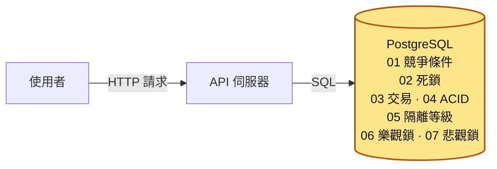
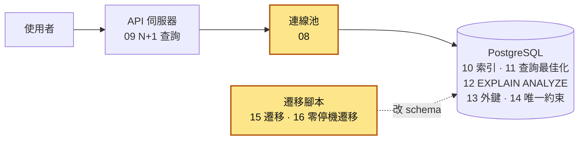
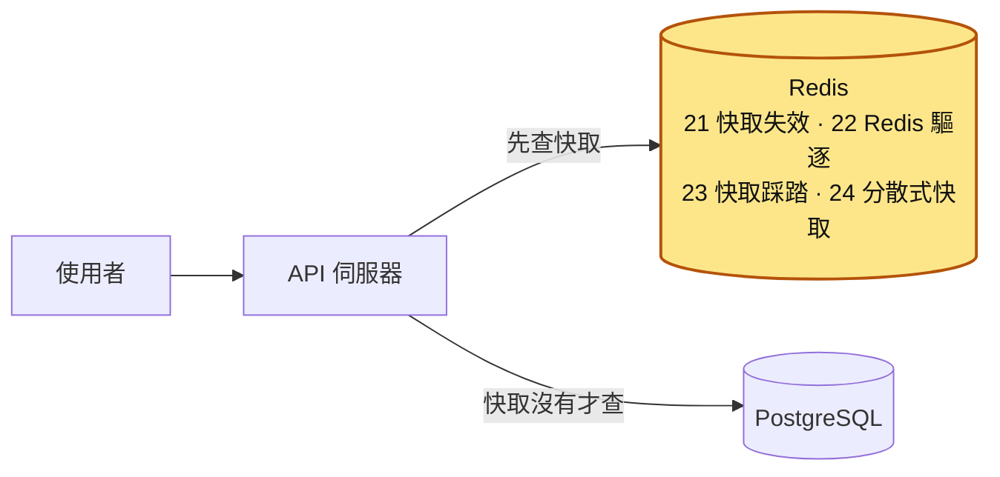
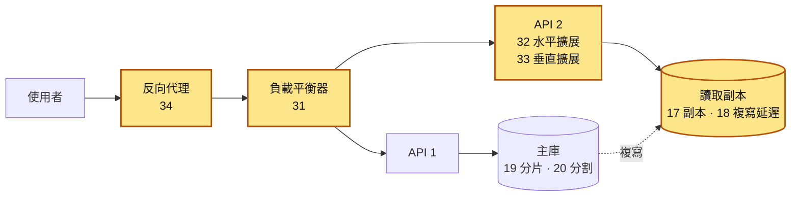
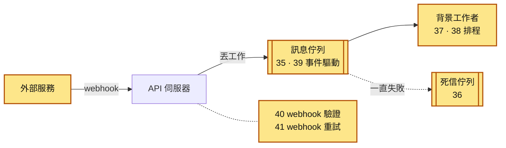
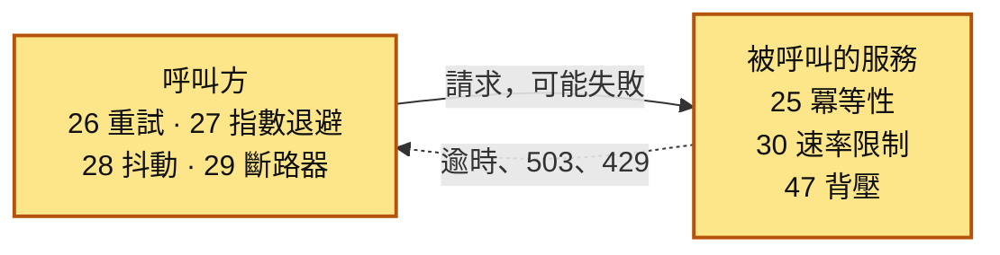
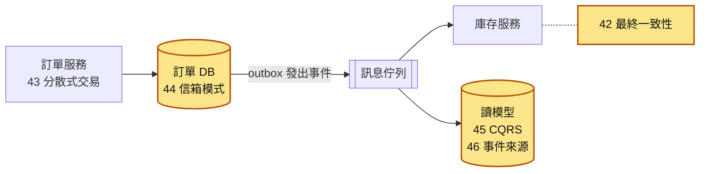
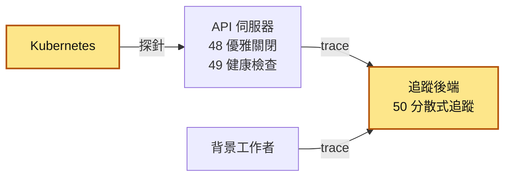
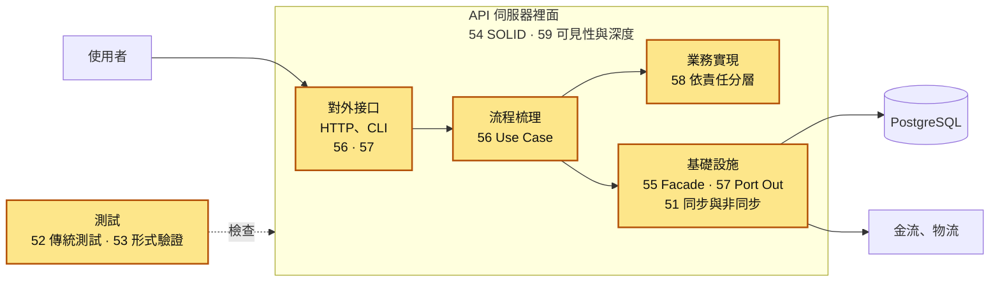

# 系列全貌圖

這 59 個主題各自發生在系統的不同位置。這一頁從最簡單的一個請求開始，每張圖多加一層元件。每一層都標出相關主題的編號，讀完一篇後可以回來看，它在整個系統裡站在哪裡。

圖裡的方框是系統元件，方框裡的數字是系列文章的編號。每張圖新加的部分用黃色標出來。

## 1. 一個請求：使用者、API、資料庫

最簡單的後端只有三樣東西：使用者送出 HTTP 請求，API 伺服器處理，資料存在 PostgreSQL。

光是這樣就會遇到第一章的問題：兩個請求同時改同一筆資料，結果會錯（01），所以要用交易把多個步驟綁在一起（03、04），並用鎖或版本號防止互相覆蓋（05～07）。鎖用錯了會互相卡住（02）。

## 2. 把資料庫用好：連線、查詢、約束、遷移

API 不會每次都重新連資料庫，而是從連線池借連線（08）。資料一多，查詢就要靠索引（10），要會看執行計畫找出慢在哪裡（11、12），也要避免迴圈裡一筆一筆查（09）。

資料要正確，就讓資料庫替你擋：外鍵擋掉指向不存在的資料（13），唯一約束擋掉重複（14）。表的結構會一直改，改法要能版本控制（15），而且不能讓服務停下來（16）。

## 3. 加上快取

同樣的資料一直被讀，就先放進 Redis，讀的時候先查快取。難的是資料改了以後，快取裡的舊資料要作廢（21）；Redis 記憶體滿了會依規則刪資料（22）；熱門資料一過期，大量請求可能同時衝到資料庫（23）；多台 API 共用一份快取時，又有分散到多個節點的問題（24）。

## 4. 流量變大：多台 API 與資料庫擴展

一台 API 扛不住，可以換大台（33），也可以多開幾台（32）。多台就需要負載平衡器把請求分出去（31），通常前面還有一層反向代理處理 TLS、逾時和真實 IP（34）。

資料庫也要擴展：讀取分給副本（17），但副本會落後主庫一點（18）；大表可以在同一個資料庫內切成分割（20），真的放不下才切到多台資料庫，也就是分片（19）。

## 5. 把慢的事情移到背景

寄信、產報表這種慢的工作，不該讓使用者等。API 把工作丟進訊息佇列（35），由背景工作者慢慢做（37）。一直失敗的訊息移到死信佇列，讓人處理（36）；固定時間要跑的工作交給排程（38）。服務之間改成廣播「發生了什麼事」，就是事件驅動架構（39）。

外部服務（例如金流）通知你的方式通常是 webhook：你要驗證它真的是對方送的（40），也要處理它重送和亂序（41）。

## 6. 呼叫會失敗：重試與保護

服務之間的每一次呼叫都可能失敗或逾時。可以重試（26），但要等越來越久（27），而且要加隨機，避免大家同時重試（28）。重試的前提是同一個操作做兩次結果一樣，也就是冪等（25）。

下游一直失敗時先停止呼叫（29）；呼叫者太多時限制每個人的頻率（30）；下游處理不過來時，要讓上游慢下來（47）。

## 7. 資料散在好幾個地方：分散式一致性

服務各有自己的資料庫後，一份資料會散在好幾處，剛改完時各處看到的值可能不同，最後才會一致（42）。跨服務沒辦法用一個交易包起來，要改用 2PC 或 Saga（43）；「寫資料庫」和「發訊息」要一起成功，可以用信箱模式（44）。讀寫用不同的模型是 CQRS（45），只存發生過的事件、再重播出目前狀態是事件來源（46）。

## 8. 上線之後：讓平台管得動、出事查得到

服務跑在 Kubernetes 這類平台上，平台要知道它活著沒、能不能接流量（49）；部署或縮容時，服務要把手上的請求做完再離開（48）。出事時，要能把一個請求經過的所有服務串成一張時間圖，才查得到慢在哪裡（50）。

## 9. 打開 API 伺服器：程式裡面怎麼切

前面八張圖都把 API 伺服器畫成一個方框。打開它，裡面的程式也要分層：對外接口只負責轉譯 HTTP、CLI 這類輸入（56、57），流程梳理決定一個使用者動作按什麼順序做哪些事（56），業務實現放「滿 1000 免運」這種規則本身（58），基礎設施負責跟資料庫、金流、物流講話（55、57）。怎麼切、切多深、什麼該公開（54、58、59），決定了改一條規則要動幾個地方。

等待外部回應時，程式要不要停下來等（51），也是在這裡決定的。寫好的程式要靠測試檢查（52）；並行的設計本身對不對，可以用形式驗證把每一種先後順序都走一遍（53）。

## 對照表

| 系統位置 | 主題 |
|---|---|
| 資料庫裡的並行 | [01 競爭條件](01-競爭條件.md)、[02 死鎖](02-死鎖.md)、[03 資料庫交易](03-資料庫交易.md)、[04 ACID 特性](04-ACID%20特性.md)、[05 隔離等級](05-隔離等級.md)、[06 樂觀鎖定](06-樂觀鎖定.md)、[07 悲觀鎖定](07-悲觀鎖定.md) |
| API 與資料庫之間 | [08 連線池](08-連線池.md)、[09 N+1 查詢](09-N+1%20查詢.md) |
| 查詢效能 | [10 資料庫索引](10-資料庫索引.md)、[11 查詢最佳化](11-查詢最佳化.md)、[12 EXPLAIN ANALYZE](12-EXPLAIN%20ANALYZE.md) |
| 資料正確與 schema 演進 | [13 外鍵約束](13-外鍵約束.md)、[14 唯一約束](14-唯一約束.md)、[15 資料庫遷移](15-資料庫遷移.md)、[16 零停機遷移](16-零停機遷移.md) |
| 資料庫擴展 | [17 讀取副本](17-讀取副本.md)、[18 複寫延遲](18-複寫延遲.md)、[19 資料庫分片](19-資料庫分片.md)、[20 分割](20-分割.md) |
| 快取 | [21 快取失效](21-快取失效.md)、[22 Redis 驅逐](22-Redis%20驅逐.md)、[23 快取踩踏](23-快取踩踏.md)、[24 分散式快取](24-分散式快取.md) |
| 呼叫失敗的處理 | [25 冪等性](25-冪等性.md)、[26 重試機制](26-重試機制.md)、[27 指數退避](27-指數退避.md)、[28 抖動](28-抖動.md)、[29 斷路器](29-斷路器.md)、[30 速率限制](30-速率限制.md)、[47 背壓](47-背壓.md) |
| 流量入口與擴展 | [31 負載平衡](31-負載平衡.md)、[32 水平擴展](32-水平擴展.md)、[33 垂直擴展](33-垂直擴展.md)、[34 反向代理](34-反向代理.md) |
| 非同步處理 | [35 訊息佇列](35-訊息佇列.md)、[36 死信佇列](36-死信佇列.md)、[37 背景工作者](37-背景工作者.md)、[38 工作排程](38-工作排程.md)、[39 事件驅動架構](39-事件驅動架構.md)、[40 Webhook 驗證](40-Webhook%20驗證.md)、[41 Webhook 重試](41-Webhook%20重試.md)、[51 同步與非同步](51-同步與非同步.md) |
| 分散式一致性 | [42 最終一致性](42-最終一致性.md)、[43 分散式交易](43-分散式交易.md)、[44 信箱模式](44-信箱模式.md)、[45 CQRS](45-CQRS.md)、[46 事件來源](46-事件來源.md) |
| 上線維運 | [48 優雅關閉](48-優雅關閉.md)、[49 健康檢查](49-健康檢查.md)、[50 分散式追蹤](50-分散式追蹤.md) |
| 測試與驗證 | [52 傳統測試方式](52-傳統測試方式.md)、[53 形式驗證](53-形式驗證.md) |
| 程式裡面怎麼切 | [54 SOLID 原則](54-SOLID.md)、[55 外觀模式](55-Facade.md)、[56 使用案例層](56-Use%20Case.md)、[57 六邊形架構](57-六邊形架構.md)、[58 依責任分層](58-依責任分層.md)、[59 可見性與模組深度](59-可見性與模組深度.md) |

想照順序讀，回到[首頁](index.md)看學習路線。
